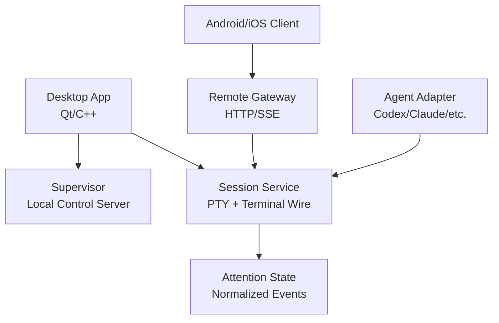
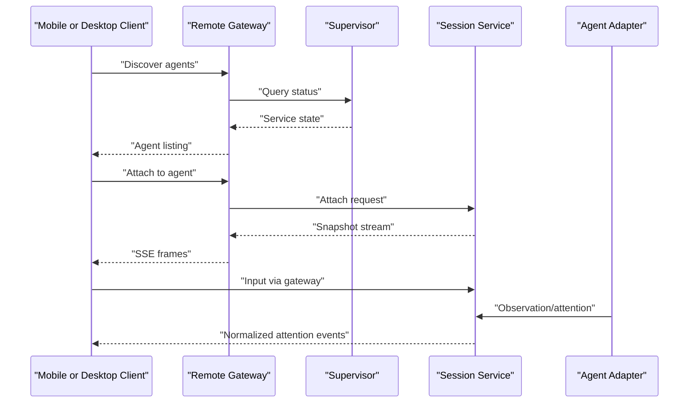
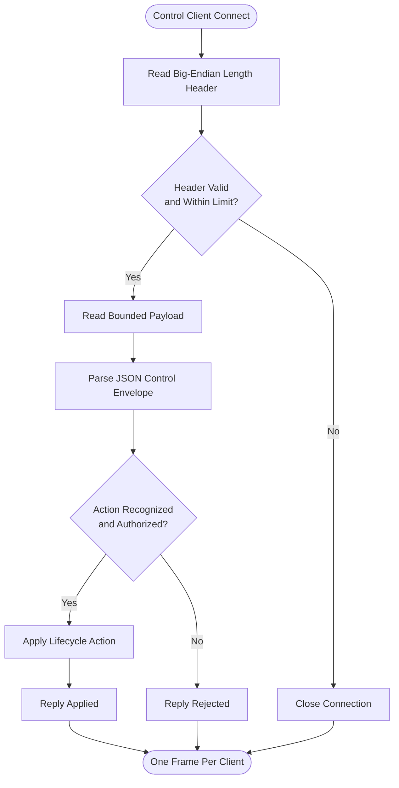
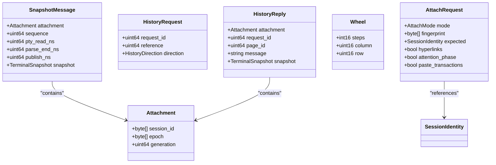
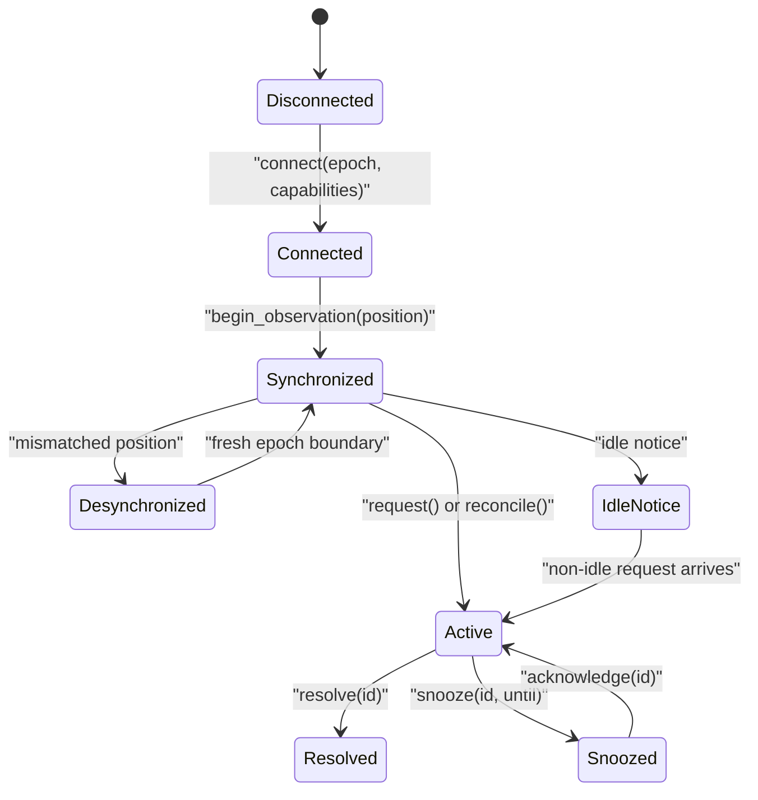
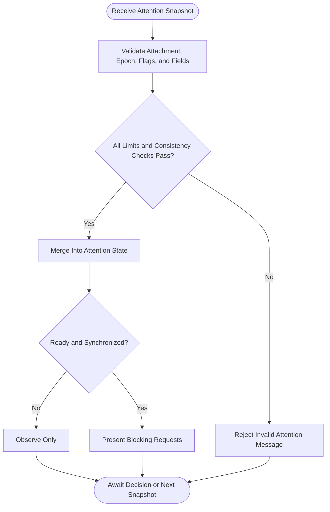
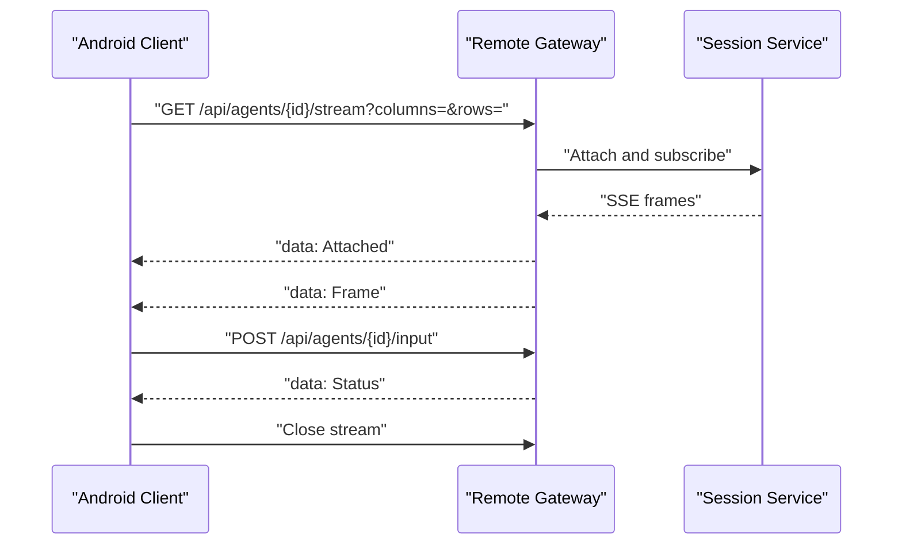
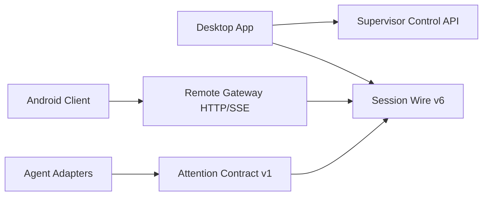

# API Reference

<cite>
**Referenced Files in This Document**
- [README.md](file://README.md)
- [architecture.md](file://docs/architecture.md)
- [phone.md](file://docs/phone.md)
- [control_server.hpp](file://services/supervisor/include/lapis/supervisor/control_server.hpp)
- [control_server.cpp](file://services/supervisor/src/control_server.cpp)
- [client.hpp](file://services/supervisor/include/lapis/supervisor/client.hpp)
- [client.cpp](file://services/supervisor/src/client.cpp)
- [runtime.hpp](file://services/supervisor/include/lapis/supervisor/runtime.hpp)
- [state.hpp](file://services/supervisor/include/lapis/supervisor/state.hpp)
- [attention.hpp](file://services/session/include/lapis/session/attention.hpp)
- [local_protocol.hpp](file://services/session/src/transport/local_protocol.hpp)
- [local_protocol.cpp](file://services/session/src/transport/local_protocol.cpp)
- [attention_protocol.hpp](file://services/session/src/transport/attention_protocol.hpp)
- [attention_protocol.cpp](file://services/session/src/transport/attention_protocol.cpp)
- [LapisGateway.kt](file://apps/android/app/src/main/kotlin/dev/lapis/remote/gateway/LapisGateway.kt)
- [Models.kt](file://apps/android/app/src/main/kotlin/dev/lapis/remote/gateway/Models.kt)
</cite>

## Table of Contents
1. [Introduction](#introduction)
2. [Project Structure](#project-structure)
3. [Core Components](#core-components)
4. [Architecture Overview](#architecture-overview)
5. [Detailed Component Analysis](#detailed-component-analysis)
6. [Dependency Analysis](#dependency-analysis)
7. [Performance Considerations](#performance-considerations)
8. [Troubleshooting Guide](#troubleshooting-guide)
9. [Conclusion](#conclusion)
10. [Appendices](#appendices)

## Introduction
This document describes all public interfaces exposed by Lapis components that are relevant to external integration or inter-process communication:

- **Supervisor control protocol**: A private local IPC between the desktop application and the supervisor process for service lifecycle management.
- **Session service wire protocol**: The internal binary framing used between the desktop, mobile gateway, and session services for terminal snapshots, input, history, paste transactions, attachment negotiation, and attention events.
- **Attention protocol**: A normalized event model shared by agent adapters (Codex, Claude Code, etc.) so the desktop can present and order requests consistently.
- **Remote gateway HTTP/SSE API**: The HTTP endpoints consumed by Android and iOS clients through `apps/remote/lapis_remote.py`.

The project is a macOS workspace for running multiple coding agents in live terminals. Its first supported slice is local Codex and Claude Code sessions on Apple Silicon Macs; remote phone access is documented but outside early-access support.

**Section sources**
- [README.md:1-100](file://README.md#L1-L100)
- [architecture.md:1-165](file://docs/architecture.md#L1-L165)

## Project Structure
The relevant integration surface is divided into four layers:

**Diagram sources**
- [architecture.md:1-165](file://docs/architecture.md#L1-L165)
- [control_server.hpp:1-32](file://services/supervisor/include/lapis/supervisor/control_server.hpp#L1-L32)
- [local_protocol.hpp:1-196](file://services/session/src/transport/local_protocol.hpp#L1-L196)
- [attention.hpp:1-136](file://services/session/include/lapis/session/attention.hpp#L1-L136)
- [LapisGateway.kt:1-200](file://apps/android/app/src/main/kotlin/dev/lapis/remote/gateway/LapisGateway.kt#L1-L200)

The repository organizes these interfaces as follows:

| Layer | Repository location | Responsibility |
|---|---|---|
| Supervisor control | `services/supervisor/` | Process birth, desired state, convergence, and control replies. |
| Session wire | `services/session/src/transport/` | Binary frame types, attachment, snapshot, history, paste, and attention framing. |
| Attention contract | `services/session/include/lapis/session/attention.hpp` | Shared request model, activity, limits, and reconciliation state. |
| Remote gateway client | `apps/android/app/src/main/kotlin/dev/lapis/remote/gateway/` | Android HTTP/SSE client mirroring iOS behavior. |
| Remote gateway server | `apps/remote/lapis_remote.py` | Python HTTP gateway referenced by phone documentation and client models. |

**Section sources**
- [architecture.md:1-165](file://docs/architecture.md#L1-L165)
- [phone.md:1-130](file://docs/phone.md#L1-L130)

## Core Components
This section summarizes the four APIs before detailing their messages, versioning, and error handling.

| Interface | Direction | Transport | Public scope | Current version or contract |
|---|---|---|---|---|
| Supervisor control | Desktop ↔ Supervisor | Local Unix domain socket with bounded frames | Internal, not a general-purpose API | JSON control envelope over length-prefixed frames |
| Session wire | Desktop/Gateway ↔ Session service | Binary frame stream | Internal protocol for Lapis components | Version 6 framing |
| Attention protocol | Adapter ↔ Session/desktop | Carried inside session wire control frames | Contract between adapter and Lapis presentation | Contract version 1 |
| Remote gateway HTTP/SSE | Mobile client ↔ Mac gateway | HTTP and Server-Sent Events | External integration point for mobile | Port 7349, `X-Lapis-Client: android` |

**Section sources**
- [control_server.hpp:1-32](file://services/supervisor/include/lapis/supervisor/control_server.hpp#L1-L32)
- [local_protocol.hpp:1-196](file://services/session/src/transport/local_protocol.hpp#L1-L196)
- [attention.hpp:1-136](file://services/session/include/lapis/session/attention.hpp#L1-L136)
- [LapisGateway.kt:1-200](file://apps/android/app/src/main/kotlin/dev/lapis/remote/gateway/LapisGateway.kt#L1-L200)

## Architecture Overview
The production architecture separates ownership clearly:

- **Session service**: Owns PTYs, terminal state and history, adapter connections, snapshots, and session lifecycle. It continues consuming output while detached from the GUI.
- **Terminal-engine adapter**: Encapsulates Ghostty parsing/reflow behavior behind a small interface.
- **Agent adapters**: Provide tool-specific observation, response, and reconciliation capabilities.
- **Attention policy**: Manages source pending requests, ordering, aging, and reconciliation independently of the UI.
- **Desktop**: Handles layout, focus, rendering, and user interaction but does not own PTYs or service lifecycle in the production route.
- **Supervisor**: Manages one-session birth admission, desired state, convergence, and private ownership records.
- **Remote gateway**: Lets mobile clients discover and interact with agents over a networked HTTP/SSE surface.

**Diagram sources**
- [architecture.md:1-165](file://docs/architecture.md#L1-L165)
- [phone.md:1-130](file://docs/phone.md#L1-L130)
- [local_protocol.hpp:1-196](file://services/session/src/transport/local_protocol.hpp#L1-L196)

## Detailed Component Analysis

### Supervisor Control Protocol

#### Purpose
The supervisor exposes a strict, single-frame-per-client control endpoint for lifecycle operations. It is not a generic control plane; launchd owns registration, and the supervisor owns one-session birth admission, desired state, convergence, and private ownership records.

#### Transport
- Local Unix domain socket endpoint.
- Each client may send exactly one control frame per connection.
- Frames use a big-endian 32-bit length prefix followed by a JSON payload.
- Maximum control payload size is defined by `max_control_bytes`, which is `8 KiB`.
- The server rejects malformed, oversized, or abandoned clients rather than holding slots indefinitely.

#### Message Format

| Field | Type | Required | Description |
|---|---|---:|---|
| `version` | integer | Yes | Control message schema version. Currently `1`. |
| `action` | string | Yes | One of `status`, `stop`. |
| `supervisor_epoch` | string | Conditional | Present on `stop`; identifies the supervisor instance. |
| `token` | string | Conditional | Present on `stop`; authenticates the stop operation using the spawn token. |
| `session` | object or null | Conditional | Present on start-related control; carries desired session data. |

##### Status Request
A status request has:
- `version`: `1`
- `action`: `"status"`

##### Status Reply
A status reply has:
- `version`: `1`
- `status`: `"ok"`
- `schema_version`: `1` or `2`
- `instance_epoch`: hexadecimal supervisor identity
- `slot`: `"empty"`, `"started"`, or `"stopped"`
- `enabled`: boolean
- `service_live`: boolean
- `blocked_reason`: string
- `endpoint`: string or null when no live session endpoint is available
- `reconstructable`: boolean indicating whether a replacement daemon can adopt or restart the described service

##### Stop Request
A stop request requires an authenticated spawn token and supervisor epoch:
- `version`: `1`
- `action`: `"stop"`
- `supervisor_epoch`: current supervisor instance identity
- `token`: spawn token from the persisted session state
- `session`: null

#### Error Handling
Errors are returned as control replies with the following statuses:

| Status | Meaning |
|---|---|
| `applied` | The action was accepted. |
| `unauthorized` | The caller lacks permission. |
| `stale_epoch` | The supplied supervisor epoch does not match the current instance. |
| `rejected` | The request is invalid or rejected by policy. |

The supervisor also enforces:
- Maximum four concurrent control clients.
- Five-second control client timeout.
- Peer UID validation where available (`getpeereid` on macOS/BSD-like systems, `SO_PEERCRED` on Linux).
- Endpoint paths must be absolute.
- Requests larger than `max_control_bytes` are rejected.

#### Connection Management
- The control server constructor takes an endpoint path and a handler function.
- `poll_once(timeout_ms)` handles at least one ready event or returns after the timeout.
- Clients should retry only after resolving authorization, epoch, or endpoint issues.
- Rejected or closed connections do not imply successful state mutation.

**Diagram sources**
- [control_server.cpp:1-200](file://services/supervisor/src/control_server.cpp#L1-L200)
- [client.cpp:1-200](file://services/supervisor/src/client.cpp#L1-L200)
- [runtime.hpp:1-151](file://services/supervisor/include/lapis/supervisor/runtime.hpp#L1-L151)

**Section sources**
- [control_server.hpp:1-32](file://services/supervisor/include/lapis/supervisor/control_server.hpp#L1-L32)
- [control_server.cpp:1-200](file://services/supervisor/src/control_server.cpp#L1-L200)
- [client.hpp:1-34](file://services/supervisor/include/lapis/supervisor/client.hpp#L1-L34)
- [client.cpp:1-200](file://services/supervisor/src/client.cpp#L1-L200)
- [runtime.hpp:1-151](file://services/supervisor/include/lapis/supervisor/runtime.hpp#L1-L151)
- [state.hpp:1-200](file://services/supervisor/include/lapis/supervisor/state.hpp#L1-L200)

#### Security Considerations
- The state directory must be owner-only mode `0700`.
- The state file must be a regular file, owned by the effective user, mode `0600`, and hard-link count one.
- Control requests require peer UID validation where supported.
- Stop operations require both a matching supervisor epoch and a valid spawn token.
- Malformed or oversized payloads close the connection without leaking state.

**Section sources**
- [client.cpp:1-200](file://services/supervisor/src/client.cpp#L1-L200)
- [state.hpp:1-200](file://services/supervisor/include/lapis/supervisor/state.hpp#L1-L200)

#### Backwards Compatibility
- The status reply supports schema versions `1` and `2`.
- Schema version `2` includes a canonical launch record allowing a replacement daemon to adopt or restart the service.
- Older clients should reject unknown schema versions.
- The state codec validates `SupervisorState.version == 2` when reading persistence.

**Section sources**
- [client.cpp:1-200](file://services/supervisor/src/client.cpp#L1-L200)
- [state.hpp:1-200](file://services/supervisor/include/lapis/supervisor/state.hpp#L1-L200)

### Session Service Wire Protocol

#### Purpose
The session wire transports terminal snapshots, input, resize events, history paging, paste transactions, attachment negotiation, and attention messages between the desktop, mobile gateway, and session service.

#### Transport Characteristics
- Binary frame stream.
- Frame kind identifies the message type.
- Most frames include an attachment carrying a 16-byte session ID, a 16-byte epoch, and a generation counter.
- Version 6 adds wheel events, join attachment mode, hyperlinks, attention phase negotiation, and paste transactions.
- Maximum frame size is eight megabytes.
- Maximum text/paste/key payload is 64 KiB.
- Paste queue limit is approximately 960 KiB.

#### Frame Kinds

| Kind | Direction | Size Limits | Description |
|---|---|---|---|
| `hello` | Service → Client | Fixed-size header plus optional paste-transaction marker | Service identity, PID, and negotiated features. |
| `attach` | Client → Service | Fixed-size attach request | Discovery, reconnect, create, or join modes with capability bits. |
| `snapshot` | Service → Client | Up to eight MB | Terminal screen content, sequence number, timing, and optional hyperlink metadata. |
| `text` | Client → Service | Up to 64 KiB | Normal input. |
| `paste` | Client → Service | Up to 64 KiB per message; queued up to ~960 KiB | Legacy paste transport. |
| `key` | Client → Service | Up to 64 KiB | Key press input. |
| `resize` | Client → Service | Up to 64 KiB | Terminal dimensions. |
| `status` | Service → Client | Up to 4 KiB message | Rejected, ended, replaced, or overloaded status. |
| `ready` | Client → Service | Fixed-size | Acknowledges the first applied snapshot sequence. |
| `history_request` | Client → Service | Up to 64 KiB | Paging query with direction and reference. |
| `history_page` | Service → Client | Up to 64 KiB reply | Paged terminal history. |
| `attention_snapshot` | Service → Client | Up to 1 MiB | Normalized attention state. |
| `attention_decision` | Client → Service | Up to 64 KiB | User decision for a pending attention request. |
| `attention_retry` | Service → Client | Up to 64 KiB | Retry signal for attention state. |
| `terminate` | Client → Service | Up to 64 KiB | Request to end the agent process. |
| `wheel` | Client → Service | Fixed wheel payload | Full-screen wheel input added in v6. |
| `paste_request` / `paste_result` | Client ↔ Service | Up to 960 KiB paste body | Transactional paste negotiation introduced in v6. |

#### Attachment Negotiation
An attach request carries:
- Protocol version.
- 32-byte fingerprint.
- Mode bits and mode enum.
- Expected session identity.

Capability bits:
- `0x80`: Hyperlinks.
- `0x40`: Attention phase.
- `0x20`: Paste transactions.

Modes:
- `discover`: Anonymous discovery.
- `reconnect`: Resume an existing session identity.
- `create`: Create a new session.
- `join`: Join beside the current view (v6).

#### Snapshot Model
A snapshot contains:
- Attachment identity.
- Monotonic sequence number.
- Timing fields for PTY read, parse end, and publish times.
- Terminal cells, colors, styles, and optional hyperlink spans.
- Optional full-screen wheel state.

#### History Paging
History requests include:
- Request ID.
- Reference page or row.
- Direction: older, newer, or at-row.

Services before v6 reject the `at` direction. Clients should send it only when the service reports navigation context such as total rows kept and viewport offset.

#### Input Model
The mobile client’s `Input` model maps to this layer:
- `text`: verbatim terminal input.
- `paste`: re-encoded paste payload.
- `key`: named key with modifier nibble (shift = 1, control = 2, alt = 4).
- `resize`: column and row dimensions.
- `wheel`: notches, column, row, clamped by the gateway.

**Diagram sources**
- [local_protocol.hpp:1-196](file://services/session/src/transport/local_protocol.hpp#L1-L196)
- [local_protocol.cpp:1-200](file://services/session/src/transport/local_protocol.cpp#L1-L200)

**Section sources**
- [local_protocol.hpp:1-196](file://services/session/src/transport/local_protocol.hpp#L1-L196)
- [local_protocol.cpp:1-200](file://services/session/src/transport/local_protocol.cpp#L1-L200)

#### Versioning and Migration
- Protocol version is `6`.
- Newer clients must negotiate capabilities through attach flags and feature markers.
- Older services reject unknown kinds like `wheel`, `paste_request`, and `join`.
- Clients should fall back to legacy paste when paste-transaction negotiation fails.
- Incompatible changes require rejection/migration tests and a private endpoint.

**Section sources**
- [local_protocol.hpp:1-196](file://services/session/src/transport/local_protocol.hpp#L1-L196)
- [local_protocol.cpp:1-200](file://services/session/src/transport/local_protocol.cpp#L1-L200)
- [architecture.md:1-165](file://docs/architecture.md#L1-L165)

### Attention Protocol Specification

#### Purpose
The attention protocol normalizes events across different agent adapters (Codex, Claude Code, etc.). The desktop presents and orders attention requests but never becomes the authoritative responder; the session service maintains the ledger.

#### Contract Version
- Contract version is `1`.
- The attention contract is carried inside the session wire’s attention control frames.

#### Event Model

| Concept | Type | Definition |
|---|---|---|
| Request ID | integer or string | Caller-supplied identity; numeric IDs are integers, string IDs are UTF-8 identifiers. |
| Tick | unsigned 64-bit integer | Caller-supplied monotonic milliseconds. |
| Activity | enum | `unknown`, `working`, `idle`, `turn_completed`. |
| Outcome | enum | `applied`, `duplicate`, `rejected`, `desynchronized`. |
| RequestStatus | enum | `pending`, `responding`, `stale`. |
| Position | struct | Source `epoch` and `sequence`. |
| Capabilities | struct | `observation`, `response`, `reconciliation`. |
| Limits | struct | Pending bound, retired bound, aging interval, cooldown. |
| Request | struct | Identity, thread/turn/item identifiers, reason, summary, choices, priority. |
| Pending | struct | Request plus delivery state, revision, arrival time, scheduling bounds, and source epoch. |

#### Idle Notices
An idle notice is a special observation-only request where:
- `reason` equals `"idle"`.
- `choices` is empty.
- It signals completion of a turn without requiring a decision.

#### State Machine
The attention state tracks:
- Session and adapter identities.
- Connected and synchronized flags.
- Epoch and sequence boundaries.
- Revision counters for authoritative reconciliation.
- Pending requests and retired identities.
- Activity level and blocking condition.

**Diagram sources**
- [attention.hpp:1-136](file://services/session/include/lapis/session/attention.hpp#L1-L136)

#### Wire Representation
Attention frames have:
- Maximum snapshot size: 1 MiB.
- Maximum decision size: 64 KiB.
- Maximum pending requests per snapshot: 128.
- Maximum metadata bytes per field: 1 KiB.
- Maximum summary bytes: 4 KiB.
- Maximum diagnostic bytes: 4 KiB.
- Maximum choices: 32.
- Maximum choice bytes: 256.
- Maximum JSON object size: 32 KiB.

The attention snapshot includes:
- Attachment identity.
- Availability, connected, and ready flags.
- Source epoch.
- Activity and observation phase.
- Diagnostic text.
- List of pending attention items.

The attention decision includes:
- Source epoch.
- Request ID.
- Revision.
- Choice string.
- Answers JSON object.

**Diagram sources**
- [attention_protocol.hpp:1-41](file://services/session/src/transport/attention_protocol.hpp#L1-L41)
- [attention_protocol.cpp:1-200](file://services/session/src/transport/attention_protocol.cpp#L1-L200)
- [attention.hpp:1-136](file://services/session/include/lapis/session/attention.hpp#L1-L136)

**Section sources**
- [attention.hpp:1-136](file://services/session/include/lapis/session/attention.hpp#L1-L136)
- [attention_protocol.hpp:1-41](file://services/session/src/transport/attention_protocol.hpp#L1-L41)
- [attention_protocol.cpp:1-200](file://services/session/src/transport/attention_protocol.cpp#L1-L200)

#### Error Handling and Recovery
- Invalid identities, limits, zero epochs, non-increasing epochs, backward clock ticks, and oversized payloads throw errors.
- Token allocation can overflow when revisions are exhausted; callers must start a new epoch.
- Sequence wrap is not observed as a gap; duplicates remain duplicates.
- Lost responses must not be automatically retransmitted by the adapter.
- Content-identical same-epoch entries retain their revision only when already synchronized; recovery and changed content issue fresh revisions.

**Section sources**
- [attention.hpp:1-136](file://services/session/include/lapis/session/attention.hpp#L1-L136)
- [attention_protocol.cpp:1-200](file://services/session/src/transport/attention_protocol.cpp#L1-L200)

### Remote Gateway HTTP/SSE API

#### Purpose
The remote gateway provides mobile clients with workspace discovery, agent lifecycle control, terminal input, history, and real-time screen streaming. Access is restricted to the Mac owner’s devices through Tailscale or ZeroTier membership. There is no separate login step for the gateway itself.

#### Connection Parameters
- Default port: `7349`.
- Supported schemes: `http` and `https`.
- Base URL normalization discards path, query, and fragment.
- Every request includes:
  - `X-Lapis-Client: android`
  - `Cache-Control: no-cache`
- Timeouts:
  - Default HTTP calls use the transport’s default.
  - Folder listing uses a 45-second timeout because another machine may need SSH resolution.

#### Authentication and Authorization
- Gateway access depends on Tailscale whois or ZeroTier membership rules enforced by the gateway process.
- Clients without `X-Lapis-Client` are refused.
- HTTPS is preferred; HTTP traffic is expected to run over encrypted tunnels such as Tailscale.

#### REST Endpoints

| Method | Path | Query Parameters | Request Body | Response | Notes |
|---|---|---|---|---|---|
| GET | `/api/agents` | None | None | Workspace listing | Categories, active category, and agents. |
| GET | `/api/harnesses` | None | None | Harnesses listing | Installed CLIs, models, modes, and defaults. |
| POST | `/api/agents` | None | `NewAgent` JSON | `StartedAgent` | Starts a new agent. |
| POST | `/api/categories` | None | `CategoryName` JSON | `MadeCategory` | Creates a new category. |
| POST | `/api/agents/{id}/close` | None | None | Empty success response | Ends the agent. |
| GET | `/api/machines` | None | None | Machine listing | SSH hosts available for starting agents. |
| GET | `/api/folders` | `machine`, `have` | None | `FolderPayload` | Fetches folders; 45-second timeout. |
| GET | `/api/agents/{id}/screen` | None | None | `ScreenFrame` | Current terminal screen without resizing. |
| POST | `/api/agents/{id}/input` | None | `Input` JSON | Empty success response | Text, paste, key, resize, or wheel input. |
| GET | `/api/agents/{id}/history` | `before`, `after`, `at` | None | `HistoryPage` | Paginated archived terminal output. |
| GET | `/api/agents/{id}/stream` | `columns`, `rows` | None | SSE stream | Real-time screen frames and status events. |

##### Workspace Listing
Response shape:
- `categories`: list of categories.
- `active_category`: identifier of the active category.

Each category contains:
- `id`
- `name`
- `agents`: list of agents

Each agent contains:
- `id`
- `title`
- `harness`
- `directory`
- `running`
- `on_phone`
- `machine`: optional machine label
- `place`: optional logical place

##### Harnesses Listing
Response shape:
- `harnesses`: list of harness definitions.
- `defaults`: optional `AgentDefaults`.

Each harness contains:
- `id`
- `name`
- `installed`
- `models`: optional model choices
- `modes`: optional agent modes

##### Starting an Agent
Request body:
- `harness`
- `directory`
- `category`
- `machine`: optional
- `model`: optional
- `mode`: optional

Response:
- `id`
- `updating`: boolean indicating whether the CLI updates itself before the agent starts.

##### Folder Payload
Response shape:
- `version`
- `unchanged`: optional boolean
- `home`: optional home path
- `folders`: optional folder list
- `frequent`: optional frequent folders
- `harnesses`: optional harness map

##### Screen Frame
Response shape:
- `revision`: optional revision
- `columns`
- `rows`
- `cursor`: x, y, visible
- `alternate_screen`
- `application_cursor`
- `wheel`: optional full-screen wheel flag
- `foreground`
- `background`
- `lines`: array of styled runs

Each run is a positional array:
- `text`
- `foreground`: optional color
- `background`: optional color
- `flags`: style flags
- `column`: optional starting column
- `width`: optional width

##### Input Model
Fields:
- `text`: verbatim input.
- `paste`: re-encoded paste payload.
- `key`: named key from the gateway key table.
- `modifiers`: modifier nibble (shift = 1, control = 2, alt = 4).
- `resize`: list containing columns and rows.
- `wheel`: list containing notches, column, row.

Key names recognized by the gateway include up, down, left, right, home, end, pageUp, pageDown, delete, enter, tab, backspace, and escape.

##### History Pagination
Query parameters:
- `before`: newest page when zero; otherwise the previous page.
- `after`: next page after the given page.
- `at`: exact row number; mutually exclusive with `after`.

Response shape:
- `page`
- `message`
- `end`
- `busy`
- `columns`: optional
- `lines`: optional
- `place`: optional navigation context with `total`, `offset`, `rows`, and `scrubbable`.

#### Real-Time Stream API
The stream endpoint opens an SSE connection:
- URL: `/api/agents/{id}/stream?columns={n}&rows={n}`
- Non-200 open responses are read up to 4096 bytes and surfaced as a refusal error.
- Each `data:` line is one complete JSON event.
- Cancellation closes the underlying connection under a non-cancellable coroutine context.

Event types:

| Event | Payload | Meaning |
|---|---|---|
| `Attached` | `Attached` | Whether the mobile client joined the existing desktop session. |
| `Frame` | `ScreenFrame` plus original JSON | Terminal screen update. |
| `Status` | `StreamStatus` | Streaming state and message. |

**Diagram sources**
- [LapisGateway.kt:1-300](file://apps/android/app/src/main/kotlin/dev/lapis/remote/gateway/LapisGateway.kt#L1-L300)
- [Models.kt:1-327](file://apps/android/app/src/main/kotlin/dev/lapis/remote/gateway/Models.kt#L1-L327)
- [phone.md:1-130](file://docs/phone.md#L1-L130)

**Section sources**
- [LapisGateway.kt:1-300](file://apps/android/app/src/main/kotlin/dev/lapis/remote/gateway/LapisGateway.kt#L1-L300)
- [Models.kt:1-327](file://apps/android/app/src/main/kotlin/dev/lapis/remote/gateway/Models.kt#L1-L327)
- [phone.md:1-130](file://docs/phone.md#L1-L130)

#### Error Handling Patterns
- Non-200 responses are treated as refusals.
- Refusal bodies contain an `error` string when JSON.
- Malformed JSON payloads raise an unreadable error instead of crashing.
- SSE streams read initial refusal bodies up to 4096 bytes before failing the flow.
- History pagination enforces mutual exclusivity of `at` and `after`.
- Wheel inputs clamp notches to `-64..64` and coordinates to `0..0xFFFF`; zero notches are rejected.

**Section sources**
- [LapisGateway.kt:1-300](file://apps/android/app/src/main/kotlin/dev/lapis/remote/gateway/LapisGateway.kt#L1-L300)
- [Models.kt:1-327](file://apps/android/app/src/main/kotlin/dev/lapis/remote/gateway/Models.kt#L1-L327)

## Dependency Analysis

**Diagram sources**
- [architecture.md:1-165](file://docs/architecture.md#L1-L165)
- [local_protocol.hpp:1-196](file://services/session/src/transport/local_protocol.hpp#L1-L196)
- [attention.hpp:1-136](file://services/session/include/lapis/session/attention.hpp#L1-L136)
- [LapisGateway.kt:1-300](file://apps/android/app/src/main/kotlin/dev/lapis/remote/gateway/LapisGateway.kt#L1-L300)

### Coupling and Cohesion
- The supervisor control API is tightly coupled to the desktop app and headless supervisor CLI; it is not intended as a general remote control plane.
- The session wire is cohesive around terminal I/O and is intentionally versioned internally.
- The attention contract decouples agent adapters from desktop presentation logic.
- The remote gateway client mirrors iOS behavior and depends on `lapis_remote.py` semantics documented by the phone guide.

### External Dependencies
- Qt/C++ for desktop and session implementation.
- Ghostty VT library for terminal parsing.
- Tailscale or ZeroTier for remote access.
- Kotlin/Coroutines and OkHttp-style transport for the Android gateway client.

**Section sources**
- [architecture.md:1-165](file://docs/architecture.md#L1-L165)
- [phone.md:1-130](file://docs/phone.md#L1-L130)

## Performance Considerations
- The renderer consumes immutable snapshots and never mutates parser or PTY state.
- Large pastes are bounded and queued rather than sent as unbounded streams.
- Snapshot frames can be large; clients should avoid decoding every frame when hidden.
- History paging avoids loading entire terminal output into memory.
- The attention state uses bounded pending and retired lists with aging and cooldown controls.
- The supervisor drops slow or malformed control clients to protect status and stop responsiveness.
- Real-time streaming emits one event per SSE line and closes connections explicitly on cancellation.

[No sources needed since this section provides general guidance]

## Troubleshooting Guide

### Supervisor Control Failures
| Symptom | Likely Cause | Resolution |
|---|---|---|
| Control connection closes immediately | Malformed frame or oversized payload | Verify 32-bit big-endian length prefix and JSON payload within `max_control_bytes`. |
| Stale epoch error | Supervisor restarted | Use the latest `instance_epoch` from a successful status query. |
| Unauthorized error | Missing or wrong peer credentials | Ensure the control socket is accessible only to trusted local processes. |
| Rejected stop request | Missing or invalid spawn token | Read the persisted supervisor state and include the correct `spawn_token`. |
| No endpoint in status reply | No live session or empty slot | Confirm the service is started and reachable. |

**Section sources**
- [control_server.cpp:1-200](file://services/supervisor/src/control_server.cpp#L1-L200)
- [client.cpp:1-200](file://services/supervisor/src/client.cpp#L1-L200)
- [state.hpp:1-200](file://services/supervisor/include/lapis/supervisor/state.hpp#L1-L200)

### Session Wire Problems
| Symptom | Likely Cause | Resolution |
|---|---|---|
| Unknown frame kind | Client sending v6 frame to old service | Negotiate capabilities and fall back to legacy transport. |
| Paste rejected | Paste transaction not negotiated | Send legacy `paste` frames when `paste_transactions` is not accepted. |
| Wheel ignored | Service predates v6 wheel support | Only send wheel when the snapshot indicates acceptance. |
| History `at` rejected | Old service does not support row-based paging | Use `older`/`newer` paging unless the service reports row context. |
| Attention snapshot rejected | Oversized fields or inconsistent epoch | Respect maximum sizes and verify source epoch consistency. |

**Section sources**
- [local_protocol.hpp:1-196](file://services/session/src/transport/local_protocol.hpp#L1-L196)
- [local_protocol.cpp:1-200](file://services/session/src/transport/local_protocol.cpp#L1-L200)
- [attention_protocol.cpp:1-200](file://services/session/src/transport/attention_protocol.cpp#L1-L200)

### Remote Gateway Issues
| Symptom | Likely Cause | Resolution |
|---|---|---|
| Host rejected | Missing `X-Lapis-Client` header or unsupported scheme | Include required headers and use `http`/`https`. |
| Network refusal | Not authorized by Tailscale or ZeroTier | Verify device belongs to the Mac owner’s account or network. |
| Folder listing hangs | Remote machine needs SSH setup | Increase timeout or ensure SSH host is reachable. |
| SSE stream refuses | Agent not running or cannot be joined | Check agent status and reconnect if necessary. |
| Unreadable response | Malformed JSON from gateway | Treat as transient gateway error and retry with backoff. |

**Section sources**
- [LapisGateway.kt:1-300](file://apps/android/app/src/main/kotlin/dev/lapis/remote/gateway/LapisGateway.kt#L1-L300)
- [phone.md:1-130](file://docs/phone.md#L1-L130)

## Conclusion
Lapis exposes four distinct integration surfaces:

1. A strict local supervisor control protocol for desktop-driven service lifecycle management.
2. A versioned internal session wire for terminal I/O, history, paste transactions, and attention framing.
3. A normalized attention contract for consistent cross-agent event handling.
4. An HTTP/SSE remote gateway API for mobile clients.

Design priorities are clear: correctness, bounded resources, explicit versioning, and separation of ownership. Internal protocols are versioned and validated; external mobile access is gated by network identity. When migrating, always check protocol versions, capability bits, and backwards-compatibility constraints before changing message formats or behaviors.

[No sources needed since this section summarizes without analyzing specific files]

## Appendices

### Protocol Version Summary

| Protocol | Version | Scope | Migration Guidance |
|---|---:|---|---|
| Supervisor control | `1` | Desktop ↔ Supervisor | Validate `version` and `action`; reject unknown actions. |
| Supervisor state schema | `1`, `2` | Persistence | Support both when reading; prefer schema `2` for adoption. |
| Session wire | `6` | Desktop/Gateway ↔ Session service | Negotiate hyperlinks, attention phase, paste transactions, and wheel support. |
| Attention contract | `1` | Adapter ↔ Lapis | Respect limits, epochs, revisions, and idle notices. |
| Remote gateway | Not enumerated | Mobile ↔ Mac gateway | Follow documented endpoints, headers, and SSE format. |

**Section sources**
- [client.cpp:1-200](file://services/supervisor/src/client.cpp#L1-L200)
- [state.hpp:1-200](file://services/supervisor/include/lapis/supervisor/state.hpp#L1-L200)
- [local_protocol.hpp:1-196](file://services/session/src/transport/local_protocol.hpp#L1-L196)
- [attention.hpp:1-136](file://services/session/include/lapis/session/attention.hpp#L1-L136)
- [LapisGateway.kt:1-300](file://apps/android/app/src/main/kotlin/dev/lapis/remote/gateway/LapisGateway.kt#L1-L300)