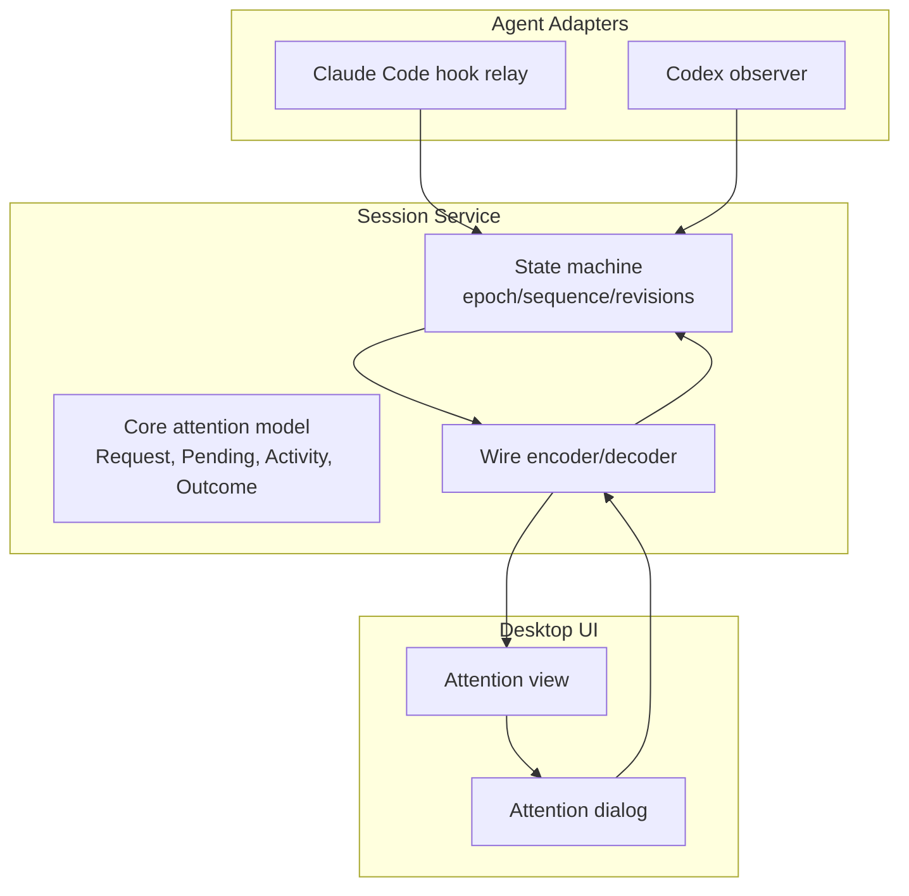
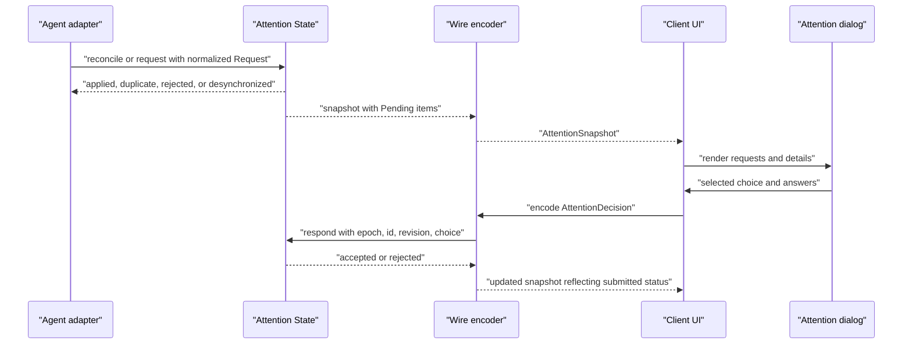
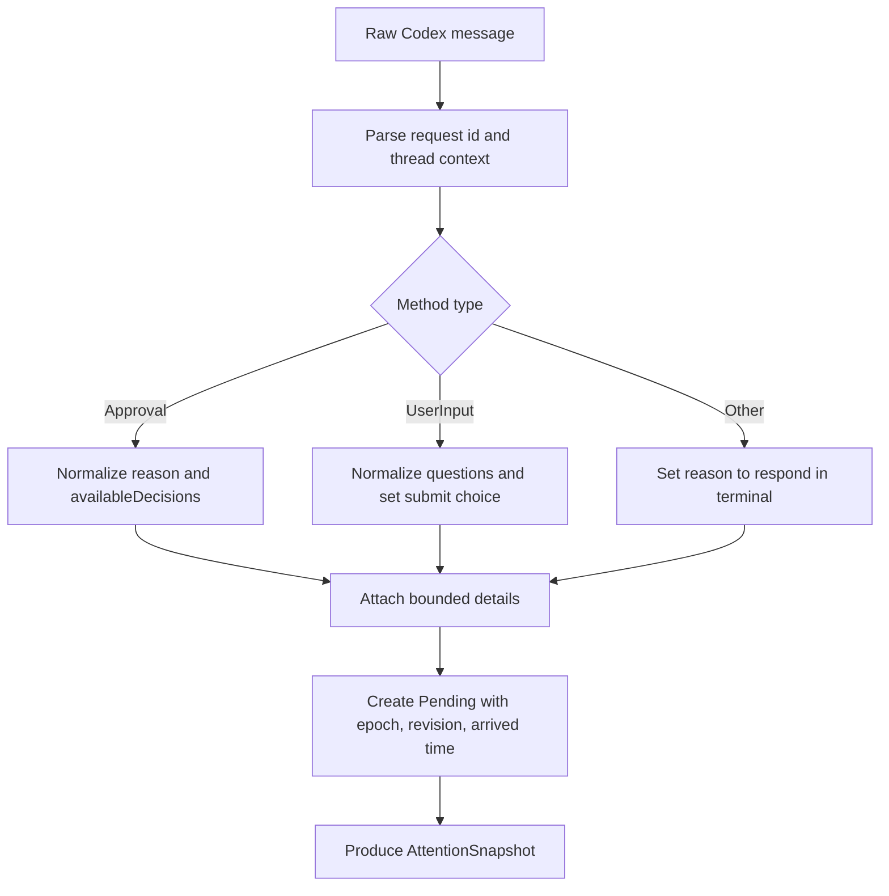
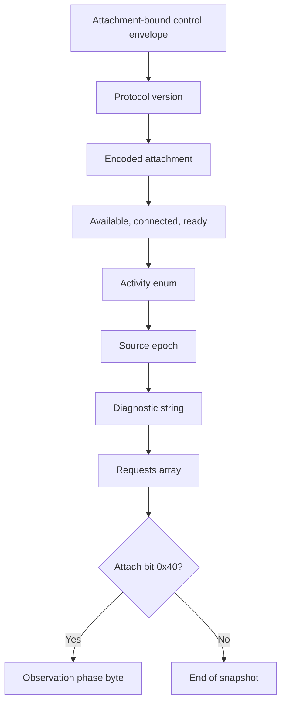
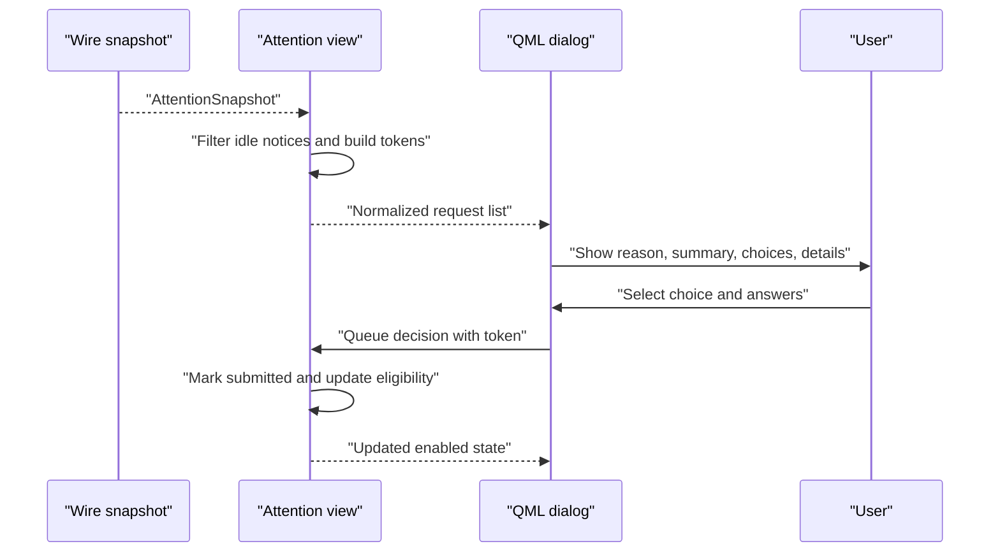
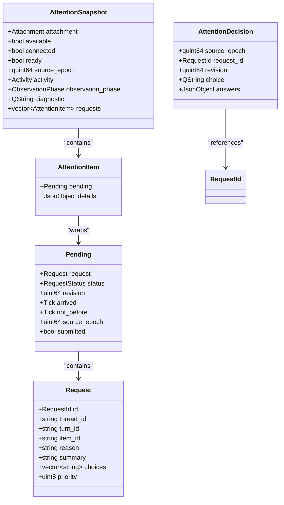

# Attention Protocol

<cite>
**Referenced Files in This Document**   
- [attention.hpp](file://services/session/include/lapis/session/attention.hpp)
- [observation_phase.hpp](file://services/session/include/lapis/session/observation_phase.hpp)
- [attention_protocol.hpp](file://services/session/src/transport/attention_protocol.hpp)
- [attention_protocol.cpp](file://services/session/src/transport/attention_protocol.cpp)
- [attention.cpp](file://services/session/src/attention.cpp)
- [observer.hpp](file://adapters/codex/src/observer.hpp)
- [observer.cpp](file://adapters/codex/src/observer.cpp)
- [hook_relay.hpp](file://adapters/claude/src/hook_relay.hpp)
- [attention_view.cpp](file://apps/desktop/src/attention_view.cpp)
- [AttentionDialog.qml](file://apps/desktop/qml/AttentionDialog.qml)
</cite>

## Table of Contents
1. [Introduction](#introduction)
2. [Project Structure](#project-structure)
3. [Core Components](#core-components)
4. [Architecture Overview](#architecture-overview)
5. [Detailed Component Analysis](#detailed-component-analysis)
6. [Dependency Analysis](#dependency-analysis)
7. [Performance Considerations](#performance-considerations)
8. [Troubleshooting Guide](#troubleshooting-guide)
9. [Conclusion](#conclusion)

## Introduction
The attention protocol normalizes agent interaction events into a shared contract so that diverse agents—Claude Code, Codex, Grok, and others—can be presented, prioritized, answered, and tracked uniformly by Lapis. It separates three concerns:

- **Producer state machine**: The session-side `State` object validates sequence boundaries, epochs, revisions, aging, retirement, and blocking behavior.
- **Wire format**: The transport layer serializes normalized attention snapshots and client decisions over the existing attachment-bound control envelope.
- **Adapter mapping**: Agent-specific adapters translate their native request types into the normalized `Request`, while preserving source-specific details for UI presentation.

This document focuses on the API surface of `AttentionItem`, `AttentionSnapshot`, and `AttentionDecision`, explains how agents map into this model, and describes integration with observation-phase negotiation through attach bit 0x40.

## Project Structure
The attention protocol spans four layers:

| Layer | Responsibility | Key files |
|---|---|---|
| Core model | Request identity, pending state, activity, outcomes, limits, capabilities, epoch/sequence tracking | [attention.hpp](file://services/session/include/lapis/session/attention.hpp), [observation_phase.hpp](file://services/session/include/lapis/session/observation_phase.hpp) |
| State machine | Sequence validation, reconciliation, response admission, snoozing, ordering, blocking rules | [attention.cpp](file://services/session/src/attention.cpp) |
| Transport wire | Binary encoding/decoding of snapshots and decisions; size, identity, JSON, and field constraints | [attention_protocol.hpp](file://services/session/src/transport/attention_protocol.hpp), [attention_protocol.cpp](file://services/session/src/transport/attention_protocol.cpp) |
| Adapter and UI mapping | Agent-specific normalization, decision submission, desktop presentation and draft handling | [observer.cpp](file://adapters/codex/src/observer.cpp), [hook_relay.hpp](file://adapters/claude/src/hook_relay.hpp), [attention_view.cpp](file://apps/desktop/src/attention_view.cpp), [AttentionDialog.qml](file://apps/desktop/qml/AttentionDialog.qml) |

**Diagram sources**
- [attention.hpp:1-136](file://services/session/include/lapis/session/attention.hpp#L1-L136)
- [attention.cpp:1-271](file://services/session/src/attention.cpp#L1-L271)
- [attention_protocol.hpp:1-41](file://services/session/src/transport/attention_protocol.hpp#L1-L41)
- [attention_protocol.cpp:1-343](file://services/session/src/transport/attention_protocol.cpp#L1-L343)
- [observer.cpp:1-200](file://adapters/codex/src/observer.cpp#L1-L200)
- [hook_relay.hpp:1-62](file://adapters/claude/src/hook_relay.hpp#L1-L62)
- [attention_view.cpp:1-200](file://apps/desktop/src/attention_view.cpp#L1-L200)
- [AttentionDialog.qml:1-200](file://apps/desktop/qml/AttentionDialog.qml#L1-L200)

## Core Components

### Normalized Request Model
The normalized request is the smallest unit of user-visible attention. Its core fields are:

| Field | Type | Meaning | Constraints |
|---|---|---|---|
| `id` | Integer or string | Stable identity for matching decisions to requests | Integer must fit signed 64-bit; string must be non-empty UTF-8 |
| `thread_id` | String | Session-level conversation thread | Optional at producer level; bounded |
| `turn_id` | String | Turn within the thread | Optional at producer level; bounded |
| `item_id` | String | Source item identifier | Optional at producer level; bounded |
| `reason` | String | Human-readable category such as command approval or user input | Required, non-empty, bounded |
| `summary` | String | Short description for listing | Optional, bounded |
| `choices` | Array of strings | Allowed responses for interactive decisions | Empty means observation-only notice; bounded and unique |
| `priority` | Integer 0–3 | Relative urgency; aging can outrank newer high-priority items | Bounded to 0–3 |

The normalized request is wrapped in `Pending`, which adds:

| Field | Type | Meaning |
|---|---|---|
| `request` | Normalized request | The agent-facing attention payload |
| `status` | Pending, responding, or stale | Local lifecycle of the item |
| `revision` | Non-zero integer | Server-assigned revision consumed by client decisions |
| `arrived` | Monotonic tick | When the server recorded the request |
| `not_before` | Monotonic tick | Snooze deadline before which the item should not be surfaced |
| `source_epoch` | Non-zero integer | Epoch from the source connection that produced the request |
| `submitted` | Boolean | Whether the client has already acknowledged this request |

A special helper identifies Claude Code’s post-turn idle notice: it uses reason `idle` with an empty choices array. Such notices are observation-only and are excluded from actionable attention lists.

**Section sources**
- [attention.hpp:18-70](file://services/session/include/lapis/session/attention.hpp#L18-L70)
- [attention.cpp:15-45](file://services/session/src/attention.cpp#L15-L45)

### AttentionItem
`AttentionItem` is the wire-level wrapper around `Pending`:

| Field | Type | Meaning |
|---|---|---|
| `pending` | `attention::Pending` | Full normalized request plus server-managed metadata |
| `details` | JSON object | Agent-specific context such as commands, questions, options, or tool information |

Constraints enforced by the wire layer include:

- Each request ID must be unique within a snapshot.
- `revision` and `source_epoch` must be non-zero.
- `reason` must be non-empty.
- `choices` must be non-empty unless the item is an observation-only idle notice.
- Individual choice values and the entire `details` JSON are bounded.

**Section sources**
- [attention_protocol.hpp:10-21](file://services/session/src/transport/attention_protocol.hpp#L10-L21)
- [attention_protocol.cpp:219-272](file://services/session/src/transport/attention_protocol.cpp#L219-L272)

### AttentionSnapshot
`AttentionSnapshot` is the authoritative view sent from the session service to clients:

| Field | Type | Meaning |
|---|---|---|
| `attachment` | Attachment | Identity, generation, and binding for the control envelope |
| `available` | Boolean | Whether the source is known to provide attention data |
| `connected` | Boolean | Whether the source connection is established |
| `ready` | Boolean | Whether the source has reached a synchronized boundary where requests can be trusted |
| `source_epoch` | Integer | Current source epoch; decisions must match this value |
| `activity` | Enum | Unknown, working, idle, or turn completed |
| `observation_phase` | Enum | Negotiated phase when present: unknown, awaiting first prompt, or reconciling |
| `diagnostic` | String | Display-only diagnostic message |
| `requests` | Array of `AttentionItem` | Normalized attention items for the current epoch |

Important semantics:

- A ready snapshot requires `available`, `connected`, and a nonzero `source_epoch`.
- Connected but not ready indicates initialization or synchronization.
- Requests in a ready snapshot must belong to the same `source_epoch`.
- Older or future request epochs relative to the snapshot are rejected by the decoder.
- The optional observation phase byte is only appended when negotiated through attach bit 0x40.

**Section sources**
- [attention_protocol.hpp:12-21](file://services/session/src/transport/attention_protocol.hpp#L12-L21)
- [attention_protocol.cpp:274-343](file://services/session/src/transport/attention_protocol.cpp#L274-L343)
- [observation_phase.hpp:7-15](file://services/session/include/lapis/session/observation_phase.hpp#L7-L15)

### AttentionDecision
`AttentionDecision` is the client response structure:

| Field | Type | Meaning |
|---|---|---|
| `source_epoch` | Integer | Must match the snapshot epoch under which the request was offered |
| `request_id` | Integer or string | Matches the normalized request ID |
| `revision` | Integer | Must match the exact revision assigned by the server |
| `choice` | String | One of the allowed choices for the request |
| `answers` | JSON object | Optional structured answers for multi-question inputs |

Validation rules:

- All three identifiers—`source_epoch`, `request_id`, and `revision`—must be present and valid.
- `choice` must be non-empty and bounded.
- `answers` is validated as a compact JSON object.
- For Codex-style question inputs, each answer maps a question ID to an array containing exactly one string.

**Section sources**
- [attention_protocol.hpp:22-30](file://services/session/src/transport/attention_protocol.hpp#L22-L30)
- [attention_protocol.cpp:200-217](file://services/session/src/transport/attention_protocol.cpp#L200-L217)
- [observer.cpp:160-200](file://adapters/codex/src/observer.cpp#L160-L200)

## Architecture Overview

**Diagram sources**
- [attention.cpp:140-271](file://services/session/src/attention.cpp#L140-L271)
- [attention_protocol.cpp:219-343](file://services/session/src/transport/attention_protocol.cpp#L219-L343)
- [attention_view.cpp:150-234](file://apps/desktop/src/attention_view.cpp#L150-L234)
- [AttentionDialog.qml:120-180](file://apps/desktop/qml/AttentionDialog.qml#L120-L180)

## Detailed Component Analysis

### AttentionItem Structure and Details Mapping
`AttentionItem.pending` carries the canonical attention state. `AttentionItem.details` carries agent-specific context without changing the core contract. Examples:

- **Command approval**: Details may contain the executed command, working directory, and requested reason. Choices are typically accept, decline, and cancel.
- **User input**: Details contain a list of questions, each with an ID, prompt text, optional selectable labels, and free-text flags. The normalized choice is submit, and answers map question IDs to arrays of selected labels or typed text.
- **Observation-only notices**: Claude Code’s idle notice uses an empty choices array and a recognized idle reason. Desktop rendering removes these from actionable lists.

The details object is bounded, re-encoded, and round-trip validated by the wire layer. Consumers should treat it as opaque display metadata rather than parsing it for protocol state.

**Section sources**
- [attention_protocol.hpp:10-21](file://services/session/src/transport/attention_protocol.hpp#L10-L21)
- [attention_protocol.cpp:219-272](file://services/session/src/transport/attention_protocol.cpp#L219-L272)
- [attention_view.cpp:150-200](file://apps/desktop/src/attention_view.cpp#L150-L200)

### AttentionSnapshot Semantics
The snapshot is the single source of truth for presentation:

- **Availability vs connectivity**: `available` indicates whether the source can produce attention data; `connected` indicates whether its transport is open.
- **Readiness**: `ready` means the state machine has reached a synchronized boundary. Until then, requests may be incomplete or unreliable.
- **Epoch correlation**: `source_epoch` ties all requests in the snapshot to one production run. Decisions with a mismatched epoch are rejected.
- **Activity**: Working, idle, turn completed, or unknown. The desktop UI maps these to user-facing states such as working, ready, finished, or unavailable.
- **Diagnostic**: Purely display-oriented. It is not parsed to infer readiness or activity.
- **Requests array**: Deduplicated by normalized request ID. Duplicate content within the same epoch preserves the original revision when already synchronized.

**Section sources**
- [attention_protocol.hpp:12-21](file://services/session/src/transport/attention_protocol.hpp#L12-L21)
- [attention_protocol.cpp:110-187](file://services/session/src/transport/attention_protocol.cpp#L110-L187)
- [attention_view.cpp:1-150](file://apps/desktop/src/attention_view.cpp#L1-L150)

### AttentionDecision Semantics
The decision structure is intentionally conservative:

- **Source epoch correlation**: Ensures the decision applies to the current snapshot generation.
- **Request ID matching**: Selects the intended normalized request across integer and string identities.
- **Revision tracking**: Prevents replay of an outdated decision after a new snapshot assigns a fresh revision.
- **Choice semantics**: Must be one of the normalized choices advertised in `request.choices`. For approval flows, these are accept, decline, and cancel. For input flows, the choice is submit.
- **Answers payload**: Encodes structured answers for multi-question prompts. Codex validation enforces one answer per question, correct IDs, and either an allowed label or free text depending on the question configuration.

**Section sources**
- [attention_protocol.hpp:22-30](file://services/session/src/transport/attention_protocol.hpp#L22-L30)
- [attention_protocol.cpp:200-217](file://services/session/src/transport/attention_protocol.cpp#L200-L217)
- [observer.cpp:160-200](file://adapters/codex/src/observer.cpp#L160-L200)

### Agent-Specific Mapping

#### Codex
The Codex observer parses raw messages into the normalized model:

- Command execution approval becomes a request with reason “Command approval” and choices accept, decline, or cancel.
- Tool input becomes a request with reason “User input”, a questions array in details, and choice submit.
- Unrecognized request methods become observation-only entries with reason “Respond in terminal”.
- The observer exposes `details(request_id)` so the UI can render method, command, cwd, or questions without exposing full private hook payloads.
- Decision submission validates answers against the original question schema before consuming the server revision token.

**Diagram sources**
- [observer.cpp:60-159](file://adapters/codex/src/observer.cpp#L60-L159)
- [observer.cpp:160-200](file://adapters/codex/src/observer.cpp#L160-L200)

**Section sources**
- [observer.hpp:10-55](file://adapters/codex/src/observer.hpp#L10-L55)
- [observer.cpp:60-200](file://adapters/codex/src/observer.cpp#L60-L200)

#### Claude Code
Claude Code events are observed through hooks. The hook relay forwards identity fields and optionally derived background-work metadata. The attention contract defines an idle notice pattern for post-turn completion:

- Reason equals `idle`.
- Choices array is empty.
- Desktop filtering removes idle notices from actionable attention.
- The presence of such a notice correlates with a turn-completed state, even though no client response is required.

The relay also documents the trust boundary: possession of the socket nonce authenticates the event path, while field placement alone does not.

**Section sources**
- [hook_relay.hpp:1-62](file://adapters/claude/src/hook_relay.hpp#L1-L62)
- [attention.hpp:60-70](file://services/session/include/lapis/session/attention.hpp#L60-L70)
- [attention_view.cpp:150-200](file://apps/desktop/src/attention_view.cpp#L150-L200)

### Integration with the Attachment-Bound Control Envelope
Attention messages are carried inside the existing attachment-bound control envelope. This means:

- Every snapshot includes the originating `Attachment`, allowing clients to bind the attention stream to the correct session and generation.
- The binary protocol starts with a version number, followed by the encoded attachment, then attention-specific fields.
- Observability extension: if the attach bit 0x40 is negotiated, the snapshot body ends with a one-byte `observation_phase` field. Legacy clients receive the existing v6 body without this extension.
- If the trailing phase byte is present but invalid, decoding fails rather than silently interpreting an unknown phase.

**Diagram sources**
- [attention_protocol.hpp:12-30](file://services/session/src/transport/attention_protocol.hpp#L12-L30)
- [attention_protocol.cpp:274-343](file://services/session/src/transport/attention_protocol.cpp#L274-L343)

**Section sources**
- [attention_protocol.hpp:26-41](file://services/session/src/transport/attention_protocol.hpp#L26-L41)
- [attention_protocol.cpp:274-343](file://services/session/src/transport/attention_protocol.cpp#L274-L343)

### UI Presentation Flow
The desktop attention view transforms wire snapshots into QML-friendly structures:

1. Idle notices are removed from actionable attention.
2. A stable token combines session identity, source epoch, generation, request epoch, revision, and request ID.
3. Eligibility requires a ready, connected attention source, a pending status, and at least one choice.
4. Submitted or responding items remain visible but are disabled for further input.
5. Drafts are preserved per request token so incoming snapshots do not overwrite user composition.
6. When a decision is queued, the view marks the request as submitted and updates eligibility accordingly.

**Diagram sources**
- [attention_view.cpp:1-234](file://apps/desktop/src/attention_view.cpp#L1-L234)
- [AttentionDialog.qml:1-200](file://apps/desktop/qml/AttentionDialog.qml#L1-L200)

**Section sources**
- [attention_view.cpp:1-234](file://apps/desktop/src/attention_view.cpp#L1-L234)
- [AttentionDialog.qml:1-200](file://apps/desktop/qml/AttentionDialog.qml#L1-L200)

### Relationship to Session Lifecycle and Terminal Output
Attention state is independent from, but correlated with, terminal output and conversation context:

- `thread_id` and `turn_id` connect attention to broader conversation context.
- `Activity::turn_completed` often appears with Claude Code’s idle notice, indicating the agent has finished generating output and may now wait for user input.
- When no observer is active, the desktop preview estimates activity from terminal output: active output maps to working, quiet output maps to idle.
- `blocking()` returns true when any pending request is not an observation-only idle notice. This prevents new input until evidence is addressed.
- Reconciliation failures mark pending items stale and reset activity to unknown, signaling that the client must reconnect and reconcile before accepting new decisions.

**Section sources**
- [attention.hpp:21-70](file://services/session/include/lapis/session/attention.hpp#L21-L70)
- [attention.cpp:200-271](file://services/session/src/attention.cpp#L200-L271)
- [attention_view.cpp:1-150](file://apps/desktop/src/attention_view.cpp#L1-L150)

## Dependency Analysis

**Diagram sources**
- [attention.hpp:21-70](file://services/session/include/lapis/session/attention.hpp#L21-L70)
- [attention_protocol.hpp:10-30](file://services/session/src/transport/attention_protocol.hpp#L10-L30)

**Section sources**
- [attention.hpp:21-70](file://services/session/include/lapis/session/attention.hpp#L21-L70)
- [attention_protocol.hpp:10-30](file://services/session/src/transport/attention_protocol.hpp#L10-L30)

## Performance Considerations
- **Message sizes**: Snapshots are capped at 1 MiB, decisions at 64 KiB, individual request records at 1 MiB intermediate allocation, and overall JSON metadata at 32 KiB.
- **Request limits**: Up to 128 requests per snapshot; up to 32 choices per request; up to 16 questions per Codex input; up to 16 choices in the core model.
- **String bounds**: Metadata fields are bounded at 1 KiB, summaries at 4 KiB, diagnostics at 4 KiB, and choices at 256 bytes.
- **Revision accounting**: Revision space wraps through overflow protection; exhaustion triggers desynchronization rather than silent reuse.
- **Ordering cost**: Ordered pending requests use O(n log n) sorting based on age and priority.
- **Idle filtering**: Desktop removal of idle notices avoids unnecessary UI churn after turn completion.

[No sources needed since this section provides general guidance]

## Troubleshooting Guide

| Symptom | Likely cause | Resolution |
|---|---|---|
| Client receives a snapshot but cannot answer | Not yet ready, disconnected, or missing capabilities | Wait for `ready` and `connected`; verify attach bit 0x40 negotiation if observation phase is expected |
| Decision rejected immediately | Mismatched `source_epoch`, wrong `request_id`, wrong `revision`, or invalid choice | Use the exact snapshot epoch, request ID, and revision; choose from the advertised choices |
| Requests marked stale | Clock moved backward, epoch gap, retired overflow, or reconciliation failure | Reconnect and reconcile; do not retry old decisions |
| Idle notice shown but no action required | Claude Code post-turn idle notice | Treat as informational; filter from actionable attention |
| UI shows “Connection lost; reconnect before responding” | Existing snapshot invalidated after transport loss | Reconnect, refresh snapshot, and resubmit decisions only after reconciliation |
| Codex answers rejected | Answer count, question ID, option label, or free-text validation failed | Match question IDs exactly; select allowed labels unless free text is permitted |

**Section sources**
- [attention_protocol.cpp:110-217](file://services/session/src/transport/attention_protocol.cpp#L110-L217)
- [attention.cpp:200-271](file://services/session/src/attention.cpp#L200-L271)
- [attention_view.cpp:200-234](file://apps/desktop/src/attention_view.cpp#L200-L234)
- [observer.cpp:160-200](file://adapters/codex/src/observer.cpp#L160-L200)

## Conclusion
The attention protocol provides a minimal, strongly validated interface between heterogeneous agents and Lapis clients. Agents normalize their native events into `Request`, which the session service sequences through epochs, sequences, and revisions. Clients consume `AttentionSnapshot`, present `AttentionItem` details, capture `AttentionDecision`, and return results through the same attachment-bound control envelope. The optional observation phase capability allows early lifecycle visibility without compromising backward compatibility. Correct usage depends on strict epoch, ID, and revision correlation, bounded metadata, and careful handling of readiness, activity, and blocking state.