# Internal IPC Protocol

<cite>
**Referenced Files in This Document**
- [local_protocol.hpp](file://services/session/src/transport/local_protocol.hpp)
- [local_protocol.cpp](file://services/session/src/transport/local_protocol.cpp)
- [wire_bytes.hpp](file://services/session/src/transport/wire_bytes.hpp)
- [terminal.hpp](file://services/session/include/lapis/session/terminal.hpp)
- [local_protocol_test.cpp](file://services/session/tests/local_protocol_test.cpp)
</cite>

## Table of Contents
1. [Introduction](#introduction)
2. [Project Structure](#project-structure)
3. [Core Components](#core-components)
4. [Architecture Overview](#architecture-overview)
5. [Detailed Component Analysis](#detailed-component-analysis)
6. [Dependency Analysis](#dependency-analysis)
7. [Performance Considerations](#performance-considerations)
8. [Troubleshooting Guide](#troubleshooting-guide)
9. [Conclusion](#conclusion)

## Introduction
This document describes the internal IPC protocol between the desktop application and session services. It covers:

- The wire frame format used for every message.
- The `Kind` enum values that identify each message type.
- Binary encoding for attachments, identities, terminal snapshots, keyboard input, resize events, paste transactions, history requests, attention messages, wheel events, and status/error frames.
- Version negotiation through `AttachRequest` capability bits.
- Mode operations: discover, reconnect, create, join.
- Terminal snapshot wire representation, including cells, styles, colors, hyperlinks, cursor state, palette, history metadata, and alternate-screen semantics.
- Error handling through `Status` messages.
- Connection lifecycle from attach to ready, streaming snapshots, input delivery, and termination.
- Frame parsing constraints and size limits.

The protocol is defined by a small set of C++ types and serialization helpers in the session service’s transport layer. Clients should implement the same frame, attachment, mode, capability, and terminal wire formats to interoperate correctly.

## Project Structure
The protocol lives under the session service’s transport layer:

```mermaid
graph TB
    Client["Desktop client"]
    Service["Session service"]
    PTY["Terminal process / PTY"]
    Wire["Wire types<br/>Frame, Kind, Attachment, SessionIdentity"]
    Terminal["TerminalSnapshot wire format"]
    Tests["Protocol tests"]

    Client -->|frame(Kind, payload)| Service
    Service -->|snapshot text| Client
    Client -->|key/text/paste/wheel| Service
    Service -->|status/ready/history| Client
    Service --> PTY
    Wire -.-> Service
    Terminal -.-> Service
    Tests --> Wire
    Tests --> Terminal
```

**Diagram sources**
- [local_protocol.hpp:10-196](file://services/session/src/transport/local_protocol.hpp#L10-L196)
- [local_protocol.cpp:1-535](file://services/session/src/transport/local_protocol.cpp#L1-L535)
- [wire_bytes.hpp:1-55](file://services/session/src/transport/wire_bytes.hpp#L1-L55)
- [terminal.hpp:1-201](file://services/session/include/lapis/session/terminal.hpp#L1-L201)
- [local_protocol_test.cpp:26-389](file://services/session/tests/local_protocol_test.cpp#L26-L389)

**Section sources**
- [local_protocol.hpp:10-196](file://services/session/src/transport/local_protocol.hpp#L10-L196)
- [wire_bytes.hpp:1-55](file://services/session/src/transport/wire_bytes.hpp#L1-L55)

## Core Components
The protocol has three foundational layers:

1. **Frame layer:** Every message starts with a length-prefixed frame containing one `Kind` byte followed by its payload.
2. **Attachment layer:** Most control messages are bound to a session using `Attachment`, which carries two 16-byte UUIDs (`session_id`, `epoch`) and a 64-bit generation number.
3. **Payload layer:** Each `Kind` defines its own payload structure. Some payloads reuse common structures such as `SessionIdentity`, `HistoryRequest`, `PasteRequest`, `Wheel`, or `TerminalSnapshot`.

Key constants:

| Symbol | Value | Meaning |
|---|---:|---|
| `version` | `6` | Current protocol version. |
| `max_frame_bytes` | 8 MiB | Maximum total frame size including header, kind byte, and payload. |
| `max_cells` | 32,768 | Maximum number of terminal cells per snapshot. |
| `max_codepoints` | 65,536 | Maximum grapheme code points per snapshot. |
| `max_input_bytes` | 64 KiB | Maximum payload for one `text`, `paste`, or `key` message. |
| `max_paste_bytes` | 960 KiB | Maximum total bytes in a bounded paste transaction. |

**Section sources**
- [local_protocol.hpp:10-43](file://services/session/src/transport/local_protocol.hpp#L10-L43)
- [local_protocol.cpp:288-343](file://services/session/src/transport/local_protocol.cpp#L288-L343)
- [wire_bytes.hpp:1-55](file://services/session/src/transport/wire_bytes.hpp#L1-L55)

## Architecture Overview
The connection follows this lifecycle:

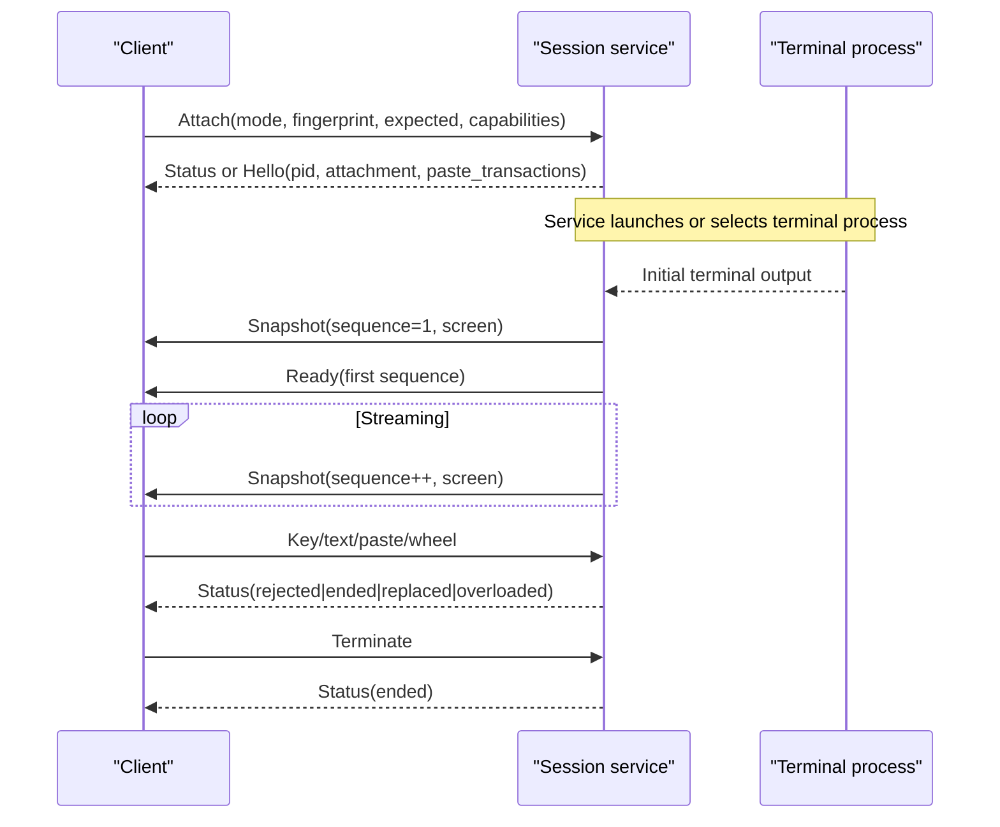

**Diagram sources**
- [local_protocol.hpp:60-120](file://services/session/src/transport/local_protocol.hpp#L60-L120)
- [local_protocol.cpp:120-175](file://services/session/src/transport/local_protocol.cpp#L120-L175)

## Detailed Component Analysis

### Frame Format
Every message is wrapped as a frame:

| Field | Size | Encoding | Description |
|---|---:|---|---|
| Length | 4 bytes | Big-endian `uint32` | Total frame length, including itself, the kind byte, and payload. |
| Kind | 1 byte | `uint8` | Message type from the `Kind` enum. |
| Payload | Variable | Per message | Message-specific binary data. |

Constraints:

- Length must be at least 1.
- Length must not exceed `max_frame_bytes`.
- Kind must be one of the defined values from `hello` through `paste_result`.
- Frame parsing supports incremental reads; incomplete buffers return false without consuming bytes.
- After reading, the parser lazily compacts consumed input when it exceeds half the buffer.

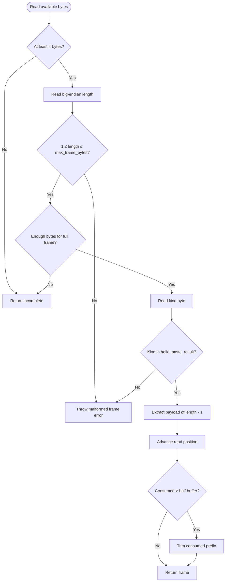

**Diagram sources**
- [local_protocol.cpp:288-343](file://services/session/src/transport/local_protocol.cpp#L288-L343)

**Section sources**
- [local_protocol.cpp:288-343](file://services/session/src/transport/local_protocol.cpp#L288-L343)

### Kind Enum and Message Map
The wire uses these message kinds:

| Kind | Direction | Purpose |
|---|---|---|
| `hello` | Service → Client | Service identity, child PID, optional paste capability. |
| `snapshot` | Service → Client | Terminal screen update. |
| `text` | Client → Service | UTF-8 text input. |
| `paste` | Client → Service | Legacy paste fragment. |
| `key` | Client → Service | Encoded key event. |
| `resize` | Client → Service | Terminal geometry change. |
| `status` | Either side | Error, lifecycle, or overload signal. |
| `attach` | Client → Service | Connect, select, create, or join a session. |
| `ready` | Service → Client | Acknowledgement after initial snapshot. |
| `history_request` | Client → Service | Navigate terminal history pages. |
| `history_page` | Service → Client | History response, possibly with a snapshot. |
| `attention_snapshot` | Service → Client | Attention-related terminal snapshot. |
| `attention_decision` | Client → Service | User decision for an attention request. |
| `attention_retry` | Client → Service | Retry an attention request. |
| `terminate` | Client → Service | Request termination of the agent process. |
| `wheel` | Client → Service | Wheel event for full-screen programs. |
| `paste_request` | Client → Service | Bounded paste transaction start or chunk. |
| `paste_result` | Service → Client | Admission result for a paste transaction. |

**Section sources**
- [local_protocol.hpp:23-59](file://services/session/src/transport/local_protocol.hpp#L23-L59)

### Attachment and Session Identity
All session-bound messages carry an `Attachment`:

| Field | Size | Encoding | Description |
|---|---:|---|---|
| `session_id` | 16 bytes | Raw bytes | Nonzero UUID identifying the session. |
| `epoch` | 16 bytes | Raw bytes | Nonzero UUID identifying the current epoch. |
| `generation` | 8 bytes | Big-endian `uint64` | Monotonic counter associated with the attachment. |

Validation rules:

- Both UUIDs must be exactly 16 bytes.
- Neither UUID may be all zeros.
- Generation must be nonzero.
- Invalid attachments throw during encode/decode.

A `SessionIdentity` contains only `session_id` and `epoch` and is used where a full attachment is unnecessary.

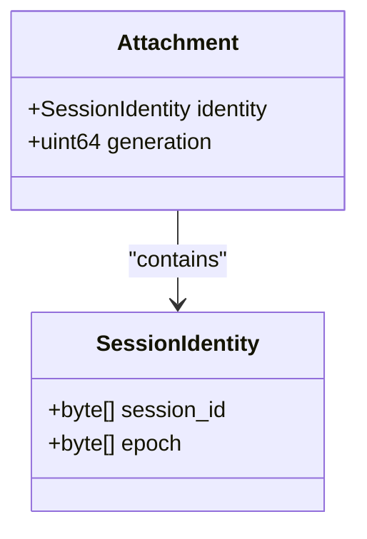

**Diagram sources**
- [local_protocol.hpp:45-61](file://services/session/src/transport/local_protocol.hpp#L45-L61)
- [wire_bytes.hpp:28-55](file://services/session/src/transport/wire_bytes.hpp#L28-L55)

**Section sources**
- [local_protocol.hpp:45-61](file://services/session/src/transport/local_protocol.hpp#L45-L61)
- [wire_bytes.hpp:28-55](file://services/session/src/transport/wire_bytes.hpp#L28-L55)

### Attach Negotiation and Modes
The client sends `AttachRequest` to negotiate connection mode and capabilities.

#### Binary layout

| Offset | Size | Field |
|---:|---:|---|
| 0 | 4 bytes | Big-endian `version`; must equal current protocol version. |
| 4 | 32 bytes | Client fingerprint. |
| 36 | 1 byte | Mode plus capability flags. |
| 37 | 16 bytes | Expected `session_id`. |
| 53 | 16 bytes | Expected `epoch`. |

#### Mode field

| Mode value | Name | `expected.session_id` | `expected.epoch` | Behavior |
|---:|---|---:|---:|---|
| 0 | `discover` | Zero | Zero | Find an existing session without naming it. |
| 1 | `reconnect` | Nonzero UUID | Nonzero UUID | Rejoin a known session. |
| 2 | `create` | Nonzero UUID | Zero | Create a new session with the given identifier. |
| 3 | `join` | Zero | Zero | Add another view to whichever session answers. |

#### Capability flags in the mode byte

| Bit | Capability | Meaning |
|---:|---|---|
| 0x80 | Hyperlinks | Client can receive hyperlink spans in snapshots. |
| 0x40 | Attention phase | Client supports attention-phase protocol. |
| 0x20 | Paste transactions | Client supports bounded paste transactions. |

Legacy clients leave these flags clear. Services built before a feature reject frames that advertise unsupported capabilities.

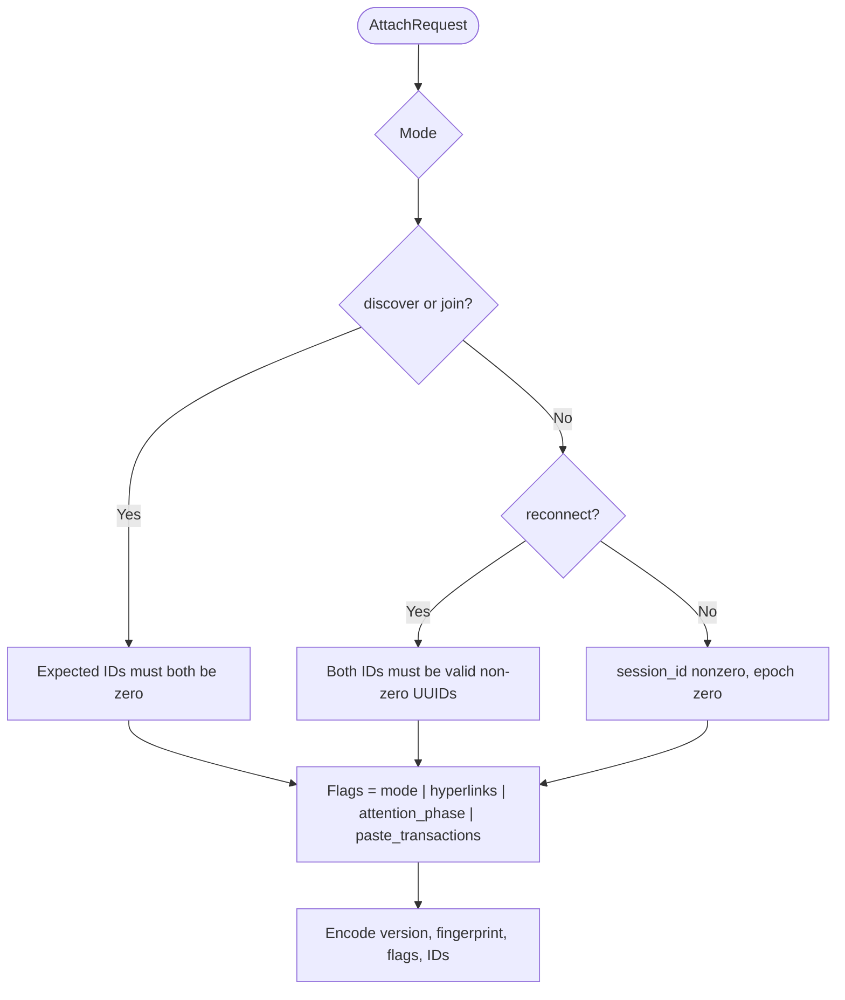

**Diagram sources**
- [local_protocol.cpp:78-120](file://services/session/src/transport/local_protocol.cpp#L78-L120)

**Section sources**
- [local_protocol.hpp:63-88](file://services/session/src/transport/local_protocol.hpp#L63-L88)
- [local_protocol.cpp:78-120](file://services/session/src/transport/local_protocol.cpp#L78-L120)
- [local_protocol_test.cpp:68-142](file://services/session/tests/local_protocol_test.cpp#L68-L142)

### Hello Response
After successful attach, the service replies with `Hello`:

| Field | Size | Encoding | Description |
|---|---:|---|---|
| Version | 4 bytes | Big-endian `uint32` | Must match protocol version. |
| Attachment | 40 bytes | Session identity plus generation. |
| PID | 8 bytes | Big-endian `uint64`; child process ID. |
| Optional paste marker | 4 bytes | Present only when `paste_transactions` is enabled. |

Rules:

- PID must be nonzero.
- Two sizes are valid: 52 bytes (legacy) and 56 bytes (with paste transaction support).
- When present, the optional marker indicates the service accepts paste transactions.

**Section sources**
- [local_protocol.hpp:89-102](file://services/session/src/transport/local_protocol.hpp#L89-L102)
- [local_protocol.cpp:120-175](file://services/session/src/transport/local_protocol.cpp#L120-L175)
- [local_protocol_test.cpp:144-175](file://services/session/tests/local_protocol_test.cpp#L144-L175)

### Ready Acknowledgement
After the service sends the first applied snapshot, it sends `Ready`:

| Field | Size | Encoding | Description |
|---|---:|---:|---|
| Attachment | 40 bytes | Session identity plus generation. |
| Sequence | 8 bytes | Big-endian `uint64`; first applied snapshot sequence. |

The `Ready` frame confirms that the client has received and applied the initial state.

**Section sources**
- [local_protocol.hpp:135-141](file://services/session/src/transport/local_protocol.hpp#L135-L141)
- [local_protocol.cpp:344-371](file://services/session/src/transport/local_protocol.cpp#L344-L371)

### Terminal Snapshot Wire Format
`TerminalSnapshot` is encoded as a dense binary stream:

#### Header fields

| Field | Size | Encoding | Notes |
|---|---:|---|---|
| Revision | 8 bytes | Big-endian `uint64` | Monotonic snapshot revision. |
| Columns | 2 bytes | Big-endian `uint16` | Must be nonzero. |
| Rows | 2 bytes | Big-endian `uint16` | Must be nonzero. |
| Cursor column | 2 bytes | Big-endian `uint16` | Viewport cell coordinate. |
| Cursor row | 2 bytes | Big-endian `uint16` | Viewport cell coordinate. |
| Cursor in viewport | 1 byte | Boolean | |
| Cursor visible | 1 byte | Boolean | |
| Cursor blinking | 1 byte | Boolean | |
| Cursor wide tail | 1 byte | Boolean | Wide-cell cursor tail flag. |
| Cursor shape | 1 byte | `uint8` | From `CursorShape`. |
| Alternate screen byte | 1 byte | Special encoding | See alternate-screen semantics below. |
| Bracketed paste | 1 byte | Boolean | |
| Application cursor keys | 1 byte | Boolean | |
| Foreground RGB | 4 bytes | `uint32` | Default foreground color. |
| Background RGB | 4 bytes | `uint32` | Default background color. |
| Cursor RGB present | 1 byte | Boolean | Whether cursor RGB follows. |
| Cursor RGB | 4 bytes | `uint32` | Only present when cursor RGB is true. |
| Total rows | 8 bytes | Big-endian `uint64` | Includes current screen. |
| Viewport offset | 8 bytes | Big-endian `uint64` | First kept row index. |
| Viewport rows | 8 bytes | Big-endian `uint64` | Visible history height. |
| Palette | 256 × 4 bytes | `uint32` | Indexed color palette. |

#### Alternate-screen semantics

The alternate-screen byte encodes both whether the screen is alternate and whether the service accepts wheel input on it:

- `0`: Primary screen; wheel input not advertised.
- `1`: Alternate screen; older service compatibility.
- `3`: Alternate screen and service accepts wheel input.
- Other values are rejected.

Clients must treat `accepts_wheel` as true only when the decoder sets it from the alternate-screen bit combination.

#### Graphemes

After the header:

1. A 32-bit count of grapheme code points.
2. That many 32-bit Unicode scalar values.
3. Values must be valid Unicode code points outside surrogate ranges.
4. Total grapheme count must not exceed `max_codepoints`.

#### Cells

Next comes the cell array:

1. A 32-bit cell count.
2. For each cell:
   - `text_offset`: 32-bit offset into the grapheme buffer.
   - `text_length`: 32-bit length in grapheme code points.
   - `kind`: Cell kind (`narrow`, `wide`, `wide_tail`, `wrap_spacer`).
   - Foreground color.
   - Background color.
   - Underline color.
   - Underline style.
   - Style flags packed into 16 bits.

Cell constraints:

- Cell count must equal `columns × rows`.
- Offsets and lengths must stay within the grapheme buffer.
- Cell count must not exceed `max_cells`.

#### Color encoding

Colors use a two-field format:

| Field | Size | Encoding |
|---|---:|---|
| Kind | 1 byte | `ColorKind` enum value. |
| Value | 4 bytes | Palette index for indexed colors, or `0xRRGGBB` for RGB. |

Indexed colors must be less than 256; RGB values must not exceed `0xFFFFFF`.

#### Style flags

| Bit | Attribute |
|---:|---|
| 1 | Bold |
| 2 | Italic |
| 4 | Faint |
| 8 | Blink |
| 16 | Inverse |
| 32 | Invisible |
| 64 | Strikethrough |
| 128 | Overline |

#### Hyperlink extension

Hyperlinks are encoded as an optional extension after the normal snapshot body:

1. Extension tag: `LNK1`.
2. Number of hyperlink spans.
3. For each span:
   - First cell index.
   - Cell count.
   - URI length.
   - URI bytes.

Validation rules:

- URI length must be nonzero.
- Total URI bytes must not exceed `max_hyperlink_bytes`.
- Number of spans must not exceed `max_hyperlink_spans`.
- URIs must be valid UTF-8.
- Spans must not overlap.
- Spans must lie within the cell range.

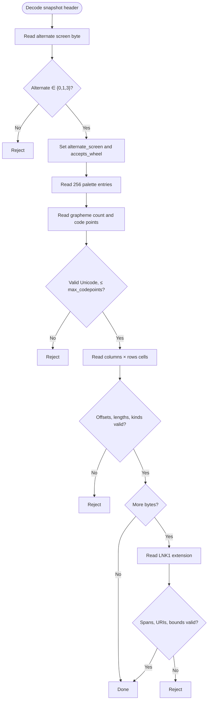

**Diagram sources**
- [local_protocol.cpp:405-535](file://services/session/src/transport/local_protocol.cpp#L405-L535)
- [terminal.hpp:19-106](file://services/session/include/lapis/session/terminal.hpp#L19-L106)

**Section sources**
- [local_protocol.cpp:405-535](file://services/session/src/transport/local_protocol.cpp#L405-L535)
- [terminal.hpp:19-106](file://services/session/include/lapis/session/terminal.hpp#L19-L106)
- [local_protocol_test.cpp:26-54](file://services/session/tests/local_protocol_test.cpp#L26-L54)
- [local_protocol_test.cpp:305-321](file://services/session/tests/local_protocol_test.cpp#L305-L321)

### Control Messages: Text, Paste, Key, Resize
These messages share a control envelope:

| Field | Size | Encoding | Description |
|---|---:|---|---|
| Attachment | 40 bytes | Session identity plus generation. |
| Payload | Variable | Message-specific data. |

Shared constraint:

- Total payload size must not exceed `max_codepoints`.
- Individual `text`, `paste`, and `key` payloads must not exceed `max_input_bytes`.

#### Text
Payload is UTF-8 text sent directly to the terminal.

#### Key
Payload is a terminal-encoded key string produced by the terminal adapter. It represents a press-only navigation subset; full keyboard protocols are reserved for later contracts.

#### Resize
Payload encodes the new terminal geometry.

#### Paste (legacy)
Payload is raw pasted text. Long pastes may be split across multiple `paste` frames.

**Section sources**
- [local_protocol.hpp:117-134](file://services/session/src/transport/local_protocol.hpp#L117-L134)
- [local_protocol.cpp:372-384](file://services/session/src/transport/local_protocol.cpp#L372-L384)
- [local_protocol_test.cpp:262-274](file://services/session/tests/local_protocol_test.cpp#L262-L274)

### Bounded Paste Transactions
Long pastes use a negotiated transaction protocol instead of unbounded legacy `paste` frames.

#### Capability negotiation
- Client advertises `paste_transactions` via the 0x20 capability bit in `AttachRequest`.
- Service advertises acceptance by including the optional paste marker in `Hello`.
- If either side lacks support, the client falls back to legacy `paste` frames.

#### Transaction model
A complete bounded paste is admitted as a unit:

- `paste_request` starts or continues a transaction.
- `paste_result` reports whether the PTY queue accepted the transaction.
- `queued` means admission to the terminal process queue; it is not an application-level acknowledgement.

#### `PasteRequest` payload

| Field | Size | Encoding | Description |
|---|---:|---|---|
| Attachment | 40 bytes | Session identity plus generation. |
| Request ID | 8 bytes | Big-endian `uint64`; nonzero. |
| Submit | 1 byte | Boolean; final submit flag. |
| Text | Variable | Remaining bytes up to `max_paste_bytes`. |

Constraints:

- Request ID must be nonzero.
- Total payload size is between 49 bytes and `49 + max_paste_bytes`.
- Text size must not exceed `max_paste_bytes`.

#### `PasteResult` payload

| Field | Size | Encoding | Description |
|---|---:|---|---|
| Attachment | 40 bytes | Session identity plus generation. |
| Request ID | 8 bytes | Big-endian `uint64`; nonzero. |
| Queued | 1 byte | Boolean; PTY queue admission. |
| Message | Variable | UTF-8 status message, up to 4096 bytes. |

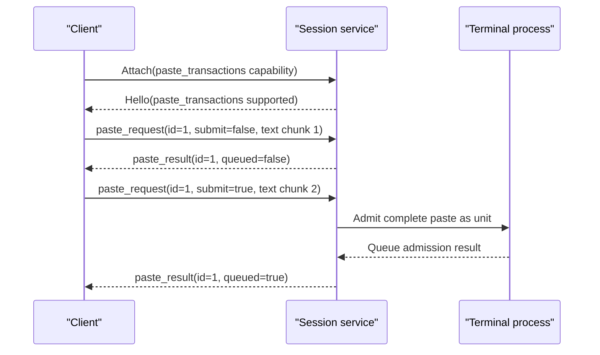

**Diagram sources**
- [local_protocol.hpp:99-116](file://services/session/src/transport/local_protocol.hpp#L99-L116)
- [local_protocol.cpp:175-238](file://services/session/src/transport/local_protocol.cpp#L175-L238)
- [local_protocol_test.cpp:168-198](file://services/session/tests/local_protocol_test.cpp#L168-L198)

**Section sources**
- [local_protocol.hpp:99-116](file://services/session/src/transport/local_protocol.hpp#L99-L116)
- [local_protocol.cpp:175-238](file://services/session/src/transport/local_protocol.cpp#L175-L238)
- [local_protocol_test.cpp:168-198](file://services/session/tests/local_protocol_test.cpp#L168-L198)

### History Navigation
History requests navigate terminal output pages.

#### `HistoryDirection`

| Value | Name | Meaning |
|---:|---|---|
| 0 | `older` | Move toward older history. Reference zero means newest. |
| 1 | `newer` | Move toward newer history. Requires a page ID reference. |
| 2 | `at` | Jump to the page holding a specific absolute row. |

#### `HistoryRequest` payload

| Field | Size | Encoding | Description |
|---|---:|---|---|
| Request ID | 8 bytes | Big-endian `uint64`; nonzero. |
| Reference | 8 bytes | Big-endian `uint64`; page ID or row depending on direction. |
| Direction | 1 byte | `HistoryDirection`. |

Total fixed payload size is 17 bytes.

#### `HistoryReply` payload

| Field | Size | Encoding | Description |
|---|---:|---|---|
| Attachment | 40 bytes | Session identity plus generation. |
| Request ID | 8 bytes | Big-endian `uint64`; nonzero. |
| Page ID | 8 bytes | Big-endian `uint64`; zero when no page is returned. |
| Message length | 4 bytes | Big-endian `uint32`; message byte count. |
| Message | Variable | UTF-8 status message. |
| Snapshot | Optional | Present only when `page_id` is nonzero. |

Compatibility rule:

- Clients should send `at` only to services whose history metadata includes page positioning information.
- Older services leave page fields as plain row counts; they reject unknown behavior.

**Section sources**
- [local_protocol.hpp:104-134](file://services/session/src/transport/local_protocol.hpp#L104-L134)
- [local_protocol.cpp:239-307](file://services/session/src/transport/local_protocol.cpp#L239-L307)
- [local_protocol_test.cpp:199-239](file://services/session/tests/local_protocol_test.cpp#L199-L239)

### Wheel Events
Wheel events are used for full-screen programs that expect mouse-like scrolling.

#### Wire format

| Field | Size | Encoding |
|---|---:|---|
| Steps | 2 bytes | Signed 16-bit; positive values scroll backward. |
| Column | 2 bytes | Unsigned 16-bit viewport column. |
| Row | 2 bytes | Unsigned 16-bit viewport row. |

Total size is 6 bytes.

#### Semantics

- The wheel event is only meaningful when the snapshot indicates `alternate_screen` and `accepts_wheel`.
- Clients should send wheel events only after receiving a snapshot advertising wheel support.
- Services built before wheel support reject frames carrying the wheel kind.
- The `steps` value must be nonzero.

**Section sources**
- [local_protocol.hpp:30-43](file://services/session/src/transport/local_protocol.hpp#L30-L43)
- [local_protocol.cpp:385-404](file://services/session/src/transport/local_protocol.cpp#L385-L404)
- [local_protocol_test.cpp:305-321](file://services/session/tests/local_protocol_test.cpp#L305-L321)

### Status and Error Handling
Errors and lifecycle transitions are carried in `Status` frames.

#### `StatusCode`

| Value | Name | Meaning |
|---:|---|---|
| 1 | `rejected` | Default rejection or invalid request. |
| 2 | `ended` | Session ended; terminal process exited. |
| 3 | `replaced` | Another client replaced this view. |
| 4 | `overloaded` | Service is overloaded and cannot accept more work. |

#### Wire format

| Field | Size | Encoding | Description |
|---|---:|---|---|
| Code | 1 byte | `StatusCode`. |
| Message | Variable | UTF-8 message, up to 4096 bytes. |

Validation rules:

- Code must be one of the four defined values.
- Message must be valid UTF-8.
- Total status payload must not exceed 4097 bytes.

Common failure patterns:

- Unknown frame kind.
- Malformed attachment identity.
- Unsupported attach mode or capability.
- Invalid history direction.
- Invalid Unicode code point or hyperlink span.
- Oversized frame, cells, graphemes, or input.

**Section sources**
- [local_protocol.hpp:142-153](file://services/session/src/transport/local_protocol.hpp#L142-L153)
- [local_protocol.cpp:372-384](file://services/session/src/transport/local_protocol.cpp#L372-L384)
- [local_protocol_test.cpp:276-283](file://services/session/tests/local_protocol_test.cpp#L276-L283)

### Complete Request/Response Examples

#### Example 1: Attach and connect to a session

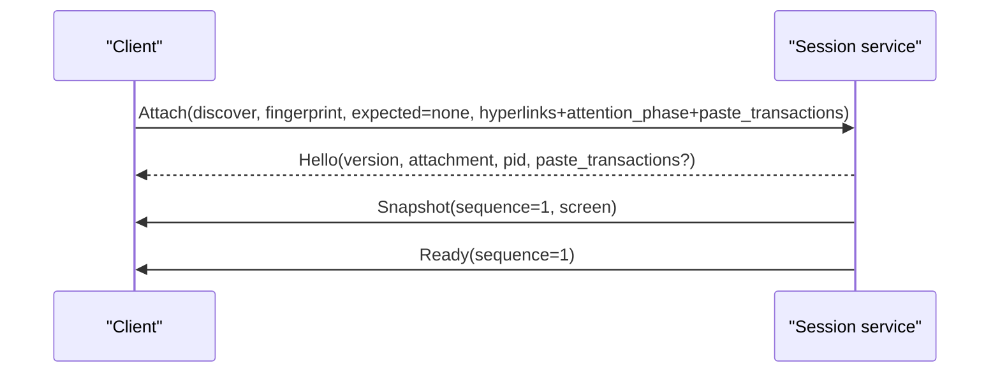

Implementation notes:

- Use `encode_attach` with the desired mode and capability bits.
- Validate `Hello.version` against `version`.
- Enable hyperlink decoding only if the client advertises and receives the link capability.
- Begin applying snapshots starting at sequence 1.
- Treat `Ready.sequence` as the first applied snapshot sequence.

**Section sources**
- [local_protocol.hpp:63-102](file://services/session/src/transport/local_protocol.hpp#L63-L102)
- [local_protocol.cpp:78-175](file://services/session/src/transport/local_protocol.cpp#L78-L175)
- [local_protocol_test.cpp:68-175](file://services/session/tests/local_protocol_test.cpp#L68-L175)

#### Example 2: Stream terminal snapshots

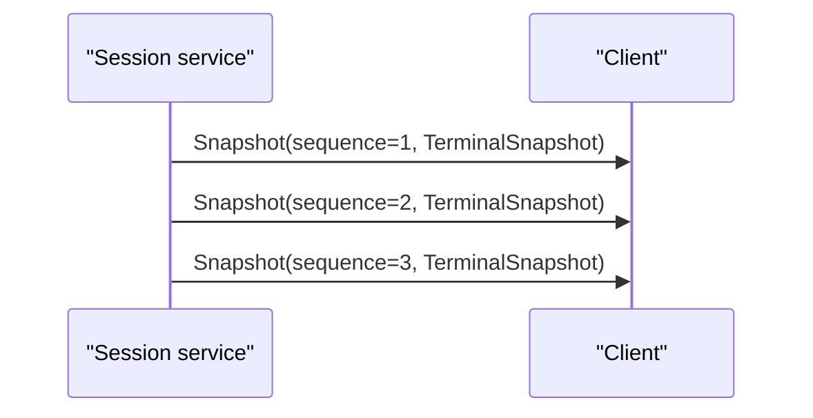

Implementation notes:

- Decode the envelope or full snapshot depending on rendering needs.
- Envelope decoding reads size and timing without requiring the full screen.
- Full snapshot decoding validates cells, graphemes, colors, and optional hyperlinks.
- Replace the previous screen with each new snapshot; do not merge unless the protocol explicitly requires diffing.

**Section sources**
- [local_protocol.cpp:201-238](file://services/session/src/transport/local_protocol.cpp#L201-L238)
- [local_protocol.cpp:405-535](file://services/session/src/transport/local_protocol.cpp#L405-L535)
- [local_protocol_test.cpp:244-258](file://services/session/tests/local_protocol_test.cpp#L244-L258)

#### Example 3: Handle keyboard input

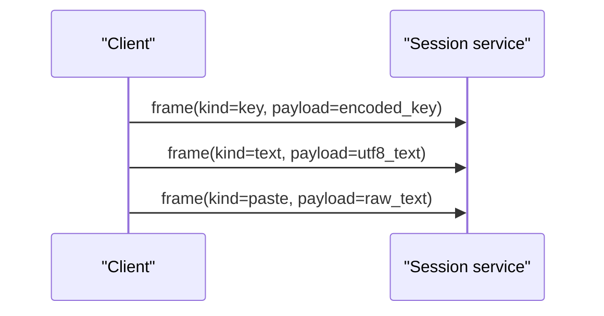

Implementation notes:

- Keep each payload under `max_input_bytes`.
- Split long legacy pastes into multiple `paste` frames.
- Prefer `paste_request`/`paste_result` when both sides support paste transactions.
- Use terminal-encoded key strings rather than raw scancodes.

**Section sources**
- [local_protocol.hpp:117-134](file://services/session/src/transport/local_protocol.hpp#L117-L134)
- [local_protocol.cpp:372-384](file://services/session/src/transport/local_protocol.cpp#L372-L384)
- [local_protocol_test.cpp:262-274](file://services/session/tests/local_protocol_test.cpp#L262-L274)

#### Example 4: Manage a bounded paste transaction

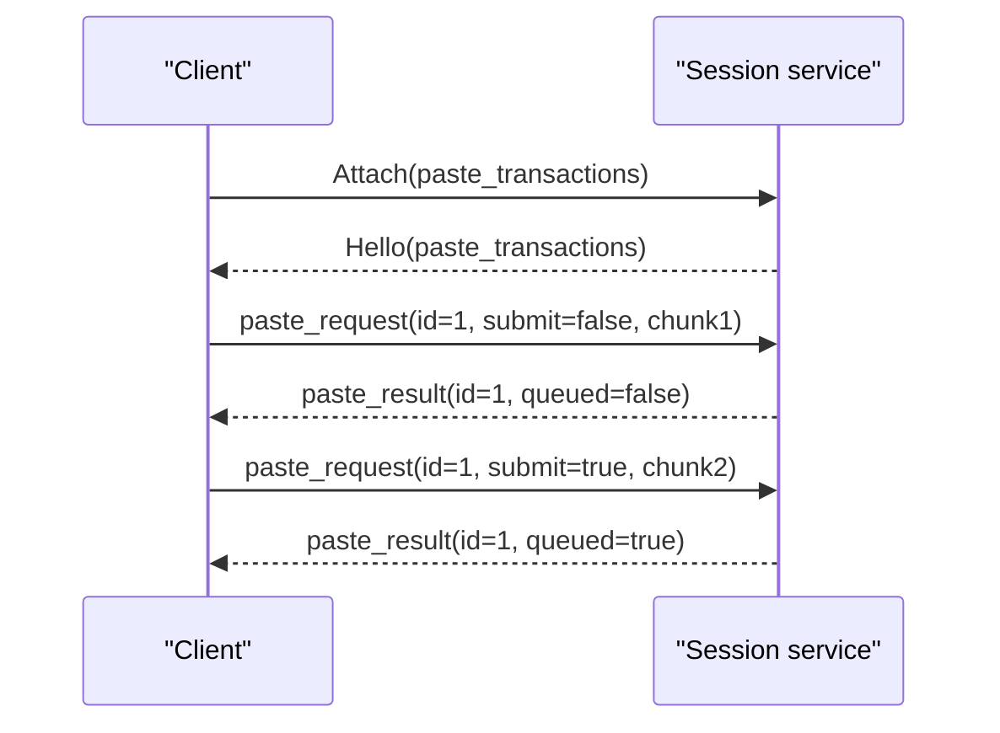

Implementation notes:

- Always use a nonzero request ID.
- Respect `max_paste_bytes`.
- Treat `queued=true` as terminal admission, not application-level completion.
- Fall back to legacy `paste` frames when the service does not advertise paste transactions.

**Section sources**
- [local_protocol.hpp:99-116](file://services/session/src/transport/local_protocol.hpp#L99-L116)
- [local_protocol.cpp:175-238](file://services/session/src/transport/local_protocol.cpp#L175-L238)
- [local_protocol_test.cpp:168-198](file://services/session/tests/local_protocol_test.cpp#L168-L198)

#### Example 5: Navigate history

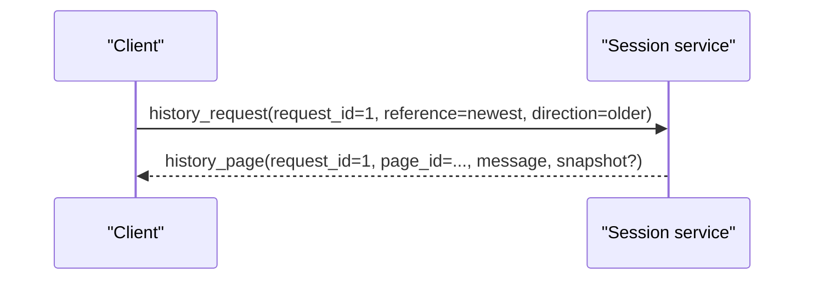

Implementation notes:

- Use `direction=older` with reference zero to move backward from the newest page.
- Use `direction=newer` with a page ID to move forward.
- Use `direction=at` with a row index to jump to a specific page.
- Only include a snapshot when `page_id` is nonzero.

**Section sources**
- [local_protocol.hpp:104-134](file://services/session/src/transport/local_protocol.hpp#L104-L134)
- [local_protocol.cpp:239-307](file://services/session/src/transport/local_protocol.cpp#L239-L307)
- [local_protocol_test.cpp:199-239](file://services/session/tests/local_protocol_test.cpp#L199-L239)

## Dependency Analysis
The protocol components have clear separation:

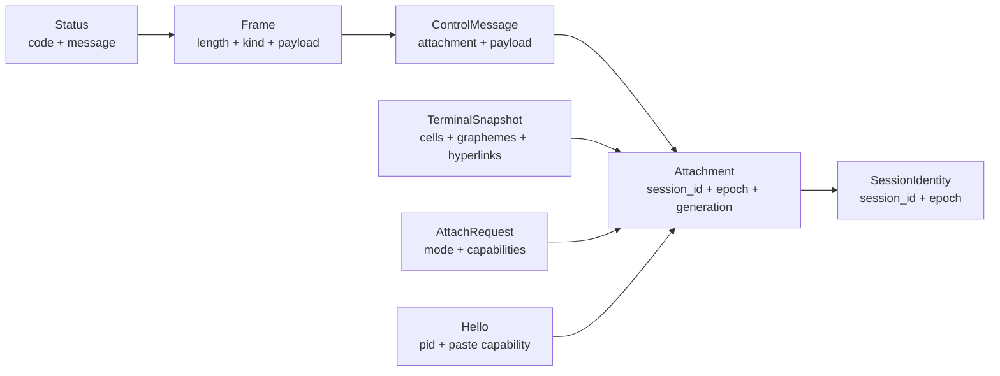

**Diagram sources**
- [local_protocol.hpp:10-153](file://services/session/src/transport/local_protocol.hpp#L10-L153)
- [wire_bytes.hpp:28-55](file://services/session/src/transport/wire_bytes.hpp#L28-L55)

Coupling observations:

- `Attachment` is reused across almost every session-bound message.
- `TerminalSnapshot` is self-contained but validated against global limits.
- `AttachRequest` controls capability negotiation independently of live message flow.
- `Status` is a lightweight error carrier used by many phases.
- History and paste transactions introduce request/response correlation via `request_id`.

**Section sources**
- [local_protocol.hpp:10-153](file://services/session/src/transport/local_protocol.hpp#L10-L153)
- [wire_bytes.hpp:28-55](file://services/session/src/transport/wire_bytes.hpp#L28-L55)

## Performance Considerations
The protocol enforces several memory and throughput safeguards:

- `max_frame_bytes` prevents oversized network buffers.
- `max_cells` bounds terminal screen rendering cost.
- `max_codepoints` bounds grapheme storage.
- `max_input_bytes` bounds per-message input pressure.
- `max_paste_bytes` bounds bounded paste transactions.
- Hyperlink validation enforces span limits, total URI byte budgets, and UTF-8 correctness.
- Frame parsing compacts buffered input lazily to avoid repeated copies.
- Snapshot envelope decoding allows clients to defer full screen decoding until needed.

Recommendations for implementations:

- Reject frames exceeding `max_frame_bytes` before allocating payloads.
- Do not assume hyperlink extensions are always present.
- Apply snapshots in sequence order and ignore gaps gracefully.
- Limit clipboard paste size to `max_paste_bytes` and split using bounded transactions when possible.
- Avoid sending wheel events unless `alternate_screen` and `accepts_wheel` are both true.

[No sources needed since this section provides general guidance]

## Troubleshooting Guide

### Common parse failures

| Symptom | Likely cause | Fix |
|---|---|---|
| Invalid local session read offset | Corrupted or inconsistent consumed pointer. | Reset buffer state and re-parse from zero. |
| Invalid local session message | Bad attachment, bad color kind, or malformed control payload. | Log payload kind and inspect attachment identity. |
| Invalid attachment identity | All-zero UUID or zero generation. | Regenerate identity and generation. |
| Unknown frame kind | Protocol version mismatch or corrupted header. | Disconnect and renegotiate attach. |
| History reply too large | Message or snapshot exceeds frame limit. | Reduce history snapshot inclusion or message size. |
| Invalid Unicode code point | Surrogate or out-of-range grapheme. | Repair terminal encoder or reset terminal state. |
| Malformed hyperlink span | Overlapping or out-of-bounds span. | Regenerate snapshot from a clean terminal instance. |
| Alternate screen byte malformed | Wheel bit set without alternate screen. | Update terminal encoder; ensure alternate screen logic is correct. |

### Lifecycle errors

| Status code | Interpretation | Recommended action |
|---|---|---|
| `rejected` | Request not accepted. | Check mode, capabilities, and payload validity. |
| `ended` | Session terminated. | Close UI resources and allow reconnect. |
| `replaced` | Another client took over. | Notify user and refresh session list. |
| `overloaded` | Service cannot accept work. | Back off and retry later. |

### Debugging steps

1. Verify the frame header length matches the actual remaining buffer.
2. Confirm the kind byte is within the defined range.
3. Validate attachment identity before processing any session-bound message.
4. Check protocol version in `AttachRequest` and `Hello`.
5. Inspect capability bits when features like hyperlinks, attention phase, or paste transactions fail.
6. Compare `HistoryDirection` and `reference` values.
7. Validate hyperlink spans and URIs when snapshot decoding fails.
8. Confirm wheel events are only sent after receiving a snapshot advertising wheel support.

**Section sources**
- [local_protocol.cpp:1-77](file://services/session/src/transport/local_protocol.cpp#L1-L77)
- [local_protocol.cpp:288-384](file://services/session/src/transport/local_protocol.cpp#L288-L384)
- [local_protocol_test.cpp:305-389](file://services/session/tests/local_protocol_test.cpp#L305-L389)

## Conclusion
The internal IPC protocol is a compact, versioned, capacity-limited wire format designed for local desktop-to-session communication. Its core ideas are:

- A single frame wrapper around every message.
- Strong attachment-based session binding.
- Explicit capability negotiation through attach flags.
- A rich terminal snapshot format with optional hyperlinks and wheel support.
- Bounded paste transactions for safe, large clipboard transfers.
- History navigation for terminal output browsing.
- Simple status codes for lifecycle and error signaling.

Implementations should validate every frame, identity, capability, and payload boundary before accepting data, fall back gracefully when capabilities are missing, and treat `Status` messages as authoritative signals for connection state changes.