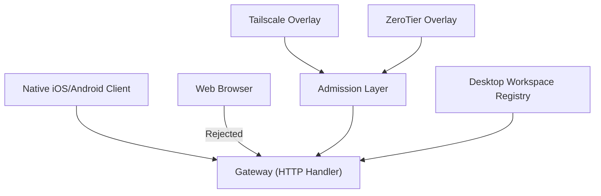
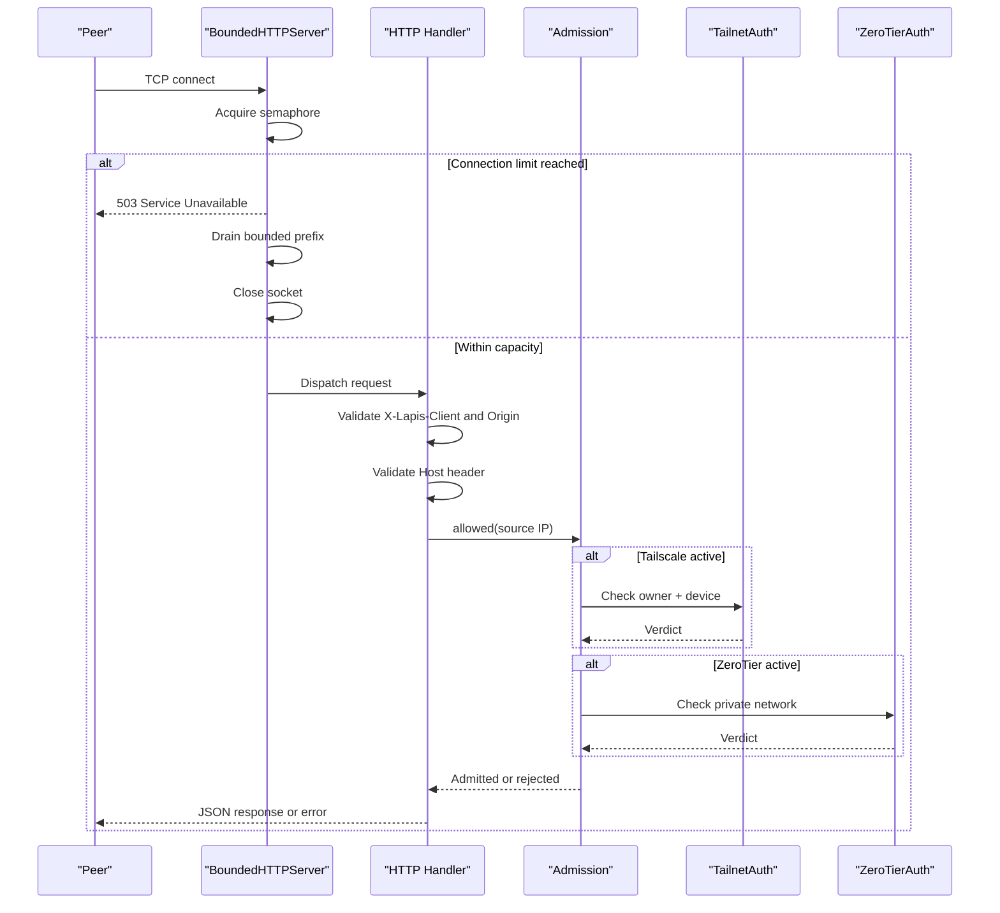
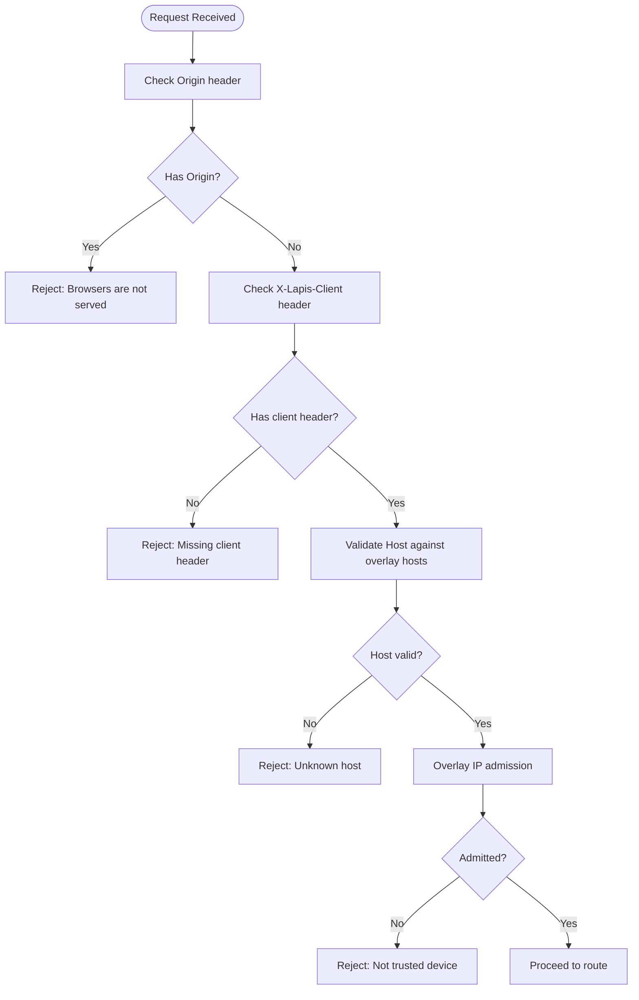
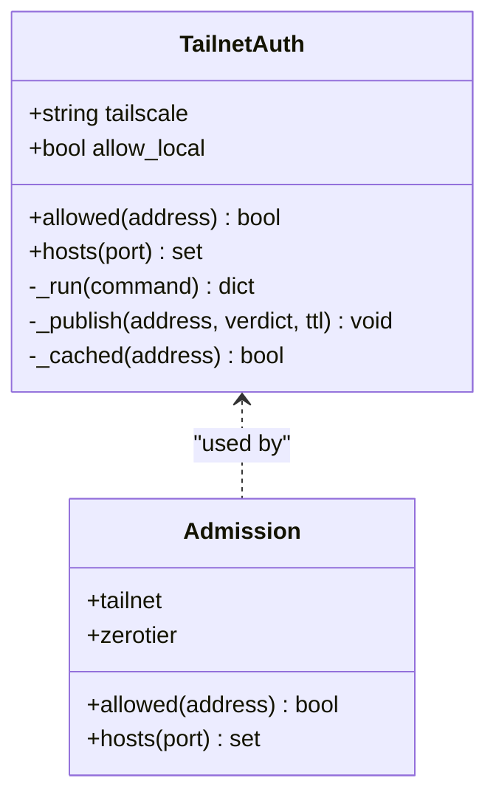
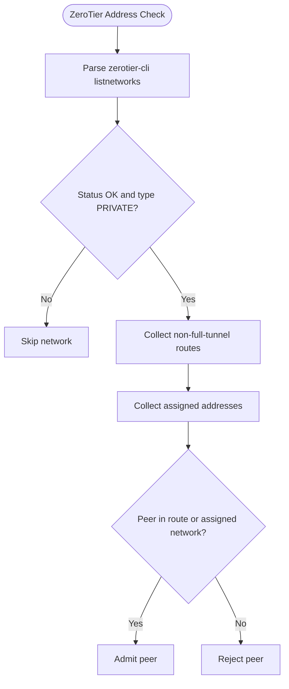
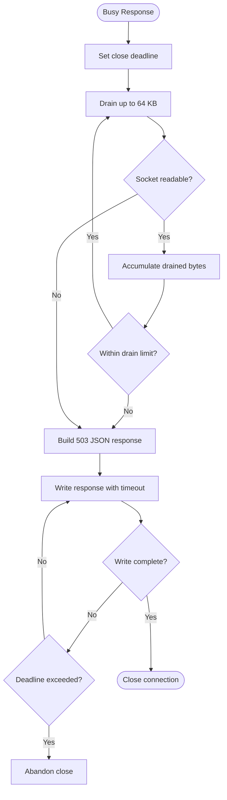
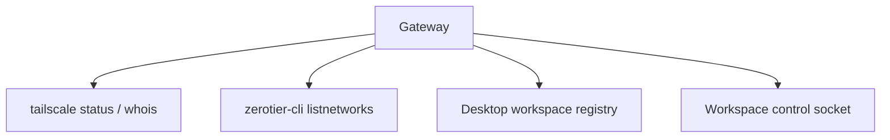

# Authentication & Security

<cite>
**Referenced Files in This Document**
- [lapis_remote.py](file://apps/remote/lapis_remote.py)
- [check_android_remote.py](file://scripts/check_android_remote.py)
- [check_ios_remote.py](file://scripts/check_ios_remote.py)
</cite>

## Table of Contents
1. [Introduction](#introduction)
2. [Project Structure](#project-structure)
3. [Core Components](#core-components)
4. [Architecture Overview](#architecture-overview)
5. [Detailed Component Analysis](#detailed-component-analysis)
6. [Dependency Analysis](#dependency-analysis)
7. [Performance Considerations](#performance-considerations)
8. [Troubleshooting Guide](#troubleshooting-guide)
9. [Conclusion](#conclusion)

## Introduction
This document describes the security model for Lapis’s remote gateway, which exposes desktop agent sessions to native iOS and Android clients. The gateway is not intended as a public web server: it requires native client identification, validates that requests originate from trusted overlay networks, rejects browser-originated traffic, and enforces strict connection admission and request-size limits.

The primary implementation is `apps/remote/lapis_remote.py`. Test harnesses under `scripts/check_android_remote.py` and `scripts/check_ios_remote.py` demonstrate how the same admission boundaries are exercised with loopback-only testing, while production deployments rely on Tailscale or ZeroTier overlay membership.

## Project Structure
The remote gateway is implemented as a single Python module that combines:
- An HTTP server with bounded connection handling.
- Two authentication backends: Tailscale owner/device checks and ZeroTier private-network membership checks.
- Per-request admission logic that enforces headers, host validation, and source IP trust.
- Request routing for workspace listing, terminal streaming, paste submission, settings changes, and other mobile-to-desktop operations.
- A startup routine that chooses the bind address based on whether Tailscale or ZeroTier is active.

**Diagram sources**
- [lapis_remote.py:2321-2470](file://apps/remote/lapis_remote.py#L2321-L2470)
- [lapis_remote.py:3299-3409](file://apps/remote/lapis_remote.py#L3299-L3409)

**Section sources**
- [lapis_remote.py:1-20](file://apps/remote/lapis_remote.py#L1-L20)
- [lapis_remote.py:3299-3409](file://apps/remote/lapis_remote.py#L3299-L3409)

## Core Components
- **BoundedHTTPServer**: A threaded HTTP server wrapper that caps concurrent connections through a semaphore and sends a bounded busy response when the limit is reached.
- **TailnetAuth**: Uses `tailscale whois` to verify that a source IP belongs to the current machine owner and runs an iOS or Android system. It caches decisions and supports loopback bypass via `--allow-local`.
- **ZeroTierAuth**: Parses `zerotier-cli listnetworks` output to admit peers whose addresses fall within private ZeroTier routes or assigned addresses. It refreshes at most every 30 seconds and stops trusting stale results after 300 seconds.
- **Admission**: Combines both overlays; a request is admitted if either backend permits it.
- **Handler**: Validates client identity, origin policy, Host header, and IP trust before routing any API call.
- **Gateway**: Holds workspace state, session ownership, folder indexing, and machine discovery; it does not itself perform network access control.

**Section sources**
- [lapis_remote.py:133-226](file://apps/remote/lapis_remote.py#L133-L226)
- [lapis_remote.py:2083-2295](file://apps/remote/lapis_remote.py#L2083-L2295)
- [lapis_remote.py:2321-2470](file://apps/remote/lapis_remote.py#L2321-L2470)

## Architecture Overview
At runtime, the gateway selects its binding strategy based on available overlay services:
- If ZeroTier reports joined private networks, the server binds to all interfaces (`0.0.0.0`).
- Otherwise, it binds to the local IPv4 address returned by `tailscale ip -4`.
- The `--bind` argument overrides this default explicitly.
- Regardless of binding, per-request admission still verifies the client header, Origin policy, Host header, and source IP against the active overlay authorizers.

**Diagram sources**
- [lapis_remote.py:133-226](file://apps/remote/lapis_remote.py#L133-L226)
- [lapis_remote.py:2083-2295](file://apps/remote/lapis_remote.py#L2083-L2295)
- [lapis_remote.py:2398-2470](file://apps/remote/lapis_remote.py#L2398-L2470)
- [lapis_remote.py:3328-3409](file://apps/remote/lapis_remote.py#L3328-L3409)

## Detailed Component Analysis

### Client Header Validation and Browser Rejection
Every request must carry the `X-Lapis-Client` header. Requests missing this header receive a forbidden response. Additionally, any request carrying an `Origin` header is rejected immediately, regardless of other checks. This prevents ordinary web pages from driving the gateway, even if they can reach the same port.

The handler also validates the `Host` header against the expected hosts published by the active overlay authorizer. Unknown hosts receive a misdirected request response.

**Diagram sources**
- [lapis_remote.py:2398-2470](file://apps/remote/lapis_remote.py#L2398-L2470)

**Section sources**
- [lapis_remote.py:2398-2470](file://apps/remote/lapis_remote.py#L2398-L2470)

### Platform Identification Through Client Header Values
The documented intent is that native mobile clients identify themselves using values such as `android` or `ios`. The constant defining the required header name is declared near the top of the module, and the mobile clients are the expected callers of the gateway.

In the current implementation, the presence of the `X-Lapis-Client` header is checked, but the handler does not inspect its value directly. Device platform validation is primarily enforced by `TailnetAuth.allowed`, which checks the operating system reported by `tailscale whois` and restricts access to iOS and Android systems owned by the local user.

Security implication: relying only on header presence is weaker than validating the exact client identifier. If future behavior changes to accept arbitrary values without verifying the underlying Tailscale OS field, the header alone would no longer be sufficient protection against spoofed or malicious clients.

**Section sources**
- [lapis_remote.py:1-20](file://apps/remote/lapis_remote.py#L1-L20)
- [lapis_remote.py:58-58](file://apps/remote/lapis_remote.py#L58-L58)
- [lapis_remote.py:2083-2155](file://apps/remote/lapis_remote.py#L2083-L2155)
- [lapis_remote.py:2398-2470](file://apps/remote/lapis_remote.py#L2398-L2470)

### Tailscale-Based Access Control
`TailnetAuth` performs the following checks:
- Local Tailscale-owned addresses are admitted directly.
- Loopback addresses may be admitted when `--allow-local` is enabled, which is primarily used by tests.
- Other addresses are resolved through `tailscale whois --json`.
- A request is admitted only when:
  - The `LoginName` matches the machine owner’s login.
  - The `Node.Hostinfo.OS` field is `ios` or `android`.
- Decisions are cached with shorter TTLs for allowed entries and longer TTLs for rejected entries.
- Pending concurrent lookups share a wait event so repeated queries for the same address do not spawn unlimited `whois` processes.

**Diagram sources**
- [lapis_remote.py:2083-2176](file://apps/remote/lapis_remote.py#L2083-L2176)
- [lapis_remote.py:2296-2311](file://apps/remote/lapis_remote.py#L2296-L2311)

**Section sources**
- [lapis_remote.py:2083-2176](file://apps/remote/lapis_remote.py#L2083-L2176)

### ZeroTier-Based Access Control
When `zerotier-cli listnetworks` returns one or more private networks, `ZeroTierAuth` treats them as trusted overlay membership:
- Only networks with status `OK` and type `PRIVATE` are considered.
- Full-tunnel routes with prefix length zero are ignored because they do not represent specific overlay membership.
- Peers are admitted if their IP falls inside a private route target or matches an assigned address network.
- Results are refreshed at most every 30 seconds by one thread.
- Stale CLI output is trusted for up to 300 seconds; after that, the effective network list becomes empty until the CLI responds again.

Because ZeroTier has no equivalent to `tailscale whois`, the gateway cannot distinguish individual devices on the same private network. Membership is the trust boundary.

**Diagram sources**
- [lapis_remote.py:2191-2287](file://apps/remote/lapis_remote.py#L2191-L2287)

**Section sources**
- [lapis_remote.py:2191-2287](file://apps/remote/lapis_remote.py#L2191-L2287)

### Binding Strategy and Network Exposure
The gateway’s bind address is selected as follows:
- Explicit `--bind` takes precedence.
- If ZeroTier reports joined private networks, the gateway binds to all interfaces.
- Otherwise, it binds to the local IPv4 address obtained from `tailscale ip -4`.

This means ZeroTier deployment intentionally accepts connections from any interface, relying on per-peer admission and the Host check as the application-layer boundary. Tailscale-only deployment typically binds to the machine’s Tailscale address rather than all interfaces.

Security implications:
- Binding to `0.0.0.0` increases exposure surface compared to binding only to a known overlay address.
- Application-layer checks remain essential even when the process listens broadly.
- Running behind a firewall, reverse proxy, or overlay-only ingress is recommended.
- TLS termination should be handled by a trusted edge component if the gateway is exposed beyond a trusted overlay.

**Section sources**
- [lapis_remote.py:3299-3409](file://apps/remote/lapis_remote.py#L3299-L3409)

### Connection Admission Controls
The gateway uses two related admission mechanisms:

1. **Process-level connection cap**: `MAX_HTTP_CONNECTIONS = 16` controls how many concurrent HTTP connections may be active. `BoundedHTTPServer` uses a `BoundedSemaphore` and refuses additional connections with a bounded 503 response.
2. **Per-request request-body size limits**: Several constants bound different kinds of payloads:
   - `MAX_REQUEST = 8 * 1024` bytes for general request bodies.
   - `MAX_INPUT = 32 * 1024` bytes for terminal input.
   - `MAX_CAPTURE = 12 * 1024 * 1024` bytes for capture operations.
   - `MAX_PASTE = 960 * 1024` bytes for paste transactions.
   - `MAX_FRAME = 8 * 1024 * 1024` bytes for wire frames.
   - `MAX_CELLS = 32768` for terminal cell buffers.

These bounds protect against memory exhaustion and slowloris-style resource consumption.

**Section sources**
- [lapis_remote.py:58-124](file://apps/remote/lapis_remote.py#L58-L124)
- [lapis_remote.py:133-226](file://apps/remote/lapis_remote.py#L133-L226)

### Paste Operation Bounds
Paste submissions are explicitly bounded by `MAX_PASTE = 960 * 1024` bytes. The comment explains that a paste is treated as a single unit admitted into the agent’s input, optionally followed by a newline, with optional service result framing added in protocol version 6.

This limit prevents a single paste from consuming unbounded memory or terminal processing resources.

**Section sources**
- [lapis_remote.py:67-83](file://apps/remote/lapis_remote.py#L67-L83)

### Busy Response Draining and Timeout Handling
`BoundedHTTPServer.send_busy_reply` implements careful draining during overload:
- It sets a short close deadline.
- It reads incoming data up to `BUSY_DRAIN_LIMIT = 64 * 1024` bytes.
- Each poll waits at most `BUSY_DRAIN_TIMEOUT = 0.02` seconds.
- It writes a small JSON 503 response with `Connection: close`.
- If writing stalls, it abandons the response rather than blocking indefinitely.

This design ensures that excess connections are rejected quickly without letting stalled peers consume the handler timeout budget.

**Diagram sources**
- [lapis_remote.py:133-226](file://apps/remote/lapis_remote.py#L133-L226)

**Section sources**
- [lapis_remote.py:133-226](file://apps/remote/lapis_remote.py#L133-L226)

### TLS Requirements and Deployment Security
The gateway implementation does not configure TLS itself. It is an HTTP server running over plain sockets. Therefore:
- Do not expose it directly over the public Internet.
- Prefer Tailscale-only binding unless ZeroTier is explicitly needed.
- Use a trusted reverse proxy or overlay ingress to terminate TLS when clients require encrypted transport.
- Restrict inbound ports at the firewall or overlay controller level.
- Treat ZeroTier binding to `0.0.0.0` as broader exposure requiring stronger overlay and host verification.

**Section sources**
- [lapis_remote.py:3299-3409](file://apps/remote/lapis_remote.py#L3299-L3409)

### Testing and Safe Local Admission
The test harnesses start the gateway on loopback with `--allow-local`:
- Android tests use `adb reverse` so the phone connects through USB as a loopback client.
- iOS simulator tests run against `127.0.0.1`.
- This allows full admission-path validation without opening the gateway to real network peers.

The `--allow-local` flag is intended for tests only and should not be used in production environments where external access is possible.

**Section sources**
- [check_android_remote.py:1-40](file://scripts/check_android_remote.py#L1-L40)
- [check_ios_remote.py:1-40](file://scripts/check_ios_remote.py#L1-L40)
- [lapis_remote.py:3397-3409](file://apps/remote/lapis_remote.py#L3397-L3409)

## Dependency Analysis
The gateway depends on external commands for overlay authorization:
- `tailscale status --json` to discover the owner and own addresses.
- `tailscale whois --json` to resolve unknown peers’ login names and operating systems.
- `zerotier-cli -j listnetworks` to discover private networks and routes.
- The desktop workspace registry and Unix-domain control socket for workspace and agent management.

**Diagram sources**
- [lapis_remote.py:2083-2176](file://apps/remote/lapis_remote.py#L2083-L2176)
- [lapis_remote.py:2191-2287](file://apps/remote/lapis_remote.py#L2191-L2287)
- [lapis_remote.py:412-470](file://apps/remote/lapis_remote.py#L412-L470)

**Section sources**
- [lapis_remote.py:2083-2176](file://apps/remote/lapis_remote.py#L2083-L2176)
- [lapis_remote.py:2191-2287](file://apps/remote/lapis_remote.py#L2191-L2287)
- [lapis_remote.py:412-470](file://apps/remote/lapis_remote.py#L412-L470)

## Performance Considerations
- **Concurrent connections**: Capped at 16. Additional connections receive an immediate busy reply and are closed after bounded draining.
- **Listing concurrency**: Agent listing is limited to four in-flight listings and probes at most 128 agents using up to 32 workers, preventing a pathological registry from causing unbounded fan-out.
- **Timeouts**: The HTTP handler has a 60-second timeout, and busy responses have dedicated short timeouts so stalled peers do not exhaust handler threads.
- **Memory bounds**: Wire frames, captures, input, and paste payloads are bounded by explicit constants.
- **Cache behavior**: Tailscale decisions are cached to reduce `whois` calls; ZeroTier membership lists are refreshed periodically and become restrictive if the CLI becomes silent.

[No sources needed since this section summarizes previously analyzed limits and behaviors]

## Troubleshooting Guide
Common security-related symptoms and likely causes:

| Symptom | Likely Cause | Recommended Action |
|---|---|---|
| Requests fail with “Missing client header” | The caller did not send `X-Lapis-Client`. | Verify the native client includes the required header. |
| Requests fail with “Browsers are not served” | The request carries an `Origin` header. | Ensure traffic comes from native apps, not web pages. |
| Requests fail with “Unknown host” | The `Host` header does not match overlay-published hosts. | Check bind address, port, and overlay DNS configuration. |
| Requests fail with “Not one of this Mac owner’s devices” | Source IP is not admitted by Tailscale or ZeroTier. | Confirm overlay membership and that the Tailscale node is owned by the correct user and reports iOS/Android. |
| Gateway starts on all interfaces unexpectedly | ZeroTier reported joined private networks. | Review ZeroTier configuration; use `--bind` if explicit control is required. |
| Gateway fails to start due to overlay errors | Neither Tailscale nor ZeroTier provided usable membership information. | Sign in to Tailscale or authorize the Mac onto a private ZeroTier network. |
| Tests pass locally but production fails | Production traffic reaches a broader bind address than loopback. | Restrict network exposure and validate overlay admission. |

**Section sources**
- [lapis_remote.py:2398-2470](file://apps/remote/lapis_remote.py#L2398-L2470)
- [lapis_remote.py:3299-3409](file://apps/remote/lapis_remote.py#L3299-L3409)

## Conclusion
The Lapis remote gateway uses layered defenses to ensure that only native mobile clients on trusted overlay networks can access desktop agent sessions:

- Browser traffic is rejected by refusing requests with `Origin`.
- Native client identity is enforced by requiring `X-Lapis-Client`.
- IP-based trust is delegated to Tailscale owner/device checks or ZeroTier private-network membership.
- Host validation adds another layer against misrouted or spoofed requests.
- Connection admission, request/body/paste bounds, and busy-drain logic prevent resource exhaustion.
- Deployment binding differs between Tailscale-only and ZeroTier modes, making network exposure control critical.

For secure operation, deploy behind a trusted overlay or firewall, avoid public exposure, prefer Tailscale-only binding when possible, and treat ZeroTier’s broad binding as an application-layer trust boundary rather than a network perimeter.