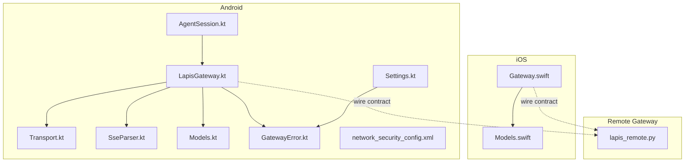
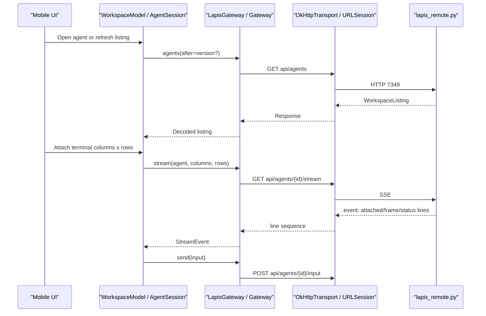
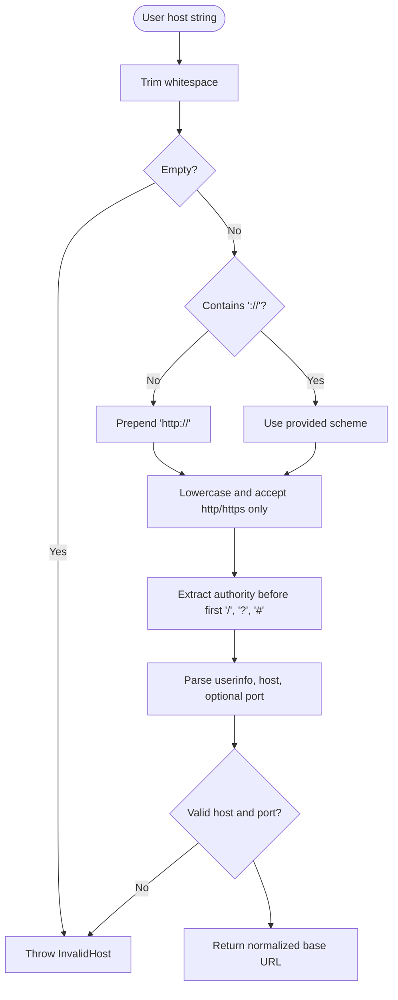
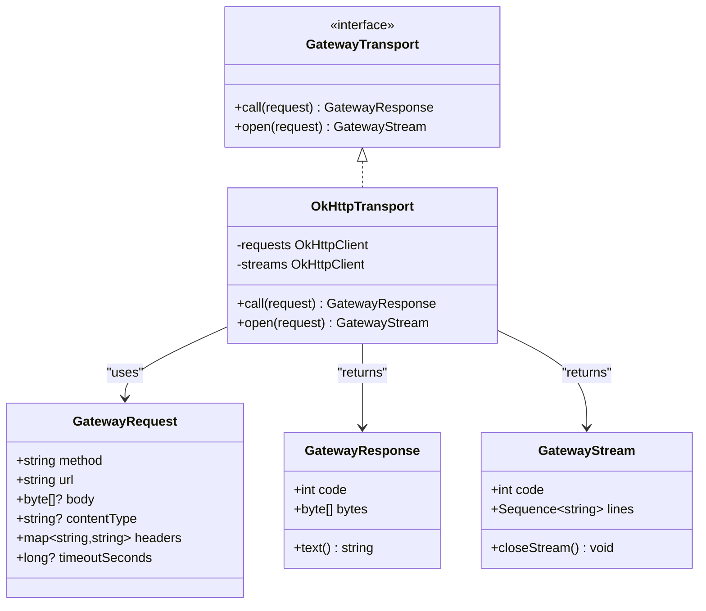
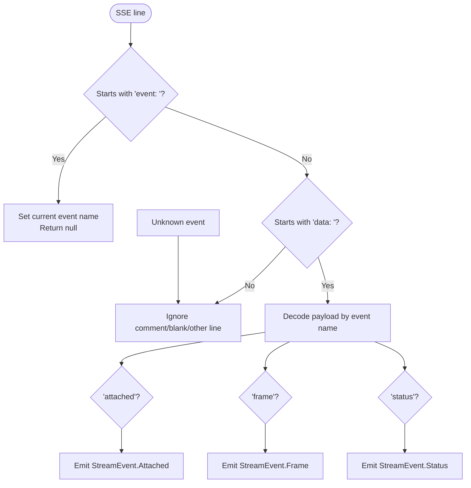
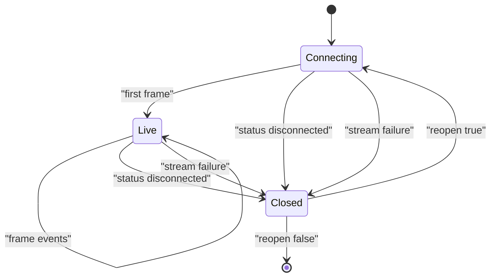
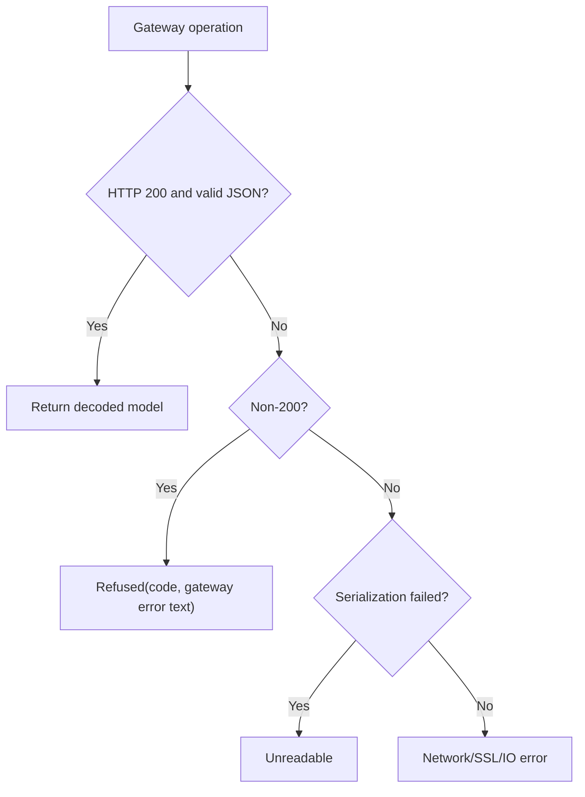
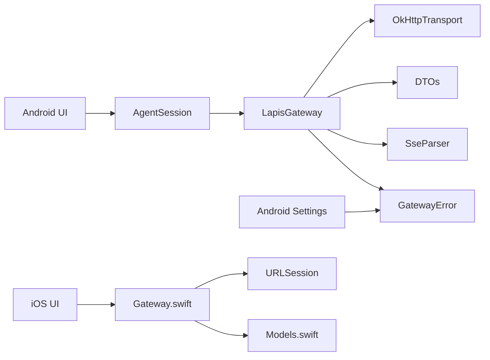

# Mobile Client Integration

<cite>
**Referenced Files in This Document**
- [LapisGateway.kt](file://apps/android/app/src/main/kotlin/dev/lapis/remote/gateway/LapisGateway.kt)
- [Transport.kt](file://apps/android/app/src/main/kotlin/dev/lapis/remote/gateway/Transport.kt)
- [SseParser.kt](file://apps/android/app/src/main/kotlin/dev/lapis/remote/gateway/SseParser.kt)
- [Models.kt](file://apps/android/app/src/main/kotlin/dev/lapis/remote/gateway/Models.kt)
- [GatewayError.kt](file://apps/android/app/src/main/kotlin/dev/lapis/remote/gateway/GatewayError.kt)
- [Settings.kt](file://apps/android/app/src/main/kotlin/dev/lapis/remote/platform/Settings.kt)
- [AgentSession.kt](file://apps/android/app/src/main/kotlin/dev/lapis/remote/session/AgentSession.kt)
- [network_security_config.xml](file://apps/android/app/src/main/res/xml/network_security_config.xml)
- [Gateway.swift](file://apps/ios/Lapis/Gateway.swift)
- [Models.swift](file://apps/ios/Lapis/Models.swift)
- [2026-09-27-android-client-design.md](file://docs/superpowers/specs/2026-09-27-android-client-design.md)
- [GatewayUrlTest.kt](file://apps/android/app/src/test/kotlin/dev/lapis/remote/gateway/GatewayUrlTest.kt)
- [LapisGatewayTest.kt](file://apps/android/app/src/test/kotlin/dev/lapis/remote/gateway/LapisGatewayTest.kt)
- [SseParserTest.kt](file://apps/android/app/src/test/kotlin/dev/lapis/remote/gateway/SseParserParserTest.kt)
</cite>

## Table of Contents
1. [Introduction](#introduction)
2. [Project Structure](#project-structure)
3. [Core Components](#core-components)
4. [Architecture Overview](#architecture-overview)
5. [Detailed Component Analysis](#detailed-component-analysis)
6. [Dependency Analysis](#dependency-analysis)
7. [Performance Considerations](#performance-considerations)
8. [Troubleshooting Guide](#troubleshooting-guide)
9. [Conclusion](#conclusion)
10. [Appendices](#appendices)

## Introduction
This document explains how mobile clients integrate with the Lapis remote gateway on a Mac. The Android implementation is `dev.lapis.remote.gateway`, and the iOS implementation is `apps/ios/Lapis`. Both connect to the same Python gateway over Tailscale or ZeroTier, using plain HTTP because the overlay network provides encryption. The gateway exposes REST endpoints for agent management and an SSE stream for live terminal output.

The integration has three layers:
- URL normalization and endpoint construction: both platforms normalize user-provided host values into a stable base URL and build request paths relative to it.
- Transport abstraction: Android uses OkHttp; iOS uses URLSession. Both provide blocking request/response calls and long-lived streams.
- Session lifecycle: Android’s `AgentSession` manages connection state, terminal frame updates, history paging, input, and cleanup; iOS performs equivalent work through its own model layer.

## Project Structure
The relevant mobile client code is split by platform:

**Diagram sources**
- [LapisGateway.kt:1-300](file://apps/android/app/src/main/kotlin/dev/lapis/remote/gateway/LapisGateway.kt#L1-L300)
- [Transport.kt:1-137](file://apps/android/app/src/main/kotlin/dev/lapis/remote/gateway/Transport.kt#L1-L137)
- [SseParser.kt:1-40](file://apps/android/app/src/main/kotlin/dev/lapis/remote/gateway/SseParser.kt#L1-L40)
- [Models.kt:1-327](file://apps/android/app/src/main/kotlin/dev/lapis/remote/gateway/Models.kt#L1-L327)
- [GatewayError.kt:1-21](file://apps/android/app/src/main/kotlin/dev/lapis/remote/gateway/GatewayError.kt#L1-L21)
- [Settings.kt:1-76](file://apps/android/app/src/main/kotlin/dev/lapis/remote/platform/Settings.kt#L1-L76)
- [AgentSession.kt:1-200](file://apps/android/app/src/main/kotlin/dev/lapis/remote/session/AgentSession.kt#L1-L200)
- [Gateway.swift:1-588](file://apps/ios/Lapis/Gateway.swift#L1-L588)
- [Models.swift:1-200](file://apps/ios/Lapis/Models.swift#L1-L200)

**Section sources**
- [LapisGateway.kt:1-300](file://apps/android/app/src/main/kotlin/dev/lapis/remote/gateway/LapisGateway.kt#L1-L300)
- [Gateway.swift:1-588](file://apps/ios/Lapis/Gateway.swift#L1-L588)
- [2026-09-27-android-client-design.md:1-120](file://docs/superpowers/specs/2026-09-27-android-client-design.md#L1-L120)

## Core Components
The Android gateway package contains five focused files:

| File | Responsibility |
|---|---|
| `LapisGateway.kt` | URL normalization, endpoint building, HTTP and SSE methods, JSON serialization, error mapping |
| `Transport.kt` | `GatewayRequest`, `GatewayResponse`, `GatewayStream`, `GatewayTransport`, and OkHttp-backed default transport |
| `SseParser.kt` | Line-based SSE decoder for `attached`, `frame`, and `status` events |
| `Models.kt` | DTOs for workspace listing, agents, screen frames, history pages, input, and stream events |
| `GatewayError.kt` | User-facing error types matching iOS behavior |

iOS mirrors this structure through `Gateway.swift` and `Models.swift`, using URLSession instead of OkHttp.

**Section sources**
- [LapisGateway.kt:1-300](file://apps/android/app/src/main/kotlin/dev/lapis/remote/gateway/LapisGateway.kt#L1-L300)
- [Transport.kt:1-137](file://apps/android/app/src/main/kotlin/dev/lapis/remote/gateway/Transport.kt#L1-L137)
- [SseParser.kt:1-40](file://apps/android/app/src/main/kotlin/dev/lapis/remote/gateway/SseParser.kt#L1-L40)
- [Models.kt:1-327](file://apps/android/app/src/main/kotlin/dev/lapis/remote/gateway/Models.kt#L1-L327)
- [GatewayError.kt:1-21](file://apps/android/app/src/main/kotlin/dev/lapis/remote/gateway/GatewayError.kt#L1-L21)
- [Gateway.swift:1-588](file://apps/ios/Lapis/Gateway.swift#L1-L588)

## Architecture Overview
The gateway API is shared between Android and iOS. Clients do not authenticate directly to the gateway; admission is controlled by the Mac-side gateway based on Tailscale or ZeroTier membership.

**Diagram sources**
- [LapisGateway.kt:120-300](file://apps/android/app/src/main/kotlin/dev/lapis/remote/gateway/LapisGateway.kt#L120-L300)
- [Transport.kt:45-137](file://apps/android/app/src/main/kotlin/dev/lapis/remote/gateway/Transport.kt#L45-L137)
- [AgentSession.kt:100-200](file://apps/android/app/src/main/kotlin/dev/lapis/remote/session/AgentSession.kt#L100-L200)
- [Gateway.swift:280-588](file://apps/ios/Lapis/Gateway.swift#L280-L588)

## Detailed Component Analysis

### URL Normalization and Endpoint Construction
Both platforms normalize a user-supplied host value into a stable base URL before constructing any endpoint.

Android normalization rules:
- Trim whitespace.
- Reject empty input.
- Default scheme to `http://` when absent.
- Accept only `http` or `https`.
- Discard path, query, and fragment from the input.
- Preserve optional userinfo before the host.
- Parse IPv4, bracketed IPv6, and optional port.
- Default port is `7349`.
- Return `scheme://userinfo@host:port`.

iOS normalization rules are mirrored:
- Trim whitespace.
- Require a valid host after parsing.
- Lowercase the scheme.
- Default to `http`.
- Use port `7349` when absent.
- Clear the path.

Endpoint construction is also consistent:
- Request URLs append `/` plus the gateway path.
- Query parameters are appended when present.
- All requests include `X-Lapis-Client`, set to `android` on Android and `ios` on iOS.
- Requests use cache-busting semantics: Android sets `Cache-Control: no-cache`; iOS uses `reloadIgnoringLocalCacheData`.

#### URL Normalization Flowchart

**Diagram sources**
- [LapisGateway.kt:30-119](file://apps/android/app/src/main/kotlin/dev/lapis/remote/gateway/LapisGateway.kt#L30-L119)
- [Gateway.swift:240-280](file://apps/ios/Lapis/Gateway.swift#L240-L280)
- [GatewayUrlTest.kt:1-80](file://apps/android/app/src/test/kotlin/dev/lapis/remote/gateway/GatewayUrlTest.kt#L1-L80)

**Section sources**
- [LapisGateway.kt:30-119](file://apps/android/app/src/main/kotlin/dev/lapis/remote/gateway/LapisGateway.kt#L30-L119)
- [Gateway.swift:240-280](file://apps/ios/Lapis/Gateway.swift#L240-L280)
- [GatewayUrlTest.kt:1-80](file://apps/android/app/src/test/kotlin/dev/lapis/remote/gateway/GatewayUrlTest.kt#L1-L80)

### Transport Abstraction Layer
The Android gateway separates protocol logic from network I/O through `GatewayTransport`:

| Interface | Purpose |
|---|---|
| `GatewayRequest` | Immutable description of method, URL, body, content type, headers, and per-call timeout |
| `GatewayResponse` | Status code and raw bytes |
| `GatewayStream` | Status code, lazy line sequence, and explicit close |
| `GatewayTransport` | Single call and single stream open |
| `OkHttpTransport` | Default OkHttp-backed implementation |

Key transport behaviors:
- Regular requests use a short-lived OkHttp client with 15-second connect, read, write, and call timeouts.
- Streams use a separate OkHttp client with 15-second connect/write but a 40-second read timeout.
- Streaming has no overall call timeout so that idle screens do not time out while the gateway pings every 10 seconds.
- Each streamed line is bounded at approximately 8 MiB plus slack to prevent memory exhaustion.
- A malformed oversized line raises an IO exception rather than being mistaken for a clean EOF.
- Closing a stream releases both the underlying source and response.

iOS implements the same idea with two URLSession configurations:
- Short-lived requests use 15-second request timeouts.
- Streams use 40-second request timeouts and very long resource timeouts.

**Diagram sources**
- [Transport.kt:15-137](file://apps/android/app/src/main/kotlin/dev/lapis/remote/gateway/Transport.kt#L15-L137)

**Section sources**
- [Transport.kt:15-137](file://apps/android/app/src/main/kotlin/dev/lapis/remote/gateway/Transport.kt#L15-L137)
- [Gateway.swift:280-320](file://apps/ios/Lapis/Gateway.swift#L280-L320)

### SSE Parsing and Terminal Event Handling
The gateway sends server-sent events for each agent stream:
- `event: attached` followed by `data:` containing attachment metadata.
- `event: frame` followed by `data:` containing a complete `ScreenFrame`.
- `event: status` followed by `data:` containing terminal status.
- Comment lines such as `: ping` every 10 seconds.
- Blank separator lines.

Android’s `SseEventParser` processes one raw line at a time:
- Lines starting with `event: ` update the current event name.
- Lines starting with `data: ` decode the payload according to the current event name.
- Unknown event names are ignored.
- Known payloads are deserialized strictly; malformed known payloads fail the stream.
- Unknown or non-event lines return null without failing.

**Diagram sources**
- [SseParser.kt:1-40](file://apps/android/app/src/main/kotlin/dev/lapis/remote/gateway/SseParser.kt#L1-L40)
- [LapisGateway.kt:240-300](file://apps/android/app/src/main/kotlin/dev/lapis/remote/gateway/LapisGateway.kt#L240-L300)

**Section sources**
- [SseParser.kt:1-40](file://apps/android/app/src/main/kotlin/dev/lapis/remote/gateway/SseParser.kt#L1-L40)
- [LapisGateway.kt:240-300](file://apps/android/app/src/main/kotlin/dev/lapis/remote/gateway/LapisGateway.kt#L240-L300)
- [SseParserTest.kt:1-72](file://apps/android/app/src/test/kotlin/dev/lapis/remote/gateway/SseParserTest.kt#L1-L72)

### Connection Lifecycle Management
Android’s `AgentSession` represents one visible agent session and owns:
- Connection state flow: `Connecting`, `Live`, `Closed(reason, reopen)`.
- Live frame state.
- Notice messages.
- Shared terminal flag.
- Archived history.
- Input queue.
- Connection generation identity.
- Background jobs for streaming, input, and history loading.

Lifecycle phases:
1. **Open**: Sets initial size, clears history state, marks connecting, launches stream job.
2. **Attached**: Updates shared state and transitions to connecting until the first frame.
3. **First Frame**: Marks live, caches frame, resends resize if needed, starts background prefetch of older history.
4. **Ongoing Frames**: Updates frame, last frame JSON, cached frame, and triggers newer-history tracking.
5. **Status Change**: Converts status into closed state, optionally marking reconnectable.
6. **Gateway Close**: Converts normal stream end into closed-with-reconnect state.
7. **Close**: Cancels stream and input jobs and resets internal references.

Reconnection strategy:
- Errors during stream collection mark the session as `Closed` with `reopen = true`.
- Cancellation exceptions are rethrown so callers can distinguish intentional cancellation from failures.
- Retired connection generations prevent older streams from publishing over newer ones.
- History loading is guarded by the same generation identity.

**Diagram sources**
- [AgentSession.kt:20-200](file://apps/android/app/src/main/kotlin/dev/lapis/remote/session/AgentSession.kt#L20-L200)

**Section sources**
- [AgentSession.kt:20-200](file://apps/android/app/src/main/kotlin/dev/lapis/remote/session/AgentSession.kt#L20-L200)

### Initial Health Check and Agent Listing with Version Tracking
The iOS client demonstrates version-aware refresh:
- It stores a `version` field in `WorkspaceListing`.
- On refresh, it passes the previously seen version as `after`.
- The gateway returns once the registry changes or after eight seconds.
- Results are cached by host digest.
- Prefetching loads harnesses, defaults, machines, folder catalogs, and running agent screens.

Android mirrors the data models and gateway endpoints:
- `agents()` returns `WorkspaceListing`.
- `harnesses()` returns `HarnessesListing` with defaults.
- `machines()` returns machine list.
- `folders(machine, have)` supports change detection via `have` and includes a longer timeout for SSH-backed machines.

For Android integration:
- Call `agents()` on app start to perform an initial health check against the configured gateway.
- If successful, store the returned listing and version.
- Periodically refresh using the stored version as the `after` parameter.
- Invalidate cached state when the host changes.

**Section sources**
- [Models.swift:1-200](file://apps/ios/Lapis/Models.swift#L1-L200)
- [LapisGateway.kt:180-240](file://apps/android/app/src/main/kotlin/dev/lapis/remote/gateway/LapisGateway.kt#L180-L240)
- [Gateway.swift:320-480](file://apps/ios/Lapis/Gateway.swift#L320-L480)

### Terminal Stream Attachment, Detachment, and Cleanup
Attachment:
- Construct `LapisGateway` from a normalized base URL.
- Call `stream(agentId, columns, rows)` to obtain a cold flow.
- Collect events on the UI scope.
- Handle `Attached`, `Frame`, and `Status` events.
- Send resize input after the first frame if the initial dimensions differ.
- Cache the latest frame for immediate display.

Detachment:
- Cancel the stream collection job.
- Let the flow’s `finally` block close the underlying response under `NonCancellable`.
- Update session state to closed.
- Allow higher-level UI to decide whether to retry automatically.

Cleanup on app termination:
- Cancel all session-scoped jobs.
- Avoid holding long-lived transports outside a session.
- Persist only lightweight settings; avoid saving large terminal buffers unnecessarily.

**Section sources**
- [LapisGateway.kt:240-300](file://apps/android/app/src/main/kotlin/dev/lapis/remote/gateway/LapisGateway.kt#L240-L300)
- [Transport.kt:80-137](file://apps/android/app/src/main/kotlin/dev/lapis/remote/gateway/Transport.kt#L80-L137)
- [AgentSession.kt:100-200](file://apps/android/app/src/main/kotlin/dev/lapis/remote/session/AgentSession.kt#L100-L200)

### Error Handling Patterns
Android maps errors consistently:

| Scenario | Behavior |
|---|---|
| Empty or unparseable host | `GatewayError.InvalidHost` |
| Non-HTTP scheme | `GatewayError.UnsupportedScheme(scheme)` |
| Non-200 response | `GatewayError.Refused(code, bodyMessage)` where `bodyMessage` comes from JSON `error` when available |
| Malformed JSON | `GatewayError.Unreadable` |
| SSL failure | Human-readable message about secure connection failure |
| Network IO failure | Actionable message about Tailscale or ZeroTier connectivity |

The `describe(error)` helper centralizes user-facing messaging for Android. iOS has an equivalent localized error description enum.

**Diagram sources**
- [LapisGateway.kt:130-179](file://apps/android/app/src/main/kotlin/dev/lapis/remote/gateway/LapisGateway.kt#L130-L179)
- [GatewayError.kt:1-21](file://apps/android/app/src/main/kotlin/dev/lapis/remote/gateway/GatewayError.kt#L1-L21)
- [Settings.kt:58-76](file://apps/android/app/src/main/kotlin/dev/lapis/remote/platform/Settings.kt#L58-L76)

**Section sources**
- [GatewayError.kt:1-21](file://apps/android/app/src/main/kotlin/dev/lapis/remote/gateway/GatewayError.kt#L1-L21)
- [Settings.kt:58-76](file://apps/android/app/src/main/kotlin/dev/lapis/remote/platform/Settings.kt#L58-L76)
- [LapisGatewayTest.kt:1-200](file://apps/android/app/src/test/kotlin/dev/lapis/remote/gateway/LapisGatewayTest.kt#L1-L200)

### Implementing the Gateway Interface
To implement a custom gateway interface on Android:

1. Define a class implementing `GatewayTransport`.
2. Record or intercept `GatewayRequest` objects.
3. Return canned `GatewayResponse` or `GatewayStream` objects for tests.
4. Inject the transport into `LapisGateway(base, transport)`.
5. Assert:
   - Method correctness.
   - URL path and query encoding.
   - Presence of `X-Lapis-Client` and `Cache-Control`.
   - Body encoding for POST operations.
   - SSE event parsing for streaming endpoints.

A minimal test pattern already exists in `FakeTransport`, which records requests and replays responses.

**Section sources**
- [Transport.kt:15-60](file://apps/android/app/src/main/kotlin/dev/lapis/remote/gateway/Transport.kt#L15-L60)
- [LapisGatewayTest.kt:1-200](file://apps/android/app/src/test/kotlin/dev/lapis/remote/gateway/LapisGatewayTest.kt#L1-L200)

### Handling Real-Time Terminal Updates
Recommended integration steps:
- Maintain one `AgentSession` per visible agent.
- Subscribe to `state`, `frame`, `notice`, `history`, and `size` flows.
- Render `ScreenFrame` rows using the existing Android terminal renderer.
- Send input through `gateway.send(Input(...), agentId)`.
- Use `Input.key(Key.ESCAPE)` for interrupt commands.
- Use `Input.wheel(notches, column, row)` for scroll events.
- Debounce resize events until the first frame arrives.

**Section sources**
- [Models.kt:250-327](file://apps/android/app/src/main/kotlin/dev/lapis/remote/gateway/Models.kt#L250-L327)
- [AgentSession.kt:100-200](file://apps/android/app/src/main/kotlin/dev/lapis/remote/session/AgentSession.kt#L100-L200)

### Managing Connection Pooling
OkHttp handles connection pooling internally:
- `OkHttpTransport.requests` shares connections for short-lived requests.
- `OkHttpTransport.streams` shares connections for long-lived streams.
- Do not create a new `OkHttpClient` per request.
- Reuse one `LapisGateway` per configured host.
- Avoid keeping many active terminal sessions simultaneously unless required.
- Close streams explicitly even when abandoning early.

**Section sources**
- [Transport.kt:60-137](file://apps/android/app/src/main/kotlin/dev/lapis/remote/gateway/Transport.kt#L60-L137)
- [LapisGateway.kt:240-300](file://apps/android/app/src/main/kotlin/dev/lapis/remote/gateway/LapisGateway.kt#L240-L300)

### Platform-Specific Considerations

#### Android Background Execution and Battery Optimization
- The design does not implement background push or background network.
- Long-lived terminal sessions run while the app is foregrounded or retained by the OS.
- Use `CoroutineScope` tied to UI lifecycle or a dedicated long-lived process scope.
- Avoid holding `AgentSession` or `LapisGateway` beyond necessary lifetimes.
- Persist only small settings through `DataStoreSettings`.

#### Android Cleartext HTTP
Cleartext HTTP is permitted because requests target a user-configured gateway behind Tailscale or ZeroTier. The network security configuration allows cleartext traffic to system trust anchors.

#### iOS Background Execution
iOS follows similar constraints: the app connects to the Mac over Tailscale or ZeroTier and does not rely on background push. Long-lived sessions should respect app lifecycle callbacks.

#### Memory Management During Long Sessions
- Android bounds streamed lines at roughly 8 MiB plus slack.
- Android caches only the latest frame and archived pages managed by the session.
- iOS caches workspace listings, harnesses, defaults, machines, and folder payloads keyed by host digest.
- Clear cached data when host changes.
- Avoid retaining full terminal history indefinitely.

**Section sources**
- [network_security_config.xml:1-12](file://apps/android/app/src/main/res/xml/network_security_config.xml#L1-L12)
- [Settings.kt:1-57](file://apps/android/app/src/main/kotlin/dev/lapis/remote/platform/Settings.kt#L1-L57)
- [Transport.kt:80-137](file://apps/android/app/src/main/kotlin/dev/lapis/remote/gateway/Transport.kt#L80-L137)
- [Models.swift:1-120](file://apps/ios/Lapis/Models.swift#L1-L120)
- [2026-09-27-android-client-design.md:100-180](file://docs/superpowers/specs/2026-09-27-android-client-design.md#L100-L180)

## Dependency Analysis
The Android gateway depends on OkHttp, kotlinx.serialization, kotlinx.coroutines, and Jetpack DataStore. iOS depends on Foundation, URLSession, and CryptoKit for host-digest caching.

**Diagram sources**
- [LapisGateway.kt:1-300](file://apps/android/app/src/main/kotlin/dev/lapis/remote/gateway/LapisGateway.kt#L1-L300)
- [Transport.kt:1-137](file://apps/android/app/src/main/kotlin/dev/lapis/remote/gateway/Transport.kt#L1-L137)
- [AgentSession.kt:1-200](file://apps/android/app/src/main/kotlin/dev/lapis/remote/session/AgentSession.kt#L1-L200)
- [Gateway.swift:1-588](file://apps/ios/Lapis/Gateway.swift#L1-L588)
- [Models.swift:1-200](file://apps/ios/Lapis/Models.swift#L1-L200)

**Section sources**
- [LapisGateway.kt:1-300](file://apps/android/app/src/main/kotlin/dev/lapis/remote/gateway/LapisGateway.kt#L1-L300)
- [Gateway.swift:1-588](file://apps/ios/Lapis/Gateway.swift#L1-L588)

## Performance Considerations
- Prefer version-aware polling for agent listings to reduce unnecessary downloads.
- Use the 45-second timeout for SSH-backed folder listings.
- Use the 40-second read timeout for SSE streams to tolerate quiet screens.
- Avoid rebuilding gateway instances when the host has not changed.
- Reuse transport clients; do not create them per request.
- Bound terminal frame processing to the displayed area.
- Debounce resize events.
- Avoid serializing large captures frequently.
- Use offline mode or mock gateways for testing without network access.

## Troubleshooting Guide
Common issues and their likely causes:

| Symptom | Likely Cause | Resolution |
|---|---|---|
| Host validation fails | Empty, malformed, or unsupported host | Verify Tailscale name or ZeroTier address and port |
| Unsupported scheme | URL uses FTP or another scheme | Use `http://` or `https://` |
| Gateway refuses request | Non-200 HTTP status | Inspect gateway logs and device admission |
| Answer unreadable | Malformed JSON or unexpected HTML | Check gateway response format |
| Mac did not answer | Tailscale or ZeroTier disconnected | Verify overlay network and device wake state |
| Secure connection failed | TLS or certificate issue | Confirm gateway scheme and overlay security |
| Terminal stream stops unexpectedly | Gateway closed connection or network interruption | Allow automatic reconnect when `reopen = true` |
| History load hangs | SSH-backed machine is slow | Use the longer timeout path for folders and history |
| App crashes on corrupt settings | DataStore corruption | Rely on built-in corruption handler that replaces file with empty preferences |

**Section sources**
- [GatewayError.kt:1-21](file://apps/android/app/src/main/kotlin/dev/lapis/remote/gateway/GatewayError.kt#L1-L21)
- [Settings.kt:58-76](file://apps/android/app/src/main/kotlin/dev/lapis/remote/platform/Settings.kt#L58-L76)
- [LapisGatewayTest.kt:1-200](file://apps/android/app/src/test/kotlin/dev/lapis/remote/gateway/LapisGatewayTest.kt#L1-L200)

## Conclusion
Mobile clients integrate with the Lapis remote gateway through a shared wire contract and platform-specific transport layers. Android’s `LapisGateway` and iOS’s `Gateway` normalize URLs identically, construct endpoints consistently, and handle SSE terminal streams uniformly. Android’s `AgentSession` provides a robust lifecycle for connection state, terminal rendering, input, history, and cleanup. Correct integration requires honoring version-aware listing refresh, respecting transport timeouts, handling gateway errors gracefully, and cleaning up long-lived connections during app termination.

## Appendices

### API Endpoints Used by Mobile Clients
| Endpoint | Method | Purpose | Notes |
|---|---:|---|---|
| `api/agents` | GET | List agents and categories | Supports `after` version for incremental refresh |
| `api/harnesses` | GET | List CLIs and defaults | Includes `defaults` |
| `api/machines` | GET | List reachable machines | Machine listing |
| `api/folders` | GET | Load folder catalog | Optional `machine` and `have` parameters |
| `api/agents` | POST | Start an agent | Body encodes `NewAgent` |
| `api/categories` | POST | Create category | Returns category ID |
| `api/agents/{id}/close` | POST | Close an agent | Equivalent to closing on the Mac |
| `api/agents/{id}/screen` | GET | Read current screen without resize | Used for preconnect snapshot |
| `api/agents/{id}/input` | POST | Send terminal input | Text, paste, key, modifiers, resize, wheel |
| `api/agents/{id}/history` | GET | Page archived output | `before`, `after`, or `at` |
| `api/agents/{id}/stream` | GET | SSE terminal stream | Events: `attached`, `frame`, `status` |

**Section sources**
- [LapisGateway.kt:150-300](file://apps/android/app/src/main/kotlin/dev/lapis/remote/gateway/LapisGateway.kt#L150-L300)
- [Gateway.swift:320-588](file://apps/ios/Lapis/Gateway.swift#L320-L588)
- [2026-09-27-android-client-design.md:60-120](file://docs/superpowers/specs/2026-09-27-android-client-design.md#L60-L120)