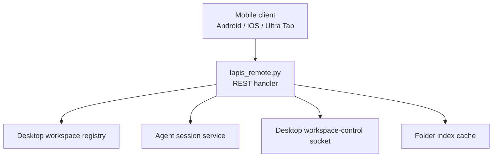
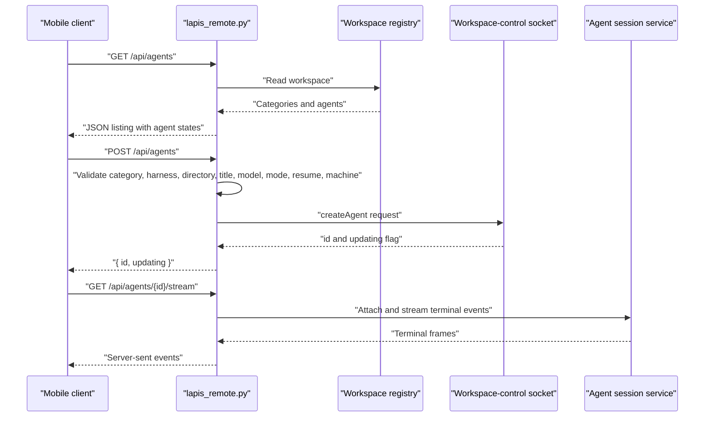
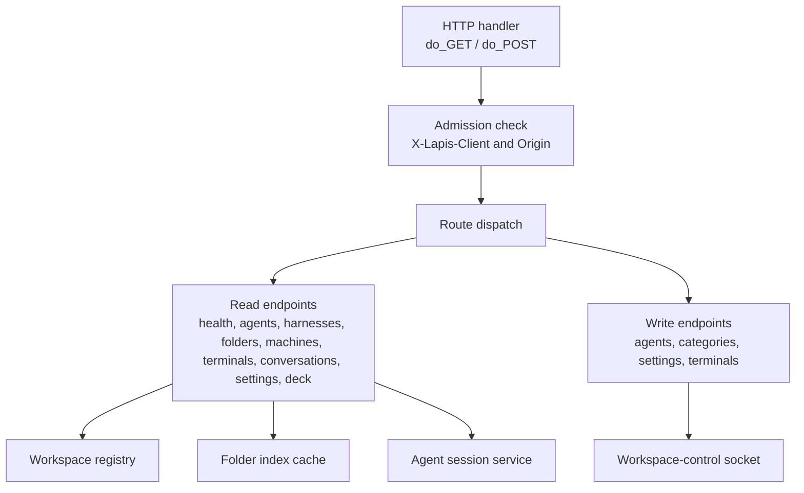
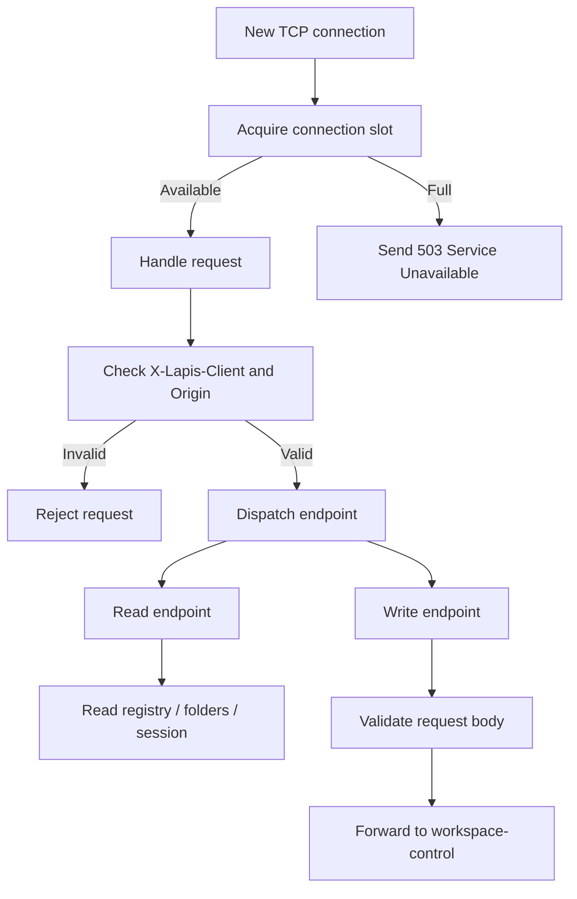

# REST Endpoints

<cite>
**Referenced Files in This Document**   
- [lapis_remote.py](file://apps/remote/lapis_remote.py)
- [LapisGateway.kt](file://apps/android/app/src/main/kotlin/dev/lapis/remote/gateway/LapisGateway.kt)
- [test_lapis_remote.py](file://scripts/tests/test_lapis_remote.py)
</cite>

## Table of Contents
1. [Introduction](#introduction)
2. [Project Structure](#project-structure)
3. [Core Components](#core-components)
4. [Architecture Overview](#architecture-overview)
5. [Detailed Component Analysis](#detailed-component-analysis)
6. [Dependency Analysis](#dependency-analysis)
7. [Performance Considerations](#performance-considerations)
8. [Troubleshooting Guide](#troubleshooting-guide)
9. [Conclusion](#conclusion)

## Introduction
This document describes the Lapis remote gateway REST API exposed by `apps/remote/lapis_remote.py`. The gateway serves mobile clients (Android and iOS) over HTTP, reads the desktop workspace registry, attaches to agent session services when needed, and forwards write operations to the desktop’s workspace-control socket. It also provides read-only deck data for Ultra Tab.

Key characteristics:
- All requests require the `X-Lapis-Client` header identifying the platform (`android`, `ios`, or another client such as `ultratab-ios`). Requests with an `Origin` header are refused, and missing authentication headers are rejected.
- Read endpoints may long-poll for changes using version parameters such as `after` or `have`.
- Write endpoints validate request bodies and forward mutations to the desktop workspace.
- The server is connection-limited; excess connections receive a 503 response immediately.

## Project Structure
The gateway implementation lives in one main Python module. Mobile clients in Kotlin and Swift call these endpoints and set the `X-Lapis-Client` header accordingly. Tests under `scripts/tests/test_lapis_remote.py` exercise the public contract.



**Diagram sources**
- [lapis_remote.py:1-80](file://apps/remote/lapis_remote.py#L1-L80)
- [lapis_remote.py:2461-2536](file://apps/remote/lapis_remote.py#L2461-L2536)

**Section sources**
- [lapis_remote.py:1-80](file://apps/remote/lapis_remote.py#L1-L80)
- [LapisGateway.kt:25-26](file://apps/android/app/src/main/kotlin/dev/lapis/remote/gateway/LapisGateway.kt#L25-L26)

## Core Components
- **Authentication and admission**: A Tailscale-based identity check admits only the Mac owner’s devices or local access when configured. Requests without `X-Lapis-Client` or with `Origin` are rejected.
- **Connection limiter**: `MAX_HTTP_CONNECTIONS = 16` bounds active HTTP connections. Excess connections receive a 503 response before request processing.
- **Listing limiter**: Up to four listing operations may probe agents concurrently; additional listing requests receive 503 with a busy message.
- **Workspace proxy**: Read endpoints expose workspace state; write endpoints forward JSON commands through the desktop’s workspace-control socket.
- **Session attachment**: Agent screen, stream, history, input, submit, skip, close, rename, place, and restart routes communicate with per-agent session services.

**Section sources**
- [lapis_remote.py:57-72](file://apps/remote/lapis_remote.py#L57-L72)
- [lapis_remote.py:142-206](file://apps/remote/lapis_remote.py#L142-L206)
- [lapis_remote.py:288-305](file://apps/remote/lapis_remote.py#L288-L305)
- [lapis_remote.py:2083-2140](file://apps/remote/lapis_remote.py#L2083-L2140)

## Architecture Overview
The gateway has two primary roles:

| Role | Behavior | Example endpoints |
|---|---|---|
| **Workspace reader** | Reads the desktop registry, folder index, machine list, categories, agents, and terminal state, then returns JSON to the client. | `GET /api/health`, `GET /api/agents`, `GET /api/harnesses`, `GET /api/folders`, `GET /api/machines`, `GET /api/terminals`, `GET /api/conversations`, `GET /api/settings`, `GET /api/deck` |
| **Desktop writer** | Validates a request body and forwards a control command to the desktop workspace. | `POST /api/agents`, `POST /api/categories`, `POST /api/settings`, `POST /api/terminals`, plus agent mutation routes |



**Diagram sources**
- [lapis_remote.py:2461-2536](file://apps/remote/lapis_remote.py#L2461-L2536)
- [lapis_remote.py:2538-2580](file://apps/remote/lapis_remote.py#L2538-L2580)
- [lapis_remote.py:2689-2748](file://apps/remote/lapis_remote.py#L2689-L2748)
- [lapis_remote.py:3173-3197](file://apps/remote/lapis_remote.py#L3173-L3197)

## Detailed Component Analysis

### Authentication and Platform Identification
- Header: `X-Lapis-Client`
- Expected values:
  - Android: `android`
  - iOS: `ios`
  - Ultra Tab: `ultratab-ios`
- Requests with `Origin` are rejected.
- Missing or disallowed platform identification results in refusal before normal routing.

Clients set this header explicitly:
- Android sets it to `android`.
- iOS tests set it to `ios`.
- Ultra Tab sets it to `ultratab-ios`.

**Section sources**
- [LapisGateway.kt:25-26](file://apps/android/app/src/main/kotlin/dev/lapis/remote/gateway/LapisGateway.kt#L25-L26)
- [test_lapis_remote.py:601-603](file://scripts/tests/test_lapis_remote.py#L601-L603)
- [test_lapis_remote.py:860-861](file://scripts/tests/test_lapis_remote.py#L860-L861)
- [test_lapis_remote.py:456-458](file://scripts/tests/test_lapis_remote.py#L456-L458)

### GET /api/health
- Purpose: Service availability and identity check.
- Method: `GET`
- URL pattern: `/api/health`
- Authentication: Requires `X-Lapis-Client`.
- Response schema:
  - `ok`: boolean, always `true` on success.
  - `version`: integer gateway version.
  - `host`: string DNS name of the host.
- Success code: `200 OK`.
- Error behavior:
  - Missing or invalid client header: refusal.
  - Connection limit exceeded: `503 Service Unavailable`.

Example success response fields:
```json
{
  "ok": true,
  "version": 1,
  "host": "mac-dns-name"
}
```

**Section sources**
- [lapis_remote.py:2461-2473](file://apps/remote/lapis_remote.py#L2461-L2473)
- [test_lapis_remote.py:593-607](file://scripts/tests/test_lapis_remote.py#L593-L607)

### GET /api/agents
- Purpose: List workspace agents grouped by category, including running state and phone attachment status.
- Method: `GET`
- URL pattern: `/api/agents`
- Query parameters:
  - `after`: optional string version. If equal to the current registry version, the server long-polls until the version changes or the wait deadline passes.
- Authentication: Requires `X-Lapis-Client`.
- Response schema:
  - `version`: string registry version.
  - `categories`: array of category objects containing agent entries.
  - Each agent entry includes:
    - `id`: string agent identifier.
    - `title`: string display title.
    - `harness`: string harness name.
    - `directory`: string workspace directory path.
    - `machine`: string destination machine.
    - `place`: string position in the desktop UI.
    - `running`: boolean whether the agent’s session service responds.
    - `onPhone`: boolean whether the phone currently owns the session.
- Long-poll behavior:
  - When `after` matches the current version, the server waits up to about eight seconds while checking the socket and client liveness.
  - After waiting, it performs the full listing.
- Listing constraints:
  - At most 128 agents are accepted; more triggers `503 Service Unavailable`.
  - At most four listings probe concurrently; additional listing requests trigger `503 Service Unavailable`.
  - Probing agents is bounded to 32 workers with a deadline.

Error responses:
| Condition | Status code | Meaning |
|---|---:|---|
| Too many concurrent listings | `503` | Busy listing gate |
| Registry cannot be read | `503` | Cannot read the workspace |
| More than 128 agents | `503` | Too many agents to list safely |
| Agent probes do not complete | `503` | Agents did not finish loading |
| Connection limit exceeded | `503` | Gateway is busy |

Example response shape:
```json
{
  "version": "registry-version",
  "categories": [
    {
      "id": "category-id",
      "name": "Category Name",
      "agents": [
        {
          "id": "agent-1",
          "title": "Working on project",
          "harness": "claude",
          "directory": "/path/to/workspace",
          "machine": "",
          "place": "top-left",
          "running": true,
          "onPhone": false
        }
      ]
    }
  ]
}
```

**Section sources**
- [lapis_remote.py:2474-2475](file://apps/remote/lapis_remote.py#L2474-L2475)
- [lapis_remote.py:2538-2580](file://apps/remote/lapis_remote.py#L2538-L2580)
- [lapis_remote.py:2581-2599](file://apps/remote/lapis_remote.py#L2581-L2599)
- [test_lapis_remote.py:740-791](file://scripts/tests/test_lapis_remote.py#L740-L791)

### GET /api/harnesses
- Purpose: Return available harness definitions and default settings.
- Method: `GET`
- URL pattern: `/api/harnesses`
- Authentication: Requires `X-Lapis-Client`.
- Request/response flow:
  - Server asks the desktop for harness information.
  - On success, returns harnesses and defaults.
- Response schema:
  - `harnesses`: array of harness records from the desktop.
  - `defaults`: object of default configuration values.
- Error behavior:
  - Desktop unavailable or no answer: no successful response body is returned by this route.

**Section sources**
- [lapis_remote.py:2476-2477](file://apps/remote/lapis_remote.py#L2476-L2477)
- [lapis_remote.py:2621-2630](file://apps/remote/lapis_remote.py#L2621-L2630)
- [test_lapis_remote.py:893-898](file://scripts/tests/test_lapis_remote.py#L893-L898)

### GET /api/folders
- Purpose: Retrieve a folder index for this Mac or a remote machine, optionally skipping unchanged versions.
- Method: `GET`
- URL pattern: `/api/folders`
- Query parameters:
  - `machine`: optional string machine name. Must match the allowed machine-name pattern.
  - `have`: optional string version. If equal to the payload version, the server returns a short unchanged response.
- Authentication: Requires `X-Lapis-Client`.
- Caching behavior:
  - If `have` equals the current payload version, the response is `{ "version": "<have>", "unchanged": true }`.
  - Otherwise, the server returns the full folder payload, possibly compressed.
- Response schemas:
  - Unchanged: `{ "version": string, "unchanged": true }`
  - Updated: `{ "version": string, ...folder-index-fields }`
- Errors:
  - Invalid `machine`: `400 Bad Request`.
  - Remote or local folder index still being read: `503 Service Unavailable`.

Example unchanged request:
```http
GET /api/folders?have=abc123
Host: mac:7349
X-Lapis-Client: ios
```

Example unchanged response:
```json
{
  "version": "abc123",
  "unchanged": true
}
```

**Section sources**
- [lapis_remote.py:2478-2479](file://apps/remote/lapis_remote.py#L2478-L2479)
- [lapis_remote.py:2639-2666](file://apps/remote/lapis_remote.py#L2639-L2666)
- [test_lapis_remote.py:1550-1555](file://scripts/tests/test_lapis_remote.py#L1550-L1555)
- [test_lapis_remote.py:1703-1724](file://scripts/tests/test_lapis_remote.py#L1703-L1724)

### GET /api/machines
- Purpose: List SSH machines known to the gateway.
- Method: `GET`
- URL pattern: `/api/machines`
- Authentication: Requires `X-Lapis-Client`.
- Response schema:
  - `machines`: array of machine entries.
- Error behavior:
  - Machine discovery still in progress: `503 Service Unavailable` with message indicating it is still looking for SSH machines.

**Section sources**
- [lapis_remote.py:2480-2481](file://apps/remote/lapis_remote.py#L2480-L2481)
- [lapis_remote.py:2632-2637](file://apps/remote/lapis_remote.py#L2632-L2637)

### GET /api/terminals
- Purpose: List quick-command terminals associated with machines.
- Method: `GET`
- URL pattern: `/api/terminals`
- Authentication: Requires `X-Lapis-Client`.
- Response schema:
  - `terminals`: array of terminal entries.
  - Each entry includes:
    - `id`: string terminal identifier.
    - `machine`: string target machine.
    - `name`: string display title.
    - `running`: boolean whether the underlying service answers.
    - `onPhone`: boolean whether the phone currently owns the session.

**Section sources**
- [lapis_remote.py:2482-2483](file://apps/remote/lapis_remote.py#L2482-L2483)
- [lapis_remote.py:2881-2897](file://apps/remote/lapis_remote.py#L2881-L2897)
- [test_lapis_remote.py:1243-1260](file://scripts/tests/test_lapis_remote.py#L1243-L1260)

### GET /api/conversations
- Purpose: Return recent Claude and Codex conversations from this Mac’s folder history, newest first, suitable for resuming as a new agent.
- Method: `GET`
- URL pattern: `/api/conversations`
- Authentication: Requires `X-Lapis-Client`.
- Response schema:
  - `conversations`: array of up to 60 conversation entries.
  - Each entry includes:
    - `harness`: string harness name.
    - `id`: string conversation identifier.
    - `directory`: string workspace path relative to home.
    - `title`: string conversation title.
    - `age`: integer age in seconds.
- Error behavior:
  - Folder index still being read: `503 Service Unavailable`.

**Section sources**
- [lapis_remote.py:2484-2485](file://apps/remote/lapis_remote.py#L2484-L2485)
- [lapis_remote.py:2914-2939](file://apps/remote/lapis_remote.py#L2914-L2939)
- [test_lapis_remote.py:1555-1555](file://scripts/tests/test_lapis_remote.py#L1555-L1555)

### GET /api/settings
- Purpose: Read current phone-related settings from the desktop.
- Method: `GET`
- URL pattern: `/api/settings`
- Authentication: Requires `X-Lapis-Client`.
- Request/response flow:
  - Forwards a `settings` request to the desktop.
  - Returns the desktop’s settings response.
- Allowed settings for updates are defined by `PHONE_SETTINGS`:
  - `keepAwake`: boolean
  - `alertSound`: boolean
  - `alertRepeat`: integer between 1 and 10
  - `finishSound`: boolean
  - `notify`: boolean
  - `showUsage`: boolean

**Section sources**
- [lapis_remote.py:2486-2487](file://apps/remote/lapis_remote.py#L2486-L2487)
- [lapis_remote.py:2388-2395](file://apps/remote/lapis_remote.py#L2388-L2395)

### GET /api/deck
- Purpose: Provide Ultra Tab with read-only workspace composition data.
- Method: `GET`
- URL pattern: `/api/deck`
- Query parameters:
  - `after`: optional string version. Long-polls until the composed deck version changes or the wait deadline passes.
- Authentication: Requires `X-Lapis-Client`; browser-like requests with `Origin` are refused.
- Response schema:
  - `version`: string composed version.
  - `categories`: array of categories from the workspace.
  - `agents`: array of agent summaries limited to `id`, `title`, `category`, `directory`, and `harness`.
  - `problems`: array of error messages for files that could not be read.
  - `state`: published ultratab card state, or absent if unreadable.
  - `writerRunning`: boolean derived from whether the state process is still running.
- Compression: Responses are gzip-compressed.
- Long-poll behavior:
  - If `after` equals the current deck version, the server waits up to about eight seconds while checking for changes and client liveness.
- Error behavior:
  - Workspace unreadable: `503 Service Unavailable`.

**Section sources**
- [lapis_remote.py:2488-2489](file://apps/remote/lapis_remote.py#L2488-L2489)
- [lapis_remote.py:2022-2071](file://apps/remote/lapis_remote.py#L2022-L2071)
- [lapis_remote.py:3173-3197](file://apps/remote/lapis_remote.py#L3173-L3197)
- [test_lapis_remote.py:1798-1853](file://scripts/tests/test_lapis_remote.py#L1798-L1853)

### POST /api/agents
- Purpose: Create a new agent in a category.
- Method: `POST`
- URL pattern: `/api/agents`
- Authentication: Requires `X-Lapis-Client`.
- Request body: JSON object.
- Required fields:
  - `category`: string, 1–64 characters.
  - `harness`: string, 1–32 characters.
  - `directory`: string, 1–4096 characters.
- Optional fields:
  - `title`: string validated as a safe name; empty or omitted is allowed.
  - `model`: string, up to 128 characters.
  - `mode`: string, up to 128 characters.
  - `resume`: string, up to 128 characters.
  - `machine`: string matching the allowed machine-name pattern; empty or omitted is allowed.
  - If a remote program is resolved for the selected machine and harness, a `program` field is added before forwarding to the desktop.
- Validation errors:
  - Invalid `Content-Length`: `400 Bad Request`.
  - Invalid JSON or non-object body: `400 Bad Request`.
  - Missing or invalid required fields: `400 Bad Request`.
  - Invalid optional fields: `400 Bad Request`.
  - Invalid machine: `400 Bad Request`.
- Success response:
  - `id`: string agent identifier.
  - `updating`: boolean indicating whether the desktop is updating the workspace.
- Error behavior:
  - Desktop unavailable or no answer: no successful response body from this route.

Request example:
```json
{
  "category": "coding",
  "harness": "claude",
  "directory": "/Users/me/project",
  "title": "Refactor utilities",
  "model": "claude-sonnet",
  "mode": "normal",
  "resume": "",
  "machine": ""
}
```

Response example:
```json
{
  "id": "agent-abc",
  "updating": true
}
```

**Section sources**
- [lapis_remote.py:2509-2510](file://apps/remote/lapis_remote.py#L2509-L2510)
- [lapis_remote.py:2689-2748](file://apps/remote/lapis_remote.py#L2689-L2748)
- [test_lapis_remote.py:932-969](file://scripts/tests/test_lapis_remote.py#L932-L969)
- [test_lapis_remote.py:981-981](file://scripts/tests/test_lapis_remote.py#L981-L981)

### POST /api/categories
- Purpose: Create a new category on the desktop.
- Method: `POST`
- URL pattern: `/api/categories`
- Authentication: Requires `X-Lapis-Client`.
- Request body: JSON object.
- Required field:
  - `name`: string of 1–80 trimmed characters.
- Success response:
  - `id`: string category identifier.
- Validation errors:
  - Invalid or empty name: `400 Bad Request`.
- Error behavior:
  - Desktop unavailable or no answer: no successful response body from this route.

**Section sources**
- [lapis_remote.py:2520-2521](file://apps/remote/lapis_remote.py#L2520-L2521)
- [lapis_remote.py:2790-2801](file://apps/remote/lapis_remote.py#L2790-L2801)
- [test_lapis_remote.py:965-969](file://scripts/tests/test_lapis_remote.py#L965-L969)

### POST /api/settings
- Purpose: Update phone-related settings.
- Method: `POST`
- URL pattern: `/api/settings`
- Authentication: Requires `X-Lapis-Client`.
- Request body: JSON object whose keys must be recognized phone settings.
- Valid keys and types:
  - `keepAwake`: boolean
  - `alertSound`: boolean
  - `alertRepeat`: integer between 1 and 10
  - `finishSound`: boolean
  - `notify`: boolean
  - `showUsage`: boolean
- Validation errors:
  - Unknown or incorrectly typed setting: `400 Bad Request`.
- Request/response flow:
  - Forwards a `changeSettings` request with the validated settings object to the desktop.
  - Returns all settings from the desktop.

**Section sources**
- [lapis_remote.py:2529-2530](file://apps/remote/lapis_remote.py#L2529-L2530)
- [lapis_remote.py:2864-2879](file://apps/remote/lapis_remote.py#L2864-L2879)
- [lapis_remote.py:2388-2395](file://apps/remote/lapis_remote.py#L2388-L2395)
- [test_lapis_remote.py:1152-1182](file://scripts/tests/test_lapis_remote.py#L1152-L1182)

### Additional agent and terminal endpoints referenced by the API design
Although not requested in detail, the gateway also exposes these agent-related routes:

| Endpoint | Method | Purpose | Notable behavior |
|---|---:|---|---|
| `/api/agents/{id}/screen` | `GET` | Get the agent’s current screen snapshot | Uses join mode and rejects attempts to take ownership |
| `/api/agents/{id}/stream` | `GET` | Attach and stream terminal events | Supports resize, paste, text, key, and wheel input through other routes |
| `/api/agents/{id}/history` | `GET` | Paginate terminal history | Supports `before` and `after` paging |
| `/api/agents/{id}/input` | `POST` | Send terminal input | Enforces size limits and supports resize/paste/text/key |
| `/api/agents/{id}/submit` | `POST` | Submit Ultra Tab reply | Sends paste and Enter through a join without replacing the desktop attachment |
| `/api/agents/{id}/skip` | `POST` | Skip an interactive prompt | Sends key selection |
| `/api/agents/{id}/close` | `POST` | Close agent or terminal | Forwards `closeAgent` or `closeTerminal` |
| `/api/agents/{id}/rename` | `POST` | Rename agent | Requires a valid 1–80-character title |
| `/api/agents/{id}/place` | `POST` | Move agent within a category | Validates category and index |
| `/api/agents/{id}/restart` | `POST` | Restart agent | Forwards to desktop |
| `/api/terminals` | `POST` | Open a quick-command terminal | Validates machine and forwards `openTerminal` |

**Section sources**
- [lapis_remote.py:2490-2518](file://apps/remote/lapis_remote.py#L2490-L2518)
- [lapis_remote.py:2668-2687](file://apps/remote/lapis_remote.py#L2668-L2687)
- [lapis_remote.py:2941-2949](file://apps/remote/lapis_remote.py#L2941-L2949)
- [lapis_remote.py:2981-3127](file://apps/remote/lapis_remote.py#L2981-L3127)

## Dependency Analysis
The gateway coordinates three major dependencies:



**Diagram sources**
- [lapis_remote.py:2461-2536](file://apps/remote/lapis_remote.py#L2461-L2536)
- [lapis_remote.py:2538-2580](file://apps/remote/lapis_remote.py#L2538-L2580)
- [lapis_remote.py:2689-2748](file://apps/remote/lapis_remote.py#L2689-L2748)

Coupling notes:
- Routing is centralized in `do_GET` and `do_POST`.
- Read endpoints depend on the registry, folder cache, and sometimes session services.
- Write endpoints depend on request validation and the desktop workspace-control socket.
- Authentication and connection limiting are applied before routing.

**Section sources**
- [lapis_remote.py:2461-2536](file://apps/remote/lapis_remote.py#L2461-L2536)
- [lapis_remote.py:2538-2580](file://apps/remote/lapis_remote.py#L2538-L2580)
- [lapis_remote.py:2689-2748](file://apps/remote/lapis_remote.py#L2689-L2748)

## Performance Considerations
- **Connection limit**: `MAX_HTTP_CONNECTIONS = 16`. Excess connections receive an immediate 503 response.
- **Kernel backlog**: The server requests a queue size of `MAX_HTTP_CONNECTIONS + 16` so burst arrivals can be handled before kernel-level rejection.
- **Busy response budget**: Busy replies drain at most 64 KiB with bounded polling timeouts to avoid blocking indefinitely.
- **Listing concurrency**:
  - At most four listing operations run concurrently.
  - Agent probing uses up to 32 workers.
  - Agent count is capped at 128.
  - Long-poll waits up to eight seconds per listing request.
  - Total listing deadline is ten seconds.
- **Deck compression**: `/api/deck` responses are gzip-compressed.
- **Keep-alive**: HTTP/1.1 keep-alive reduces connection setup overhead; idle connections close after about one minute.



**Diagram sources**
- [lapis_remote.py:142-206](file://apps/remote/lapis_remote.py#L142-L206)
- [lapis_remote.py:288-305](file://apps/remote/lapis_remote.py#L288-L305)
- [lapis_remote.py:3173-3197](file://apps/remote/lapis_remote.py#L3173-L3197)

**Section sources**
- [lapis_remote.py:57-72](file://apps/remote/lapis_remote.py#L57-L72)
- [lapis_remote.py:142-206](file://apps/remote/lapis_remote.py#L142-L206)
- [lapis_remote.py:288-305](file://apps/remote/lapis_remote.py#L288-L305)
- [lapis_remote.py:2398-2403](file://apps/remote/lapis_remote.py#L2398-L2403)

## Troubleshooting Guide
Common issues and their likely causes:

| Symptom | Likely cause | Recommended action |
|---|---|---|
| Health endpoint refuses request | Missing `X-Lapis-Client` or presence of `Origin` | Add `X-Lapis-Client: android` or `ios`; remove `Origin` |
| 421 status code | Host mismatch or suspicious host header | Ensure `Host` matches the expected gateway host |
| 503 Service Unavailable | Too many connections, too many listings, workspace unavailable, or desktop unavailable | Retry later; reduce concurrent requests |
| Agents not listed | Workspace registry unreadable or too many agents | Check desktop workspace health and agent count |
| Folder listing unchanged | `have` parameter equals current version | Use unchanged response or omit `have` |
| Agent creation fails | Invalid `category`, `harness`, `directory`, `title`, `model`, `mode`, `resume`, or `machine` | Validate request fields against documented limits |
| Deck not changing | `after` version still matches current deck version | Wait for change or poll again after timeout |
| Terminal stream disconnected | Client left or session ownership changed | Reconnect and reattach through the appropriate agent route |

**Section sources**
- [test_lapis_remote.py:601-603](file://scripts/tests/test_lapis_remote.py#L601-L603)
- [test_lapis_remote.py:277-289](file://scripts/tests/test_lapis_remote.py#L277-L289)
- [lapis_remote.py:2538-2580](file://apps/remote/lapis_remote.py#L2538-L2580)
- [lapis_remote.py:2639-2666](file://apps/remote/lapis_remote.py#L2639-L2666)
- [lapis_remote.py:2689-2748](file://apps/remote/lapis_remote.py#L2689-L2748)
- [lapis_remote.py:3173-3197](file://apps/remote/lapis_remote.py#L3173-L3197)

## Conclusion
The Lapis remote gateway presents a focused REST surface for mobile and Ultra Tab clients. Read endpoints expose workspace state, while write endpoints enforce strict validation before mutating the desktop workspace. Clients must authenticate via `X-Lapis-Client`, handle long-polling version parameters such as `after` and `have`, and treat 503 responses as temporary capacity or readiness signals. The dual nature of the gateway—proxying to local session services and communicating with the desktop workspace—is central to its design: the phone can observe and interact with agents while the desktop remains the authoritative workspace owner.