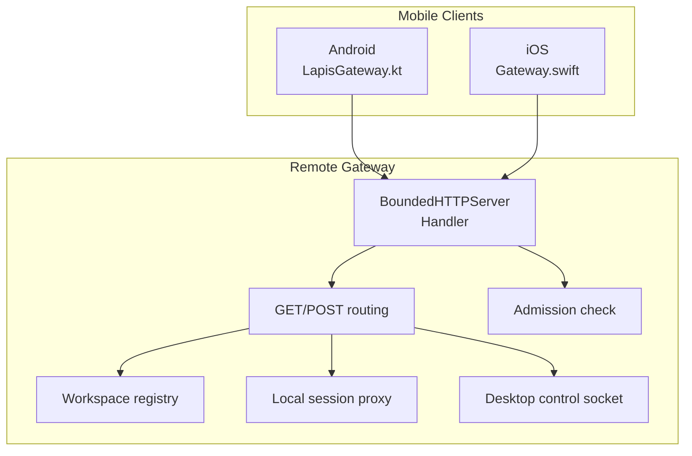
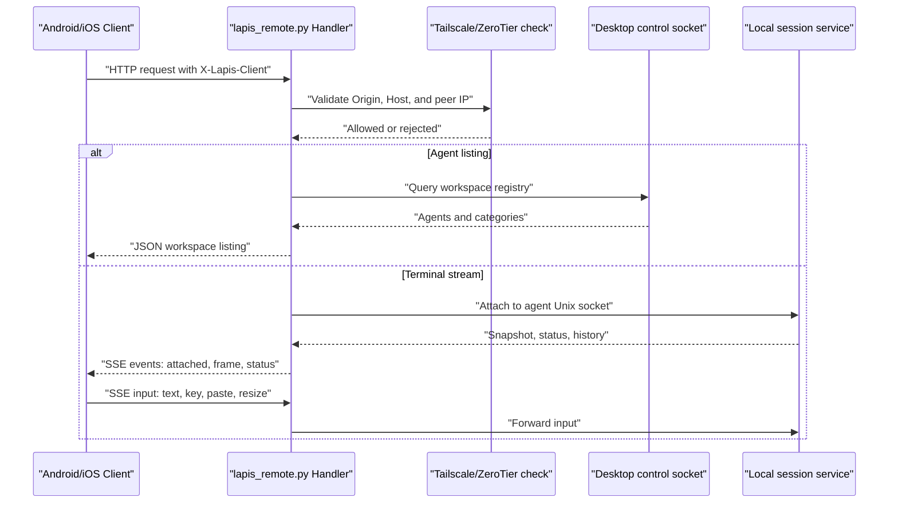
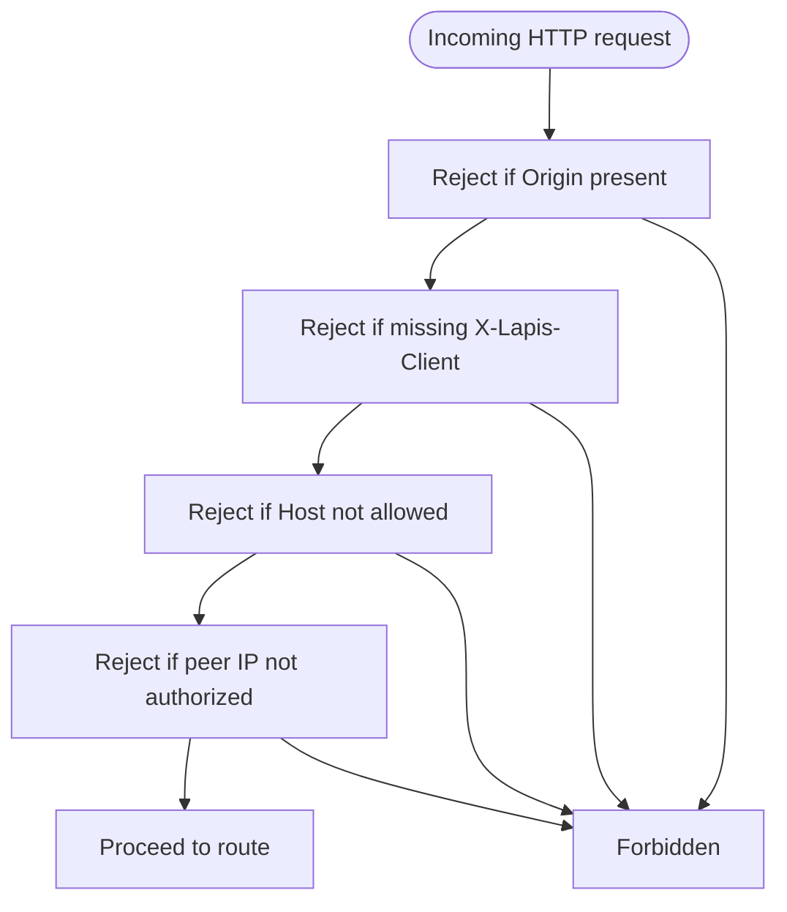
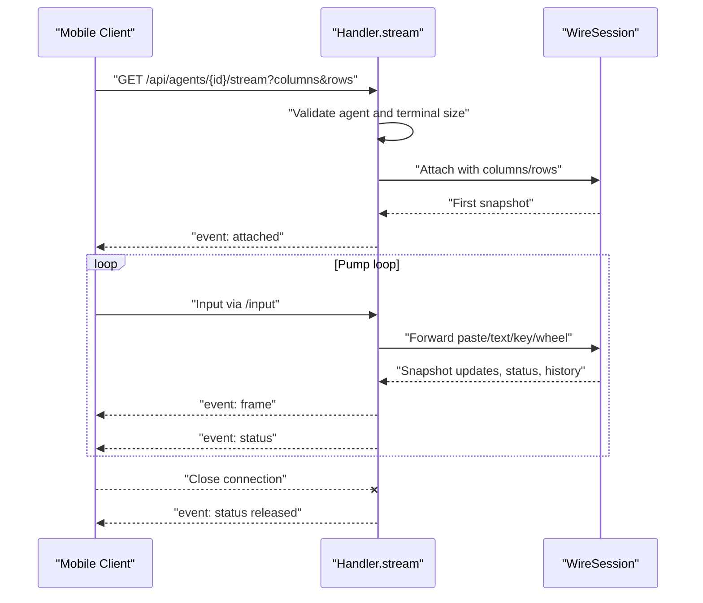
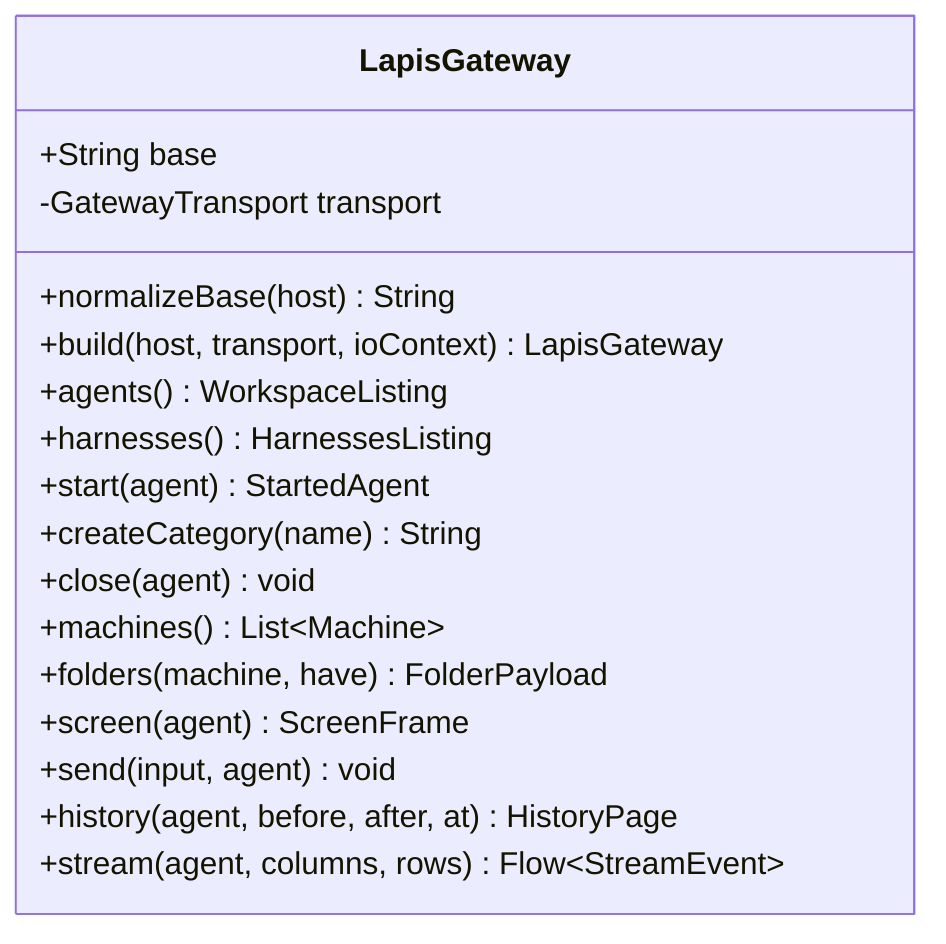
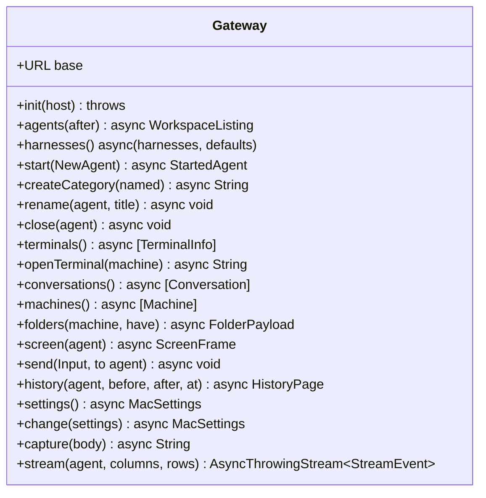
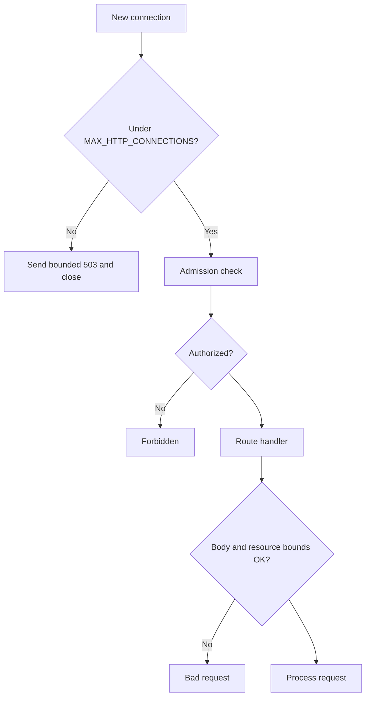

# Remote Gateway API

<cite>
**Referenced Files in This Document**
- [lapis_remote.py](file://apps/remote/lapis_remote.py)
- [LapisGateway.kt](file://apps/android/app/src/main/kotlin/dev/lapis/remote/gateway/LapisGateway.kt)
- [Gateway.swift](file://apps/ios/Lapis/Gateway.swift)
</cite>

## Table of Contents
1. [Introduction](#introduction)
2. [Project Structure](#project-structure)
3. [Core Components](#core-components)
4. [Architecture Overview](#architecture-overview)
5. [Authentication and Access Control](#authentication-and-access-control)
6. [REST Endpoints](#rest-endpoints)
7. [Terminal Streaming and SSE Protocol](#terminal-streaming-and-sse-protocol)
8. [Mobile Client Integration](#mobile-client-integration)
9. [Error Handling](#error-handling)
10. [Security Considerations](#security-considerations)
11. [Performance Characteristics](#performance-characteristics)
12. [Protocol Versions and Migration](#protocol-versions-and-migration)
13. [Troubleshooting Guide](#troubleshooting-guide)
14. [Conclusion](#conclusion)

## Introduction
The remote gateway is a Python HTTP server that exposes a REST and Server-Sent Events (SSE) interface for Android and iOS clients to interact with Lapis agents running on the local desktop machine. It is designed for private overlay networks such as Tailscale or ZeroTier, so it does not require a separate authentication step: instead, it verifies that the mobile client is an authorized device belonging to the same network identity as the host.

The gateway has two roles:
- An HTTP server handling REST requests for workspace listing, agent lifecycle management, terminal access, folder browsing, settings, and debugging captures.
- A proxy that attaches to the desktop’s local session service over Unix sockets, forwarding terminal input and output while maintaining per-agent connection state.

The public entry point is `apps/remote/lapis_remote.py`. The Android integration lives in `apps/android/app/src/main/kotlin/dev/lapis/remote/gateway/LapisGateway.kt`, and the iOS integration lives in `apps/ios/Lapis/Gateway.swift`.

## Project Structure
The remote gateway implementation is concentrated in one Python module, with parallel mobile client implementations in Kotlin and Swift.

**Diagram sources**
- [lapis_remote.py:2398-2700](file://apps/remote/lapis_remote.py#L2398-L2700)
- [lapis_remote.py:3081-3409](file://apps/remote/lapis_remote.py#L3081-L3409)
- [LapisGateway.kt:1-200](file://apps/android/app/src/main/kotlin/dev/lapis/remote/gateway/LapisGateway.kt#L1-L200)
- [Gateway.swift:1-200](file://apps/ios/Lapis/Gateway.swift#L1-L200)

**Section sources**
- [lapis_remote.py:1-80](file://apps/remote/lapis_remote.py#L1-L80)
- [LapisGateway.kt:1-60](file://apps/android/app/src/main/kotlin/dev/lapis/remote/gateway/LapisGateway.kt#L1-L60)
- [Gateway.swift:1-20](file://apps/ios/Lapis/Gateway.swift#L1-L20)

## Core Components
- **`BoundedHTTPServer`**: A threading HTTP server with a fixed admission gate. It limits concurrent HTTP connections through a bounded semaphore, rejects excess connections with a bounded 503 response, and drains request bodies safely before closing busy connections.
- **`Handler`**: Per-request handler implementing `BaseHTTPRequestHandler`. It validates admission, routes REST paths, reads bounded JSON bodies, forwards operations to the desktop control socket, and streams terminal sessions via SSE.
- **`Gateway`**: Process-wide state holding the workspace registry path, admission controller, port, folder index, machine list, active sessions, and concurrency limits for agent listings.
- **`Admission`**: Combines optional Tailscale and ZeroTier authorization into a single access decision based on peer IP address and allowed host names.
- **Session proxy layer**: Opens a local wire protocol connection to the selected agent’s Unix socket endpoint, renders snapshots, forwards history pages, and translates terminal input into keystrokes, paste data, resize events, and wheel scrolling.

Key constants include:
- Default HTTP port: `7349`
- Maximum concurrent HTTP connections: `MAX_HTTP_CONNECTIONS = 16`
- Maximum pasted or typed input: `MAX_INPUT = 32 KiB`
- Maximum capture payload: `MAX_CAPTURE = 12 MiB`
- Maximum request body: `MAX_REQUEST = 8 KiB`
- Maximum frame size: `MAX_FRAME = 8 MiB`
- Maximum cells per snapshot: `MAX_CELLS = 32768`

**Section sources**
- [lapis_remote.py:40-110](file://apps/remote/lapis_remote.py#L40-L110)
- [lapis_remote.py:2398-2490](file://apps/remote/lapis_remote.py#L2398-L2490)
- [lapis_remote.py:3081-3409](file://apps/remote/lapis_remote.py#L3081-L3409)

## Architecture Overview
The gateway sits between mobile clients and the local Lapis process. Mobile clients connect over encrypted overlay networks and call REST endpoints for discovery and control. Terminal sessions use SSE to stream terminal frames from the desktop’s session service.

**Diagram sources**
- [lapis_remote.py:2418-2490](file://apps/remote/lapis_remote.py#L2418-L2490)
- [lapis_remote.py:3140-3240](file://apps/remote/lapis_remote.py#L3140-L3240)
- [lapis_remote.py:3300-3409](file://apps/remote/lapis_remote.py#L3300-L3409)

## Authentication and Access Control
Access control is enforced at the HTTP handler level before any business logic runs.

| Check | Behavior | Reason |
|---|---|---|
| `Origin` header present | Reject with forbidden | Prevents browser-driven automation |
| Missing `X-Lapis-Client` | Reject with forbidden | Requires a known mobile client |
| `Host` not in allowed hosts | Reject with misdirected request | Ensures the request targets the intended gateway address |
| Peer IP not allowed by overlay whois | Reject with forbidden | Ensures the caller is an authorized device |

### Header Validation
- Requests carrying an `Origin` header are rejected immediately.
- Requests without `X-Lapis-Client` are rejected.
- The `Host` header must match the gateway’s configured host set.
- The client IP is checked against Tailscale whois information or joined ZeroTier networks.

### Platform Identification
- Android sets `X-Lapis-Client: android`.
- iOS sets `X-Lapis-Client: ios`.
- The gateway accepts either value; it only requires the presence of the header.

### Overlay Authorization
The gateway builds an admission controller from:
- Optional Tailscale binary and its IPv4 address.
- Optional ZeroTier CLI and currently joined private networks.
- Optional local-loopback allowance for tests.

If neither overlay responds, the gateway fails to start rather than accepting arbitrary traffic.

**Diagram sources**
- [lapis_remote.py:2418-2450](file://apps/remote/lapis_remote.py#L2418-L2450)
- [lapis_remote.py:3360-3409](file://apps/remote/lapis_remote.py#L3360-L3409)

**Section sources**
- [lapis_remote.py:2418-2450](file://apps/remote/lapis_remote.py#L2418-L2450)
- [lapis_remote.py:3360-3409](file://apps/remote/lapis_remote.py#L3360-L3409)
- [LapisGateway.kt:60-120](file://apps/android/app/src/main/kotlin/dev/lapis/remote/gateway/LapisGateway.kt#L60-L120)
- [Gateway.swift:300-340](file://apps/ios/Lapis/Gateway.swift#L300-L340)

## REST Endpoints
All REST endpoints require successful admission. They return JSON unless they are streaming endpoints. Non-200 responses may include an `error` field.

### Health
- `GET /api/health`
- Returns gateway version, health flag, and DNS name.
- Useful for readiness checks and basic connectivity validation.

### Workspace and Agents
- `GET /api/agents?after=<version>`
- Lists workspace categories and agents.
- Supports long polling through the `after` parameter: the server waits until the registry version changes or a timeout expires.
- Includes agent metadata: identifier, title, harness, directory, machine, place, running status, and whether the agent is already open on the phone.

- `GET /api/harnesses`
- Returns available agent CLIs and default launch options.

- `POST /api/agents`
- Starts a new agent in a category.
- Request body includes harness, directory, category, optional machine, model, mode, resume ID, and optional title.
- Response includes the new agent identifier and whether the CLI is updating itself.

- `POST /api/agents/<id>/close`
- Ends the agent, equivalent to closing it on the desktop.

- `POST /api/agents/<id>/rename`
- Renames the agent.

- `POST /api/agents/<id>/place`
- Moves an agent within a category, optionally specifying an index.

- `POST /api/agents/<id>/restart`
- Restarts a stopped agent where possible.

### Terminals
- `GET /api/terminals`
- Lists quick-command terminals associated with the workspace.

- `POST /api/terminals`
- Opens a plain shell terminal on a named machine or the local Mac.

### Conversations and Folders
- `GET /api/conversations`
- Lists recent Claude or Codex conversations that can be resumed.

- `GET /api/folders?machine=<name>&have=<version>`
- Returns a folder index for the local Mac or a remote SSH machine.
- If the client already holds the reported version, returns `unchanged: true`.

### Machines
- `GET /api/machines`
- Lists SSH machines known to the workspace.

### Settings
- `GET /api/settings`
- Returns Mac-side settings controlled by the phone: keep-awake, alert sounds, finish sound, notifications, and usage display.

- `POST /api/settings`
- Changes supported settings fields.
- Returns the complete updated settings object.

### Debugging
- `POST /api/captures`
- Saves a PNG screenshot and accompanying JSON for rendering diagnostics.
- Validates PNG magic bytes and enforces a maximum capture size.

### Ultra Tab Deck
- `GET /api/deck?after=<version>`
- Returns Ultra Tab deck data, optionally compressed with gzip when the client advertises gzip support.
- Supports long polling similar to `/api/agents`.

### Endpoint Summary Table

| Method | Path | Purpose | Body | Response |
|---|---|---|---|---|
| GET | `/api/health` | Readiness and version | None | `{ok, version, host}` |
| GET | `/api/agents?after=<version>` | List agents and categories | None | `{categories, activeCategory, version}` |
| GET | `/api/harnesses` | Discover agent CLIs | None | `{harnesses, defaults}` |
| POST | `/api/agents` | Start agent | JSON agent spec | `{id, updating}` |
| POST | `/api/agents/<id>/close` | End agent | Drained but ignored | `{ok}` |
| POST | `/api/agents/<id>/rename` | Rename agent | `{title}` | `{ok}` |
| POST | `/api/agents/<id>/place` | Move agent | `{category, index}` | `{ok}` |
| POST | `/api/agents/<id>/restart` | Restart agent | Drained but ignored | `{ok}` |
| GET | `/api/terminals` | List terminals | None | `{terminals}` |
| POST | `/api/terminals` | Open terminal | `{machine}` | `{id}` |
| GET | `/api/conversations` | Resume conversations | None | `{conversations}` |
| GET | `/api/folders?machine=&have=` | Browse folders | None | Folder payload or unchanged |
| GET | `/api/machines` | List machines | None | `{machines}` |
| GET | `/api/settings` | Read settings | None | `{settings}` |
| POST | `/api/settings` | Change settings | Allowed setting fields | `{settings}` |
| POST | `/api/captures` | Save debug capture | Base64 PNG plus metadata | `{saved}` |
| GET | `/api/deck?after=` | Ultra Tab deck | None | Compressed or uncompressed deck |

**Section sources**
- [lapis_remote.py:2450-2700](file://apps/remote/lapis_remote.py#L2450-L2700)
- [lapis_remote.py:3140-3409](file://apps/remote/lapis_remote.py#L3140-L3409)
- [LapisGateway.kt:120-300](file://apps/android/app/src/main/kotlin/dev/lapis/remote/gateway/LapisGateway.kt#L120-L300)
- [Gateway.swift:300-557](file://apps/ios/Lapis/Gateway.swift#L300-L557)

## Terminal Streaming and SSE Protocol
The terminal streaming endpoint connects the mobile client to the live agent session. It is implemented as an SSE stream over a persistent HTTP connection.

### Endpoint
- `GET /api/agents/<id>/stream?columns=<n>&rows=<n>`
- Returns `text/event-stream`.
- Connection is closed by the server after the stream ends.
- The stream carries no content length because it is a live feed.

### Stream Lifecycle
1. The client opens the stream with the desired terminal dimensions.
2. The gateway looks up the agent and attempts to attach to its session.
3. On success, the first event is `attached`, indicating whether the session is shared with the desktop.
4. The gateway then pumps terminal output as `frame` events.
5. The client sends terminal input through the regular `/api/agents/<id>/input` endpoint.
6. The gateway emits `status` events for lifecycle changes such as disconnected, replaced, released, or overloaded.

**Diagram sources**
- [lapis_remote.py:3140-3240](file://apps/remote/lapis_remote.py#L3140-L3240)
- [lapis_remote.py:3300-3409](file://apps/remote/lapis_remote.py#L3300-L3409)

### SSE Event Types
| Event | Data Shape | Meaning |
|---|---|---|
| `attached` | `{shared: boolean}` | Session attached; `shared` indicates whether the desktop also owns the attachment |
| `frame` | Screen snapshot | Terminal screen including cursor position, colors, alternate screen, wheel support, and styled lines |
| `status` | `{state, message}` | Lifecycle or error state |
| Ping | Comment line starting with colon | Internal keepalive comment used by the server; clients should ignore unknown comments |

### Terminal Input
Terminal input is not sent through SSE data events. Instead, clients send JSON payloads to `/api/agents/<id>/input`:

| Field | Type | Constraint | Meaning |
|---|---|---|---|
| `text` | String | UTF-8 byte length ≤ `MAX_INPUT` | Text input |
| `paste` | String | UTF-8 byte length ≤ `MAX_INPUT` | Clipboard paste |
| `key` | String | One of mapped terminal keys | Keypress |
| `modifiers` | Integer | Bit flags for shift, control, alt | Key modifiers |
| `resize` | `[columns, rows]` | Integers | Terminal resize |
| `wheel` | `[notches, column, row]` | Notches integer, column and row non-negative integers | Full-screen program wheel scroll |

A special behavior exists for paste followed by submit: the gateway intentionally delays keystroke processing briefly so the paste settles before the agent receives the enter key.

### History Query
- `GET /api/agents/<id>/history?before=<page>|?after=<page>|?at=<row>`
- Only one navigation mode is allowed per request.
- Returns a page containing the terminal snapshot, page metadata, and optional placement information.
- The gateway requires the agent to be currently open on the phone for history access.

### Backpressure and Rendering
- Frames are emitted at most every 50 milliseconds.
- The server pings every 10 seconds to detect dead connections.
- Invalid or malformed session data is converted into a `status` event rather than crashing the stream.
- The client-side parsers enforce bounded reading for refusal responses and SSE line processing.

**Section sources**
- [lapis_remote.py:3140-3240](file://apps/remote/lapis_remote.py#L3140-L3240)
- [lapis_remote.py:3300-3409](file://apps/remote/lapis_remote.py#L3300-L3409)
- [LapisGateway.kt:220-300](file://apps/android/app/src/main/kotlin/dev/lapis/remote/gateway/LapisGateway.kt#L220-L300)
- [Gateway.swift:340-557](file://apps/ios/Lapis/Gateway.swift#L340-L557)

## Mobile Client Integration

### Android: `LapisGateway.kt`
The Android client provides:
- URL normalization matching the iOS implementation.
- Transport abstraction through `GatewayTransport`.
- Structured request building with headers and timeouts.
- SSE streaming using Kotlin `Flow`.
- Error mapping from raw HTTP responses to structured gateway errors.

Key responsibilities:
- Normalizes host strings into a base URL with scheme, host, and port.
- Adds `X-Lapis-Client: android` and `Cache-Control: no-cache`.
- Encodes query parameters using UTF-8 percent encoding.
- Decodes JSON responses using kotlinx serialization.
- Streams terminal output through `SseEventParser`.
- Guarantees stream cleanup even under cancellation by running close logic on a non-cancellable coroutine context.

**Diagram sources**
- [LapisGateway.kt:1-300](file://apps/android/app/src/main/kotlin/dev/lapis/remote/gateway/LapisGateway.kt#L1-L300)

### iOS: `Gateway.swift`
The iOS client mirrors the Android client with:
- URL normalization through `URLComponents`.
- Separate `URLSession` instances for normal requests and long-lived streams.
- Async/await-based API surface.
- SSE streaming through `AsyncThrowingStream`.
- Structured error types for invalid host, unsupported scheme, refused responses, and unreadable responses.

Key responsibilities:
- Uses ephemeral session configurations with explicit timeouts.
- Normalizes URLs to remove paths and enforce http/https schemes.
- Sends platform tag `X-Lapis-Client: ios`.
- Reads up to 4096 bytes of initial stream data to surface refusal responses.
- Provides convenience helpers for common agent actions like rename, place, restart, and category management.

**Diagram sources**
- [Gateway.swift:201-557](file://apps/ios/Lapis/Gateway.swift#L201-L557)

### Transport Abstraction
Both clients abstract the underlying HTTP transport:
- Android uses `GatewayTransport` with synchronous blocking calls executed off the calling coroutine.
- iOS uses `URLSession` with async/await and dedicated stream session configuration.
- Both reject non-200 responses and map JSON error bodies into user-facing exceptions.

**Section sources**
- [LapisGateway.kt:1-300](file://apps/android/app/src/main/kotlin/dev/lapis/remote/gateway/LapisGateway.kt#L1-L300)
- [Gateway.swift:201-557](file://apps/ios/Lapis/Gateway.swift#L201-L557)

## Error Handling
The gateway distinguishes between client errors, unavailable services, and upstream failures.

| Status | Condition | Typical Meaning |
|---|---|---|
| 400 Bad Request | Invalid request size, malformed JSON, invalid field values | Client sent invalid input |
| 403 Forbidden | Browser origin, missing client header, unauthorized peer IP | Security rejection |
| 404 Not Found | Unknown agent or unhandled route | Wrong identifier or endpoint |
| 406 Misdirected Request | Host header not allowed | Request reached wrong gateway |
| 409 Conflict | Agent not open on phone, agent refused input, or view requires taking agent | State mismatch |
| 500 Unprocessable Entity | Desktop returned an error | Upstream processing failure |
| 502 Bad Gateway | Cannot attach to session | Local session failure |
| 503 Service Unavailable | Gateway busy, too many listings, late probe, or still loading | Temporary overload |

### Bounded Busy Responses
When the connection limit is exceeded, the server:
- Drains up to 64 KiB of request data.
- Sends a bounded 503 JSON response.
- Closes the connection after a short timeout.
- Avoids blocking indefinitely on stalled peers.

### Stream Error Propagation
For terminal streams:
- Non-200 opening responses are read up to 4096 bytes and surfaced as refusal errors.
- Malformed session data becomes a `status` event with `disconnected`.
- Replaced sessions emit `released` with an explanatory message.
- Client-side parsers fail flows rather than silently dropping stream data.

**Section sources**
- [lapis_remote.py:110-200](file://apps/remote/lapis_remote.py#L110-L200)
- [lapis_remote.py:2450-2700](file://apps/remote/lapis_remote.py#L2450-L2700)
- [lapis_remote.py:3140-3240](file://apps/remote/lapis_remote.py#L3140-L3240)
- [LapisGateway.kt:120-300](file://apps/android/app/src/main/kotlin/dev/lapis/remote/gateway/LapisGateway.kt#L120-L300)
- [Gateway.swift:340-557](file://apps/ios/Lapis/Gateway.swift#L340-L557)

## Security Considerations
The gateway is security-sensitive because it grants mobile devices indirect control over desktop agents and terminals.

### Browser Protection
Requests carrying an `Origin` header are rejected. This prevents ordinary web pages from driving agents through a mobile browser.

### Client Identity
The `X-Lapis-Client` header is mandatory. Android and iOS clients set distinct platform values, but the gateway only enforces presence.

### Network Boundary
Authorization depends on overlay networks:
- Tailscale: peer IP is validated through `tailscale whois`.
- ZeroTier: peer IP is validated against joined private networks.
- Neither overlay being available causes startup failure.

### Host Validation
The `Host` header must match the gateway’s configured host set. This prevents host-header confusion when multiple services share an IP.

### Resource Limits
- `MAX_HTTP_CONNECTIONS = 16` caps concurrent handlers.
- Listing probes are bounded to `MAX_LISTING_AGENTS = 128` workers and `MAX_LISTING_WORKERS = 32`.
- Request bodies are limited to `MAX_REQUEST = 8 KiB`.
- Terminal input is limited to `MAX_INPUT = 32 KiB`.
- Captures are limited to `MAX_CAPTURE = 12 MiB`.
- Frames are limited to `MAX_FRAME = 8 MiB`.
- Snapshot cell count is limited to `MAX_CELLS = 32768`.

### Filesystem Safety
- Capture files are created with restrictive permissions (`0o600`).
- Registry endpoints validate local Unix socket endpoints against the workspace directory.
- Folder scanning excludes generated and system directories.

**Diagram sources**
- [lapis_remote.py:110-200](file://apps/remote/lapis_remote.py#L110-L200)
- [lapis_remote.py:2418-2450](file://apps/remote/lapis_remote.py#L2418-L2450)
- [lapis_remote.py:3140-3409](file://apps/remote/lapis_remote.py#L3140-L3409)

**Section sources**
- [lapis_remote.py:40-110](file://apps/remote/lapis_remote.py#L40-L110)
- [lapis_remote.py:2418-2450](file://apps/remote/lapis_remote.py#L2418-L2450)
- [lapis_remote.py:3360-3409](file://apps/remote/lapis_remote.py#L3360-L3409)

## Performance Characteristics
The gateway is tuned for low-latency terminal interaction and bounded resource consumption on a developer’s Mac.

### Connection Pooling
- HTTP/1.1 keep-alive is enabled.
- Idle connections time out after 60 seconds.
- The Android and iOS clients reuse connection pools through their transport layers.

### Streaming Backpressure
- Terminal frames are throttled to at most one emission every 50 milliseconds.
- The server flushes SSE output after each event.
- A 10-second ping keeps dead connections detectable.
- The mobile clients parse SSE incrementally and do not buffer the entire stream.

### Memory Bounds
- All request bodies, paste data, captured screenshots, frames, and snapshot cells are bounded.
- History and conversation scans use bounded readers and iteration limits.
- Folder scanning uses breadth-first traversal with depth and total-entry limits.

### Listing Concurrency
- Agent listing uses a bounded thread pool.
- Long-poll waiting is capped at 8 seconds.
- Total listing deadline is 10 seconds.
- Excess concurrent listings are rejected with a retry hint.

### Compression
- Normal JSON responses are compact.
- `/api/deck` supports gzip compression when the client advertises it.
- `/api/folders` may return compressed payloads when the folder index is large.

**Section sources**
- [lapis_remote.py:110-200](file://apps/remote/lapis_remote.py#L110-L200)
- [lapis_remote.py:200-300](file://apps/remote/lapis_remote.py#L200-L300)
- [lapis_remote.py:3140-3240](file://apps/remote/lapis_remote.py#L3140-L3240)
- [Gateway.swift:320-340](file://apps/ios/Lapis/Gateway.swift#L320-L340)

## Protocol Versions and Migration
There are several version-aware behaviors across the gateway and mobile clients.

| Version Area | Current Value | Compatibility Behavior |
|---|---:|---|
| Gateway wire protocol | `WIRE_VERSION = 6` | Older services may omit newer fields; newer gateways tolerate them |
| Desktop control protocol | Version `1` | Explicitly sent with workspace-control requests |
| Workspace listing | `version` field | Clients can pass `after` to wait for registry changes |
| Screen frame | Optional fields | `column`, `width`, `wheel`, and `revision` may be absent on older gateways |
| History | Optional place fields | `total`, `offset`, `rows`, and `scrubbable` may be absent |
| Attach mode | `JOIN` | Services started before join reject joining and require takeover |

### Backwards Compatibility Guidelines
- Clients should treat optional fields as nullable.
- When a newer feature is unavailable, clients fall back to simpler behavior:
  - Omitting `column`/`width` rendering hints.
  - Ignoring wheel input when the service does not advertise support.
  - Using basic history navigation without scrubbable placement.
- The gateway’s `version` field enables clients to avoid unnecessary polling when nothing has changed.

### Migration Recommendations
- Prefer the `after` query parameter for both agent listings and deck data to reduce polling overhead.
- Handle optional fields defensively in deserialization.
- Do not assume `stream` attachments are always shared; inspect the `attached.shared` event.
- Validate terminal sizes before streaming and retry on bad request responses.
- Treat `status.released` as a signal that another client took ownership of the session.

**Section sources**
- [lapis_remote.py:60-110](file://apps/remote/lapis_remote.py#L60-L110)
- [lapis_remote.py:2450-2700](file://apps/remote/lapis_remote.py#L2450-L2700)
- [Gateway.swift:201-260](file://apps/ios/Lapis/Gateway.swift#L201-L260)

## Troubleshooting Guide

### Common Problems
| Symptom | Likely Cause | Resolution |
|---|---|---|
| `Missing client header` | Request lacks `X-Lapis-Client` | Ensure mobile client sets the header |
| `Browsers are not served` | Request includes `Origin` | Use the app, not a browser |
| `Unknown host` | `Host` header does not match allowed hosts | Connect to the correct gateway address |
| `Not one of this Mac owner's devices` | Peer IP not authorized by overlay | Verify Tailscale/ZeroTier login and network membership |
| `Too many agents are being listed` | Listing concurrency limit reached | Retry after a short delay |
| `Cannot attach` | Session service unavailable or agent not found | Check agent status and desktop availability |
| `This agent is not open on the phone` | History or input requires an active stream | Open the terminal stream first |
| `Invalid terminal size` | Columns or rows are not valid integers | Normalize dimensions before streaming |
| Paste or text too large | Input exceeds `MAX_INPUT` | Reduce payload size |
| No overlay answered | Neither Tailscale nor ZeroTier is available | Sign in to an overlay network |

### Diagnostic Steps
1. Call `/api/health` to verify gateway reachability and version.
2. Call `/api/agents` to confirm the workspace is readable.
3. Open the terminal stream with small terminal dimensions to test connectivity.
4. Inspect `status` events for detailed disconnection reasons.
5. Use `/api/captures` to save debugging screenshots when rendering differs between desktop and mobile.
6. Check overlay status for Tailscale or ZeroTier if admission fails.

**Section sources**
- [lapis_remote.py:2418-2450](file://apps/remote/lapis_remote.py#L2418-L2450)
- [lapis_remote.py:3140-3409](file://apps/remote/lapis_remote.py#L3140-L3409)

## Conclusion
The remote gateway provides a secure, bounded, and performance-tuned interface for mobile clients to operate Lapis agents over private overlay networks. Its design separates three concerns clearly: admission control, REST control of workspace state, and live terminal streaming. Mobile clients implement nearly symmetric APIs in Android and iOS, focusing on URL normalization, transport abstraction, structured error handling, and robust SSE consumption.

For reliable integration, clients should:
- Always send `X-Lapis-Client`.
- Use normalized base URLs with http or https.
- Respect request and input size limits.
- Treat optional screen and history fields as nullable.
- Handle `status.released` and `status.disconnected` gracefully.
- Retry transient 503 responses.
- Keep terminal dimensions synchronized through resize input.
- Prefer long-polling with `after` for listings and deck data.