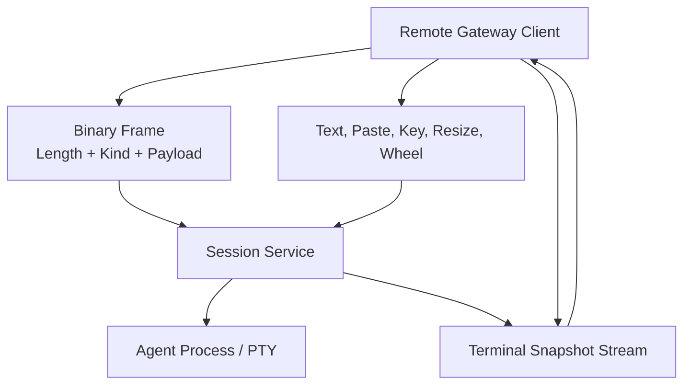
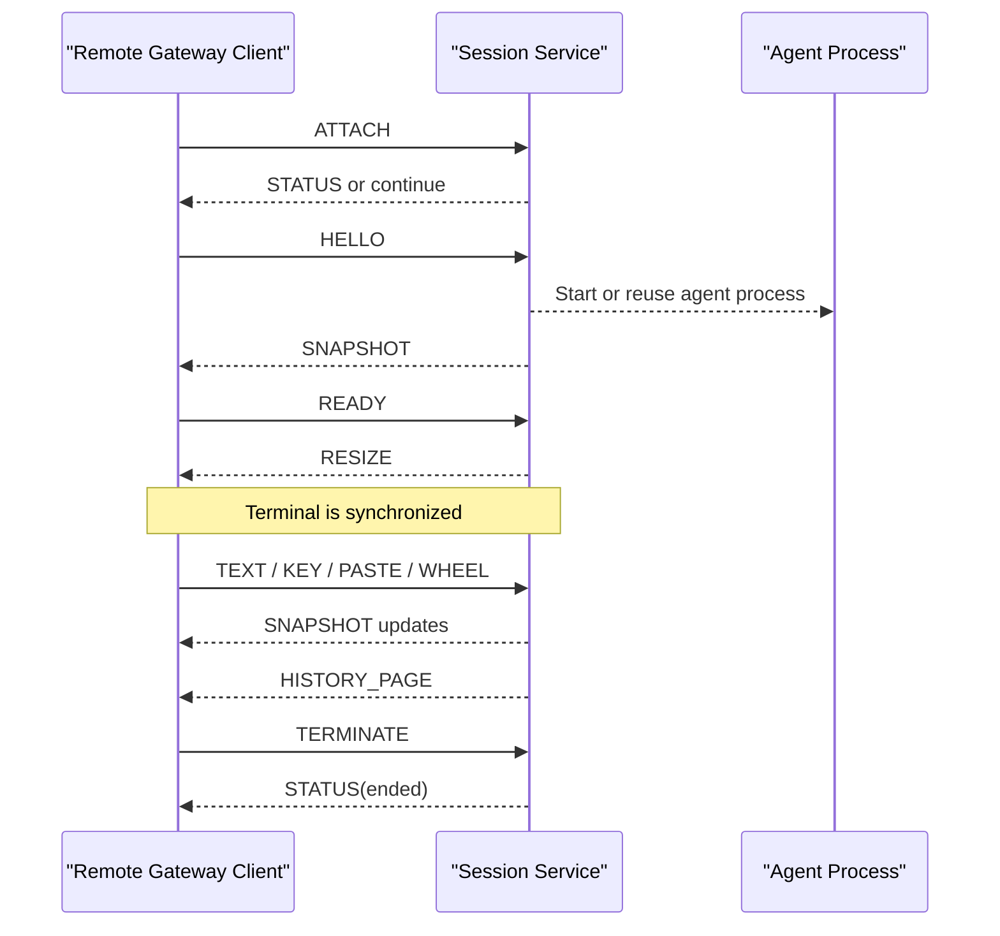
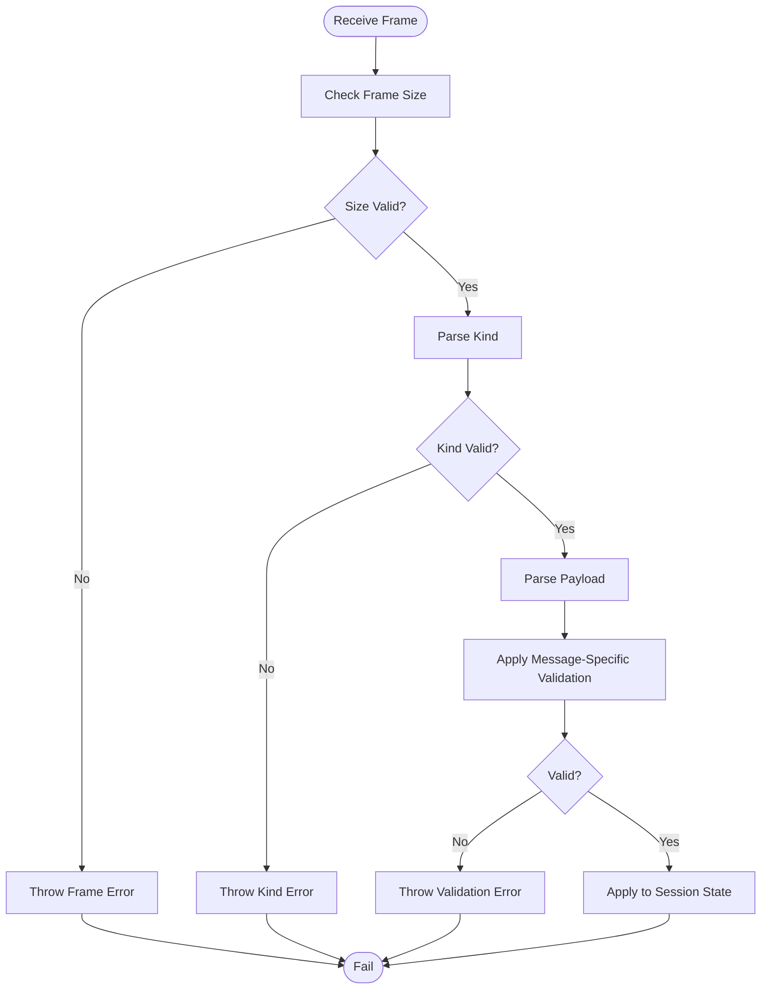

# Internal Wire Protocol

<cite>
**Referenced Files in This Document**
- [local_protocol.hpp](file://services/session/src/transport/local_protocol.hpp)
- [local_protocol.cpp](file://services/session/src/transport/local_protocol.cpp)
- [wire_bytes.hpp](file://services/session/src/transport/wire_bytes.hpp)
- [session_service.cpp](file://services/session/src/session_service.cpp)
- [unix_websocket.hpp](file://adapters/codex/src/unix_websocket.hpp)
- [unix_websocket.cpp](file://adapters/codex/src/unix_websocket.cpp)
- [wire_fixture.hpp](file://apps/desktop/tests/wire_fixture.hpp)
</cite>

## Table of Contents
1. [Introduction](#introduction)
2. [Protocol Overview](#protocol-overview)
3. [Transport and Framing](#transport-and-framing)
4. [Versioning and Capability Negotiation](#versioning-and-capability-negotiation)
5. [Message Catalog](#message-catalog)
6. [Wire Serialization Details](#wire-serialization-details)
7. [Connection Lifecycle](#connection-lifecycle)
8. [Error Handling and Validation](#error-handling-and-validation)
9. [Debugging Techniques](#debugging-techniques)
10. [Performance Characteristics](#performance-characteristics)
11. [Conclusion](#conclusion)

## Introduction
This document describes the internal wire protocol between a remote gateway client and the Lapis session service. It covers the message types, serialization format, field definitions, validation rules, versioning, error handling, and debugging guidance for wire-level issues. The protocol is implemented in C++ on the service side and is consumed by clients such as the desktop application, Android app, iOS app, and adapters that bridge to other transports like Unix-domain WebSocket connections.

The protocol is framed around:
- A binary frame envelope containing a length prefix and a one-byte message kind.
- A payload whose structure depends on the message kind.
- Attachment-based identity using two 16-byte UUIDs and a monotonic generation counter.
- A current protocol version of `6`, with capability negotiation through attach and hello fields.

**Section sources**
- [local_protocol.hpp:1-196](file://services/session/src/transport/local_protocol.hpp#L1-L196)
- [local_protocol.cpp:327-381](file://services/session/src/transport/local_protocol.cpp#L327-L381)

## Protocol Overview
The protocol has two main directions:

| Direction | Typical messages | Purpose |
|---|---|---|
| Client → Service | ATTACH, HELLO, TEXT, PASTE, KEY, RESIZE, WHEEL, HISTORY_REQUEST, PASTE_REQUEST, TERMINATE | Establish identity, synchronize terminal state, send input, request history, submit bounded paste operations, and terminate the agent process. |
| Service → Client | STATUS, READY, SNAPSHOT, HISTORY_PAGE, ATTENTION_SNAPSHOT, ATTENTION_DECISION, ATTENTION_RETRY, PASTE_RESULT | Reject or accept attachments, acknowledge readiness, stream terminal snapshots, answer history requests, coordinate attention workflows, and report paste admission results. |

Key design principles:
- Every meaningful message carries an attachment so the service can correlate it with an active view.
- Terminal snapshots are the authoritative source of terminal state; input messages are applied against the latest accepted snapshot sequence.
- Large text is normally sent incrementally through TEXT frames; PASTE is reserved for complete bounded paste transactions negotiated through ATTACH and HELLO.
- Mouse wheel events are only used when the snapshot signals support.

**Diagram sources**
- [local_protocol.hpp:10-70](file://services/session/src/transport/local_protocol.hpp#L10-L70)
- [session_service.cpp:1301-1832](file://services/session/src/session_service.cpp#L1301-L1832)

**Section sources**
- [local_protocol.hpp:10-70](file://services/session/src/transport/local_protocol.hpp#L10-L70)
- [session_service.cpp:1301-1832](file://services/session/src/session_service.cpp#L1301-L1832)

## Transport and Framing
All messages travel inside a binary frame:

- **Frame header**: four big-endian bytes representing the total frame size, including the one-byte kind field.
- **Kind**: one byte selected from the protocol’s `Kind` enum.
- **Payload**: the remaining bytes after the header.
- **Maximum frame size**: 8 MiB.

A frame parser accepts partial input and returns false until enough bytes are available. When malformed, oversized, unknown, or inconsistent data is encountered, the parser throws an exception rather than returning a silent failure.

### Frame Layout
| Offset | Size | Meaning |
|---|---:|---|
| 0–3 | 4 bytes | Total frame length, big-endian `uint32`. |
| 4 | 1 byte | Message kind. |
| 5..N | N − 4 bytes | Payload. |

### Known Message Kinds
| Kind value | Direction | Name | Description |
|---:|---|---|---|
| 1 | Both | HELLO | Client identifies itself and negotiates capabilities. |
| 2 | Service → Client | SNAPSHOT | Terminal screen state update. |
| 3 | Client → Service | TEXT | Incremental character input. |
| 4 | Client → Service | PASTE | Bulk text operation (legacy non-transactional). |
| 5 | Client → Service | KEY | Keyboard event. |
| 6 | Client → Service | RESIZE | Terminal resizing. |
| 7 | Service → Client | STATUS | Connection state or error response. |
| 8 | Client → Service | ATTACH | Attach request and capability negotiation. |
| 9 | Client → Service | READY | Acknowledgement of the first applied snapshot sequence. |
| 10 | Client → Service | HISTORY_REQUEST | Conversation history navigation request. |
| 11 | Service → Client | HISTORY_PAGE | History page reply. |
| 12 | Service → Client | ATTENTION_SNAPSHOT | Attention workflow state. |
| 13 | Client → Service | ATTENTION_DECISION | User decision about attention. |
| 14 | Client → Service | ATTENTION_RETRY | Retry rejected attention. |
| 15 | Client → Service | TERMINATE | Request to end the agent process. |
| 16 | Client → Service | WHEEL | Mouse wheel input for full-screen programs. |
| 17 | Client → Service | PASTE_REQUEST | Bounded paste transaction request. |
| 18 | Service → Client | PASTE_RESULT | Admission result for a paste transaction. |

**Section sources**
- [local_protocol.cpp:327-381](file://services/session/src/transport/local_protocol.cpp#L327-L381)
- [local_protocol.hpp:10-70](file://services/session/src/transport/local_protocol.hpp#L10-L70)

## Versioning and Capability Negotiation
### Protocol Version
The current protocol version is `6`. Clients must reject connections advertising unsupported versions. The version is part of several control payloads, notably ATTACH and HELLO.

### Attachment Identity
Every attachment contains:
- `session_id`: 16 bytes, nonzero UUID.
- `epoch`: 16 bytes, nonzero UUID.
- `generation`: 64-bit unsigned integer, nonzero and monotonically increasing per attachment.

An identity is valid only if both UUIDs are present and nonzero.

### Attach Capabilities
ATTACH encodes three optional capability bits:
- Hyperlinks: bit `0x80`.
- Attention phase: bit `0x40`.
- Paste transactions: bit `0x20`.

These bits allow the client to advertise whether it supports hyperlinks, attention decisions, and bounded paste transactions. Older services may reject requests that include unsupported capabilities.

### Attach Modes
| Mode | Value | Expected identity | Meaning |
|---|---:|---|---|
| Discover | 0 | Both zero | Find an existing matching session without replacing it. |
| Reconnect | 1 | Nonzero session ID and epoch | Reattach to a known session. |
| Create | 2 | Nonzero session ID, zero epoch | Create a new session with this identifier. |
| Join | 3 | Both zero | Open another view beside the current client. |

### Hello Capabilities
HELLO includes:
- The same attachment identity used during attachment.
- Child process PID.
- Optional paste transaction capability flag.

If paste transactions are enabled, the service sends PASTE_REQUEST instead of streaming large pastes as ordinary TEXT frames.

**Section sources**
- [local_protocol.hpp:17-70](file://services/session/src/transport/local_protocol.hpp#L17-L70)
- [local_protocol.cpp:108-186](file://services/session/src/transport/local_protocol.cpp#L108-L186)

## Message Catalog

### ATTACH
Client → Service.

| Field | Type | Size | Rules |
|---|---|---:|---|
| Version | Big-endian `uint32` | 4 | Must equal the supported protocol version. |
| Fingerprint | Bytes | 32 | Launch fingerprint identifying the agent workspace. |
| Flags | Unsigned byte | 1 | Lower five bits are mode; upper bits encode hyperlinks, attention phase, and paste transactions. |
| Session ID | Bytes | 16 | Zero for discover/join; nonzero for reconnect/create. |
| Epoch | Bytes | 16 | Zero unless reconnecting to a specific epoch. |

Validation:
- Discover and join require both session ID and epoch to be zero.
- Reconnect requires both to be valid nonzero UUIDs.
- Create requires a nonzero session ID and zero epoch.
- The flags byte must not contain an unknown mode.

**Section sources**
- [local_protocol.hpp:45-64](file://services/session/src/transport/local_protocol.hpp#L45-L64)
- [local_protocol.cpp:108-155](file://services/session/src/transport/local_protocol.cpp#L108-L155)

### HELLO
Client → Service.

| Field | Type | Size | Rules |
|---|---|---:|---|
| Version | Big-endian `uint32` | 4 | Must match the protocol version. |
| Attachment | Struct | 24 bytes | Valid session ID, epoch, and nonzero generation. |
| PID | Big-endian `uint64` | 8 | Nonzero child process identifier. |
| Paste transactions | Optional marker | 4 bytes | Present only when the capability is advertised; value must be `1`. |

Total sizes are either 52 bytes without the optional marker or 56 bytes with it.

**Section sources**
- [local_protocol.hpp:66-70](file://services/session/src/transport/local_protocol.hpp#L66-L70)
- [local_protocol.cpp:186-200](file://services/session/src/transport/local_protocol.cpp#L186-L200)

### SNAPSHOT
Service → Client.

There are two related forms:

1. **Snapshot message**: contains the full `TerminalSnapshot`.
2. **Snapshot envelope**: contains attachment, sequence, timing, terminal size, and an encoded snapshot buffer that can be decoded later.

Shared fields:
- Attachment: 24 bytes.
- Sequence: big-endian `uint64`, nonzero.
- Timing: three big-endian `uint64` timestamps in nanoseconds (`pty_read_ns`, `parse_end_ns`, `publish_ns`).

Timing semantics:
- Zero timing indicates no observed PTY output yet.
- The sequence number is monotonic per attachment and is acknowledged by READY.

Snapshot content includes:
- Revision, columns, rows.
- Cursor position, shape, visibility, blinking, wide tail, viewport presence.
- Alternate screen and wheel-support indicator.
- Bracketed paste and application cursor keys flags.
- Foreground, background, optional cursor RGB color.
- History metadata: total kept rows, viewport offset, viewport row count.
- Palette entries.
- Grapheme codepoints.
- Cells: text offsets, lengths, kinds, foreground/background/underline colors, underline style, and style flags.
- Optional hyperlink extension.

Validation:
- Columns and rows are positive.
- Cell count equals `columns × rows`.
- Grapheme count does not exceed 65,536.
- Cell indices stay within grapheme bounds.
- Color values are valid RGB or indexed values.
- Hyperlink spans are consistent with cell ranges and URI sizes.

**Section sources**
- [local_protocol.hpp:72-114](file://services/session/src/transport/local_protocol.hpp#L72-L114)
- [local_protocol.cpp:201-265](file://services/session/src/transport/local_protocol.cpp#L201-L265)
- [local_protocol.cpp:424-535](file://services/session/src/transport/local_protocol.cpp#L424-L535)

### TEXT
Client → Service.

- Payload: attachment followed by raw bytes.
- Maximum payload size: 65,536 code points.
- Normalized input: carriage return characters are rejected for TEXT and KEY.
- Used for incremental character input rather than bulk paste.

**Section sources**
- [local_protocol.hpp:12-16](file://services/session/src/transport/local_protocol.hpp#L12-L16)
- [local_protocol.cpp:306-325](file://services/session/src/transport/local_protocol.cpp#L306-L325)
- [session_service.cpp:1701-1746](file://services/session/src/session_service.cpp#L1701-L1746)

### PASTE
Client → Service.

Legacy paste uses the same control envelope as TEXT:
- Attachment followed by up to 960 KiB of text.
- The service queues at most 1 MiB for the agent to read.
- Long pastes are split into multiple TEXT frames by the view layer before being sent.

For modern paste transactions, use PASTE_REQUEST/PASTE_RESULT instead.

**Section sources**
- [local_protocol.hpp:12-16](file://services/session/src/transport/local_protocol.hpp#L12-L16)
- [local_protocol.cpp:201-265](file://services/session/src/transport/local_protocol.cpp#L201-L265)
- [session_service.cpp:1701-1777](file://services/session/src/session_service.cpp#L1701-L1777)

### KEY
Client → Service.

- Payload: attachment followed by keyboard bytes.
- Same maximum as TEXT: 65,536 code points.
- Carriage return is rejected.

**Section sources**
- [local_protocol.hpp:12-16](file://services/session/src/transport/local_protocol.hpp#L12-L16)
- [local_protocol.cpp:306-325](file://services/session/src/transport/local_protocol.cpp#L306-L325)
- [session_service.cpp:1701-1746](file://services/session/src/session_service.cpp#L1701-L1746)

### RESIZE
Client → Service.

- Payload: attachment followed by serialized terminal size.
- Sent after synchronization completes and when the desired terminal dimensions change.

**Section sources**
- [wire_fixture.hpp:128-131](file://apps/desktop/tests/wire_fixture.hpp#L128-L131)
- [session_service.cpp:2086-2088](file://services/session/src/session_service.cpp#L2086-L2088)

### STATUS
Service → Client.

| Field | Type | Size | Rules |
|---|---|---:|---|
| Code | Unsigned byte | 1 | One of rejected, ended, replaced, overloaded. |
| Message | UTF-8 string | Up to 4,096 bytes | Valid UTF-8, round-trips through Qt UTF-8 conversion. |

Status codes:
- `rejected`: Attach rejected, usually due to invalid fingerprint or incompatible negotiation.
- `ended`: Agent process terminated.
- `replaced`: Another client attached and replaced this view.
- `overloaded`: Service cannot admit more work or input.

**Section sources**
- [local_protocol.hpp:123-126](file://services/session/src/transport/local_protocol.hpp#L123-L126)
- [local_protocol.cpp:336-356](file://services/session/src/transport/local_protocol.cpp#L336-L356)
- [session_service.cpp:1832-1832](file://services/session/src/session_service.cpp#L1832-L1832)

### READY
Client → Service.

Acknowledges the first applied snapshot sequence:
- Attachment matches the current view.
- Sequence equals the snapshot sequence the client wants confirmed.

The service expects READY before treating normal input as fully synchronized.

**Section sources**
- [local_protocol.hpp:120-122](file://services/session/src/transport/local_protocol.hpp#L120-L122)
- [local_protocol.cpp:325-336](file://services/session/src/transport/local_protocol.cpp#L325-L336)
- [wire_fixture.hpp:121-127](file://apps/desktop/tests/wire_fixture.hpp#L121-L127)

### HISTORY_REQUEST
Client → Service.

| Field | Type | Size | Rules |
|---|---|---:|---|
| Request ID | Big-endian `uint64` | 8 | Nonzero. |
| Reference | Big-endian `uint64` | 8 | Zero means newest for older direction; required for newer. |
| Direction | Unsigned byte | 1 | Older, newer, or at. |

Direction rules:
- Older: reference is zero to mean newest.
- Newer: requires a page ID as reference.
- At: asks for the page holding a specific row counted from the oldest kept row; supported only when the service advertises page placement information.

**Section sources**
- [local_protocol.hpp:116-120](file://services/session/src/transport/local_protocol.hpp#L116-L120)
- [local_protocol.cpp:265-289](file://services/session/src/transport/local_protocol.cpp#L265-L289)
- [wire_fixture.hpp:132-141](file://apps/desktop/tests/wire_fixture.hpp#L132-L141)

### HISTORY_PAGE
Service → Client.

| Field | Type | Size | Rules |
|---|---|---:|---|
| Attachment | Struct | 24 bytes | Identifies the view. |
| Request ID | Big-endian `uint64` | 8 | Matches HISTORY_REQUEST. |
| Page ID | Big-endian `uint64` | 8 | Zero when no page is returned. |
| Message length | Big-endian `uint32` | 4 | Up to 4,096 bytes. |
| Message | UTF-8 string | Variable | Error or informational message. |
| Snapshot | Optional | Variable | Present only when page ID is nonzero. |

Validation:
- Request ID is nonzero.
- Snapshot exists exactly when page ID is nonzero.
- Total frame size stays under the 8 MiB limit.
- Message is valid UTF-8.

**Section sources**
- [local_protocol.hpp:116-120](file://services/session/src/transport/local_protocol.hpp#L116-L120)
- [local_protocol.cpp:289-306](file://services/session/src/transport/local_protocol.cpp#L289-L306)
- [wire_fixture.hpp:142-150](file://apps/desktop/tests/wire_fixture.hpp#L142-L150)

### PASTE_REQUEST
Client → Service.

Used for complete bounded paste transactions negotiated through ATTACH and HELLO.

| Field | Type | Size | Rules |
|---|---|---:|---|
| Attachment | Struct | 24 bytes | Valid identity. |
| Request ID | Big-endian `uint64` | 8 | Nonzero. |
| Submit | Byte | 1 | Boolean flag. |
| Text | Bytes | Up to 960 KiB | Complete paste payload. |

Minimum payload size is 49 bytes.

**Section sources**
- [local_protocol.hpp:72-86](file://services/session/src/transport/local_protocol.hpp#L72-L86)
- [local_protocol.cpp:201-231](file://services/session/src/transport/local_protocol.cpp#L201-L231)

### PASTE_RESULT
Service → Client.

| Field | Type | Size | Rules |
|---|---|---:|---|
| Attachment | Struct | 24 bytes | Identifies the view. |
| Request ID | Big-endian `uint64` | 8 | Matches PASTE_REQUEST. |
| Queued | Byte | 1 | Indicates PTY queue admission, not application-level acknowledgement. |
| Message | UTF-8 string | Up to 4,096 bytes | Result detail. |

**Section sources**
- [local_protocol.hpp:86-92](file://services/session/src/transport/local_protocol.hpp#L86-L92)
- [local_protocol.cpp:231-265](file://services/session/src/transport/local_protocol.cpp#L231-L265)
- [session_service.cpp:1773-1777](file://services/session/src/session_service.cpp#L1773-L1777)

### WHEEL
Client → Service.

Introduced in protocol version 6. Only sent when the snapshot reports `accepts_wheel`.

Payload encoding:
- Steps: signed 16-bit big-endian. Positive means scroll back.
- Column: unsigned 16-bit big-endian.
- Row: unsigned 16-bit big-endian.

Total payload size is six bytes. A zero step count is rejected.

**Section sources**
- [local_protocol.hpp:28-43](file://services/session/src/transport/local_protocol.hpp#L28-L43)
- [local_protocol.cpp:399-423](file://services/session/src/transport/local_protocol.cpp#L399-L423)
- [session_service.cpp:1697-1746](file://services/session/src/session_service.cpp#L1697-L1746)

## Wire Serialization Details

### Common Primitives
The session protocol uses its own big-endian helpers for compatibility:
- `append_quint32`: writes a 32-bit value in network byte order.
- `append_quint64`: writes a 64-bit value as two big-endian 32-bit parts.
- `read_quint32`: reads a big-endian 32-bit value.
- `read_quint64`: reads a big-endian 64-bit value.
- `raw_bytes`: copies a fixed-size byte range and advances the cursor.

### Attachment Encoding
Attachment encoding is always:
1. 16-byte session ID.
2. 16-byte epoch.
3. 8-byte big-endian generation.

Invalid identities or zero generations cause serialization or deserialization to throw.

### Control Envelope
TEXT, PASTE, KEY, RESIZE, and similar control payloads use:
1. Attachment.
2. Raw payload bytes.

Control payloads are limited to 65,536 code points.

### Qt DataStream Messages
Some structured messages use Qt DataStream with version `Qt_6_0`:
- Frame header length and kind.
- Wheel payload.
- Full terminal snapshot.

Clients and services must agree on this encoder because arbitrary changes to Qt DataStream behavior could break backward compatibility.

**Section sources**
- [wire_bytes.hpp:10-55](file://services/session/src/transport/wire_bytes.hpp#L10-L55)
- [local_protocol.cpp:327-423](file://services/session/src/transport/local_protocol.cpp#L327-L423)

## Connection Lifecycle

### Lifecycle Rules
1. Client starts with ATTACH.
2. Service may respond with STATUS for immediate rejection.
3. Client sends HELLO with identity and PID.
4. Service sends SNAPSHOT with initial terminal state.
5. Client acknowledges with READY.
6. Service sends RESIZE to establish the final terminal size.
7. Client begins sending input.
8. History requests and paste transactions follow their request-response pattern.
9. TERMINATE causes the service to stop the agent process and report status.

**Diagram sources**
- [wire_fixture.hpp:106-131](file://apps/desktop/tests/wire_fixture.hpp#L106-L131)
- [session_service.cpp:1301-1832](file://services/session/src/session_service.cpp#L1301-L1832)

**Section sources**
- [wire_fixture.hpp:106-150](file://apps/desktop/tests/wire_fixture.hpp#L106-L150)
- [session_service.cpp:1301-1832](file://services/session/src/session_service.cpp#L1301-L1832)

## Error Handling and Validation

### Parser-Level Errors
The wire parser throws exceptions for:
- Incomplete read offsets.
- Frame sizes outside the allowed range.
- Unknown message kinds.
- Invalid attachment identities.
- Invalid status codes.
- Malformed history replies.
- Invalid WebSocket frames when used by the Codex adapter.

### Input Validation
- TEXT and KEY reject carriage return bytes.
- TEXT and KEY payloads must fit within the code point limit.
- PASTE payloads must fit within the paste byte limit.
- HISTORY_REQUEST requires a nonzero request ID and consistent direction/reference combinations.
- HISTORY_PAGE requires a snapshot only when page ID is nonzero.
- WHEEL payloads must be exactly six bytes and have nonzero steps.

### Status Responses
STATUS provides a human-readable reason alongside a machine-readable code. Clients should treat STATUS as terminal for the affected operation and log the message for diagnostics.

**Diagram sources**
- [local_protocol.cpp:327-381](file://services/session/src/transport/local_protocol.cpp#L327-L381)
- [local_protocol.cpp:336-356](file://services/session/src/transport/local_protocol.cpp#L336-L356)

**Section sources**
- [local_protocol.cpp:327-381](file://services/session/src/transport/local_protocol.cpp#L327-L381)
- [local_protocol.cpp:336-356](file://services/session/src/transport/local_protocol.cpp#L336-L356)
- [session_service.cpp:1701-1777](file://services/session/src/session_service.cpp#L1701-L1777)

## Debugging Techniques

### Capture Frames
Use the frame API to serialize and deserialize frames:
- `frame(kind, payload)` constructs a wire frame.
- `take_frame(buffer, result)` parses one frame from a growing buffer.
- `encode_*` and `decode_*` functions validate round-trip serialization.

### Use Test Fixtures
The desktop test fixture demonstrates a realistic client-side wire interaction:
- Accept an ATTACH request.
- Send HELLO.
- Send SNAPSHOT.
- Read READY.
- Expect RESIZE.
- Exchange HISTORY_REQUEST and HISTORY_PAGE.

### Inspect Attachment Identity
When debugging reattachment or replacement issues, compare:
- Session ID.
- Epoch.
- Generation.
- Attach mode.
- Capability flags.

### Validate Paste Transactions
Paste problems often involve:
- Whether paste transactions were negotiated.
- Whether PASTE_REQUEST was used instead of legacy PASTE.
- Whether PASTE_RESULT reported queued admission.
- Whether the payload exceeded the paste byte limit.

### Inspect Wheel Support
Wheel issues typically come from:
- Sending WHEEL before the snapshot reports wheel support.
- Using an unsupported protocol version.
- Encoding the wrong payload size or zero step count.

### Decode Snapshots Carefully
Snapshots are the largest and most complex wire object. Useful checks include:
- Column-row product equals cell count.
- Cursor coordinates are inside the grid.
- Grapheme indices are valid.
- Hyperlink spans do not overlap unexpectedly.
- Link URIs are valid UTF-8.

**Section sources**
- [wire_fixture.hpp:38-154](file://apps/desktop/tests/wire_fixture.hpp#L38-L154)
- [local_protocol.cpp:201-535](file://services/session/src/transport/local_protocol.cpp#L201-L535)

## Performance Characteristics

### Limits
| Resource | Limit | Notes |
|---|---|---|
| Maximum frame size | 8 MiB | Applies to all frames. |
| Maximum cells | 32,768 | Terminal grid constraint. |
| Maximum graphemes | 65,536 | Snapshot grapheme list constraint. |
| Maximum control payload | 65,536 code points | TEXT, PASTE, KEY, RESIZE, and similar controls. |
| Maximum paste payload | 960 KiB | Complete paste transaction or legacy paste frame. |
| Maximum message string | 4,096 bytes | STATUS, HISTORY_PAGE, and PASTE_RESULT messages. |

### Throughput Considerations
- SNAPSHOT messages dominate bandwidth because they describe the full terminal grid.
- TEXT is suitable for small, frequent input but not bulk paste.
- PASTE_REQUEST bundles a complete paste into one bounded frame.
- The service limits queued paste input to approximately 1 MiB while the agent reads it.
- Wheel input is lightweight and only used when necessary.

### Codex Adapter Limits
The Unix WebSocket adapter adds transport-level constraints:
- Maximum WebSocket message size: 1 MiB.
- Header limit: 16 KiB.
- Queue limit: 2 MiB plus WebSocket overhead.
- Strict WebSocket framing, UTF-8 validation, and close-code validation.

**Section sources**
- [local_protocol.hpp:4-16](file://services/session/src/transport/local_protocol.hpp#L4-L16)
- [local_protocol.cpp:289-306](file://services/session/src/transport/local_protocol.cpp#L289-L306)
- [unix_websocket.hpp:12-26](file://adapters/codex/src/unix_websocket.hpp#L12-L26)
- [unix_websocket.cpp:12-22](file://adapters/codex/src/unix_websocket.cpp#L12-L22)
- [unix_websocket.cpp:201-328](file://adapters/codex/src/unix_websocket.cpp#L201-L328)

## Conclusion
The Lapis internal wire protocol is a compact, versioned binary protocol centered on attachment-bound identity, authoritative terminal snapshots, and clearly separated input and control flows. Its design emphasizes safety through strict size limits, explicit capability negotiation, and strong validation. For implementers, the most important responsibilities are:

- Always negotiate ATTACH and HELLO capabilities before exchanging heavy payloads.
- Treat SNAPSHOT as the source of truth and wait for READY before relying on input ordering.
- Prefer PASTE_REQUEST for large paste operations when supported.
- Never send WHEEL unless the snapshot indicates support.
- Handle STATUS responses as definitive connection-state signals.
- Use the provided frame and serializer APIs to avoid subtle serialization mismatches.