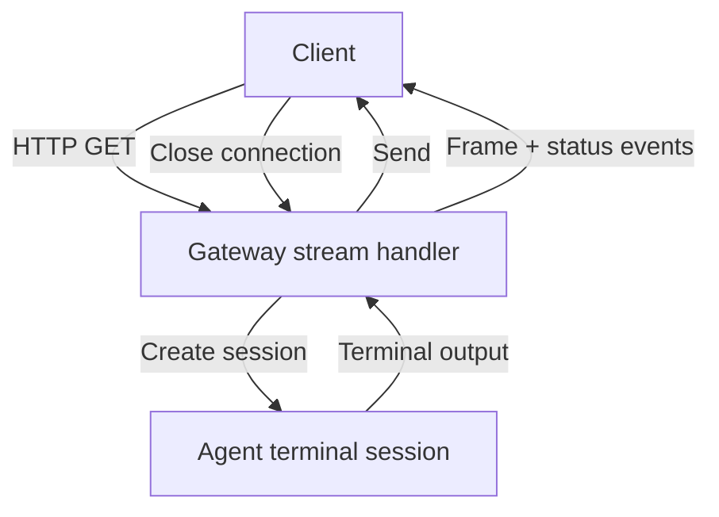
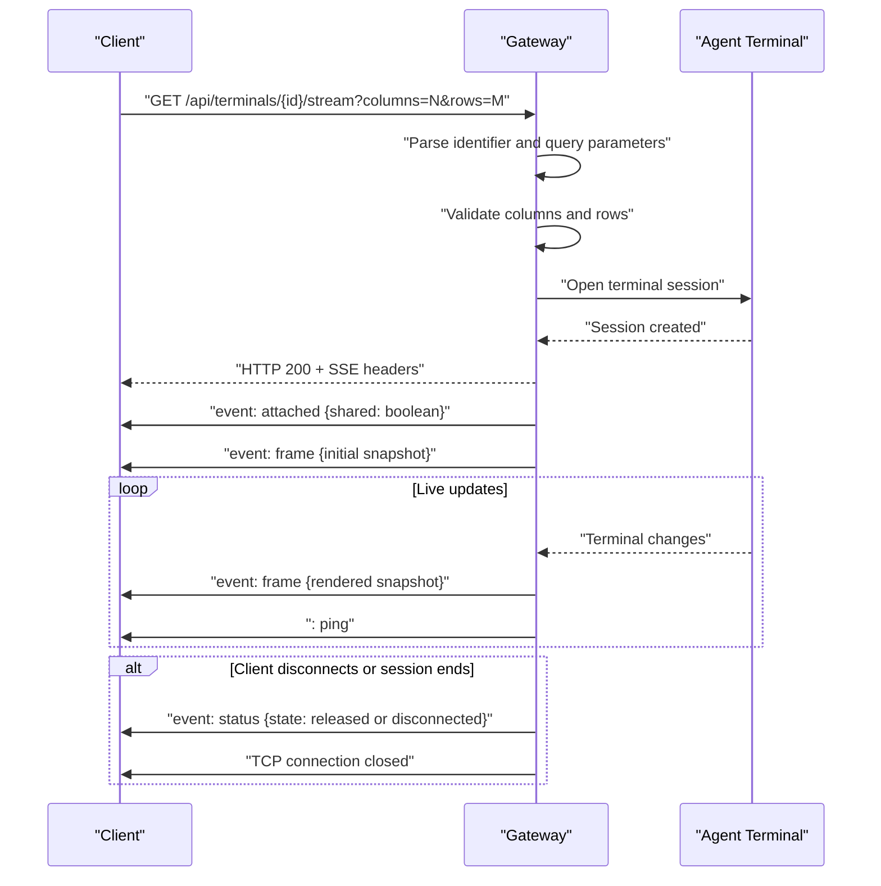
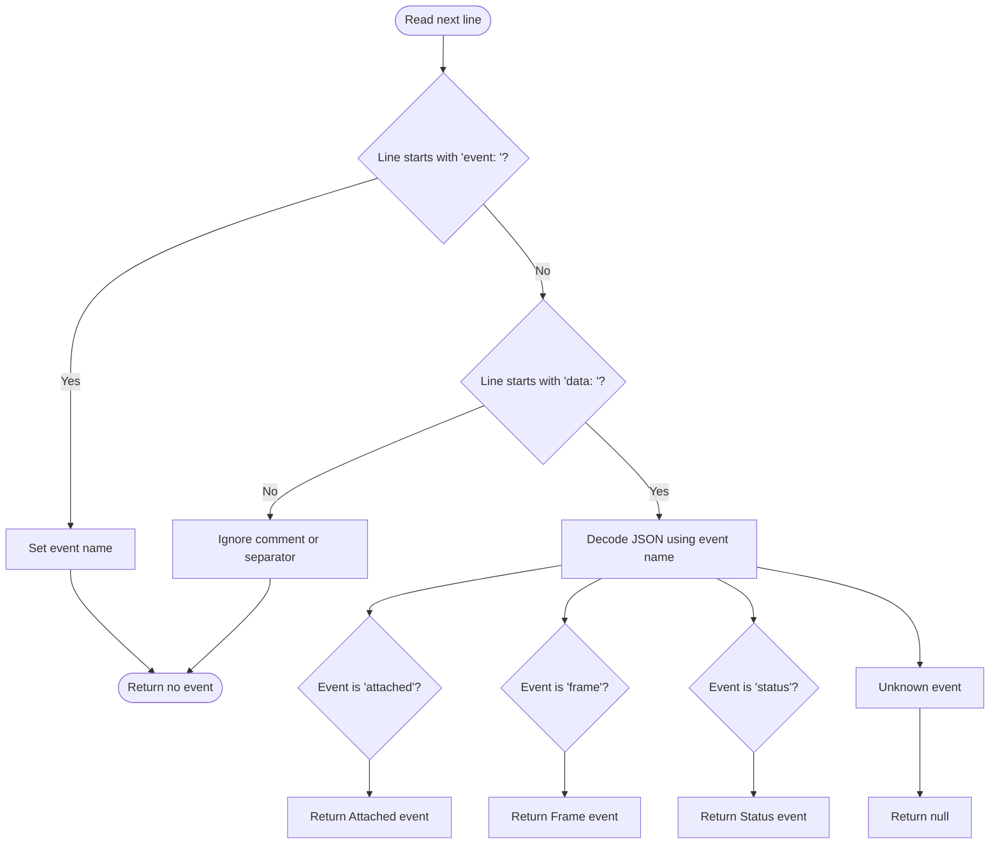
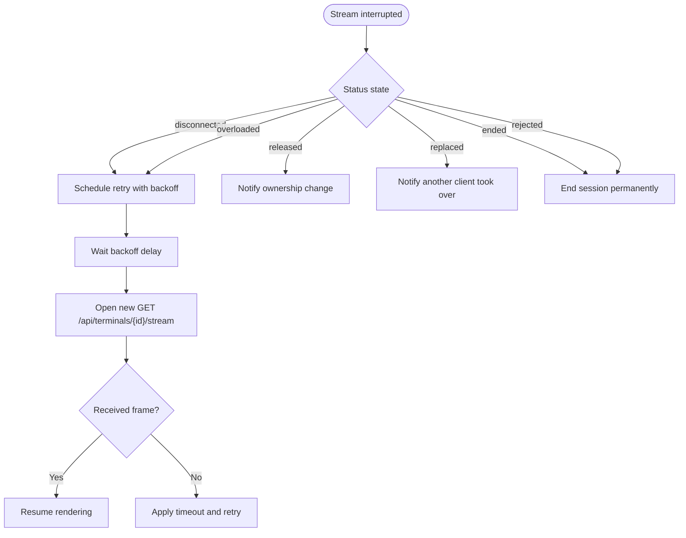
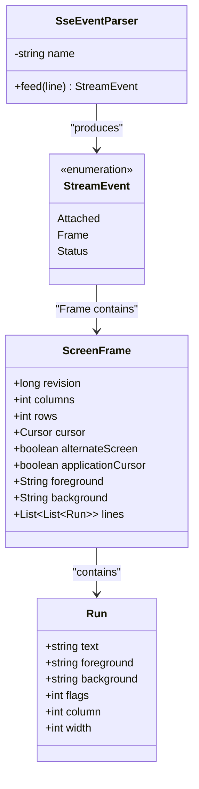

# SSE Protocol Specification

<cite>
**Referenced Files in This Document**   
- [lapis_remote.py](file://apps/remote/lapis_remote.py)
- [SseParser.kt](file://apps/android/app/src/main/kotlin/dev/lapis/remote/gateway/SseParser.kt)
- [Transport.kt](file://apps/android/app/src/main/kotlin/dev/lapis/remote/gateway/Transport.kt)
- [Models.kt](file://apps/android/app/src/main/kotlin/dev/lapis/remote/gateway/Models.kt)
- [stream_events.txt](file://apps/android/app/src/test/resources/fixtures/stream_events.txt)
</cite>

## Table of Contents
1. [Introduction](#introduction)
2. [Protocol Overview](#protocol-overview)
3. [Endpoint Definition](#endpoint-definition)
4. [Connection Lifecycle](#connection-lifecycle)
5. [Event Types](#event-types)
6. [Event Stream Format](#event-stream-format)
7. [Error Handling and Reconnection](#error-handling-and-reconnection)
8. [Client Implementation Guide](#client-implementation-guide)
9. [Performance and Limits](#performance-and-limits)
10. [Troubleshooting](#troubleshooting)
11. [Conclusion](#conclusion)

## Introduction
This document specifies the Server-Sent Events (SSE) terminal streaming protocol used by the Lapis gateway to deliver live terminal snapshots from an agent running on a host machine to remote clients. The protocol is implemented by `apps/remote/lapis_remote.py` and consumed by Android and iOS clients through an SSE transport layer.

The primary stream endpoint is:

```
GET /api/terminals/{identifier}/stream
```

It returns a long-lived `text/event-stream` connection that sends initial shared state, repeated rendered terminal frames, status updates for connection lifecycle events, and periodic keepalive comments.

## Protocol Overview
The protocol uses standard HTTP with SSE framing:

- **Request:** A normal HTTP GET request.
- **Response headers:**
  - `Content-Type: text/event-stream`
  - `Cache-Control: no-store`
  - `Connection: close`
- **Body:** A line-oriented SSE stream where each event consists of:
  - An `event:` line naming the event type.
  - A `data:` line containing JSON.
  - A blank separator line.
- **Keepalive:** The server writes comment lines starting with `: ping` at least every 10 seconds.
- **Termination:** The server closes the TCP connection when the client disconnects, when the session is superseded elsewhere, or when the underlying session ends.



**Diagram sources**
- [lapis_remote.py:2956-3007](file://apps/remote/lapis_remote.py#L2956-L3007)
- [lapis_remote.py:3008-3053](file://apps/remote/lapis_remote.py#L3008-L3053)

**Section sources**
- [lapis_remote.py:2951-3007](file://apps/remote/lapis_remote.py#L2951-L3007)
- [lapis_remote.py:3008-3053](file://apps/remote/lapis_remote.py#L3008-L3053)

## Endpoint Definition

### Path Parameters

| Parameter | Required | Description |
|-----------|----------|-------------|
| `identifier` | Yes | The agent identifier assigned by the gateway. It identifies the agent whose terminal is being streamed. |

### Query Parameters

| Parameter | Type | Default | Description |
|-----------|------|---------|-------------|
| `columns` | Integer | `0` (no resize) | Requested terminal width in columns. Values are validated by the gateway as `10 <= columns <= 500`. |
| `rows` | Integer | `0` (no resize) | Requested terminal height in rows. Values are validated by the gateway as `3 <= rows <= 300`. |

When both `columns` and `rows` are zero, the gateway attaches without requesting a resize. When provided, the gateway resizes the terminal session after attachment.

### Validation Rules

The gateway validates the query parameters before opening the session:

- If `columns` or `rows` cannot be parsed as integers, the response is `400 Bad Request` with the message `Invalid terminal size`.
- After parsing, resizing enforces:
  - `10 <= columns <= 500`
  - `3 <= rows <= 300`
  - `columns * rows <= MAX_CELLS`

If resizing fails later during session setup, the gateway rejects the attach operation and reports it through the stream.

**Section sources**
- [lapis_remote.py:2956-2971](file://apps/remote/lapis_remote.py#L2956-L2971)
- [lapis_remote.py:1849-1854](file://apps/remote/lapis_remote.py#L1849-L1854)

## Connection Lifecycle

### Step-by-Step Establishment



**Diagram sources**
- [lapis_remote.py:2956-3007](file://apps/remote/lapis_remote.py#L2956-L3007)
- [lapis_remote.py:3008-3053](file://apps/remote/lapis_remote.py#L3008-L3053)

### Response Headers

| Header | Value | Meaning |
|--------|-------|---------|
| `Content-Type` | `text/event-stream` | Indicates an SSE stream. |
| `Cache-Control` | `no-store` | Prevents caching of the live stream. |
| `Connection` | `close` | The server will close the connection when the stream ends. |

### Stream Start Behavior

1. The gateway resolves the agent by `identifier`.
2. If the agent does not exist, it responds with `404 Not Found` and an error body.
3. If `columns` or `rows` are invalid integers, it responds with `400 Bad Request`.
4. If attaching to the agent fails, it responds with `502 Bad Gateway` and includes the underlying error.
5. On success, it immediately sends:
   - `attached` with `shared`, indicating whether another client already owns the terminal.
   - `frame` with the first rendered snapshot.

### Shared Ownership

The `attached.shared` field indicates whether another client currently holds ownership:

- `true`: Another client is connected; this connection may be superseded.
- `false`: This client is the sole owner.

Clients should monitor `status` events because a `replaced` or `released` status can indicate that another client has taken over.

**Section sources**
- [lapis_remote.py:2956-3007](file://apps/remote/lapis_remote.py#L2956-L3007)
- [lapis_remote.py:3008-3053](file://apps/remote/lapis_remote.py#L3008-L3053)

## Event Types

### `attached`

Sent once at the beginning of a successful stream.

| Field | Type | Description |
|-------|------|-------------|
| `shared` | Boolean | Whether another client already owns the terminal. |

#### Example

```
event: attached
data: {"shared": true}
```

**Section sources**
- [lapis_remote.py:2984-2984](file://apps/remote/lapis_remote.py#L2984-L2984)
- [stream_events.txt:3-5](file://apps/android/app/src/test/resources/fixtures/stream_events.txt#L3-L5)

### `frame`

Sent repeatedly while the terminal has content. The first frame is sent immediately after `attached`. Subsequent frames are throttled to approximately one per 50 milliseconds when new data is available.

#### Frame Fields

| Field | Type | Description |
|-------|------|-------------|
| `revision` | Number or absent | Optional revision number carried by the frame model. |
| `columns` | Integer | Terminal width in columns. |
| `rows` | Integer | Terminal height in rows. |
| `cursor.x` | Integer | Cursor column. |
| `cursor.y` | Integer | Cursor row. |
| `cursor.visible` | Boolean | Whether the cursor is visible. |
| `alternateScreen` | Boolean | Whether the alternate screen buffer is active. |
| `applicationCursor` | Boolean | Whether application cursor mode is active. |
| `wheel` | Boolean or absent | Whether the Mac service takes wheel input for full-screen programs. |
| `foreground` | String | Default foreground color. |
| `background` | String | Default background color. |
| `lines` | Array of arrays | Rendered terminal rows, where each cell is a styled run. |

#### Cell Run Format

Each cell in a row is represented as a positional array:

```
[text, foreground, background, flags, column, width]
```

| Position | Field | Type | Description |
|----------|-------|------|-------------|
| 0 | `text` | String | Displayed text. |
| 1 | `foreground` | String or null | Foreground color. |
| 2 | `background` | String or null | Background color. |
| 3 | `flags` | Integer | Style flags such as bold, italic, faint, underline, strike, cursor. |
| 4 | `column` | Integer or absent | Starting column index. |
| 5 | `width` | Integer or absent | Cell width in columns. |

#### Example

```
event: frame
data: {"revision": 1, "columns": 4, "rows": 1, "cursor": {"x": 0, "y": 0, "visible": false}, "alternateScreen": false, "applicationCursor": false, "foreground": "#ffffff", "background": "#000000", "lines": [[["hi", null, null, 0]]]}
```

**Section sources**
- [lapis_remote.py:3008-3053](file://apps/remote/lapis_remote.py#L3008-L3053)
- [Models.kt:109-144](file://apps/android/app/src/main/kotlin/dev/lapis/remote/gateway/Models.kt#L109-L144)
- [stream_events.txt:6-10](file://apps/android/app/src/test/resources/fixtures/stream_events.txt#L6-L10)

### `status`

Sent for connection lifecycle and backend status transitions.

| Field | Type | Description |
|-------|------|-------------|
| `state` | String | Status code describing the connection state. |
| `message` | String | Human-readable explanation. |

#### Supported States

| State | Meaning |
|-------|---------|
| `rejected` | The gateway rejected the connection attempt. |
| `ended` | The underlying agent session ended. |
| `replaced` | Another client took over the terminal. |
| `overloaded` | The gateway could not admit the connection due to load. |
| `disconnected` | A network or session error occurred. |
| `released` | The terminal was opened elsewhere or the session ended normally. |

The mapping between low-level status codes and string states comes from the gateway's `STATUS_NAMES` table. When a status is received from the backend but is not recognized, it is emitted as the generic `status` state.

#### Example

```
event: status
data: {"state": "replaced", "message": ""}
```

**Section sources**
- [lapis_remote.py:86-86](file://apps/remote/lapis_remote.py#L86-L86)
- [lapis_remote.py:3020-3037](file://apps/remote/lapis_remote.py#L3020-L3037)
- [stream_events.txt:13-15](file://apps/android/app/src/test/resources/fixtures/stream_events.txt#L13-L15)

### `ping` Keepalive

The server writes comment lines:

```
: ping
```

These are not decoded as named events. They serve two purposes:

1. Keep intermediate proxies and firewalls alive.
2. Allow clients to detect stalled connections.

The implementation writes a ping at least every 10 seconds. The Android transport treats a read timeout longer than the ping interval—40 seconds—as acceptable, so a quiet screen should not trigger a timeout.

**Section sources**
- [lapis_remote.py:3049-3052](file://apps/remote/lapis_remote.py#L3049-L3052)
- [Transport.kt:38-53](file://apps/android/app/src/main/kotlin/dev/lapis/remote/gateway/Transport.kt#L38-L53)
- [stream_events.txt:1-2](file://apps/android/app/src/test/resources/fixtures/stream_events.txt#L1-L2)
- [stream_events.txt:11-12](file://apps/android/app/src/test/resources/fixtures/stream_events.txt#L11-L12)

## Event Stream Format

### Line Structure

A complete event has this structure:

```
event: <name>
data: <json-payload>

```

Comments such as `: ping` do not have an `event:` line and are ignored by event parsers.

### Parser Behavior

The Android `SseEventParser` processes one raw line at a time:

1. Lines starting with `event: ` set the current event name.
2. Lines starting with `data: ` decode the payload according to the current event name.
3. Unknown event names are ignored.
4. Comment lines, blank separators, and other non-event lines are ignored.
5. A malformed payload for a known event causes decoding to fail rather than silently discarding it.



**Diagram sources**
- [SseParser.kt:1-40](file://apps/android/app/src/main/kotlin/dev/lapis/remote/gateway/SseParser.kt#L1-L40)

**Section sources**
- [SseParser.kt:1-40](file://apps/android/app/src/main/kotlin/dev/lapis/remote/gateway/SseParser.kt#L1-L40)

## Error Handling and Reconnection

### HTTP-Level Errors

| Condition | Response |
|-----------|----------|
| No agent matches `identifier` | `404 Not Found` |
| `columns` or `rows` are not valid integers | `400 Bad Request` with message `Invalid terminal size` |
| Attaching to the agent fails | `502 Bad Gateway` with an error description |

These errors occur before the SSE stream begins. Clients should treat them as fatal for that connection attempt and surface the error to the user or retry policy.

### Stream-Level Errors

Errors detected after the stream starts are delivered as `status` events:

- `disconnected`: Network interruption, EOF, or unexpected socket failure.
- `released`: The session was opened elsewhere or the session ended normally.
- `replaced`: Another client superseded this connection.
- `overloaded`: The gateway rejected admission due to load.
- `ended`: The underlying agent session ended.
- `rejected`: The gateway rejected the connection.

### Reconnection Strategy

A robust client should implement exponential backoff with jitter:

1. **Immediate retry** after transient failures such as network drops.
2. **Backoff delay** that grows with consecutive failures.
3. **Maximum delay cap** to avoid long stalls.
4. **Jitter** to prevent synchronized retries across multiple clients.
5. **Retry only on reconnectable states**:
   - `disconnected`
   - Temporary overload conditions
6. **Do not auto-retry** on terminal-ending states unless explicitly requested:
   - `ended`
   - `rejected`
   - Permanent `released`
7. **Handle `replaced`** by notifying the UI that another client now owns the terminal; optionally allow the client to rejoin if permitted.
8. **Reinitialize terminal dimensions** from the first `frame` event after reconnecting, because the server may have resized the terminal.
9. **Respect `Connection: close`**: Do not assume the same TCP connection survives; always open a new HTTP connection.



[No diagram sources needed since this flow is conceptual guidance based on the documented behavior]

**Section sources**
- [lapis_remote.py:2956-3007](file://apps/remote/lapis_remote.py#L2956-L3007)
- [lapis_remote.py:3008-3053](file://apps/remote/lapis_remote.py#L3008-L3053)

## Client Implementation Guide

### Android Kotlin Client

The Android gateway layer demonstrates how to consume the SSE stream:

- Use an HTTP transport capable of streaming response bodies.
- Read the response body line by line.
- Feed each line into `SseEventParser.feed`.
- Handle `Attached`, `Frame`, and `Status` events.
- Close the stream explicitly when done.
- Apply a read timeout larger than the 10-second ping interval.



**Diagram sources**
- [SseParser.kt:1-40](file://apps/android/app/src/main/kotlin/dev/lapis/remote/gateway/SseParser.kt#L1-L40)
- [Models.kt:109-186](file://apps/android/app/src/main/kotlin/dev/lapis/remote/gateway/Models.kt#L109-L186)

#### Key Responsibilities

| Responsibility | Guidance |
|----------------|----------|
| Transport | Use OkHttp or equivalent with a stream-aware API. |
| Timeout | Configure read timeout greater than 10 seconds. |
| Line limit | Reject or truncate lines larger than the expected maximum to avoid memory exhaustion. |
| Parsing | Use a line-based parser that ignores unknown events and comments. |
| Rendering | Update the terminal buffer using `columns`, `rows`, `lines`, and `cursor`. |
| Cleanup | Close the stream and release resources even on early termination. |

**Section sources**
- [SseParser.kt:1-40](file://apps/android/app/src/main/kotlin/dev/lapis/remote/gateway/SseParser.kt#L1-L40)
- [Transport.kt:38-137](file://apps/android/app/src/main/kotlin/dev/lapis/remote/gateway/Transport.kt#L38-L137)
- [Models.kt:109-186](file://apps/android/app/src/main/kotlin/dev/lapis/remote/gateway/Models.kt#L109-L186)

### Web Browser Client

Browsers support native `EventSource`. However, this repository’s server-side SSE writer emits a custom `: ping` comment and a fixed `event:`/`data:` format. A browser client should:

1. Create an `EventSource` for `GET /api/terminals/{identifier}/stream`.
2. Listen for `attached`, `frame`, and `status` messages.
3. Ignore `ping` comments automatically handled by `EventSource`.
4. Parse `frame.data` as JSON and update the canvas or terminal widget.
5. On `status.state === "disconnected"` or `"released"`, apply reconnection logic.
6. Avoid relying on automatic reconnection unless the application supports safe reconnect semantics, because the stream carries terminal state that may require explicit reset.

Note: Some proxy layers or older browsers may not forward `text/event-stream` responses correctly. Clients should test their deployment environment.

### Desktop C++ / Qt Client

The desktop application consumes the same gateway protocol through its own transport and terminal surface. The important contract remains identical:

- Connect to `/api/terminals/{identifier}/stream`.
- Expect `attached`, `frame`, `status`, and `ping`.
- Render terminal snapshots.
- Handle disconnections and ownership changes.

For platform-specific details, refer to the desktop application’s terminal and connection modules rather than assuming the Android parser implementation.

**Section sources**
- [lapis_remote.py:2956-3053](file://apps/remote/lapis_remote.py#L2956-L3053)

## Performance and Limits

### Frame Throttling

The server renders the latest snapshot at most once every 50 milliseconds. This prevents the client from being overwhelmed when the terminal produces rapid output.

### Maximum Frame Size

Frames are capped at 8 MiB (`MAX_FRAME`). The Android transport adds 4 KiB of envelope slack, resulting in a maximum line length of approximately 8 MiB plus overhead. Lines exceeding this limit are treated as protocol violations.

### Terminal Resize Limits

| Constraint | Limit |
|------------|-------|
| `columns` | 10 to 500 |
| `rows` | 3 to 300 |
| `columns * rows` | Bounded by `MAX_CELLS` |

### Keepalive Interval

Pings are written at least every 10 seconds. Clients should consider the connection stalled if no data arrives within roughly 40 seconds.

### Memory Considerations

Clients should:

- Process frames incrementally.
- Avoid buffering the entire stream.
- Replace or discard old terminal buffers rather than growing unbounded lists.
- Respect the maximum line size to prevent memory exhaustion.

**Section sources**
- [lapis_remote.py:86-90](file://apps/remote/lapis_remote.py#L86-L90)
- [lapis_remote.py:1849-1854](file://apps/remote/lapis_remote.py#L1849-L1854)
- [lapis_remote.py:3008-3053](file://apps/remote/lapis_remote.py#L3008-L3053)
- [Transport.kt:87-137](file://apps/android/app/src/main/kotlin/dev/lapis/remote/gateway/Transport.kt#L87-L137)

## Troubleshooting

### Common Problems

| Symptom | Likely Cause | Resolution |
|---------|--------------|------------|
| Immediate `404 Not Found` | Invalid or expired `identifier` | Verify the agent identifier before connecting. |
| Immediate `400 Bad Request` | Non-integer `columns` or `rows` | Send numeric values or omit them. |
| Immediate `502 Bad Gateway` | Agent attach failed | Inspect the error message and check agent availability. |
| Stream starts but stops after a few seconds | Client closed the connection or network dropped | Check logs and retry with backoff. |
| `status.state` is `replaced` | Another client owns the terminal | Notify the user; do not silently continue rendering. |
| `status.state` is `released` | Terminal opened elsewhere or session ended normally | Treat as terminal ownership loss. |
| `status.state` is `overloaded` | Gateway is under load | Retry with backoff. |
| `status.state` is `disconnected` | Network or I/O error | Retry if appropriate; otherwise show an error. |
| `status.state` is `ended` | Agent session terminated | End the terminal view. |
| Frames stop arriving but connection stays open | Missing pings or slow client | Ensure the client reads lines continuously and handles `ping` comments. |
| Large terminal output crashes the client | Unbounded line or frame buffer | Enforce the 8 MiB frame limit and process frames efficiently. |

### Debugging Tips

1. Log the full SSE stream temporarily to verify event ordering.
2. Confirm the response headers include `Content-Type: text/event-stream`.
3. Validate that `attached` appears before the first `frame`.
4. Confirm `ping` comments appear at least every 10 seconds.
5. Compare the received `columns` and `rows` with the requested values.
6. Validate that `lines` contains exactly `rows` entries and that each entry has `columns` cells.
7. Use the fixture file `stream_events.txt` as a minimal reference stream for unit tests.

**Section sources**
- [lapis_remote.py:2956-3053](file://apps/remote/lapis_remote.py#L2956-L3053)
- [stream_events.txt:1-15](file://apps/android/app/src/test/resources/fixtures/stream_events.txt#L1-L15)

## Conclusion
The Lapis terminal SSE protocol provides a simple, line-oriented streaming interface for delivering terminal snapshots. Clients should parse `event:` and `data:` lines, handle `attached`, `frame`, `status`, and `ping`, enforce the documented size limits, and implement robust reconnection logic for transient failures. The Android `SseEventParser`, `Transport`, and `Models` implementations provide a practical reference for building reliable clients on other platforms.