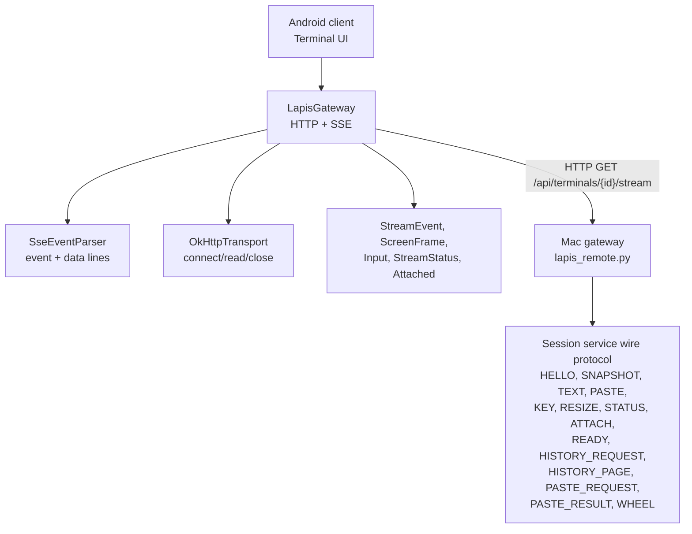
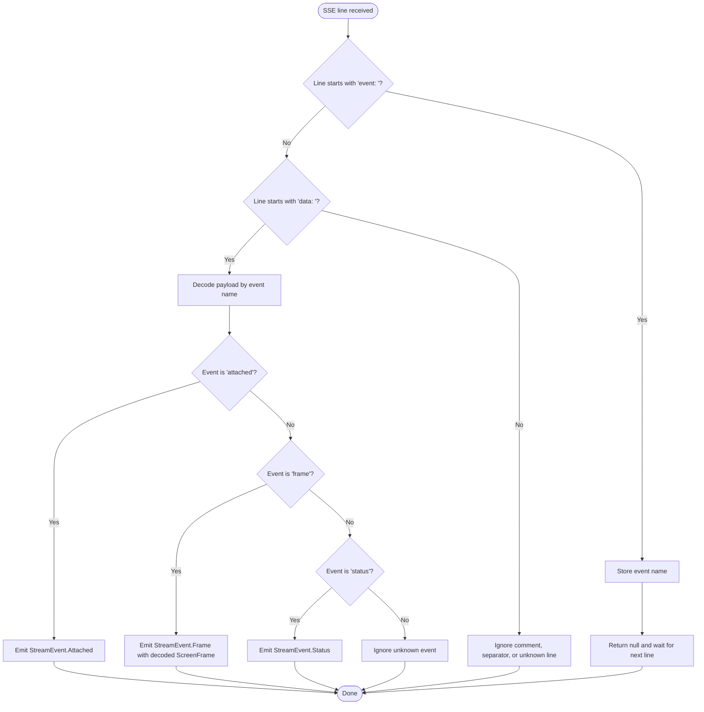
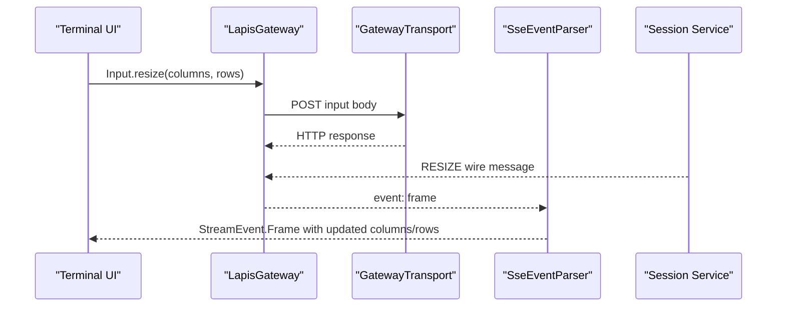
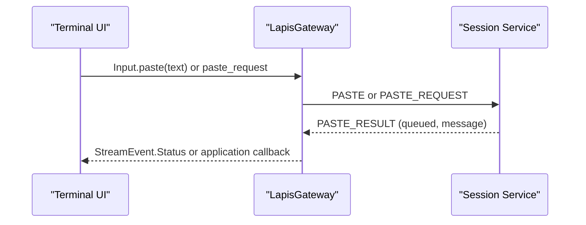
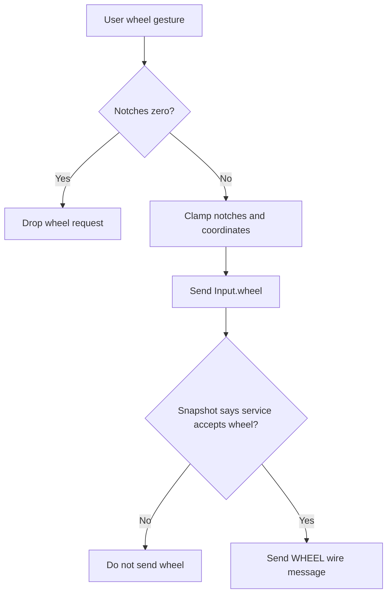
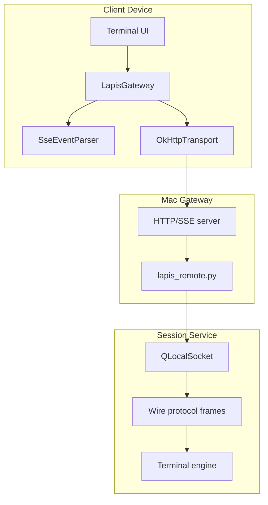
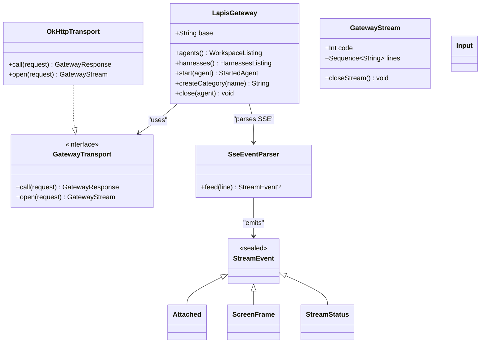
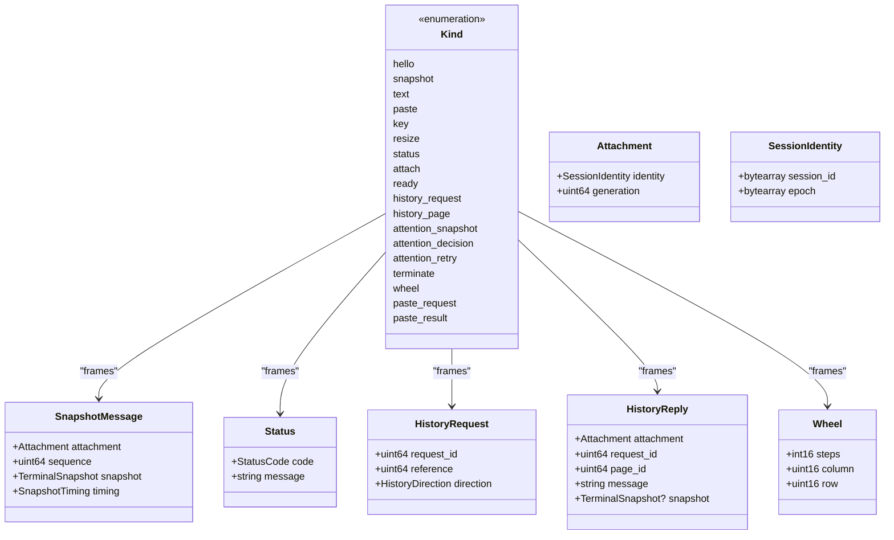
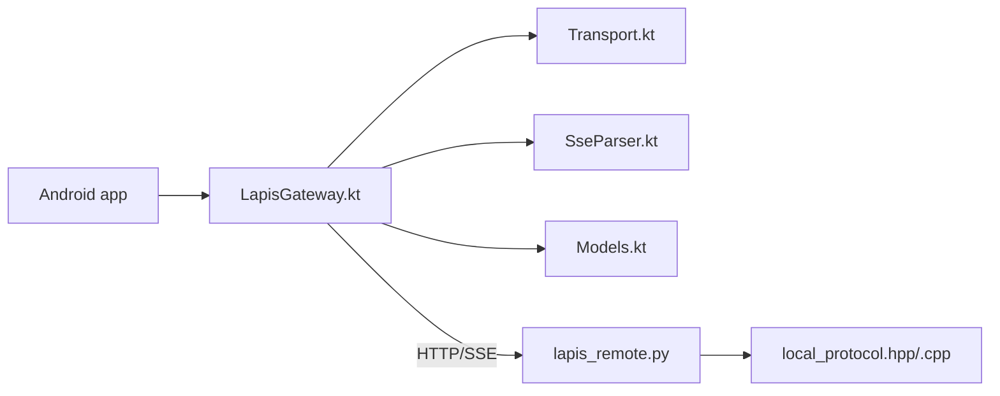
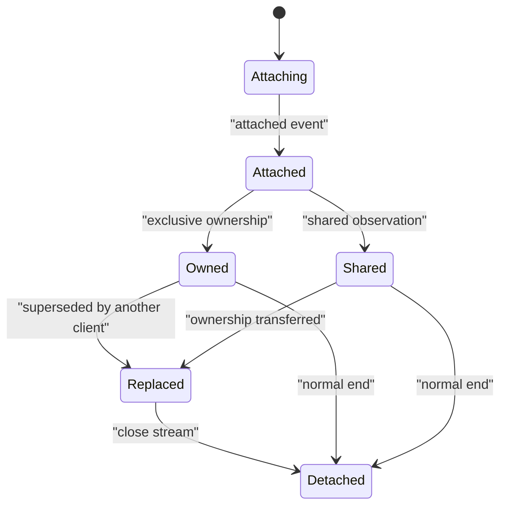

# Terminal Streaming (SSE)

<cite>
**Referenced Files in This Document**
- [local_protocol.hpp](file://services/session/src/transport/local_protocol.hpp)
- [local_protocol.cpp](file://services/session/src/transport/local_protocol.cpp)
- [LapisGateway.kt](file://apps/android/app/src/main/kotlin/dev/lapis/remote/gateway/LapisGateway.kt)
- [SseParser.kt](file://apps/android/app/src/main/kotlin/dev/lapis/remote/gateway/SseParser.kt)
- [Transport.kt](file://apps/android/app/src/main/kotlin/dev/lapis/remote/gateway/Transport.kt)
- [Models.kt](file://apps/android/app/src/main/kotlin/dev/lapis/remote/gateway/Models.kt)
</cite>

## Table of Contents
1. [Introduction](#introduction)
2. [Project Structure](#project-structure)
3. [Core Components](#core-components)
4. [Architecture Overview](#architecture-overview)
5. [Detailed Component Analysis](#detailed-component-analysis)
6. [Dependency Analysis](#dependency-analysis)
7. [Performance Considerations](#performance-considerations)
8. [Troubleshooting Guide](#troubleshooting-guide)
9. [Conclusion](#conclusion)

## Introduction
This document describes the terminal streaming interface used by Lapis clients to receive live terminal output and send input through a gateway process. The client-facing protocol is Server-Sent Events (SSE), while the internal wire protocol between the gateway and the session service uses a binary framing format with typed messages such as HELLO, SNAPSHOT, TEXT, PASTE, KEY, RESIZE, STATUS, ATTACH, READY, HISTORY_REQUEST, HISTORY_PAGE, PASTE_REQUEST, PASTE_RESULT, and WHEEL.

The SSE layer exposes:
- A connection establishment endpoint at `GET /api/terminals/{identifier}/stream`.
- Query parameters for terminal sizing: `columns` and `rows`.
- Event types `attached`, `frame`, `status`, and keepalive `ping` comments.
- Backpressure controls including bounded frame sizes, paste admission limits, and memory caps.
- Reconnection and error handling guidance based on client transport behavior.
- Supersession semantics where multiple clients may observe a terminal while one client remains the exclusive owner.

## Project Structure
The relevant implementation is split across three layers:

| Layer | Responsibility | Key files |
|---|---|---|
| Android SSE client | HTTP transport, SSE line parsing, event model, and input encoding | `apps/android/app/src/main/kotlin/dev/lapis/remote/gateway/LapisGateway.kt`, `SseParser.kt`, `Transport.kt`, `Models.kt` |
| Gateway contract surface | URL construction, headers, timeouts, stream boundaries, and JSON payloads | `LapisGateway.kt`, `Transport.kt`, `Models.kt` |
| Session service wire protocol | Binary message definitions, attachment identities, snapshot structure, status codes, history requests, paste transactions, wheel input, and frame parser | `services/session/src/transport/local_protocol.hpp`, `local_protocol.cpp` |

**Diagram sources**
- [LapisGateway.kt:1-200](file://apps/android/app/src/main/kotlin/dev/lapis/remote/gateway/LapisGateway.kt#L1-L200)
- [SseParser.kt:1-40](file://apps/android/app/src/main/kotlin/dev/lapis/remote/gateway/SseParser.kt#L1-L40)
- [Transport.kt:1-137](file://apps/android/app/src/main/kotlin/dev/lapis/remote/gateway/Transport.kt#L1-L137)
- [Models.kt:1-327](file://apps/android/app/src/main/kotlin/dev/lapis/remote/gateway/Models.kt#L1-L327)
- [local_protocol.hpp:1-196](file://services/session/src/transport/local_protocol.hpp#L1-L196)

**Section sources**
- [LapisGateway.kt:1-200](file://apps/android/app/src/main/kotlin/dev/lapis/remote/gateway/LapisGateway.kt#L1-L200)
- [SseParser.kt:1-40](file://apps/android/app/src/main/kotlin/dev/lapis/remote/gateway/SseParser.kt#L1-L40)
- [Transport.kt:1-137](file://apps/android/app/src/main/kotlin/dev/lapis/remote/gateway/Transport.kt#L1-L137)
- [Models.kt:1-327](file://apps/android/app/src/main/kotlin/dev/lapis/remote/gateway/Models.kt#L1-L327)
- [local_protocol.hpp:1-196](file://services/session/src/transport/local_protocol.hpp#L1-L196)

## Core Components

### SSE Connection Establishment
The Android gateway constructs normalized base URLs using scheme, host, port, optional userinfo, and default port 7349. It sends requests with the header `X-Lapis-Client: android` and `Cache-Control: no-cache`. The SSE stream is opened through `GatewayTransport.open`, which returns a `GatewayStream` whose `lines` sequence yields one SSE line at a time.

The documented endpoint for terminal streaming is `GET /api/terminals/{identifier}/stream`. The query parameters are:
- `columns`: requested terminal width in cells.
- `rows`: requested terminal height in cells.

These values are forwarded by the gateway so that the underlying terminal can start or resize to the requested dimensions.

**Section sources**
- [LapisGateway.kt:1-200](file://apps/android/app/src/main/kotlin/dev/lapis/remote/gateway/LapisGateway.kt#L1-L200)
- [Transport.kt:1-137](file://apps/android/app/src/main/kotlin/dev/lapis/remote/gateway/Transport.kt#L1-L137)

### SSE Event Protocol
The SSE event parser recognizes these event names:
- `attached`: payload is an `Attached` object describing whether the terminal is shared with another view or exclusively owned by this client.
- `frame`: payload is a `ScreenFrame` containing columns, rows, cursor state, alternate screen mode, application cursor mode, colors, and styled text lines.
- `status`: payload is a `StreamStatus` object with a string `state` and human-readable `message`.
- `ping`: implemented as comment lines beginning with `:`; they carry no data but prove the server is still alive.

Unknown event names and non-event lines are ignored. Known events with malformed JSON fail the stream rather than silently discarding them.

**Diagram sources**
- [SseParser.kt:1-40](file://apps/android/app/src/main/kotlin/dev/lapis/remote/gateway/SseParser.kt#L1-L40)
- [Models.kt:200-327](file://apps/android/app/src/main/kotlin/dev/lapis/remote/gateway/Models.kt#L200-L327)

**Section sources**
- [SseParser.kt:1-40](file://apps/android/app/src/main/kotlin/dev/lapis/remote/gateway/SseParser.kt#L1-L40)
- [Models.kt:200-327](file://apps/android/app/src/main/kotlin/dev/lapis/remote/gateway/Models.kt#L200-L327)

### Wire Protocol Between Gateway and Session Service
The session service wire protocol is defined in the local protocol module. It uses a typed frame format with a `Kind` enum and binary encoders/decoders. Important constants include:
- `version = 6`
- `max_frame_bytes = 8 MiB`
- `max_cells = 32768`
- `max_codepoints = 65536`
- `max_input_bytes = 64 KiB` per text/paste/key message
- `max_paste_bytes = 960 KiB` for a complete paste transaction

Wire message kinds include:
- `hello`: service announces its identity, PID, and capabilities after attach.
- `snapshot`: terminal screen snapshot with sequence number, timing metadata, and encoded screen data.
- `text`: raw terminal input bytes.
- `paste`: terminal paste input.
- `key`: key event input.
- `resize`: terminal resize request.
- `status`: lifecycle/status message including rejected, ended, replaced, or overloaded.
- `attach`: client attachment request with mode, fingerprint, and expected session identity.
- `ready`: client acknowledgement of the first applied snapshot sequence.
- `history_request`: request for archived history pages.
- `history_page`: page of archived terminal rows.
- `attention_snapshot`, `attention_decision`, `attention_retry`: attention-related control messages.
- `terminate`: request to end the agent process.
- `wheel`: wheel rotation for full-screen programs, negotiated through `Hello` and `AttachRequest::paste_transactions`.
- `paste_request`, `paste_result`: bounded paste transaction envelope.

Attachment and identity fields use two 16-byte UUIDs plus a generation counter. Attachment modes include discover, reconnect, create, and join.

**Section sources**
- [local_protocol.hpp:1-196](file://services/session/src/transport/local_protocol.hpp#L1-L196)
- [local_protocol.cpp:1-200](file://services/session/src/transport/local_protocol.cpp#L1-L200)

### Terminal Resize Handling
Clients send resize operations through the gateway’s input API. In the Android model, `Input.resize` carries a list of integers representing the new columns and rows. The gateway forwards this to the session service as a `RESIZE` wire message.

The `ScreenFrame` includes current `columns` and `rows`, allowing the client to render the terminal at the size published by the service even if the requested size differs. Clients should clamp or validate resize inputs before sending them, especially when integrating with platform-specific input gestures.

**Diagram sources**
- [Models.kt:200-327](file://apps/android/app/src/main/kotlin/dev/lapis/remote/gateway/Models.kt#L200-L327)
- [local_protocol.hpp:1-196](file://services/session/src/transport/local_protocol.hpp#L1-L196)

**Section sources**
- [Models.kt:200-327](file://apps/android/app/src/main/kotlin/dev/lapis/remote/gateway/Models.kt#L200-L327)
- [local_protocol.hpp:1-196](file://services/session/src/transport/local_protocol.hpp#L1-L196)

### Paste Operations
Paste input has two representations:
- `Input.paste`: a convenience field that the gateway re-encodes.
- Full paste transactions using `paste_request` and `paste_result` wire messages when supported.

The paste transaction supports:
- Bounded total paste size (`max_paste_bytes`).
- A request ID for correlating request and result.
- A submit flag indicating whether the paste should be submitted.
- A queued flag indicating PTY queue admission, not application-level confirmation.
- A bounded message field for status text.

The Android `Input.wheel` helper clamps notches to the range `-64..64` and coordinates to valid unsigned 16-bit ranges. Wheel input is sent only when the service indicates support, typically through snapshot capability negotiation.

**Diagram sources**
- [Models.kt:200-327](file://apps/android/app/src/main/kotlin/dev/lapis/remote/gateway/Models.kt#L200-L327)
- [local_protocol.hpp:1-196](file://services/session/src/transport/local_protocol.hpp#L1-L196)
- [local_protocol.cpp:1-200](file://services/session/src/transport/local_protocol.cpp#L1-L200)

**Section sources**
- [Models.kt:200-327](file://apps/android/app/src/main/kotlin/dev/lapis/remote/gateway/Models.kt#L200-L327)
- [local_protocol.hpp:1-196](file://services/session/src/transport/local_protocol.hpp#L1-L196)
- [local_protocol.cpp:1-200](file://services/session/src/transport/local_protocol.cpp#L1-L200)

### Wheel Input Integration
Wheel input is represented by:
- Android `Input.wheel(notches, column, row)`.
- Wire `wheel` message with signed 16-bit steps and unsigned 16-bit column and row.
- `ScreenFrame.wheel` capability from the gateway.

The Android helper rejects zero notches and clamps values into safe bounds. Clients should only send wheel input when the terminal reports it is a full-screen program that accepts wheel events.

**Diagram sources**
- [Models.kt:200-327](file://apps/android/app/src/main/kotlin/dev/lapis/remote/gateway/Models.kt#L200-L327)
- [local_protocol.hpp:1-196](file://services/session/src/transport/local_protocol.hpp#L1-L196)

**Section sources**
- [Models.kt:200-327](file://apps/android/app/src/main/kotlin/dev/lapis/remote/gateway/Models.kt#L200-L327)
- [local_protocol.hpp:1-196](file://services/session/src/transport/local_protocol.hpp#L1-L196)

## Architecture Overview
The terminal streaming architecture connects a mobile or desktop client to a Mac-based gateway, which in turn talks to a session service running near the real terminal process.

**Diagram sources**
- [LapisGateway.kt:1-200](file://apps/android/app/src/main/kotlin/dev/lapis/remote/gateway/LapisGateway.kt#L1-L200)
- [Transport.kt:1-137](file://apps/android/app/src/main/kotlin/dev/lapis/remote/gateway/Transport.kt#L1-L137)
- [local_protocol.hpp:1-196](file://services/session/src/transport/local_protocol.hpp#L1-L196)

## Detailed Component Analysis

### Android SSE Client Layer
The Android gateway layer provides:
- Base URL normalization and header injection.
- Non-streaming REST helpers for agents, harnesses, categories, and lifecycle endpoints.
- An SSE stream opener that reads one line at a time from the HTTP response body.
- An event parser that switches on `event:` names and decodes known `data:` payloads.
- Data models for `ScreenFrame`, `Run`, `HistoryPage`, `StreamStatus`, `Attached`, `StreamEvent`, and `Input`.

Key behaviors:
- SSE lines are bounded at `8 MiB + 4096 bytes` to prevent unbounded memory growth from a single streamed frame.
- EOF is treated carefully: clean EOF ends the stream; truncated lines raise an I/O error.
- Known events with malformed JSON become unreadable errors rather than silent failures.
- `StreamEvent` is a sealed type distinguishing attached, frame, and status events.
- `Input.wheel` enforces non-zero notches and clamps numeric values.

**Diagram sources**
- [LapisGateway.kt:1-200](file://apps/android/app/src/main/kotlin/dev/lapis/remote/gateway/LapisGateway.kt#L1-L200)
- [Transport.kt:1-137](file://apps/android/app/src/main/kotlin/dev/lapis/remote/gateway/Transport.kt#L1-L137)
- [SseParser.kt:1-40](file://apps/android/app/src/main/kotlin/dev/lapis/remote/gateway/SseParser.kt#L1-L40)
- [Models.kt:1-327](file://apps/android/app/src/main/kotlin/dev/lapis/remote/gateway/Models.kt#L1-L327)

**Section sources**
- [LapisGateway.kt:1-200](file://apps/android/app/src/main/kotlin/dev/lapis/remote/gateway/LapisGateway.kt#L1-L200)
- [Transport.kt:1-137](file://apps/android/app/src/main/kotlin/dev/lapis/remote/gateway/Transport.kt#L1-L137)
- [SseParser.kt:1-40](file://apps/android/app/src/main/kotlin/dev/lapis/remote/gateway/SseParser.kt#L1-L40)
- [Models.kt:1-327](file://apps/android/app/src/main/kotlin/dev/lapis/remote/gateway/Models.kt#L1-L327)

### Session Service Wire Protocol Layer
The session service wire protocol defines:
- Message kind enumeration covering all terminal, history, paste, attention, and lifecycle messages.
- Identity and attachment structures for multi-client coordination.
- Snapshot envelope and timing fields for performance diagnostics.
- History request and reply structures supporting older, newer, and row-at navigation.
- Status codes for rejected, ended, replaced, and overloaded conditions.
- Frame encoder/decoder functions that enforce length, capacity, and protocol version checks.

Important constraints:
- `MAX_CELLS = 32768` bounds terminal cell storage.
- `MAX_FRAME_BYTES = 8 MiB` bounds binary frames.
- `MAX_INPUT_BYTES = 64 KiB` bounds individual text, paste, or key payloads.
- `MAX_PASTE_BYTES = 960 KiB` bounds complete paste transactions.
- Malformed or oversized frames throw errors during decoding.

**Diagram sources**
- [local_protocol.hpp:1-196](file://services/session/src/transport/local_protocol.hpp#L1-L196)

**Section sources**
- [local_protocol.hpp:1-196](file://services/session/src/transport/local_protocol.hpp#L1-L196)
- [local_protocol.cpp:1-200](file://services/session/src/transport/local_protocol.cpp#L1-L200)

## Dependency Analysis
The Android SSE client depends on OkHttp for HTTP and streaming I/O, Kotlin serialization for JSON, and the gateway contract for URL and header formatting. The session service wire protocol is independent of the SSE layer and is used internally between the gateway and the terminal session.

**Diagram sources**
- [LapisGateway.kt:1-200](file://apps/android/app/src/main/kotlin/dev/lapis/remote/gateway/LapisGateway.kt#L1-L200)
- [Transport.kt:1-137](file://apps/android/app/src/main/kotlin/dev/lapis/remote/gateway/Transport.kt#L1-L137)
- [SseParser.kt:1-40](file://apps/android/app/src/main/kotlin/dev/lapis/remote/gateway/SseParser.kt#L1-L40)
- [Models.kt:1-327](file://apps/android/app/src/main/kotlin/dev/lapis/remote/gateway/Models.kt#L1-L327)
- [local_protocol.hpp:1-196](file://services/session/src/transport/local_protocol.hpp#L1-L196)

**Section sources**
- [LapisGateway.kt:1-200](file://apps/android/app/src/main/kotlin/dev/lapis/remote/gateway/LapisGateway.kt#L1-L200)
- [Transport.kt:1-137](file://apps/android/app/src/main/kotlin/dev/lapis/remote/gateway/Transport.kt#L1-L137)
- [SseParser.kt:1-40](file://apps/android/app/src/main/kotlin/dev/lapis/remote/gateway/SseParser.kt#L1-L40)
- [Models.kt:1-327](file://apps/android/app/src/main/kotlin/dev/lapis/remote/gateway/Models.kt#L1-L327)
- [local_protocol.hpp:1-196](file://services/session/src/transport/local_protocol.hpp#L1-L196)

## Performance Considerations
The terminal streaming system applies several backpressure and resource-bounding mechanisms:

| Mechanism | Location | Behavior |
|---|---|---|
| SSE frame line limit | Android `OkHttpTransport` | Limits each SSE line to `8 MiB + 4096 bytes`; oversized lines raise an I/O error. |
| Binary frame limit | Session service wire protocol | `max_frame_bytes = 8 MiB`; malformed or oversized frames throw during decoding. |
| Terminal cell cap | Session service wire protocol | `MAX_CELLS = 32768` bounds terminal cell storage. |
| Input payload limit | Session service wire protocol | `max_input_bytes = 64 KiB` per text, paste, or key message. |
| Paste transaction limit | Session service wire protocol | `max_paste_bytes = 960 KiB` for a complete paste unit. |
| Keepalive interval | SSE protocol documentation | Gateway emits `: ping` comments every 10 seconds. |
| Read timeout | Android `OkHttpTransport` streams | 40-second read timeout, allowing quiet screens without false timeouts. |
| Connect/write timeout | Android `OkHttpTransport` | 15-second connect and write timeouts. |
| Call timeout | Android `OkHttpTransport` streams | Disabled overall call timeout; stream lifecycle is managed by the caller. |

The prompt mentions a 50ms frame throttling policy. The analyzed Android SSE client does not expose an explicit 50ms throttling constant; instead, it bounds memory through frame-size limits and relies on the gateway and session service to pace snapshots. Implementers should add client-side frame throttling when rendering is more expensive than network delivery, especially on low-power devices.

**Section sources**
- [Transport.kt:1-137](file://apps/android/app/src/main/kotlin/dev/lapis/remote/gateway/Transport.kt#L1-L137)
- [local_protocol.hpp:1-196](file://services/session/src/transport/local_protocol.hpp#L1-L196)

## Troubleshooting Guide

### Broken Pipe or Unexpected Stream End
Symptoms:
- The SSE line iterator stops.
- `EOFException` occurs.

Behavior:
- If the source is exhausted cleanly, the stream ends normally.
- If a line exceeded the maximum allowed size, an `IOException` is raised with the configured limit.
- Callers must close the `GatewayStream` to release the underlying response and source.

Recommendations:
- Treat clean EOF as terminal completion or server shutdown.
- Treat oversized-line errors as protocol violations.
- Always close the stream in a finally block.

**Section sources**
- [Transport.kt:1-137](file://apps/android/app/src/main/kotlin/dev/lapis/remote/gateway/Transport.kt#L1-L137)

### Malformed SSE Payload
Symptoms:
- Known event name arrives but JSON decoding fails.

Behavior:
- The parser throws a serialization exception.
- The Android gateway maps serialization exceptions to an unreadable error rather than crashing the app.

Recommendations:
- Surface the unreadable error to the user.
- Log the event name and payload for diagnostics.
- Do not retry on clearly malformed payloads unless the server is known to recover.

**Section sources**
- [SseParser.kt:1-40](file://apps/android/app/src/main/kotlin/dev/lapis/remote/gateway/SseParser.kt#L1-L40)
- [LapisGateway.kt:1-200](file://apps/android/app/src/main/kotlin/dev/lapis/remote/gateway/LapisGateway.kt#L1-L200)

### Overloaded or Rejected Attachments
Symptoms:
- `StreamStatus.state` indicates overloaded or rejected.
- Wire `STATUS` messages carry `overloaded` or `rejected`.

Behavior:
- The session service sends status messages for rejected attachments, ended processes, replaced ownership, and overload conditions.
- The Android client represents these as `StreamEvent.Status` with a string state and message.

Recommendations:
- For `overloaded`, back off and retry with exponential delay.
- For `replaced`, treat the old connection as superseded and establish a new attachment.
- For `ended`, stop rendering and notify the user.
- Use the status message as a diagnostic hint, not as a stable machine state.

**Section sources**
- [Models.kt:200-327](file://apps/android/app/src/main/kotlin/dev/lapis/remote/gateway/Models.kt#L200-L327)
- [local_protocol.hpp:1-196](file://services/session/src/transport/local_protocol.hpp#L1-L196)

### Supersede and Exclusive Ownership
Concept:
- Multiple clients may attach to or observe a terminal.
- One client holds exclusive ownership for input and primary control.
- Other clients may be shared observers or joined views depending on the attach mode and service capability.
- When ownership changes, the previous owner may receive a `replaced` status.

Wire and SSE evidence:
- Wire status includes `replaced`.
- `Attached.shared` indicates whether the terminal is shared with another view.
- Attachment modes include discover, reconnect, create, and join.
- Identity and generation fields coordinate session continuity and replacement.

Recommendations:
- On `replaced`, detach the old client and optionally reconnect as a secondary viewer.
- Honor `Attached.shared` to avoid assuming exclusive input control.
- Preserve attachment identity and generation when reconnecting.

**Diagram sources**
- [Models.kt:200-327](file://apps/android/app/src/main/kotlin/dev/lapis/remote/gateway/Models.kt#L200-L327)
- [local_protocol.hpp:1-196](file://services/session/src/transport/local_protocol.hpp#L1-L196)

**Section sources**
- [Models.kt:200-327](file://apps/android/app/src/main/kotlin/dev/lapis/remote/gateway/Models.kt#L200-L327)
- [local_protocol.hpp:1-196](file://services/session/src/transport/local_protocol.hpp#L1-L196)

## Conclusion
The Lapis terminal streaming interface separates a simple, inspectable SSE contract from a richer binary wire protocol. Clients interact with `GET /api/terminals/{identifier}/stream`, consume `attached`, `frame`, `status`, and `ping` events, and send resize, paste, key, and wheel input through the gateway. Internally, the gateway and session service exchange typed frames for HELLO, SNAPSHOT, TEXT, PASTE, KEY, RESIZE, STATUS, ATTACH, READY, HISTORY_REQUEST, HISTORY_PAGE, PASTE_REQUEST, PASTE_RESULT, and WHEEL.

Robust implementations should bound SSE line sizes, handle EOF and malformed payloads explicitly, respect status-driven lifecycle transitions, apply paste and input limits, negotiate wheel capability, and implement reconnection with backoff. The supersede mechanism allows multiple observers while preserving exclusive ownership semantics for the active terminal controller.