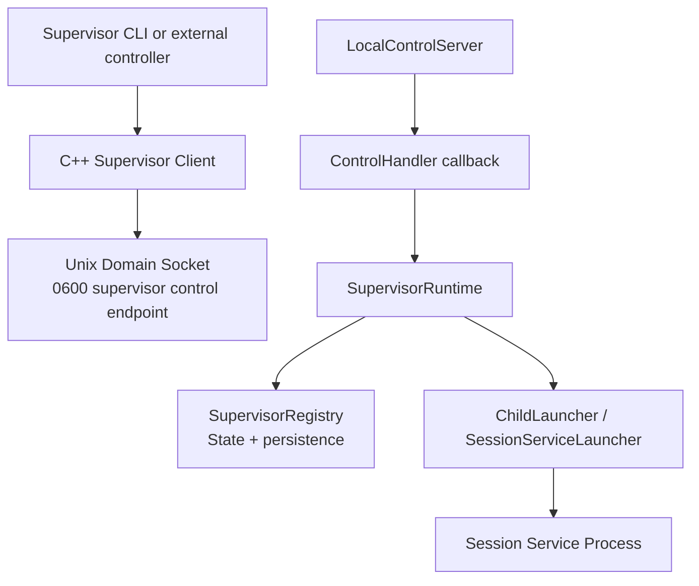
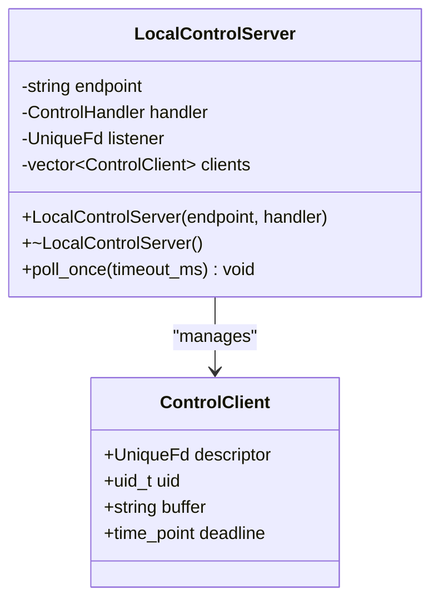
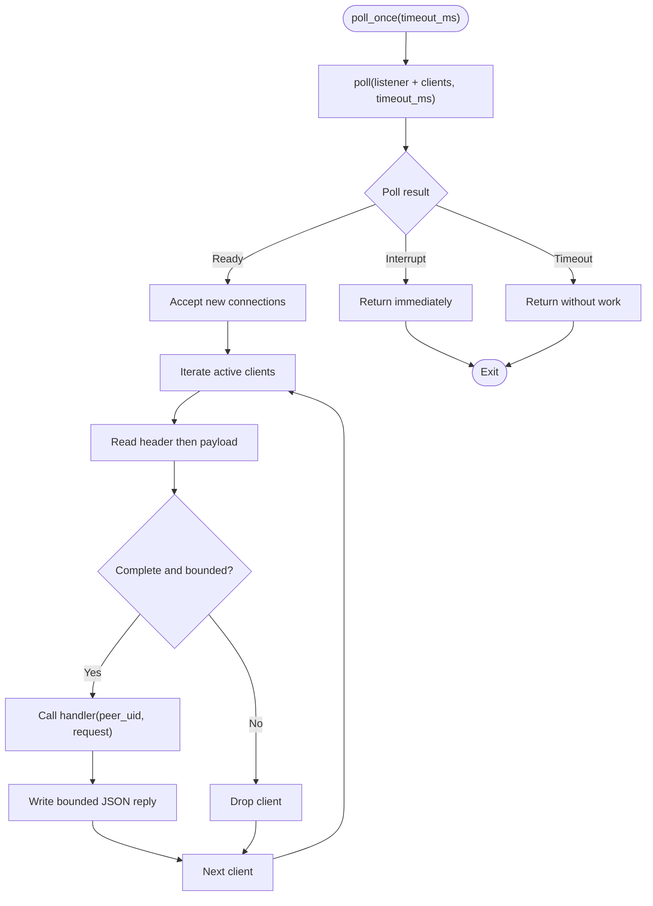
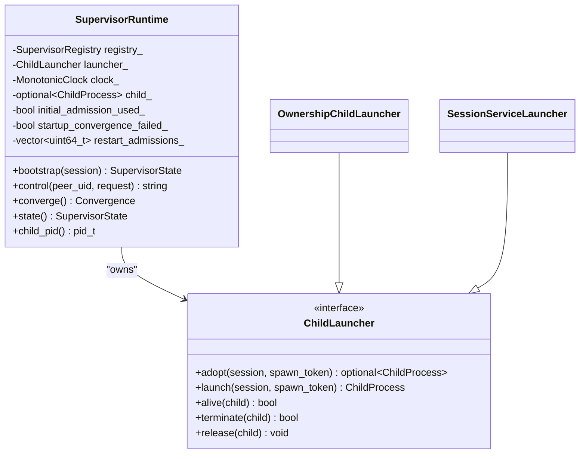
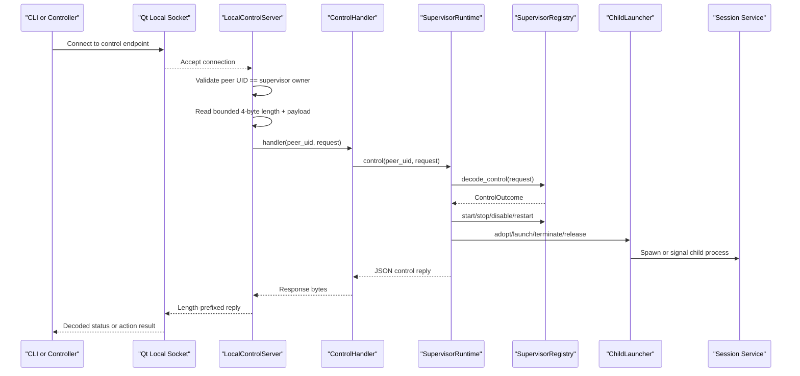
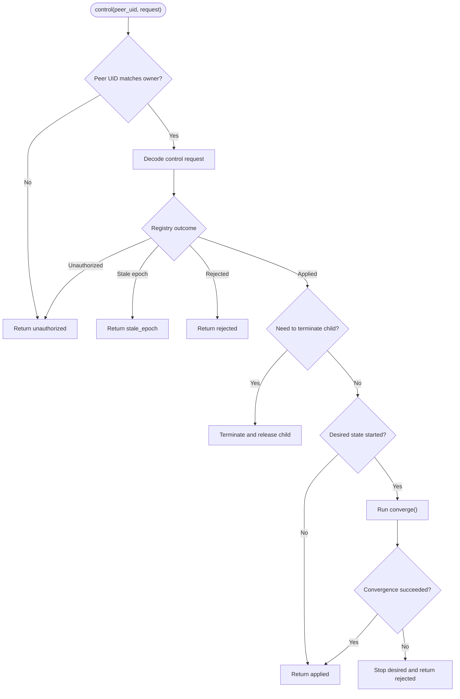
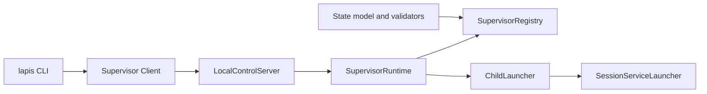
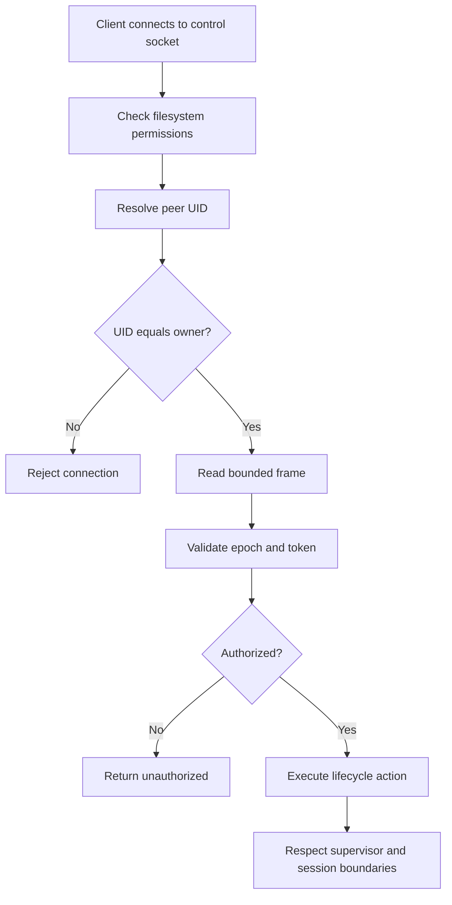

# Supervisor Control API

<cite>
**Referenced Files in This Document**   
- [control_server.hpp](file://services/supervisor/include/lapis/supervisor/control_server.hpp)
- [control_server.cpp](file://services/supervisor/src/control_server.cpp)
- [client.hpp](file://services/supervisor/include/lapis/supervisor/client.hpp)
- [client.cpp](file://services/supervisor/src/client.cpp)
- [runtime.hpp](file://services/supervisor/include/lapis/supervisor/runtime.hpp)
- [runtime.cpp](file://services/supervisor/src/runtime.cpp)
- [state.hpp](file://services/supervisor/include/lapis/supervisor/state.hpp)
- [state.cpp](file://services/supervisor/src/state.cpp)
- [session_service_launcher.hpp](file://services/supervisor/include/lapis/supervisor/session_service_launcher.hpp)
- [session_service_launcher.cpp](file://services/supervisor/src/session_service_launcher.cpp)
- [cli.cpp](file://services/supervisor/src/cli.cpp)
</cite>

## Table of Contents
1. [Introduction](#introduction)
2. [Project Structure](#project-structure)
3. [Core Components](#core-components)
4. [Architecture Overview](#architecture-overview)
5. [Detailed Component Analysis](#detailed-component-analysis)
6. [Control Protocol Specification](#control-protocol-specification)
7. [Dependency Analysis](#dependency-analysis)
8. [Performance Considerations](#performance-considerations)
9. [Security Model](#security-model)
10. [Monitoring and Debugging](#monitoring-and-debugging)
11. [Troubleshooting Guide](#troubleshooting-guide)
12. [Conclusion](#conclusion)

## Introduction
This document describes the supervisor control interface used for service lifecycle management in the Lapis supervisor subsystem. It focuses on:

- The `LocalControlServer` class, its endpoint configuration, peer UID validation, and one-frame-per-connection processing model.
- The `ControlHandler` function signature pattern and how request payloads are decoded and turned into responses.
- The blocking `poll_once` method and its timeout semantics.
- The wire format for control requests and responses.
- Status discovery, health observation, and process control operations such as starting, stopping, disabling, and restarting sessions.
- Security boundaries between the supervisor daemon, local clients, and session services.
- Practical usage through the supervisor CLI and programmatic use of the C++ client API.
- Monitoring, debugging, and integration patterns for orchestrating supervised services.

The supervisor is not a general-purpose network server. Its control surface is intentionally restricted to local Unix domain sockets owned by the supervisor process owner, with strict frame sizes, per-connection timeouts, and token-based authorization.

## Project Structure
The supervisor control interface spans several focused modules:

| Area | Responsibility |
|---|---|
| Control server | Accepts local connections, validates peers, reads bounded frames, and dispatches to a handler. |
| Runtime | Translates control actions into state transitions and child lifecycle changes. |
| State model | Defines persistent supervisor state, desired sessions, identity fields, and validation helpers. |
| Client library | Encodes status and stop requests, sends them over a local socket, and decodes replies. |
| Session launcher | Launches, adopts, probes, terminates, and releases session service processes. |
| CLI | Exposes `status` and `stop` commands to users or automation scripts. |



**Diagram sources**
- [control_server.cpp:230-327](file://services/supervisor/src/control_server.cpp#L230-L327)
- [runtime.cpp:440-560](file://services/supervisor/src/runtime.cpp#L440-L560)
- [client.cpp:1-249](file://services/supervisor/src/client.cpp#L1-L249)
- [cli.cpp:1-97](file://services/supervisor/src/cli.cpp#L1-L97)

**Section sources**
- [control_server.hpp:1-32](file://services/supervisor/include/lapis/supervisor/control_server.hpp#L1-L32)
- [control_server.cpp:1-327](file://services/supervisor/src/control_server.cpp#L1-L327)
- [client.hpp:1-34](file://services/supervisor/include/lapis/supervisor/client.hpp#L1-L34)
- [client.cpp:1-249](file://services/supervisor/src/client.cpp#L1-L249)
- [runtime.hpp:1-151](file://services/supervisor/include/lapis/supervisor/runtime.hpp#L1-L151)
- [runtime.cpp:1-560](file://services/supervisor/src/runtime.cpp#L1-L560)
- [state.hpp:1-232](file://services/supervisor/include/lapis/supervisor/state.hpp#L1-L232)
- [state.cpp:1-284](file://services/supervisor/src/state.cpp#L1-L284)
- [session_service_launcher.hpp:1-56](file://services/supervisor/include/lapis/supervisor/session_service_launcher.hpp#L1-L56)
- [session_service_launcher.cpp:1-710](file://services/supervisor/src/session_service_launcher.cpp#L1-L710)
- [cli.cpp:1-97](file://services/supervisor/src/cli.cpp#L1-L97)

## Core Components

### LocalControlServer
`LocalControlServer` is the public entry point for exposing the supervisor control interface. It owns:

- A prepared absolute Unix domain socket endpoint path.
- A `ControlHandler` callback that receives a peer UID and an uninterpreted request payload.
- A nonblocking listener socket.
- A bounded set of active control clients.
- Per-client receive buffers and deadlines.

Key responsibilities:

- Validate the endpoint argument and bind a Unix domain socket.
- Restrict the socket file mode to `0600`.
- Reject stale endpoints already bound elsewhere.
- Accept up to `max_control_clients` concurrent connections.
- Read one complete control frame per connection within a fixed timeout.
- Drop malformed, slow, or abandoned clients instead of holding slots indefinitely.
- Invoke the supplied handler exactly once per successfully received frame.



**Diagram sources**
- [control_server.hpp:9-31](file://services/supervisor/include/lapis/supervisor/control_server.hpp#L9-L31)
- [control_server.cpp:100-130](file://services/supervisor/src/control_server.cpp#L100-L130)
- [control_server.cpp:230-327](file://services/supervisor/src/control_server.cpp#L230-L327)

**Section sources**
- [control_server.hpp:9-31](file://services/supervisor/include/lapis/supervisor/control_server.hpp#L9-L31)
- [control_server.cpp:230-327](file://services/supervisor/src/control_server.cpp#L230-L327)

### ControlHandler Signature Pattern
The control interface uses a functional handler type rather than a virtual interface:

```cpp
using ControlHandler = std::function<std::string(uid_t peer_uid, const std::string& request)>;
```

Design implications:

- The caller supplies both the request decoder and response encoder.
- The server does not interpret the request body itself.
- Peer identity is exposed as a POSIX UID, which the runtime layer then authorizes.
- Handlers return a serialized response string; the server wraps it in the control wire format.
- Errors inside handlers should be represented as application-level failures because the server assumes a valid reply string from a successful frame exchange.

**Section sources**
- [control_server.hpp:9-14](file://services/supervisor/include/lapis/supervisor/control_server.hpp#L9-L14)
- [control_server.cpp:201-209](file://services/supervisor/src/control_server.cpp#L201-L209)

### poll_once Blocking Behavior
`poll_once(timeout_ms)` performs one event-loop iteration:

1. Polls the listener socket and all active client sockets.
2. If the listener is ready, accepts new connections up to `max_control_clients`.
3. For each client, tries to read at least one complete control frame.
4. Writes one response per completed frame.
5. Drops clients that close, time out, send malformed data, or exceed the control frame size limit.

Important behavior:

- `timeout_ms` applies to the entire polling call, not just one client.
- A zero or expired timeout returns immediately without blocking.
- Interrupted system calls return without error.
- Each accepted client has its own `control_client_timeout_ms` deadline for reading a complete frame.
- Malformed or incomplete frames do not block other clients.



**Diagram sources**
- [control_server.cpp:266-327](file://services/supervisor/src/control_server.cpp#L266-L327)
- [control_server.cpp:100-130](file://services/supervisor/src/control_server.cpp#L100-L130)
- [control_server.cpp:132-209](file://services/supervisor/src/control_server.cpp#L132-L209)

**Section sources**
- [control_server.cpp:266-327](file://services/supervisor/src/control_server.cpp#L266-L327)

### SupervisorRuntime
`SupervisorRuntime` owns lifecycle policy:

- Bootstrap a first desired session.
- Decode control requests and translate them into registry transitions.
- Adopt an existing child when possible.
- Launch a new child when convergence requires it.
- Terminate children on stop or restart.
- Track restart admissions within a bounded window.
- Report convergence states such as converged, started, restarted, stopped, disabled, exhausted, or failed.



**Diagram sources**
- [runtime.hpp:39-151](file://services/supervisor/include/lapis/supervisor/runtime.hpp#L39-L151)
- [runtime.cpp:440-560](file://services/supervisor/src/runtime.cpp#L440-L560)
- [session_service_launcher.hpp:18-56](file://services/supervisor/include/lapis/supervisor/session_service_launcher.hpp#L18-L56)

**Section sources**
- [runtime.hpp:39-151](file://services/supervisor/include/lapis/supervisor/runtime.hpp#L39-L151)
- [runtime.cpp:440-560](file://services/supervisor/src/runtime.cpp#L440-L560)

## Architecture Overview
The supervisor control architecture separates transport, authorization, state, and process lifecycle.



**Diagram sources**
- [control_server.cpp:132-209](file://services/supervisor/src/control_server.cpp#L132-L209)
- [control_server.cpp:230-327](file://services/supervisor/src/control_server.cpp#L230-L327)
- [runtime.cpp:440-560](file://services/supervisor/src/runtime.cpp#L440-L560)
- [client.cpp:1-249](file://services/supervisor/src/client.cpp#L1-L249)
- [cli.cpp:1-97](file://services/supervisor/src/cli.cpp#L1-L97)

## Detailed Component Analysis

### Local Control Server Lifecycle

#### Endpoint Configuration
The server constructor validates:

- The endpoint is a nonempty absolute path.
- The path is bounded.
- An existing socket at the same path is either live (reject as already in use) or stale (remove before binding).
- The resulting socket is created, bound, chmodded to `0600`, and put into listen mode.
- The final socket file is inspected to ensure it is owned by the effective user and has private permissions.

#### Peer UID Validation
Before accepting a client, the server obtains the connecting process UID using platform-specific APIs:

- macOS, OpenBSD, FreeBSD: `getpeereid`.
- Linux: `SO_PEERCRED` via `getsockopt`.
- Unsupported platforms: peer identity cannot be determined, so the connection is rejected.

Only clients whose UID equals the supervisor’s effective UID are accepted. This makes the control socket effectively owner-only even if filesystem permissions are weakened.

#### One Frame Per Connection
Each accepted client is assigned a deadline based on `control_client_timeout_ms`. The server reads:

1. A 4-byte big-endian header declaring payload length.
2. A payload bounded by `max_control_bytes`.

If either phase fails, times out, or exceeds bounds, the client is dropped. On success, the handler is called exactly once and one reply is written.

**Section sources**
- [control_server.cpp:230-265](file://services/supervisor/src/control_server.cpp#L230-L265)
- [control_server.cpp:100-130](file://services/supervisor/src/control_server.cpp#L100-L130)
- [control_server.cpp:132-209](file://services/supervisor/src/control_server.cpp#L132-L209)
- [control_server.cpp:266-327](file://services/supervisor/src/control_server.cpp#L266-L327)

### Runtime Control Flow

#### Control Method
`SupervisorRuntime::control` performs:

1. UID check against the effective user.
2. JSON decoding of the request.
3. Registry control transition.
4. Child termination if the desired state changed or the spawn token rotated.
5. Optional launch or adoption when the desired state is started.
6. Failure fallback to stopping the desired session and returning a rejected reply.



**Diagram sources**
- [runtime.cpp:440-560](file://services/supervisor/src/runtime.cpp#L440-L560)

**Section sources**
- [runtime.cpp:440-560](file://services/supervisor/src/runtime.cpp#L440-L560)

### Session Service Launcher Integration
The launcher abstraction allows different child lifecycle strategies:

- `OwnershipChildLauncher`: Generic PID-bound ownership with token-checked ownership files.
- `SessionServiceLauncher`: Full session service launch, handshake, fingerprint verification, terminal sizing, and agent-mode selection.

The supervisor distinguishes between harmless generic children and qualified session services. Only qualified services can be controlled by protocol identity; generic children may be terminated by PID only.

**Section sources**
- [runtime.hpp:39-151](file://services/supervisor/include/lapis/supervisor/runtime.hpp#L39-L151)
- [session_service_launcher.hpp:18-56](file://services/supervisor/include/lapis/supervisor/session_service_launcher.hpp#L18-L56)
- [session_service_launcher.cpp:1-200](file://services/supervisor/src/session_service_launcher.cpp#L1-L200)

## Control Protocol Specification

### Transport Layer
The control transport is a stream-oriented local socket with framed messages:

| Field | Size | Encoding | Meaning |
|---|---:|---|---|
| Header | 4 bytes | Big-endian unsigned integer | Payload length in bytes |
| Payload | Variable | UTF-8 JSON text | Serialized request or response object |

Constraints:

- Maximum payload size is `max_control_bytes`.
- The server rejects oversized payloads.
- Trailing bytes after a complete message are treated as invalid by the client.
- The server writes one reply per complete request.

### Request and Response Objects
Requests and responses are compact JSON objects validated strictly by the client and codec layers.

#### Status Request
| Field | Type | Required | Value |
|---|---|---:|---|
| `version` | integer | Yes | `1` |
| `action` | string | Yes | `"status"` |

#### Status Reply
| Field | Type | Required | Meaning |
|---|---|---:|---|
| `version` | integer | Yes | `1` |
| `status` | string | Yes | `"ok"` |
| `schema_version` | number | Yes | `1` or `2` |
| `instance_epoch` | string | Yes | Hexadecimal supervisor instance identifier |
| `slot` | string | Yes | `"empty"`, `"started"`, or `"stopped"` |
| `enabled` | boolean | Yes | Whether the supervisor slot is enabled |
| `service_live` | boolean | Yes | Whether the session service endpoint is reachable |
| `blocked_reason` | string | Yes | Human-readable block reason or empty |
| `endpoint` | string or null | Yes | Live service endpoint when available |
| `reconstructable` | boolean | Yes | Whether a replacement supervisor can adopt the service |

#### Stop Request
| Field | Type | Required | Meaning |
|---|---|---:|---|
| `version` | integer | Yes | `1` |
| `action` | string | Yes | `"stop"` |
| `supervisor_epoch` | string | Yes | Current supervisor instance epoch |
| `token` | string | Yes | Spawn token from persisted state |
| `session` | null | Yes | Placeholder indicating no new session is being started |

#### Control Action Responses
All control action responses share this structure:

| Field | Type | Possible Values |
|---|---|---|
| `version` | integer | `1` |
| `status` | string | `"applied"`, `"unauthorized"`, `"stale_epoch"`, `"rejected"` |

#### Internal Control Actions
The internal `ControlAction` enum supports:

- `start`
- `stop`
- `disable`

These map to higher-level lifecycle decisions in the registry and runtime.

### Error Handling Patterns
Errors occur at multiple layers:

| Layer | Error Condition | Observable Result |
|---|---|---|
| Transport | Socket connection failure | Client throws a connection error |
| Transport | Timeout waiting for reply | Client throws a timeout error |
| Transport | Oversized payload | Invalid request or reply error |
| Transport | Trailing bytes | Invalid reply error |
| Authorization | Peer UID mismatch | Control reply status `"unauthorized"` |
| Authorization | Invalid or missing token | Control reply status `"unauthorized"` |
| State | Mismatched epoch | Control reply status `"stale_epoch"` |
| State | Invalid request or unsupported transition | Control reply status `"rejected"` |
| Lifecycle | Launch or convergence failure | Stop desired and return `"rejected"` |

**Section sources**
- [client.cpp:64-159](file://services/supervisor/src/client.cpp#L64-L159)
- [client.cpp:200-249](file://services/supervisor/src/client.cpp#L200-L249)
- [runtime.cpp:440-560](file://services/supervisor/src/runtime.cpp#L440-L560)
- [state.hpp:49-120](file://services/supervisor/include/lapis/supervisor/state.hpp#L49-L120)

## Dependency Analysis



**Diagram sources**
- [control_server.hpp:1-32](file://services/supervisor/include/lapis/supervisor/control_server.hpp#L1-L32)
- [runtime.hpp:1-151](file://services/supervisor/include/lapis/supervisor/runtime.hpp#L1-L151)
- [state.hpp:1-232](file://services/supervisor/include/lapis/supervisor/state.hpp#L1-L232)
- [client.hpp:1-34](file://services/supervisor/include/lapis/supervisor/client.hpp#L1-L34)
- [cli.cpp:1-97](file://services/supervisor/src/cli.cpp#L1-L97)

**Section sources**
- [control_server.hpp:1-32](file://services/supervisor/include/lapis/supervisor/control_server.hpp#L1-L32)
- [runtime.hpp:1-151](file://services/supervisor/include/lapis/supervisor/runtime.hpp#L1-L151)
- [state.hpp:1-232](file://services/supervisor/include/lapis/supervisor/state.hpp#L1-L232)
- [client.hpp:1-34](file://services/supervisor/include/lapis/supervisor/client.hpp#L1-L34)
- [cli.cpp:1-97](file://services/supervisor/src/cli.cpp#L1-L97)

## Performance Considerations

### Event Loop Characteristics
- `poll_once` is designed for small, frequent invocations rather than long blocking waits.
- It polls the listener and active clients together, minimizing context switches.
- It caps concurrent control clients at `max_control_clients`.
- Slow or malformed clients are dropped, preventing resource exhaustion.

### Memory and Sizing
- Control frames are bounded by `max_control_bytes`.
- Persistent state is bounded by `max_state_bytes`.
- Endpoint paths, blocked reasons, and launch payloads have separate limits.
- The client buffers partial responses until a complete bounded frame arrives.

### Restart Throttling
- Restart admissions are tracked within a fixed nanosecond window.
- Once the maximum restarts per window is reached, the supervisor stops the desired session instead of repeatedly launching a failing service.
- Initial admission is consumed differently depending on whether a previously started session already had a spawn token.

[No sources needed since this section provides general guidance]

## Security Model

### Local Socket Permissions
The supervisor control socket is created with:

- Owner-only file mode `0600`.
- Ownership tied to the effective user of the supervisor process.
- Stale socket cleanup before binding.
- Post-bind inspection to confirm socket type, owner, and permissions.

### UID-Based Access Control
Connection acceptance requires:

- Platform support for kernel-supplied peer credentials.
- Peer UID equal to the supervisor’s effective UID.
- No network exposure; the endpoint is a local Unix domain socket.

### Token-Based Authorization
Control actions require:

- A matching supervisor instance epoch.
- A valid spawn token from the current persisted state.
- Strict JSON shape validation.
- Constant-time comparison helpers for tokens where applicable.

### Privilege Boundaries
- The control server does not execute commands directly; it delegates to `SupervisorRuntime`.
- `SupervisorRuntime` validates ownership and lifecycle state before touching child processes.
- Session services are launched separately and may hold their own resources.
- Ownership files for spawned processes are also owner-only and token-bound.



**Diagram sources**
- [control_server.cpp:100-130](file://services/supervisor/src/control_server.cpp#L100-L130)
- [control_server.cpp:230-265](file://services/supervisor/src/control_server.cpp#L230-L265)
- [runtime.cpp:440-560](file://services/supervisor/src/runtime.cpp#L440-L560)
- [state.cpp:140-180](file://services/supervisor/src/state.cpp#L140-L180)

**Section sources**
- [control_server.cpp:230-265](file://services/supervisor/src/control_server.cpp#L230-L265)
- [runtime.cpp:440-560](file://services/supervisor/src/runtime.cpp#L440-L560)
- [state.cpp:140-180](file://services/supervisor/src/state.cpp#L140-L180)

## Monitoring and Debugging

### Status Inspection
Use the supervisor CLI to inspect the current state:

- `lapis status --control-endpoint <path>` prints human-readable output.
- `lapis status --control-endpoint <path> --json` prints machine-readable JSON.

The status output includes:

- Schema version.
- Slot state.
- Enabled flag.
- Service liveness.
- Instance epoch.
- Blocked reason.
- Live service endpoint when available.
- Reconstructability flag.

### Stop Command
The stop command requires both:

- A control endpoint.
- A private supervisor state directory containing `supervisor.json`.

It reads the persisted state, constructs a stop request with the current epoch and spawn token, and sends it to the supervisor. Exit code indicates whether the action was applied.

### Health Checks
External orchestrators can treat the following as health signals:

- Control socket reachable with correct owner permissions.
- Status reply with `status: "ok"`.
- `service_live` true when the session service endpoint is reachable.
- `blocked_reason` empty when no explicit block is present.
- `reconstructable` true when a replacement supervisor can adopt the service.

### Log Aggregation and Diagnostics
Recommended operational practices:

- Capture supervisor daemon logs from the process manager.
- Inspect the private state directory contents only from the supervisor owner account.
- Record control errors as application logs rather than leaking raw tokens.
- Use the status endpoint for automated health checks and dashboards.
- Avoid polling faster than necessary; the control server is synchronous per frame.

**Section sources**
- [cli.cpp:1-97](file://services/supervisor/src/cli.cpp#L1-L97)
- [client.cpp:64-159](file://services/supervisor/src/client.cpp#L64-L159)
- [client.cpp:161-249](file://services/supervisor/src/client.cpp#L161-L249)

## Troubleshooting Guide

### Control Socket Not Found
**Symptoms:**
- CLI reports inability to connect to the supervisor control endpoint.

**Checks:**
- Verify the control endpoint path is absolute and exists.
- Confirm the supervisor daemon is running.
- Confirm the socket file is owned by the expected user.
- Confirm the socket file mode is `0600`.

**Likely causes:**
- Wrong endpoint path.
- Supervisor not started.
- Stale or removed endpoint.

**Section sources**
- [client.cpp:200-249](file://services/supervisor/src/client.cpp#L200-L249)
- [control_server.cpp:230-265](file://services/supervisor/src/control_server.cpp#L230-L265)

### Unauthorized Control Requests
**Symptoms:**
- Status works but stop or start returns `"unauthorized"`.

**Checks:**
- Ensure the calling process runs as the supervisor owner.
- Ensure the state directory and `supervisor.json` are owned by the same effective user.
- Confirm the spawn token in the state matches the requested operation.

**Likely causes:**
- Calling process UID differs from supervisor owner.
- Corrupted or cross-user state directory.
- Missing or incorrect spawn token.

**Section sources**
- [control_server.cpp:100-130](file://services/supervisor/src/control_server.cpp#L100-L130)
- [client.cpp:121-159](file://services/supervisor/src/client.cpp#L121-L159)
- [client.cpp:161-200](file://services/supervisor/src/client.cpp#L161-L200)

### Stale Epoch
**Symptoms:**
- Control reply status is `"stale_epoch"`.

**Checks:**
- Treat this as a request to refresh state from the latest persisted supervisor state.
- Do not retry the old epoch blindly.

**Likely causes:**
- Another supervisor instance updated state.
- Replacement supervisor took over.

**Section sources**
- [runtime.cpp:440-560](file://services/supervisor/src/runtime.cpp#L440-L560)

### Service Not Live
**Symptoms:**
- Status shows `service_live: false`.

**Checks:**
- Confirm the session service endpoint path is valid.
- Check whether the service process is alive.
- Review blocked reason and reconstructability.

**Likely causes:**
- Service failed to launch.
- Service crashed.
- Supervisor is blocked or exhausted restarts.

**Section sources**
- [runtime.cpp:440-560](file://services/supervisor/src/runtime.cpp#L440-L560)
- [client.cpp:64-159](file://services/supervisor/src/client.cpp#L64-L159)

### Stop Command Fails Because State Directory Is Missing
**Symptoms:**
- CLI exits with an error requiring a state directory.

**Checks:**
- Provide `--state-directory` pointing to the private supervisor state directory.
- Ensure the directory is owned by the calling user.
- Ensure `supervisor.json` exists and is readable.

**Section sources**
- [cli.cpp:56-97](file://services/supervisor/src/cli.cpp#L56-L97)
- [client.cpp:161-200](file://services/supervisor/src/client.cpp#L161-L200)

## Conclusion
The supervisor control API is a narrowly scoped, locally authenticated control plane for managing session services. Its safety comes from layered boundaries:

- OS-level Unix socket ownership and permissions.
- Kernel-assisted peer UID validation.
- Bounded frames and strict JSON schemas.
- Epoch and spawn token authorization.
- Separation between the control server, runtime policy, persistent state, and child processes.

Operational users interact primarily through the supervisor CLI or by encoding status and stop requests through the C++ client API. Orchestrators should monitor status replies, respect blocked reasons and reconstructability, avoid rapid restart loops, and keep state directories and control endpoints isolated to the supervisor owner.