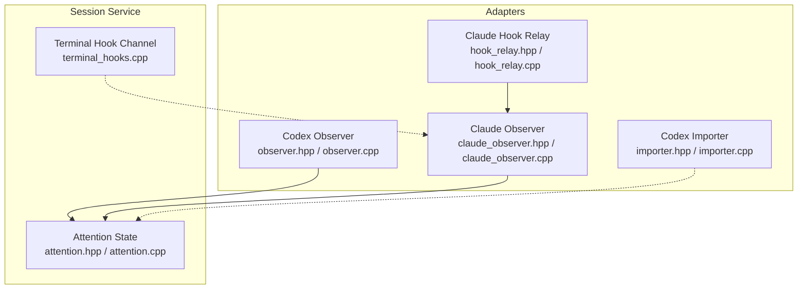
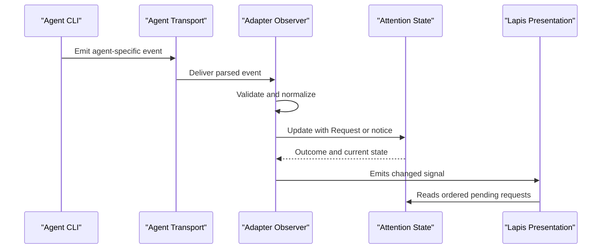
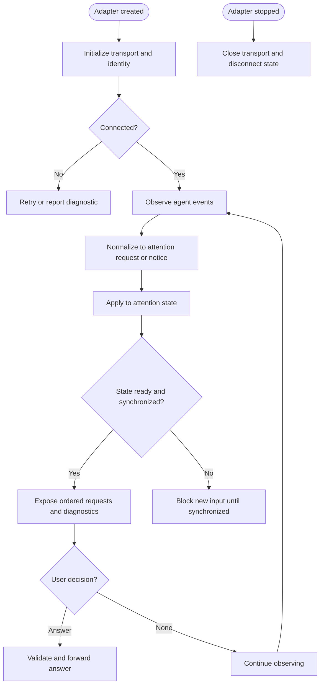
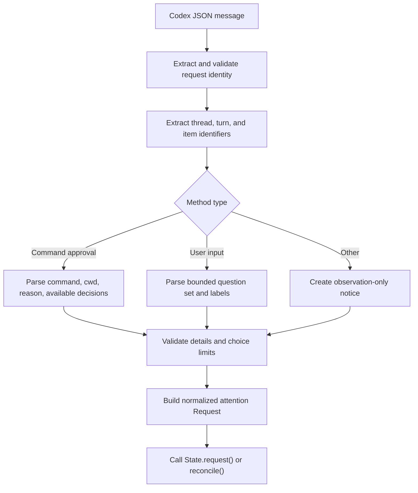
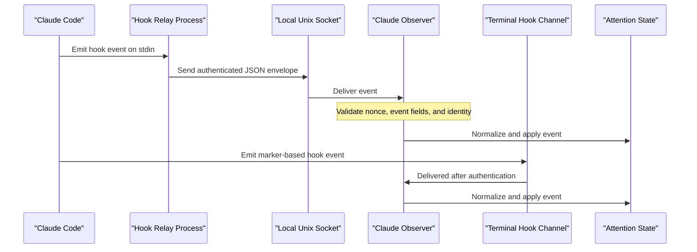
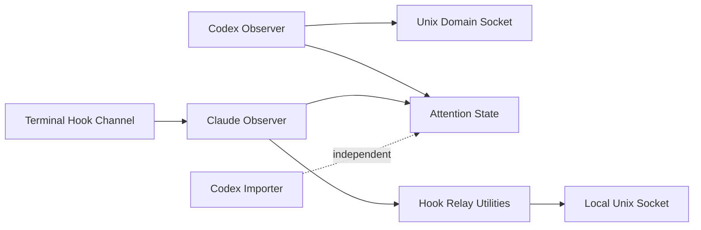

# Adapter Framework

<cite>
**Referenced Files in This Document**
- [observer.hpp](file://adapters/codex/src/observer.hpp)
- [observer.cpp](file://adapters/codex/src/observer.cpp)
- [importer.hpp](file://adapters/codex/src/importer.hpp)
- [importer.cpp](file://adapters/codex/src/importer.cpp)
- [claude_observer.hpp](file://adapters/claude/src/claude_observer.hpp)
- [claude_observer.cpp](file://adapters/claude/src/claude_observer.cpp)
- [hook_relay.hpp](file://adapters/claude/src/hook_relay.hpp)
- [hook_relay.cpp](file://adapters/claude/src/hook_relay.cpp)
- [attention.hpp](file://services/session/include/lapis/session/attention.hpp)
- [observation_phase.hpp](file://services/session/include/lapis/session/observation_phase.hpp)
- [attention.cpp](file://services/session/src/attention.cpp)
- [terminal_hooks.cpp](file://services/session/src/terminal_hooks.cpp)
- [architecture.md](file://docs/architecture.md)
- [agents.md](file://docs/agents.md)
</cite>

## Table of Contents
1. Introduction
2. Project Structure
3. Core Components
4. Architecture Overview
5. Detailed Component Analysis
6. Dependency Analysis
7. Performance Considerations
8. Troubleshooting Guide
9. Conclusion

## Introduction
The adapter framework provides a common abstraction layer that lets Lapis observe and interact with different coding agent CLIs without modifying the agents themselves. It separates agent-specific transport, event parsing, and hook wiring from Lapis’s unified attention model, lifecycle management, and desktop presentation.

Two concrete adapters are implemented:
- Codex adapter: connects to a local Codex app-server through a Unix-domain socket, observes requests such as command approvals and user-input questions, normalizes them into Lapis attention requests, and forwards explicit user answers back to the source.
- Claude Code adapter: injects Claude hooks so Lapis can observe session events, tool use, permissions, prompts, stops, and lifecycle transitions. A separate relay process forwards authenticated hook frames either to a local Unix domain socket or through terminal escape sequences when the agent runs on another machine.

The shared contract between adapters and Lapis is defined by the session service’s attention state. Adapters do not render UI or own terminal processes; they establish connections, normalize events, update attention state, and surface diagnostics and bounded details for display.

**Section sources**
- [architecture.md:1-60](file://docs/architecture.md#L1-L60)
- [agents.md:1-40](file://docs/agents.md#L1-L40)

## Project Structure
Adapter-related code is organized per agent under `adapters/<agent>/`, with headers defining public interfaces, implementation files handling transport and normalization, and tests validating behavior. Shared Lapis contracts live under `services/session/`.

**Diagram sources**
- [observer.hpp:1-55](file://adapters/codex/src/observer.hpp#L1-L55)
- [observer.cpp:1-200](file://adapters/codex/src/observer.cpp#L1-L200)
- [importer.hpp:1-130](file://adapters/codex/src/importer.hpp#L1-L130)
- [claude_observer.hpp:1-50](file://adapters/claude/src/claude_observer.hpp#L1-L50)
- [claude_observer.cpp:1-200](file://adapters/claude/src/claude_observer.cpp#L1-L200)
- [hook_relay.hpp:1-62](file://adapters/claude/src/hook_relay.hpp#L1-L62)
- [hook_relay.cpp:1-138](file://adapters/claude/src/hook_relay.cpp#L1-L138)
- [attention.hpp:1-136](file://services/session/include/lapis/session/attention.hpp#L1-L136)
- [attention.cpp:1-200](file://services/session/src/attention.cpp#L1-L200)
- [terminal_hooks.cpp:1-200](file://services/session/src/terminal_hooks.cpp#L1-L200)

**Section sources**
- [observer.hpp:1-55](file://adapters/codex/src/observer.hpp#L1-L55)
- [claude_observer.hpp:1-50](file://adapters/claude/src/claude_observer.hpp#L1-L50)
- [attention.hpp:1-136](file://services/session/include/lapis/session/attention.hpp#L1-L136)

## Core Components
The adapter framework has three main responsibilities:

1. **Observation:** Monitor agent behavior through protocol messages or injected hooks without changing agent code.
2. **Normalization:** Convert agent-specific events into Lapis’s unified attention request model.
3. **Interaction:** Present pending attention items and forward explicit user decisions back to the agent through validated channels.

### Codex Observer
The Codex observer owns one server/TUI source connection. It validates incoming JSON, classifies approval and question events, updates the shared attention state, and exposes bounded diagnostic information. It also tracks hook inventory and run summaries for display while keeping raw payloads private.

Key responsibilities:
- Start, reconnect, and stop observation against a Codex Unix-domain socket.
- Normalize Codex methods such as command approval and user input into attention requests.
- Validate and forward user answers using an epoch/revision token bound to the current state.
- Expose observation phase, thread identity, hook inventory, and per-request details.

**Section sources**
- [observer.hpp:1-55](file://adapters/codex/src/observer.hpp#L1-L55)
- [observer.cpp:1-200](file://adapters/codex/src/observer.cpp#L1-L200)

### Claude Observer
The Claude observer owns a private, observation-only channel for Claude Code hook events. It can receive frames from a local Unix domain socket or from terminal-relayed JSON after the session service authenticates them. It does not print decisions and does not block Claude’s permission dialogs.

Key responsibilities:
- Create a temporary private directory and Unix domain socket for authenticated hook delivery.
- Generate launch arguments that inject Claude hook settings pointing at the relay command.
- Validate hook frames, compute derived background-work metadata, and publish normalized events.
- Provide session identity, launch argument transformation, diagnostic output, and bounded per-request details.

**Section sources**
- [claude_observer.hpp:1-50](file://adapters/claude/src/claude_observer.hpp#L1-L50)
- [claude_observer.cpp:1-200](file://adapters/claude/src/claude_observer.cpp#L1-L200)

### Claude Hook Relay
The Claude hook relay is a small helper process invoked by Claude for each registered event. It reads one hook frame from standard input, derives bounded metadata, wraps it in a nonce-authenticated envelope, and sends it to the observer’s Unix domain socket.

Key responsibilities:
- Define the set of observed Claude event names.
- Build Claude hook configuration that invokes the relay command for every event.
- Derive a stable relay event shape with identity fields and optional derived fields.
- Run the relay with strict size, deadline, and transport limits.

**Section sources**
- [hook_relay.hpp:1-62](file://adapters/claude/src/hook_relay.hpp#L1-L62)
- [hook_relay.cpp:1-138](file://adapters/claude/src/hook_relay.cpp#L1-L138)

### Data Importer
The Codex importer is intentionally independent from the observer and attention state. It connects to a Codex server to detect migration items such as configuration, skills, plugins, hooks, commands, memory, sessions, and related metadata. It then imports selected sessions with bounded validation and failure reporting.

Key responsibilities:
- Manage import phases: disconnected, connecting, ready, detecting, importing, completed, failed, and completed-with-failures.
- Detect migration items and validate their schema and sizes.
- Import only explicitly selected sessions while retaining bounded descriptions and immutable payloads for the import request.
- Report per-item results, failures, imported sessions, and completion identifiers.

**Section sources**
- [importer.hpp:1-130](file://adapters/codex/src/importer.hpp#L1-L130)
- [importer.cpp:1-200](file://adapters/codex/src/importer.cpp#L1-L200)

### Unified Attention Model
All adapters converge on `session::attention::State`. This state models pending requests, epochs, sequences, revisions, capabilities, activity, synchronization status, and retirement of resolved IDs. It enforces bounds on request identities, choices, priority, and capacity, and distinguishes observation-only notices from authoritative reconciliation snapshots.

Key concepts:
- `RequestId` supports numeric or string identifiers from different agents.
- `Request` carries thread, turn, item context, reason, summary, allowed choices, and priority.
- `Pending` adds request status, revision, arrival time, scheduling constraints, submission state, and source epoch.
- `Capabilities` declares whether an adapter may observe, respond, or reconcile.
- `ObservationPhase` describes producer-owned lifecycle stages such as awaiting first prompt or reconciling.

**Section sources**
- [attention.hpp:1-136](file://services/session/include/lapis/session/attention.hpp#L1-L136)
- [observation_phase.hpp:1-16](file://services/session/include/lapis/session/observation_phase.hpp#L1-L16)
- [attention.cpp:1-200](file://services/session/src/attention.cpp#L1-L200)

## Architecture Overview
The adapter framework uses the observer pattern across several layers:

1. Agent-specific transports emit events.
2. Adapters parse, validate, and normalize those events.
3. The shared attention state maintains a canonical view of pending work.
4. Lapis components consume the normalized state to present and manage attention.

**Diagram sources**
- [observer.cpp:1-200](file://adapters/codex/src/observer.cpp#L1-L200)
- [claude_observer.cpp:1-200](file://adapters/claude/src/claude_observer.cpp#L1-L200)
- [attention.cpp:1-200](file://services/session/src/attention.cpp#L1-L200)

## Detailed Component Analysis

### Event Observation Lifecycle
Both adapters follow a similar lifecycle, adapted to their transport:

**Diagram sources**
- [observer.cpp:1-200](file://adapters/codex/src/observer.cpp#L1-L200)
- [claude_observer.cpp:1-200](file://adapters/claude/src/claude_observer.cpp#L1-L200)
- [attention.cpp:1-200](file://services/session/src/attention.cpp#L1-L200)

#### Codex Normalization Flow
Codex events are classified by method name and parameters:
- Command approval requests are mapped to a bounded reason, command, working directory, and allowed decisions.
- User input requests are mapped to a bounded set of questions with labels and optional free-text options.
- Unsupported or unqualified methods are observed but not answered directly.

**Diagram sources**
- [observer.cpp:1-200](file://adapters/codex/src/observer.cpp#L1-L200)
- [attention.cpp:1-200](file://services/session/src/attention.cpp#L1-L200)

#### Claude Hook Delivery Flow
Claude hook events arrive through two possible paths:

**Diagram sources**
- [hook_relay.cpp:1-138](file://adapters/claude/src/hook_relay.cpp#L1-L138)
- [claude_observer.cpp:1-200](file://adapters/claude/src/claude_observer.cpp#L1-L200)
- [terminal_hooks.cpp:1-200](file://services/session/src/terminal_hooks.cpp#L1-L200)
- [attention.cpp:1-200](file://services/session/src/attention.cpp#L1-L200)

### Shared Interfaces
Although the adapters are implemented independently, they share these interface concepts:

| Interface | Purpose | Key Contract |
|---|---|---|
| Event observer | Monitors agent behavior | Initialize, observe, normalize, expose diagnostics, and emit change signals |
| Decision responder | Forwards user decisions | Accepts epoch, request ID, revision, choice, and optional answers |
| Detail provider | Supplies bounded inspection data | Returns method, command, questions, or hook metadata without leaking full payloads |
| Lifecycle manager | Controls initialization and cleanup | Explicit start, reconnect, stop, and state disconnect |
| Import task manager | Manages workspace migration | Connect, detect, select, import, and report failures |

**Section sources**
- [observer.hpp:1-55](file://adapters/codex/src/observer.hpp#L1-L55)
- [importer.hpp:1-130](file://adapters/codex/src/importer.hpp#L1-L130)
- [claude_observer.hpp:1-50](file://adapters/claude/src/claude_observer.hpp#L1-L50)

### Configuration Schema for Adapter Discovery and Registration
Lapis discovers agents through its new-agent form and per-CLI configuration. The relevant configuration lives in `lapis.json`, with `newAgent.harness` selecting the adapter (for example, `codex`), `harnessArguments` adding flags passed to the agent, and per-machine settings controlling folder locations.

Important notes:
- Lapis starts the executable directly; shell aliases are not applied.
- Per-CLI flags such as sandboxing or permission modes are supplied through `harnessArguments` or generated defaults.
- Remote agents receive hook or notify configuration on their command line, while local agents get injected hook settings or socket endpoints.
- Adapter discovery is driven by installed CLIs and their availability in the UI rather than a global adapter registry file.

**Section sources**
- [agents.md:1-40](file://docs/agents.md#L1-L40)
- [config.md:1-40](file://docs/config.md#L1-L40)

### Guidelines for Implementing New Adapters

#### Required Responsibilities
A new adapter should implement:
1. A transport layer that connects to the agent or its local server.
2. An event parser that validates agent-specific JSON or terminal markers.
3. A normalizer that converts events into `session::attention::Request` or observation-only notices.
4. A response path that validates user choices and forwards them using epoch/revision tokens.
5. Diagnostics and bounded detail exposure for debugging and UI presentation.
6. Explicit lifecycle control: initialization, monitoring, reconnection, and cleanup.

#### Required Interface Methods
Use these as a checklist:
- Constructor accepting `session::attention::State&` and optional parent QObject.
- Diagnostic accessor.
- Launch argument transformer when the adapter injects hooks or settings.
- Stop or cleanup method.
- Change signal emitted after state updates.
- Optional: request decision method accepting epoch, request ID, revision, choice, and answers.
- Optional: observation phase or readiness query.

#### Testing Patterns
Tests should cover:
- Malformed event rejection.
- Boundary sizes for request IDs, summaries, choices, and payload details.
- Epoch and sequence invalidation.
- Duplicate request handling.
- Response validation against requested choices and question labels.
- Transport failure behavior, including disconnect and retry policies.
- Hook relay boundaries, nonce authentication, and frame limits.
- Import detection, session selection, and failure reporting.

#### Integration Points
- Use `session::attention::State` for all canonical request tracking.
- Do not render UI from adapters.
- Keep raw agent payloads out of diagnostics unless bounded and necessary.
- Treat transport loss as terminal for individual tasks where the design requires it, such as Codex import slices.
- Ensure remote hook frames are authenticated before normalization.

**Section sources**
- [observer.hpp:1-55](file://adapters/codex/src/observer.hpp#L1-L55)
- [claude_observer.hpp:1-50](file://adapters/claude/src/claude_observer.hpp#L1-L50)
- [attention.hpp:1-136](file://services/session/include/lapis/session/attention.hpp#L1-L136)

### Error Handling Strategies
Adapters and the attention layer use layered error handling:

| Layer | Strategy |
|---|---|
| Parser | Reject malformed JSON, invalid identities, oversized strings, unexpected arrays, and unknown enum values. |
| Validator | Enforce limits on pending requests, retired IDs, choices, priorities, question counts, and option labels. |
| Transport | Disconnect on send failure, treat timeouts and malformed frames as terminal for specific tasks, and avoid automatic retransmission of responses. |
| State | Return outcomes such as rejected, duplicate, desynchronized, or applied; throw for invalid clocks, epochs, or exhausted revision space. |
| Hooks | Fail open for Claude hook relay errors so hook failure never becomes a permission decision. |
| Terminal channel | Drop oversized hook sequences safely and recover after terminator boundaries. |

**Section sources**
- [observer.cpp:1-200](file://adapters/codex/src/observer.cpp#L1-L200)
- [importer.cpp:1-200](file://adapters/codex/src/importer.cpp#L1-L200)
- [hook_relay.cpp:1-138](file://adapters/claude/src/hook_relay.cpp#L1-L138)
- [attention.cpp:1-200](file://services/session/src/attention.cpp#L1-L200)
- [terminal_hooks.cpp:1-200](file://services/session/src/terminal_hooks.cpp#L1-L200)

### Debugging Techniques
Recommended debugging steps:
1. Inspect adapter diagnostics and observation phase exposed by the observer.
2. Check whether the attention state reports connected, synchronized, blocking, and active.
3. Review per-request details for Codex method, command, cwd, or question structure.
4. For Claude, verify hook settings, socket path, nonce, and relay event identity fields.
5. Confirm that terminal hook markers are initialized and authenticated before events are accepted.
6. Distinguish between observation-only notices and authoritative reconciliation snapshots.
7. Preserve exact source identity and epoch when reproducing desynchronization issues.

**Section sources**
- [observer.hpp:1-55](file://adapters/codex/src/observer.hpp#L1-L55)
- [claude_observer.cpp:1-200](file://adapters/claude/src/claude_observer.cpp#L1-L200)
- [terminal_hooks.cpp:1-200](file://services/session/src/terminal_hooks.cpp#L1-L200)

## Dependency Analysis
The adapter framework has clear ownership boundaries:

- Codex observer depends on the Unix-domain transport, JSON parsing, and the shared attention state.
- Claude observer depends on the hook relay utilities and the shared attention state.
- Claude hook relay depends only on bounded I/O, JSON framing, and the local Unix socket contract.
- Codex importer is deliberately independent from the observer and attention state.
- Terminal hook channel is part of the session service and delivers authenticated events to observers.

**Diagram sources**
- [observer.cpp:1-200](file://adapters/codex/src/observer.cpp#L1-L200)
- [claude_observer.cpp:1-200](file://adapters/claude/src/claude_observer.cpp#L1-L200)
- [hook_relay.cpp:1-138](file://adapters/claude/src/hook_relay.cpp#L1-L138)
- [terminal_hooks.cpp:1-200](file://services/session/src/terminal_hooks.cpp#L1-L200)
- [attention.cpp:1-200](file://services/session/src/attention.cpp#L1-L200)

**Section sources**
- [observer.hpp:1-55](file://adapters/codex/src/observer.hpp#L1-L55)
- [claude_observer.hpp:1-50](file://adapters/claude/src/claude_observer.hpp#L1-L50)
- [importer.hpp:1-130](file://adapters/codex/src/importer.hpp#L1-L130)
- [hook_relay.hpp:1-62](file://adapters/claude/src/hook_relay.hpp#L1-L62)
- [attention.hpp:1-136](file://services/session/include/lapis/session/attention.hpp#L1-L136)

## Performance Considerations
The framework emphasizes responsiveness and bounded resource usage:

- Message and detail sizes are limited to prevent large payloads from blocking the event loop.
- Hook frames have fixed deadlines and maximum frame sizes.
- Connection limits protect the Claude hook listener from spam.
- Background work detection avoids premature turn completion when long-running tasks remain in flight.
- Attention state enforces pending and retired request limits, aging intervals, and cooldown behavior.
- Import tasks use explicit timeouts and reject oversized or malformed detection results.

[No sources needed since this section provides general guidance]

## Troubleshooting Guide
Common problems and resolutions:

| Symptom | Likely Cause | Resolution |
|---|---|---|
| No attention requests appear | Source not connected or not synchronized | Verify adapter connection, epoch progression, and observation phase. |
| Requests are blocked | Pending requests are unsynchronized or stale | Reconcile or restart observation at a verified boundary. |
| Answers are rejected | Wrong epoch, revision, or invalid choice | Validate request identity, choice list, and question labels before forwarding. |
| Claude hooks missing | Socket creation, nonce mismatch, or connection limit exceeded | Check temporary directory, private socket permissions, and relay command settings. |
| Hook relay crashes silently | Malformed input, oversized frame, or transport timeout | Inspect relay bounds, frame format, and ACK expectations. |
| Import fails immediately | Invalid item type, duplicate session, or unknown details key | Validate detected schema and restrict submission to supported session items. |
| Terminal hook events ignored | Missing init marker, wrong nonce, or oversized body | Confirm terminal channel initialization and base64-encoded event body. |

**Section sources**
- [observer.cpp:1-200](file://adapters/codex/src/observer.cpp#L1-L200)
- [claude_observer.cpp:1-200](file://adapters/claude/src/claude_observer.cpp#L1-L200)
- [hook_relay.cpp:1-138](file://adapters/claude/src/hook_relay.cpp#L1-L138)
- [importer.cpp:1-200](file://adapters/codex/src/importer.cpp#L1-L200)
- [terminal_hooks.cpp:1-200](file://services/session/src/terminal_hooks.cpp#L1-L200)
- [attention.cpp:1-200](file://services/session/src/attention.cpp#L1-L200)

## Conclusion
The adapter framework isolates agent-specific protocols behind a stable observation and normalization layer. Codex and Claude adapters demonstrate how to monitor agent behavior, normalize events into Lapis’s unified attention model, and forward explicit user decisions without altering the agents themselves. Correctness comes from strict validation, epoch-based state synchronization, bounded diagnostics, and explicit lifecycle control. New adapters should follow the same patterns: connect safely, parse conservatively, normalize uniformly, respect attention state guarantees, and expose diagnostics without leaking sensitive agent payloads.

[No sources needed since this section summarizes without analyzing specific files]