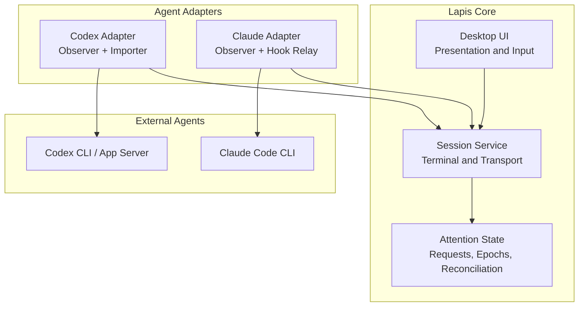
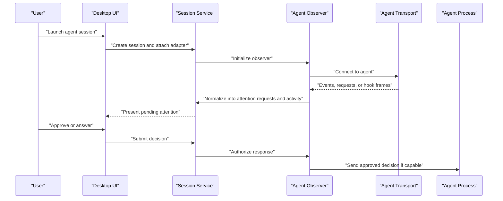
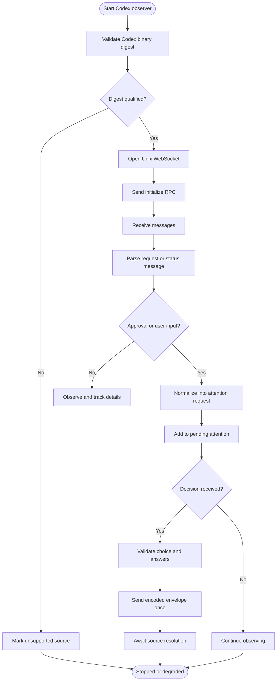
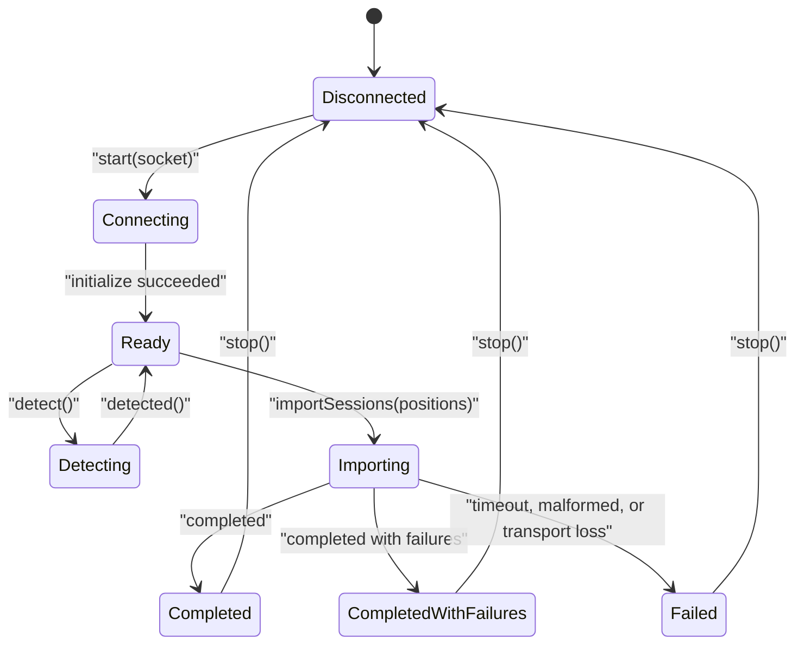
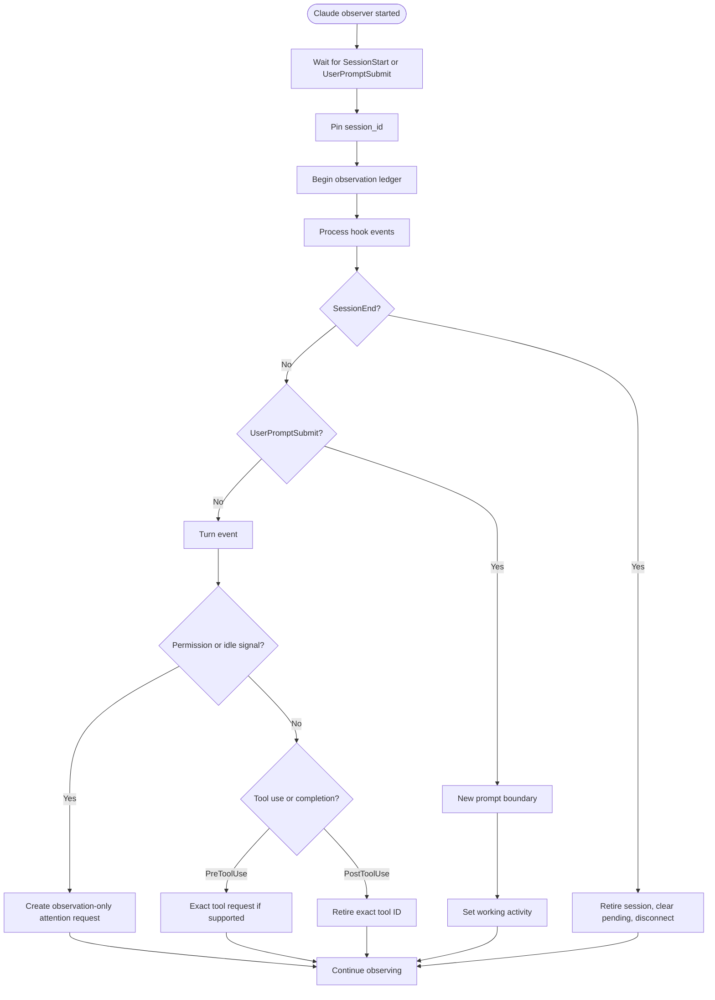
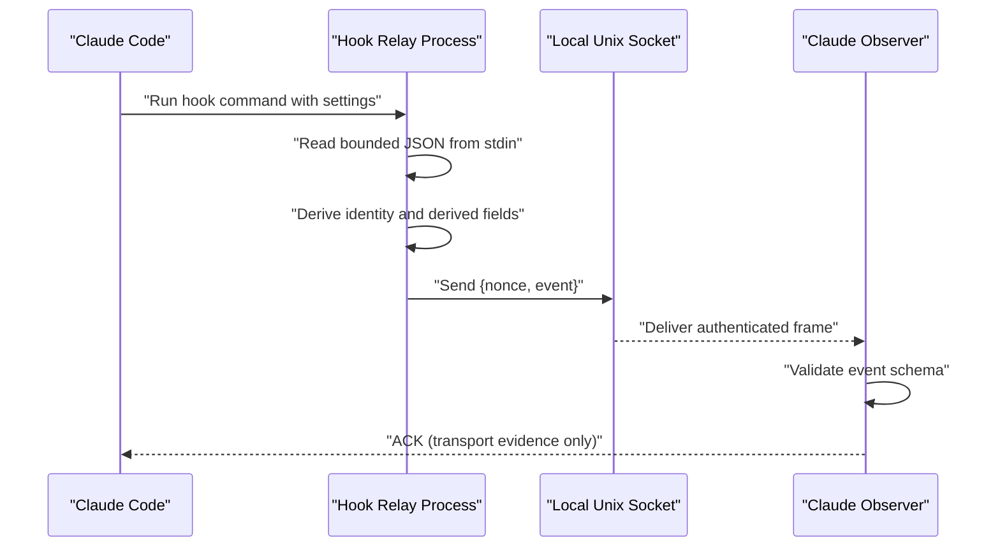
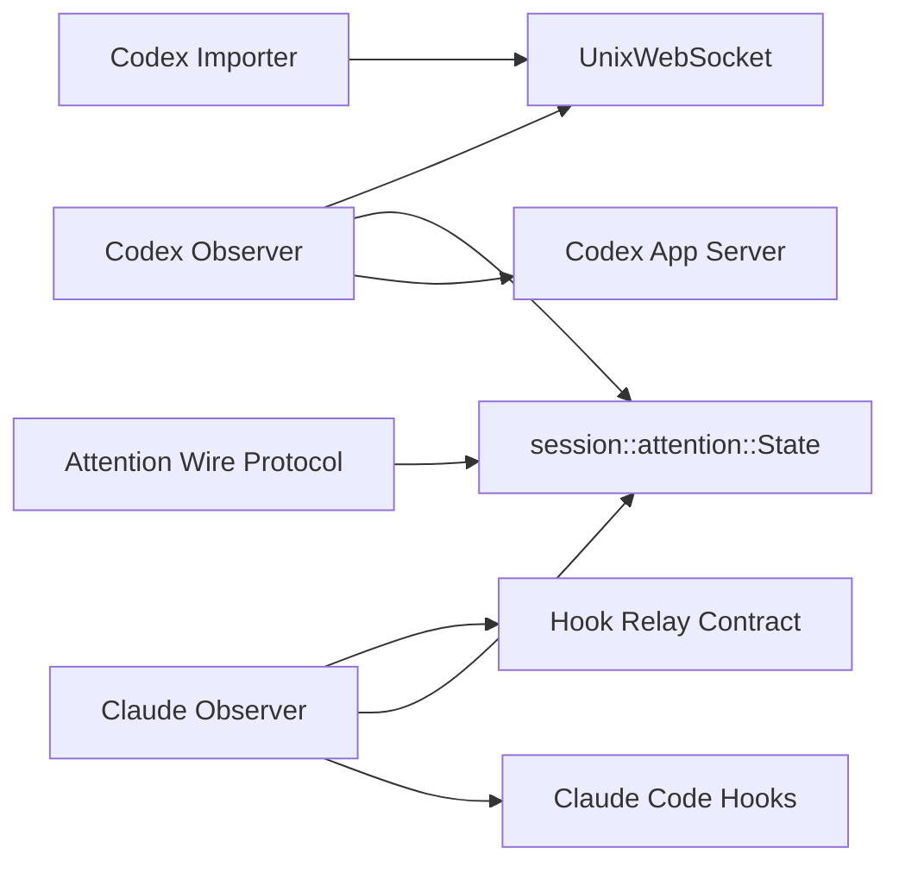

# Agent Adapters

<cite>
**Referenced Files in This Document**
- [README.md](file://adapters/codex/README.md)
- [observer.hpp](file://adapters/codex/src/observer.hpp)
- [observer.cpp](file://adapters/codex/src/observer.cpp)
- [importer.hpp](file://adapters/codex/src/importer.hpp)
- [importer.cpp](file://adapters/codex/src/importer.cpp)
- [unix_websocket.hpp](file://adapters/codex/src/unix_websocket.hpp)
- [unix_websocket.cpp](file://adapters/codex/src/unix_websocket.cpp)
- [claude_observer.hpp](file://adapters/claude/src/claude_observer.hpp)
- [claude_observer.cpp](file://adapters/claude/src/claude_observer.cpp)
- [hook_relay.hpp](file://adapters/claude/src/hook_relay.hpp)
- [hook_relay.cpp](file://adapters/claude/src/hook_relay.cpp)
- [attention.hpp](file://services/session/include/lapis/session/attention.hpp)
- [attention_protocol.cpp](file://services/session/src/transport/attention_protocol.cpp)
- [architecture.md](file://docs/architecture.md)
</cite>

## Table of Contents
1. [Introduction](#introduction)
2. [Project Structure](#project-structure)
3. [Core Components](#core-components)
4. [Architecture Overview](#architecture-overview)
5. [Detailed Component Analysis](#detailed-component-analysis)
6. [Dependency Analysis](#dependency-analysis)
7. [Performance Considerations](#performance-considerations)
8. [Testing and Qualification Approach](#testing-and-qualification-approach)
9. [Security Considerations](#security-considerations)
10. [Guidelines for Implementing a New Agent Adapter](#guidelines-for-implementing-a-new-agent-adapter)
11. [Troubleshooting Guide](#troubleshooting-guide)
12. [Conclusion](#conclusion)

## Introduction
The agent adapter framework lets Lapis observe, reason about, and sometimes respond to different coding agent command-line interfaces without coupling the core session service or desktop UI to any single agent implementation. Each agent lives in its own adapter package under `adapters/`, exposing behavior through narrow, testable boundaries while sharing common session state, attention modeling, and transport patterns where appropriate.

Two adapters are implemented:
- **Codex adapter**: Connects to Codex’s private Unix-domain WebSocket endpoint, observes thread and request traffic, normalizes approval and user-input requests into Lapis attention, and optionally sends back approved decisions after explicit authorization by the session layer. It also includes an independent importer client for migrating Claude-related configuration data from a dedicated Codex server.
- **Claude adapter**: Starts a local socket observer or accepts relayed hook frames and interprets Claude Code’s internal hook events as turn lifecycle notices, permission prompts, tool-use requests, idle signals, and completion markers. Its hook relay writes bounded JSON frames over a Unix socket with nonce authentication.

At the center is the session attention model. Adapters translate agent-specific events into Lapis’s normalized `Request`, `Activity`, epoch/sequence positions, and reconciliation primitives. The desktop GUI owns presentation and input flow; it never changes response authority directly.

## Project Structure
The adapter code is organized per agent, each containing its own source tree, tests, build file, and (for Codex) a focused investigation README.

**Diagram sources**
- [observer.hpp:1-55](file://adapters/codex/src/observer.hpp#L1-L55)
- [claude_observer.hpp:1-50](file://adapters/claude/src/claude_observer.hpp#L1-L50)
- [attention.hpp:1-136](file://services/session/include/lapis/session/attention.hpp#L1-L136)
- [architecture.md:1-165](file://docs/architecture.md#L1-L165)

**Section sources**
- [README.md:1-200](file://adapters/codex/README.md#L1-L200)
- [architecture.md:1-165](file://docs/architecture.md#L1-L165)

## Core Components
This section summarizes the shared concepts that every adapter must respect.

| Concept | Meaning | Adapter responsibility |
|---|---|---|
| Request ID | Numeric or string identity tied to a specific prompt, tool call, or source request. | Normalize agent IDs into one stable field; do not invent synthetic identities unless explicitly modeled. |
| Thread ID | Long-lived conversation or process thread. | Derive from discovery or hook metadata; reject unknown or changing threads. |
| Turn ID | Prompt-level boundary. | Track start, activity, and completion; avoid resurrecting stale turns. |
| Epoch and sequence | Local ordering and synchronization tokens. | Advance only through the attention state; never assume network order implies correctness. |
| Activity | Unknown, working, idle, or turn completed. | Emit transitions at clear lifecycle boundaries. |
| Pending request | A notice that may require terminal or GUI action. | Mark observation-only when no decision capability exists. |
| Reconciliation | Authoritative snapshot replacement. | Use only when the source guarantees completeness and exact ordering. |

**Section sources**
- [attention.hpp:1-136](file://services/session/include/lapis/session/attention.hpp#L1-L136)

## Architecture Overview
The adapter pattern here separates three concerns:

1. **Transport**: How the adapter talks to the agent.
2. **Observation/Interception**: How raw agent events are parsed and classified.
3. **Normalization**: How those events become Lapis attention and session state.

**Diagram sources**
- [observer.cpp:201-537](file://adapters/codex/src/observer.cpp#L201-L537)
- [claude_observer.cpp:201-540](file://adapters/claude/src/claude_observer.cpp#L201-L540)
- [attention.hpp:1-136](file://services/session/include/lapis/session/attention.hpp#L1-L136)

## Detailed Component Analysis

### Codex Adapter
The Codex adapter has two main responsibilities:
- Observing live Codex app-server traffic on a Unix-domain WebSocket to extract attention and approval requests.
- Running an independent importer client that discovers and imports Claude-originated migration items from a Codex server.

#### Codex Observer
The observer owns one Codex server/TUI connection. It validates the binary digest before connecting, establishes a bounded replay queue, classifies persistent versus ephemeral threads, and exposes display-only hook inventory and run summaries.

Key behaviors:
- Connection lifecycle: initialize, reconnect explicitly, stop, and report diagnostics.
- Event parsing: validates request identity, method names, thread/turn/item context, and bounded details.
- Request normalization: maps Codex command approvals and user-input questions to Lapis attention requests.
- Decision sending: validates choices and answers, consumes the exact state token, sends once, and treats uncertain delivery as non-terminal until explicit reconciliation.
- Thread classification: only the qualified persistent TUI thread can receive responses; other persistent threads fail closed.
- Replay accounting: unclassified traffic is bounded by event count and byte size until classification completes.

**Diagram sources**
- [observer.cpp:201-537](file://adapters/codex/src/observer.cpp#L201-L537)

**Section sources**
- [observer.hpp:1-55](file://adapters/codex/src/observer.hpp#L1-L55)
- [observer.cpp:201-537](file://adapters/codex/src/observer.cpp#L201-L537)

#### Codex Unix WebSocket Transport
The transport implements a single-thread asynchronous WebSocket client over `QLocalSocket`. It performs the HTTP upgrade handshake, validates headers, handles text frames, control frames, fragmentation, and peer close frames. It does not auto-reconnect or retransmit; failures are reported through `failed()`.

Important constraints:
- Maximum message size: 1 MiB.
- Outbound queue limit: twice the maximum message size.
- Strict UTF-8 validation for payloads.
- Bounded read loop per event-loop turn to avoid starvation.
- Terminal peer close mapped to adapter failure.

**Section sources**
- [unix_websocket.hpp:1-33](file://adapters/codex/src/unix_websocket.hpp#L1-L33)
- [unix_websocket.cpp:1-200](file://adapters/codex/src/unix_websocket.cpp#L1-L200)
- [unix_websocket.cpp:201-328](file://adapters/codex/src/unix_websocket.cpp#L201-L328)

#### Codex Importer
The importer is intentionally separate from the observer. It connects to a dedicated Codex import server, detects migration items, restricts submission to SESSIONS items, preserves the exact server-provided payload, and tracks acceptance, progress, and completion by import ID.

Behavioral guarantees:
- No automatic retry for malformed, timed-out, or failed tasks.
- Detection results are validated against allowed connector sources and session limits.
- Only SESSIONS items retain their full payload before submission.
- Progress notifications are merged by item type.
- Early notifications before acceptance are buffered and drained once the import ID is known.

**Diagram sources**
- [importer.hpp:1-130](file://adapters/codex/src/importer.hpp#L1-L130)
- [importer.cpp:201-551](file://adapters/codex/src/importer.cpp#L201-L551)

**Section sources**
- [importer.hpp:1-130](file://adapters/codex/src/importer.hpp#L1-L130)
- [importer.cpp:1-200](file://adapters/codex/src/importer.cpp#L1-L200)
- [importer.cpp:201-551](file://adapters/codex/src/importer.cpp#L201-L551)
- [README.md:201-325](file://adapters/codex/README.md#L201-L325)

### Claude Adapter
The Claude adapter intercepts Claude Code’s internal hooks and converts them into attention lifecycle signals. It supports two transports:
- Local Unix socket listener used by a Claude hook relay process.
- Relayed frames accepted through the terminal path, already authenticated by the session service.

#### Claude Observer
The observer pins one Claude session, waits for `SessionStart` or `UserPromptSubmit`, begins observation, and then processes permission requests, tool use, idle notices, Stop hooks, and session boundaries.

Key behaviors:
- Observation-only by default: requests are marked advisory unless they map to an exact tool-use identity.
- Turn lifecycle: new prompt starts working activity; Stop may finish immediately, pause with background work, or fall back to a long timeout.
- Completion tombstones: exact tool IDs are retired locally to prevent duplicate advisory rows.
- Retired sessions: old session IDs cannot resurrect a newer conversation.
- Diagnostics: base diagnostic plus optional background-work diagnostic.

**Diagram sources**
- [claude_observer.cpp:201-540](file://adapters/claude/src/claude_observer.cpp#L201-L540)

**Section sources**
- [claude_observer.hpp:1-50](file://adapters/claude/src/claude_observer.hpp#L1-L50)
- [claude_observer.cpp:1-200](file://adapters/claude/src/claude_observer.cpp#L1-L200)
- [claude_observer.cpp:201-540](file://adapters/claude/src/claude_observer.cpp#L201-L540)

#### Hook Relay Mechanism
The hook relay is a small process invoked by Claude Code for each registered hook event. It reads one JSON frame from stdin, validates the socket path and nonce, derives a bounded event shape, sends it to Lapis, and ignores the ACK.

Design points:
- Identity fields come from Claude; derived fields like in-flight background-work counts are computed only by the relay or observer contract.
- Two contracts exist: legacy identity-only and contract 2 with derived fields.
- Fail-open semantics: hook relay errors return zero so Claude permission decisions remain unaffected.
- Local observer uses a temporary directory, private socket, and nonce; remote relay frames are accepted only after session-service authentication.

**Diagram sources**
- [hook_relay.cpp:1-138](file://adapters/claude/src/hook_relay.cpp#L1-L138)
- [hook_relay.hpp:1-62](file://adapters/claude/src/hook_relay.hpp#L1-L62)
- [claude_observer.cpp:1-200](file://adapters/claude/src/claude_observer.cpp#L1-L200)

**Section sources**
- [hook_relay.hpp:1-62](file://adapters/claude/src/hook_relay.hpp#L1-L62)
- [hook_relay.cpp:1-138](file://adapters/claude/src/hook_relay.cpp#L1-L138)
- [claude_observer.cpp:1-200](file://adapters/claude/src/claude_observer.cpp#L1-L200)

### Shared Session Attention Model
Both adapters rely on `lapis::session::attention::State` for:
- Request creation, pending tracking, and retirement.
- Epoch-based synchronization and revision management.
- Activity transitions and idle notice handling.
- Authorized response submission with exact epoch/revision binding.

The wire protocol enforces bounds on snapshots, decisions, request counts, identifiers, choices, and JSON metadata.

**Section sources**
- [attention.hpp:1-136](file://services/session/include/lapis/session/attention.hpp#L1-L136)
- [attention_protocol.cpp:1-200](file://services/session/src/transport/attention_protocol.cpp#L1-L200)

## Dependency Analysis
The following diagram shows how adapters depend on shared services and external agents.

**Diagram sources**
- [observer.cpp:201-537](file://adapters/codex/src/observer.cpp#L201-L537)
- [importer.cpp:201-551](file://adapters/codex/src/importer.cpp#L201-L551)
- [unix_websocket.cpp:1-328](file://adapters/codex/src/unix_websocket.cpp#L1-L328)
- [claude_observer.cpp:201-540](file://adapters/claude/src/claude_observer.cpp#L201-L540)
- [hook_relay.cpp:1-138](file://adapters/claude/src/hook_relay.cpp#L1-L138)
- [attention.hpp:1-136](file://services/session/include/lapis/session/attention.hpp#L1-L136)

**Section sources**
- [observer.hpp:1-55](file://adapters/codex/src/observer.hpp#L1-L55)
- [claude_observer.hpp:1-50](file://adapters/claude/src/claude_observer.hpp#L1-L50)
- [attention.hpp:1-136](file://services/session/include/lapis/session/attention.hpp#L1-L136)

## Performance Considerations
Adapters favor bounded memory, explicit lifecycle control, and event-loop friendliness:

- **Bounded buffers**: WebSocket input and messages are limited to 1 MiB; outgoing queues cap at twice that size.
- **Per-turn budgets**: The Codex WebSocket parser processes up to 128 frames per event-loop turn and defers the rest.
- **Bounded caches**: Hook runs, details, pending requests, retired sources, and completed tool IDs have explicit limits.
- **No silent retries**: Transport loss, malformed data, timeouts, and unknown binaries disable response capabilities rather than retrying indefinitely.
- **Display-only aggregation**: Hook inventory and runs expose aggregated metadata; raw hook payloads stay private.
- **Lazy notification**: Claude observer coalesces change notifications to avoid reentrant transport callbacks.

These choices reduce memory growth during high-output agent runs but mean observers can lose synchronization or miss late events. The correct recovery is usually to restart the session or reconcile from authoritative source state.

[No sources needed since this section provides general guidance]

## Testing and Qualification Approach
Adapter testing spans unit coverage, synthetic protocol fixtures, and live qualification receipts.

| Area | Approach |
|---|---|
| Codex binary compatibility | Pinned digests qualify observed behavior; changed hashes remain unsupported until requalified. |
| Codex attention route | Live runner exercises private server/home, real approval/input round trips, resume/reconnect, second-thread rejection, archive/restore safety, and cancellation. |
| Codex observer state machine | Tests validate request parsing, question validation, decision routing, phase transitions, and bounded replay behavior. |
| Codex importer | Synthetic protocol suite covers detection, connector validation, SESSIONS-only selection, progress merging, early notifications, and completion validation. |
| Claude hook relay | Relay contract defines identity and derived fields; fail-open behavior ensures hook failures do not become agent decisions. |
| Claude observer lifecycle | Tests cover session pinning, prompt boundaries, permission vs input deduplication, Stop background-work fallback, and retired-session isolation. |
| Wire protocol | Attention snapshots and decisions are validated against strict bounds before crossing IPC boundaries. |

Evidence files and scripts under `evidence/` and `scripts/` record dated observations, probe results, and qualification receipts. The architecture document clarifies that success with one agent does not imply adapter independence; each agent/version must be probed independently.

**Section sources**
- [README.md:1-200](file://adapters/codex/README.md#L1-L200)
- [architecture.md:1-165](file://docs/architecture.md#L1-L165)

## Security Considerations
Agent adapters interact closely with running processes, sockets, and configuration files. Security must be treated as a first-class design constraint.

### Process Injection and Hook Interception
- The Claude hook relay reads from stdin and writes to a Unix socket. It validates the socket path, nonce length, and frame size, and fails open if anything goes wrong.
- The Claude observer creates a temporary directory and private socket with owner-only permissions.
- Remote relay frames arriving through the terminal are not trusted by the observer alone; the session service authenticates them before calling `receiveRelayed`.
- Hook settings invoke a command for every registered event; commands must never print decisions or exit with special codes interpreted as agent decisions.

### Transport and Payload Validation
- All JSON is reparsed and compacted where required to normalize representation.
- String fields are bounded and validated as UTF-8.
- Request IDs, thread IDs, turn IDs, and item IDs have strict length and format checks.
- WebSocket frames enforce opcode validity, canonical lengths, fragment boundaries, and close-frame codes.
- Attention wire protocol rejects oversized snapshots, invalid request sets, duplicate IDs, and inconsistent attachment states.

### Response Authority
- Adapters never blindly send agent decisions. The Codex observer requires an authorized `decide()` call with epoch, request ID, revision, and validated choice/answers.
- Claude’s observer is observation-only by default; decisions remain in Claude’s terminal unless a separately reviewed and version-pinned protocol is added.
- Reconciliation replaces state atomically with epoch/revision boundaries; lost responses must not be automatically retransmitted.

### Supply Chain and Binary Trust
- Codex adapter qualification depends on exact binary digests, not just version strings.
- Hook inventory and runs expose safe aggregate metadata; raw hook source paths and outputs are not exposed as Lapis API content.
- Importer preserves the exact server payload for selected migration items but restricts which items can be submitted.

**Section sources**
- [hook_relay.cpp:1-138](file://adapters/claude/src/hook_relay.cpp#L1-L138)
- [claude_observer.cpp:1-200](file://adapters/claude/src/claude_observer.cpp#L1-L200)
- [observer.cpp:201-537](file://adapters/codex/src/observer.cpp#L201-L537)
- [unix_websocket.cpp:1-328](file://adapters/codex/src/unix_websocket.cpp#L1-L328)
- [attention_protocol.cpp:1-200](file://services/session/src/transport/attention_protocol.cpp#L1-L200)

## Guidelines for Implementing a New Agent Adapter
Follow these steps when adding support for another coding agent CLI.

### Step 1: Define the Observation Boundary
Answer these questions:
- How does Lapis discover and connect to the agent?
- Is observation passive, or can Lapis inject responses?
- What constitutes a thread, a turn, and a request?
- Which agent events are observable, and which are dangerous to act on?

If the agent uses hooks, define a bounded contract similar to the Claude hook relay:
- Fixed identity fields.
- Optional derived fields with a versioned contract.
- Clear transport framing.
- Fail-open behavior that does not affect agent decisions.

### Step 2: Implement a Narrow Observer Interface
Expose an observer object with:
- Explicit lifecycle methods: start, reconnect, stop.
- Diagnostic state and observation phase.
- Normalized request details.
- Optional decision interface guarded by session authorization.
- Signals or state changes that do not reenter transport callbacks.

Do not embed large payloads in signals. Prefer bounded summaries and lazy detail retrieval.

### Step 3: Normalize Events Into Lapis Attention
Map agent events to:
- `RequestId`: stable and unique within the relevant scope.
- `thread_id`: persistent conversation identity.
- `turn_id`: prompt or execution turn identity.
- `reason` and `summary`: human-readable explanation.
- `choices`: only include values the adapter is qualified to send.
- `priority`: reflect urgency without allowing low-priority notices to outrank blocking requests.
- `activity`: working, idle, or turn_completed at clear boundaries.

Use `State::request`, `State::resolve`, `State::activity`, and `State::reconcile` instead of maintaining your own pending list.

### Step 4: Handle Lifecycle and Recovery
Implement:
- Session start and end.
- Prompt boundaries.
- Idle and completion signals.
- Retired identity handling.
- Synchronization loss detection.
- Explicit reconnect and reconciliation.
- Bounded replay queues for events before authoritative classification.

Never assume a later event can retroactively authorize an earlier decision.

### Step 5: Add Transport Safety
For network or IPC transports:
- Enforce message size limits.
- Validate UTF-8 and JSON.
- Reject malformed frames early.
- Avoid auto-reconnect for response-critical flows.
- Treat transport failure as terminal for the current operation unless reconciliation is available.

### Step 6: Write Qualification Tests
Include:
- Unit tests for parsers and validators.
- Synthetic protocol fixtures.
- Live tests against pinned agent versions.
- Failure cases: timeout, malformed payload, duplicate ID, lost connection, unknown binary, and exceeded bounds.
- Evidence receipts documenting the exact agent version, transport, and exercised behaviors.

### Step 7: Review Security Implications
Before enabling response or injection:
- Audit process spawning and environment mutation.
- Restrict writable paths and configuration scopes.
- Validate all agent-supplied identifiers and payloads.
- Separate observation from decision authority.
- Document what happens when the agent updates or changes its event schema.

**Section sources**
- [observer.hpp:1-55](file://adapters/codex/src/observer.hpp#L1-L55)
- [claude_observer.hpp:1-50](file://adapters/claude/src/claude_observer.hpp#L1-L50)
- [attention.hpp:1-136](file://services/session/include/lapis/session/attention.hpp#L1-L136)
- [architecture.md:1-165](file://docs/architecture.md#L1-L165)

## Troubleshooting Guide

| Symptom | Likely Cause | Recommended Action |
|---|---|---|
| Codex observer reports unsupported binary hash | Digest does not match a qualified release. | Do not bypass the check; requalify the new binary and update the qualified digest list. |
| Codex connection times out or fails | Private endpoint unavailable, handshake rejected, or peer closed. | Verify the Unix socket path, endpoint discovery, and that the Codex app server is reachable. |
| Approval or input request remains pending | Source did not resolve the request, or transport delivery was uncertain. | Reconnect and reconcile; do not resend the decision automatically. |
| Claude observer sees no hooks | Hooks disabled, relay not launched, or session identity mismatch. | Check launch arguments, settings file, local socket ownership, and whether `SessionStart` arrives. |
| Claude Stop does not finish the turn | Background work detected or schema fallback active. | Inspect diagnostics; expect either a pause timeout or completion based on relay-derived counts. |
| Imported sessions complete with failures | Malformed result, unexpected item type, or missing selected SESSIONS result. | Review progress and completion structures; importer does not retry automatically. |
| Attention state reports desynchronization | Adapter advanced position incorrectly or source replay was incomplete. | Restart the session or reconcile from authoritative state; inspect epoch and sequence usage. |

**Section sources**
- [observer.cpp:201-537](file://adapters/codex/src/observer.cpp#L201-L537)
- [claude_observer.cpp:201-540](file://adapters/claude/src/claude_observer.cpp#L201-L540)
- [importer.cpp:201-551](file://adapters/codex/src/importer.cpp#L201-L551)
- [attention.hpp:1-136](file://services/session/include/lapis/session/attention.hpp#L1-L136)

## Conclusion
The agent adapter framework separates Lapis from any single coding agent by enforcing narrow interfaces, bounded transports, normalized attention models, and explicit security boundaries. The Codex adapter observes structured app-server traffic and can forward approved decisions after authorization. The Claude adapter interprets internal hook events as attention lifecycle signals and relies on Claude’s terminal for responses. Both adapters share the session attention model and follow the same principles: validate aggressively, bound memory, preserve source identity, treat transport loss seriously, and keep response authority separate from observation.

New adapters should start with passive observation, add response capability only after version-pinning and live qualification, and document every behavioral assumption against real agent binaries or protocols.

[No sources needed since this section summarizes without analyzing specific files]