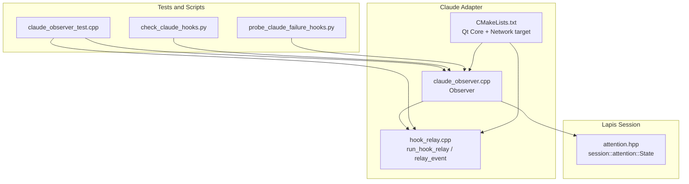
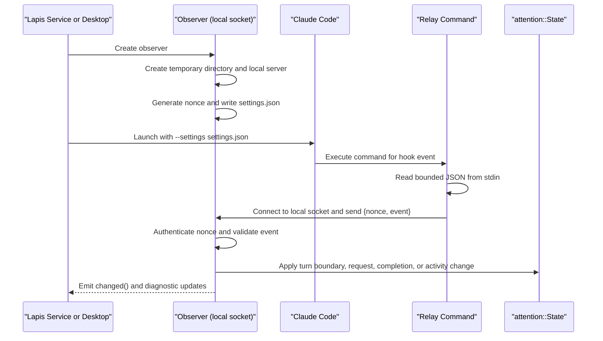
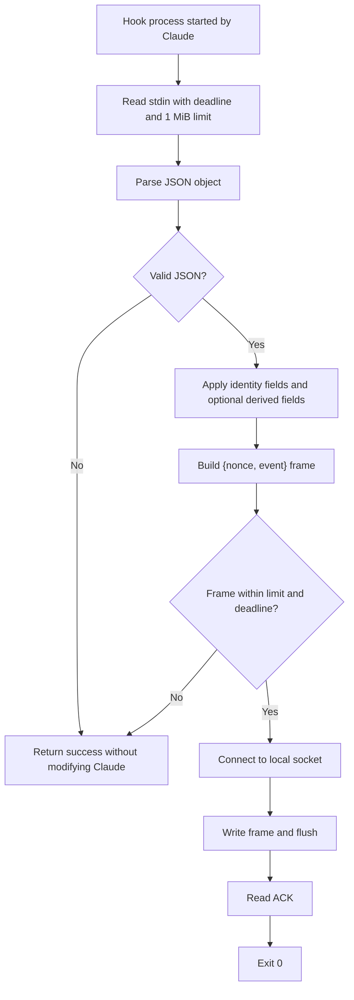
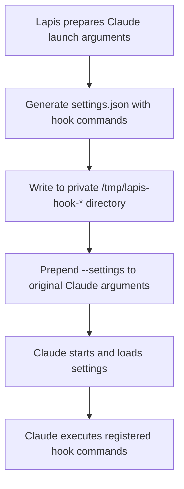
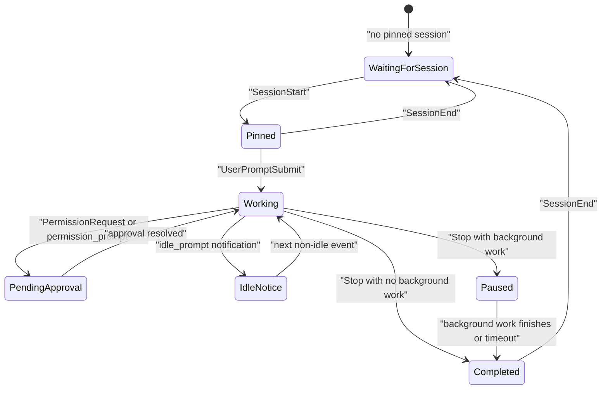
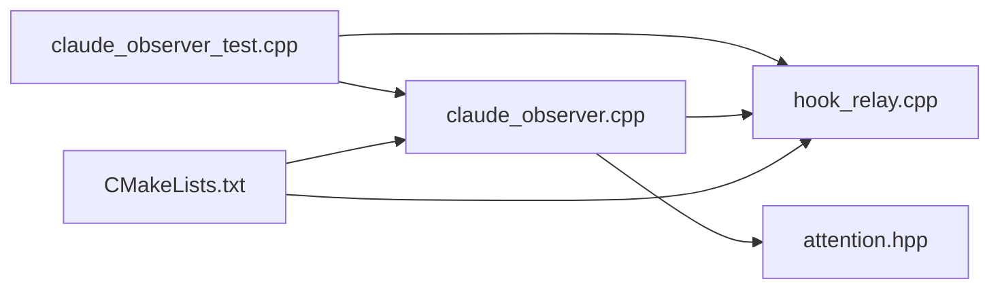

# Claude Adapter

<cite>
**Referenced Files in This Document**
- [hook_relay.hpp](file://adapters/claude/src/hook_relay.hpp)
- [hook_relay.cpp](file://adapters/claude/src/hook_relay.cpp)
- [claude_observer.hpp](file://adapters/claude/src/claude_observer.hpp)
- [claude_observer.cpp](file://adapters/claude/src/claude_observer.cpp)
- [CMakeLists.txt](file://adapters/claude/CMakeLists.txt)
- [claude_observer_test.cpp](file://adapters/claude/tests/claude_observer_test.cpp)
- [attention.hpp](file://services/session/include/lapis/session/attention.hpp)
- [check_claude_hooks.py](file://scripts/check_claude_hooks.py)
- [probe_claude_failure_hooks.py](file://scripts/probe_claude_failure_hooks.py)
</cite>

## Table of Contents
1. [Introduction](#introduction)
2. [Project Structure](#project-structure)
3. [Core Components](#core-components)
4. [Architecture Overview](#architecture-overview)
5. [Detailed Component Analysis](#detailed-component-analysis)
6. [Dependency Analysis](#dependency-analysis)
7. [Performance Considerations](#performance-considerations)
8. [Security and Sandboxing](#security-and-sandboxing)
9. [Troubleshooting Guide](#troubleshooting-guide)
10. [Captured Events and Lapis Attention Models](#captured-events-and-lapis-attention-models)
11. [Conclusion](#conclusion)

## Introduction
The Claude adapter is an observation-only integration between Claude Code and the Lapis attention system. It does not modify Claude Code’s internal implementation. Instead, it attaches to Claude Code through its documented hook mechanism so that turn boundaries, user prompts, tool interactions, permission requests, and completion signals can be observed. The adapter then translates these events into Lapis attention requests and state transitions, allowing the rest of Lapis to present agent activity without interfering with Claude’s behavior.

The design separates two responsibilities:
- A lightweight relay process invoked by Claude Code for each hook event. It validates, bounds, and forwards a small JSON envelope over a local socket.
- An observer process that owns a private local server, authenticates incoming frames, tracks turn lifecycle state, and updates the shared `session::attention::State`.

This separation keeps Claude-facing code minimal, fails open when hooks cannot execute, and isolates potentially untrusted hook payloads from the main service.

## Project Structure
The Claude adapter lives under `adapters/claude` and consists of a C++ library built with Qt 6 Core and Network support. Its build targets:
- `lapis_claude_adapter`, a static library exposing `Observer` and hook-relay helpers.
- `lapis_claude_observer_tests`, a test executable linked against the adapter.

**Diagram sources**
- [CMakeLists.txt:1-26](file://adapters/claude/CMakeLists.txt#L1-L26)
- [claude_observer.hpp:1-50](file://adapters/claude/src/claude_observer.hpp#L1-L50)
- [claude_observer.cpp:1-540](file://adapters/claude/src/claude_observer.cpp#L1-L540)
- [hook_relay.hpp:1-62](file://adapters/claude/src/hook_relay.hpp#L1-L62)
- [hook_relay.cpp:1-138](file://adapters/claude/src/hook_relay.cpp#L1-L138)
- [attention.hpp:1-136](file://services/session/include/lapis/session/attention.hpp#L1-L136)

**Section sources**
- [CMakeLists.txt:1-26](file://adapters/claude/CMakeLists.txt#L1-L26)
- [claude_observer.hpp:1-50](file://adapters/claude/src/claude_observer.hpp#L1-L50)
- [hook_relay.hpp:1-62](file://adapters/claude/src/hook_relay.hpp#L1-L62)

## Core Components
The adapter has two runtime components and one shared contract:

| Component | Responsibility | Key Behaviors |
|---|---|---|
| `Observer` | Owns the authenticated observation channel and turns hook events into attention state changes. | Creates a private temporary directory and local socket, generates a nonce, launches Claude with settings, processes `SessionStart`, `UserPromptSubmit`, tool hooks, permissions, idle notices, and `Stop`/`SessionEnd`. Emits `changed()` and exposes diagnostics, session identity, and per-request details. |
| Relay command | Runs inside Claude Code as configured by the generated settings file. | Reads bounded input from stdin, parses JSON, applies the identity/derived field contract, connects to the observer’s socket, sends a framed frame with the nonce, reads transport evidence, and never prints decisions or exit codes to Claude. |
| Shared contract | Defines allowed fields, event names, frame limits, and derived background-work metadata. | Identity fields include event name, notification type, prompt ID, reason, session ID, source, tool name, and tool use ID. Derived fields include a background work count computed only for `Stop` events. |

The observer depends on `session::attention::State` to represent whether Claude is working, idle, waiting for a turn to complete, or synchronized. The relay depends only on Qt JSON and local networking primitives.

**Section sources**
- [claude_observer.hpp:1-50](file://adapters/claude/src/claude_observer.hpp#L1-L50)
- [claude_observer.cpp:1-540](file://adapters/claude/src/claude_observer.cpp#L1-L540)
- [hook_relay.hpp:1-62](file://adapters/claude/src/hook_relay.hpp#L1-L62)
- [hook_relay.cpp:1-138](file://adapters/claude/src/hook_relay.cpp#1-L138)
- [attention.hpp:1-136](file://services/session/include/lapis/session/attention.hpp#L1-L136)

## Architecture Overview
At startup, the Lapis desktop or service creates an `Observer`. If using the local socket transport, the observer:
1. Creates a private temporary directory.
2. Starts a `QLocalServer` listening on a path such as `/tmp/lapis-hook-XXXXXX/events.sock`.
3. Generates a random UUID-based nonce.
4. Writes a Claude settings file that registers commands for nine hook event names.
5. Returns modified launch arguments that pass those settings to Claude.

When Claude runs, it invokes the relay command for each registered hook event. The relay reads one JSON payload from stdin, validates it, transforms it into a bounded frame, and writes it to the observer’s local socket. The observer authenticates the frame using the nonce and applies the event to `attention::State`.

**Diagram sources**
- [claude_observer.cpp:1-200](file://adapters/claude/src/claude_observer.cpp#L1-L200)
- [hook_relay.cpp:1-138](file://adapters/claude/src/hook_relay.cpp#L1-L138)
- [attention.hpp:60-136](file://services/session/include/lapis/session/attention.hpp#L60-L136)

## Detailed Component Analysis

### Hook Relay Mechanism
The hook relay is intentionally simple and defensive. It exists because every hook execution runs as a separate child process owned by Claude Code.

Key behaviors:
- Input is read from standard input with a deadline timer and a 1 MiB hard limit.
- The raw input must parse as a JSON object.
- Only identity fields are forwarded; derived fields are added only when the service explicitly supports the current relay contract.
- The output frame contains a nonce and an event object, terminated by a newline.
- The relay connects to the observer’s local socket, writes the frame, waits until all bytes are written, and reads a three-byte transport acknowledgment.
- Any failure returns zero so Claude treats the hook as successful and does not alter permission decisions or prompt text.

**Diagram sources**
- [hook_relay.cpp:1-138](file://adapters/claude/src/hook_relay.cpp#L1-L138)
- [hook_relay.hpp:1-62](file://adapters/claude/src/hook_relay.hpp#L1-L62)

#### Security Properties of the Relay
- Never prints decision text.
- Never exits with status 2.
- Rejects malformed JSON, oversized payloads, invalid sockets, wrong nonce lengths, and unknown events.
- Uses a short deadline and bounded memory growth.
- Treats every exception as a silent success return, preventing Claude from inferring adapter failures.

**Section sources**
- [hook_relay.cpp:1-138](file://adapters/claude/src/hook_relay.cpp#L1-L138)
- [hook_relay.hpp:1-62](file://adapters/claude/src/hook_relay.hpp#L1-L62)

### Hook Injection Technique
The adapter injects hooks by generating a Claude settings document rather than patching Claude binaries or symbols.

Injection steps:
1. Create a private temporary directory with restricted owner permissions.
2. Build a JSON document mapping each supported hook event name to a command array.
3. Each command invokes the relay binary with three arguments: the observer socket path, the nonce, and the relay contract version.
4. Return modified launch arguments that prepend `--settings <path>` to Claude’s original arguments.

This approach is safer than process injection or symbol interception because:
- It relies on Claude’s documented settings-driven hook mechanism.
- It avoids writing machine code into another process.
- It confines hook configuration to a private directory.
- It uses a per-session random nonce to authenticate frames.

**Diagram sources**
- [claude_observer.cpp:120-180](file://adapters/claude/src/claude_observer.cpp#L120-L180)
- [hook_relay.cpp:70-90](file://adapters/claude/src/hook_relay.cpp#L70-L90)
- [hook_relay.hpp:35-62](file://adapters/claude/src/hook_relay.hpp#L35-L62)

**Section sources**
- [claude_observer.cpp:120-180](file://adapters/claude/src/claude_observer.cpp#L120-L180)
- [hook_relay.cpp:70-90](file://adapters/claude/src/hook_relay.cpp#L70-L90)
- [hook_relay.hpp:35-62](file://adapters/claude/src/hook_relay.hpp#L35-L62)

### Event Capture Logic and Turn Tracking
The observer maintains a bounded turn-state machine. It recognizes nine hook event names and focuses on:
- `SessionStart`: pins the current Claude session and begins observation.
- `UserPromptSubmit`: marks a new turn and sets activity to working.
- `PermissionRequest` and related notifications: create pending approval requests.
- `PreToolUse`, `PostToolUse`, `PostToolUseFailure`: track exact tool interactions.
- `Notification`: handles idle prompts and permission prompts.
- `Stop`: completes or pauses a turn based on background work.
- `SessionEnd`: retires the session, clears pending items, and waits for the next session.

**Diagram sources**
- [claude_observer.cpp:201-540](file://adapters/claude/src/claude_observer.cpp#L201-L540)
- [attention.hpp:1-136](file://services/session/include/lapis/session/attention.hpp#L1-L136)

#### Turn Lifecycle Details
- A new prompt resets completed-tool tombstones after a successfully applied boundary.
- Exact tool IDs are retired locally before they consume the shared retired-ID budget in `attention::State`.
- Idle notices are deduplicated per prompt and retired when the turn ends.
- A paused turn waits up to one hour for background work to finish; if no follow-up turn arrives, the adapter assumes the agent is still busy and forces completion.
- `SessionEnd` moves the observer back to a waiting state while retaining limited history of retired sessions.

**Section sources**
- [claude_observer.cpp:201-540](file://adapters/claude/src/claude_observer.cpp#L201-L540)

### Attention Signal Extraction
The adapter extracts attention signals by translating Claude hook semantics into `attention::Request` objects:

| Claude signal | Attention translation | Purpose |
|---|---|---|
| Permission request | Approval request with empty choices | Tells Lapis that Claude needs user consent. |
| `AskUserQuestion` pre-use hook | Input request with a specific tool ID | Directs the user to the terminal input prompt. |
| `PostToolUse` / `PostToolUseFailure` | Resolution of the matching tool request | Removes the exact attention item once the tool finishes. |
| `Notification` with `idle_prompt` | Advisory idle notice | Indicates Claude is waiting for input after finishing a turn. |
| `Stop` with background work | Pause or completion depending on derived count | Preserves accurate “still working” semantics when background tasks remain. |
| `Stop` with no background work | Completion | Marks the turn as finished. |

Details attached to requests include:
- `adapter`: identifies the Claude adapter.
- `responseLocation`: indicates the response happens in Claude’s terminal.
- `observationOnly`: confirms the adapter does not make decisions.
- `toolName`, `hookEvent`, and semantic classification help UI and auditing logic understand the event origin.

**Section sources**
- [claude_observer.cpp:201-540](file://adapters/claude/src/claude_observer.cpp#L201-L540)
- [attention.hpp:40-136](file://services/session/include/lapis/session/attention.hpp#L40-L136)

### Process Attachment and Symbol Resolution
The adapter does **not** attach to Claude’s process memory, resolve dynamic symbols, install trampolines, or patch function pointers. There is no inline hooking or ELF/Mach-O manipulation in this codebase.

Instead, attachment occurs at the process and configuration level:
- Claude is launched with a generated `--settings` file.
- Claude executes a command for each registered hook event.
- The command is the relay, which communicates with the observer via a Unix domain-style local socket.

This means compatibility concerns are about Claude’s hook schema and event names, not about binary layouts, compiler ABIs, or symbol mangling.

**Section sources**
- [claude_observer.cpp:120-180](file://adapters/claude/src/claude_observer.cpp#L120-L180)
- [hook_relay.hpp:20-62](file://adapters/claude/src/hook_relay.hpp#L20-L62)
- [hook_relay.cpp:70-138](file://adapters/claude/src/hook_relay.cpp#L70-L138)

## Dependency Analysis
The adapter has clear layering:

**Diagram sources**
- [CMakeLists.txt:1-26](file://adapters/claude/CMakeLists.txt#L1-L26)
- [claude_observer.cpp:1-540](file://adapters/claude/src/claude_observer.cpp#L1-L540)
- [hook_relay.cpp:1-138](file://adapters/claude/src/hook_relay.cpp#L1-L138)
- [attention.hpp:1-136](file://services/session/include/lapis/session/attention.hpp#L1-L136)

Coupling and cohesion:
- `Observer` is cohesive around turn lifecycle, bounded identities, and authentication.
- `relay_event` centralizes identity-field extraction and derived-field computation, so both the relay process and the observer’s remote-received path share one definition.
- External coupling is limited to Qt JSON/network types and `session::attention::State`.

Potential circular dependencies:
- None visible in the adapter itself. The observer depends on the attention subsystem but does not depend on higher-level presentation layers.

External integration points:
- Claude Code settings and hook execution.
- Local socket communication.
- `session::attention::State` for attention modeling.

**Section sources**
- [CMakeLists.txt:1-26](file://adapters/claude/CMakeLists.txt#L1-L26)
- [claude_observer.cpp:1-540](file://adapters/claude/src/claude_observer.cpp#L1-L540)
- [hook_relay.cpp:1-138](file://adapters/claude/src/hook_relay.cpp#L1-L138)
- [attention.hpp:1-136](file://services/session/include/lapis/session/attention.hpp#L1-L136)

## Performance Considerations
- The relay uses a 1-second deadline per hook invocation and a 1 MiB input cap to prevent long-running or memory-heavy hook commands.
- Frames sent over the local socket are limited to 16 KiB.
- The observer caps client buffers at `relay_frame_limit + 1` and aborts connections that exceed the limit.
- Connection backlog is limited to eight concurrent clients.
- Prompt identities, retired sessions, and completed tool IDs are bounded to avoid unbounded growth.
- Notifications are coalesced through a single-shot timer to avoid excessive UI updates.
- Background-turn pausing uses a one-hour timer so adapters can distinguish agents still running work from agents that have truly finished.

These limits keep the adapter safe under high-frequency hook traffic and protect the main service from slow or malicious hook payloads.

**Section sources**
- [hook_relay.hpp:10-18](file://adapters/claude/src/hook_relay.hpp#L10-L18)
- [hook_relay.cpp:10-68](file://adapters/claude/src/hook_relay.cpp#L10-L68)
- [claude_observer.cpp:10-120](file://adapters/claude/src/claude_observer.cpp#L10-L120)

## Security and Sandboxing
### Process Isolation
Each hook event runs in a separate child process. The observer does not call arbitrary code inside Claude; it only receives bounded JSON frames over a local socket. The relay is responsible for reading and validating input before contacting the observer.

### Authentication
Frames include a per-session nonce generated by the observer. The observer rejects frames whose nonce does not match. Remote relays must therefore know the nonce, which is passed only through the Claude-generated settings command.

### Input Validation
Both relay and observer enforce:
- Socket path checks.
- Nonce length validation.
- JSON parsing and shape checks.
- Allowed field lists.
- String length and null-character restrictions.
- Known event-name filtering.
- Bounded byte counts and deadlines.

### Fail-Open Behavior
If the relay crashes, throws, times out, or cannot connect, it returns zero. This prevents Claude from interpreting adapter failures as user-denied permissions or prompt rejections.

### Private Configuration
Settings are written to a temporary directory with owner-only read/write permissions. The observer also cleans up its temporary directory and closes servers and sockets during shutdown.

### No Symbol Patching
Because the adapter uses Claude’s settings-driven hook mechanism rather than memory patching, it avoids common risks associated with process injection, including ABI instability, crash propagation, and security scanner false positives.

**Section sources**
- [hook_relay.cpp:90-138](file://adapters/claude/src/hook_relay.cpp#L90-L138)
- [claude_observer.cpp:100-180](file://adapters/claude/src/claude_observer.cpp#L100-L180)
- [claude_observer.cpp:201-320](file://adapters/claude/src/claude_observer.cpp#L201-L320)

## Troubleshooting Guide

### Hook Installation Fails
Symptoms:
- Claude does not emit any hook events.
- Diagnostic reports waiting for a session hook.

Checks:
- Verify the settings file was created in the temporary directory.
- Confirm the observer created a local server and that the socket path exists.
- Ensure Claude was launched with the generated `--settings` argument.
- Inspect the observer’s diagnostic string, which includes messages such as “Claude hooks observe attention only; answer in the terminal” after a successful start, or “Waiting for a Claude session hook; hooks may be disabled” before one.

Relevant paths:
- [claude_observer.cpp:120-180](file://adapters/claude/src/claude_observer.cpp#L120-L180)
- [claude_observer.cpp:201-260](file://adapters/claude/src/claude_observer.cpp#L201-L260)

### Local Socket Connection Problems
Symptoms:
- Relay connects but the observer never receives frames.
- Diagnostic mentions connection overflow or malformed events.

Checks:
- Validate the socket path starts with `/`, is not too long, and contains no null characters.
- Confirm the nonce length is exactly 36 characters.
- Check that the observer accepted the connection and did not reject it due to the connection limit.
- Look for “Malformed authenticated Claude hook” or “Claude hook connection limit exceeded”.

Relevant paths:
- [hook_relay.cpp:100-138](file://adapters/claude/src/hook_relay.cpp#L100-L138)
- [claude_observer.cpp:160-220](file://adapters/claude/src/claude_observer.cpp#L160-L220)

### Symbol Resolution or Version Compatibility Issues
Since the adapter does not resolve symbols, most compatibility issues come from:
- Unsupported Claude versions.
- Missing or renamed hook events.
- Schema drift in hook payloads.

Verification:
- Use the hook-check script to qualify Claude Code hooks through a disposable real service.
- Use the failure-hooks probe to capture installed hook events and inspect their top-level payload shapes.
- Confirm that the expected event names exist and that the adapter recognizes them.

Relevant paths:
- [check_claude_hooks.py:1-200](file://scripts/check_claude_hooks.py#L1-L200)
- [probe_claude_failure_hooks.py:1-200](file://scripts/probe_claude_failure_hooks.py#L1-L200)
- [hook_relay.hpp:20-35](file://adapters/claude/src/hook_relay.hpp#L20-L35)

### Lost Synchronization or Exceeded Bounds
Symptoms:
- Diagnostic says observation lost synchronization or exceeded bounds.
- Pending requests disappear unexpectedly.

Causes:
- Too many prompt identities.
- Too many retired session identities.
- Too many completed tool IDs.
- Malformed background-work count.
- Unexpected event ordering across epochs.

Remedies:
- Restart the Claude session to obtain a fresh epoch.
- Reduce noisy tool usage or duplicate events.
- Upgrade or downgrade Claude to a version whose hook schema matches the adapter’s expectations.

Relevant paths:
- [claude_observer.cpp:320-540](file://adapters/claude/src/claude_observer.cpp#L320-L540)

### Debugging Captured Hook Payloads
Use the failure-hooks probe to record what Claude actually sends. It captures:
- Hook event name.
- Whether synthetic test tool calls match expected identifiers.
- Top-level payload types.

This helps determine whether schema drift is causing the adapter to treat events as legacy or unknown.

Relevant paths:
- [probe_claude_failure_hooks.py:1-200](file://scripts/probe_claude_failure_hooks.py#L1-L200)

**Section sources**
- [claude_observer.cpp:100-220](file://adapters/claude/src/claude_observer.cpp#L100-L220)
- [claude_observer.cpp:320-540](file://adapters/claude/src/claude_observer.cpp#L320-L540)
- [hook_relay.cpp:90-138](file://adapters/claude/src/hook_relay.cpp#L90-L138)
- [check_claude_hooks.py:1-200](file://scripts/check_claude_hooks.py#L1-L200)
- [probe_claude_failure_hooks.py:1-200](file://scripts/probe_claude_failure_hooks.py#L1-L200)

## Captured Events and Lapis Attention Models

### Supported Hook Events
The adapter subscribes to these nine events:

| Event | Meaning | Attention effect |
|---|---|---|
| `SessionStart` | Claude session begins | Pins session, begins observation. |
| `UserPromptSubmit` | User submits a prompt | Starts a new turn and marks activity as working. |
| `PermissionRequest` | Tool requires approval | Creates a pending approval request. |
| `Notification` | Agent notification | Handles idle prompts and permission prompts. |
| `PreToolUse` | Tool use is about to run | For `AskUserQuestion`, creates an input request. |
| `PostToolUse` | Tool succeeded | Resolves the matching exact tool request. |
| `PostToolUseFailure` | Tool failed | Resolves the matching exact tool request. |
| `Stop` | Turn completion signal | Completes or pauses the turn based on background work. |
| `SessionEnd` | Conversation ends | Retires session and waits for the next one. |

**Section sources**
- [hook_relay.hpp:20-35](file://adapters/claude/src/hook_relay.hpp#L20-L35)
- [claude_observer.cpp:260-540](file://adapters/claude/src/claude_observer.cpp#L260-L540)

### Transformation Examples

#### User Prompt Submission
- Input: `UserPromptSubmit` with a `prompt_id`.
- Output: `attention::State` activity becomes `working`; the current prompt becomes the active turn.

#### Permission Request
- Input: `PermissionRequest` with `tool_name`.
- Output: A pending approval request with reason `approval`, summary describing a Claude permission request, and details identifying the Claude adapter and terminal response location.

#### AskUserQuestion Input
- Input: `PreToolUse` for `AskUserQuestion` with a `tool_use_id`.
- Output: A pending input request with reason `input` and an exact tool ID, directing the user to respond in the terminal.

#### Tool Completion
- Input: `PostToolUse` or `PostToolUseFailure` with `tool_use_id`.
- Output: Resolution of the matching exact tool request; the request is removed from pending state.

#### Idle Notice
- Input: `Notification` with `notification_type` equal to `idle_prompt`.
- Output: An advisory idle request with reason `idle`, priority adjusted for advisory behavior, and no choices.

#### Stop with Background Work
- Input: `Stop` with derived `in_flight` count greater than zero.
- Output: The turn is paused; the adapter waits for background work to finish or for a timeout.

#### Stop Without Background Work
- Input: `Stop` with derived `in_flight` count equal to zero.
- Output: The turn is marked completed.

### Example Wire Shapes

#### Raw Claude Hook Payload
A raw hook payload may contain:
- `hook_event_name`
- `session_id`
- `prompt_id`
- `tool_name`
- `tool_use_id`
- Optional background-work lists for `Stop`

#### Relayed Frame Sent to Observer
The relay sends a frame containing:
- `nonce`: observer-generated UUID without braces.
- `event`: bounded event reduced to identity and derived fields.

#### Lapis Attention Model
The observer converts relevant events into `attention::Request` objects containing:
- `id`: either an exact tool ID or a hashed advisory identifier.
- `thread_id`: pinned session identity.
- `turn_id`: current prompt identity.
- `item_id`: optional exact tool identifier.
- `reason`: `approval`, `input`, or `idle`.
- `summary`: human-readable explanation.
- `choices`: empty for observation-only notices.
- `priority`: advisory notices use lower priority than approval/input.
- `details`: adapter-specific metadata.

**Section sources**
- [hook_relay.cpp:90-138](file://adapters/claude/src/hook_relay.cpp#L90-L138)
- [claude_observer.cpp:201-540](file://adapters/claude/src/claude_observer.cpp#L201-L540)
- [attention.hpp:40-136](file://services/session/include/lapis/session/attention.hpp#L40-L136)
- [claude_observer_test.cpp:1-200](file://adapters/claude/tests/claude_observer_test.cpp#L1-L200)

## Conclusion
The Claude adapter provides a safe, bounded, and observation-only bridge between Claude Code’s hook system and Lapis attention state. It avoids invasive process instrumentation by relying on Claude’s settings-driven hook mechanism, authenticates frames with a per-session nonce, and translates Claude’s turn-based interaction flow into structured attention models. Its design emphasizes fail-open behavior, strict input validation, bounded memory and identity tracking, and clear diagnostics. When Claude’s hook schema changes, compatibility can be diagnosed through the provided scripts and tests without rebuilding or redeploying complex symbol-resolution machinery.