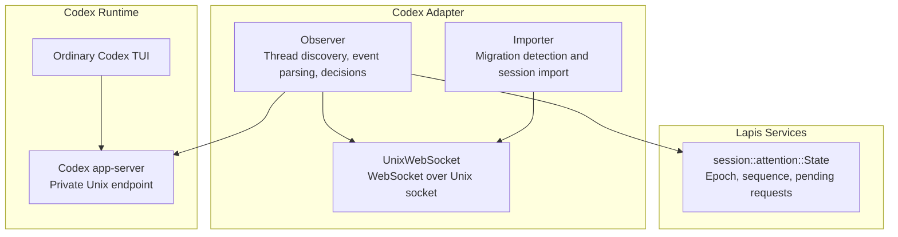
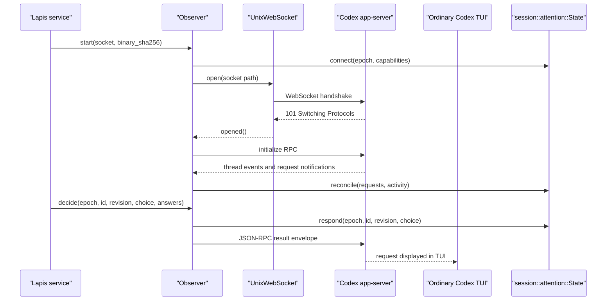
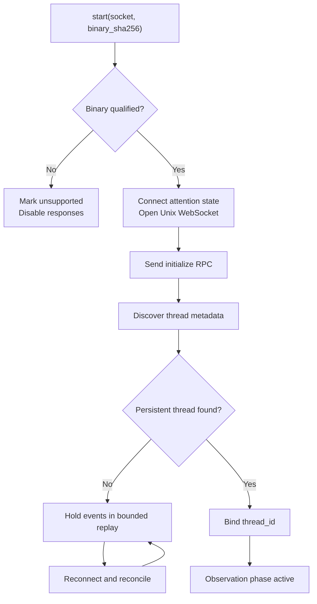
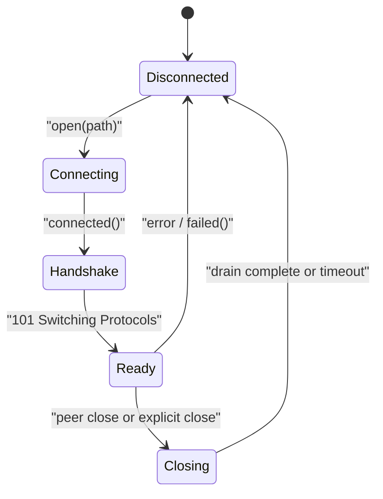
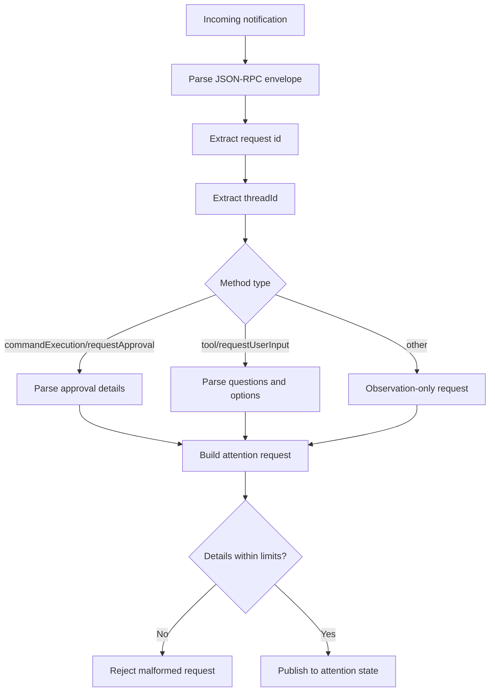
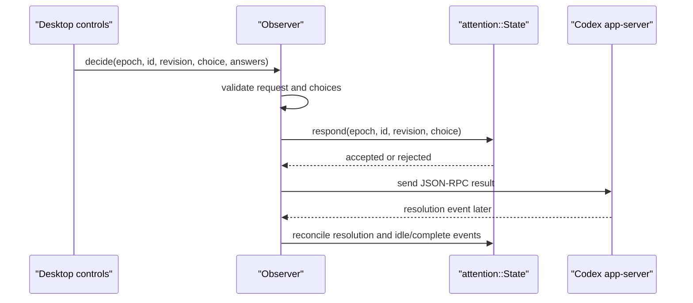
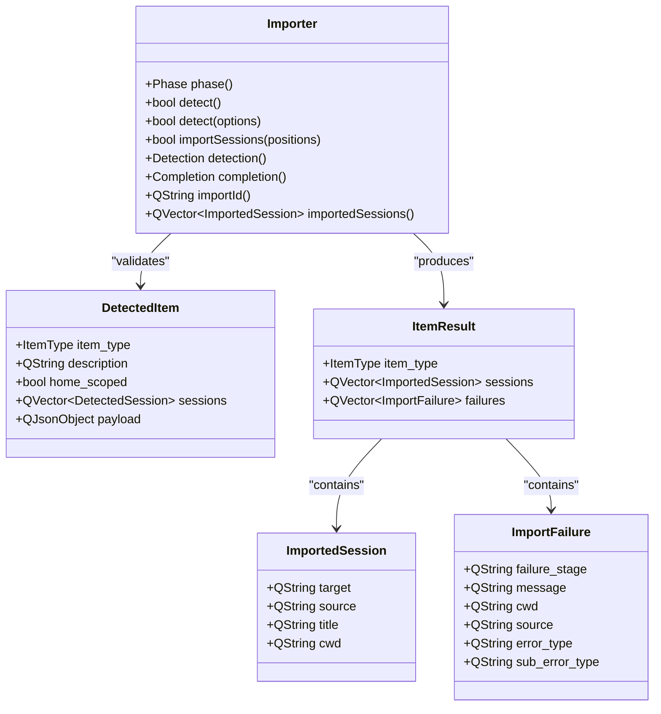
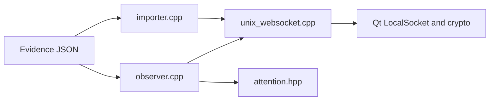

# Codex Adapter

<cite>
**Referenced Files in This Document**   
- [README.md](file://adapters/codex/README.md)
- [observer.hpp](file://adapters/codex/src/observer.hpp)
- [observer.cpp](file://adapters/codex/src/observer.cpp)
- [unix_websocket.hpp](file://adapters/codex/src/unix_websocket.hpp)
- [unix_websocket.cpp](file://adapters/codex/src/unix_websocket.cpp)
- [importer.hpp](file://adapters/codex/src/importer.hpp)
- [importer.cpp](file://adapters/codex/src/importer.cpp)
- [attention.hpp](file://services/session/include/lapis/session/attention.hpp)
- [codex-attention-route.json](file://evidence/codex-attention-route.json)
- [codex-service.json](file://evidence/codex-service.json)
</cite>

## Table of Contents
1. [Introduction](#introduction)
2. [Project Structure](#project-structure)
3. [Core Components](#core-components)
4. [Architecture Overview](#architecture-overview)
5. [Detailed Component Analysis](#detailed-component-analysis)
6. [Dependency Analysis](#dependency-analysis)
7. [Performance Considerations](#performance-considerations)
8. [Troubleshooting Guide](#troubleshooting-guide)
9. [Conclusion](#conclusion)
10. [Appendices](#appendices)

## Introduction
The Codex adapter is Lapis’s integration layer for observing and responding to a running Codex CLI through its private Unix-domain WebSocket server. It has two distinct responsibilities:

- **Observer**: Discovers a persistent Codex thread, connects to the Codex app-server over a Unix socket, captures real-time JSON-RPC messages, identifies user requests and command approvals, and optionally sends responses back when the source binary is qualified.
- **Importer**: A separate onboarding client that discovers Claude-style migration items, validates them, and imports selected session data through a dedicated Codex external-agent protocol path.

The observer does not replace the ordinary Codex TUI; it shares the same private app-server so the TUI can continue rendering while Lapis observes, reconciles history, and responds to approved request kinds. The importer is intentionally independent from observer state and attention history.

**Section sources**
- [README.md:1-40](file://adapters/codex/README.md#L1-L40)
- [observer.hpp:1-55](file://adapters/codex/src/observer.hpp#L1-L55)
- [importer.hpp:1-130](file://adapters/codex/src/importer.hpp#L1-L130)

## Project Structure
The Codex adapter lives under `adapters/codex` and follows a layered design:

| Layer | File | Responsibility |
|---|---|---|
| Transport | `unix_websocket.{hpp,cpp}` | Implements WebSocket framing over Qt `QLocalSocket`, including handshake, text frames, ping/pong, close handling, and bounded input buffering. |
| Observer | `observer.{hpp,cpp}` | Owns connection lifecycle, Codex RPC calls, thread binding, event parsing, hook diagnostics, request tracking, and response submission. |
| Importer | `importer.{hpp,cpp}` | Manages a separate import task with detection, validation, progress tracking, and completion reporting. |
| Public API | `observer.hpp`, `importer.hpp` | Exposes stable C++ interfaces to Lapis services. |
| Tests | `tests/` directory | Unit tests for observer, importer, and transport behavior. |
| Documentation | `README.md` | Investigation notes, qualification boundaries, evidence references, and protocol assumptions. |

**Diagram sources**
- [observer.hpp:1-55](file://adapters/codex/src/observer.hpp#L1-L55)
- [unix_websocket.hpp:1-33](file://adapters/codex/src/unix_websocket.hpp#L1-L33)
- [attention.hpp:1-136](file://services/session/include/lapis/session/attention.hpp#L1-L136)

**Section sources**
- [README.md:1-40](file://adapters/codex/README.md#L1-L40)
- [observer.hpp:1-55](file://adapters/codex/src/observer.hpp#L1-L55)
- [unix_websocket.hpp:1-33](file://adapters/codex/src/unix_websocket.hpp#L1-L33)
- [importer.hpp:1-130](file://adapters/codex/src/importer.hpp#L1-L130)

## Core Components

### Observer
The observer represents one dedicated Codex server and TUI source. It owns the connection, tracks the current thread, maintains pending requests, collects hook inventory and run diagnostics, and exposes decision methods for command approval and user-input answers.

Key responsibilities:
- Validate the Codex binary hash before enabling structured responses.
- Connect to the configured Unix socket and send an initialization RPC.
- Discover and bind a persistent thread through `thread/read` or `thread/started`.
- Parse incoming Codex request messages into Lapis attention requests.
- Track unclassified early events until thread identity is known.
- Submit decisions only after validating choices and answers against the original request.
- Reconcile history through resume followed by read when reconnecting.

**Section sources**
- [observer.hpp:1-55](file://adapters/codex/src/observer.hpp#L1-L55)
- [observer.cpp:1-200](file://adapters/codex/src/observer.cpp#L1-L200)

### UnixWebSocket
The transport wraps Qt’s local socket in a WebSocket client tailored for Codex’s private endpoint. It performs:
- HTTP upgrade handshake.
- Text frame encoding with masking.
- Ping/pong handling.
- Close-frame validation and graceful drain timeout.
- Bounded message sizes and input buffers.
- No automatic reconnection or retransmission; failures are terminal per connection.

**Section sources**
- [unix_websocket.hpp:1-33](file://adapters/codex/src/unix_websocket.hpp#L1-L33)
- [unix_websocket.cpp:1-200](file://adapters/codex/src/unix_websocket.cpp#L1-L200)
- [unix_websocket.cpp:201-328](file://adapters/codex/src/unix_websocket.cpp#L201-L328)

### Importer
The importer is an independent client for workspace onboarding. It:
- Starts a dedicated Codex connection.
- Detects migration items, currently focusing on Claude-style detection metadata.
- Validates item types, paths, sessions, connectors, and payload shapes.
- Submits selected SESSIONS migration payloads unchanged.
- Tracks acceptance, progress, and completion by Codex import ID.
- Treats transport loss, malformed data, and timeouts as terminal for the task.

**Section sources**
- [importer.hpp:1-130](file://adapters/codex/src/importer.hpp#L1-L130)
- [importer.cpp:1-200](file://adapters/codex/src/importer.cpp#L1-L200)
- [importer.cpp:201-551](file://adapters/codex/src/importer.cpp#L201-L551)

### Session State Bridge
The observer integrates with `session::attention::State`, which provides:
- Epoch-based synchronization.
- Monotonic sequence numbering.
- Pending request tracking.
- Activity snapshots.
- Exact-source reconciliation through epoch, request ID, revision, and choice.

This bridge ensures that Lapis does not assume ownership of a request until both the attention state accepts it and the transport delivers it successfully.

**Section sources**
- [attention.hpp:1-136](file://services/session/include/lapis/session/attention.hpp#L1-L136)
- [observer.cpp:201-537](file://adapters/codex/src/observer.cpp#L201-L537)

## Architecture Overview
The adapter connects Lapis to Codex through three conceptual layers: transport, protocol, and business logic.

**Diagram sources**
- [observer.cpp:201-537](file://adapters/codex/src/observer.cpp#L201-L537)
- [unix_websocket.cpp:1-200](file://adapters/codex/src/unix_websocket.cpp#L1-L200)
- [attention.hpp:1-136](file://services/session/include/lapis/session/attention.hpp#L1-L136)

The architecture deliberately separates:
- Connection ownership (service-owned observer).
- Transport framing (bounded, no auto-reconnect).
- Protocol parsing (strict validation).
- Session state (epoch-aware, revisioned, bounded).
- User interaction (desktop controls admit decisions after attention state synchronization).

**Section sources**
- [README.md:160-240](file://adapters/codex/README.md#L160-L240)
- [codex-service.json:1-140](file://evidence/codex-service.json#L1-L140)

## Detailed Component Analysis

### Observer Lifecycle and Thread Discovery
The observer starts with a socket path and a Codex binary SHA-256. If the binary is not in the qualified list, it marks itself unsupported and disables structured responses. On successful initialization, it:

1. Creates a new attention state connection with observation, response, and reconciliation capabilities.
2. Opens the Unix WebSocket.
3. Sends `initialize`.
4. Begins discovering thread metadata.
5. Binds exactly one persistent thread.
6. Retains early traffic in a bounded replay buffer until classification succeeds.
7. Uses `thread/resume` followed by `thread/read` to reconcile history on reconnect.

The implementation enforces:
- One stable thread per observer.
- Classification-only behavior before metadata arrives.
- Retired and retired-bytes accounting for unclassified traffic.
- Failed-close behavior when multiple persistent threads appear or budgets overflow.

**Diagram sources**
- [observer.cpp:201-537](file://adapters/codex/src/observer.cpp#L201-L537)

**Section sources**
- [observer.cpp:201-537](file://adapters/codex/src/observer.cpp#L201-L537)
- [README.md:160-240](file://adapters/codex/README.md#L160-L240)

### Unix WebSocket Communication Protocol
The transport implements a minimal RFC-compatible WebSocket client suitable for Codex’s raw byte forwarding:

| Phase | Behavior |
|---|---|
| Handshake | Sends an HTTP GET upgrade request with `Sec-WebSocket-Version: 13`, computes `Sec-WebSocket-Accept`, rejects non-101 responses, invalid headers, extensions, or protocols. |
| Frames | Encodes text frames with random masking, supports continuation fragments, pings, pongs, and close frames. |
| Limits | Rejects messages larger than 1 MiB, control frames without FIN, oversized inputs, and invalid UTF-8 payloads. |
| Close | Responds to peer close frames with validated codes, drains writes, and fails if the drain times out. |
| Delivery | Emits decoded text bytes to the observer; errors become terminal connection failures. |

**Diagram sources**
- [unix_websocket.cpp:1-200](file://adapters/codex/src/unix_websocket.cpp#L1-L200)
- [unix_websocket.cpp:201-328](file://adapters/codex/src/unix_websocket.cpp#L201-L328)

**Section sources**
- [unix_websocket.hpp:1-33](file://adapters/codex/src/unix_websocket.hpp#L1-L33)
- [unix_websocket.cpp:1-200](file://adapters/codex/src/unix_websocket.cpp#L1-L200)
- [unix_websocket.cpp:201-328](file://adapters/codex/src/unix_websocket.cpp#L201-L328)

### Event Extraction and Request Parsing
The observer parses Codex request notifications into Lapis attention requests. The supported request kinds are:

| Codex method | Lapis reason | Choices | Notes |
|---|---|---|---|
| `item/commandExecution/requestApproval` | Command approval | accept, decline, cancel | Requires a valid `availableDecisions` array. Missing or empty options fall back to observation-only. |
| `item/tool/requestUserInput` | User input | submit | Validates question IDs, labels, option counts, and answer shape. |
| Other request methods | Respond in terminal | None | Observation-only; the adapter never answers unknown request kinds. |

Important parsing constraints include:
- Bounded request ID strings or integers.
- Valid `threadId`, optional `turnId`, and optional `itemId`.
- Maximum 16 questions per request.
- Maximum 32 options per question.
- Answers must match the number and structure of questions.
- Free-text answers are allowed only when options are absent or the question marks `isOther`.
- Details are bounded and summarized as the attention summary.

**Diagram sources**
- [observer.cpp:1-200](file://adapters/codex/src/observer.cpp#L1-L200)

**Section sources**
- [observer.cpp:1-200](file://adapters/codex/src/observer.cpp#L1-L200)

### Decision Submission and Reconciliation
When the user approves a command or submits answers to a tool question, the observer validates the decision before touching session state:

1. Verify the observer is ready, connected, and the request exists.
2. Verify the epoch matches the current attention state epoch.
3. Verify the choice is one of the parsed available choices.
4. For user input, validate the answer map against the original questions.
5. Mark the request as responded in attention state using exact epoch, ID, and revision.
6. Send the JSON-RPC result envelope to Codex.
7. If transport delivery fails, retain the submission and require explicit reconciliation before retrying.

**Diagram sources**
- [observer.cpp:201-537](file://adapters/codex/src/observer.cpp#L201-L537)
- [attention.hpp:1-136](file://services/session/include/lapis/session/attention.hpp#L1-L136)

**Section sources**
- [observer.cpp:201-537](file://adapters/codex/src/observer.cpp#L201-L537)

### Hook Inventory and Run Diagnostics
The observer also collects Codex hook diagnostics. It parses:
- Hook inventory declarations, including event names, handler types, trust status, matcher, plugin ID, command/MCP tool configuration, enabled flags, timeouts, and hashes.
- Per-entry warnings and errors.
- Live hook runs with thread, turn, event, execution mode, scope, source, status, timing, and bounded output entries.

These values are advisory and display-only. They do not make the adapter capable of answering arbitrary Codex hooks.

**Section sources**
- [observer.cpp:201-537](file://adapters/codex/src/observer.cpp#L201-L537)

### Importer Data Transformation
The importer transforms Codex migration metadata into Lapis import state. It maps Codex string identifiers such as `AGENTS_MD`, `CONFIG`, `SKILLS`, `PLUGINS`, `MCP_SERVER_CONFIG`, `SUBAGENTS`, `HOOKS`, `COMMANDS`, `MEMORY`, and `SESSIONS` to internal enum values. Only SESSIONS items are retained as selectable payloads; other detected classes remain visible as typed metadata but are not submitted automatically.

For SESSIONS items, it validates:
- Required top-level fields: `itemType`, `description`, `details.sessions`.
- Allowed detail keys: plugins, skills, sessions, mcpServers, hooks, subagents, commands, memory.
- Non-session arrays must be empty.
- Duplicate session paths are rejected.
- Connector detection includes bounded session counts and allowed sources.

Import results track per-item successes and failures, preserving the original payload and imported session target/source/title information.

**Diagram sources**
- [importer.hpp:1-130](file://adapters/codex/src/importer.hpp#L1-L130)
- [importer.cpp:1-200](file://adapters/codex/src/importer.cpp#L1-L200)
- [importer.cpp:201-551](file://adapters/codex/src/importer.cpp#L201-L551)

**Section sources**
- [importer.hpp:1-130](file://adapters/codex/src/importer.hpp#L1-L130)
- [importer.cpp:1-200](file://adapters/codex/src/importer.cpp#L1-L200)
- [importer.cpp:201-551](file://adapters/codex/src/importer.cpp#L201-L551)

## Dependency Analysis
The adapter has clear dependency boundaries:

- `observer.cpp` depends on `unix_websocket.cpp` for transport and on `session::attention::State` for session semantics.
- `importer.cpp` depends only on `unix_websocket.cpp` and its own validation pipeline.
- `unix_websocket.cpp` depends on Qt networking primitives and cryptographic helpers.
- Evidence files document qualification boundaries rather than runtime dependencies.

**Diagram sources**
- [observer.cpp:1-200](file://adapters/codex/src/observer.cpp#L1-L200)
- [importer.cpp:1-200](file://adapters/codex/src/importer.cpp#L1-L200)
- [unix_websocket.cpp:1-200](file://adapters/codex/src/unix_websocket.cpp#L1-L200)
- [attention.hpp:1-136](file://services/session/include/lapis/session/attention.hpp#L1-L136)

**Section sources**
- [observer.cpp:1-200](file://adapters/codex/src/observer.cpp#L1-L200)
- [importer.cpp:1-200](file://adapters/codex/src/importer.cpp#L1-L200)
- [unix_websocket.cpp:1-200](file://adapters/codex/src/unix_websocket.cpp#L1-L200)

## Performance Considerations
The adapter favors safety and predictability over throughput:

- Messages are bounded at 1 MiB for the transport and smaller limits for RPC envelopes, details, and hook diagnostics.
- Early unclassified events use bounded replay queues rather than retaining unadoptable payloads indefinitely.
- WebSocket input is processed in bounded loops to avoid blocking the event loop on bursty server traffic.
- Pending request counts, retired IDs, and byte counters prevent unbounded growth.
- Response submission is single-use: a failed transport send does not auto-replay, avoiding duplicate decisions.
- Import detection and import results have strict size caps to protect against malformed or malicious server responses.

[No sources needed since this section provides general guidance]

## Troubleshooting Guide

### Socket Permission Issues
If the observer cannot connect to the Codex Unix endpoint:
- Confirm the socket path points to the Codex app-server’s private endpoint.
- Ensure the process has permission to access the Unix domain socket file.
- Check whether the explicit remote endpoint is being used instead of daemon discovery.
- Inspect the observer diagnostic and observation phase.

Common symptoms:
- Connection fails immediately.
- Diagnostic mentions connection failure.
- Phase remains unknown or connecting.

**Section sources**
- [unix_websocket.cpp:1-200](file://adapters/codex/src/unix_websocket.cpp#L1-L200)
- [observer.cpp:201-537](file://adapters/codex/src/observer.cpp#L201-L537)
- [README.md:120-160](file://adapters/codex/README.md#L120-L160)

### Connection Failures and Timeouts
Potential causes include:
- Invalid WebSocket handshake.
- Upgrade rejection.
- Invalid headers or extensions.
- Peer close without a valid close frame.
- Write queue overflow.
- Input buffer exceeding limits.
- RPC timeout.

Mitigations:
- Restart the observer to reconnect explicitly.
- Do not assume automatic retransmission of sent responses.
- Use `reconnect()` only when the caller understands that prior submissions may need reconciliation.
- Check transport diagnostics for handshake, frame, or close errors.

**Section sources**
- [unix_websocket.cpp:1-200](file://adapters/codex/src/unix_websocket.cpp#L1-L200)
- [unix_websocket.cpp:201-328](file://adapters/codex/src/unix_websocket.cpp#L201-L328)
- [observer.cpp:201-537](file://adapters/codex/src/observer.cpp#L201-L537)

### Message Parsing Errors
Parsing failures usually indicate a mismatch between the expected Codex wire format and what was received:
- Invalid request identity or missing thread ID.
- Too many questions or options.
- Duplicate question IDs or option labels.
- Invalid answer shape.
- Unknown or unsupported request method.
- Malformed hook inventory or run diagnostics.
- Import payload with unexpected keys, duplicate sessions, or unselected item types.

Recommended steps:
- Record the diagnostic and phase.
- Avoid sending decisions for malformed requests.
- Requalify the adapter if the Codex binary changed.
- For importer issues, inspect the detected item type and session list.

**Section sources**
- [observer.cpp:1-200](file://adapters/codex/src/observer.cpp#L1-L200)
- [observer.cpp:201-537](file://adapters/codex/src/observer.cpp#L201-L537)
- [importer.cpp:1-200](file://adapters/codex/src/importer.cpp#L1-L200)
- [importer.cpp:201-551](file://adapters/codex/src/importer.cpp#L201-L551)

### Unqualified Binary Hashes
If the observed Codex binary is not in the qualified list:
- Responses are disabled.
- The observer still attempts observation.
- The diagnostic indicates an unsupported binary hash.
- Requalification requires testing the specific binary digest, not just changing a pin.

**Section sources**
- [observer.cpp:201-537](file://adapters/codex/src/observer.cpp#L201-L537)
- [README.md:40-120](file://adapters/codex/README.md#L40-L120)

### Session Tracking Across Multiple Streams
The observer binds one persistent thread. Events arriving before classification are held in a bounded replay buffer. Once a persistent thread is confirmed:
- Earlier replayed events are replaced by the subsequent `thread/read` boundary.
- Unclassified senders cannot redirect decisions.
- A second persistent thread fails closed.
- Lost connections require resume/read reconciliation.

**Section sources**
- [observer.cpp:201-537](file://adapters/codex/src/observer.cpp#L201-L537)
- [README.md:160-240](file://adapters/codex/README.md#L160-L240)

## Conclusion
The Codex adapter provides a cautious, well-bounded bridge between Lapis and Codex’s private WebSocket endpoint. Its observer focuses on a single persistent thread, strict request parsing, and safe decision submission backed by epoch-aware session state. Its importer independently handles migration discovery and session import with strong validation and terminal error semantics. Both components prioritize correctness, bounded resources, and observable diagnostics over automatic recovery.

Qualification remains tied to specific Codex binary digests and live protocol behavior. New binaries, changed request kinds, or different worktree behaviors require requalification before expanding adapter capabilities.

[No sources needed since this section summarizes without analyzing specific files]

## Appendices

### Captured Events and Mapping to Lapis Attention Models
| Codex signal | Lapis model field | Meaning |
|---|---|---|
| `item/commandExecution/requestApproval` | `reason = "Command approval"` | Command execution needs human approval. |
| `item/tool/requestUserInput` | `reason = "User input"` | Tool requires user-selected or free-text answers. |
| Unknown request method | `reason = "Respond in terminal"` | Observation-only; adapter does not answer. |
| Idle or completed turn | Activity snapshot | Indicates agent activity state. |
| Hook run | Advisory diagnostics | Provides event name, handler type, execution mode, scope, source, and status. |
| Hook inventory | Advisory diagnostics | Provides counts by event, handler type, and trust status. |

These mappings are derived from the observer’s request parser and diagnostic collectors. They do not imply that every Codex event becomes a Lapis attention decision. Only qualified request kinds with validated choices produce actionable attention entries.

**Section sources**
- [observer.cpp:1-200](file://adapters/codex/src/observer.cpp#L1-L200)
- [observer.cpp:201-537](file://adapters/codex/src/observer.cpp#L201-L537)
- [codex-attention-route.json:1-120](file://evidence/codex-attention-route.json#L1-L120)
- [codex-service.json:1-140](file://evidence/codex-service.json#L1-L140)