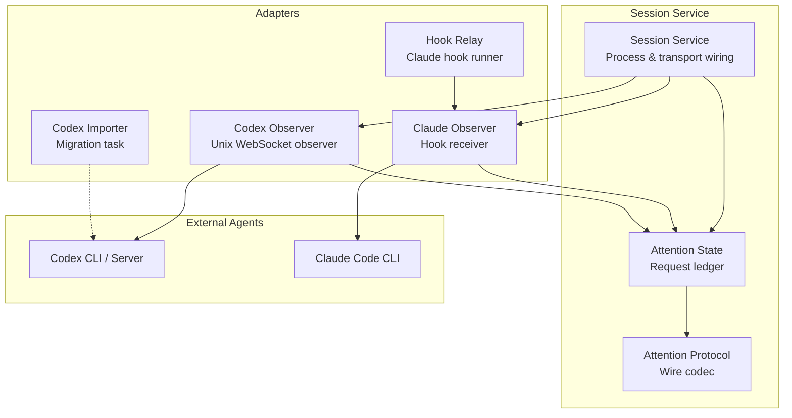
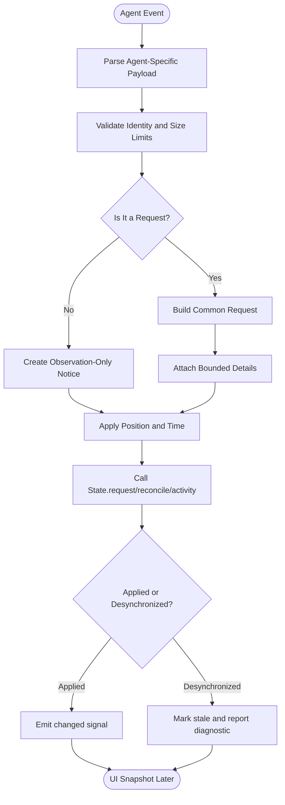
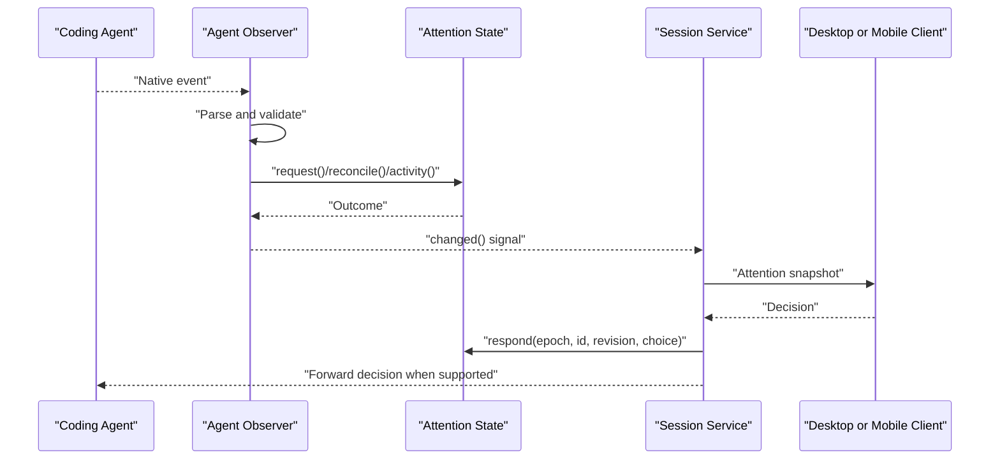
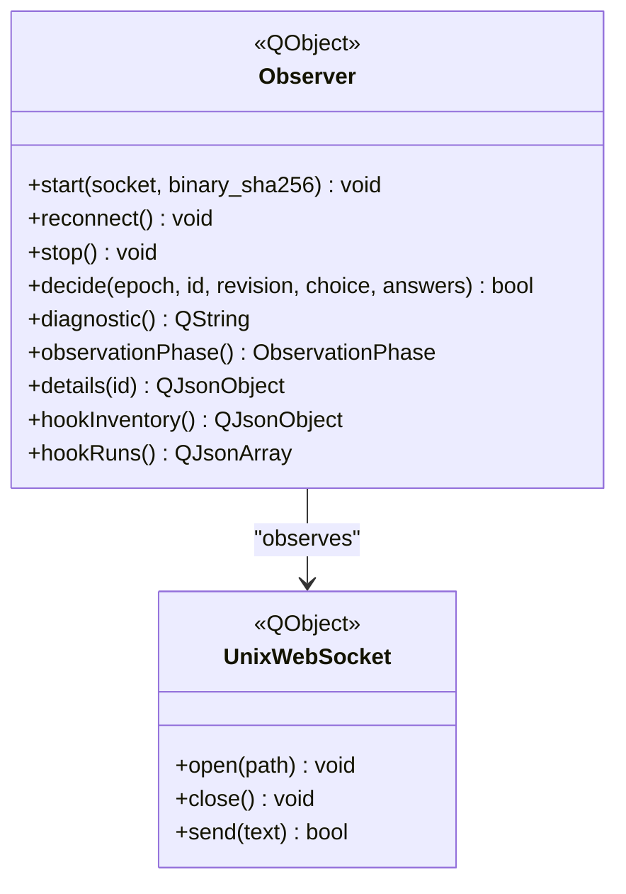
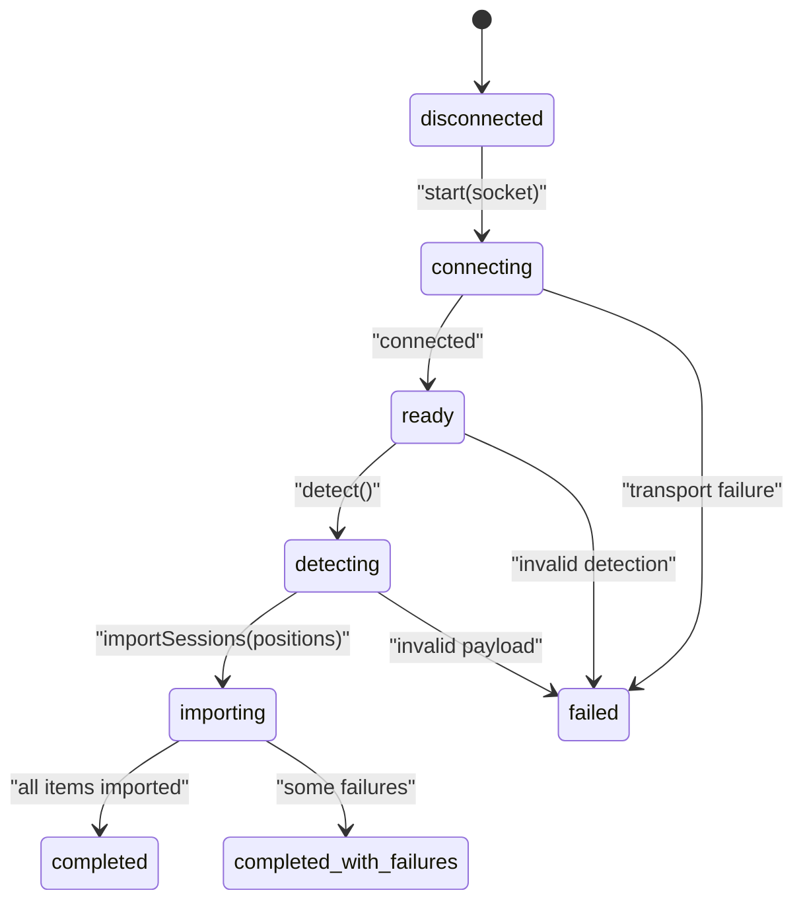
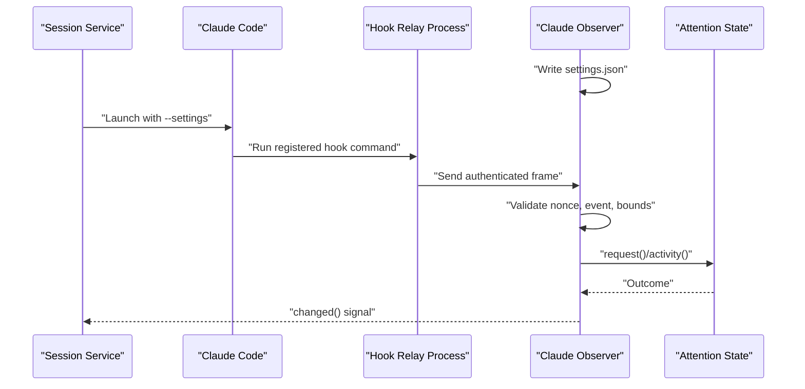
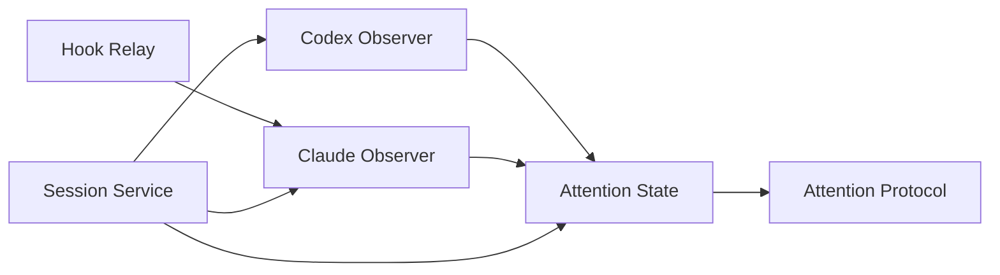
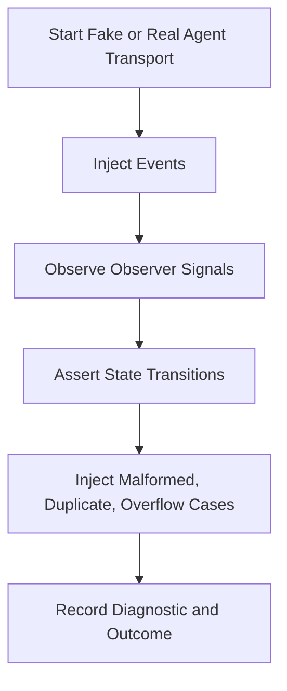

# Agent Adapter Framework

<cite>
**Referenced Files in This Document**
- [observer.hpp](file://adapters/codex/src/observer.hpp)
- [observer.cpp](file://adapters/codex/src/observer.cpp)
- [importer.hpp](file://adapters/codex/src/importer.hpp)
- [importer.cpp](file://adapters/codex/src/importer.cpp)
- [unix_websocket.hpp](file://adapters/codex/src/unix_websocket.hpp)
- [claude_observer.hpp](file://adapters/claude/src/claude_observer.hpp)
- [claude_observer.cpp](file://adapters/claude/src/claude_observer.cpp)
- [hook_relay.hpp](file://adapters/claude/src/hook_relay.hpp)
- [hook_relay.cpp](file://adapters/claude/src/hook_relay.cpp)
- [attention.hpp](file://services/session/include/lapis/session/attention.hpp)
- [attention.cpp](file://services/session/src/attention.cpp)
- [observation_phase.hpp](file://services/session/include/lapis/session/observation_phase.hpp)
- [attention_protocol.hpp](file://services/session/src/transport/attention_protocol.hpp)
- [attention_protocol.cpp](file://services/session/src/transport/attention_protocol.cpp)
- [session_service.cpp](file://services/session/src/session_service.cpp)
- [observer_test.cpp](file://adapters/codex/tests/observer_test.cpp)
- [claude_observer_test.cpp](file://adapters/claude/tests/claude_observer_test.cpp)
- [probe_codex_attention.py](file://scripts/probe_codex_attention.py)
</cite>

## Table of Contents
1. [Introduction](#introduction)
2. [Project Structure](#project-structure)
3. [Core Components](#core-components)
4. [Architecture Overview](#architecture-overview)
5. [Detailed Component Analysis](#detailed-component-analysis)
6. [Dependency Analysis](#dependency-analysis)
7. [Performance Considerations](#performance-considerations)
8. [Troubleshooting Guide](#troubleshooting-guide)
9. [Extension Guidelines](#extension-guidelines)
10. [Testing Patterns](#testing-patterns)
11. [Conclusion](#conclusion)

## Introduction
The pluggable agent adapter framework connects external coding agents to a shared attention protocol. Each adapter observes one agent process or CLI, translates its native events into a common model, and lets the session service manage request lifecycle, sequencing, activity state, and client-visible snapshots. Two adapters are implemented:

- **Codex adapter**: observes a private Codex Unix-domain WebSocket server, parses method-driven requests such as command approvals and user-input prompts, and optionally imports migration data.
- **Claude Code adapter**: registers Claude hooks through a settings file, receives hook frames over a local Unix socket, and also accepts relayed hook metadata from another machine through the authenticated terminal channel.

The central contract is `lapis::session::attention::State`. Adapters do not directly speak to UI clients; they update this state, while the session service serializes it into an attention snapshot for transport.

## Project Structure
The repository organizes adapter-specific logic under `adapters/<agent>/src`, with unit tests under `adapters/<agent>/tests`. The shared attention model lives in `services/session/include/lapis/session`, and the session service wires adapters into process supervision, terminal I/O, and transport.

**Diagram sources**
- [observer.hpp:12-54](file://adapters/codex/src/observer.hpp#L12-L54)
- [importer.hpp:12-129](file://adapters/codex/src/importer.hpp#L12-L129)
- [claude_observer.hpp:10-49](file://adapters/claude/src/claude_observer.hpp#L10-L49)
- [hook_relay.hpp:10-61](file://adapters/claude/src/hook_relay.hpp#L10-L61)
- [attention.hpp:12-135](file://services/session/include/lapis/session/attention.hpp#L12-L135)
- [attention_protocol.hpp:10-40](file://services/session/src/transport/attention_protocol.hpp#L10-L40)
- [session_service.cpp:1-60](file://services/session/src/session_service.cpp#L1-L60)

**Section sources**
- [observer.hpp:12-54](file://adapters/codex/src/observer.hpp#L12-L54)
- [importer.hpp:12-129](file://adapters/codex/src/importer.hpp#L12-L129)
- [claude_observer.hpp:10-49](file://adapters/claude/src/claude_observer.hpp#L10-L49)
- [hook_relay.hpp:10-61](file://adapters/claude/src/hook_relay.hpp#L10-L61)
- [attention.hpp:12-135](file://services/session/include/lapis/session/attention.hpp#L12-L135)
- [attention_protocol.hpp:10-40](file://services/session/src/transport/attention_protocol.hpp#L10-L40)
- [session_service.cpp:1-60](file://services/session/src/session_service.cpp#L1-L60)

## Core Components
This section describes the common interface and normalization pipeline that every adapter implements.

### Common Attention State
`lapis::session::attention::State` is the single source of truth for per-session requests. It tracks:

| Concept | Meaning |
|---|---|
| `RequestId` | Either a 64-bit integer or a UTF-8 string, bounded at the wire layer. |
| `Position` | Monotonic `(epoch, sequence)` supplied by the adapter to order events. |
| `Activity` | Unknown, working, idle, or turn-completed status. |
| `Outcome` | Applied, duplicate, rejected, or desynchronized result for each state transition. |
| `Pending` | A request with its revision, arrival time, scheduling fields, and submission status. |
| `ObservationPhase` | Unknown, awaiting first prompt, or reconciling. |
| `Capabilities` | Whether the adapter supports observation-only notices, responses, or authoritative reconciliation. |

Important constraints include bounded identifiers, bounded choice lists, monotonic clocks, epoch-based replay boundaries, and explicit desynchronization on invalid sequences.

**Section sources**
- [attention.hpp:12-135](file://services/session/include/lapis/session/attention.hpp#L12-L135)
- [attention.cpp:12-200](file://services/session/src/attention.cpp#L12-L200)

### Normalization Pipeline
Each adapter follows the same conceptual flow:

**Diagram sources**
- [observer.cpp:80-220](file://adapters/codex/src/observer.cpp#L80-L220)
- [claude_observer.cpp:20-120](file://adapters/claude/src/claude_observer.cpp#L20-L120)
- [attention.hpp:40-135](file://services/session/include/lapis/session/attention.hpp#L40-L135)

### Transport Contracts
The session service exposes a binary attention protocol that carries:

- An attachment identity and generation.
- Connection and readiness flags.
- Current activity and observation phase.
- A list of pending requests with details.
- Client decisions containing epoch, request ID, revision, choice, and optional answers.

The wire format enforces maximum message sizes, UTF-8 validation, unique request identities, and consistent state invariants before encoding.

**Section sources**
- [attention_protocol.hpp:10-40](file://services/session/src/transport/attention_protocol.hpp#L10-L40)
- [attention_protocol.cpp:12-120](file://services/session/src/transport/attention_protocol.cpp#L12-L120)

## Architecture Overview
The system separates three responsibilities:

1. **Adapter observers** observe one agent source and translate events into `attention::State` transitions.
2. **The session service** supervises agent processes, owns the `attention::State`, and publishes snapshots to clients.
3. **Transport codecs** serialize the normalized state into a compact wire envelope.

**Diagram sources**
- [observer.hpp:12-54](file://adapters/codex/src/observer.hpp#L12-L54)
- [claude_observer.hpp:10-49](file://adapters/claude/src/claude_observer.hpp#L10-L49)
- [attention.hpp:40-135](file://services/session/include/lapis/session/attention.hpp#L40-L135)
- [attention_protocol.hpp:10-40](file://services/session/src/transport/attention_protocol.hpp#L10-L40)

## Detailed Component Analysis

### Codex Observer
The Codex observer connects to a private Unix-domain WebSocket server owned by a Codex process. Its responsibilities are:

- Open and maintain a text WebSocket connection.
- Parse method names such as command approval and user-input questions.
- Map those methods to common requests with bounded details.
- Expose advisory hook inventory without exposing raw hook payloads.
- Accept user choices through `decide()` and return whether the submission was accepted locally.

Key implementation characteristics:

| Area | Behavior |
|---|---|
| Transport | Uses `UnixWebSocket`, which has no automatic reconnect or retransmission. Peer close is terminal. |
| Message limit | Default message limit is 64 KiB; details are further capped at 16 KiB per request and 512 KiB aggregated. |
| Request parsing | Validates thread IDs, turn/item context, question sets, option labels, and answer formats. |
| Decision handling | Only explicitly recognized choices are added to the common request; unrecognized types remain observation-only. |
| Diagnostics | Exposes current observation phase, thread ID, diagnostic text, hook inventory summary, and per-request details. |

**Diagram sources**
- [observer.hpp:12-54](file://adapters/codex/src/observer.hpp#L12-L54)
- [unix_websocket.hpp:10-32](file://adapters/codex/src/unix_websocket.hpp#L10-L32)

**Section sources**
- [observer.hpp:12-54](file://adapters/codex/src/observer.hpp#L12-L54)
- [observer.cpp:80-220](file://adapters/codex/src/observer.cpp#L80-L220)
- [unix_websocket.hpp:10-32](file://adapters/codex/src/unix_websocket.hpp#L10-L32)

### Codex Importer
The importer is intentionally independent from the observer and attention state. It models a workspace onboarding or migration task against the Codex server.

Supported item types include agents documentation, configuration, skills, plugins, MCP server configuration, subagents, hooks, commands, memory, and sessions. Detection returns typed items with descriptions, home scope, detected sessions, and retained payloads only for selected migration classes.

Important properties:

- Every start is explicit; transport loss, malformed data, and timeouts are terminal.
- The first detection slice requests Claude detection only.
- Session import selection is restricted to explicit session migration items.
- Failures carry stage, message, optional cwd/source, and error-type fields.

**Diagram sources**
- [importer.hpp:12-129](file://adapters/codex/src/importer.hpp#L12-L129)
- [importer.cpp:12-120](file://adapters/codex/src/importer.cpp#L12-L120)

**Section sources**
- [importer.hpp:12-129](file://adapters/codex/src/importer.hpp#L12-L129)
- [importer.cpp:12-120](file://adapters/codex/src/importer.cpp#L12-L120)

### Claude Observer
The Claude observer uses a different observation strategy. Instead of polling a WebSocket, it:

1. Creates a temporary directory and a Unix-domain socket.
2. Writes a Claude settings file that registers hook commands for each supported event.
3. Launches Claude with `--settings` pointing to that file.
4. Accepts authenticated JSON frames from the hook relay process.
5. Optionally accepts relayed frames from another machine through the session service’s authenticated terminal channel.

It distinguishes two transports:

| Transport | Purpose |
|---|---|
| `local_socket` | Directly listens on a private Unix socket. |
| `terminal` | Receives already-authenticated relayed frames from the session service. |

The observer coalesces notifications, caps incoming frames, limits concurrent connections, and computes background-work information from Stop events.

**Diagram sources**
- [claude_observer.cpp:20-120](file://adapters/claude/src/claude_observer.cpp#L20-L120)
- [hook_relay.cpp:60-138](file://adapters/claude/src/hook_relay.cpp#L60-L138)
- [hook_relay.hpp:10-61](file://adapters/claude/src/hook_relay.hpp#L10-L61)

**Section sources**
- [claude_observer.hpp:10-49](file://adapters/claude/src/claude_observer.hpp#L10-L49)
- [claude_observer.cpp:20-120](file://adapters/claude/src/claude_observer.cpp#L20-L120)
- [hook_relay.hpp:10-61](file://adapters/claude/src/hook_relay.hpp#L10-L61)
- [hook_relay.cpp:60-138](file://adapters/claude/src/hook_relay.cpp#L60-L138)

### Hook Relay Contract
The hook relay is a small helper process invoked by Claude hooks. Its role is to:

- Read a single JSON object from standard input within a deadline.
- Extract a bounded set of identity fields.
- Derive background-work information when the contract supports it.
- Send a framed envelope with a nonce to the observer’s local socket.
- Return zero on any failure so Claude does not interpret relay errors as permission decisions.

The relay defines nine hook event names, including session start, prompt submission, permission requests, notifications, tool-use events, stop, and session end.

**Section sources**
- [hook_relay.hpp:10-61](file://adapters/claude/src/hook_relay.hpp#L10-L61)
- [hook_relay.cpp:12-138](file://adapters/claude/src/hook_relay.cpp#L12-L138)

### Session Service Integration
The session service includes both Claude and Codex observer headers, meaning it is responsible for launching, configuring, and observing adapters. It also removes stale Codex symlinks, parses Codex CLI options, and applies Codex permission mappings.

The service integrates with:

- Agent checkpointing and journaling.
- History workers.
- Terminal hooks.
- Local endpoint transport.
- Process group guards and PTY processes.
- Attention audit and protocol serialization.

**Section sources**
- [session_service.cpp:1-60](file://services/session/src/session_service.cpp#L1-L60)
- [session_service.cpp:60-200](file://services/session/src/session_service.cpp#L60-L200)

## Dependency Analysis
The adapter framework has clear boundaries:

- Adapters depend on the shared attention model.
- Adapters do not depend on desktop UI code.
- The session service depends on adapters, transport, and platform primitives.
- Claude hooks run in a separate process boundary enforced by the hook relay.
- Codex observation runs over a dedicated Unix WebSocket.

**Diagram sources**
- [observer.hpp:12-54](file://adapters/codex/src/observer.hpp#L12-L54)
- [claude_observer.hpp:10-49](file://adapters/claude/src/claude_observer.hpp#L10-L49)
- [hook_relay.hpp:10-61](file://adapters/claude/src/hook_relay.hpp#L10-L61)
- [attention.hpp:12-135](file://services/session/include/lapis/session/attention.hpp#L12-L135)
- [attention_protocol.hpp:10-40](file://services/session/src/transport/attention_protocol.hpp#L10-L40)
- [session_service.cpp:1-60](file://services/session/src/session_service.cpp#L1-L60)

**Section sources**
- [observer.hpp:12-54](file://adapters/codex/src/observer.hpp#L12-L54)
- [claude_observer.hpp:10-49](file://adapters/claude/src/claude_observer.hpp#L10-L49)
- [hook_relay.hpp:10-61](file://adapters/claude/src/hook_relay.hpp#L10-L61)
- [attention.hpp:12-135](file://services/session/include/lapis/session/attention.hpp#L12-L135)
- [attention_protocol.hpp:10-40](file://services/session/src/transport/attention_protocol.hpp#L10-L40)
- [session_service.cpp:1-60](file://services/session/src/session_service.cpp#L1-L60)

## Performance Considerations
- **Bounded messages**: Both adapters and the wire codec enforce size limits to prevent unbounded memory growth.
- **Thread ownership**: Observers and their internal implementations are QObject-owned and intended to run on a dedicated thread, avoiding shared mutable state across threads.
- **Signal coalescing**: Claude observer notifications are delayed until after transport callbacks return, preventing recursive reentrancy during observer destruction.
- **Connection limits**: Claude hook connections are limited, with overflow reported as degraded observation rather than desynchronizing state.
- **Idle timeout**: Claude uses a long paused-turn timer because background work often extends turns beyond immediate completion.
- **Wire pressure handling**: The session service admits output in bounded windows and avoids blocking ordinary interactive batches under normal conditions.

[No sources needed since this section provides general guidance]

## Troubleshooting Guide

### Common Adapter Symptoms

| Symptom | Likely Cause | Recommended Check |
|---|---|---|
| No attention snapshots arrive | Observer not connected or source epoch invalid | Inspect `diagnostic()` and `observationPhase()` |
| Requests appear stale | Sequence gap or desynchronization | Reconnect the adapter and begin a new epoch |
| Claude hooks never fire | Settings file missing, wrong socket path, or nonce mismatch | Verify temporary directory permissions and hook command arguments |
| Hook relay exits immediately | Invalid socket path, nonce, or malformed input | Check relay argument validation and stdin deadline |
| Codex WebSocket disconnects | Peer closed or malformed frame | Treat as terminal transport failure; restart the adapter |
| Import fails mid-migration | Unknown item type, duplicate session, or unexpected schema | Review `ImportFailure.stage` and message |

### Error Handling Strategies

| Layer | Strategy |
|---|---|
| Adapter parsing | Throws descriptive exceptions for malformed payloads; events are rejected rather than silently applied. |
| Attention state | Returns `Outcome` values and throws for invalid clocks, exhausted revisions, or invalid identities. |
| Wire codec | Rejects oversized or non-UTF-8 strings, duplicate request IDs, and inconsistent snapshot state. |
| Claude relay | Returns zero on all failures so Claude does not misinterpret transport errors as user-facing decisions. |
| Codex transport | Reports peer close as terminal failure without automatic retry. |

**Section sources**
- [attention.cpp:12-200](file://services/session/src/attention.cpp#L12-L200)
- [attention_protocol.cpp:12-120](file://services/session/src/transport/attention_protocol.cpp#L12-L120)
- [hook_relay.cpp:100-138](file://adapters/claude/src/hook_relay.cpp#L100-L138)
- [unix_websocket.hpp:10-32](file://adapters/codex/src/unix_websocket.hpp#L10-L32)

## Extension Guidelines
To add support for a new coding agent:

1. **Choose an observation mechanism.**
   - Use a Unix-domain WebSocket if the agent exposes a private server.
   - Use hook registration if the agent supports runtime hooks.
   - Use terminal inspection only as a last resort and authenticate relayed frames through the session service.

2. **Implement an observer.**
   - Own one agent source.
   - Run on a dedicated thread via Qt object ownership.
   - Translate events into `attention::State` calls.
   - Expose diagnostics, observation phase, and bounded details.

3. **Normalize events.**
   - Validate identity fields early.
   - Bound strings, arrays, and JSON bodies.
   - Distinguish requests from observation-only notices.
   - Preserve original agent context in bounded detail objects.

4. **Handle lifecycle safely.**
   - Support explicit start, reconnect, and stop.
   - Never automatically retransmit lost decisions.
   - Mark state stale instead of guessing sequence recovery.
   - Emit signals asynchronously where transport callbacks may destroy the observer.

5. **Add tests.**
   - Mock or fake the agent transport.
   - Exercise malformed inputs, duplicates, overflow, and desynchronization.
   - Verify that decisions use the correct epoch, request ID, and revision.
   - Verify diagnostics and details remain bounded.

6. **Integrate with the session service.**
   - Launch the agent process.
   - Configure environment, workspace, and permissions.
   - Create and attach the observer to the session’s attention state.
   - Publish snapshots through the existing attention protocol.

[No sources needed since this section provides general guidance]

## Testing Patterns
Existing tests demonstrate useful patterns for adapter validation:

### Codex Observer Tests
- Construct a fake Unix-domain WebSocket server that performs a WebSocket handshake.
- Send and decode frames with a custom frame builder.
- Drive initialization, thread discovery, history resume, and request flows.
- Assert observer behavior when the fake source disconnects or sends malformed data.

### Claude Observer Tests
- Launch the actual hook relay command through a shell.
- Connect a local socket and send authenticated frames with the expected nonce.
- Verify Claude settings contain the expected number of hooks and command shape.
- Test idle notice retirement, foreign session filtering, duplicate completions, and callback destruction safety.

### Shared Probe Tool
- `scripts/probe_codex_attention.py` starts a real Codex server with a private home, connects two clients, initializes the server, starts an ephemeral thread, and verifies read/resume behavior without submitting a model turn.

**Diagram sources**
- [observer_test.cpp:12-120](file://adapters/codex/tests/observer_test.cpp#L12-L120)
- [claude_observer_test.cpp:12-120](file://adapters/claude/tests/claude_observer_test.cpp#L12-L120)
- [probe_codex_attention.py:12-120](file://scripts/probe_codex_attention.py#L12-L120)

**Section sources**
- [observer_test.cpp:12-120](file://adapters/codex/tests/observer_test.cpp#L12-L120)
- [claude_observer_test.cpp:12-120](file://adapters/claude/tests/claude_observer_test.cpp#L12-L120)
- [probe_codex_attention.py:12-120](file://scripts/probe_codex_attention.py#L12-L120)

## Conclusion
The agent adapter framework isolates agent-specific observation logic behind a stable attention contract. Codex uses a Unix-domain WebSocket observer and an independent importer, while Claude Code uses a hook-based relay approach. Both adapters normalize events into `attention::State`, which the session service serializes into a bounded wire protocol. Adding a new agent requires implementing a focused observer, strict input validation, safe lifecycle handling, and comprehensive tests that cover malformed input, ordering, and desynchronization.

[No sources needed since this section summarizes without analyzing specific files]