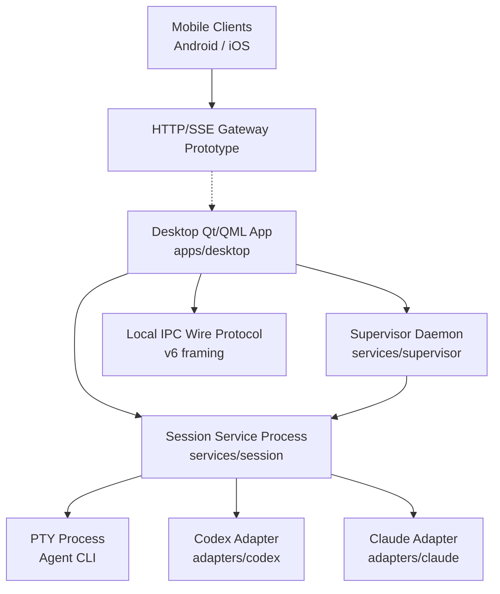
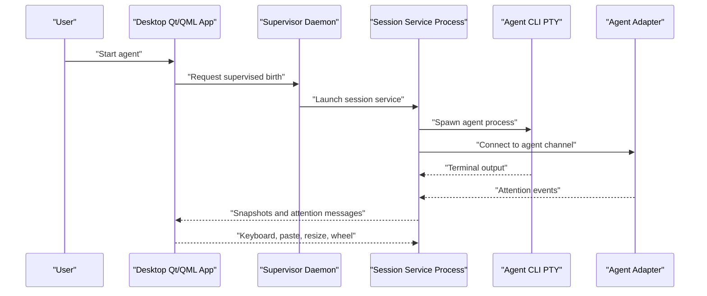
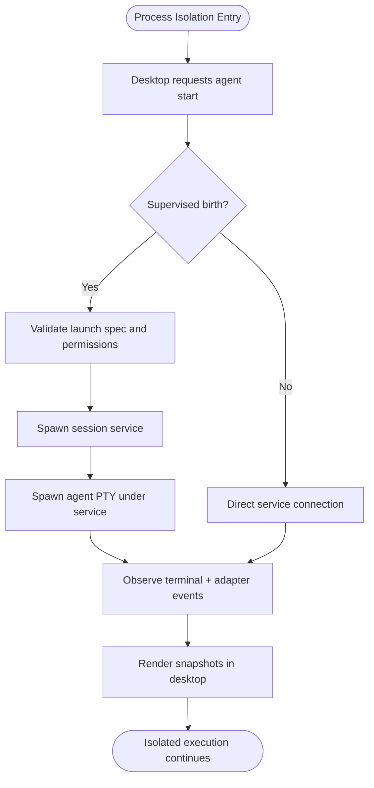
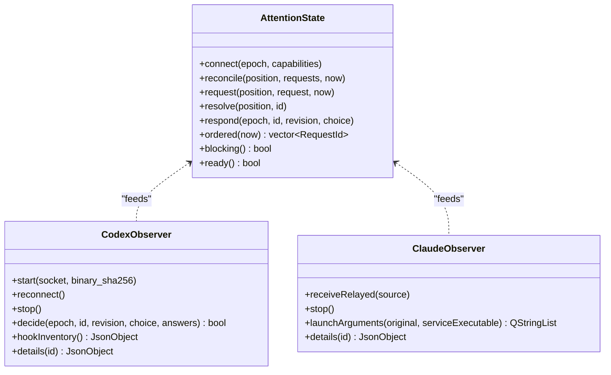
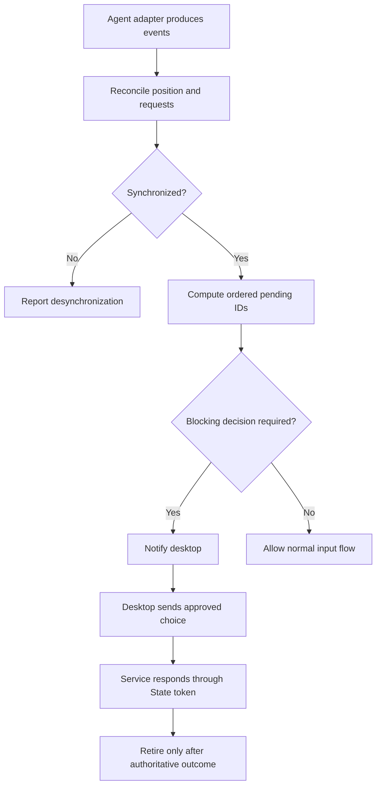
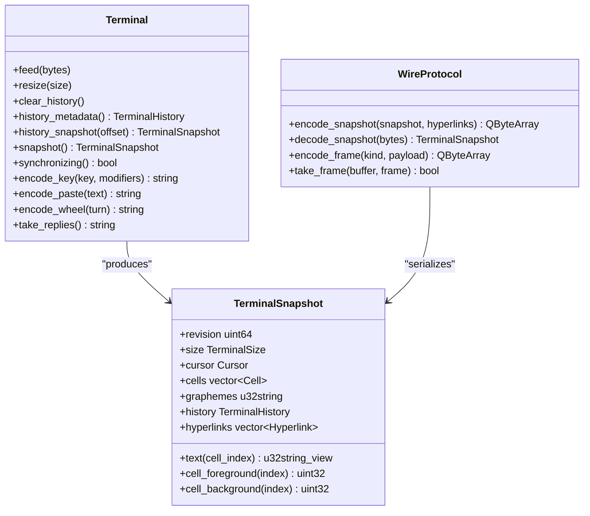
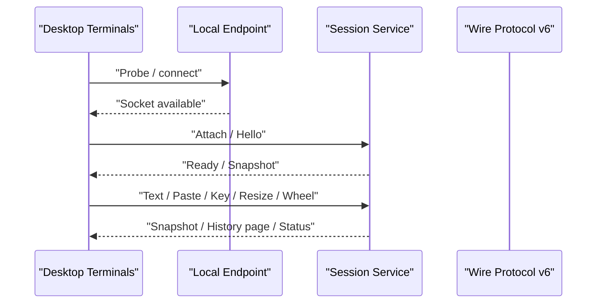
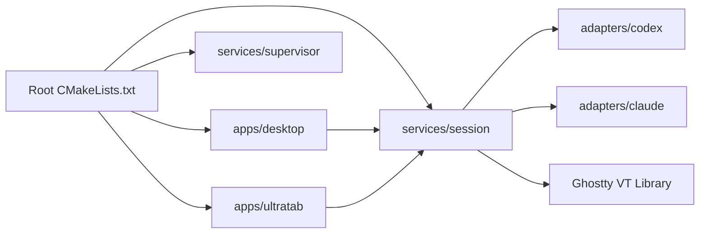

# Architecture Overview

<cite>
**Referenced Files in This Document**
- [README.md](file://README.md)
- [CMakeLists.txt](file://CMakeLists.txt)
- [cmake/Ghostty.cmake](file://cmake/Ghostty.cmake)
- [docs/architecture.md](file://docs/architecture.md)
- [apps/desktop/src/main.cpp](file://apps/desktop/src/main.cpp)
- [apps/desktop/src/terminals.cpp](file://apps/desktop/src/terminals.cpp)
- [services/supervisor/src/daemon.cpp](file://services/supervisor/src/daemon.cpp)
- [services/supervisor/src/runtime.cpp](file://services/supervisor/src/runtime.cpp)
- [services/session/src/session_service.cpp](file://services/session/src/session_service.cpp)
- [services/session/include/lapis/session/attention.hpp](file://services/session/include/lapis/session/attention.hpp)
- [services/session/include/lapis/session/terminal.hpp](file://services/session/include/lapis/session/terminal.hpp)
- [services/session/src/transport/local_protocol.hpp](file://services/session/src/transport/local_protocol.hpp)
- [adapters/codex/src/observer.hpp](file://adapters/codex/src/observer.hpp)
- [adapters/claude/src/claude_observer.hpp](file://adapters/claude/src/claude_observer.hpp)
</cite>

## Table of Contents
1. [Introduction](#introduction)
2. [Project Structure](#project-structure)
3. [Core Components](#core-components)
4. [Architecture Overview](#architecture-overview)
5. [Detailed Component Analysis](#detailed-component-analysis)
6. [Dependency Analysis](#dependency-analysis)
7. [Performance Considerations](#performance-considerations)
8. [Troubleshooting Guide](#troubleshooting-guide)
9. [Conclusion](#conclusion)

## Introduction
Lapis is a local macOS workspace for running multiple coding agents concurrently. Each agent receives its own live terminal, and the desktop application composes those terminals into categories, strips, tiles, attention notifications, history, and usage surfaces. The system separates concerns across four principal layers:

- **Desktop Qt/QML application:** User interface, workspace layout, keyboard focus, selection, accessibility, rendering, and client-side session connections.
- **Supervisor daemon:** Long-lived process owner that admits one-session births, tracks desired state, converges service processes, and owns private persistence.
- **Per-session services:** Isolated C++ processes hosting PTYs, terminal state, adapter channels, snapshots, and lifecycle management.
- **Agent adapters:** Tool-specific observers for Codex and Claude Code that translate external CLI behavior into Lapis's shared attention model.

The repository also includes mobile clients (Android Kotlin and iOS Swift) that communicate with Lapis through an HTTP/SSE gateway prototype, as well as build tooling around CMake, Qt 6.11 Quick, and Ghostty's VT library.

**Section sources**
- [README.md:1-100](file://README.md#L1-L100)
- [docs/architecture.md:1-165](file://docs/architecture.md#L1-L165)

## Project Structure
At a high level, the repository is organized by runtime role rather than by platform alone:

| Area | Responsibility |
| --- | --- |
| `apps/desktop` | Qt/QML desktop UI, workspace control, SSH host discovery, terminal previews, and local session transport |
| `apps/android` | Android gateway, SSE parser, terminal screen, command bar, and workspace repository |
| `apps/ios` | iOS gateway, models, terminal views, and Ultra Tab overlay app |
| `services/supervisor` | Daemon entry point, registry, runtime convergence, child ownership validation, and JSON state storage |
| `services/session` | Session process, PTY process group, terminal engine wrapper, wire protocol, attention ledger, history store, and launch specification |
| `adapters/codex` | Codex observer, Unix socket transport, importer, and hook relay interfaces |
| `adapters/claude` | Claude observer, hook relay, and hook observation implementation |
| `cmake` | Project options and pinned Ghostty VT artifact integration |
| `tools` | Terminal probe, smoke verification, QA helpers, and replay utilities |
| `scripts` | Build, test, probe, package, and qualification scripts |

**Diagram sources**
- [CMakeLists.txt:1-65](file://CMakeLists.txt#L1-L65)
- [docs/architecture.md:1-165](file://docs/architecture.md#L1-L165)

**Section sources**
- [CMakeLists.txt:1-65](file://CMakeLists.txt#L1-L65)
- [docs/architecture.md:1-165](file://docs/architecture.md#L1-L165)

## Core Components
This section maps the main executable roles to their primary responsibilities.

### Desktop Application
The desktop application initializes a Qt GUI, parses command-line options, discovers or launches sessions, manages workspace state, and renders terminal snapshots. It does not own PTY handles or service lifecycles in the production route; instead, it connects to existing session services or asks the supervisor to admit new ones.

Key behaviors include:
- Command-line validation for development shells, managed agents, restore-only mode, server mode, explicit sockets, working directories, UI preview, capture, tracing, and smoke input.
- Workspace composition: categories, strip, tiles, search, history, tools, usage, alerts, and next-prompt suggestions.
- Local IPC over Qt `QLocalSocket` to session services.
- SSH configuration parsing and machine enumeration for local and remote hosts.

**Section sources**
- [apps/desktop/src/main.cpp:1-200](file://apps/desktop/src/main.cpp#L1-L200)
- [apps/desktop/src/terminals.cpp:1-200](file://apps/desktop/src/terminals.cpp#L1-L200)

### Supervisor Daemon
The supervisor is a long-lived daemon process responsible for one-session birth admission, desired state reconciliation, and private ownership records. It validates absolute paths, checks endpoint directory ownership, reconstructs persisted launches, adopts or waits for child processes, and exposes read-only status and controlled stop/reset operations.

Key responsibilities:
- Parse required state directory and control endpoint arguments.
- Persist and reconstruct `DesiredSessionLaunch`.
- Launch per-session services using a validated service program path.
- Validate parent endpoints, child PIDs, spawn tokens, and ownership files.
- Provide a headless `lapis supervisor` interface before GUI routes.

**Section sources**
- [services/supervisor/src/daemon.cpp:1-200](file://services/supervisor/src/daemon.cpp#L1-L200)
- [services/supervisor/src/runtime.cpp:1-200](file://services/supervisor/src/runtime.cpp#L1-L200)

### Per-Session Service
Each agent runs inside its own session service process. The service owns:
- PTY creation and process-group isolation.
- Terminal encoding, snapshot generation, and bounded output pacing.
- Agent adapter connections.
- Attention request ledger, audit journal, checkpointing, and history store.
- Local IPC negotiation with desktop or other clients.

It explicitly rejects unqualified workspace launches from the desktop unless qualified options are provided.

**Section sources**
- [services/session/src/session_service.cpp:1-200](file://services/session/src/session_service.cpp#L1-L200)

### Agent Adapters
Adapters implement the pluggable boundary between Lapis and specific agent CLIs:

- **Codex adapter:** Connects to a Codex server/TUI, observes attention events, exposes binary qualification hashes, supports reconnection without automatic response retransmission, and provides advisory hook inventory and details.
- **Claude adapter:** Observes hooks via a local socket or terminal relay, translates them into attention notices, exposes launch argument transformation, and maintains diagnostic and session-scoped information.

Both adapters feed into the shared attention state model.

**Section sources**
- [adapters/codex/src/observer.hpp:1-55](file://adapters/codex/src/observer.hpp#L1-L55)
- [adapters/claude/src/claude_observer.hpp:1-50](file://adapters/claude/src/claude_observer.hpp#L1-L50)

## Architecture Overview
The system uses process isolation, adapter abstraction, and layered communication protocols to separate user interface, lifecycle management, terminal fidelity, and agent-specific behavior.

**Diagram sources**
- [apps/desktop/src/main.cpp:1-200](file://apps/desktop/src/main.cpp#L1-L200)
- [services/supervisor/src/daemon.cpp:1-200](file://services/supervisor/src/daemon.cpp#L1-L200)
- [services/session/src/session_service.cpp:1-200](file://services/session/src/session_service.cpp#L1-L200)
- [adapters/codex/src/observer.hpp:1-55](file://adapters/codex/src/observer.hpp#L1-L55)
- [adapters/claude/src/claude_observer.hpp:1-50](file://adapters/claude/src/claude_observer.hpp#L1-L50)

### Communication Patterns
| Channel | Direction | Purpose | Boundary |
| --- | --- | --- | --- |
| Local IPC | Desktop ↔ Session service | Snapshots, terminal input, attention, history, lifecycle | Qt `QLocalSocket`, internal wire protocol v6 |
| PTY wire | Session service ↔ Agent CLI | Raw terminal bytes and agent process I/O | POSIX PTY and process group |
| Adapter protocol | Session service ↔ Agent CLI | Socket, hook stream, or terminal-relay frames | Tool-specific but normalized through observer interfaces |
| Mobile gateway | Android/iOS ↔ Desktop or service | HTTP/SSE API for phone prototype | Outside early-access support slice |

**Section sources**
- [services/session/src/transport/local_protocol.hpp:1-196](file://services/session/src/transport/local_protocol.hpp#L1-L196)
- [README.md:1-100](file://README.md#L1-L100)

## Detailed Component Analysis

### Process Isolation Model
Lapis isolates each agent in its own session service process. The desktop does not hold PTY file descriptors, and the supervisor owns service lifecycle rather than the GUI. This design improves fault tolerance: if one agent crashes, it can terminate without necessarily taking down the desktop or other sessions. The supervisor persists desired launch state so a session can be resumed after GUI replacement, update, or reboot.

**Diagram sources**
- [services/supervisor/src/daemon.cpp:1-200](file://services/supervisor/src/daemon.cpp#L1-L200)
- [services/supervisor/src/runtime.cpp:1-200](file://services/supervisor/src/runtime.cpp#L1-L200)
- [services/session/src/session_service.cpp:1-200](file://services/session/src/session_service.cpp#L1-L200)

**Section sources**
- [docs/architecture.md:1-165](file://docs/architecture.md#L1-L165)

### Adapter Pattern for Multiple Agent CLIs
The adapter pattern decouples Lapis from agent-specific implementations. Both Codex and Claude adapters share a common attention state contract while preserving tool-specific transport, diagnostics, and hook handling.

**Diagram sources**
- [services/session/include/lapis/session/attention.hpp:1-136](file://services/session/include/lapis/session/attention.hpp#L1-L136)
- [adapters/codex/src/observer.hpp:1-55](file://adapters/codex/src/observer.hpp#L1-L55)
- [adapters/claude/src/claude_observer.hpp:1-50](file://adapters/claude/src/claude_observer.hpp#L1-L50)

**Section sources**
- [adapters/codex/src/observer.hpp:1-55](file://adapters/codex/src/observer.hpp#L1-L55)
- [adapters/claude/src/claude_observer.hpp:1-50](file://adapters/claude/src/claude_observer.hpp#L1-L50)
- [services/session/include/lapis/session/attention.hpp:1-136](file://services/session/include/lapis/session/attention.hpp#L1-L136)

### Event-Driven Attention Protocol
The attention subsystem is event-driven and versioned. A source connection supplies epochs, positions, sequences, and revisions. Requests carry identifiers, thread/turn/item context, reasons, summaries, choices, priority, and optional activity. The state object enforces synchronization, aging, retirement bounds, cooldowns, blocking rules, and overflow/desynchronization outcomes.

**Diagram sources**
- [services/session/include/lapis/session/attention.hpp:1-136](file://services/session/include/lapis/session/attention.hpp#L1-L136)

**Section sources**
- [services/session/include/lapis/session/attention.hpp:1-136](file://services/session/include/lapis/session/attention.hpp#L1-L136)

### Terminal Engine Abstraction
The terminal layer abstracts VT processing behind a small C++ interface. It encapsulates cell layout, styles, cursor, alternate screen, history pages, hyperlinks, key encoding, paste sanitization, wheel turns, and reply draining. The current reference implementation integrates Ghostty's VT library, keeping upstream types and unstable ABI isolated behind this boundary.

**Diagram sources**
- [services/session/include/lapis/session/terminal.hpp:1-200](file://services/session/include/lapis/session/terminal.hpp#L1-L200)
- [services/session/src/transport/local_protocol.hpp:1-196](file://services/session/src/transport/local_protocol.hpp#L1-L196)
- [cmake/Ghostty.cmake:1-57](file://cmake/Ghostty.cmake#L1-L57)

**Section sources**
- [services/session/include/lapis/session/terminal.hpp:1-200](file://services/session/include/lapis/session/terminal.hpp#L1-L200)
- [cmake/Ghostty.cmake:1-57](file://cmake/Ghostty.cmake#L1-L57)

### Local IPC and Desktop Connection Flow
The desktop connects to session services through a local endpoint. It parses and validates launch specifications, reads SSH configuration, enumerates machines, probes endpoints, and manages attachment states such as ready, disconnected, ended, replaced, and closed.

**Diagram sources**
- [apps/desktop/src/terminals.cpp:1-200](file://apps/desktop/src/terminals.cpp#L1-L200)
- [services/session/src/transport/local_protocol.hpp:1-196](file://services/session/src/transport/local_protocol.hpp#L1-L196)

**Section sources**
- [apps/desktop/src/terminals.cpp:1-200](file://apps/desktop/src/terminals.cpp#L1-L200)
- [services/session/src/transport/local_protocol.hpp:1-196](file://services/session/src/transport/local_protocol.hpp#L1-L196)

### Mobile Client Integration
The Android and iOS applications are described as prototype surfaces that drive the same agents through a gateway. They use HTTP/SSE semantics, terminal screen representation, and workspace/repository abstractions. The README marks remote hosts, shared plans, the phone, and next-prompt suggestions as outside the early-access support slice.

**Section sources**
- [README.md:1-100](file://README.md#L1-L100)

## Dependency Analysis
The build system defines the top-level dependency graph:

- C++20 project with Qt 6.11 Quick and Vulkan/MoltenVK rendering on macOS.
- Desktop requires the session target.
- Ultratab requires the session target.
- Session links both Codex and Claude adapters.
- Supervisor builds independently when the experimental runtime option is enabled.
- Ghostty VT is imported as a static library with a pinned receipt check.

**Diagram sources**
- [CMakeLists.txt:1-65](file://CMakeLists.txt#L1-L65)
- [cmake/Ghostty.cmake:1-57](file://cmake/Ghostty.cmake#L1-L57)

**Section sources**
- [CMakeLists.txt:1-65](file://CMakeLists.txt#L1-L65)

## Performance Considerations
The architecture prioritizes responsiveness:

- Process isolation prevents a crashing agent from blocking the desktop or other sessions.
- Bounded output admission and pacing protect against sustained pressure from large terminal output.
- Immutable terminal snapshots allow rendering without mutating parser or PTY state.
- Local IPC avoids network latency for desktop-to-service communication.
- Ghostty VT provides a pinned terminal engine, with compatibility checked through probe receipts.

The repository notes that responsiveness is the first product priority, followed by ergonomics and visual polish, and that presentation and resize tails require candidate measurements rather than being treated as guaranteed claims.

**Section sources**
- [docs/architecture.md:1-165](file://docs/architecture.md#L1-L165)
- [services/session/src/session_service.cpp:1-200](file://services/session/src/session_service.cpp#L1-L200)

## Troubleshooting Guide
Common architectural failure modes and their boundaries:

| Symptom | Likely Boundary | Diagnostic Guidance |
| --- | --- | --- |
| Desktop cannot attach to a session | Local IPC endpoint or service health | Verify endpoint existence and service liveness; inspect desktop terminal connection state |
| Supervisor refuses birth | Permission, path, or state validation | Check absolute state directory, endpoint directory ownership, persisted state version, and launch spec |
| Agent process exits unexpectedly | PTY or adapter channel | Inspect service logs and adapter diagnostics; note that reconnect must not automatically retransmit decisions |
| Terminal appears garbled or out of sync | Terminal snapshot sequence or wire protocol | Use sequence numbers, history paging, and epoch/revision reconciliation |
| Attention request never resolves | Attention ledger or adapter capability | Confirm source epoch, revision, and whether the adapter supports response/reconciliation |
| Ghostty build fails | Pinned VT artifacts | Ensure `LAPIS_GHOSTTY_PREFIX` points to a successful probe receipt matching pinned sources |

**Section sources**
- [services/supervisor/src/runtime.cpp:1-200](file://services/supervisor/src/runtime.cpp#L1-L200)
- [services/session/include/lapis/session/attention.hpp:1-136](file://services/session/include/lapis/session/attention.hpp#L1-L136)
- [cmake/Ghostty.cmake:1-57](file://cmake/Ghostty.cmake#L1-L57)

## Conclusion
Lapis's architecture separates desktop UI, service lifecycle, terminal fidelity, and agent-specific behavior into clear boundaries. The supervisor daemon owns long-lived process management; per-session services isolate agent processes and terminal state; adapters normalize different CLI protocols into a shared attention model; and the desktop composes those signals into a responsive workspace. The technology stack centers on Qt 6.11 Quick, Ghostty VT, and a CMake-based build that pins terminal dependencies and restricts unsupported platforms. Future gates emphasize durability, reproducible delivery, account/input safety, and measured workload qualification rather than expanding scope prematurely.