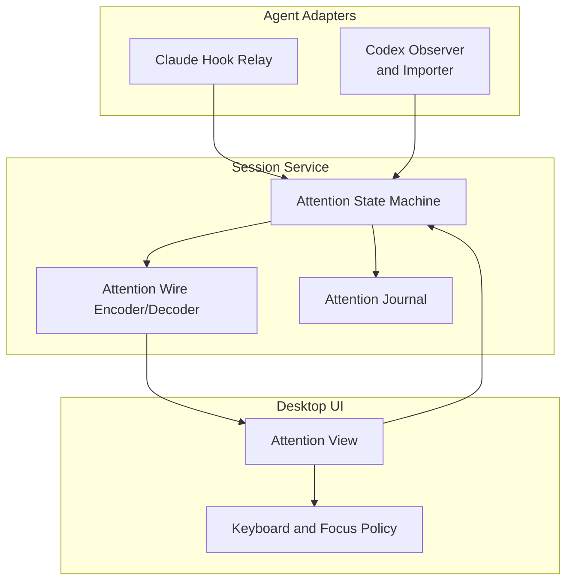
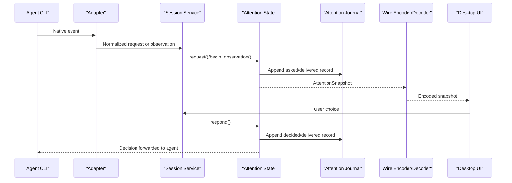
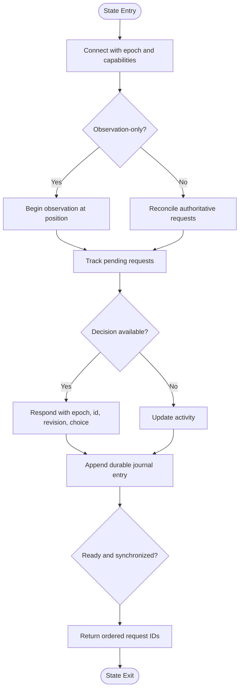
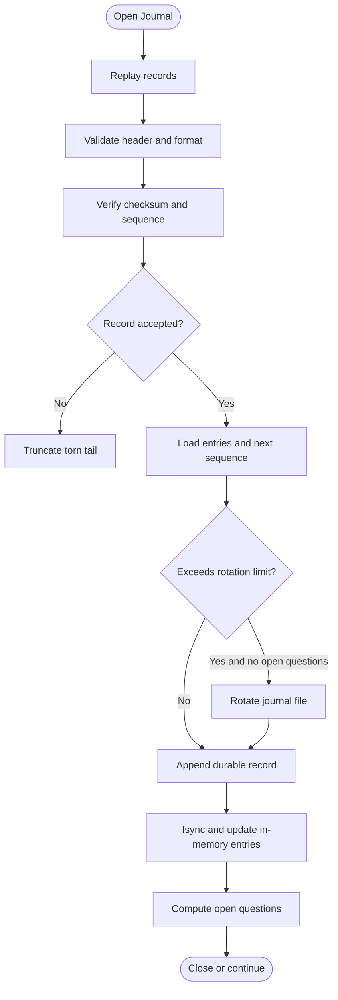
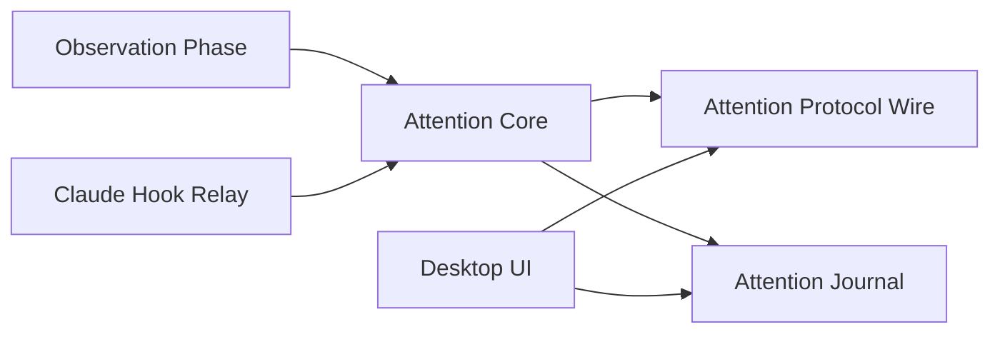

# Attention Protocol

<cite>
**Referenced Files in This Document**
- [attention.hpp](file://services/session/include/lapis/session/attention.hpp)
- [observation_phase.hpp](file://services/session/include/lapis/session/observation_phase.hpp)
- [attention_protocol.hpp](file://services/session/src/transport/attention_protocol.hpp)
- [attention_protocol.cpp](file://services/session/src/transport/attention_protocol.cpp)
- [attention_journal.hpp](file://services/session/src/attention_journal.hpp)
- [attention_journal.cpp](file://services/session/src/attention_journal.cpp)
- [hook_relay.hpp](file://adapters/claude/src/hook_relay.hpp)
- [hook_relay.cpp](file://adapters/claude/src/hook_relay.cpp)
- [architecture.md](file://docs/architecture.md)
</cite>

## Table of Contents
1. [Introduction](#introduction)
2. [Project Structure](#project-structure)
3. [Core Components](#core-components)
4. [Architecture Overview](#architecture-overview)
5. [Detailed Component Analysis](#detailed-component-analysis)
6. [Dependency Analysis](#dependency-analysis)
7. [Performance Considerations](#performance-considerations)
8. [Troubleshooting Guide](#troubleshooting-guide)
9. [Conclusion](#conclusion)

## Introduction
The Attention Protocol is the common contract that normalizes agent interaction events into a shared attention model. Its purpose is to let different agent adapters—such as Claude Code and Codex—emit tool approvals, input requests, idle notices, and completion signals without forcing the desktop UI or session service to understand every adapter’s native event format.

At its center are:
- A normalized request model describing who needs attention, why, and what choices are available.
- Transport encoding for snapshots and decisions carried over the existing session wire.
- A durable journal for auditing asked, decided, resolved, and delivered attention records.
- Adapter boundaries that preserve each agent’s native lifecycle while exposing a stable Lapis attention surface.

This document explains the event types, schema, adapter mapping, persistence, routing behavior, UI integration points, and performance characteristics.

## Project Structure
The Attention Protocol spans three layers:

| Layer | Responsibility | Key files |
|---|---|---|
| Session core | Request state machine, pending queue, aging, reconciliation, blocking policy | `services/session/include/lapis/session/attention.hpp`, `services/session/include/lapis/session/observation_phase.hpp` |
| Transport | Binary wire format for attention snapshots and decisions | `services/session/src/transport/attention_protocol.hpp`, `services/session/src/transport/attention_protocol.cpp` |
| Persistence | Durable audit trail with rotation, recovery, and open-question tracking | `services/session/src/attention_journal.hpp`, `services/session/src/attention_journal.cpp` |
| Claude adapter | Relays Claude hook metadata and background-work hints | `adapters/claude/src/hook_relay.hpp`, `adapters/claude/src/hook_relay.cpp` |
| Architecture context | Ownership, production scope, and boundary rules | `docs/architecture.md` |

**Diagram sources**
- [hook_relay.hpp:1-62](file://adapters/claude/src/hook_relay.hpp#L1-L62)
- [hook_relay.cpp:1-138](file://adapters/claude/src/hook_relay.cpp#L1-L138)
- [attention.hpp:1-136](file://services/session/include/lapis/session/attention.hpp#L1-L136)
- [attention_protocol.hpp:1-41](file://services/session/src/transport/attention_protocol.hpp#L1-L41)
- [attention_journal.hpp:1-99](file://services/session/src/attention_journal.hpp#L1-L99)
- [architecture.md:1-165](file://docs/architecture.md#L1-L165)

**Section sources**
- [attention.hpp:1-136](file://services/session/include/lapis/session/attention.hpp#L1-L136)
- [observation_phase.hpp:1-16](file://services/session/include/lapis/session/observation_phase.hpp#L1-L16)
- [attention_protocol.hpp:1-41](file://services/session/src/transport/attention_protocol.hpp#L1-L41)
- [attention_journal.hpp:1-99](file://services/session/src/attention_journal.hpp#L1-L99)
- [hook_relay.hpp:1-62](file://adapters/claude/src/hook_relay.hpp#L1-L62)
- [architecture.md:1-165](file://docs/architecture.md#L1-L165)

## Core Components

### Normalized Request Model
A request represents something that may require user attention or can be processed automatically. The canonical fields are:

| Field | Meaning | Constraints |
|---|---|---|
| `id` | Stable identity of the attention item | Numeric 64-bit integer or bounded UTF-8 string; must not be empty when text-based |
| `thread_id` | Agent thread or conversation reference | Bounded UTF-8 string |
| `turn_id` | Agent turn identifier | Bounded UTF-8 string |
| `item_id` | Fine-grained item inside a turn | Bounded UTF-8 string |
| `reason` | Semantic reason for attention | Non-empty bounded UTF-8 string |
| `summary` | Human-readable summary | Bounded UTF-8 string |
| `choices` | Available actions for this request | Up to 32 unique non-empty choices, each bounded |
| `priority` | Relative urgency | Integer from 0 through 3 |

The protocol also defines:

| Symbol | Meaning |
|---|---|
| `idle_reason` | Special observation-only notice indicating an idle turn |
| `Activity` | Current agent activity: unknown, working, idle, or turn completed |
| `Outcome` | Result of reconciliation operations: applied, duplicate, rejected, or desynchronized |
| `RequestStatus` | Pending request status: pending, responding, or stale |
| `ObservationPhase` | Producer-owned diagnostic phase: unknown, awaiting first prompt, or reconciling |

An **idle notice** is recognized by having the idle reason and no choices. It is observation-only and does not itself force user action unless combined with other blocking evidence.

**Section sources**
- [attention.hpp:1-136](file://services/session/include/lapis/session/attention.hpp#L1-L136)
- [observation_phase.hpp:1-16](file://services/session/include/lapis/session/observation_phase.hpp#L1-L16)

### Event Types and Their Semantics
The Attention Protocol does not define one fixed event name per agent action. Instead, it models attention through the `Request` and `Pending` structures plus lifecycle methods on the state machine. The following table maps commonly referenced interaction concepts to their protocol meaning:

| Concept | Protocol representation | Interpretation |
|---|---|---|
| Request received | A new `Request` added through `request()` or observed via `begin_observation()` | A source reports that attention may be required |
| Response started | Activity transition toward working or responding, often alongside incoming requests | The agent is producing output or preparing to respond |
| Thinking phase | Advisory activity and observation-phase data rather than a dedicated approval request | Indicates ongoing processing without necessarily requiring user action |
| Tool use | A request whose `reason` references tool execution, permission, or input; choices describe how to proceed | May be automatic if policy allows, or manual if blocked |
| Approval request | A request carrying explicit choices where user intent is needed | Requires decision unless already satisfied by prior durable intent |
| Completion | Turn completion or idle notice that may retire earlier requests | Closes loops once reconciliation and delivery are consistent |

The protocol deliberately separates **observation** (learning about agent state) from **response authority** (answering requests). Observation-only notices cannot retroactively restore a lost stream or replace pending requests.

**Section sources**
- [attention.hpp:1-136](file://services/session/include/lapis/session/attention.hpp#L1-L136)
- [attention_protocol.hpp:1-41](file://services/session/src/transport/attention_protocol.hpp#L1-L41)

### Snapshot and Decision Schema
The transport layer carries attention as:

#### Attention Snapshot
| Field | Type | Purpose |
|---|---|---|
| `attachment` | Existing session attachment identity | Binds the snapshot to a session |
| `available` | Boolean | Whether the attention subsystem is available |
| `connected` | Boolean | Whether the source connection is established |
| `ready` | Boolean | Whether the connection is synchronized and usable |
| `source_epoch` | Unsigned 64-bit integer | Source-side ordering epoch |
| `activity` | Enum | Current agent activity |
| `observation_phase` | Enum | Diagnostic producer phase |
| `diagnostic` | String | Display-only diagnostic text |
| `requests` | Array of `AttentionItem` | Pending attention items |

Each `AttentionItem` contains:
- `pending`: the normalized pending request with status, revision, arrival time, cooldown timing, source epoch, and submission state.
- `details`: adapter-specific JSON payload attached to the request.

#### Attention Decision
| Field | Type | Purpose |
|---|---|---|
| `source_epoch` | Unsigned 64-bit integer | Authoritative epoch for the decision |
| `request_id` | Request identity | Which request is being answered |
| `revision` | Unsigned 64-bit integer | Revision bound for the decision |
| `choice` | String | Selected choice |
| `answers` | Object | Additional answer data |

Both snapshots and decisions are validated against size limits, identity constraints, enum ranges, UTF-8 validity, and request uniqueness. Invalid payloads throw errors instead of silently accepting malformed attention traffic.

**Section sources**
- [attention_protocol.hpp:1-41](file://services/session/src/transport/attention_protocol.hpp#L1-L41)
- [attention_protocol.cpp:1-200](file://services/session/src/transport/attention_protocol.cpp#L1-L200)

## Architecture Overview
The Attention Protocol sits between agent adapters and the desktop UI.

**Diagram sources**
- [attention.hpp:1-136](file://services/session/include/lapis/session/attention.hpp#L1-L136)
- [attention_protocol.hpp:1-41](file://services/session/src/transport/attention_protocol.hpp#L1-L41)
- [attention_journal.hpp:1-99](file://services/session/src/attention_journal.hpp#L1-L99)
- [hook_relay.cpp:1-138](file://adapters/claude/src/hook_relay.cpp#L1-L138)

Key architectural rules:
- The session service owns PTYs, terminal state/history, adapter connections, snapshots, and session lifecycle.
- Desktop layout, keyboard focus, selection, accessibility, and rendering consume attention but do not own PTYs or service lifecycle.
- Messages crossing IPC are validated by their receiving owner.
- Claude hooks and Codex observers are separate adapter routes; success with one adapter is not proof of general adapter independence.

**Section sources**
- [architecture.md:1-165](file://docs/architecture.md#L1-L165)

## Detailed Component Analysis

### Attention State Machine
The state machine tracks:
- Session identity and adapter identity.
- Epoch, sequence, and revision counters.
- Connected and synchronized readiness.
- Pending requests indexed by request identity.
- Retired request identities.
- Activity and observation capabilities.

Important operations:

| Operation | Behavior |
|---|---|
| `connect(epoch, capabilities)` | Establishes a connection boundary with epoch and capability flags |
| `disconnect()` | Ends the connection |
| `overflow()` | Signals capacity pressure |
| `begin_observation(position, now)` | Starts an observation-only ledger at a verified position |
| `reconcile(position, requests, now)` | Applies authoritative snapshots; returns applied, duplicate, rejected, or desynchronized |
| `request(position, request, now)` | Adds a local request |
| `resolve(id)` | Resolves a request externally |
| `activity(activity)` | Updates agent activity |
| `respond(epoch, id, revision, choice)` | Records a decision bound by epoch and revision |
| `snooze(id, until, now)` | Schedules a later review |
| `acknowledge(id, now)` | Acknowledges scheduling or delivery timing |
| `ordered(now)` | Returns priority-aware ordered request IDs |
| `blocking()` | Reports whether current evidence requires answers before new input |

Complexity considerations:
- Pending requests are stored in a map keyed by request identity, giving average constant-time lookup and insertion.
- Ordered delivery iterates pending entries, so ordering cost grows with pending count.
- Retired IDs are kept in a set, supporting efficient duplicate detection.
- Limits include configurable pending size, retired size, aging interval, and acknowledgment cooldown.

Error handling:
- Invalid identities, zero or non-increasing epochs, backward clock ticks, and invalid limits throw exceptions.
- Token allocation exhaustion throws overflow errors.
- Reconciliation reports desynchronization rather than silently accepting inconsistent state.

**Diagram sources**
- [attention.hpp:1-136](file://services/session/include/lapis/session/attention.hpp#L1-L136)

**Section sources**
- [attention.hpp:1-136](file://services/session/include/lapis/session/attention.hpp#L1-L136)

### Transport Encoding
The wire format enforces:
- Maximum snapshot size.
- Maximum decision size.
- Maximum number of requests per snapshot.
- Maximum metadata, summary, diagnostic, choice, and JSON sizes.
- Valid request identity, reason, choices, status, epoch, and revision values.
- Consistency between snapshot availability, connected state, ready state, and request epochs.

Encoding helpers validate UTF-8 strings, compact JSON round-trips, numeric bounds, and enum values. Decoding uses a reader that rejects undersized reads, oversized payloads, malformed JSON, and invalid field combinations.

**Section sources**
- [attention_protocol.hpp:1-41](file://services/session/src/transport/attention_protocol.hpp#L1-L41)
- [attention_protocol.cpp:1-200](file://services/session/src/transport/attention_protocol.cpp#L1-L200)

### Attention Journal
The journal provides a durable audit trail for attention history. Record kinds include:

| Kind | Meaning |
|---|---|
| `asked` | A question was posed to the system |
| `decided` | A decision was recorded |
| `resolved` | The source resolved or retired the request |
| `delivered` | The decision was delivered back to the source |

Additional fields:
- `seq`: Dense journal-local sequence starting at 1.
- `epoch`: Source epoch.
- `revision`: Request revision.
- `id`: Request identity.
- `choice`: Present for decided records.
- `origin`: User, agent, or outcome unknown.
- `request`: Full request shape for asked records.

Durability guarantees:
- Each append writes and fsyncs before returning.
- Corrupt or torn tails are truncated during replay.
- CRC-32 checksums verify record integrity.
- Exclusive file locking prevents concurrent writers.
- Journals rotate when exceeding configured bytes, but only when no question is open.
- Recovery computes open questions after replay.

Open-question logic:
- Newer asks with the same ID supersede older ones.
- User-decided records remain open until delivered or compensated.
- Non-user decisions close matching open questions.
- A synthetic `outcome_unknown` decision exists for crashes where intent is unclear.

**Diagram sources**
- [attention_journal.hpp:1-99](file://services/session/src/attention_journal.hpp#L1-L99)
- [attention_journal.cpp:1-558](file://services/session/src/attention_journal.cpp#L1-L558)

**Section sources**
- [attention_journal.hpp:1-99](file://services/session/src/attention_journal.hpp#L1-L99)
- [attention_journal.cpp:1-558](file://services/session/src/attention_journal.cpp#L1-L558)

### Claude Adapter Mapping
The Claude adapter uses hook events such as session start, user prompt submit, permission requests, notifications, pre/post tool use, stop, and session end. The relay extracts:
- Identity fields including hook event name, notification type, prompt ID, reason, session ID, source, tool name, and tool use ID.
- Derived background work information when supported by the negotiated contract.

The relay:
- Reads bounded input from stdin.
- Validates socket path length, nonce length, and frame size.
- Sends a framed event with nonce and relayed event metadata.
- Treats hook failures as fail-open: they never become Claude permission decisions or prompt text.
- Supports legacy and derived-field contracts depending on command negotiation.

Mapping guidance:
- Permission requests and tool-use prompts typically map to attention requests requiring choices.
- Idle or turn-completion notices map to observation-only activity updates.
- Background work counts help the UI distinguish genuine idle turns from lingering background tasks.

**Section sources**
- [hook_relay.hpp:1-62](file://adapters/claude/src/hook_relay.hpp#L1-L62)
- [hook_relay.cpp:1-138](file://adapters/claude/src/hook_relay.cpp#L1-L138)

### Codex Adapter Mapping
The repository includes Codex observer and importer components. The importer handles workspace onboarding and session migration over a Unix WebSocket, with bounded payloads, timeouts, progress notifications, and completion results. While the importer itself focuses on migration rather than live attention, the Codex adapter boundary is part of the broader agent adapter strategy documented in the architecture.

For attention-driven behavior:
- Codex-native events should be mapped into the normalized `Request` shape with stable `id`, `thread_id`, `turn_id`, `item_id`, `reason`, `summary`, and bounded `choices`.
- Observers should emit observation-only notices for phases like thinking or response-starting without claiming response authority unless explicitly supported.
- Decisions should be encoded as `AttentionDecision` with valid epoch, revision, request identity, and choice.

**Section sources**
- [architecture.md:1-165](file://docs/architecture.md#L1-L165)

## Dependency Analysis
The Attention Protocol has clear internal dependencies:

Coupling notes:
- `observation_phase.hpp` is a small enum dependency used by `attention.hpp`.
- `attention_protocol.*` depends on both the core attention model and the local session wire envelope.
- The journal depends on the core attention model but not on the wire format.
- The Claude relay depends on Qt JSON and local socket primitives; it produces a bounded relay event consumed upstream.
- The desktop consumes wire snapshots and can send decisions back into the session service.

Potential risks:
- If adapters emit too many high-priority requests, the pending map and ordered iteration can grow.
- Large `details` JSON payloads increase wire and memory usage.
- Long-lived attention histories increase journal size and replay time.

**Diagram sources**
- [observation_phase.hpp:1-16](file://services/session/include/lapis/session/observation_phase.hpp#L1-L16)
- [attention.hpp:1-136](file://services/session/include/lapis/session/attention.hpp#L1-L136)
- [attention_protocol.hpp:1-41](file://services/session/src/transport/attention_protocol.hpp#L1-L41)
- [attention_journal.hpp:1-99](file://services/session/src/attention_journal.hpp#L1-L99)
- [hook_relay.hpp:1-62](file://adapters/claude/src/hook_relay.hpp#L1-L62)

**Section sources**
- [attention.hpp:1-136](file://services/session/include/lapis/session/attention.hpp#L1-L136)
- [attention_protocol.hpp:1-41](file://services/session/src/transport/attention_protocol.hpp#L1-L41)
- [attention_journal.hpp:1-99](file://services/session/src/attention_journal.hpp#L1-L99)
- [hook_relay.hpp:1-62](file://adapters/claude/src/hook_relay.hpp#L1-L62)

## Performance Considerations

### High-Frequency Event Streams
Recommendations:
- Batch observations into snapshots rather than sending one attention message per micro-event.
- Use observation-only notices for low-value telemetry such as thinking or response-starting.
- Avoid emitting redundant choices; deduplicate choices within a request.
- Prefer numeric request IDs when possible to reduce serialization overhead.
- Keep `details` small and omit unnecessary adapter-specific payloads.

Bounded limits already protect against runaway payloads:
- Maximum snapshot bytes.
- Maximum decision bytes.
- Maximum requests per snapshot.
- Maximum metadata, summary, diagnostic, choice, and JSON sizes.

### Memory Management for Large Attention Histories
Recommendations:
- Use `release_entries()` after recovery scans when the working set is no longer needed.
- Monitor pending and retired counts; tune `Limits.pending` and `Limits.retired`.
- Configure journal rotation based on expected workload and disk space.
- Avoid retaining large `details` objects in long-lived UI views.
- Throttle UI updates when many pending requests arrive rapidly.

### Priority-Based Routing
Priority is defined as 0 through 3, with the comment that aging eventually outranks newer high-priority requests. This means:
- Low-priority requests may be surfaced later if higher-priority items exist.
- Older requests gain relevance over time through aging.
- Automatic vs manual routing should combine priority with `blocking()` and `ready()` state.
- Stale or desynchronized requests should not be treated as normal automatic approvals.

### Throughput and Latency
- The state machine is single-threaded for ownership; avoid blocking calls inside attention callbacks.
- Journal fsync occurs per append; batch non-critical audit entries where safe.
- Wire decoding validates JSON twice (compact encode and parse), which adds CPU cost but ensures safety.
- Desktop rendering should consume immutable snapshots and avoid mutating parser or PTY state.

[No sources needed since this section provides general guidance]

## Troubleshooting Guide

### Common Validation Errors
| Symptom | Likely cause | Resolution |
|---|---|---|
| Invalid attention message | Malformed request identity, reason, choices, status, epoch, or revision | Validate adapter mapping and enforce maximum sizes |
| Desynchronized reconciliation | Inconsistent source epoch, sequence, or content | Reset observation boundary and re-establish source completeness |
| Journal already owned | Another writer holds the exclusive lock | Ensure only one process opens the journal |
| Unsupported or newer journal format | File version mismatch | Upgrade or migrate the lapis binary according to format rules |
| Torn or corrupt journal | Crash mid-append or checksum mismatch | Allow recovery truncation; inspect recent records |
| Blocked input | Blocking request exists and is not observation-only idle | Resolve or acknowledge the attention before accepting new input |

### Debugging Attention Flow
1. Inspect `source_epoch` and `observation_phase` in the snapshot.
2. Check whether the session is `ready` and `connected`.
3. Compare `activity` with expected agent state.
4. Review `requests` for duplicates, stale statuses, or missing choices.
5. Verify the journal contains corresponding asked, decided, resolved, or delivered records.
6. Confirm decisions carry the correct epoch, revision, request identity, and choice.

### Adapter-Specific Checks
- Claude: Verify hook contract negotiation and that relay frames stay within size limits.
- Codex: Ensure observer events are mapped to normalized requests and that migration/import flows do not confuse attention state.
- Desktop: Confirm keyboard shortcuts and focus policies do not bypass attention-blocking rules.

**Section sources**
- [attention_protocol.cpp:1-200](file://services/session/src/transport/attention_protocol.cpp#L1-L200)
- [attention_journal.cpp:1-558](file://services/session/src/attention_journal.cpp#L1-L558)
- [hook_relay.cpp:1-138](file://adapters/claude/src/hook_relay.cpp#L1-L138)

## Conclusion
The Attention Protocol provides a stable normalization layer between heterogeneous agent adapters and Lapis’ session service and desktop UI. Its strengths are bounded validation, epoch-and-revision synchronization, durable auditing, and clear separation between observation and response authority.

Adopters should:
- Map native agent events into the normalized request model.
- Reserve explicit choices for attention that may require user action.
- Use observation-only notices for advisory phases.
- Persist asked and delivered records through the journal.
- Respect priority, aging, blocking, and readiness semantics.
- Bound memory, wire size, and journal growth for high-frequency streams.