# Communication Protocols and Interfaces

<cite>
**Referenced Files in This Document**
- [local_protocol.hpp](file://services/session/src/transport/local_protocol.hpp)
- [local_protocol.cpp](file://services/session/src/transport/local_protocol.cpp)
- [attention_protocol.hpp](file://services/session/src/transport/attention_protocol.hpp)
- [attention_protocol.cpp](file://services/session/src/transport/attention_protocol.cpp)
- [wire_bytes.hpp](file://services/session/src/transport/wire_bytes.hpp)
- [terminal.hpp](file://services/session/include/lapis/session/terminal.hpp)
- [update_pacing.hpp](file://services/session/src/transport/update_pacing.hpp)
- [session_service.cpp](file://services/session/src/session_service.cpp)
- [client.hpp](file://services/supervisor/include/lapis/supervisor/client.hpp)
- [client.cpp](file://services/supervisor/src/client.cpp)
</cite>

## Table of Contents
1. [Introduction](#introduction)
2. [Project Structure](#project-structure)
3. [Core Components](#core-components)
4. [Architecture Overview](#architecture-overview)
5. [Detailed Component Analysis](#detailed-component-analysis)
6. [Dependency Analysis](#dependency-analysis)
7. [Performance Considerations](#performance-considerations)
8. [Security Considerations](#security-considerations)
9. [Troubleshooting Guide](#troubleshooting-guide)
10. [Conclusion](#conclusion)

## Introduction
This document describes Lapis’s internal communication protocols and interfaces. It covers:

- The local IPC protocol between the desktop application and session services for terminal state, input, history navigation, attention requests, and process lifecycle.
- The attention protocol that normalizes agent interaction events into a common format for UI consumption.
- The binary wire format used for efficient terminal data transmission.
- Protocol versioning and capability negotiation.
- The supervisor client interface for controlling the Lapis supervisor daemon.
- Security boundaries, authentication expectations, error handling, debugging strategies, and logging considerations.

The focus is on how clients and services agree on message shapes, how they negotiate capabilities, and how they safely exchange terminal output and user input over local IPC.

## Project Structure
The relevant protocol implementation lives primarily under `services/session/src/transport` and `services/supervisor`.

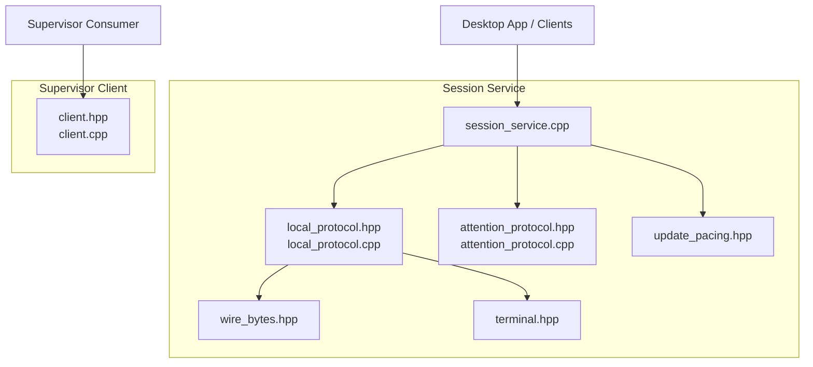

**Diagram sources**
- [session_service.cpp:1-200](file://services/session/src/session_service.cpp#L1-L200)
- [local_protocol.hpp:1-196](file://services/session/src/transport/local_protocol.hpp#L1-L196)
- [local_protocol.cpp:1-535](file://services/session/src/transport/local_protocol.cpp#L1-L535)
- [attention_protocol.hpp:1-41](file://services/session/src/transport/attention_protocol.hpp#L1-L41)
- [attention_protocol.cpp:1-343](file://services/session/src/transport/attention_protocol.cpp#L1-L343)
- [wire_bytes.hpp:1-55](file://services/session/src/transport/wire_bytes.hpp#L1-L55)
- [terminal.hpp:1-201](file://services/session/include/lapis/session/terminal.hpp#L1-L201)
- [update_pacing.hpp:1-52](file://services/session/src/transport/update_pacing.hpp#L1-L52)
- [client.hpp:1-34](file://services/supervisor/include/lapis/supervisor/client.hpp#L1-L34)
- [client.cpp:1-249](file://services/supervisor/src/client.cpp#L1-L249)

**Section sources**
- [session_service.cpp:1-200](file://services/session/src/session_service.cpp#L1-L200)
- [local_protocol.hpp:1-196](file://services/session/src/transport/local_protocol.hpp#L1-L196)
- [attention_protocol.hpp:1-41](file://services/session/src/transport/attention_protocol.hpp#L1-L41)
- [wire_bytes.hpp:1-55](file://services/session/src/transport/wire_bytes.hpp#L1-L55)
- [terminal.hpp:1-201](file://services/session/include/lapis/session/terminal.hpp#L1-L201)
- [client.hpp:1-34](file://services/supervisor/include/lapis/supervisor/client.hpp#L1-L34)

## Core Components
- Local session protocol: defines message kinds, framing, attachments, snapshot encoding, control messages, paste transactions, history navigation, wheel input, status codes, and attachment identity validation.
- Attention protocol: encodes normalized attention snapshots and decisions, including request metadata, choices, revision tracking, and optional observation phase.
- Wire bytes: big-endian primitives and attachment serialization used by both protocols.
- Terminal model: the logical terminal representation whose snapshots are serialized efficiently over the wire.
- Update pacing: publish-to-publish rate limiting helper for coalescing UI updates.
- Supervisor client: JSON-over-local-socket control interface for querying status and stopping the supervisor.

**Section sources**
- [local_protocol.hpp:1-196](file://services/session/src/transport/local_protocol.hpp#L1-L196)
- [local_protocol.cpp:1-535](file://services/session/src/transport/local_protocol.cpp#L1-L535)
- [attention_protocol.hpp:1-41](file://services/session/src/transport/attention_protocol.hpp#L1-L41)
- [attention_protocol.cpp:1-343](file://services/session/src/transport/attention_protocol.cpp#L1-L343)
- [wire_bytes.hpp:1-55](file://services/session/src/transport/wire_bytes.hpp#L1-L55)
- [terminal.hpp:1-201](file://services/session/include/lapis/session/terminal.hpp#L1-L201)
- [update_pacing.hpp:1-52](file://services/session/src/transport/update_pacing.hpp#L1-L52)
- [client.hpp:1-34](file://services/supervisor/include/lapis/supervisor/client.hpp#L1-L34)
- [client.cpp:1-249](file://services/supervisor/src/client.cpp#L1-L249)

## Architecture Overview
At runtime, the desktop app connects to a session service through a local endpoint. The first handshake establishes identity, capabilities, and protocol version. After connection, the service publishes terminal snapshots; the client sends input, resize events, history navigation requests, and attention decisions. A separate supervisor client talks to the supervisor daemon using a bounded JSON frame over a local socket.

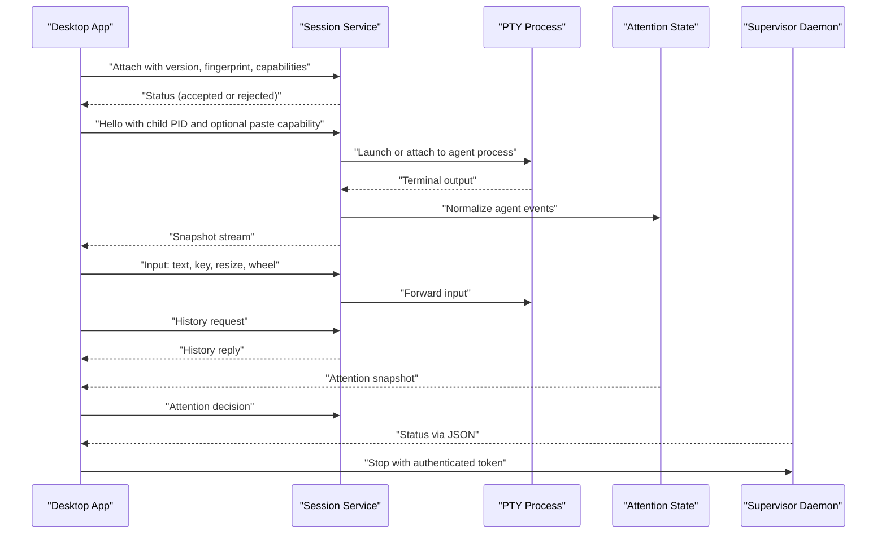

**Diagram sources**
- [session_service.cpp:1-200](file://services/session/src/session_service.cpp#L1-L200)
- [local_protocol.cpp:1-535](file://services/session/src/transport/local_protocol.cpp#L1-L535)
- [attention_protocol.cpp:1-343](file://services/session/src/transport/attention_protocol.cpp#L1-L343)
- [client.cpp:1-249](file://services/supervisor/src/client.cpp#L1-L249)

## Detailed Component Analysis

### Local Session IPC Protocol
The local session protocol provides:

- Framing: every frame begins with a four-byte big-endian length followed by one payload byte indicating the message kind. Frame payloads must not exceed the configured maximum frame size.
- Message kinds: hello, snapshot, text, paste, key, resize, status, attach, ready, history_request, history_page, attention_snapshot, attention_decision, attention_retry, terminate, wheel, paste_request, paste_result.
- Attachment-based routing: most messages carry an attachment containing two 16-byte UUIDs and a monotonic generation number. This binds messages to a specific session and prevents replay across unrelated sessions.
- Versioning: a global protocol version constant is included in attach and hello frames. Older services reject newer frames unless the client negotiates compatibility.
- Capability negotiation: attach flags advertise hyperlink support, attention phase support, and paste transaction support. Hello may advertise paste transaction support.
- Snapshot envelope: terminal screen updates are sent as snapshots with sequence numbers and timing metadata. An envelope variant exposes only size and encoded body so consumers can defer decoding when not needed.
- Input messages: text, key, paste, and wheel events are bound to the active attachment. Wheel input is negotiated and only accepted by services that advertise acceptance in the snapshot.
- History navigation: clients send history requests with direction and reference; services return page identifiers, optional snapshots, and bounded diagnostic messages.
- Paste transactions: bounded paste requests and results include a request ID and queue admission result.
- Status and termination: status carries a code and bounded UTF-8 message; terminate asks the service to end the agent process, after which ordinary ended status is returned.

#### Wire Format Summary
| Layer | Description |
|---|---|
| Frame header | Four-byte big-endian payload length, then one-byte kind |
| Payload prefix | Attachment: 16-byte session ID, 16-byte epoch, eight-byte generation |
| Payload body | Kind-specific fields |
| Limits | Maximum frame size, maximum cells, maximum grapheme codepoints, maximum input/paste sizes |

**Section sources**
- [local_protocol.hpp:1-196](file://services/session/src/transport/local_protocol.hpp#L1-L196)
- [local_protocol.cpp:1-535](file://services/session/src/transport/local_protocol.cpp#L1-L535)
- [wire_bytes.hpp:1-55](file://services/session/src/transport/wire_bytes.hpp#L1-L55)

#### Attach and Hello Flow
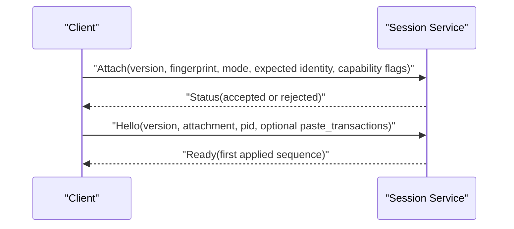

**Diagram sources**
- [local_protocol.cpp:1-200](file://services/session/src/transport/local_protocol.cpp#L1-L200)

#### Snapshot and Input Flow
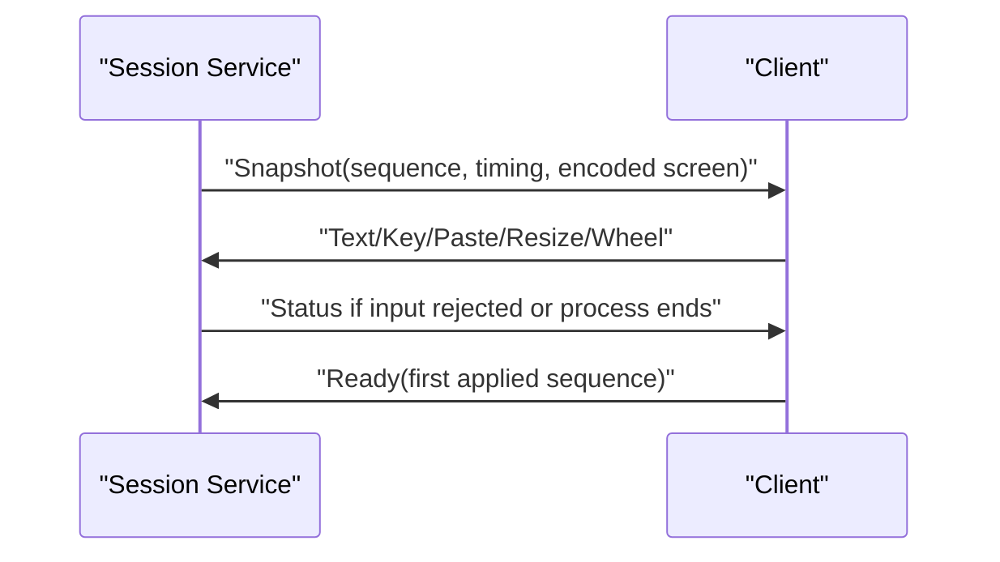

**Diagram sources**
- [local_protocol.cpp:200-535](file://services/session/src/transport/local_protocol.cpp#L200-L535)

#### History Navigation Flow
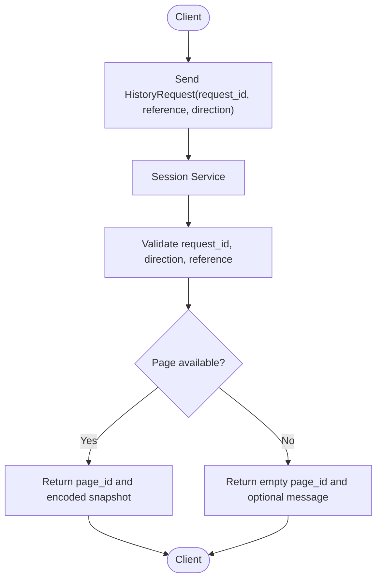

**Diagram sources**
- [local_protocol.cpp:200-340](file://services/session/src/transport/local_protocol.cpp#L200-L340)

#### Paste Transaction Flow
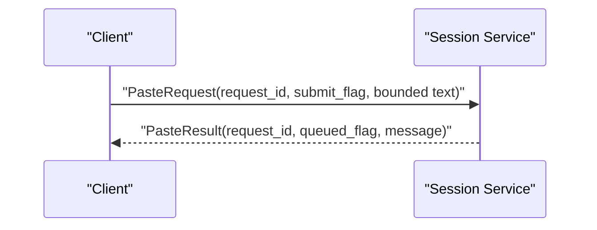

**Diagram sources**
- [local_protocol.cpp:120-200](file://services/session/src/transport/local_protocol.cpp#L120-L200)

### Terminal Data Wire Format
The terminal wire format is optimized for dense screen updates:

- Revision counter for ordering.
- Screen dimensions, cursor position, and cursor rendering hints.
- Alternate-screen flag and wheel-input acceptance flag.
- Color palette, foreground/background colors, optional cursor color.
- History metadata: total rows, viewport offset, viewport row count.
- Grapheme array holding Unicode code points.
- Row-major cell array referencing offsets and lengths into the grapheme array.
- Optional hyperlink extension with per-link spans and URIs.

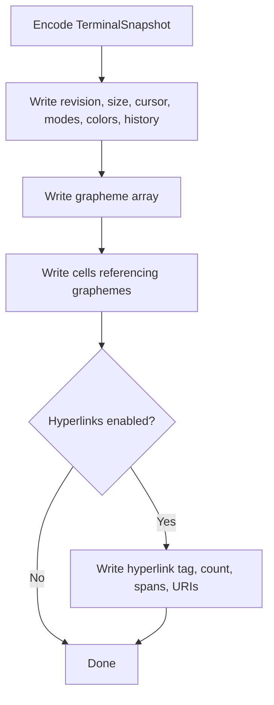

**Diagram sources**
- [local_protocol.cpp:340-535](file://services/session/src/transport/local_protocol.cpp#L340-L535)
- [terminal.hpp:1-201](file://services/session/include/lapis/session/terminal.hpp#L1-L201)

### Attention Protocol
The attention protocol normalizes agent interaction events into a common format suitable for UI presentation and user decisions.

- Contract version: attention protocol has its own contract version distinct from the local session protocol version.
- Attention snapshot: contains attachment, availability and connection state, readiness, activity level, source epoch, diagnostic text, and a bounded list of pending requests.
- Request model: includes a flexible request identifier, thread/turn/item identifiers, reason, summary, ordered choices, priority, status, revision, arrival time, scheduling bounds, source epoch, and submission state.
- Decision model: identifies the source epoch, request, revision, chosen response, and optional answers JSON.
- Observation phase: when negotiated, snapshots may include an observation phase value indicating reconciliation progress.
- Validation: strict bounds on JSON size, string sizes, choice count, URI and metadata sizes, and structural consistency between connected, available, ready, and epoch values.

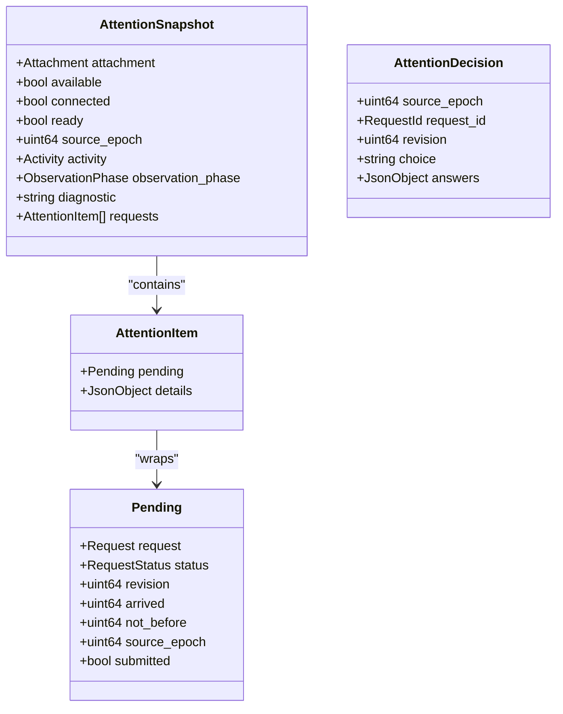

**Diagram sources**
- [attention_protocol.hpp:1-41](file://services/session/src/transport/attention_protocol.hpp#L1-L41)
- [attention_protocol.cpp:1-343](file://services/session/src/transport/attention_protocol.cpp#L1-L343)
- [attention.hpp:1-136](file://services/session/include/lapis/session/attention.hpp#L1-L136)

#### Attention Lifecycle Sequence
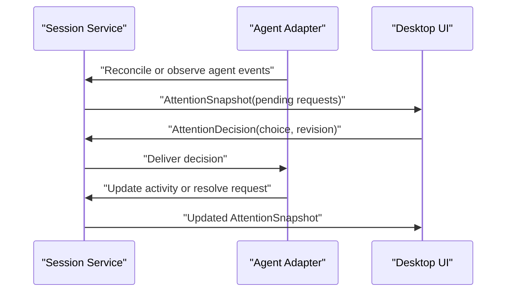

**Diagram sources**
- [attention_protocol.cpp:1-343](file://services/session/src/transport/attention_protocol.cpp#L1-L343)
- [attention.hpp:1-136](file://services/session/include/lapis/session/attention.hpp#L1-L136)

### Supervisor Client Interface
The supervisor client controls the Lapis supervisor daemon over a local socket using framed JSON.

- Status request: asks the supervisor for schema version, enabled state, service liveness, instance epoch, slot, blocked reason, endpoint, and reconstructability.
- Stop request: requires an authenticated spawn token and supervisor epoch; it cannot be issued without session state containing the token.
- Transport: four-byte big-endian length followed by a compact JSON object. The client enforces timeouts, payload bounds, exact field presence, and state file permission checks.
- State file validation: the supervisor state directory and file must be owned by the current user, have restrictive permissions, no symlink exposure, and a bounded size.

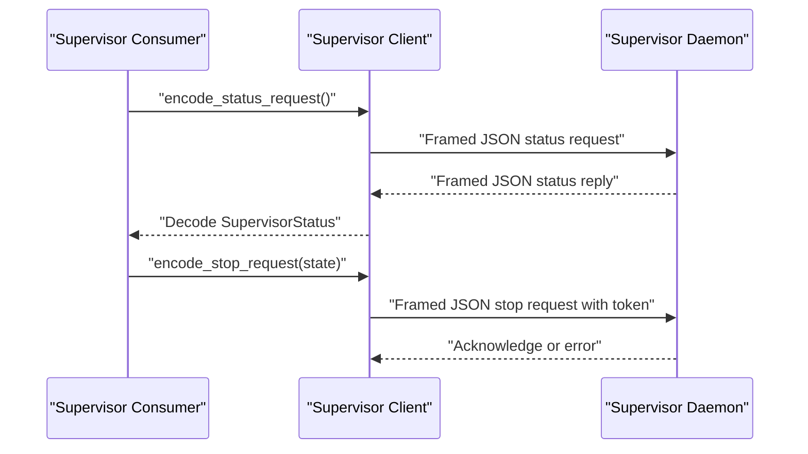

**Diagram sources**
- [client.cpp:1-249](file://services/supervisor/src/client.cpp#L1-L249)
- [client.hpp:1-34](file://services/supervisor/include/lapis/supervisor/client.hpp#L1-L34)

**Section sources**
- [client.hpp:1-34](file://services/supervisor/include/lapis/supervisor/client.hpp#L1-L34)
- [client.cpp:1-249](file://services/supervisor/src/client.cpp#L1-L249)

## Dependency Analysis
The transport layer depends on shared binary primitives and the terminal model. The session service composes these transports with platform IPC, process management, and attention state.

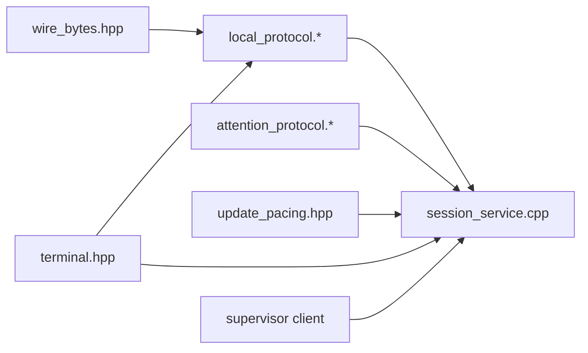

**Diagram sources**
- [wire_bytes.hpp:1-55](file://services/session/src/transport/wire_bytes.hpp#L1-L55)
- [local_protocol.hpp:1-196](file://services/session/src/transport/local_protocol.hpp#L1-L196)
- [attention_protocol.hpp:1-41](file://services/session/src/transport/attention_protocol.hpp#L1-L41)
- [terminal.hpp:1-201](file://services/session/include/lapis/session/terminal.hpp#L1-L201)
- [update_pacing.hpp:1-52](file://services/session/src/transport/update_pacing.hpp#L1-L52)
- [session_service.cpp:1-200](file://services/session/src/session_service.cpp#L1-L200)

**Section sources**
- [local_protocol.hpp:1-196](file://services/session/src/transport/local_protocol.hpp#L1-L196)
- [attention_protocol.hpp:1-41](file://services/session/src/transport/attention_protocol.hpp#L1-L41)
- [wire_bytes.hpp:1-55](file://services/session/src/transport/wire_bytes.hpp#L1-L55)
- [terminal.hpp:1-201](file://services/session/include/lapis/session/terminal.hpp#L1-L201)
- [session_service.cpp:1-200](file://services/session/src/session_service.cpp#L1-L200)

## Performance Considerations
- Binary framing avoids string parsing overhead for high-frequency terminal frames.
- Snapshot envelopes allow consumers to skip decoding large screen payloads until necessary.
- Grapheme arrays and cell references minimize per-cell allocations.
- Hyperlink spans are optional and bounded, avoiding unnecessary URI storage for ordinary screens.
- Update pacing coalesces bursts of UI updates while preserving immediate responsiveness after quiet periods.
- Output admission limits protect the service under sustained pressure, batching small interactive frames and bounding retained memory.

[No sources needed since this section provides general guidance]

## Security Considerations
Local IPC security in Lapis relies on process isolation, ownership checks, bounded payloads, and capability negotiation rather than cryptographic encryption:

- Attachment identities: every session-bound message carries two nonzero 16-byte UUIDs and a generation number. Invalid or zero identities are rejected.
- Protocol versioning: attach and hello frames include the protocol version; older services reject incompatible frames.
- Capability flags: hyperlink, attention phase, and paste transaction features are explicitly advertised and validated.
- Size limits: frame sizes, paste sizes, input sizes, JSON sizes, snapshot sizes, and diagnostic strings are bounded.
- Permission checks: supervisor state directories and files require owner-only permissions and bounded sizes.
- Authentication tokens: supervisor stop operations require a spawn token stored in trusted supervisor state; clients cannot forge it.
- Privilege boundaries: the session service owns process creation and PTY I/O; clients receive terminal output and send controlled input.
- Replay protection: generation counters and epochs help distinguish live sessions and prevent reuse of old attachments.
- Input sanitization: terminal encoding functions sanitize unsafe control bytes before sending them to applications.

**Section sources**
- [local_protocol.cpp:1-200](file://services/session/src/transport/local_protocol.cpp#L1-L200)
- [attention_protocol.cpp:1-200](file://services/session/src/transport/attention_protocol.cpp#L1-L200)
- [client.cpp:1-200](file://services/supervisor/src/client.cpp#L1-L200)
- [terminal.hpp:120-201](file://services/session/include/lapis/session/terminal.hpp#L120-L201)

## Troubleshooting Guide
Protocol-level troubleshooting should focus on framing, validation errors, capability mismatches, and bounded payload violations.

### Common Error Signals
- Invalid local session message: thrown when frame length, kind, attachment identity, or payload structure is malformed.
- Invalid attention message: thrown when attention snapshot or decision exceeds limits or fails structural validation.
- Invalid supervisor reply: thrown when JSON shape, version, fields, or bounds are invalid.
- Timeout errors: supervisor control requests use a fixed timeout for connection, writes, and reads.
- Rejected status: client receives a status code indicating rejection, replacement, ending, or overload conditions.

### Debugging Strategy
1. **Capture frames at the boundary**: log raw frame length and kind before decoding.
2. **Inspect attachments**: verify session ID, epoch, and generation are nonzero and consistent.
3. **Check capability flags**: ensure hyperlinks, attention phase, and paste transactions are negotiated consistently.
4. **Validate sizes**: confirm payloads do not exceed maximum frame, paste, JSON, or snapshot limits.
5. **Track sequences**: monitor snapshot sequence numbers and ready acknowledgements for ordering issues.
6. **Audit attention revisions**: check source epoch, revision, and request identity when decisions appear stale or duplicate.
7. **Verify supervisor state permissions**: inspect directory and file ownership, permissions, and size constraints.
8. **Use pacing diagnostics**: check last publish time and interval to identify whether bursts are being coalesced.

**Section sources**
- [local_protocol.cpp:1-535](file://services/session/src/transport/local_protocol.cpp#L1-L535)
- [attention_protocol.cpp:1-343](file://services/session/src/transport/attention_protocol.cpp#L1-L343)
- [client.cpp:1-249](file://services/supervisor/src/client.cpp#L1-L249)
- [update_pacing.hpp:1-52](file://services/session/src/transport/update_pacing.hpp#L1-L52)

## Conclusion
Lapis’s internal communication design separates concerns cleanly:

- The local session protocol handles terminal output, input, history navigation, paste transactions, and lifecycle control over a binary-framed IPC channel.
- The attention protocol normalizes agent events into a structured, bounded, and revision-aware format suitable for UI presentation and user decisions.
- Wire-level helpers provide efficient big-endian serialization and attachment binding.
- The supervisor client offers a secure, permission-checked JSON control interface for process supervision.
- Versioning, capability negotiation, size limits, and identity validation together form a practical security model for local IPC.

Future changes should preserve backward compatibility through explicit version checks, capability flags, and strict validation, while keeping performance-sensitive paths binary-encoded and bounded.