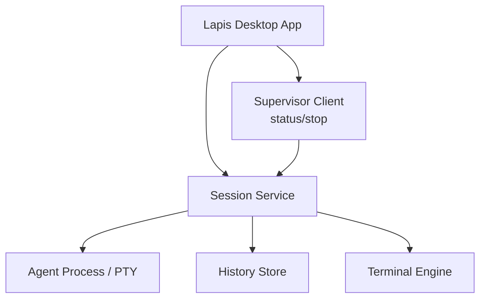
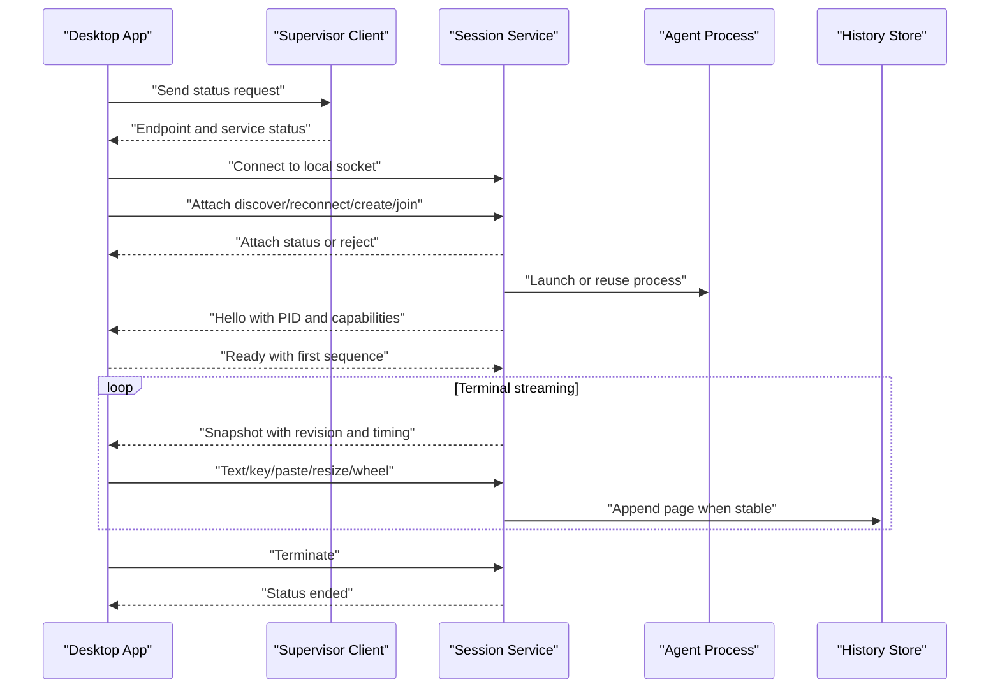
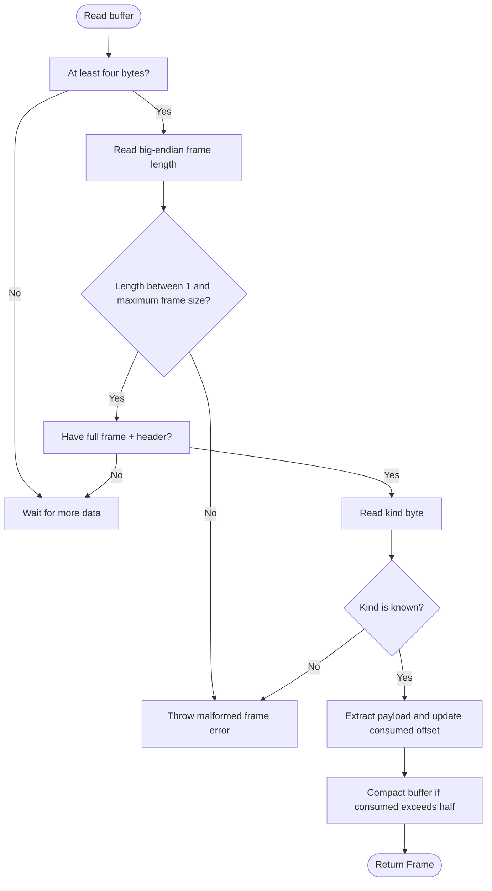
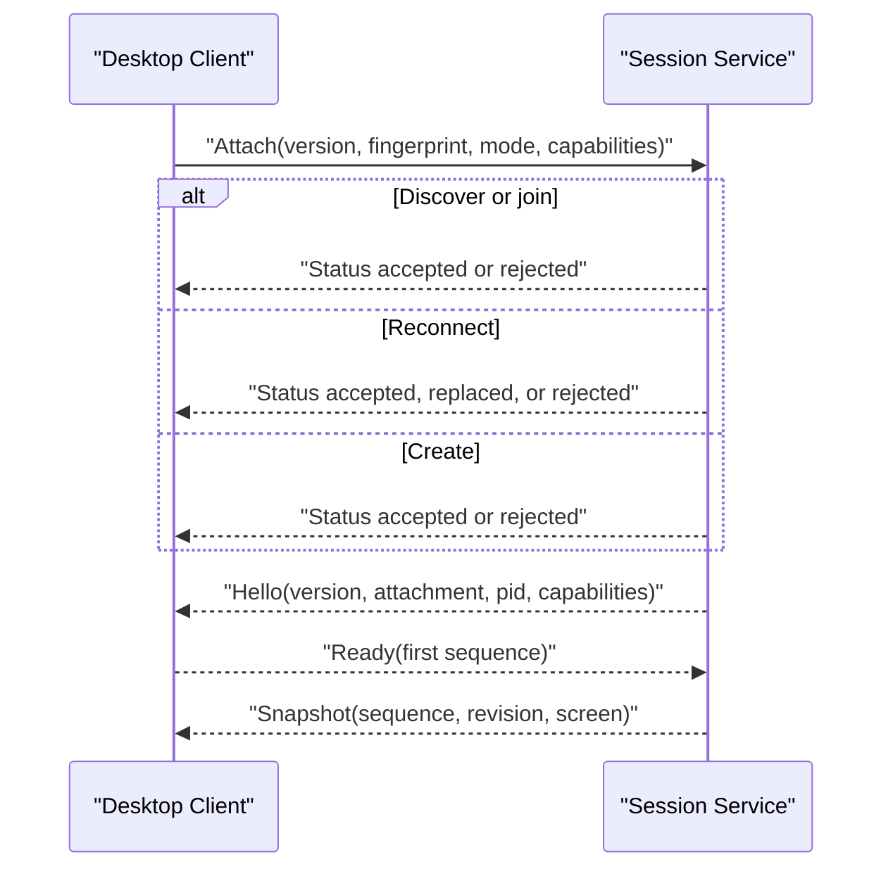
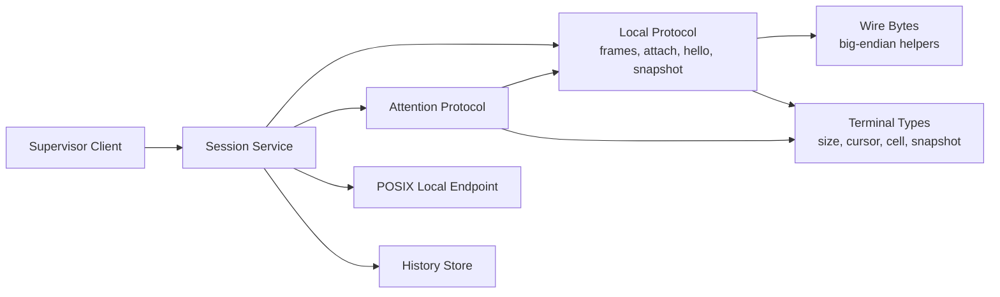

# Local IPC Protocol

<cite>
**Referenced Files in This Document**
- [local_protocol.hpp](file://services/session/src/transport/local_protocol.hpp)
- [local_protocol.cpp](file://services/session/src/transport/local_protocol.cpp)
- [wire_bytes.hpp](file://services/session/src/transport/wire_bytes.hpp)
- [attention_protocol.hpp](file://services/session/src/transport/attention_protocol.hpp)
- [attention_protocol.cpp](file://services/session/src/transport/attention_protocol.cpp)
- [terminal.hpp](file://services/session/include/lapis/session/terminal.hpp)
- [terminal.cpp](file://services/session/src/terminal/terminal.cpp)
- [session_service.cpp](file://services/session/src/session_service.cpp)
- [launch_spec.hpp](file://services/session/src/launch_spec.hpp)
- [session_descriptor.hpp](file://services/session/src/session_descriptor.hpp)
- [local_endpoint.hpp](file://services/session/src/platform/posix/local_endpoint.hpp)
- [local_endpoint.cpp](file://services/session/src/platform/posix/local_endpoint.cpp)
- [history_store.hpp](file://services/session/src/history_store.hpp)
- [client.hpp](file://services/supervisor/include/lapis/supervisor/client.hpp)
- [client.cpp](file://services/supervisor/src/client.cpp)
</cite>

## Table of Contents
1. [Introduction](#introduction)
2. [Project Structure](#project-structure)
3. [Core Components](#core-components)
4. [Architecture Overview](#architecture-overview)
5. [Detailed Component Analysis](#detailed-component-analysis)
6. [Dependency Analysis](#dependency-analysis)
7. [Performance Considerations](#performance-considerations)
8. [Troubleshooting Guide](#troubleshooting-guide)
9. [Conclusion](#conclusion)

## Introduction
This document describes the Local IPC Protocol used by the Lapis desktop application to communicate with per-session services that manage agent terminals, history, and attention workflows. The protocol is a frame-based binary stream over local Unix-domain sockets. It supports:

- Session lifecycle negotiation through attach, hello, ready, status, and terminate messages.
- Terminal I/O streaming through snapshots, text input, key events, paste operations, resize, wheel input, and terminal control frames.
- History paging for older or newer terminal rows.
- Attention request snapshots and decisions.
- Supervisor control queries for service discovery, status, and stop.

The implementation uses Qt `QLocalSocket` and `QLocalServer`, big-endian framing for transport headers, and Qt 6.0 data streams for structured payload encoding. The protocol is versioned independently from the underlying socket transport.

## Project Structure
The relevant code for this protocol lives primarily under the session service and its transport layer:

**Diagram sources**
- [session_service.cpp:1-120](file://services/session/src/session_service.cpp#L1-L120)
- [client.cpp:1-249](file://services/supervisor/src/client.cpp#L1-L249)
- [local_endpoint.cpp:1-93](file://services/session/src/platform/posix/local_endpoint.cpp#L1-L93)

**Section sources**
- [session_service.cpp:1-120](file://services/session/src/session_service.cpp#L1-L120)
- [local_endpoint.hpp:1-17](file://services/session/src/platform/posix/local_endpoint.hpp#L1-L17)
- [local_endpoint.cpp:1-93](file://services/session/src/platform/posix/local_endpoint.cpp#L1-L93)

## Core Components
The Local IPC Protocol is defined by the session wire namespace and its supporting types:

| Component | Responsibility | Key Types |
|---|---|---|
| Wire framing | Frame length prefix, kind selection, buffered parsing | `Frame`, `Kind`, `frame()`, `take_frame()` |
| Attachment identity | Binds messages to a specific session and client attachment | `Attachment`, `SessionIdentity` |
| Control envelope | Wraps snapshot, text, paste, key, resize, status, history, attention payloads | `ControlMessage` |
| Snapshot pipeline | Encodes and decodes terminal screen state | `SnapshotMessage`, `SnapshotEnvelope`, `encode_snapshot()`, `decode_snapshot()` |
| Input primitives | Text, paste, key, resize, wheel | `text`, `paste`, `key`, `resize`, `wheel`, `Wheel` |
| Lifecycle messages | Attach, Hello, Ready, Status, Terminate | `AttachRequest`, `Hello`, `Ready`, `Status`, `StatusCode` |
| History protocol | Older/newer/at-row page requests and replies | `HistoryRequest`, `HistoryReply`, `HistoryDirection` |
| Attention protocol | Agent attention snapshots and client decisions | `AttentionSnapshot`, `AttentionDecision` |
| Supervisor control | Non-session service control RPCs | `SupervisorStatus`, status/stop JSON RPC |

**Section sources**
- [local_protocol.hpp:1-196](file://services/session/src/transport/local_protocol.hpp#L1-L196)
- [local_protocol.cpp:1-200](file://services/session/src/transport/local_protocol.cpp#L1-L200)
- [local_protocol.cpp:201-535](file://services/session/src/transport/local_protocol.cpp#L201-L535)
- [attention_protocol.hpp:1-41](file://services/session/src/transport/attention_protocol.hpp#L1-L41)
- [attention_protocol.cpp:1-200](file://services/session/src/transport/attention_protocol.cpp#L1-L200)
- [client.hpp:1-34](file://services/supervisor/include/lapis/supervisor/client.hpp#L1-L34)
- [client.cpp:1-249](file://services/supervisor/src/client.cpp#L1-L249)

## Architecture Overview
The protocol runs over local Unix-domain sockets managed by the POSIX endpoint helpers. Each session has an endpoint path and a durable descriptor containing its canonical session identity. The desktop app discovers endpoints through the supervisor when needed, then negotiates a session through the attach/hello handshake before exchanging terminal frames.

**Diagram sources**
- [client.cpp:140-249](file://services/supervisor/src/client.cpp#L140-L249)
- [local_protocol.cpp:120-200](file://services/session/src/transport/local_protocol.cpp#L120-L200)
- [local_protocol.cpp:430-535](file://services/session/src/transport/local_protocol.cpp#L430-L535)
- [history_store.hpp:1-74](file://services/session/src/history_store.hpp#L1-L74)

**Section sources**
- [session_service.cpp:1-120](file://services/session/src/session_service.cpp#L1-L120)
- [client.cpp:1-249](file://services/supervisor/src/client.cpp#L1-L249)
- [local_endpoint.cpp:1-93](file://services/session/src/platform/posix/local_endpoint.cpp#L1-L93)

## Detailed Component Analysis

### Socket Transport and Framing
The transport wraps each message payload in a fixed-length header:

| Field | Size | Encoding | Meaning |
|---|---:|---|---|
| Frame length | 4 bytes | Big-endian unsigned 32-bit | Total frame bytes including the kind byte |
| Kind | 1 byte | Unsigned 8-bit | Message type from `Kind` |
| Payload | Variable | Protocol-specific encoder | Structured payload |

Constraints:

- Maximum frame size is eight MiB.
- Every frame must contain one valid `Kind`.
- Parsed frames are removed from the read buffer; partial reads return false until the complete frame arrives.
- Malformed, oversized, or unknown kinds throw a runtime error rather than silently advancing.

Wire primitive helpers provide big-endian serialization for 32-bit and 64-bit values and raw byte slices. These are used by attach, hello, history, and attention encoders.

**Diagram sources**
- [local_protocol.cpp:430-535](file://services/session/src/transport/local_protocol.cpp#L430-L535)
- [wire_bytes.hpp:1-55](file://services/session/src/transport/wire_bytes.hpp#L1-L55)

**Section sources**
- [local_protocol.cpp:430-535](file://services/session/src/transport/local_protocol.cpp#L430-L535)
- [wire_bytes.hpp:1-55](file://services/session/src/transport/wire_bytes.hpp#L1-L55)

### Connection Lifecycle
The connection follows a strict negotiation phase before normal terminal traffic begins.

| Phase | Direction | Message | Purpose |
|---|---|---|---|
| Connect | Client → Server | `attach` | Negotiate mode, fingerprint, expected identity, and optional capabilities |
| Negotiation | Server → Client | `status` | Accept, reject, replace, or signal overload |
| Startup | Server → Client | `hello` | Report child process PID and negotiated capabilities |
| Acknowledgement | Client → Server | `ready` | Confirm attachment and report first applied snapshot sequence |
| Streaming | Bidirectional | `snapshot`, `text`, `key`, `paste`, `resize`, `wheel` | Live terminal state and input |
| End | Client → Server | `terminate` | Request process termination |
| Completion | Server → Client | `status` with code `ended` | Process exited |

Attach modes:

| Mode | Expected identity fields | Behavior |
|---|---|---|
| Discover | Both zero | Find a matching session without claiming it |
| Reconnect | Both nonzero UUIDs | Claim an existing session |
| Create | Session ID nonzero, epoch zero | Start a new session |
| Join | Both zero | Add another view beside the current client |

Optional capability bits:

| Bit | Field | Meaning |
|---|---|---|
| 0x80 | Hyperlinks | Client accepts hyperlink spans in snapshots |
| 0x40 | Attention phase | Client can receive observation-phase attention snapshots |
| 0x20 | Paste transactions | Client supports bounded paste requests |

Versioning:

- Protocol version is a constant 32-bit value.
- Attach and hello encode this version as the first field.
- Services built before newer features reject unsupported frames or omit optional fields.
- Clients should inspect capability bits and behavior hints such as `accepts_wheel` before sending advanced frames.

**Diagram sources**
- [local_protocol.hpp:20-120](file://services/session/src/transport/local_protocol.hpp#L20-L120)
- [local_protocol.cpp:60-120](file://services/session/src/transport/local_protocol.cpp#L60-L120)

**Section sources**
- [local_protocol.hpp:20-120](file://services/session/src/transport/local_protocol.hpp#L20-L120)
- [local_protocol.cpp:60-120](file://services/session/src/transport/local_protocol.cpp#L60-L120)

### Session Management Operations

#### Launch and Creation
Launch configuration is represented by an internal launch spec:

| Field | Type | Validation |
|---|---|---|
| Program | String | Resolved executable path |
| Arguments | List of strings | Passed literally, no shell interpretation |
| Directory | String | Working directory |
| Size | Terminal dimensions | Columns and rows validated against terminal limits |
| Agent mode | Enum | Terminal, Codex, or Claude |

The launch fingerprint is a 32-byte identifier derived from program, arguments, and working directory. It is used to locate existing sessions and write descriptors.

#### Stop and Termination
Clients send a `terminate` control frame. The service does not immediately kill the process; it waits for the process to exit and then sends a `status` message with code `ended`. This allows the client to distinguish graceful shutdown from abrupt disconnect.

#### Attach and Reconnect
Attach requests include:

- A 32-byte fingerprint tied to the launch specification.
- An expected `SessionIdentity` composed of two 16-byte UUIDs: session ID and epoch.
- Capability flags for hyperlinks, attention phase, and paste transactions.

Reconnect requires both identity fields to be nonzero. Discover and join require both to be zero. Create requires a nonzero session ID and a zero epoch.

**Section sources**
- [launch_spec.hpp:1-32](file://services/session/src/launch_spec.hpp#L1-L32)
- [session_descriptor.hpp:1-58](file://services/session/src/session_descriptor.hpp#L1-L58)
- [local_protocol.hpp:40-120](file://services/session/src/transport/local_protocol.hpp#L40-L120)
- [local_protocol.cpp:60-120](file://services/session/src/transport/local_protocol.cpp#L60-L120)

### Terminal I/O Streaming

#### Snapshot Stream
Snapshots describe the terminal screen:

| Field | Type | Validation |
|---|---|---|
| Sequence | Unsigned 64-bit | Monotonic, nonzero |
| Revision | Unsigned 64-bit | Terminal engine revision |
| Timing | Three nanosecond counters | Optional zero timing indicates no observed output yet |
| Size | Columns and rows | Positive, product bounded by maximum cells |
| Cursor | Column, row, shape, visibility flags | Cursor position within viewport when marked visible |
| Alternate screen | Boolean | Also carries wheel-input capability bit |
| Palette | 256 RGB colors | Fixed-size array |
| Graphemes | Unicode code points | Bounded by maximum codepoints |
| Cells | Row-major cells | Exactly columns × rows |
| Hyperlinks | Optional spans | Only when hyperlinks capability is negotiated |

Validation rules include:

- Cell count equals columns times rows.
- Grapheme indices are valid into the grapheme buffer.
- URI lengths and total hyperlink byte budgets are enforced.
- Color values are within allowed ranges.
- Underline and style flags are within enum bounds.

#### Text, Key, Resize, and Wheel Input
Input types:

| Kind | Payload | Limits |
|---|---|---|
| Text | UTF-8 string | Maximum codepoint budget |
| Key | Terminal key enum plus modifiers | Navigation subset only |
| Resize | Terminal size | Columns and rows bounded by cell limit |
| Wheel | Steps, column, row | Steps nonzero, coordinates within terminal grid |

Wheel input is only sent when the snapshot reports that the service accepts wheel input on the alternate screen.

#### Paste Transactions
Paste support has two forms:

1. Ordinary paste messages carry text directly.
2. Transactional paste requests split large pastes into bounded fragments with a request ID and submit flag.

Transactional constraints:

- Maximum paste payload is approximately 960 KiB.
- Service-side PTY queue admission is bounded at approximately 1 MiB.
- Results indicate whether the paste was queued by the PTY layer, along with an optional diagnostic message.

**Section sources**
- [local_protocol.hpp:120-196](file://services/session/src/transport/local_protocol.hpp#L120-L196)
- [local_protocol.cpp:201-430](file://services/session/src/transport/local_protocol.cpp#L201-L430)
- [terminal.hpp:1-200](file://services/session/include/lapis/session/terminal.hpp#L1-L200)
- [terminal.cpp:1-200](file://services/session/src/terminal/terminal.cpp#L1-L200)

### History Queries
History uses request-reply semantics inside the normal attachment-bound control envelope.

| Field | Type | Rules |
|---|---|---|
| Request ID | Unsigned 64-bit | Nonzero |
| Reference | Unsigned 64-bit | Zero means newest for older direction; newer requires a page ID |
| Direction | Enum | Older, newer, or at-row |
| Page ID | Unsigned 64-bit | Zero when no page returned |
| Message | UTF-8 string | Up to 4096 bytes |
| Snapshot | Optional terminal snapshot | Present only when page ID is nonzero |

Direction behavior:

- Older: reference zero returns the newest available page.
- Newer: reference must identify an existing page.
- At: reference is an absolute row number counted from the oldest kept row.

Services advertise page information through history fields in snapshots. Clients should not send `at` requests to legacy services that leave page metadata unset.

**Section sources**
- [local_protocol.hpp:140-196](file://services/session/src/transport/local_protocol.hpp#L140-L196)
- [local_protocol.cpp:260-340](file://services/session/src/transport/local_protocol.cpp#L260-L340)
- [history_store.hpp:1-74](file://services/session/src/history_store.hpp#L1-L74)

### Attention Protocol
Attention provides agent-request awareness across clients. It uses the same attachment-bound control envelope but has its own schema.

| Component | Fields | Constraints |
|---|---|---|
| `AttentionSnapshot` | Attachment, availability, connectivity, readiness, source epoch, activity, observation phase, diagnostic, request list | Identity nonzero, generation nonzero, bounded request list |
| `AttentionItem` | Pending request, details JSON | Request ID and choices validated |
| `AttentionDecision` | Source epoch, request ID, revision, choice, answers JSON | Nonzero epoch and revision, bounded choice and JSON |

Observation phase negotiation occurs through the attach capability bit 0x40. Legacy clients receive the standard v6 snapshot body; negotiated clients may receive an observation-phase attention snapshot.

**Section sources**
- [attention_protocol.hpp:1-41](file://services/session/src/transport/attention_protocol.hpp#L1-L41)
- [attention_protocol.cpp:1-200](file://services/session/src/transport/attention_protocol.cpp#L1-L200)

### Configuration and Discovery
The supervisor client provides a separate control interface distinct from the session wire protocol. It uses JSON over local sockets with its own framed format:

| Operation | Request | Response |
|---|---|---|
| Status | Version 1, action `status` | Schema version, enabled, service live, reconstructable, instance epoch, slot, blocked reason, endpoint |
| Stop | Version 1, action `stop`, spawn token | Not applicable; errors indicate invalid or unauthorized state |

The control request/response format uses a four-byte big-endian length prefix followed by a compact JSON object. Timeouts and bounds protect against unbounded responses.

**Section sources**
- [client.hpp:1-34](file://services/supervisor/include/lapis/supervisor/client.hpp#L1-L34)
- [client.cpp:1-249](file://services/supervisor/src/client.cpp#L1-L249)

## Dependency Analysis
The session transport depends on lower-level components:

**Diagram sources**
- [local_protocol.hpp:1-40](file://services/session/src/transport/local_protocol.hpp#L1-L40)
- [wire_bytes.hpp:1-55](file://services/session/src/transport/wire_bytes.hpp#L1-L55)
- [attention_protocol.hpp:1-41](file://services/session/src/transport/attention_protocol.hpp#L1-L41)
- [terminal.hpp:1-200](file://services/session/include/lapis/session/terminal.hpp#L1-L200)
- [session_service.cpp:1-60](file://services/session/src/session_service.cpp#L1-L60)
- [local_endpoint.hpp:1-17](file://services/session/src/platform/posix/local_endpoint.hpp#L1-L17)
- [history_store.hpp:1-74](file://services/session/src/history_store.hpp#L1-L74)
- [client.hpp:1-34](file://services/supervisor/include/lapis/supervisor/client.hpp#L1-L34)

Coupling notes:

- The wire layer is tightly coupled to Qt containers and types (`QByteArray`, `QString`, `QDataStream`).
- Terminal snapshots are the largest payload and dominate memory and bandwidth.
- Attention payloads add JSON handling on top of the attachment envelope.
- The supervisor client is intentionally separate from the session wire protocol to avoid mixing control-plane and data-plane concerns.

**Section sources**
- [local_protocol.cpp:1-200](file://services/session/src/transport/local_protocol.cpp#L1-L200)
- [attention_protocol.cpp:1-200](file://services/session/src/transport/attention_protocol.cpp#L1-L200)
- [session_service.cpp:1-120](file://services/session/src/session_service.cpp#L1-L120)

## Performance Considerations
Key performance characteristics:

| Area | Behavior | Implication |
|---|---|---|
| Frame framing | Fixed big-endian length prefix | Simple parser with early rejection of malformed frames |
| Buffer management | Lazy compaction after consuming half the buffer | Reduces repeated copies during high-throughput streaming |
| Snapshot encoding | Qt 6.0 data stream with reserved capacity | Efficient packed binary representation of screen state |
| Screen size limit | Maximum cells prevents excessive allocations | Prevents memory explosion from extremely wide or tall terminals |
| Paste queue | Approximately 1 MiB service-side bound | Protects PTY processing from unbounded client paste pressure |
| Output admission | 64 KiB admission window under sustained pressure | Smooths bursts while keeping interactive latency low |
| Socket buffers | Best-effort widening to one MiB | Reduces round trips for full-screen updates on macOS |
| History storage | Compressed pages with append-only segments | Enables long-term replay while controlling disk growth |

Optimization opportunities:

- Avoid decoding snapshots unless the terminal surface needs them; `SnapshotEnvelope` exposes screen size and encoded bytes for deferred rendering.
- Batch small inputs where safe, but respect per-frame validation limits.
- Prefer reconnect attach mode for session recovery instead of recreating processes unnecessarily.
- Use page-aware history navigation rather than repeatedly requesting the newest page.

[No sources needed since this section provides general guidance]

## Troubleshooting Guide

### Common Errors and Their Meanings

| Symptom | Likely Cause | Recommended Action |
|---|---|---|
| Invalid local session message | Malformed frame, unknown kind, oversized payload, or failed validation | Check frame length, kind, and payload boundaries |
| Invalid attachment identity | Zero or null session/epoch UUIDs or zero generation | Verify attach/hello identity fields |
| Invalid terminal dimensions | Zero columns/rows or product exceeds maximum cells | Clamp or validate terminal size before resize |
| Invalid terminal cell index | Accessing a cell outside the rendered grid | Guard cell access against snapshot size |
| Invalid attention message | Exceeded request, choice, diagnostic, or JSON limits | Inspect attention snapshot request list and diagnostic field |
| Supervisor control reply timeout | Unreachable control endpoint or slow service | Retry with backoff and verify endpoint path |
| Socket path too long or symlink | OS restriction or unsafe path setup | Use shorter paths and avoid symlinks |
| Private directory permissions | Directory owned by another user or world-writable | Set owner and mode 0700 on the endpoint parent |

### Debugging Techniques

1. **Trace frame boundaries**  
   Log every call to `frame()` and `take_frame()`. Record frame length, kind, and payload size before parsing.

2. **Validate attachments**  
   Dump `SessionIdentity` and generation from attach, hello, snapshot, and control frames. Mismatched identities indicate cross-session contamination.

3. **Inspect terminal dimensions**  
   Compare requested resize values with `max_cells`. Reject sizes whose product exceeds the wire limit.

4. **Check protocol version compatibility**  
   Ensure attach and hello versions match. If a feature is absent, fall back to the older behavior rather than retrying indefinitely.

5. **Monitor paste flow**  
   Track paste request IDs, submit flags, and result queueing. Large pastes should use transactional requests and respect the service queue limit.

6. **Analyze attention diagnostics**  
   The attention snapshot includes a diagnostic string and activity state. Use these to distinguish connection loss, unavailable agents, and stale requests.

7. **Use supervisor status for service health**  
   Query the supervisor status endpoint to determine whether a session service is live, reconstructable, and what endpoint it exposes.

**Section sources**
- [local_protocol.cpp:1-200](file://services/session/src/transport/local_protocol.cpp#L1-L200)
- [local_protocol.cpp:430-535](file://services/session/src/transport/local_protocol.cpp#L430-L535)
- [attention_protocol.cpp:1-200](file://services/session/src/transport/attention_protocol.cpp#L1-L200)
- [client.cpp:140-249](file://services/supervisor/src/client.cpp#L140-L249)
- [local_endpoint.cpp:1-93](file://services/session/src/platform/posix/local_endpoint.cpp#L1-L93)

## Conclusion
The Local IPC Protocol separates concerns cleanly:

- A lightweight frame layer handles transport framing and buffered parsing.
- A versioned wire schema defines attach, hello, ready, status, and terminate lifecycle messages.
- Terminal streaming uses packed snapshots with strict size, color, hyperlink, and history bounds.
- History and attention extend the same attachment model with request-reply semantics.
- Supervisor control remains a separate JSON-based interface for service discovery and lifecycle control.

Robust clients should implement capability negotiation, bounded input, graceful reconnection through reconnect attach, deferred snapshot decoding, and explicit error handling for malformed or timed-out frames.

[No sources needed since this section summarizes without analyzing specific files]