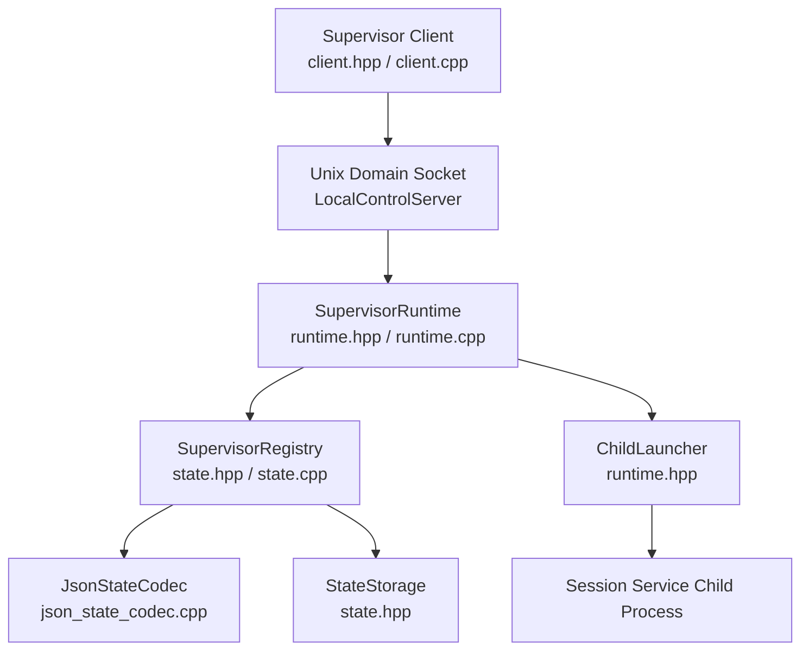
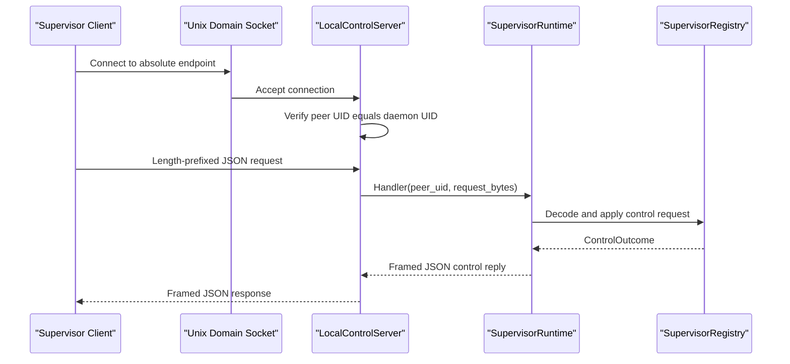
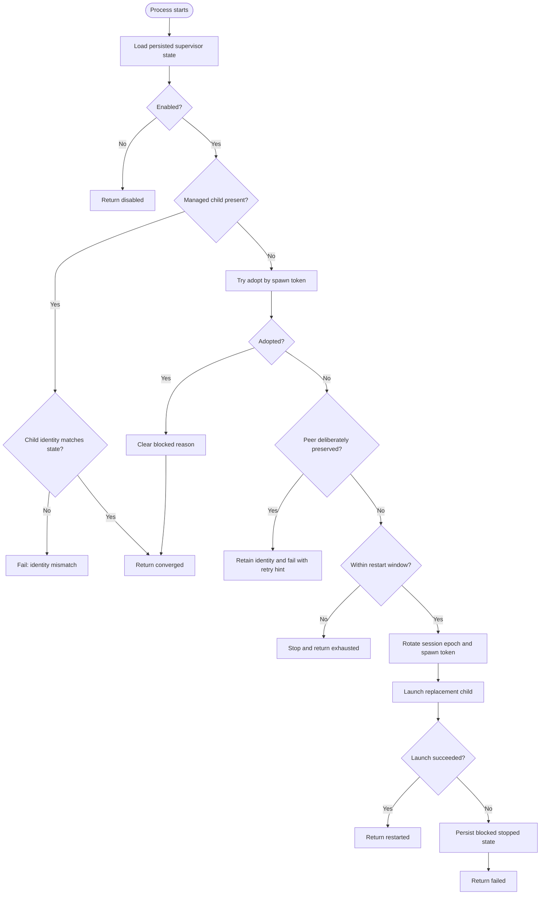
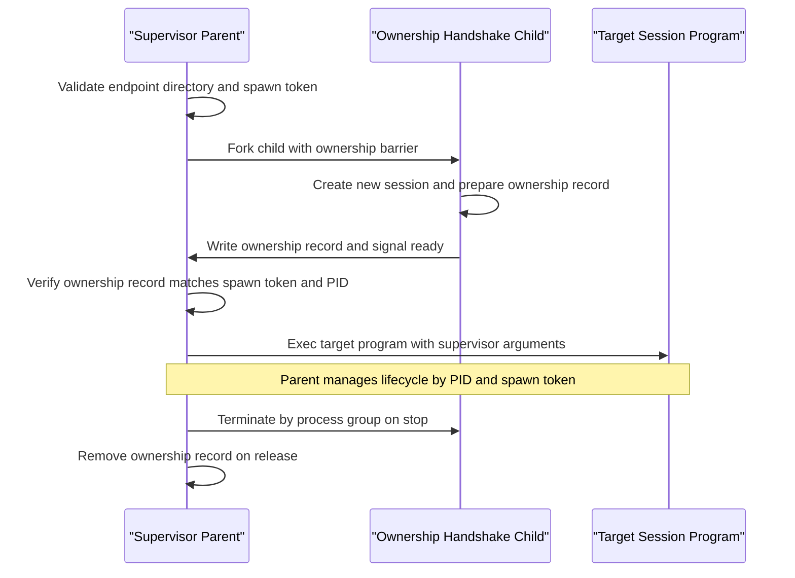

# Supervisor Client API

<cite>
**Referenced Files in This Document**   
- [client.hpp](file://services/supervisor/include/lapis/supervisor/client.hpp)
- [client.cpp](file://services/supervisor/src/client.cpp)
- [control_server.hpp](file://services/supervisor/include/lapis/supervisor/control_server.hpp)
- [control_server.cpp](file://services/supervisor/src/control_server.cpp)
- [runtime.hpp](file://services/supervisor/include/lapis/supervisor/runtime.hpp)
- [runtime.cpp](file://services/supervisor/src/runtime.cpp)
- [state.hpp](file://services/supervisor/include/lapis/supervisor/state.hpp)
- [state.cpp](file://services/supervisor/src/state.cpp)
- [json_state_codec.cpp](file://services/supervisor/src/json_state_codec.cpp)
- [session_service_launcher.hpp](file://services/supervisor/include/lapis/supervisor/session_service_launcher.hpp)
- [birth.hpp](file://services/supervisor/include/lapis/supervisor/birth.hpp)
- [supervisor_client_test.cpp](file://services/supervisor/tests/supervisor_client_test.cpp)
</cite>

## Table of Contents
1. [Introduction](#introduction)
2. [Project Structure](#project-structure)
3. [Core Components](#core-components)
4. [Architecture Overview](#architecture-overview)
5. [Supervisor Control Protocol](#supervisor-control-protocol)
6. [State Model and Persistence](#state-model-and-persistence)
7. [Process Hierarchy and Session Coordination](#process-hierarchy-and-session-coordination)
8. [Security and Access Control](#security-and-access-control)
9. [Troubleshooting Guide](#troubleshooting-guide)
10. [Conclusion](#conclusion)

## Introduction
This document describes the Supervisor Client interface used to manage process-backed session services. It covers:
- The control request/response protocol between a supervisor client and the supervisor daemon.
- Commands for service discovery, lifecycle management, status monitoring, and state inspection.
- Authentication requirements and security boundaries around the local control socket.
- The state model, persistence format, and recovery behavior after crashes or restarts.
- How supervisors launch, adopt, monitor, and terminate child session services.
- Troubleshooting guidance for connectivity problems, stale state, and corrupted files.

The implementation is intentionally narrow: it exposes one strict control frame per client, validates all JSON payloads, enforces owner-only file permissions, and ties privileged operations to a short-lived spawn token.

## Project Structure
The supervisor subsystem lives under `services/supervisor` and separates concerns into headers and source files:

| Area | Responsibility |
| --- | --- |
| Client | Encodes/decodes status and stop requests, reads persisted state from disk, and sends framed control requests over a Unix domain socket. |
| Control server | Listens on an owner-only Unix socket, accepts one strict frame per peer, verifies peer identity, and dispatches to a handler. |
| Runtime | Coordinates registry transitions with child lifecycle: bootstrap, converge, terminate, adopt, and restart. |
| State | Defines the authoritative supervisor state, desired session, control actions/status, codec interface, storage interface, and the single-threaded registry. |
| Codec | Parses and serializes supervisor state and control requests as bounded JSON. |
| Launcher interfaces | Define how children are adopted, launched, terminated, and released. |
| Birth helpers | Encode/decode birth messages exchanged during initial service handshake. |

**Diagram sources**
- [client.hpp:1-34](file://services/supervisor/include/lapis/supervisor/client.hpp#L1-L34)
- [client.cpp:1-249](file://services/supervisor/src/client.cpp#L1-L249)
- [control_server.hpp:1-32](file://services/supervisor/include/lapis/supervisor/control_server.hpp#L1-L32)
- [control_server.cpp:1-327](file://services/supervisor/src/control_server.cpp#L1-L327)
- [runtime.hpp:1-151](file://services/supervisor/include/lapis/supervisor/runtime.hpp#L1-L151)
- [runtime.cpp:1-560](file://services/supervisor/src/runtime.cpp#L1-L560)
- [state.hpp:1-232](file://services/supervisor/include/lapis/supervisor/state.hpp#L1-L232)
- [state.cpp:1-284](file://services/supervisor/src/state.cpp#L1-L284)
- [json_state_codec.cpp:1-339](file://services/supervisor/src/json_state_codec.cpp#L1-L339)

**Section sources**
- [client.hpp:1-34](file://services/supervisor/include/lapis/supervisor/client.hpp#L1-L34)
- [control_server.hpp:1-32](file://services/supervisor/include/lapis/supervisor/control_server.hpp#L1-L32)
- [runtime.hpp:1-151](file://services/supervisor/include/lapis/supervisor/runtime.hpp#L1-L151)
- [state.hpp:1-232](file://services/supervisor/include/lapis/supervisor/state.hpp#L1-L232)

## Core Components

### Supervisor Status Model
The client exposes a compact status object returned by the status command:

| Field | Meaning |
| --- | --- |
| `schema_version` | Persistent state schema version supported by the client; currently 1 or 2. |
| `enabled` | Whether supervisor state is enabled. |
| `service_live` | Whether the supervisor considers its service endpoint live. |
| `reconstructable` | Whether the persisted state can be reconstructed without guessing a launch payload. |
| `instance_epoch` | Hex instance identifier used to reject stale control requests. |
| `slot` | Human-friendly slot name: `empty`, `started`, or `stopped`. |
| `blocked_reason` | Diagnostic reason when the session is blocked. |
| `endpoint` | Live session-service Unix socket path, exposed only when `service_live` is true. |

**Section sources**
- [client.hpp:12-21](file://services/supervisor/include/lapis/supervisor/client.hpp#L12-L21)
- [client.cpp:85-153](file://services/supervisor/src/client.cpp#L85-L153)

### Control Request Encoding
The client provides functions to encode requests:

| Function | Purpose | Required Parameters | Return Value | Error Behavior |
| --- | --- | --- | --- | --- |
| `encode_status_request()` | Requests current supervisor status. | None. | Framed JSON string. | Throws on internal encoding failure. |
| `encode_stop_request(state)` | Requests stopping the current supervised session. | Valid `SupervisorState` with a non-empty `spawn_token`. | Framed JSON string containing the supervisor epoch and token. | Throws if the supplied state has no authenticated stop token. |
| `send_control_request(endpoint, request)` | Sends a framed request to the supervisor control endpoint. | Absolute Unix socket endpoint and valid request bytes. | Decoded response payload string. | Throws on connection failure, timeout, oversized reply, or trailing bytes. |

**Section sources**
- [client.hpp:23-34](file://services/supervisor/include/lapis/supervisor/client.hpp#L23-L34)
- [client.cpp:65-74](file://services/supervisor/src/client.cpp#L65-L74)
- [client.cpp:155-167](file://services/supervisor/src/client.cpp#L155-L167)
- [client.cpp:170-249](file://services/supervisor/src/client.cpp#L170-L249)

### Control Server Interface
The supervisor daemon exposes `LocalControlServer`:

| Member | Description |
| --- | --- |
| Constructor `(endpoint, handler)` | Binds an owner-only Unix socket at an absolute endpoint and installs a control handler. |
| `poll_once(timeout_ms)` | Accepts up to `max_control_clients`, reads one strict frame per client, calls the handler with the peer UID and request, and writes back a bounded reply. |
| Destructor | Closes listeners, clears clients, and removes the socket path. |

The handler type receives the caller's UID and raw request bytes, returning a bounded JSON response.

**Section sources**
- [control_server.hpp:11-32](file://services/supervisor/include/lapis/supervisor/control_server.hpp#L11-L32)
- [control_server.cpp:238-327](file://services/supervisor/src/control_server.cpp#L238-L327)

### Runtime and Convergence
`SupervisorRuntime` bridges state transitions and process lifecycle:

| Operation | Behavior |
| --- | --- |
| `bootstrap(session)` | Starts the desired session through the registry and runs convergence. |
| `control(peer_uid, request)` | Validates caller UID, decodes and applies the control request, then updates the child process accordingly. |
| `converge()` | Ensures the running child matches the authoritative state: adopts an existing verified child, launches a new one, rotates restarts, stops disabled sessions, or reports exhaustion/failure. |
| `state()` | Returns the current authoritative state. |
| `child_pid()` | Returns the PID of the currently managed child, or `-1`. |

Convergence returns one of:

| Value | Meaning |
| --- | --- |
| `converged` | A verified child exists and matches state. |
| `started` | A fresh first admission launch succeeded. |
| `restarted` | A rotated replacement service was launched. |
| `stopped` | The supervisor is disabled or not started. |
| `disabled` | The supervisor explicitly disabled itself. |
| `exhausted` | Restart attempts exceeded the configured window limit. |
| `failed` | Launch failed and the desired state was stopped. |

**Section sources**
- [runtime.hpp:17-151](file://services/supervisor/include/lapis/supervisor/runtime.hpp#L17-L151)
- [runtime.cpp:424-560](file://services/supervisor/src/runtime.cpp#L424-L560)

## Supervisor Control Protocol

### Transport
- Transport: Unix domain stream socket.
- Frame format: 32-bit big-endary length followed by the request payload.
- Maximum payload size: 8 KiB (`max_control_bytes`).
- Default client timeout: 5 seconds (`supervisor_client_timeout_ms`).
- Maximum concurrent control clients: 4 (`max_control_clients`).
- Peer authorization: the server rejects connections whose effective UID does not match the daemon's effective UID.

**Diagram sources**
- [client.cpp:201-249](file://services/supervisor/src/client.cpp#L201-L249)
- [control_server.cpp:1-327](file://services/supervisor/src/control_server.cpp#L1-L327)
- [runtime.cpp:466-517](file://services/supervisor/src/runtime.cpp#L466-L517)
- [state.cpp:250-284](file://services/supervisor/src/state.cpp#L250-L284)

### Command: Status Discovery
Purpose: Discover whether the supervisor is enabled, whether its service endpoint is live, and what persistent state it holds.

Request schema:
| Field | Type | Required | Value |
| --- | --- | --- | --- |
| `version` | Number | Yes | `1` |
| `action` | String | Yes | `"status"` |

Response schema:
| Field | Type | Required | Meaning |
| --- | --- | --- | --- |
| `version` | Number | Yes | `1` |
| `status` | String | Yes | `"ok"` |
| `schema_version` | Number | Yes | Persistent state schema version. |
| `instance_epoch` | String | Yes | Hex instance epoch. |
| `slot` | String | Yes | `"empty"`, `"started"`, or `"stopped"`. |
| `enabled` | Boolean | Yes | Whether supervisor state is enabled. |
| `service_live` | Boolean | Yes | Whether the service endpoint is considered live. |
| `blocked_reason` | String | Yes | Current diagnostic block reason. |
| `endpoint` | String or null | Yes | Live endpoint only when `service_live` is true. |
| `reconstructable` | Boolean | Yes | Whether persisted launch information allows safe reconstruction. |

Error handling:
- Malformed JSON or unexpected fields throw.
- Unsupported version or non-`"ok"` status throws.
- Inconsistent combinations such as an empty slot reporting enabled/live state throw.

Common operation example (conceptual):
1. Call `encode_status_request()`.
2. Call `read_control_state(directory)` to inspect the persisted state before connecting.
3. Call `send_control_request(endpoint, request)`.
4. Parse the result with `decode_status_reply(bytes)`.

**Section sources**
- [client.cpp:65-74](file://services/supervisor/src/client.cpp#L65-L74)
- [client.cpp:76-153](file://services/supervisor/src/client.cpp#L76-L153)
- [client.cpp:155-167](file://services/supervisor/src/client.cpp#L155-L167)
- [supervisor_client_test.cpp:63-108](file://services/supervisor/tests/supervisor_client_test.cpp#L63-L108)

### Command: Stop Session
Purpose: Stop the currently supervised session using the authenticated spawn token.

Request schema:
| Field | Type | Required | Value |
| --- | --- | --- | --- |
| `version` | Number | Yes | `1` |
| `action` | String | Yes | `"stop"` |
| `supervisor_epoch` | String | Yes | Hex instance epoch matching the supervisor. |
| `token` | String | Yes | Hex spawn token belonging to the current session. |
| `session` | Null | Yes | Must be null for stop. |

Behavior:
- Requires the same `instance_epoch` as stored state.
- Requires a valid authenticated spawn token.
- Transitions the desired session to `stopped` and rotates the spawn token.
- The runtime terminates the current child if needed and retries convergence.

Error codes returned by the control layer:
| Code | Meaning |
| --- | --- |
| `applied` | Stop accepted and applied. |
| `unauthorized` | Wrong instance epoch or wrong spawn token. |
| `stale_epoch` | The supplied epoch does not match the registry's current epoch. |
| `rejected` | Invalid request shape or unsupported action. |

Common operation example (conceptual):
1. Read the current state via status or `read_control_state`.
2. Call `encode_stop_request(state)`.
3. Send it to the control endpoint.
4. Expect either an applied reply or an error code.

**Section sources**
- [client.cpp:155-167](file://services/supervisor/src/client.cpp#L155-L167)
- [state.cpp:222-236](file://services/supervisor/src/state.cpp#L222-L236)
- [state.cpp:250-284](file://services/supervisor/src/state.cpp#L250-L284)
- [runtime.cpp:466-517](file://services/supervisor/src/runtime.cpp#L466-L517)
- [supervisor_client_test.cpp:108-123](file://services/supervisor/tests/supervisor_client_test.cpp#L108-L123)

### Command: Start Session
Purpose: Register and start a new session service described by endpoint, fingerprint, and identity.

Request schema:
| Field | Type | Required | Value |
| --- | --- | --- | --- |
| `version` | Number | Yes | `1` |
| `action` | String | Yes | `"start"` |
| `supervisor_epoch` | String | Yes | Hex instance epoch matching the supervisor. |
| `token` | String | Yes | Hex spawn token. |
| `session.endpoint` | String | Yes | Absolute Unix socket path owned by the caller. |
| `session.fingerprint` | String | Yes | Fixed-length hex identity fingerprint. |
| `session.identity.session_id` | String | Yes | Fixed-length hex session ID. |
| `session.identity.epoch` | String | Yes | Fixed-length hex session epoch. |

Behavior:
- Adds a new desired session with a fresh spawn token and epoch.
- Persists the state through the registry.
- The runtime converges by launching or adopting the child.

Important note:
- The first control-capable slot requires an authoritative bootstrap; the registry refuses control until a session exists with a spawn token.

**Section sources**
- [json_state_codec.cpp:296-339](file://services/supervisor/src/json_state_codec.cpp#L296-L339)
- [state.cpp:250-284](file://services/supervisor/src/state.cpp#L250-L284)
- [runtime.cpp:424-465](file://services/supervisor/src/runtime.cpp#L424-L465)

### Command: Disable Supervisor
Purpose: Disable supervisor operation and stop any active desired session.

Request schema:
| Field | Type | Required | Value |
| --- | --- | --- | --- |
| `version` | Number | Yes | `1` |
| `action` | String | Yes | `"disable"` |
| `supervisor_epoch` | String | Yes | Hex instance epoch. |
| `token` | String | Yes | Hex spawn token. |
| `session` | Null | Yes | Must be null. |

Behavior:
- Sets `enabled` to false.
- Marks the desired session as stopped.
- Clears the spawn token and records a blocked reason.

**Section sources**
- [json_state_codec.cpp:324-339](file://services/supervisor/src/json_state_codec.cpp#L324-L339)
- [state.cpp:238-248](file://services/supervisor/src/state.cpp#L238-L248)
- [state.cpp:250-284](file://services/supervisor/src/state.cpp#L250-L284)

### Control Reply Format
All control replies use this envelope:

| Field | Type | Meaning |
| --- | --- | --- |
| `version` | Number | Always `1`. |
| `status` | String | One of `applied`, `unauthorized`, `stale_epoch`, or `rejected`. |

Clients should treat `applied` as success and other statuses as errors requiring retry, reauthentication, or state inspection.

**Section sources**
- [runtime.cpp:405-422](file://services/supervisor/src/runtime.cpp#L405-L422)
- [state.cpp:250-284](file://services/supervisor/src/state.cpp#L250-L284)

## State Model and Persistence

### Persistent State Schema
Version 2 is the current schema:

| Field | Type | Requirement |
| --- | --- | --- |
| `version` | Number | `1` or `2`. |
| `enabled` | Boolean | Whether supervisor state is enabled. |
| `instance_epoch` | String | Fixed-length lowercase hex. |
| `session` | Object or null | Present when enabled; absent otherwise. |

Session fields:

| Field | Type | Requirement |
| --- | --- | --- |
| `endpoint` | String | Absolute Unix socket path. |
| `fingerprint` | String | Fixed-length lowercase hex. |
| `identity.session_id` | String | Fixed-length lowercase hex. |
| `identity.epoch` | String | Fixed-length lowercase hex. |
| `desired_state` | String | `"started"` or `"stopped"`. |
| `spawn_token` | String | Optional fixed-length lowercase hex; required when started. |
| `blocked_reason` | String | Optional bounded text. |
| `launch` | Object or null | Version 2 must include a canonical launch description; version 1 must omit it. |

Launch fields:

| Field | Type | Requirement |
| --- | --- | --- |
| `mode` | String | `"terminal"`, `"codex"`, or `"claude"`. |
| `program` | String | Non-empty bounded text. |
| `arguments` | Array of strings | At most 256 entries. |
| `working_directory` | String | Bounded text. |
| `columns` | Integer | Between 1 and 1024. |
| `rows` | Integer | Between 1 and 1024. |

Validation rules:
- All hex identifiers have fixed lengths.
- Endpoints start with `/`.
- Total state size is bounded to 8 KiB.
- A started session must have a spawn token.
- Version 2 requires the canonical launch payload.

**Section sources**
- [state.hpp:12-99](file://services/supervisor/include/lapis/supervisor/state.hpp#L12-L99)
- [state.cpp:47-115](file://services/supervisor/src/state.cpp#L47-L115)
- [json_state_codec.cpp:148-239](file://services/supervisor/src/json_state_codec.cpp#L148-L239)
- [json_state_codec.cpp:241-294](file://services/supervisor/src/json_state_codec.cpp#L241-L294)

### Storage Abstraction
Two storage implementations are defined:

| Implementation | Behavior |
| --- | --- |
| `MemoryStateStorage` | In-memory state used by tests; tracks write count, fsync flag, and owner-only mode. |
| `PosixStateStorage` | POSIX-backed singleton that acquires a lock, loads/stores a private JSON file, and validates directory ownership and permissions. |

The registry constructor acquires storage, loads saved state or initializes an instance epoch, and validates the loaded state. A failed commit poisons the registry so later transitions are rejected until a new registry reloads from storage.

**Section sources**
- [state.hpp:101-178](file://services/supervisor/include/lapis/supervisor/state.hpp#L101-L178)
- [state.cpp:117-189](file://services/supervisor/src/state.cpp#L117-L189)
- [state.cpp:280-284](file://services/supervisor/src/state.cpp#L280-L284)

### Recovery After Crashes or Restarts
Recovery follows these rules:

1. On construction, the runtime loads persisted state.
2. If the persisted state shows a started session with a spawn token, the runtime treats the initial admission as already consumed.
3. During convergence, it tries to adopt a verified child using the spawn token.
4. If adoption fails:
   - If another launcher deliberately preserved the peer, convergence fails but retains identity for retry.
   - Otherwise, it checks restart admissions within a time window.
   - If the maximum restarts per window is reached, the supervisor stops itself with `exhausted`.
   - Otherwise, it rotates the session epoch and spawn token and launches a replacement.
5. Failed launches are persisted as a blocked stopped state rather than leaving an ambiguous alive-or-dead condition.

**Diagram sources**
- [runtime.cpp:424-560](file://services/supervisor/src/runtime.cpp#L424-L560)

**Section sources**
- [runtime.cpp:424-560](file://services/supervisor/src/runtime.cpp#L424-L560)
- [state.cpp:201-248](file://services/supervisor/src/state.cpp#L201-L248)

## Process Hierarchy and Session Coordination

### Child Lifecycle
The supervisor owns lifecycle policy through `ChildLauncher`:

| Method | Responsibility |
| --- | --- |
| `adopt(session, spawn_token)` | Reuse an existing verified child after supervisor restart. |
| `peer_preserved(session, spawn_token)` | Signal that a live peer should not be rotated out prematurely. |
| `launch(session, spawn_token)` | Create a new child process bound to the requested identity. |
| `alive(child)` | Check whether the child process is still alive. |
| `terminate(child)` | Gracefully stop the child and wait for termination. |
| `release(child)` | Clean up ownership metadata or auxiliary resources. |

A production adapter may leave PTY, terminal, and protocol ownership in the existing session-service child; the supervisor coordinates higher-level lifecycle and identity rotation.

**Section sources**
- [runtime.hpp:46-89](file://services/supervisor/include/lapis/supervisor/runtime.hpp#L46-L89)

### Ownership-Based Child Launching
`OwnershipChildLauncher` implements an experimental ownership model:

- The parent writes an ownership record containing a spawn token and child PID.
- The child process sets up a new session, writes the same ownership record, signals readiness, and execs the target program.
- The parent verifies that the ownership record matches the expected spawn token and PID.
- Termination uses process-group signals: first `SIGTERM`, then `SIGKILL` if needed.
- Release removes the ownership record associated with the child endpoint.

**Diagram sources**
- [runtime.cpp:201-399](file://services/supervisor/src/runtime.cpp#L201-L399)

### Service Discovery and Endpoint Validation
- The supervisor probes whether a child endpoint is live by attempting a nonblocking connect and waiting for completion.
- The parent directory of the endpoint must be owned by the supervisor user and have owner-only permissions.
- An existing live endpoint prevents launching a conflicting child.
- The client also validates the state directory, file permissions, and maximum size before decoding state.

**Section sources**
- [runtime.cpp:63-133](file://services/supervisor/src/runtime.cpp#L63-L133)
- [runtime.cpp:135-200](file://services/supervisor/src/runtime.cpp#L135-L200)
- [client.cpp:119-153](file://services/supervisor/src/client.cpp#L119-L153)

### Birth Messages
During service startup, birth helpers encode and decode a birth request carrying:
- The service endpoint.
- The service fingerprint.
- Agent program, arguments, working directory, terminal dimensions, and agent mode.

The service replies with either a successful `SessionIdentity` or a rejection.

**Section sources**
- [birth.hpp:1-39](file://services/supervisor/include/lapis/supervisor/birth.hpp#L1-L39)

## Security and Access Control

### Local Socket Authorization
- The control server binds an owner-only Unix socket with mode `0600`.
- Connections are accepted only if the peer UID equals the daemon's effective UID.
- Each client is limited to one strict control frame.
- Maximum concurrent control clients is four.
- Malformed, incomplete, or oversized frames cause the client to be dropped.

**Section sources**
- [control_server.cpp:238-327](file://services/supervisor/src/control_server.cpp#L238-L327)
- [runtime.hpp:19-23](file://services/supervisor/include/lapis/supervisor/runtime.hpp#L19-L23)

### Token-Based Control Authentication
- Control requests require both a matching `instance_epoch` and a matching spawn token.
- Tokens are compared using constant-time comparison to prevent timing-based leakage.
- A fresh or disabled registry has no authenticated control capability.
- Spawn tokens rotate on stop, restart, and disable.

**Section sources**
- [state.cpp:117-145](file://services/supervisor/src/state.cpp#L117-L145)
- [state.cpp:250-284](file://services/supervisor/src/state.cpp#L250-L284)

### Filesystem and Privilege Boundaries
- Supervisor state directory must be owned by the effective user and have mode `0700`.
- The state file must be a regular file, owned by the effective user, mode `0600`, hard link count 1, and within the 8 KiB state bound.
- Ownership records for children must be private regular files with mode `0600` and bounded size.
- Child programs receive explicit supervisor arguments including spawn token, owner path, and socket path.
- The parent endpoint directory must be owned and permission-restricted.

These constraints reduce the risk of privilege escalation through symlink attacks, world-writable directories, stale sockets, or forged process ownership.

**Section sources**
- [client.cpp:96-153](file://services/supervisor/src/client.cpp#L96-L153)
- [runtime.cpp:135-200](file://services/supervisor/src/runtime.cpp#L135-L200)
- [control_server.cpp:273-306](file://services/supervisor/src/control_server.cpp#L273-L306)

## Troubleshooting Guide

### Cannot Connect to Supervisor Control Endpoint
Symptoms:
- Connection fails immediately.
- Client throws a connection error.

Likely causes:
- The supervisor daemon is not running.
- The endpoint path is incorrect or not absolute.
- The Unix socket is stale or unavailable.
- The caller UID does not match the supervisor's effective UID.

Checks:
- Confirm the endpoint is an absolute path starting with `/`.
- Confirm the daemon owns the socket and the socket is mode `0600`.
- Confirm the client runs as the same user as the supervisor.
- Inspect whether the control endpoint is already in use before binding.

**Section sources**
- [client.cpp:201-213](file://services/supervisor/src/client.cpp#L201-L213)
- [control_server.cpp:273-306](file://services/supervisor/src/control_server.cpp#L273-L306)

### Unauthorized or Stale Epoch
Symptoms:
- Control reply status is `unauthorized` or `stale_epoch`.

Likely causes:
- The request carries a different `supervisor_epoch` than the current registry.
- The request token does not match the current session spawn token.
- The registry has no authenticated session yet.

Remediation:
- Refresh the current state by calling status.
- Use the latest `instance_epoch` and spawn token from the authoritative state.
- For a new session, perform an authoritative bootstrap before issuing control commands.

**Section sources**
- [state.cpp:250-284](file://services/supervisor/src/state.cpp#L250-L284)
- [runtime.cpp:466-517](file://services/supervisor/src/runtime.cpp#L466-L517)

### Suppressed Stop Because No Authenticated Token
Symptoms:
- The client throws when encoding a stop request.

Cause:
- The supplied `SupervisorState` lacks a non-empty `spawn_token`.

Remediation:
- Obtain the current state from the supervisor status command.
- Ensure the session is started and has a spawn token before issuing stop.

**Section sources**
- [client.cpp:155-167](file://services/supervisor/src/client.cpp#L155-L167)

### State Directory Not Private
Symptoms:
- `read_control_state` throws that the state directory is not private.

Cause:
- The directory is not owned by the effective user.
- The directory mode is not `0700`.

Remediation:
- Restrict the supervisor state directory to owner-only access.
- Do not share the directory with other users.

**Section sources**
- [client.cpp:119-132](file://services/supervisor/src/client.cpp#L119-L132)

### Corrupted or Unsupported State
Symptoms:
- State loading or decoding throws invalid state errors.
- Legacy version 1 state is refused by the stop client.

Cause:
- The state file is malformed, oversized, or has an unsupported schema.
- Version 1 state omits the canonical launch payload required by version 2.

Remediation:
- Back up the state directory.
- Inspect the file permissions and size.
- Replace or reconstruct state through the authoritative bootstrap path rather than guessing a launch payload.
- Tests verify that legacy version 1 state is refused by the stop client.

**Section sources**
- [client.cpp:134-153](file://services/supervisor/src/client.cpp#L134-L153)
- [json_state_codec.cpp:241-294](file://services/supervisor/src/json_state_codec.cpp#L241-L294)
- [supervisor_client_test.cpp:125-149](file://services/supervisor/tests/supervisor_client_test.cpp#L125-L149)

### Restart Loop or Exhausted Restarts
Symptoms:
- The supervisor repeatedly restarts and eventually stops itself.
- Convergence returns `exhausted`.

Cause:
- The child fails to launch or adopt repeatedly.
- More than three restart attempts occur within the configured restart window.

Remediation:
- Inspect `blocked_reason` from the status response.
- Check whether the endpoint directory and child ownership records are valid.
- Investigate why the child cannot establish its endpoint or pass ownership verification.
- Avoid forcing repeated restarts without fixing the underlying launch or ownership problem.

**Section sources**
- [runtime.hpp:20-25](file://services/supervisor/include/lapis/supervisor/runtime.hpp#L20-L25)
- [runtime.cpp:424-560](file://services/supervisor/src/runtime.cpp#L424-L560)

### Orphaned Processes
Symptoms:
- A child process remains after the supervisor thinks it is gone.
- The endpoint is stale but the process is still alive.

Behavior:
- The runtime waits briefly for child termination.
- If graceful termination fails, it escalates to kill.
- Ownership records are removed on release.
- If a peer is preserved deliberately, the supervisor retains identity and retries instead of rotating blindly.

Remediation:
- Let the supervisor handle cleanup through normal stop or converge.
- Do not manually remove endpoints or ownership records unless you understand the spawn token relationship.
- Investigate whether `peer_preserved` is intentionally retaining the child.

**Section sources**
- [runtime.cpp:175-189](file://services/supervisor/src/runtime.cpp#L175-L189)
- [runtime.cpp:384-399](file://services/supervisor/src/runtime.cpp#L384-L399)
- [runtime.cpp:519-560](file://services/supervisor/src/runtime.cpp#L519-L560)

## Conclusion
The Supervisor Client API provides a minimal, strongly validated interface for managing session services. Its design emphasizes safety over convenience:
- One strict control frame per client limits abuse.
- Owner-only filesystem and socket permissions prevent cross-user interference.
- Spawn tokens and instance epochs provide short-lived authentication.
- Persistent state includes enough launch information for safe reconstruction while refusing legacy or malformed data.
- Convergence handles adoption, restart rotation, exhaustion, and failure without exposing untrusted processes to arbitrary control.

For robust integrations, always refresh the authoritative state before issuing control commands, validate responses, respect restart exhaustion, and keep supervisor state directories private.