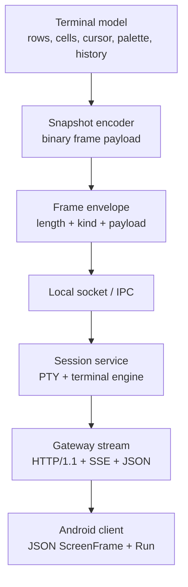
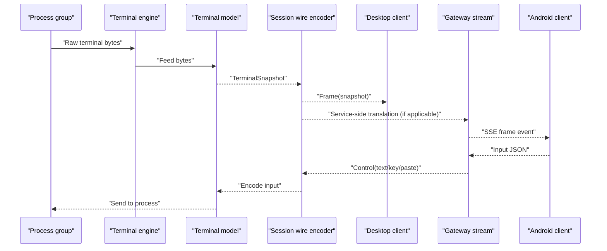
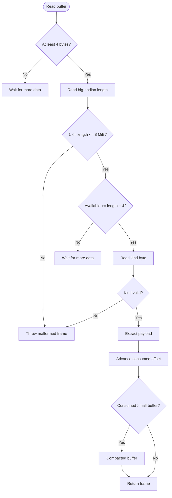
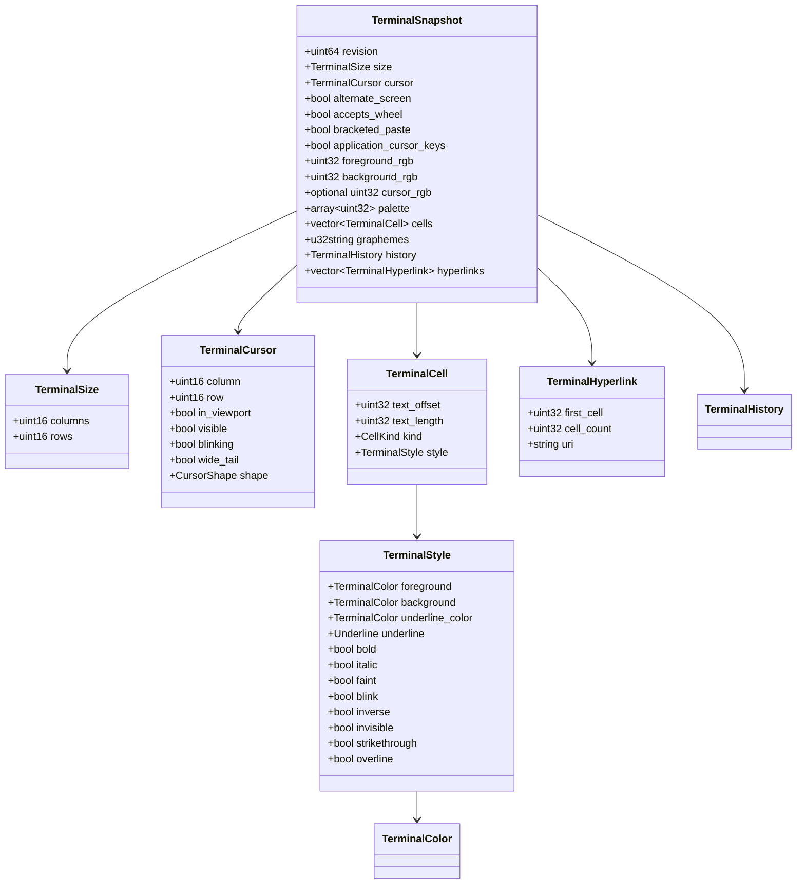
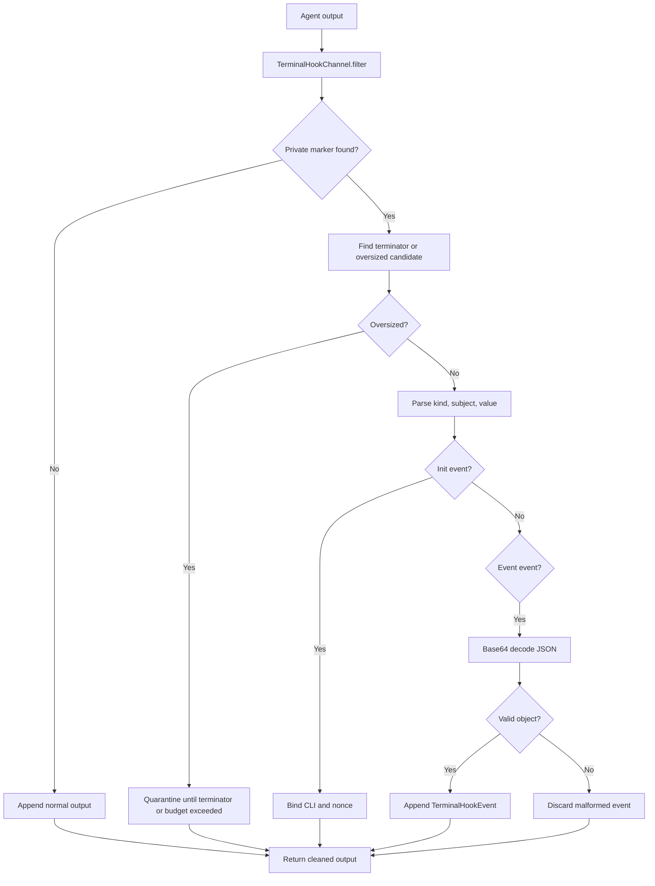
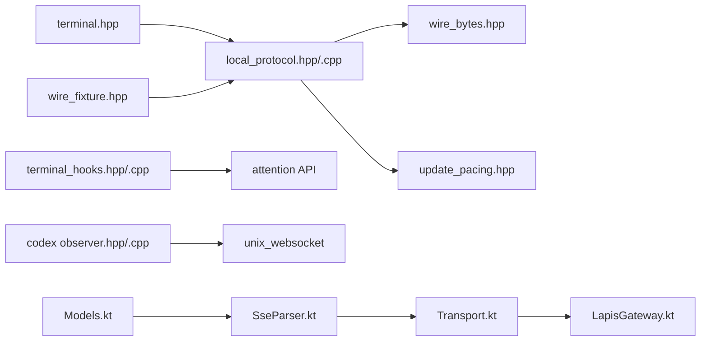
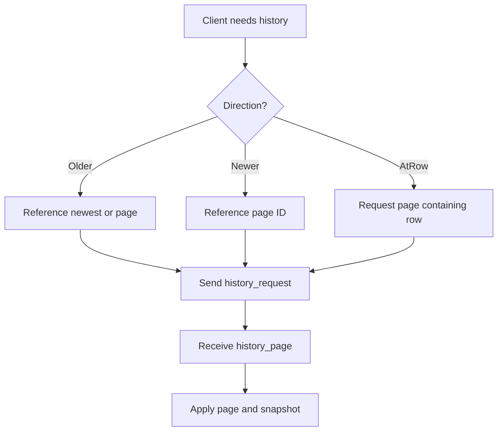
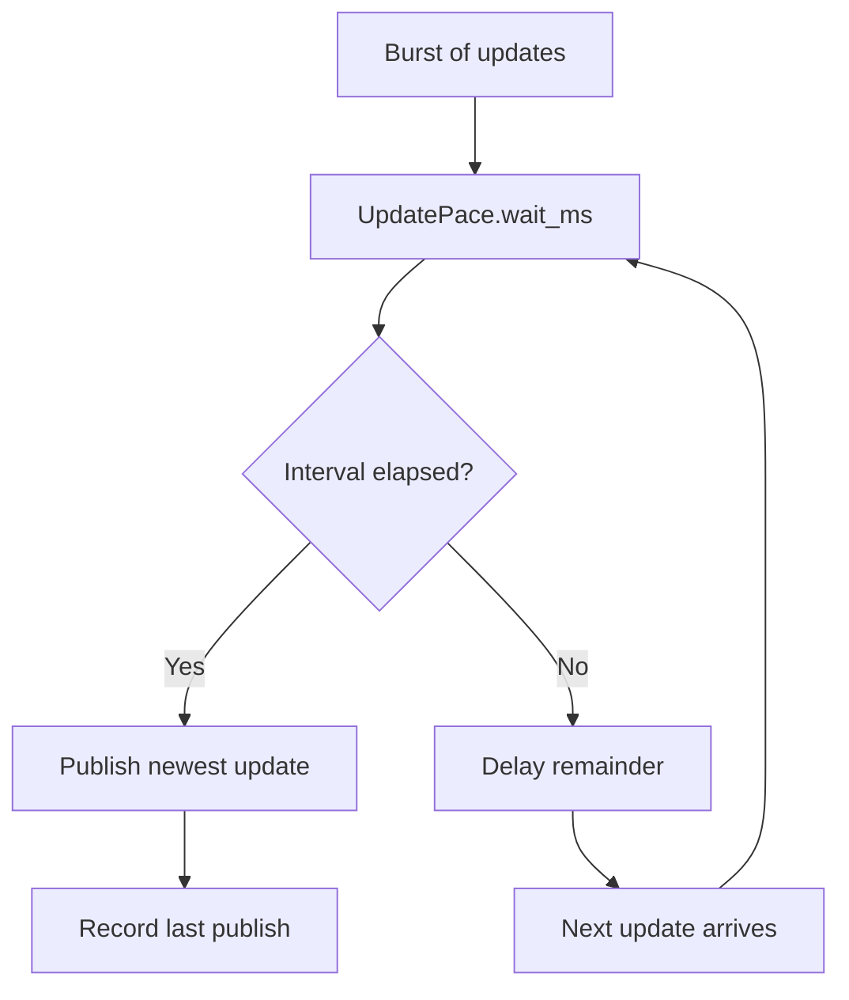

# Wire Format and Binary Transmission

<cite>
**Referenced Files in This Document**
- [terminal.hpp](file://services/session/include/lapis/session/terminal.hpp)
- [local_protocol.hpp](file://services/session/src/transport/local_protocol.hpp)
- [local_protocol.cpp](file://services/session/src/transport/local_protocol.cpp)
- [wire_bytes.hpp](file://services/session/src/transport/wire_bytes.hpp)
- [update_pacing.hpp](file://services/session/src/transport/update_pacing.hpp)
- [terminal_hooks.hpp](file://services/session/src/terminal_hooks.hpp)
- [terminal_hooks.cpp](file://services/session/src/terminal_hooks.cpp)
- [observer.hpp](file://adapters/codex/src/observer.hpp)
- [observer.cpp](file://adapters/codex/src/observer.cpp)
- [TerminalScreen.kt](file://apps/android/app/src/main/kotlin/dev/lapis/remote/terminal/TerminalScreen.kt)
- [Models.kt](file://apps/android/app/src/main/kotlin/dev/lapis/remote/gateway/Models.kt)
- [SseParser.kt](file://apps/android/app/src/main/kotlin/dev/lapis/remote/gateway/SseParser.kt)
- [Transport.kt](file://apps/android/app/src/main/kotlin/dev/lapis/remote/gateway/Transport.kt)
- [LapisGateway.kt](file://apps/android/app/src/main/kotlin/dev/lapis/remote/gateway/LapisGateway.kt)
- [wire_fixture.hpp](file://apps/desktop/tests/wire_fixture.hpp)
- [probe_terminal.py](file://scripts/probe_terminal.py)
</cite>

## Table of Contents
1. [Introduction](#introduction)
2. [Project Structure](#project-structure)
3. [Core Components](#core-components)
4. [Architecture Overview](#architecture-overview)
5. [Detailed Component Analysis](#detailed-component-analysis)
6. [Dependency Analysis](#dependency-analysis)
7. [Performance Considerations](#performance-considerations)
8. [Troubleshooting Guide](#troubleshooting-guide)
9. [Conclusion](#conclusion)

## Introduction
This document describes the wire format and binary transmission mechanisms used by the project to send terminal state from a local session service to clients. The implementation is not a generic network protocol; it is an internal C++/Qt frame format plus a JSON-based gateway stream that Android and other clients consume. The key pieces are:

- A versioned Qt-local frame envelope carrying control messages, snapshots, input, history pages, and attention events.
- A binary snapshot encoding of terminal state: size, cursor, screen cells, Unicode graphemes, palette, history metadata, and optional hyperlinks.
- A terminal hooks subsystem that intercepts private escape sequences from agents such as Claude Code or Codex before they reach the rendered terminal.
- An Android transport layer over HTTP/1.1 server-sent events that carries JSON screen frames rather than the native binary snapshot.
- Performance helpers for update pacing, bounded parsing, and error recovery.

The term “WireBytes” refers to the big-endian integer primitives and attachment helpers under `lapis::session::wire::bytes`, which are reused by several message encoders.

## Project Structure
The wire format spans three layers:

| Layer | Responsibility | Key files |
|---|---|---|
| Terminal model | In-process representation of rows, cells, styles, cursor, palette, history, and hyperlinks | [terminal.hpp](file://services/session/include/lapis/session/terminal.hpp) |
| Session wire | Frame framing, snapshot encoding, control payloads, attachments, and history requests/replies | [local_protocol.hpp](file://services/session/src/transport/local_protocol.hpp), [local_protocol.cpp](file://services/session/src/transport/local_protocol.cpp), [wire_bytes.hpp](file://services/session/src/transport/wire_bytes.hpp) |
| Client gateway stream | HTTP/1.1 + SSE with JSON screen frames for Android/iOS-like clients | [Models.kt](file://apps/android/app/src/main/kotlin/dev/lapis/remote/gateway/Models.kt), [SseParser.kt](file://apps/android/app/src/main/kotlin/dev/lapis/remote/gateway/SseParser.kt), [Transport.kt](file://apps/android/app/src/main/kotlin/dev/lapis/remote/gateway/Transport.kt), [LapisGateway.kt](file://apps/android/app/src/main/kotlin/dev/lapis/remote/gateway/LapisGateway.kt) |

**Diagram sources**
- [terminal.hpp:1-200](file://services/session/include/lapis/session/terminal.hpp#L1-L200)
- [local_protocol.hpp:1-196](file://services/session/src/transport/local_protocol.hpp#L1-L196)
- [local_protocol.cpp:200-535](file://services/session/src/transport/local_protocol.cpp#L200-L535)
- [Models.kt:1-200](file://apps/android/app/src/main/kotlin/dev/lapis/remote/gateway/Models.kt#L1-L200)
- [SseParser.kt:1-40](file://apps/android/app/src/main/kotlin/dev/lapis/remote/gateway/SseParser.kt#L1-L40)
- [Transport.kt:1-137](file://apps/android/app/src/main/kotlin/dev/lapis/remote/gateway/Transport.kt#L1-L137)

**Section sources**
- [terminal.hpp:1-200](file://services/session/include/lapis/session/terminal.hpp#L1-L200)
- [local_protocol.hpp:1-196](file://services/session/src/transport/local_protocol.hpp#L1-L196)
- [local_protocol.cpp:200-535](file://services/session/src/transport/local_protocol.cpp#L200-L535)
- [Models.kt:1-200](file://apps/android/app/src/main/kotlin/dev/lapis/remote/gateway/Models.kt#L1-L200)

## Core Components
The core components are:

1. **Terminal model**: Defines `TerminalSize`, `TerminalCell`, `TerminalStyle`, `TerminalColor`, `TerminalCursor`, `TerminalHistory`, `TerminalHyperlink`, and `TerminalSnapshot`. It also exposes `Terminal` for feeding PTY bytes, resizing, extracting snapshots, encoding input, and draining replies.
2. **Session wire types**: Defines message kinds (`hello`, `snapshot`, `text`, `paste`, `key`, `resize`, `status`, `attach`, `ready`, history request/reply, attention messages, `terminate`, `wheel`, paste transaction messages).
3. **Frame framing**: Encodes each message as a four-byte big-endian length followed by a one-byte kind and the payload.
4. **Binary snapshot encoding**: Serializes revision, geometry, cursor, flags, palette, grapheme storage, cell table, and optional hyperlink extension.
5. **Attachment identity**: Two 16-byte UUID fields plus a big-endian generation counter.
6. **Terminal hooks**: Filters private OSC-style sequences from agent output and converts them into structured hook events.
7. **Android gateway stream**: Carries JSON screen frames and input over HTTP/1.1 SSE.
8. **Update pacing**: Rate-limits publishing so bursts do not overwhelm consumers.

**Section sources**
- [terminal.hpp:1-200](file://services/session/include/lapis/session/terminal.hpp#L1-L200)
- [local_protocol.hpp:1-196](file://services/session/src/transport/local_protocol.hpp#L1-L196)
- [local_protocol.cpp:200-535](file://services/session/src/transport/local_protocol.cpp#L200-L535)
- [terminal_hooks.hpp:1-82](file://services/session/src/terminal_hooks.hpp#L1-L82)
- [update_pacing.hpp:1-52](file://services/session/src/transport/update_pacing.hpp#L1-L52)

## Architecture Overview
At runtime, the session service owns the PTY and terminal engine. It produces `TerminalSnapshot` objects and serializes them through the session wire. Clients may connect directly to the service over the local frame protocol, or go through a gateway that translates terminal state into JSON for mobile clients.

**Diagram sources**
- [terminal.hpp:120-200](file://services/session/include/lapis/session/terminal.hpp#L120-L200)
- [local_protocol.cpp:200-535](file://services/session/src/transport/local_protocol.cpp#L200-L535)
- [SseParser.kt:1-40](file://apps/android/app/src/main/kotlin/dev/lapis/remote/gateway/SseParser.kt#L1-L40)
- [Models.kt:120-200](file://apps/android/app/src/main/kotlin/dev/lapis/remote/gateway/Models.kt#L120-L200)

## Detailed Component Analysis

### Frame Envelope and Message Kinds
Every session-wire message is wrapped in a frame:

| Offset | Size | Field | Endianness | Meaning |
|---|---:|---|---:|---|
| 0 | 4 bytes | Frame length | Big-endian unsigned 32-bit | Length of the payload including the kind byte |
| 4 | 1 byte | Kind | Unsigned 8-bit | Message type |
| 5 | N bytes | Payload | As defined by kind | Message-specific data |

Constraints:

- Maximum frame size is 8 MiB.
- The reader must check available bytes before decoding because frames can arrive split across reads.
- Malformed or oversized frames throw exceptions.

Message kinds include:

| Kind | Purpose | Notes |
|---|---|---|
| `hello` | Client hello with attachment identity and PID | Supports optional paste-transaction capability |
| `attach` | Attach/detect/join/create session | Carries capability bits for hyperlinks, attention phase, and paste transactions |
| `snapshot` | Full terminal screen state | Includes timing fields and embedded snapshot payload |
| `text` | Raw text input | Passes through as terminal bytes |
| `paste` | Paste operation | Bounded paste size |
| `paste_request` | Transactional paste upload | Separate from ordinary `paste` |
| `paste_result` | Transaction result | Indicates PTY queue admission |
| `key` | Named navigation key | Restricted subset |
| `resize` | Terminal resize | Triggers regrid |
| `status` | Rejected, ended, replaced, overloaded | Bounded UTF-8 message |
| `ready` | Acknowledges first applied snapshot sequence | Required before input is enabled |
| `history_request` | Scrollback page request | Older/newer/at |
| `history_page` | Scrollback reply with optional snapshot | Contains page ID and message |
| `attention_snapshot` | Attention observation | Non-terminal attention state |
| `attention_decision` | User decision for attention | Accept/decline/cancel or submit answers |
| `attention_retry` | Request retry |
| `terminate` | Request end of agent process |
| `wheel` | Mouse wheel turn | Added in v6; only when snapshot indicates service accepts wheel input |

**Section sources**
- [local_protocol.hpp:1-196](file://services/session/src/transport/local_protocol.hpp#L1-L196)
- [local_protocol.cpp:400-535](file://services/session/src/transport/local_protocol.cpp#L400-L535)

#### Frame Parsing Flow

**Diagram sources**
- [local_protocol.cpp:400-460](file://services/session/src/transport/local_protocol.cpp#L400-L460)

### Attachment Identity and Protocol Versioning
The attachment identity consists of:

| Field | Size | Encoding |
|---|---:|---|
| `session_id` | 16 bytes | UUID bytes |
| `epoch` | 16 bytes | UUID bytes |
| `generation` | 8 bytes | Big-endian unsigned 64-bit |

Protocol-level version constants:

| Constant | Value | Meaning |
|---|---:|---|
| `version` | 6 | Current session wire version |
| `max_frame_bytes` | 8 MiB | Maximum frame payload |
| `max_cells` | 32,768 | Maximum number of cells in a snapshot |
| `max_codepoints` | 65,536 | Maximum grapheme code points in a snapshot |
| `max_input_bytes` | 64 KiB | Maximum text/paste/key payload |
| `max_paste_bytes` | 960 KiB | Maximum single paste transaction |

Attach capability bits:

| Bit | Mask | Capability |
|---:|---:|---|
| Hyperlinks | `0x80` | Optional hyperlink support |
| Attention phase | `0x40` | Optional attention observation |
| Paste transactions | `0x20` | Optional large paste transaction support |

**Section sources**
- [local_protocol.hpp:1-196](file://services/session/src/transport/local_protocol.hpp#L1-L196)
- [local_protocol.cpp:60-120](file://services/session/src/transport/local_protocol.cpp#L60-L120)
- [wire_bytes.hpp:1-55](file://services/session/src/transport/wire_bytes.hpp#L1-L55)

### Binary Snapshot Encoding
A snapshot encodes the complete terminal view at a point in time. Its logical structure is:

**Diagram sources**
- [terminal.hpp:1-120](file://services/session/include/lapis/session/terminal.hpp#L1-L120)

#### Byte-Level Snapshot Layout
The snapshot payload begins with fixed fields, then variable-length grapheme and cell arrays, and finally an optional hyperlink extension.

| Section | Field(s) | Size/Encoding | Notes |
|---|---|---|---|
| Header | `revision` | 8 bytes | Monotonic snapshot revision |
| Header | `size.columns` | 2 bytes | Cell width |
| Header | `size.rows` | 2 bytes | Cell height |
| Header | `cursor.column` | 2 bytes | Zero-based |
| Header | `cursor.row` | 2 bytes | Zero-based |
| Header | `cursor.in_viewport` | 1 byte boolean |
| Header | `cursor.visible` | 1 byte boolean |
| Header | `cursor.blinking` | 1 byte boolean |
| Header | `cursor.wide_tail` | 1 byte boolean |
| Header | `cursor.shape` | 1 byte enum |
| Header | `alternate_screen` | 1 byte | Special bit layout includes wheel capability |
| Header | `bracketed_paste` | 1 byte boolean |
| Header | `application_cursor_keys` | 1 byte boolean |
| Header | `foreground_rgb` | 4 bytes |
| Header | `background_rgb` | 4 bytes |
| Header | `cursor_rgb_present` | 1 byte boolean |
| Header | `cursor_rgb` | 4 bytes | Only present if flag is set |
| Header | `history.total_rows` | 8 bytes | Includes current screen |
| Header | `history.viewport_offset` | 8 bytes |
| Header | `history.viewport_rows` | 8 bytes |
| Palette | 256 colors | 256 × 4 bytes | Each color is 4 bytes |
| Graphemes | `graphemes.size` | 4 bytes | Number of code points |
| Graphemes | Code points | Variable | 4 bytes per code point |
| Cells | `cells.size` | 4 bytes | Must equal `columns × rows` |
| Cells | Per-cell entries | Variable | See next table |
| Links | Extension tag + count | Optional | Tagged extension after cells |

Per-cell entry layout:

| Field | Size/Encoding | Meaning |
|---|---|---|
| `text_offset` | 4 bytes | Index into grapheme array |
| `text_length` | 4 bytes | Number of graphemes |
| `kind` | 1 byte | Narrow, wide, wide tail, or wrap spacer |
| `foreground` | 4 bytes | Color kind + value |
| `background` | 4 bytes | Color kind + value |
| `underline_color` | 4 bytes | Color kind + value |
| `underline` | 1 byte | Underline style enum |
| `style_flags` | 2 bytes | Bold, italic, faint, blink, inverse, invisible, strikethrough, overline |

The hyperlink extension uses a magic tag `LNK1` followed by the number of hyperlinks. Each hyperlink contains starting cell index, span length, URI length, and raw UTF-8 URI bytes. Total hyperlink bytes are validated against limits.

**Section sources**
- [local_protocol.cpp:200-535](file://services/session/src/transport/local_protocol.cpp#L200-L535)
- [terminal.hpp:1-120](file://services/session/include/lapis/session/terminal.hpp#L1-L120)

### Terminal State Representation
The terminal state model separates rendering concerns from transport concerns:

- **Geometry**: `TerminalSize` stores columns and rows. The total number of cells is constrained to 32,768.
- **Cursor**: Position, visibility, blinking, wide-character tail, and shape. Cursor position is validated against geometry.
- **Screen buffer**: Row-major `TerminalCell` vector exactly sized to `columns × rows`. Text is stored separately as a contiguous `u32string graphemes` to avoid per-cell allocation.
- **Formatting metadata**: Colors use `ColorKind` default/indexed/RGB, and styles encode visual attributes as flags.
- **History**: Total rows, viewport offset, viewport row count, and primary-screen availability.
- **Hyperlinks**: Contiguous ranges of cells mapped to URIs, kept separate from cell storage.

Complexity characteristics:

- Snapshot construction is linear in the number of cells and graphemes.
- Decoding validates every range, color, code point, and hyperlink boundary.
- Invalid geometry, out-of-range offsets, invalid code points, or malformed links cause decoder errors.

**Section sources**
- [terminal.hpp:1-200](file://services/session/include/lapis/session/terminal.hpp#L1-L200)
- [local_protocol.cpp:200-535](file://services/session/src/transport/local_protocol.cpp#L200-L535)

### Terminal Hooks System
The terminal hooks system intercepts private OSC-style sequences printed by agent tooling. The marker prefix is `\x1b]7717;lapis-`. Supported forms include:

- `ESC ] 7717 ; lapis-init ; <cli> ; <nonce> BEL` — binds CLI type and nonce.
- `ESC ] 7717 ; lapis-event ; <nonce> ; <base64 JSON> BEL` — delivers a hook event.

Behavior:

- The nonce is a 32-hex-digit value bound during init.
- Events without a matching nonce are ignored.
- Hook sequences are removed from output before the terminal sees it.
- Oversized candidates are quarantined up to a bounded discard limit.
- If quarantine exceeds its budget, a diagnostic drop message is emitted.
- Events are parsed as base64-encoded JSON objects.
- `NotifyTurns` tracks agent turn completion and updates attention state accordingly.

**Diagram sources**
- [terminal_hooks.cpp:1-200](file://services/session/src/terminal_hooks.cpp#L1-L200)
- [terminal_hooks.hpp:1-82](file://services/session/src/terminal_hooks.hpp#L1-L82)

**Section sources**
- [terminal_hooks.hpp:1-82](file://services/session/src/terminal_hooks.hpp#L1-L82)
- [terminal_hooks.cpp:1-200](file://services/session/src/terminal_hooks.cpp#L1-L200)

### Android Gateway Stream and JSON Screen Frames
The Android client does not consume the native binary snapshot directly. Instead, it connects to the gateway over HTTP/1.1 server-sent events on port 7349. The relevant endpoints include:

- `api/agents`
- `api/categories`
- `api/agents/{id}/close`
- `api/machines`
- `api/folders`
- `api/agents/{id}/screen`
- `api/agents/{id}/input`
- `api/agents/{id}/history?before=N|after=N`
- `api/agents/{id}/stream`
- `api/captures`

The stream emits events:

| Event | Payload | Meaning |
|---|---|---|
| `attached` | Attached metadata | Client is attached to a session |
| `frame` | `ScreenFrame` | Terminal screen frame |
| `status` | Status object | Session status |

`ScreenFrame` contains:

| Field | Type | Meaning |
|---|---|---|
| `revision` | Long? | Optional revision |
| `columns` | Int | Columns |
| `rows` | Int | Rows |
| `cursor` | Cursor | X, Y, visible |
| `alternateScreen` | Boolean | Alternate screen mode |
| `applicationCursor` | Boolean | Application cursor keys |
| `wheel` | Boolean? | Service takes wheel input |
| `foreground` | String | Hex color |
| `background` | String | Hex color |
| `lines` | List of Runs | Row runs |

Each `Run` is decoded from positional arrays `[text, foreground, background, flags, column, width]`:

| Flag | Value | Meaning |
|---:|---|---|
| `BOLD` | 1 | Bold |
| `ITALIC` | 2 | Italic |
| `FAINT` | 4 | Faint |
| `UNDERLINE` | 8 | Underline |
| `STRIKE` | 16 | Strikethrough |
| `CURSOR` | 32 | Cursor highlight |

Input is sent as JSON with optional fields:

- `resize`: `[cols, rows]`
- `paste`: raw text
- `text`: raw text bytes
- `key`: named key
- `modifiers`: shift, control, alt

Text passes through verbatim as terminal bytes. Paste is sanitized through bracketed-paste handling.

**Section sources**
- [Models.kt:120-200](file://apps/android/app/src/main/kotlin/dev/lapis/remote/gateway/Models.kt#L120-L200)
- [SseParser.kt:1-40](file://apps/android/app/src/main/kotlin/dev/lapis/remote/gateway/SseParser.kt#L1-L40)
- [Transport.kt:1-137](file://apps/android/app/src/main/kotlin/dev/lapis/remote/gateway/Transport.kt#L1-L137)
- [LapisGateway.kt:1-200](file://apps/android/app/src/main/kotlin/dev/lapis/remote/gateway/LapisGateway.kt#L1-L200)

### Input and Wheel Handling
Named keys are intentionally limited to a navigation subset: up, down, left, right, home, end, page up, page down, insert, delete, enter, tab, backspace, escape. Letters are not part of the key table and should be sent as text.

Wheel turns are represented as:

| Field | Size | Signedness | Meaning |
|---|---:|---:|---|
| `steps` | 2 bytes | Signed | Notches; positive scrolls back |
| `column` | 2 bytes | Unsigned | Viewport cell column |
| `row` | 2 bytes | Unsigned | Viewport cell row |

Clients must send wheel frames only when the snapshot reports `accepts_wheel` is true. Services built before v6 reject wheel frames.

**Section sources**
- [terminal.hpp:120-200](file://services/session/include/lapis/session/terminal.hpp#L120-L200)
- [local_protocol.hpp:1-196](file://services/session/src/transport/local_protocol.hpp#L1-L196)
- [local_protocol.cpp:460-535](file://services/session/src/transport/local_protocol.cpp#L460-L535)

## Dependency Analysis
The following diagram shows how the main components depend on each other:

**Diagram sources**
- [terminal.hpp:1-200](file://services/session/include/lapis/session/terminal.hpp#L1-L200)
- [local_protocol.hpp:1-196](file://services/session/src/transport/local_protocol.hpp#L1-L196)
- [wire_bytes.hpp:1-55](file://services/session/src/transport/wire_bytes.hpp#L1-L55)
- [update_pacing.hpp:1-52](file://services/session/src/transport/update_pacing.hpp#L1-L52)
- [terminal_hooks.hpp:1-82](file://services/session/src/terminal_hooks.hpp#L1-L82)
- [observer.hpp:1-55](file://adapters/codex/src/observer.hpp#L1-L55)
- [observer.cpp:1-200](file://adapters/codex/src/observer.cpp#L1-L200)
- [Models.kt:1-200](file://apps/android/app/src/main/kotlin/dev/lapis/remote/gateway/Models.kt#L1-L200)
- [SseParser.kt:1-40](file://apps/android/app/src/main/kotlin/dev/lapis/remote/gateway/SseParser.kt#L1-L40)
- [Transport.kt:1-137](file://apps/android/app/src/main/kotlin/dev/lapis/remote/gateway/Transport.kt#L1-L137)
- [LapisGateway.kt:1-200](file://apps/android/app/src/main/kotlin/dev/lapis/remote/gateway/LapisGateway.kt#L1-L200)
- [wire_fixture.hpp:1-154](file://apps/desktop/tests/wire_fixture.hpp#L1-L154)

**Section sources**
- [local_protocol.hpp:1-196](file://services/session/src/transport/local_protocol.hpp#L1-L196)
- [local_protocol.cpp:200-535](file://services/session/src/transport/local_protocol.cpp#L200-L535)
- [observer.cpp:1-200](file://adapters/codex/src/observer.cpp#L1-L200)

## Performance Considerations

### Bandwidth Optimization
The repository implements two distinct optimization strategies depending on the transport:

1. **Binary snapshot encoding**:
   - Text is stored once in a contiguous grapheme buffer.
   - Cells store offsets and lengths instead of copying strings.
   - Styles and colors are compactly encoded.
   - Hyperlinks are optional and appended as a tagged extension.

2. **Android JSON screen frames**:
   - Uses styled run arrays rather than per-cell strings.
   - Omits unnecessary fields where older gateways lack them.
   - Bounds line sizes at the gateway level.

There is no explicit compression algorithm documented for either the binary snapshot or the JSON stream. Compression would need to be added at the transport layer if required.

**Section sources**
- [local_protocol.cpp:200-535](file://services/session/src/transport/local_protocol.cpp#L200-L535)
- [Models.kt:120-200](file://apps/android/app/src/main/kotlin/dev/lapis/remote/gateway/Models.kt#L120-L200)

### Delta Updates
The codebase does not implement a full delta-compression protocol between snapshots. Instead, it uses:

- A monotonic `revision` field in snapshots.
- A `sequence` field identifying snapshot ordering.
- A `ready` acknowledgment confirming the first applied sequence.
- History paging via `history_request` and `history_page` for scrollback rather than recomputing the whole screen.

Clients should compare revisions and sequences to decide whether to redraw or skip stale frames.

**Section sources**
- [terminal.hpp:80-120](file://services/session/include/lapis/session/terminal.hpp#L80-L120)
- [local_protocol.hpp:100-196](file://services/session/src/transport/local_protocol.hpp#L100-L196)
- [local_protocol.cpp:200-320](file://services/session/src/transport/local_protocol.cpp#L200-L320)

### Selective Retransmission
Selective retransmission is not implemented as a general protocol feature. The history subsystem supports requesting older or newer pages and fetching a specific page by row. This allows clients to recover scrollback gaps without resending the entire screen.

**Diagram sources**
- [local_protocol.hpp:140-196](file://services/session/src/transport/local_protocol.hpp#L140-L196)
- [local_protocol.cpp:280-360](file://services/session/src/transport/local_protocol.cpp#L280-L360)

**Section sources**
- [local_protocol.hpp:140-196](file://services/session/src/transport/local_protocol.hpp#L140-L196)
- [local_protocol.cpp:280-360](file://services/session/src/transport/local_protocol.cpp#L280-L360)

### Backpressure Handling
Backpressure is enforced primarily through bounds and pacing:

- Frame payload is capped at 8 MiB.
- Control payloads are capped at 64 KiB.
- Pastes are capped at 960 KiB.
- Snapshot cells are capped at 32,768.
- Grapheme code points are capped at 65,536.
- Hyperlink URIs are individually and collectively bounded.
- Android SSE lines are bounded at 8 MiB plus envelope slack.
- `UpdatePace` provides publish-to-publish rate limiting without debouncing.

**Diagram sources**
- [update_pacing.hpp:1-52](file://services/session/src/transport/update_pacing.hpp#L1-L52)

**Section sources**
- [local_protocol.hpp:1-196](file://services/session/src/transport/local_protocol.hpp#L1-L196)
- [local_protocol.cpp:400-535](file://services/session/src/transport/local_protocol.cpp#L400-L535)
- [Transport.kt:60-137](file://apps/android/app/src/main/kotlin/dev/lapis/remote/gateway/Transport.kt#L60-L137)
- [update_pacing.hpp:1-52](file://services/session/src/transport/update_pacing.hpp#L1-L52)

## Troubleshooting Guide

### Analyzing Wire Traffic
For desktop tests, the fixture provides a `WirePeer` helper that reads frames from a local socket and sends framed messages. This is useful for validating frame boundaries, kind validation, and synchronization flows.

Key behaviors to validate:

- Attach request fingerprint matches launch fingerprint.
- Hello establishes generation and PID.
- First snapshot triggers readiness.
- Ready acknowledgment includes the expected sequence.
- Resize follows synchronization.
- History requests carry the current attachment.
- History replies contain page IDs and optional snapshots.

**Section sources**
- [wire_fixture.hpp:1-154](file://apps/desktop/tests/wire_fixture.hpp#L1-L154)

### Validating Protocol Compliance
Compliance checks include:

- Frame length bounds.
- Kind enumeration bounds.
- Identity validity (non-null 16-byte UUIDs).
- Snapshot cell count equals `columns × rows`.
- Cursor position within geometry.
- Color kind and value constraints.
- Code point range excluding surrogate pairs.
- Hyperlink URI length and total hyperlink byte budget.
- JSON screen frame field validation on Android.
- SSE line size limits.

Malformed inputs generally throw exceptions rather than silently continuing. For example:

- Invalid local session messages.
- Invalid attachment identities.
- Oversized frames.
- Invalid code points.
- Invalid hyperlink spans.
- Malformed JSON screen runs.
- Streamed lines exceeding the gateway limit.

**Section sources**
- [local_protocol.cpp:200-535](file://services/session/src/transport/local_protocol.cpp#L200-L535)
- [Models.kt:180-200](file://apps/android/app/src/main/kotlin/dev/lapis/remote/gateway/Models.kt#L180-L200)
- [Transport.kt:80-137](file://apps/android/app/src/main/kotlin/dev/lapis/remote/gateway/Transport.kt#L80-L137)

### Debugging Terminal Hooks
When hook events are missing:

1. Verify the private marker prefix is present.
2. Confirm the init sequence bound a CLI and nonce.
3. Confirm event nonces match.
4. Check that the terminator is a bell character or properly escaped escape.
5. Ensure the payload is valid base64 JSON.
6. Inspect whether an oversized candidate was quarantined.

Diagnostic output includes:

- `[lapis: dropped an oversized hook]\r\n`
- Turn completion diagnostics from `NotifyTurns`.

**Section sources**
- [terminal_hooks.cpp:1-200](file://services/session/src/terminal_hooks.cpp#L1-L200)
- [terminal_hooks.hpp:1-82](file://services/session/src/terminal_hooks.hpp#L1-L82)

### Android Gateway Debugging
Common issues:

- Host normalization failures due to invalid scheme, empty host, or invalid port.
- Missing `X-Lapis-Client` header causing gateway refusal.
- SSE parser ignoring unknown events and comment lines.
- Malformed `frame` events failing the stream.
- Lines exceeding the 8 MiB + 4 KiB bound.
- Stale connection detection using keepalive timeouts.

**Section sources**
- [LapisGateway.kt:1-200](file://apps/android/app/src/main/kotlin/dev/lapis/remote/gateway/LapisGateway.kt#L1-L200)
- [SseParser.kt:1-40](file://apps/android/app/src/main/kotlin/dev/lapis/remote/gateway/SseParser.kt#L1-L40)
- [Transport.kt:60-137](file://apps/android/app/src/main/kotlin/dev/lapis/remote/gateway/Transport.kt#L60-L137)

## Conclusion
The wire format in this project is best understood as a layered design:

- The session wire defines a strict, versioned, bounded binary frame protocol for local IPC.
- The snapshot encoding represents terminal state efficiently through shared grapheme storage, compact styling, and optional hyperlink extensions.
- The terminal hooks system safely extracts structured telemetry from agent output while keeping terminal content clean.
- The Android gateway stream adapts terminal state to JSON over HTTP/1.1 SSE, trading some fidelity for cross-platform simplicity.
- Performance relies on bounds, pacing, history paging, and careful validation rather than explicit compression or full delta protocols.

Future improvements could add explicit delta encoding, optional compression, richer history diff payloads, and standardized debugging envelopes. Until then, correctness depends on respecting the documented bounds, version compatibility, and validation rules.