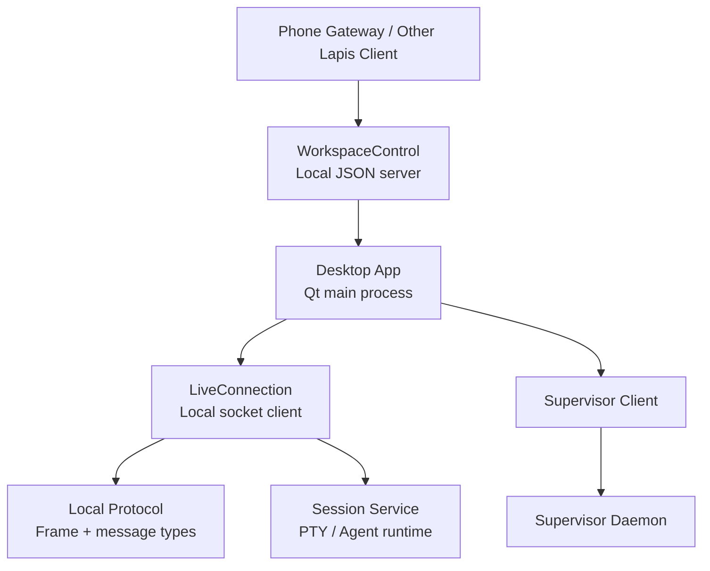
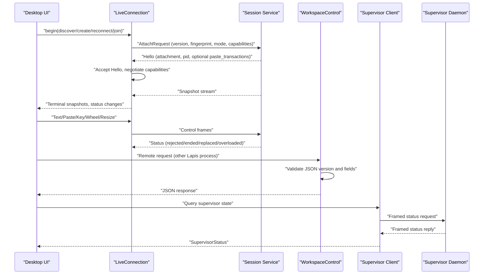
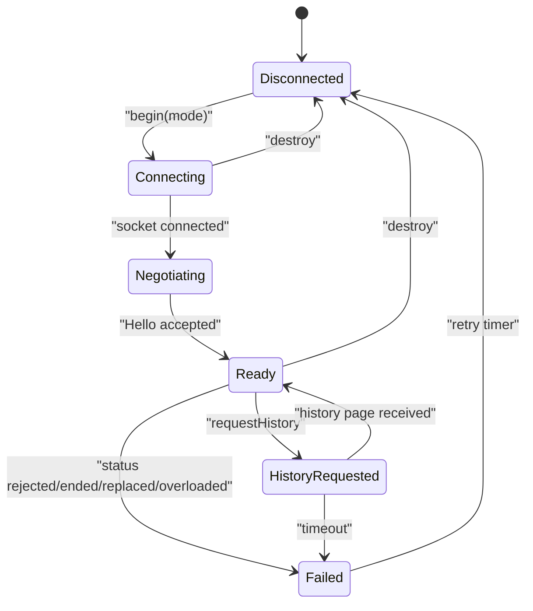
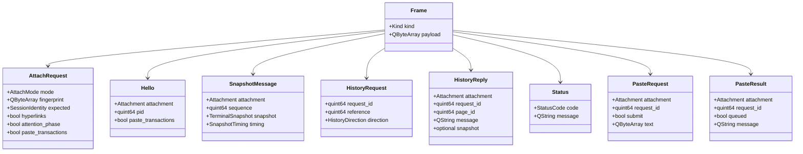
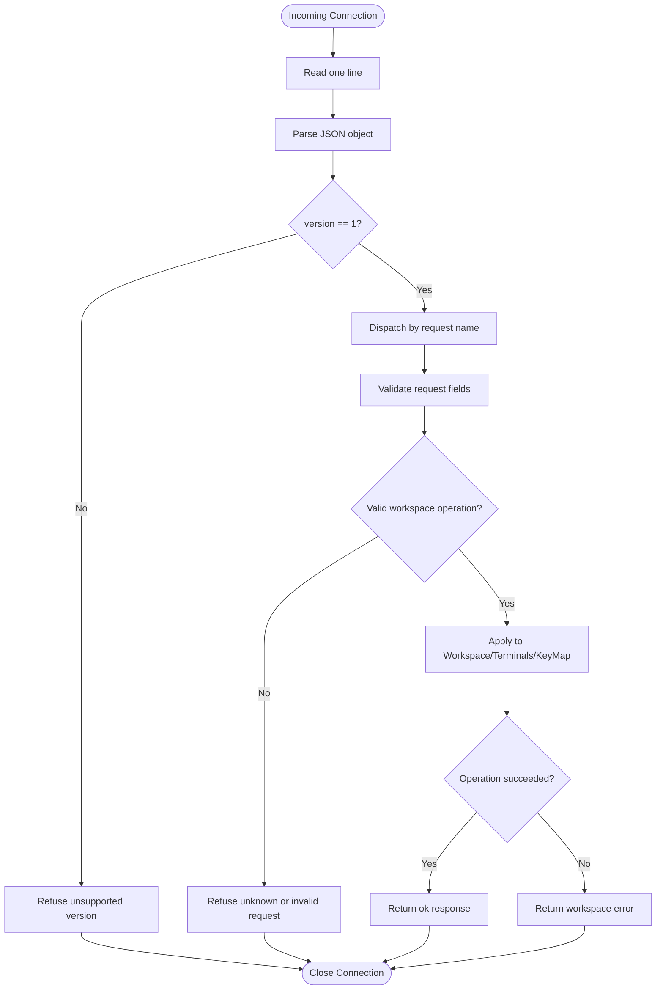
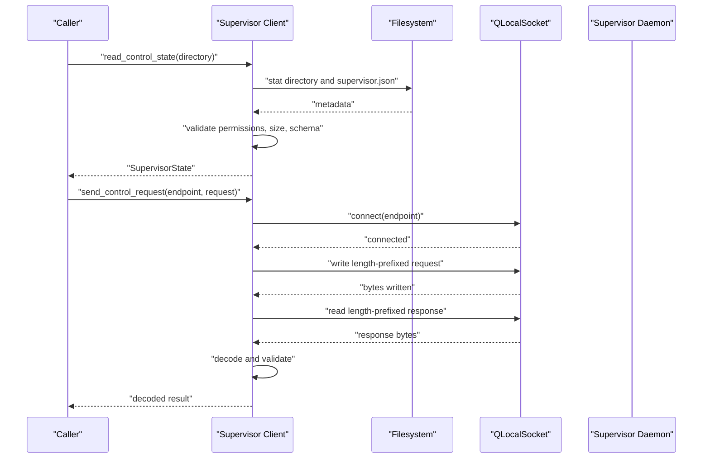
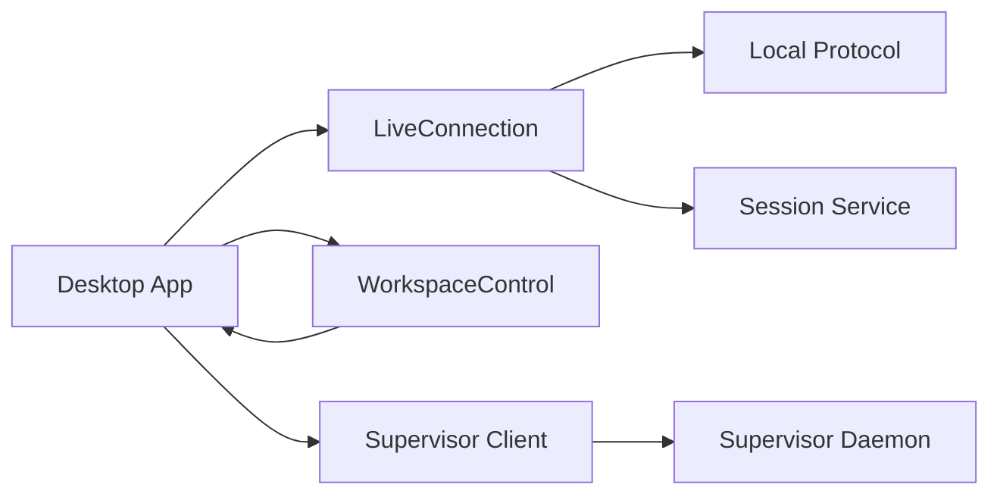

# Background Service Integration

<cite>
**Referenced Files in This Document**
- [live_connection.hpp](file://apps/desktop/src/live_connection.hpp)
- [live_connection.cpp](file://apps/desktop/src/live_connection.cpp)
- [local_protocol.hpp](file://services/session/src/transport/local_protocol.hpp)
- [local_protocol.cpp](file://services/session/src/transport/local_protocol.cpp)
- [workspace_control.hpp](file://apps/desktop/src/workspace_control.hpp)
- [workspace_control.cpp](file://apps/desktop/src/workspace_control.cpp)
- [client.hpp](file://services/supervisor/include/lapis/supervisor/client.hpp)
- [client.cpp](file://services/supervisor/src/client.cpp)
</cite>

## Table of Contents
1. [Introduction](#introduction)
2. [Project Structure](#project-structure)
3. [Core Components](#core-components)
4. [Architecture Overview](#architecture-overview)
5. [Detailed Component Analysis](#detailed-component-analysis)
6. [Dependency Analysis](#dependency-analysis)
7. [Performance Considerations](#performance-considerations)
8. [Troubleshooting Guide](#troubleshooting-guide)
9. [Conclusion](#conclusion)

## Introduction
This document explains how the Lapis desktop application integrates with background services. It focuses on four interconnected layers:

- The local IPC wire format used by session services.
- `LiveConnection`, which establishes, negotiates, and maintains a live connection to a session service for terminal output, input, history, and lifecycle control.
- `WorkspaceControl`, which exposes a local Unix-domain socket API so other Lapis processes such as the phone gateway can manage the main workspace.
- The supervisor client, which discovers, queries, and controls the Lapis supervisor daemon responsible for process lifecycle, service discovery, and state persistence.

The goal is to make these integration points clear enough for developers adding new services or clients, while also providing concrete troubleshooting guidance for connection failures, protocol mismatches, and service restarts.

## Project Structure
The relevant implementation is split between the desktop Qt application and the C++ session and supervisor services:

**Diagram sources**
- [live_connection.hpp:20-116](file://apps/desktop/src/live_connection.hpp#L20-L116)
- [local_protocol.hpp:1-196](file://services/session/src/transport/local_protocol.hpp#L1-L196)
- [workspace_control.hpp:10-70](file://apps/desktop/src/workspace_control.hpp#L10-L70)
- [client.hpp:1-34](file://services/supervisor/include/lapis/supervisor/client.hpp#L1-L34)

**Section sources**
- [live_connection.hpp:1-116](file://apps/desktop/src/live_connection.hpp#L1-L116)
- [workspace_control.hpp:1-70](file://apps/desktop/src/workspace_control.hpp#L1-L70)
- [local_protocol.hpp:1-196](file://services/session/src/transport/local_protocol.hpp#L1-L196)
- [client.hpp:1-34](file://services/supervisor/include/lapis/supervisor/client.hpp#L1-L34)

## Core Components
This section summarizes each major component and its responsibility in the background-service integration.

| Component | Location | Responsibility | Key Behaviors |
|---|---|---|---|
| `LiveConnection` | Desktop app | Establishes and manages a local socket connection to a session service. | Connects, negotiates attach mode, handles hello/snapshot/status, resizes, sends text/paste/key/wheel, manages history requests, retries failed connections, and persists identity. |
| Local Protocol (`lapis::session::wire`) | Session service | Defines the wire format for IPC between the desktop app and session services. | Frame framing, version 6, attachment identities, attach/hello/snapshot/control/history/ready/status messages, paste transactions, wheel input, and strict bounds checking. |
| `WorkspaceControl` | Desktop app | Listens on a local Unix-domain socket for commands from other Lapis processes. | Parses one-line JSON per request, dispatches handlers for harnesses, agents, categories, terminals, settings, and handover; enforces version 1 and validates fields. |
| Supervisor Client | Supervisor service | Talks to the supervisor daemon over a local control endpoint. | Encodes/decodes status and stop requests, reads persisted state, connects via `QLocalSocket`, frames requests/responses with length prefixes, and enforces timeouts and file permissions. |

**Section sources**
- [live_connection.hpp:20-116](file://apps/desktop/src/live_connection.hpp#L20-L116)
- [local_protocol.hpp:1-196](file://services/session/src/transport/local_protocol.hpp#L1-L196)
- [workspace_control.hpp:10-70](file://apps/desktop/src/workspace_control.hpp#L10-L70)
- [client.hpp:1-34](file://services/supervisor/include/lapis/supervisor/client.hpp#L1-L34)

## Architecture Overview
At runtime, the desktop app owns the user interface and may launch or connect to a session service. `LiveConnection` is the single client abstraction for that session. `WorkspaceControl` provides an internal RPC surface for sibling Lapis processes. The supervisor client coordinates with the long-lived supervisor daemon.

**Diagram sources**
- [live_connection.cpp:201-500](file://apps/desktop/src/live_connection.cpp#L201-L500)
- [local_protocol.hpp:1-196](file://services/session/src/transport/local_protocol.hpp#L1-L196)
- [workspace_control.cpp:1-200](file://apps/desktop/src/workspace_control.cpp#L1-L200)
- [client.cpp:200-249](file://services/supervisor/src/client.cpp#L200-L249)

## Detailed Component Analysis

### LiveConnection: Local Socket Client and Reconnection Manager
`LiveConnection` is a Qt `QObject` that encapsulates one session service connection. It does not directly own the underlying terminal rendering; instead it interacts with `SessionPreview`, which owns the visible screen and history strip.

#### Responsibilities
- Construct with a session endpoint, launch specification, attach mode, descriptor store, and optional launcher.
- Start the connection asynchronously through `begin`.
- Negotiate protocol version and capabilities using `AttachRequest` and `Hello`.
- Receive `SnapshotEnvelope` payloads and forward decoded snapshots to the preview layer.
- Send user input: `text`, `paste`, `key`, and `wheel`.
- Manage terminal resize coordination, including coalescing and replay when another device resized the agent.
- Request historical pages through `history_request`/`history_page`.
- Handle status frames such as rejected, ended, replaced, or overloaded.
- Retry connection attempts up to a bounded number of times.
- Persist session identity information for later reconnection.

#### State Machine

**Diagram sources**
- [live_connection.hpp:20-116](file://apps/desktop/src/live_connection.hpp#L20-L116)
- [live_connection.cpp:201-500](file://apps/desktop/src/live_connection.cpp#L201-L500)

#### Connection Lifecycle and Reconnection Logic
- `begin` chooses the attach mode: discover, reconnect, create, or join.
- A retry timer drives repeated connection attempts after failures.
- A handshake timer enforces synchronization deadlines; codex sessions use a longer timeout than ordinary terminal sessions.
- On failure, the connection reports an error and resets state, allowing higher-level UI to show connection state.
- Identity persistence allows later reconnect flows to target an existing session.

**Section sources**
- [live_connection.hpp:20-116](file://apps/desktop/src/live_connection.hpp#L20-L116)
- [live_connection.cpp:201-500](file://apps/desktop/src/live_connection.cpp#L201-L500)

#### Input, Paste Transactions, and Wheel Handling
- Text and key input go through normal control frames.
- Paste input can use either regular paste frames or negotiated paste transactions. Paste transactions allow bounded paste admission with explicit `paste_request` and `paste_result` frames.
- Wheel input is version-gated: it is only sent when the snapshot indicates the service accepts wheel input. Wheel events are clamped and tracked so full-screen program navigation can be recovered if the connection drops mid-wheel sequence.

**Section sources**
- [local_protocol.hpp:1-196](file://services/session/src/transport/local_protocol.hpp#L1-L196)
- [live_connection.cpp:201-500](file://apps/desktop/src/live_connection.cpp#L201-L500)

#### History Management
- History requests are issued with a monotonically increasing request ID.
- Outstanding history requests have a timeout; missing replies cancel the request and mark the page as canceled so future navigation avoids repeating it.
- The preview layer composes live output with historical pages and supports scrolling older/newer content.

**Section sources**
- [local_protocol.hpp:1-196](file://services/session/src/transport/local_protocol.hpp#L1-L196)
- [live_connection.cpp:201-500](file://apps/desktop/src/live_connection.cpp#L201-L500)

### LocalProtocol: Wire Format for IPC Communication
The local protocol defines the byte-level contract between the desktop app and session services. It uses a frame wrapper plus typed payloads.

#### Frame Format
Each frame has:
- A 4-byte big-endian payload size.
- A 1-byte kind.
- The payload bytes.

The maximum frame size is 8 MiB, and malformed or oversized frames throw rather than silently accepting data.

#### Message Types
| Kind | Direction | Purpose |
|---|---|---|
| `hello` | Service → Client | Attaches identity, PID, and capability flags. |
| `snapshot` | Service → Client | Terminal screen update with timing metadata. |
| `text` | Client → Service | Raw input bytes. |
| `paste` | Client → Service | Legacy paste payload. |
| `key` | Client → Service | Key code plus modifier flags. |
| `resize` | Client → Service | Terminal size change. |
| `status` | Service → Client | Lifecycle and error status. |
| `attach` | Client → Service | Attach negotiation. |
| `ready` | Service → Client | Acknowledgement of first applied snapshot sequence. |
| `history_request` | Client → Service | Request historical page. |
| `history_page` | Service → Client | Historical terminal snapshot. |
| `attention_snapshot` | Service → Client | Attention-related screen updates. |
| `attention_decision` | Client → Service | User attention decision. |
| `attention_retry` | Service → Client | Attention retry signal. |
| `terminate` | Client → Service | Ask service to end agent process. |
| `wheel` | Client → Service | Full-screen program wheel input. |
| `paste_request` | Client → Service | Bounded paste transaction request. |
| `paste_result` | Service → Client | Admission result for paste transaction. |

#### Attach Mode and Versioning
- `AttachMode` values include discover, reconnect, create, and join.
- The protocol version is fixed at 6.
- Optional capability bits advertise hyperlink support, attention-phase support, and paste-transaction support.
- Discover and join require anonymous identities; reconnect requires both session ID and epoch; create requires a nonzero session ID and zero epoch.

#### Attachment Identity
Every meaningful frame carries an attachment containing:
- A 16-byte session ID.
- A 16-byte epoch.
- A generation counter.

This enables clients and services to detect stale or replaced sessions.

#### Error Handling
- Status codes include rejected, ended, replaced, and overloaded.
- Many decoder functions validate field sizes, ranges, UTF-8 validity, monotonic counters, and structural constraints.
- Invalid inputs throw exceptions instead of producing partial objects.

#### Data Structures Summary

**Diagram sources**
- [local_protocol.hpp:1-196](file://services/session/src/transport/local_protocol.hpp#L1-L196)
- [local_protocol.cpp:200-535](file://services/session/src/transport/local_protocol.cpp#L200-L535)

**Section sources**
- [local_protocol.hpp:1-196](file://services/session/src/transport/local_protocol.hpp#L1-L196)
- [local_protocol.cpp:1-535](file://services/session/src/transport/local_protocol.cpp#L1-L535)

### WorkspaceControl: Cross-Process Workspace API
`WorkspaceControl` exposes a local Unix-domain socket server that other Lapis processes can use to interact with the workspace owned by the desktop process.

#### Endpoint and Security
- The socket path is derived from the workspace registry directory and ends with `workspace-control.sock`.
- The server removes any leftover socket from a previous dead process before listening.
- The server sets `UserAccessOption`, restricting access to the current user.
- Each incoming connection is limited to one request/response pair and closed after a short idle timeout.
- Requests are limited to 16 KiB, and responses are one compact JSON line terminated by a newline.

#### Request Model
All requests share this shape:
- Top-level `version`: currently required to be `1`.
- Top-level `request`: the operation name.
- Operation-specific fields.

Supported operations include:
- `harnesses`: list available harnesses and defaults.
- `createAgent`: start an agent with category, harness, directory, and optional metadata.
- Category management: `createCategory`, `renameCategory`, `removeCategory`, `placeCategory`.
- Agent management: `closeAgent`, `renameAgent`, `placeAgent`, `restartAgent`.
- Terminal management: `openTerminal`, `closeTerminal`.
- Settings: `settings`, `changeSettings`.
- `handover`: ask the windowless host to transfer ownership of the registry.

#### Validation and Refusals
- Unknown request names return a refusal.
- Missing or invalid fields return a refusal with a descriptive message.
- Workspace-level failures delegate to the workspace’s error string.
- Handover is only honored by the windowless host; a windowed process refuses it.

**Diagram sources**
- [workspace_control.cpp:1-200](file://apps/desktop/src/workspace_control.cpp#L1-L200)
- [workspace_control.cpp:200-341](file://apps/desktop/src/workspace_control.cpp#L200-L341)

**Section sources**
- [workspace_control.hpp:10-70](file://apps/desktop/src/workspace_control.hpp#L10-L70)
- [workspace_control.cpp:1-341](file://apps/desktop/src/workspace_control.cpp#L1-L341)

### Supervisor Client: Process Lifecycle and Service Discovery
The supervisor client talks to the supervisor daemon over a local control endpoint. It is responsible for reading persisted state, encoding control requests, and decoding status replies.

#### Control Messages
- `encode_status_request`: produces a JSON request asking for supervisor status.
- `encode_stop_request`: produces an authenticated stop request using the spawn token and instance epoch.
- `decode_status_reply`: parses a structured status response into `SupervisorStatus`.
- `send_control_request`: connects to the endpoint, writes a length-framed request, reads a length-framed response, and applies a global timeout.

#### State Persistence
- `read_control_state` reads `/supervisor.json` under a private directory.
- File and directory permissions are validated: owner-only directories and files, no world/group write bits, regular file type, single link, and size bound.
- The persisted state is decoded through a JSON codec and validated for schema version.

#### Status Fields
| Field | Meaning |
|---|---|
| `schema_version` | Supervisor state schema version. |
| `enabled` | Whether supervisor-managed sessions are enabled. |
| `service_live` | Whether the associated service appears live. |
| `reconstructable` | Whether the session can be reconstructed from persisted launch info. |
| `instance_epoch` | Supervisor instance identifier. |
| `slot` | Empty, started, or stopped. |
| `blocked_reason` | Human-readable reason why a session cannot proceed. |
| `endpoint` | Control endpoint when a live service exists. |

**Diagram sources**
- [client.cpp:1-200](file://services/supervisor/src/client.cpp#L1-L200)
- [client.cpp:200-249](file://services/supervisor/src/client.cpp#L200-L249)
- [client.hpp:1-34](file://services/supervisor/include/lapis/supervisor/client.hpp#L1-L34)

**Section sources**
- [client.hpp:1-34](file://services/supervisor/include/lapis/supervisor/client.hpp#L1-L34)
- [client.cpp:1-249](file://services/supervisor/src/client.cpp#L1-L249)

## Dependency Analysis
The components form a layered dependency graph where the desktop app depends on both the session wire protocol and the supervisor client, while `WorkspaceControl` bridges external Lapis processes into the workspace.

**Diagram sources**
- [live_connection.hpp:1-116](file://apps/desktop/src/live_connection.hpp#L1-L116)
- [workspace_control.hpp:1-70](file://apps/desktop/src/workspace_control.hpp#L1-L70)
- [client.hpp:1-34](file://services/supervisor/include/lapis/supervisor/client.hpp#L1-L34)
- [local_protocol.hpp:1-196](file://services/session/src/transport/local_protocol.hpp#L1-L196)

### Coupling and Cohesion
- `LiveConnection` is tightly coupled to `session::wire` because it constructs and consumes attach, hello, snapshot, control, history, ready, and status frames.
- `WorkspaceControl` is cohesive around one responsibility: translating safe, versioned JSON requests into workspace operations.
- `SupervisorClient` is cohesive around serialized JSON control messages and filesystem-backed state validation.
- External callers depend on stable APIs: `LiveConnection` for session connectivity, `WorkspaceControl` for workspace RPC, and `SupervisorClient` for supervisor state.

### Potential Risks
- Over-reliance on local Unix-domain sockets means broken pipes, stale sockets, and permission issues must be handled explicitly.
- Protocol version mismatches can cause silent or noisy failures if capability negotiation is not checked.
- Large pastes and snapshots are bounded but still require careful buffering and timeout handling.
- Supervisor state files must remain private; otherwise security checks fail.

**Section sources**
- [live_connection.hpp:20-116](file://apps/desktop/src/live_connection.hpp#L20-L116)
- [workspace_control.cpp:1-200](file://apps/desktop/src/workspace_control.cpp#L1-L200)
- [client.cpp:1-249](file://services/supervisor/src/client.cpp#L1-L249)
- [local_protocol.hpp:1-196](file://services/session/src/transport/local_protocol.hpp#L1-L196)

## Performance Considerations
- **Frame size limits:** Frames are capped at 8 MiB to prevent unbounded memory growth. Clients should avoid sending oversized pastes or snapshots.
- **Paste batching:** Large pastes are split into multiple text messages when paste transactions are unavailable. When paste transactions are negotiated, bounded paste admission reduces queue pressure.
- **Snapshot streaming:** `SnapshotEnvelope` allows deferred decoding of the screen buffer until the screen is actually shown, reducing unnecessary CPU work for hidden viewers.
- **Resize coalescing:** Resize requests are coordinated with terminal state and sequence numbers to avoid redundant redraws and to recover from remote resize races.
- **History pacing:** History decodes and viewer intervals are paced so bursts of screens do not overwhelm the UI thread.
- **Timeouts:** Codex sync, terminal sync, history requests, and supervisor control all use explicit timeouts to avoid hanging indefinitely.

[No sources needed since this section provides general guidance based on already analyzed files]

## Troubleshooting Guide

### LiveConnection Fails to Connect
**Symptoms:**
- UI shows no terminal output.
- Connection state remains disconnected or repeatedly reconnecting.

**Likely Causes:**
- Session service did not start or exited.
- Endpoint path is wrong.
- Attach mode mismatch.
- Capability negotiation failed.

**Checks:**
- Verify `begin` is called with the intended attach mode.
- Check whether the retry timer fires repeatedly.
- Inspect status frames for `rejected`, `ended`, `replaced`, or `overloaded`.
- Confirm the service responds with a valid `Hello`.

**Relevant Implementation Areas:**
- Connection setup, timers, and retry logic.
- Attach negotiation and hello acceptance.
- Status handling.

**Section sources**
- [live_connection.hpp:20-116](file://apps/desktop/src/live_connection.hpp#L20-L116)
- [live_connection.cpp:201-500](file://apps/desktop/src/live_connection.cpp#L201-L500)
- [local_protocol.hpp:1-196](file://services/session/src/transport/local_protocol.hpp#L1-L196)

### Protocol Version or Capability Mismatch
**Symptoms:**
- Service rejects attach.
- Wheel input is ignored.
- Paste transactions are unavailable.
- History `at` direction fails.

**Likely Causes:**
- Service is built against an older protocol version.
- Capability bits were not advertised.
- Client sent a newer feature without checking service capability.

**Checks:**
- Confirm protocol version is compatible.
- Check capability bits in `AttachRequest` and `Hello`.
- Avoid sending wheel or paste transactions unless the service advertises support.
- Use history directions only when the service reports page placement metadata.

**Section sources**
- [local_protocol.hpp:1-196](file://services/session/src/transport/local_protocol.hpp#L1-L196)
- [local_protocol.cpp:200-535](file://services/session/src/transport/local_protocol.cpp#L200-L535)

### Paste Fails or Is Dropped
**Symptoms:**
- Paste does not appear in the agent.
- Large paste is rejected.
- Paste acknowledgment is missing.

**Likely Causes:**
- Paste transactions not negotiated.
- Paste exceeds maximum allowed size.
- Service PTY queue is overloaded.
- History reconciliation is active, blocking input.

**Checks:**
- Prefer paste transactions when supported.
- Ensure paste text is within `max_paste_bytes`.
- Check `paste_result` for `queued` and message.
- Do not send paste while history is being reconciled.

**Section sources**
- [local_protocol.hpp:1-196](file://services/session/src/transport/local_protocol.hpp#L1-L196)
- [live_connection.cpp:201-500](file://apps/desktop/src/live_connection.cpp#L201-L500)

### History Navigation Hangs
**Symptoms:**
- Scrolling back freezes.
- History page never arrives.
- UI shows a timeout message.

**Likely Causes:**
- Service did not respond to the history request.
- Request ID was canceled or exhausted.
- History timeout expired.

**Checks:**
- Verify `request_id` is nonzero and monotonic.
- Check whether the request was marked canceled.
- Inspect history timeout behavior.
- Confirm the service returns a proper `history_page` with placement metadata when using `at`.

**Section sources**
- [live_connection.hpp:20-116](file://apps/desktop/src/live_connection.hpp#L20-L116)
- [live_connection.cpp:201-500](file://apps/desktop/src/live_connection.cpp#L201-L500)
- [local_protocol.hpp:1-196](file://services/session/src/transport/local_protocol.hpp#L1-L196)

### WorkspaceControl Requests Are Refused
**Symptoms:**
- Phone gateway or other Lapis process receives `ok: false`.
- Error message says malformed request, unsupported version, unknown request, missing field, or workspace refused.

**Likely Causes:**
- Request JSON is malformed.
- `version` is not `1`.
- Required fields are missing or have wrong types.
- Workspace is in an error state.
- Operation is not allowed on the current host.

**Checks:**
- Validate JSON structure and field types.
- Use version `1`.
- For settings, ensure only supported keys and value ranges are changed.
- For handover, confirm the process is the windowless host.

**Section sources**
- [workspace_control.cpp:1-200](file://apps/desktop/src/workspace_control.cpp#L1-L200)
- [workspace_control.cpp:200-341](file://apps/desktop/src/workspace_control.cpp#L200-L341)

### Supervisor State or Control Fails
**Symptoms:**
- Reading supervisor state throws an error.
- Control request times out.
- Stop request is rejected due to missing token.

**Likely Causes:**
- State directory or file permissions are incorrect.
- State file is corrupted or outside size bounds.
- Supervisor endpoint is unreachable.
- Spawn token is missing.

**Checks:**
- Verify directory and file ownership and permission bits.
- Confirm state file is a regular file with a single link.
- Check endpoint path format and reachability.
- Ensure the stored state includes a spawn token for stop operations.

**Section sources**
- [client.cpp:1-200](file://services/supervisor/src/client.cpp#L1-L200)
- [client.cpp:200-249](file://services/supervisor/src/client.cpp#L200-L249)

## Conclusion
Lapis’s background-service integration is built around three clear boundaries:

- The local protocol defines a strict, versioned, and capacity-aware IPC format between the desktop app and session services.
- `LiveConnection` implements robust connection management, capability negotiation, input delivery, history reconciliation, and error recovery.
- `WorkspaceControl` provides a safe, versioned RPC surface for sibling Lapis processes to manage the workspace without exposing arbitrary internals.
- The supervisor client isolates supervisor communication, state validation, and control messaging behind typed encoders and decoders.

When diagnosing problems, start by identifying which boundary failed: transport connection, protocol capability, workspace RPC validation, or supervisor state. Then inspect the corresponding frame, JSON request, or file permission checks. This separation makes it possible to evolve each layer independently while keeping the desktop app resilient to service restarts, protocol upgrades, and cross-process errors.

[No sources needed since this section summarizes without analyzing specific files]