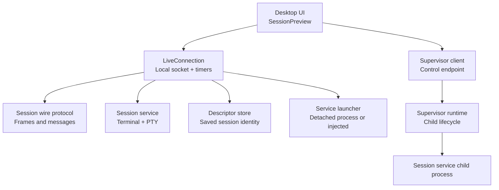
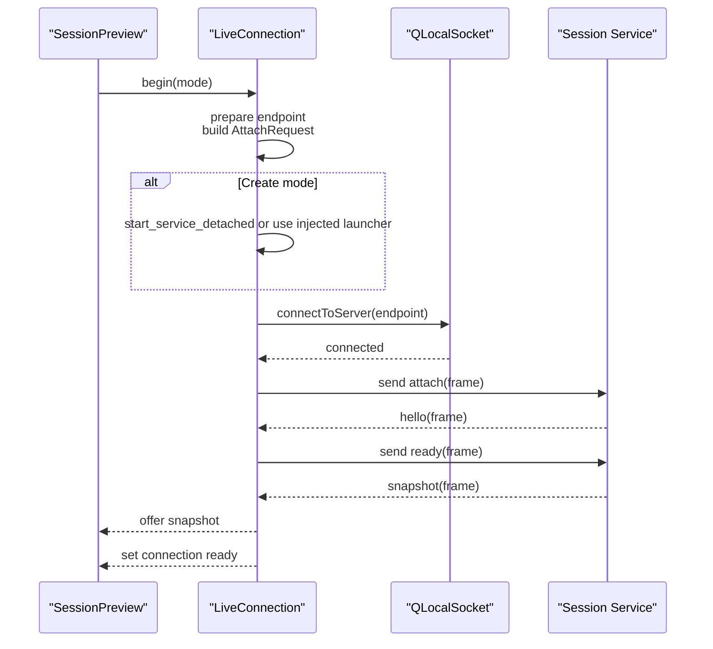
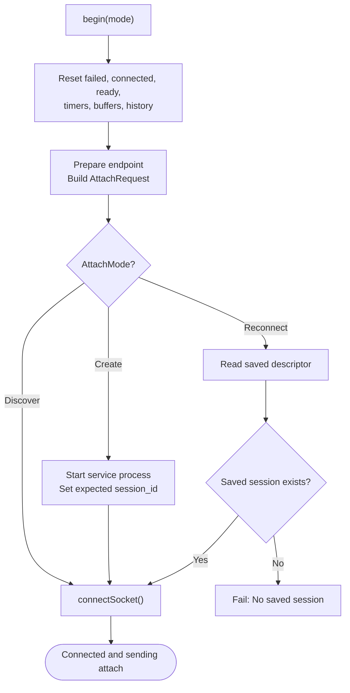
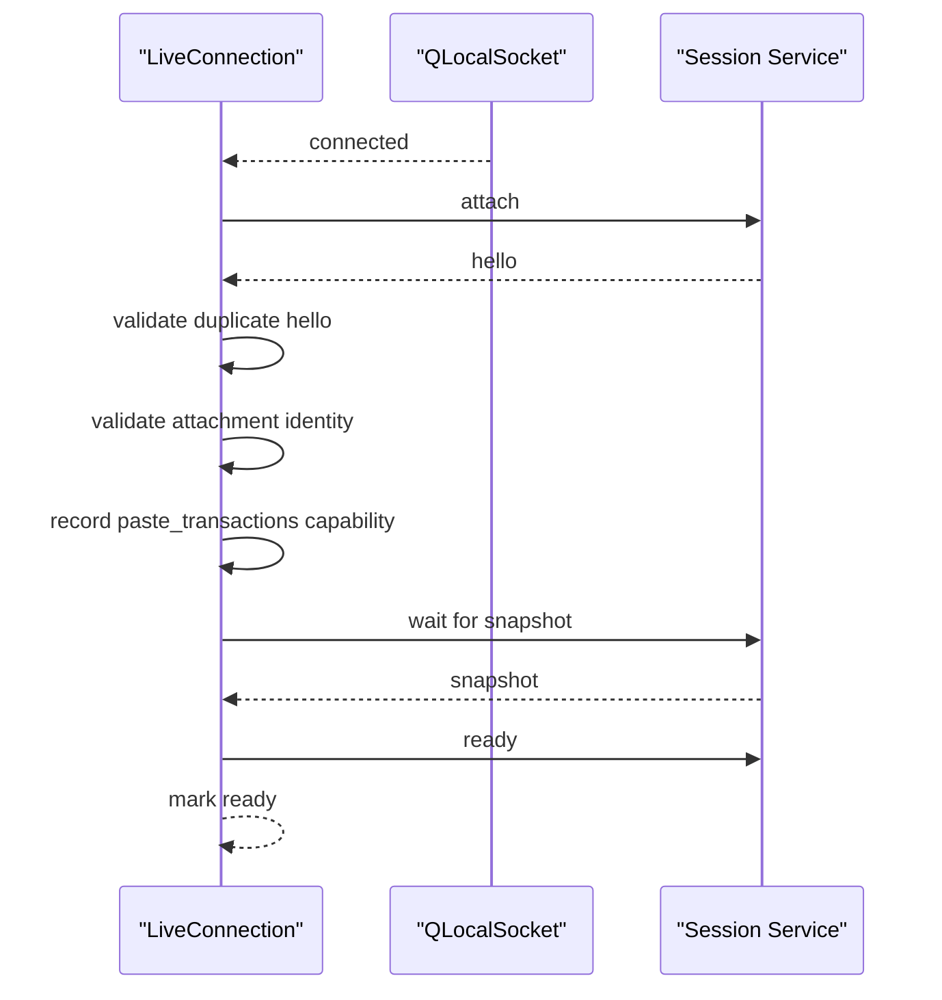
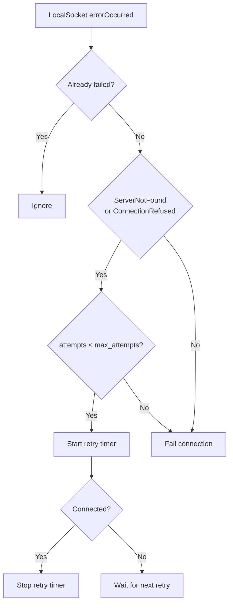
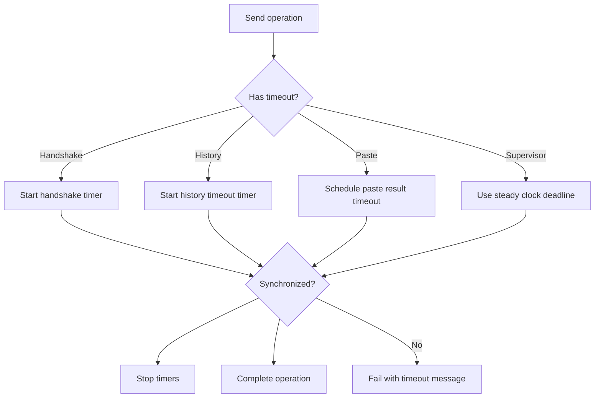
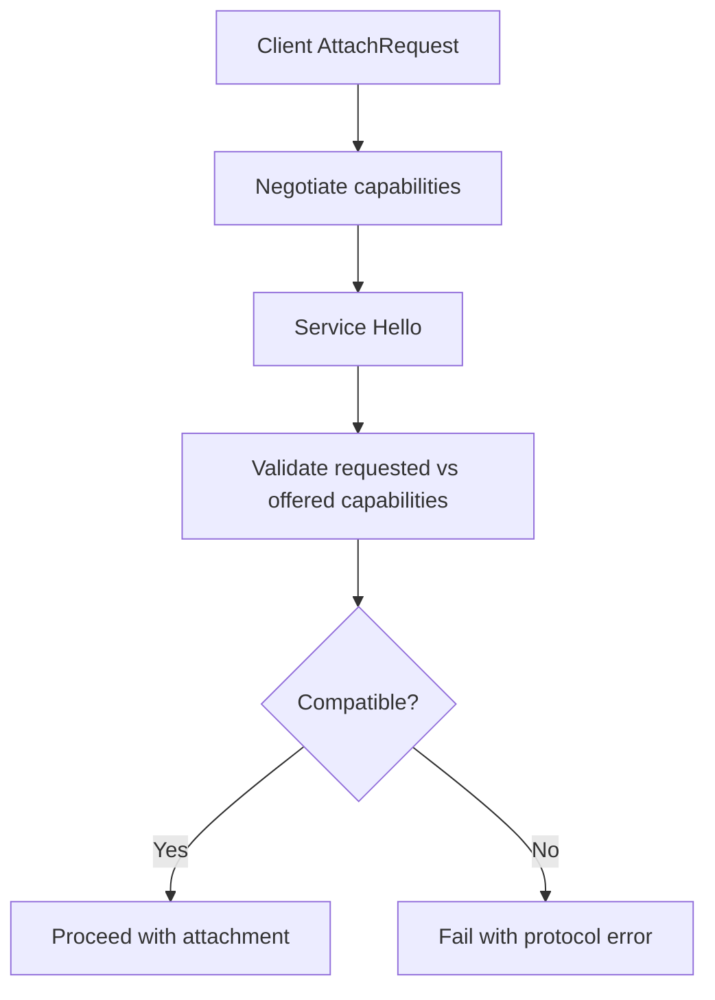
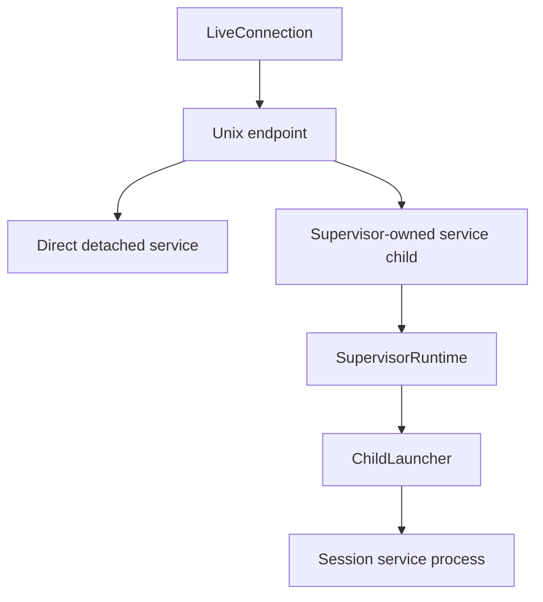
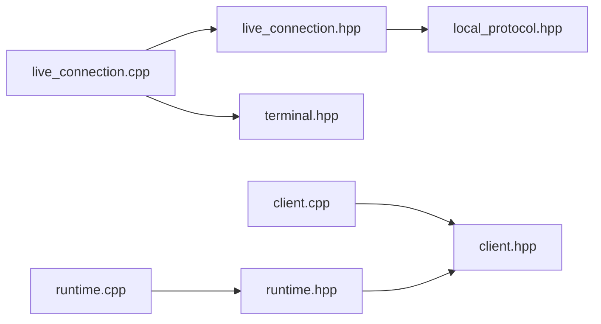

# Connection Management

<cite>
**Referenced Files in This Document**
- [live_connection.hpp](file://apps/desktop/src/live_connection.hpp)
- [live_connection.cpp](file://apps/desktop/src/live_connection.cpp)
- [local_protocol.hpp](file://services/session/src/transport/local_protocol.hpp)
- [terminal.hpp](file://services/session/include/lapis/session/terminal.hpp)
- [client.hpp](file://services/supervisor/include/lapis/supervisor/client.hpp)
- [client.cpp](file://services/supervisor/src/client.cpp)
- [runtime.hpp](file://services/supervisor/include/lapis/supervisor/runtime.hpp)
- [runtime.cpp](file://services/supervisor/src/runtime.cpp)
</cite>

## Table of Contents
1. [Introduction](#introduction)
2. [Project Structure](#project-structure)
3. [Core Components](#core-components)
4. [Architecture Overview](#architecture-overview)
5. [Detailed Component Analysis](#detailed-component-analysis)
6. [Dependency Analysis](#dependency-analysis)
7. [Performance Considerations](#performance-considerations)
8. [Troubleshooting Guide](#troubleshooting-guide)
9. [Conclusion](#conclusion)
10. [Appendices](#appendices)

## Introduction
This document explains how the Lapis desktop application manages connections to its local session services and supervisor processes. It focuses on the `LiveConnection` class, which is the central connection manager for terminal sessions, and contrasts it with the supervisor client used for service lifecycle control. The documentation covers discovery, attachment, protocol negotiation, reconnection, resource cleanup, retry behavior, timeouts, monitoring hooks, and operational best practices.

The connection layer does not implement a generic network pool or an explicit circuit breaker. Instead, it uses:
- A single active local socket per session preview.
- A bounded retry loop for transient transport failures.
- Capability-based feature negotiation between client and service.
- Supervisor-managed child process lifecycle when services are launched through the supervisor runtime.
- Direct detached process launching when no launcher is provided.

## Project Structure
The connection management code spans three main areas:

| Area | Responsibility | Key Files |
| --- | --- | --- |
| Desktop session connection | Local Unix-domain socket handling, attach/hello/snapshot lifecycle, history, paste, resize, retry, and persistence | `apps/desktop/src/live_connection.{hpp,cpp}` |
| Session wire protocol | Frame types, message encoders/decoders, limits, version, capabilities, identity, and history model | `services/session/src/transport/local_protocol.hpp`, `services/session/include/lapis/session/terminal.hpp` |
| Supervisor integration | Control endpoint client, child process ownership, launch, restart policy, and convergence | `services/supervisor/{include,lapis/supervisor/*}`, `services/supervisor/src/{client.cpp,runtime.cpp}` |

**Diagram sources**
- [live_connection.hpp:1-116](file://apps/desktop/src/live_connection.hpp#L1-L116)
- [live_connection.cpp:1-200](file://apps/desktop/src/live_connection.cpp#L1-L200)
- [local_protocol.hpp:1-196](file://services/session/src/transport/local_protocol.hpp#L1-L196)
- [client.hpp:1-34](file://services/supervisor/include/lapis/supervisor/client.hpp#L1-L34)
- [runtime.hpp:1-151](file://services/supervisor/include/lapis/supervisor/runtime.hpp#L1-L151)

**Section sources**
- [live_connection.hpp:1-116](file://apps/desktop/src/live_connection.hpp#L1-L116)
- [local_protocol.hpp:1-196](file://services/session/src/transport/local_protocol.hpp#L1-L196)
- [client.hpp:1-34](file://services/supervisor/include/lapis/supervisor/client.hpp#L1-L34)
- [runtime.hpp:1-151](file://services/supervisor/include/lapis/supervisor/runtime.hpp#L1-L151)

## Core Components

### LiveConnection
`LiveConnection` owns one active connection to a session service. Its responsibilities include:
- Preparing the local endpoint path.
- Building attach requests based on discovery, creation, reconnect, or join modes.
- Creating and managing a `QLocalSocket`.
- Running handshake timers for synchronization.
- Reconnecting after transient errors up to a fixed attempt limit.
- Handling hello, snapshot, history, attention, paste, resize, status, and termination frames.
- Persisting the session identity so reconnects can target an existing service.
- Exposing capability flags such as paste transactions.

Important state fields include:
- `socket_`: current local socket.
- `retry_`: retry timer for transient connection errors.
- `handshake_`: timeout timer for session synchronization.
- `history_timeout_`: timeout timer for history requests.
- `attachment_`: verified service attachment identity.
- `paste_transactions_`: negotiated paste transaction capability.
- `connected_`, `ready_`, `failed_`: connection lifecycle flags.
- `attempts_`: number of connect attempts.
- `last_sequence_`, `resize_sent_after_sequence_`: sequence tracking for snapshots and resizes.
- `pending_pastes_`: pending confirmed paste acknowledgements.

**Section sources**
- [live_connection.hpp:18-116](file://apps/desktop/src/live_connection.hpp#L18-L116)
- [live_connection.cpp:350-480](file://apps/desktop/src/live_connection.cpp#L350-L480)

### Session Wire Protocol
The wire protocol defines the frame-level contract between the desktop client and the session service. Key elements include:
- `version`: current protocol version.
- `Kind`: frame type enumeration including hello, attach, ready, snapshot, text, paste, key, resize, history, wheel, paste_request, paste_result, and status.
- `AttachMode`: discover, reconnect, create, join.
- `AttachRequest`: mode, fingerprint, expected identity, and optional capability bits.
- `Hello`: returned attachment, service PID, and negotiated capabilities.
- `SnapshotEnvelope`: attachment, sequence, timing, size, and encoded screen payload.
- `HistoryRequest` / `HistoryReply`: request ID, direction, reference page or row, and page snapshot.
- `PasteRequest` / `PasteResult`: bounded paste payload with admission confirmation.
- `StatusCode`: rejected, ended, replaced, overloaded.

Limits protect memory and I/O:
- Maximum frame size.
- Maximum input and paste sizes.
- Maximum cells and codepoints.
- Snapshot header size.

**Section sources**
- [local_protocol.hpp:1-196](file://services/session/src/transport/local_protocol.hpp#L1-L196)

### Supervisor Client
The supervisor client communicates with the supervisor’s control endpoint over a local Unix socket. It:
- Encodes and decodes JSON control requests and replies.
- Validates schema versions, field sets, and values.
- Reads and validates the supervisor state file.
- Sends status and stop requests with a strict timeout.
- Enforces maximum control payload size.

Relevant constants:
- `supervisor_client_timeout_ms`: 5 seconds for control requests.

**Section sources**
- [client.hpp:1-34](file://services/supervisor/include/lapis/supervisor/client.hpp#L1-L34)
- [client.cpp:1-249](file://services/supervisor/src/client.cpp#L1-L249)

### Supervisor Runtime
The supervisor runtime owns the desired-to-actual convergence loop for a session service child process. It:
- Bootstraps desired state.
- Accepts local control requests after validation.
- Adopts an existing child if ownership matches.
- Launches a new child through a `ChildLauncher`.
- Terminates and releases children.
- Applies restart admission limits within a time window.
- Reports convergence states such as converged, started, restarted, stopped, disabled, exhausted, or failed.

Key constants:
- `max_control_clients`: maximum concurrent control peers.
- `control_client_timeout_ms`: control peer timeout.
- `max_restarts_per_window`: restart admissions allowed.
- `restart_window_ns`: restart admission window.

**Section sources**
- [runtime.hpp:1-151](file://services/supervisor/include/lapis/supervisor/runtime.hpp#L1-L151)
- [runtime.cpp:1-560](file://services/supervisor/src/runtime.cpp#L1-L560)

## Architecture Overview
The desktop application connects to a local session service using a single ordered stream. Discovery, creation, and reattach flows all go through `LiveConnection::begin`, which builds an attach request and connects to the prepared endpoint.

**Diagram sources**
- [live_connection.cpp:380-480](file://apps/desktop/src/live_connection.cpp#L380-L480)
- [live_connection.cpp:750-978](file://apps/desktop/src/live_connection.cpp#L750-L978)
- [local_protocol.hpp:1-196](file://services/session/src/transport/local_protocol.hpp#L1-L196)

## Detailed Component Analysis

### Connection Lifecycle: Discovery Through Active Use
`LiveConnection::begin` resets failure state, clears retry and handshake timers, clears buffers, invalidates history, and prepares the endpoint path. Depending on `AttachMode`:
- **Discover**: attaches without a saved session identity.
- **Create**: constructs command-line arguments, optionally launches the service process, and sets an expected session identity.
- **Reconnect**: reads a saved descriptor; if missing, fails with a clear user-facing message.

After preparation, it calls `connectSocket`, which creates a fresh `QLocalSocket`, installs signal handlers, and connects to the server.

**Diagram sources**
- [live_connection.cpp:380-480](file://apps/desktop/src/live_connection.cpp#L380-L480)
- [live_connection.cpp:601-680](file://apps/desktop/src/live_connection.cpp#L601-L680)

**Section sources**
- [live_connection.cpp:380-480](file://apps/desktop/src/live_connection.cpp#L380-L480)
- [live_connection.cpp:601-680](file://apps/desktop/src/live_connection.cpp#L601-L680)

### Initial Discovery and Attachment
On socket connection, `resetSocket` widens socket buffers, marks the connection as connected, starts the handshake timer, and sends the attach frame. The service responds with a hello frame containing the attachment identity, PID, and capabilities.

During hello handling:
- Duplicate hello detection prevents multiple attachments.
- Reconnect mode compares the returned attachment identity against the expected saved identity.
- Create mode checks that the returned session identity matches the requested one.
- Paste transaction capability is validated against the request.
- The attachment becomes the active attachment identity.
- The UI is updated to “synchronizing” while the initial snapshot arrives.

**Diagram sources**
- [live_connection.cpp:480-560](file://apps/desktop/src/live_connection.cpp#L480-L560)
- [live_connection.cpp:750-978](file://apps/desktop/src/live_connection.cpp#L750-L978)
- [local_protocol.hpp:1-196](file://services/session/src/transport/local_protocol.hpp#L1-L196)

**Section sources**
- [live_connection.cpp:480-560](file://apps/desktop/src/live_connection.cpp#L480-L560)
- [live_connection.cpp:750-978](file://apps/desktop/src/live_connection.cpp#L750-L978)

### Connection Pooling
`LiveConnection` does not implement a connection pool. Each `SessionPreview` holds one `LiveConnection`, and each `LiveConnection` owns exactly one `QLocalSocket`. There is no shared pool of sockets across previews or sessions.

Resource sharing occurs at higher levels:
- `session::DescriptorStore` may be shared to persist discovered session identities.
- The global Qt thread pool is used asynchronously for descriptor staging and commit.
- The supervisor runtime maintains one child process per authoritative session slot.

If a pool-like pattern is needed for custom extensions, it should be implemented outside `LiveConnection`, because this class is intentionally scoped to a single session preview.

**Section sources**
- [live_connection.hpp:31-116](file://apps/desktop/src/live_connection.hpp#L31-L116)
- [live_connection.cpp:350-480](file://apps/desktop/src/live_connection.cpp#L350-L480)
- [runtime.hpp:1-151](file://services/supervisor/include/lapis/supervisor/runtime.hpp#L1-L151)

### Automatic Reconnection Logic
When the local socket reports `ServerNotFoundError` or `ConnectionRefusedError` before being fully connected, `LiveConnection` retries up to `max_attempts`, currently 30. Each retry is scheduled through the `retry_` timer. On successful connection, the retry timer stops.

This is a fixed-capacity retry loop rather than exponential backoff:
- Attempts are counted.
- Only specific transient socket errors trigger retries.
- Other socket errors immediately fail the connection.
- Disconnection after readiness fails the connection and requires an explicit reconnect action from the UI.

**Diagram sources**
- [live_connection.cpp:520-600](file://apps/desktop/src/live_connection.cpp#L520-L600)
- [live_connection.cpp:601-680](file://apps/desktop/src/live_connection.cpp#L601-L680)

**Section sources**
- [live_connection.cpp:520-600](file://apps/desktop/src/live_connection.cpp#L520-L680)

### Circuit Breaker Patterns
There is no formal circuit breaker implementation in `LiveConnection`. However, several mechanisms provide similar resilience properties:
- Fixed retry limit prevents unbounded reconnection loops.
- Failed state blocks further input until a new `begin` call is made.
- Saved session identity enables targeted reconnects instead of blind discovery.
- Supervisor restart admission limits prevent rapid repeated child restarts.
- Status codes such as `ended` and `replaced` move the connection into a terminal failure state rather than continuing retries indefinitely.

For extension authors who need a true circuit breaker, wrap service calls with a short-circuit state that records recent failures and temporarily blocks new operations until a cooldown period passes.

**Section sources**
- [live_connection.hpp:31-116](file://apps/desktop/src/live_connection.hpp#L31-L116)
- [local_protocol.hpp:1-196](file://services/session/src/transport/local_protocol.hpp#L1-L196)
- [runtime.hpp:1-151](file://services/supervisor/include/lapis/supervisor/runtime.hpp#L1-L151)

### Retry Strategies and Backoff
Current retry behavior:
- Fixed delay via a single-shot timer.
- Up to 30 attempts for transient connection errors.
- No exponential backoff in the live connection layer.
- History requests have a separate timeout but do not automatically retry.
- Supervisor restarts use a bounded admission window rather than exponential backoff.

Recommended extension strategy:
- For transient network or transport failures, apply exponential backoff with jitter.
- Distinguish between recoverable and unrecoverable errors.
- Apply a maximum retry count and maximum total delay.
- Surface failure reasons to users when retries are exhausted.

**Section sources**
- [live_connection.cpp:520-600](file://apps/desktop/src/live_connection.cpp#L520-L600)
- [runtime.cpp:450-560](file://services/supervisor/src/runtime.cpp#L450-L560)

### Connection Timeout Handling
Timeouts are used in several places:
- Handshake timeout: waits for session synchronization after connect.
- History timeout: waits for a history reply.
- Paste result timeout: waits for paste admission acknowledgment.
- Supervisor control timeout: waits for status or stop responses.

**Diagram sources**
- [live_connection.cpp:350-480](file://apps/desktop/src/live_connection.cpp#L350-L480)
- [live_connection.cpp:680-750](file://apps/desktop/src/live_connection.cpp#L680-L750)
- [client.cpp:201-249](file://services/supervisor/src/client.cpp#L201-L249)

**Section sources**
- [live_connection.cpp:350-480](file://apps/desktop/src/live_connection.cpp#L350-L480)
- [live_connection.cpp:680-750](file://apps/desktop/src/live_connection.cpp#L680-L750)
- [client.cpp:201-249](file://services/supervisor/src/client.cpp#L201-L249)

### Resource Cleanup on Failures
Cleanup responsibilities include:
- Stopping retry and handshake timers.
- Aborting and disconnecting the socket.
- Clearing the read buffer.
- Invalidating outstanding history requests.
- Abandoning pending paste transactions.
- Cancelling asynchronous descriptor writes.
- Releasing supervisor-owned child endpoints.

On paste failure or disconnection, pending pastes are reported to the UI with a reason indicating that delivery was unknown and not retried.

**Section sources**
- [live_connection.cpp:320-380](file://apps/desktop/src/live_connection.cpp#L320-L380)
- [live_connection.cpp:601-680](file://apps/desktop/src/live_connection.cpp#L601-L680)
- [live_connection.cpp:700-750](file://apps/desktop/src/live_connection.cpp#L700-L750)
- [runtime.cpp:500-560](file://services/supervisor/src/runtime.cpp#L500-L560)

### Protocol Version Negotiation and Compatibility
The wire protocol exposes a fixed `version` constant. Compatibility is enforced primarily through:
- Attach request capability bits (`hyperlinks`, `attention_phase`, `paste_transactions`).
- Hello response capability flags.
- Rejecting unexpected or duplicate capabilities.
- Frame-type-specific compatibility checks (for example, wheel input and `at` history direction).
- Supervisor client schema-version validation.

The client advertises paste transactions, hyperlinks, and attention phase support. If the service returns an unrequested capability, the connection treats it as a protocol violation.

**Diagram sources**
- [local_protocol.hpp:1-196](file://services/session/src/transport/local_protocol.hpp#L1-L196)
- [live_connection.cpp:750-978](file://apps/desktop/src/live_connection.cpp#L750-L978)

**Section sources**
- [local_protocol.hpp:1-196](file://services/session/src/transport/local_protocol.hpp#L1-L196)
- [live_connection.cpp:750-978](file://apps/desktop/src/live_connection.cpp#L750-L978)

### Connection Monitoring and Metrics Collection
Monitoring hooks exposed by `LiveConnection` include:
- UI activity messages through `report`, which also logs session messages.
- Connection state updates: connecting, synchronizing, ready, ended, replaced, disconnected.
- Service identity exposure through `setServiceIdentity`.
- Snapshot timing metrics passed through `setSnapshotTiming`, including PTY read, parse end, and publish timestamps.
- History request IDs and failure messages propagated to `SessionPreview`.
- Paste result callbacks for admission or timeout outcomes.

These hooks are suitable for telemetry, debugging, and user feedback, but they are not a full metrics pipeline. Extensions should collect them through the UI or logging layer.

**Section sources**
- [live_connection.cpp:320-380](file://apps/desktop/src/live_connection.cpp#L320-L380)
- [live_connection.cpp:680-750](file://apps/desktop/src/live_connection.cpp#L680-L750)
- [live_connection.cpp:750-978](file://apps/desktop/src/live_connection.cpp#L750-L978)

### Relationship Between Supervisor-Managed Connections and Direct Service Connections
There are two paths to start a session service:

| Path | Behavior | Ownership |
| --- | --- | --- |
| Direct detached process | `start_service_detached` launches the program with arguments, standard output and error appended to a log file, and an optional environment map. | Desktop process owns the process indirectly; no supervisor lifecycle enforcement. |
| Supervisor runtime | `SupervisorRuntime::converge` adopts or launches a child through `ChildLauncher`, enforces restart limits, and terminates children. | Supervisor runtime owns child lifecycle and endpoint ownership. |

`LiveConnection` itself is transport-neutral: it connects to an endpoint string regardless of whether the service was launched directly or through the supervisor. The supervisor controls process state; `LiveConnection` controls protocol state.

**Diagram sources**
- [live_connection.cpp:1-120](file://apps/desktop/src/live_connection.cpp#L1-L120)
- [runtime.cpp:201-560](file://services/supervisor/src/runtime.cpp#L201-L560)

**Section sources**
- [live_connection.cpp:1-120](file://apps/desktop/src/live_connection.cpp#L1-L120)
- [runtime.cpp:201-560](file://services/supervisor/src/runtime.cpp#L201-L560)

## Dependency Analysis
The main dependency relationships are:

**Diagram sources**
- [live_connection.hpp:1-116](file://apps/desktop/src/live_connection.hpp#L1-L116)
- [live_connection.cpp:1-120](file://apps/desktop/src/live_connection.cpp#L1-L120)
- [local_protocol.hpp:1-196](file://services/session/src/transport/local_protocol.hpp#L1-L196)
- [terminal.hpp:1-200](file://services/session/include/lapis/session/terminal.hpp#L1-L200)
- [client.hpp:1-34](file://services/supervisor/include/lapis/supervisor/client.hpp#L1-L34)
- [client.cpp:1-249](file://services/supervisor/src/client.cpp#L1-L249)
- [runtime.hpp:1-151](file://services/supervisor/include/lapis/supervisor/runtime.hpp#L1-L151)
- [runtime.cpp:1-560](file://services/supervisor/src/runtime.cpp#L1-L560)

**Section sources**
- [live_connection.hpp:1-116](file://apps/desktop/src/live_connection.hpp#L1-L116)
- [local_protocol.hpp:1-196](file://services/session/src/transport/local_protocol.hpp#L1-L196)
- [client.hpp:1-34](file://services/supervisor/include/lapis/supervisor/client.hpp#L1-L34)
- [runtime.hpp:1-151](file://services/supervisor/include/lapis/supervisor/runtime.hpp#L1-L151)

## Performance Considerations
- **Bounded queues**: Input and paste payloads are limited by `max_input_bytes`, `max_paste_bytes`, and internal queue-size checks.
- **Frame limits**: `max_frame_bytes` protects against oversized frames.
- **Asynchronous decoding**: Screens are offered to the UI asynchronously, reducing blocking during decode bursts.
- **Resize coalescing**: Resizes are tracked by sequence numbers and deferred when necessary.
- **History pacing**: History requests are single outstanding and timed out.
- **Socket buffer widening**: Socket read buffers are widened on connection.
- **Threaded descriptor persistence**: Descriptor staging and commit run on the global thread pool.

Recommendations for extensions:
- Respect wire protocol limits.
- Avoid sending large pastes unless paste transactions are negotiated.
- Defer expensive UI work off the connection thread.
- Use the supplied timing fields to measure service latency rather than measuring only client-side wall-clock time.

[No sources needed since this section provides general guidance]

## Troubleshooting Guide

### Port Conflicts and Endpoint Availability
Symptoms:
- Connection refused.
- Server not found.
- Immediate failure after connection.

Checks:
- Verify the endpoint path is correctly prepared.
- Ensure no other process owns the same Unix domain socket.
- Confirm the service is listening before attaching.
- For supervisor-managed services, verify the supervisor state directory and endpoint ownership files.

Likely causes:
- Another service already bound to the endpoint.
- Stale socket file left behind by a previous process.
- Incorrect endpoint path formatting.

Remediation:
- Restart the service or supervisor.
- Remove stale endpoints only after confirming the old process is gone.
- Use supervisor-managed lifecycle to avoid manual endpoint conflicts.

**Section sources**
- [live_connection.cpp:520-600](file://apps/desktop/src/live_connection.cpp#L520-L600)
- [runtime.cpp:201-320](file://services/supervisor/src/runtime.cpp#L201-L320)

### Permission Issues
Symptoms:
- Cannot open supervisor state.
- Unsafe supervisor child ownership record.
- State directory permissions rejected.

Checks:
- Supervisor state directory must be owned by the effective user.
- State directory and state files must have restrictive permissions.
- Endpoint ownership files must be regular, single-link, owner-only files.

Likely causes:
- Running under a different user.
- World-writable directories or files.
- Corrupted or improperly formatted state files.

Remediation:
- Run the supervisor and client under consistent ownership.
- Repair or recreate the supervisor state directory.
- Ensure absolute paths are used where required.

**Section sources**
- [client.cpp:120-200](file://services/supervisor/src/client.cpp#L120-L200)
- [runtime.cpp:120-200](file://services/supervisor/src/runtime.cpp#L120-L200)

### Network Timeouts
Symptoms:
- Session synchronization timed out.
- History request timed out.
- Paste admission timed out.
- Supervisor control request timed out.

Checks:
- Service process is running.
- Socket buffers are writable.
- Service is responsive enough to send hello and snapshots.
- Supervisor control endpoint is reachable.

Likely causes:
- Service crashed during startup.
- Heavy terminal workload delaying snapshot publication.
- Slow or blocked IPC.
- Supervisor control endpoint not accepting connections.

Remediation:
- Inspect service logs.
- Reduce workload or resize the terminal to lower pressure.
- Restart the service or supervisor.
- Add application-level retry logic around supervisor control calls if needed.

**Section sources**
- [live_connection.cpp:350-480](file://apps/desktop/src/live_connection.cpp#L350-L480)
- [live_connection.cpp:680-750](file://apps/desktop/src/live_connection.cpp#L680-L750)
- [client.cpp:201-249](file://services/supervisor/src/client.cpp#L201-L249)

### Saved Session Ended or Replaced
Symptoms:
- Reconnect fails because no saved session exists.
- Connection reports ended or replaced.
- UI shows “The saved session has ended or been replaced.”

Checks:
- Whether the service process exited.
- Whether another process created a new session with the same identity.
- Whether descriptor persistence succeeded.

Likely causes:
- Service crash.
- Manual replacement of the service.
- Descriptor write failure.

Remediation:
- Discover an existing session.
- Start a new session.
- Clear stale descriptors if appropriate.

**Section sources**
- [live_connection.cpp:380-480](file://apps/desktop/src/live_connection.cpp#L380-L480)
- [live_connection.cpp:750-978](file://apps/desktop/src/live_connection.cpp#L750-L978)

### Paste Delivery Uncertainty
Symptoms:
- Paste admission timeout.
- Paste delivery unknown.
- Paste not sent due to queue limits.

Checks:
- Paste transaction capability is negotiated.
- Pending paste count is below the limit.
- Payload size is within bounds.
- Connection is ready.

Likely causes:
- Older service without paste transaction support.
- Slow service or PTY queue pressure.
- Connection failure during paste submission.

Remediation:
- Restart the service to obtain paste transaction support.
- Reduce paste size.
- Avoid pasting while history reconciliation is active.

**Section sources**
- [live_connection.cpp:680-750](file://apps/desktop/src/live_connection.cpp#L680-L750)
- [local_protocol.hpp:1-196](file://services/session/src/transport/local_protocol.hpp#L1-L196)

## Conclusion
Lapis’s desktop connection layer centers on `LiveConnection`, a single-session manager that handles local socket transport, protocol negotiation, synchronization, history, paste, resizing, and basic retry behavior. It is not a general-purpose connection pool or circuit breaker, but it provides strong boundaries through fixed attempt limits, capability validation, sequence tracking, and explicit failure states.

Supervisor integration adds process lifecycle management, restart admission limits, and ownership verification. Extensions should treat supervisor-managed services as process-lifecycle resources and `LiveConnection` as protocol-lifecycle resources. Reliable custom integrations should combine these layers with application-level retry policies, clear error reporting, and careful resource cleanup.

[No sources needed since this section summarizes without analyzing specific files]

## Appendices

### Best Practices for Reliable Service Communication in Extensions
- Prefer supervisor-managed services when you need restart guarantees and ownership control.
- Always validate protocol capabilities before relying on advanced features like paste transactions or wheel input.
- Respect wire protocol size limits and avoid blocking the connection thread.
- Treat transient connection errors differently from permanent protocol or permission errors.
- Implement exponential backoff with jitter for external retries.
- Record diagnostic information: endpoint, service identity, sequence number, timing fields, and error messages.
- Clean up sockets, timers, futures, and descriptors on every failure path.
- Do not assume reconnect will always restore state; explicitly handle ended and replaced cases.
- Test failure scenarios: port conflicts, permission errors, slow services, service crashes, and protocol mismatches.

[No sources needed since this section provides general guidance]