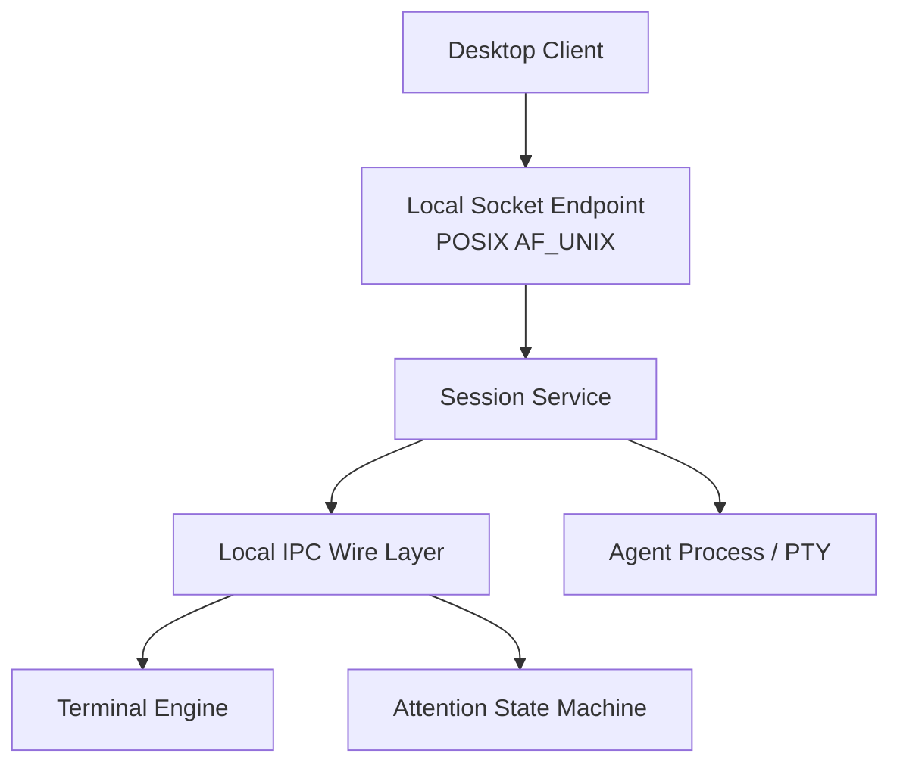
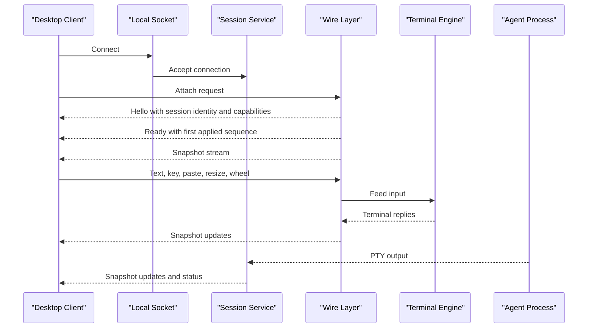
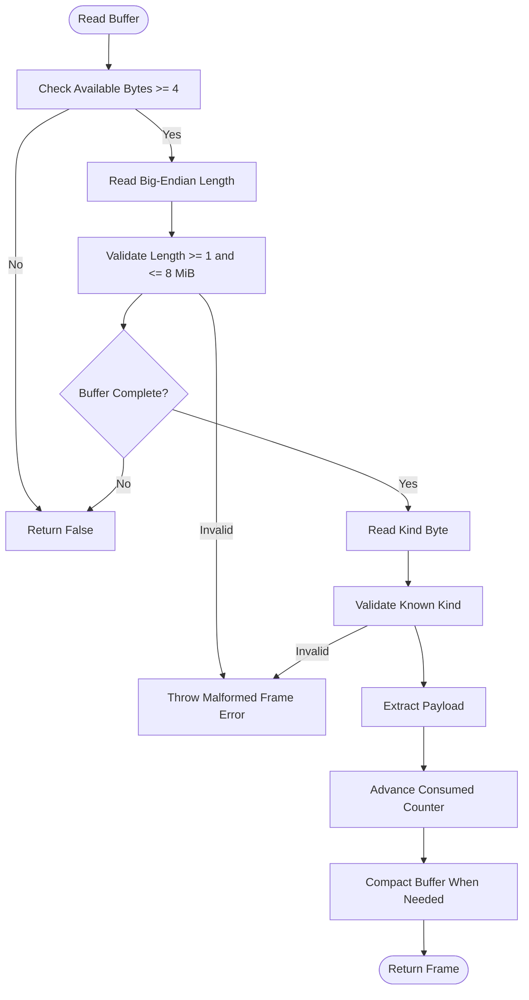
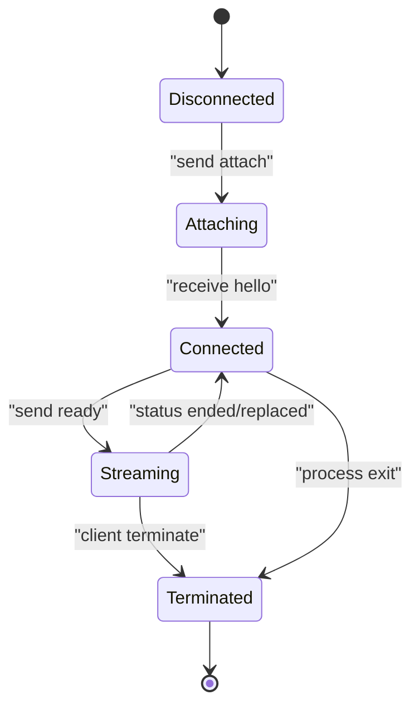
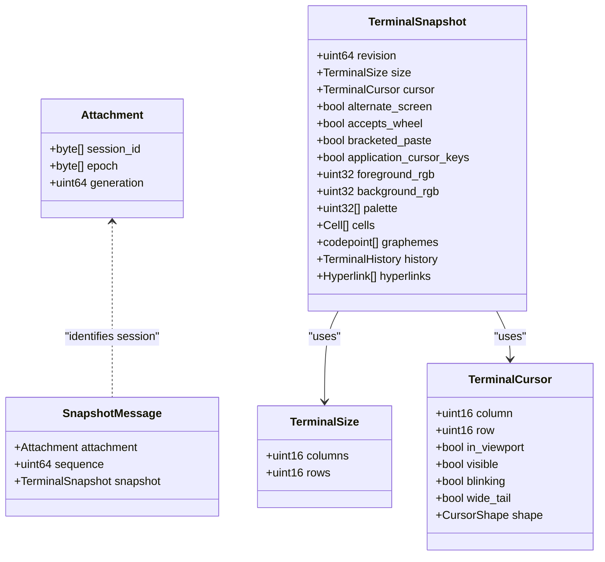
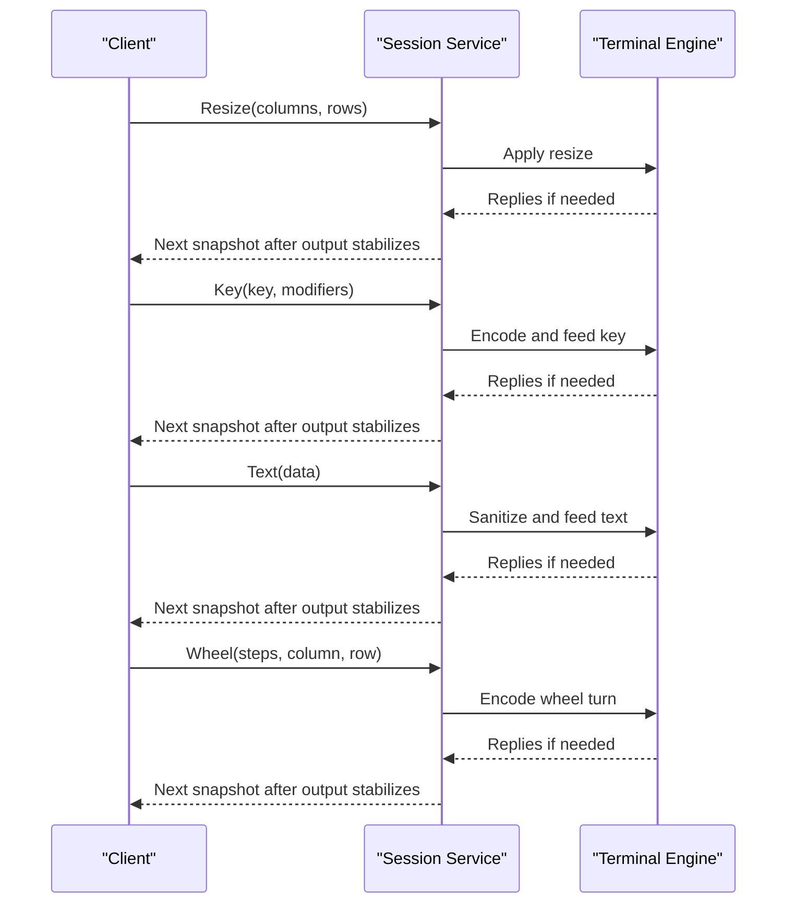
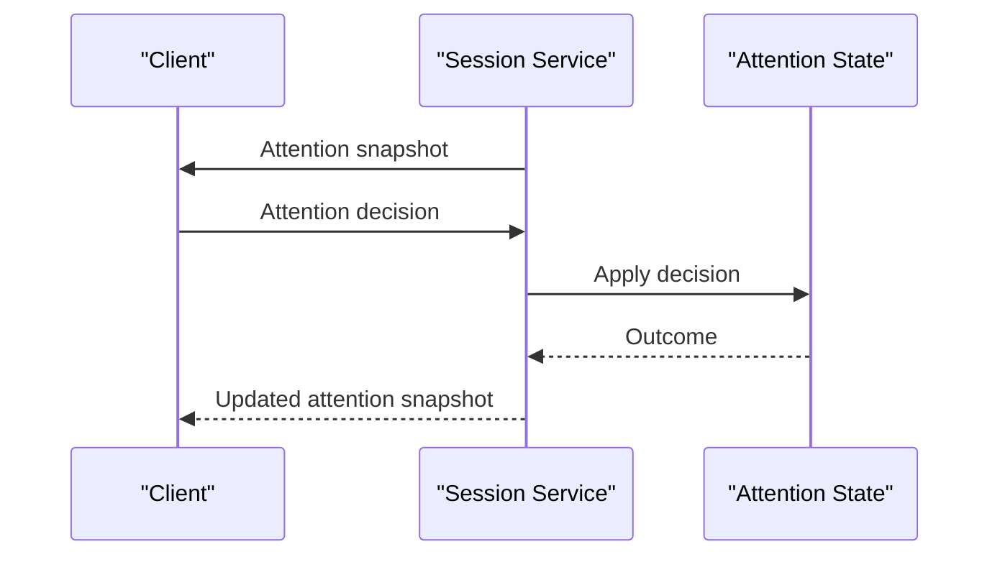
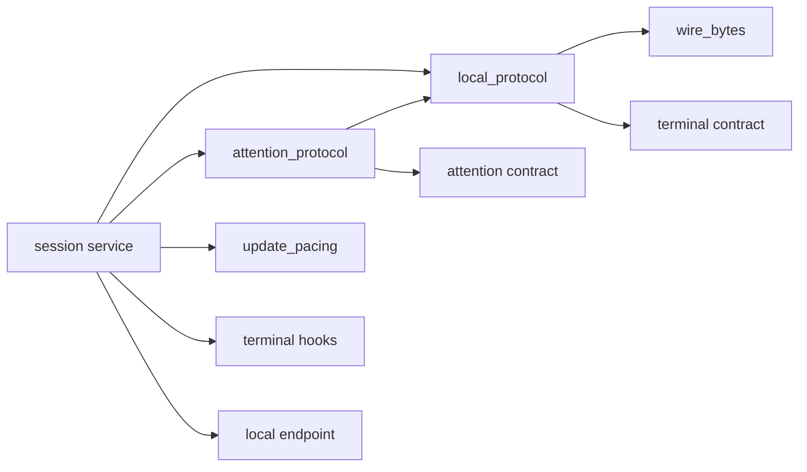

# Local IPC Protocol

<cite>
**Referenced Files in This Document**
- [local_protocol.hpp](file://services/session/src/transport/local_protocol.hpp)
- [local_protocol.cpp](file://services/session/src/transport/local_protocol.cpp)
- [attention_protocol.hpp](file://services/session/src/transport/attention_protocol.hpp)
- [attention_protocol.cpp](file://services/session/src/transport/attention_protocol.cpp)
- [wire_bytes.hpp](file://services/session/src/transport/wire_bytes.hpp)
- [update_pacing.hpp](file://services/session/src/transport/update_pacing.hpp)
- [terminal.hpp](file://services/session/include/lapis/session/terminal.hpp)
- [attention.hpp](file://services/session/include/lapis/session/attention.hpp)
- [terminal_hooks.hpp](file://services/session/src/terminal_hooks.hpp)
- [terminal_hooks.cpp](file://services/session/src/terminal_hooks.cpp)
- [session_service.cpp](file://services/session/src/session_service.cpp)
- [local_endpoint.hpp](file://services/session/src/platform/posix/local_endpoint.hpp)
- [local_endpoint.cpp](file://services/session/src/platform/posix/local_endpoint.cpp)
</cite>

## Table of Contents
1. [Introduction](#introduction)
2. [Project Structure](#project-structure)
3. [Core Components](#core-components)
4. [Architecture Overview](#architecture-overview)
5. [Detailed Component Analysis](#detailed-component-analysis)
6. [Dependency Analysis](#dependency-analysis)
7. [Performance Considerations](#performance-considerations)
8. [Troubleshooting Guide](#troubleshooting-guide)
9. [Conclusion](#conclusion)

## Introduction
This document describes the Local IPC Protocol used by the Lapis desktop application to communicate with session services that manage agent processes, terminal emulators, and attention requests. The protocol runs over local sockets on POSIX systems and provides:

- A framed wire format with a fixed header and a payload kind byte.
- Protocol versioning through a negotiated handshake.
- Terminal snapshot streaming, terminal input, paste operations, resize events, wheel events, history paging, status updates, attachment lifecycle, and readiness acknowledgements.
- An optional attention subsystem for request/response and observation flows.
- Security boundaries enforced through trusted directory validation, symlink rejection, process isolation, and bounded message sizes.

The documentation covers wire framing, serialization, supported messages, request/response patterns, error handling, timeouts, connection lifecycle, security considerations, debugging techniques, and troubleshooting steps.

## Project Structure
The Local IPC Protocol is implemented primarily in the session service transport layer:

- `services/session/src/transport/local_protocol.{hpp,cpp}` defines the main frame format, message kinds, terminal snapshots, control payloads, history, attachment, hello, ready, status, and framing helpers.
- `services/session/src/transport/attention_protocol.{hpp,cpp}` defines the attention snapshot and decision wire formats layered onto the same attachment model.
- `services/session/src/transport/wire_bytes.hpp` provides big-endian integer helpers and attachment encoding/decoding.
- `services/session/src/transport/update_pacing.hpp` provides publish pacing logic used when delivering terminal updates.
- `services/session/include/lapis/session/terminal.hpp` defines the in-process terminal contract including cell models, cursor state, history metadata, hyperlinks, and input encoders.
- `services/session/include/lapis/session/attention.hpp` defines the attention state machine, limits, capabilities, and request/pending models.
- `services/session/src/terminal_hooks.{hpp,cpp}` parses private OSC-like sequences from terminal output to inject hook events into the attention system.
- `services/session/src/session_service.cpp` orchestrates socket endpoints, session lifecycle, timeout configuration, admission pacing, and integration between transport frames and higher-level session behavior.
- `services/session/src/platform/posix/local_endpoint.{hpp,cpp}` implements trusted directory checks, endpoint preparation, and socket buffer widening.

**Diagram sources**
- [session_service.cpp:1-200](file://services/session/src/session_service.cpp#L1-L200)
- [local_endpoint.cpp:1-93](file://services/session/src/platform/posix/local_endpoint.cpp#L1-L93)
- [local_protocol.cpp:1-200](file://services/session/src/transport/local_protocol.cpp#L1-L200)
- [attention_protocol.cpp:1-200](file://services/session/src/transport/attention_protocol.cpp#L1-L200)

**Section sources**
- [local_protocol.hpp:1-196](file://services/session/src/transport/local_protocol.hpp#L1-L196)
- [attention_protocol.hpp:1-41](file://services/session/src/transport/attention_protocol.hpp#L1-L41)
- [wire_bytes.hpp:1-55](file://services/session/src/transport/wire_bytes.hpp#L1-L55)
- [update_pacing.hpp:1-52](file://services/session/src/transport/update_pacing.hpp#L1-L52)
- [terminal.hpp:1-200](file://services/session/include/lapis/session/terminal.hpp#L1-L200)
- [attention.hpp:1-136](file://services/session/include/lapis/session/attention.hpp#L1-L136)
- [terminal_hooks.hpp:1-82](file://services/session/src/terminal_hooks.hpp#L1-L82)
- [local_endpoint.hpp:1-17](file://services/session/src/platform/posix/local_endpoint.hpp#L1-L17)

## Core Components
The Local IPC Protocol has several core components:

### Frame Format
Every wire message is a frame consisting of:

| Field | Size | Endianness | Description |
|---|---:|---:|---|
| Length | 4 bytes | Big-endian unsigned 32-bit | Total frame length including the kind byte and payload |
| Kind | 1 byte | Unsigned 8-bit | Message type identifier |
| Payload | Variable | Depends on kind | Typed payload for the selected message kind |

Constraints:

- Minimum frame length is one because the length includes the kind byte.
- Maximum frame length is eight MiB.
- Invalid or oversized frames throw an exception rather than silently truncating.
- Parsing returns false for incomplete input; malformed data throws.

**Section sources**
- [local_protocol.cpp:360-420](file://services/session/src/transport/local_protocol.cpp#L360-L420)
- [local_protocol.hpp:1-196](file://services/session/src/transport/local_protocol.hpp#L1-L196)

### Protocol Versioning
The current protocol version is six. Both attach and hello handshakes carry the negotiated version, enabling older services to reject newer clients and vice versa where necessary.

Key version-related behaviors:

- Attach requests carry a capability flags field supporting hyperlink negotiation, attention phase support, and paste transaction support.
- Hello messages carry the child process PID and optionally indicate paste transaction support.
- Wheel input is introduced in version six; older services reject frames containing it.
- History paging uses an `at` direction introduced in version six; older services reject unsupported directions.
- Attention snapshots can include an optional observation phase byte only when the attach capability bit is negotiated.

**Section sources**
- [local_protocol.hpp:1-196](file://services/session/src/transport/local_protocol.hpp#L1-L196)
- [local_protocol.cpp:100-170](file://services/session/src/transport/local_protocol.cpp#L100-L170)
- [attention_protocol.hpp:1-41](file://services/session/src/transport/attention_protocol.hpp#L1-L41)
- [attention_protocol.cpp:260-343](file://services/session/src/transport/attention_protocol.cpp#L260-L343)

### Attachment Model
All messages use an attachment envelope that identifies the target session and view generation:

| Field | Size | Description |
|---:|---|---|
| Session ID | 16 bytes | Nonzero UUID identifying the session |
| Epoch | 16 bytes | Nonzero UUID identifying the epoch |
| Generation | 8 bytes | Monotonic generation number |

Rules:

- Both session ID and epoch must be nonzero.
- Generation must be nonzero.
- Attachments are encoded using big-endian integers and raw byte copies.

**Section sources**
- [wire_bytes.hpp:1-55](file://services/session/src/transport/wire_bytes.hpp#L1-L55)
- [local_protocol.hpp:1-196](file://services/session/src/transport/local_protocol.hpp#L1-L196)

## Architecture Overview
The session service owns the local socket endpoint and manages sessions. Clients connect, negotiate identity and capabilities, receive terminal snapshots, send terminal input, and receive status and attention events.

**Diagram sources**
- [session_service.cpp:1-200](file://services/session/src/session_service.cpp#L1-L200)
- [local_protocol.cpp:1-200](file://services/session/src/transport/local_protocol.cpp#L1-L200)
- [terminal.hpp:1-200](file://services/session/include/lapis/session/terminal.hpp#L1-L200)

**Section sources**
- [session_service.cpp:1-200](file://services/session/src/session_service.cpp#L1-L200)

## Detailed Component Analysis

### Wire Framing and Serialization
The frame parser reads the four-byte length, validates it against the maximum frame size, then reads the kind byte and payload. It tracks how many bytes have been consumed so partial reads across event-loop iterations can be handled incrementally.

Important constraints:

- Length must be at least one.
- Length must not exceed eight MiB.
- Kind must be a known value.
- Incomplete buffers return false.
- Malformed data throws `std::runtime_error`.

Serialization uses Qt's binary stream for complex structures such as wheel input and terminal snapshots, while simple fields use explicit big-endian helpers.

**Diagram sources**
- [local_protocol.cpp:360-420](file://services/session/src/transport/local_protocol.cpp#L360-L420)

**Section sources**
- [local_protocol.cpp:360-420](file://services/session/src/transport/local_protocol.cpp#L360-L420)
- [wire_bytes.hpp:1-55](file://services/session/src/transport/wire_bytes.hpp#L1-L55)

### Connection Lifecycle and Attachment
The client begins by sending an attach request. The service responds with a hello message containing the service-side attachment identity, the child process PID, and optional capabilities. After the client acknowledges readiness, the service starts streaming snapshots.

Supported attach modes:

| Mode | Purpose | Expected Identity Fields |
|---|---|---|
| Discover | Find an existing session without replacing it | Session ID zero, Epoch zero |
| Reconnect | Reattach to an existing session | Nonzero session ID, Nonzero epoch |
| Create | Create a new session | Nonzero session ID, Epoch zero |
| Join | Attach another view beside the current client | Session ID zero, Epoch zero |

Capability bits:

| Bit | Name | Meaning |
|---:|---|---|
| 0x80 | Hyperlinks | Client supports hyperlink spans in snapshots |
| 0x40 | Attention Phase | Client supports attention observation phase extension |
| 0x20 | Paste Transactions | Client supports bounded paste transactions |

**Diagram sources**
- [local_protocol.hpp:1-196](file://services/session/src/transport/local_protocol.hpp#L1-L196)
- [local_protocol.cpp:100-170](file://services/session/src/transport/local_protocol.cpp#L100-L170)

**Section sources**
- [local_protocol.hpp:1-196](file://services/session/src/transport/local_protocol.hpp#L1-L196)
- [local_protocol.cpp:100-170](file://services/session/src/transport/local_protocol.cpp#L100-L170)

### Terminal Snapshot Stream
Terminal output is delivered as snapshot messages. Each snapshot contains:

| Field | Type | Description |
|---|---|---|
| Attachment | Struct | Session and generation identity |
| Sequence | 64-bit | Monotonic sequence number |
| Timing | Three 64-bit values | PTY read time, parse end time, publish time |
| Snapshot | Terminal structure | Screen geometry, cells, graphemes, cursor, palette, history, hyperlinks |

The snapshot body includes:

- Revision, columns, rows.
- Cursor position, visibility, blinking, wide tail, shape.
- Alternate screen flag and wheel acceptance flag.
- Bracketed paste and application cursor key flags.
- Foreground and background colors.
- Optional cursor color.
- Palette array.
- Grapheme string.
- Row-major cell array.
- Optional hyperlink extension.

History metadata:

- Total rows kept.
- Viewport offset.
- Viewport row count.
- Primary screen availability.

**Diagram sources**
- [local_protocol.hpp:1-196](file://services/session/src/transport/local_protocol.hpp#L1-L196)
- [terminal.hpp:1-200](file://services/session/include/lapis/session/terminal.hpp#L1-L200)
- [local_protocol.cpp:201-360](file://services/session/src/transport/local_protocol.cpp#L201-L360)

**Section sources**
- [local_protocol.hpp:1-196](file://services/session/src/transport/local_protocol.hpp#L1-L196)
- [local_protocol.cpp:201-360](file://services/session/src/transport/local_protocol.cpp#L201-L360)
- [terminal.hpp:1-200](file://services/session/include/lapis/session/terminal.hpp#L1-L200)

### Terminal Input Operations
Clients send terminal input through control messages. Supported input types include text, paste, key presses, resize, and wheel turns.

Input constraints:

- Control payload size is limited to 32,768 codepoints.
- Single text, paste, or key message payload is limited to 64 KiB.
- Bounded paste transactions allow larger pastes to be admitted as a unit up to 960 KiB.
- Resize changes terminal width and height.
- Wheel input is available only when the snapshot reports `accepts_wheel`.

Wheel format:

| Field | Size | Description |
|---:|---|---|
| Steps | 16-bit signed | Positive values scroll back |
| Column | 16-bit unsigned | Pointer column |
| Row | 16-bit unsigned | Pointer row |

**Diagram sources**
- [local_protocol.hpp:1-196](file://services/session/src/transport/local_protocol.hpp#L1-L196)
- [local_protocol.cpp:300-360](file://services/session/src/transport/local_protocol.cpp#L300-L360)
- [terminal.hpp:1-200](file://services/session/include/lapis/session/terminal.hpp#L1-L200)

**Section sources**
- [local_protocol.hpp:1-196](file://services/session/src/transport/local_protocol.hpp#L1-L196)
- [local_protocol.cpp:300-360](file://services/session/src/transport/local_protocol.cpp#L300-L360)
- [terminal.hpp:1-200](file://services/session/include/lapis/session/terminal.hpp#L1-L200)

### Paste Operations
There are two paste mechanisms:

1. **Control paste**: Small pastes are sent directly inside a control payload.
2. **Paste transaction**: Negotiated through attach and hello capability bits. A bounded paste is submitted as a single unit and acknowledged with a queued result.

Paste request fields:

| Field | Description |
|---|---|
| Attachment | Target session and generation |
| Request ID | Nonzero request identifier |
| Submit | Whether this fragment should be submitted |
| Text | Paste content |

Paste result fields:

| Field | Description |
|---|---|
| Attachment | Target session and generation |
| Request ID | Matching request identifier |
| Queued | Whether the PTY queue accepted the paste |
| Message | Human-readable status |

**Section sources**
- [local_protocol.hpp:1-196](file://services/session/src/transport/local_protocol.hpp#L1-L196)
- [local_protocol.cpp:170-250](file://services/session/src/transport/local_protocol.cpp#L170-L250)

### History Paging
History paging lets clients request pages older or newer than a reference point. The `at` direction was added in protocol version six and requires service support.

History request fields:

| Field | Description |
|---|---|
| Request ID | Nonzero client-generated identifier |
| Reference | Zero for newest older pages, page ID for newer, row index for `at` |
| Direction | Older, newer, or at |

History reply fields:

| Field | Description |
|---|---|
| Attachment | Target session and generation |
| Request ID | Matching request identifier |
| Page ID | Zero when no page is returned |
| Message | Status message |
| Snapshot | Optional terminal snapshot for the requested page |

**Section sources**
- [local_protocol.hpp:1-196](file://services/session/src/transport/local_protocol.hpp#L1-L196)
- [local_protocol.cpp:220-300](file://services/session/src/transport/local_protocol.cpp#L220-L300)

### Status Updates
Status messages inform the client about session state transitions:

| Code | Meaning |
|---:|---|
| 1 | Rejected |
| 2 | Ended |
| 3 | Replaced |
| 4 | Overloaded |

Status messages contain:

- One-byte status code.
- UTF-8 message up to 4,096 bytes.

Errors:

- Unknown codes are rejected during decoding.
- Oversized messages are rejected.
- Invalid UTF-8 is rejected.

**Section sources**
- [local_protocol.hpp:1-196](file://services/session/src/transport/local_protocol.hpp#L1-L196)
- [local_protocol.cpp:300-360](file://services/session/src/transport/local_protocol.cpp#L300-L360)

### Readiness Acknowledgement
After receiving hello, the client sends a ready acknowledgement containing its first applied snapshot sequence. This allows the service to know which snapshot the client considers authoritative.

**Section sources**
- [local_protocol.hpp:1-196](file://services/session/src/transport/local_protocol.hpp#L1-L196)
- [local_protocol.cpp:300-360](file://services/session/src/transport/local_protocol.cpp#L300-L360)

### Termination
A client may explicitly request termination. The service ends the agent process and responds with an ordinary ended status once the process exits.

**Section sources**
- [local_protocol.hpp:1-196](file://services/session/src/transport/local_protocol.hpp#L1-L196)

### Attention Protocol
The attention protocol provides a request/response mechanism for agent attention events. It reuses the attachment model but carries its own typed messages inside the protocol’s control envelope.

#### Attention Snapshot
An attention snapshot reports:

| Field | Description |
|---|---|
| Attachment | Target session and generation |
| Available | Whether attention data is available |
| Connected | Whether the source is connected |
| Ready | Whether the source is synchronized |
| Activity | Working, idle, turn completed, or unknown |
| Source Epoch | Source identity epoch |
| Observation Phase | Optional phase when negotiated |
| Diagnostic | Optional diagnostic string |
| Requests | List of pending attention requests |

Each pending request includes:

- Request ID, thread ID, turn ID, item ID.
- Reason and summary.
- Choices.
- Priority.
- Status: pending, responding, or stale.
- Revision, arrival time, not-before time, source epoch.
- Submission flag.

#### Attention Decision
A client responds to an attention request with a decision containing:

- Source epoch.
- Request ID.
- Revision.
- Choice.
- Optional JSON answers.

**Diagram sources**
- [attention_protocol.hpp:1-41](file://services/session/src/transport/attention_protocol.hpp#L1-L41)
- [attention_protocol.cpp:200-343](file://services/session/src/transport/attention_protocol.cpp#L200-L343)
- [attention.hpp:1-136](file://services/session/include/lapis/session/attention.hpp#L1-L136)

**Section sources**
- [attention_protocol.hpp:1-41](file://services/session/src/transport/attention_protocol.hpp#L1-L41)
- [attention_protocol.cpp:1-343](file://services/session/src/transport/attention_protocol.cpp#L1-L343)
- [attention.hpp:1-136](file://services/session/include/lapis/session/attention.hpp#L1-L136)

### Terminal Hook Integration
Terminal hooks let remote agents emit private sequences into their own terminal output. The service extracts these sequences, validates nonces, decodes JSON, and converts them into terminal hook events.

Security properties:

- Only one init sequence is accepted per channel.
- Nonce must be 32 hexadecimal characters.
- CLI subject must be claude or codex.
- Events must match the bound nonce.
- Oversized candidates are quarantined and discarded safely.
- Private sequences are removed from terminal output before the user sees it.

**Section sources**
- [terminal_hooks.hpp:1-82](file://services/session/src/terminal_hooks.hpp#L1-L82)
- [terminal_hooks.cpp:1-200](file://services/session/src/terminal_hooks.cpp#L1-L200)

## Dependency Analysis
The protocol layer depends on shared wire primitives and higher-level terminal and attention models.

**Diagram sources**
- [local_protocol.hpp:1-196](file://services/session/src/transport/local_protocol.hpp#L1-L196)
- [attention_protocol.hpp:1-41](file://services/session/src/transport/attention_protocol.hpp#L1-L41)
- [wire_bytes.hpp:1-55](file://services/session/src/transport/wire_bytes.hpp#L1-L55)
- [update_pacing.hpp:1-52](file://services/session/src/transport/update_pacing.hpp#L1-L52)
- [terminal.hpp:1-200](file://services/session/include/lapis/session/terminal.hpp#L1-L200)
- [attention.hpp:1-136](file://services/session/include/lapis/session/attention.hpp#L1-L136)
- [terminal_hooks.hpp:1-82](file://services/session/src/terminal_hooks.hpp#L1-L82)
- [session_service.cpp:1-200](file://services/session/src/session_service.cpp#L1-L200)
- [local_endpoint.hpp:1-17](file://services/session/src/platform/posix/local_endpoint.hpp#L1-L17)

**Section sources**
- [local_protocol.hpp:1-196](file://services/session/src/transport/local_protocol.hpp#L1-L196)
- [attention_protocol.hpp:1-41](file://services/session/src/transport/attention_protocol.hpp#L1-L41)
- [session_service.cpp:1-200](file://services/session/src/session_service.cpp#L1-L200)

## Performance Considerations
The protocol and service implement several performance safeguards:

- Maximum frame size prevents unbounded memory growth.
- Terminal snapshots limit total cells and grapheme codepoints.
- Control payloads limit input to 32,768 codepoints.
- Bounded paste transactions cap paste payloads at 960 KiB.
- Attention snapshots limit total bytes, request count, choice count, and JSON size.
- Output admission pacing coalesces rapid terminal output bursts.
- Publish-to-publish update pacing avoids excessive redraws.
- Local socket buffers are widened to reduce round trips for large screens.

Update pacing semantics:

- It is a rate limit, not a debounce.
- It measures elapsed time since the last published update.
- Zero wait means publish immediately.
- A denial arms only the remaining interval.
- First events after a quiet period publish immediately.

**Section sources**
- [local_protocol.hpp:1-196](file://services/session/src/transport/local_protocol.hpp#L1-L196)
- [attention_protocol.cpp:1-120](file://services/session/src/transport/attention_protocol.cpp#L1-L120)
- [update_pacing.hpp:1-52](file://services/session/src/transport/update_pacing.hpp#L1-L52)
- [local_endpoint.cpp:60-93](file://services/session/src/platform/posix/local_endpoint.cpp#L60-L93)
- [session_service.cpp:1-200](file://services/session/src/session_service.cpp#L1-L200)

## Troubleshooting Guide

### Common Communication Failures

| Symptom | Likely Cause | Resolution |
|---|---|---|
| Connection refused | Socket path does not exist or is invalid | Verify the endpoint path exists and is accessible |
| Permission denied | Parent directory ownership or mode is incorrect | Ensure the directory is owned by the current user with mode `0700` |
| Stale socket file | Old Codex symlink remains after crash | Remove stale symlink or restart the service |
| Frame rejected | Unknown or unsupported kind | Upgrade client or service to compatible versions |
| Oversized frame | Payload exceeds eight MiB | Reduce snapshot size or split large data |
| Invalid identity | Zero or malformed session ID or epoch | Regenerate session identity |
| History request rejected | Unsupported direction or missing reference | Use older/newer with appropriate references, or upgrade service |
| Attention snapshot rejected | Invalid request, duplicate IDs, or capacity exceeded | Validate request IDs, reduce pending requests, and synchronize epochs |
| Paste not queued | PTY queue full or malformed paste request | Retry with smaller paste or check request ID and submit flag |

### Debugging Techniques

1. Inspect raw frames by logging the first five bytes: length and kind.
2. Validate the protocol version in attach and hello messages.
3. Confirm attachment identities are nonzero and consistent across messages.
4. Check whether the snapshot reports `accepts_wheel` before sending wheel input.
5. Verify hyperlink capability negotiation when rendering links.
6. Monitor attention snapshot activity, source epoch, and request revisions.
7. Use the service’s built-in timing fields to distinguish PTY read latency, parsing latency, and publish latency.
8. Validate terminal hook events only after a successful init and matching nonce.
9. Check terminal hooks for oversized candidates marked as dropped.

**Section sources**
- [local_protocol.cpp:1-200](file://services/session/src/transport/local_protocol.cpp#L1-L200)
- [attention_protocol.cpp:1-200](file://services/session/src/transport/attention_protocol.cpp#L1-L200)
- [terminal_hooks.cpp:1-200](file://services/session/src/terminal_hooks.cpp#L1-L200)
- [session_service.cpp:1-200](file://services/session/src/session_service.cpp#L1-L200)

### Timeout Handling
The session service defines several timeout constants:

- Backend sync timeout.
- Terminal sync timeout.
- Backend probe interval and attempt limits.

These values control how long the service waits for terminal or backend synchronization before taking corrective action. Clients should treat status messages and process termination as the primary termination signals rather than relying solely on network timeouts.

**Section sources**
- [session_service.cpp:1-200](file://services/session/src/session_service.cpp#L1-L200)

## Conclusion
The Local IPC Protocol provides a compact, versioned, and strongly validated wire format for Lapis desktop communication with session services. Its design emphasizes safety through bounded frames, strict identity validation, capability negotiation, and clear separation between terminal streaming, input, history, status, and attention flows. Correct clients should:

- Negotiate attach capabilities.
- Respect version-specific features like wheel input and history paging.
- Handle incomplete frames incrementally.
- Validate all received attachments and status codes.
- Treat attention snapshots as authoritative state updates.
- Follow service security requirements for socket directories and process isolation.
- Use terminal timing and pacing information for diagnostics rather than assuming synchronous delivery.