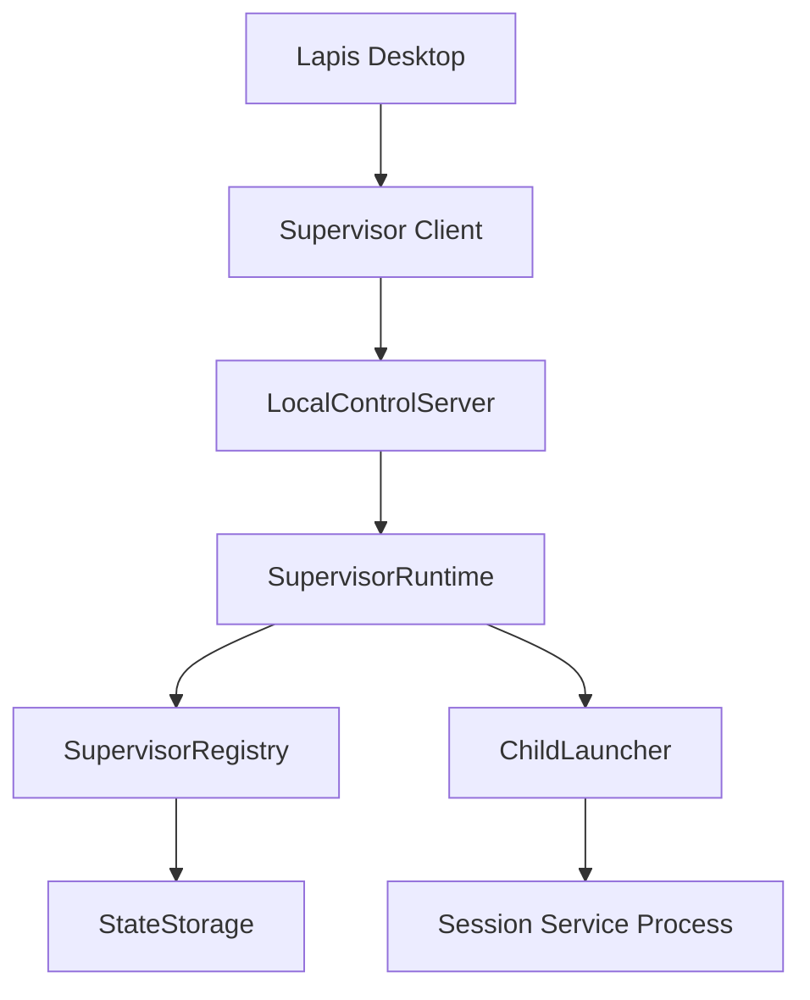
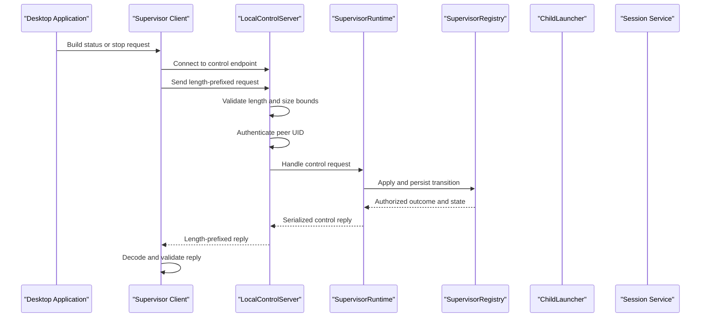
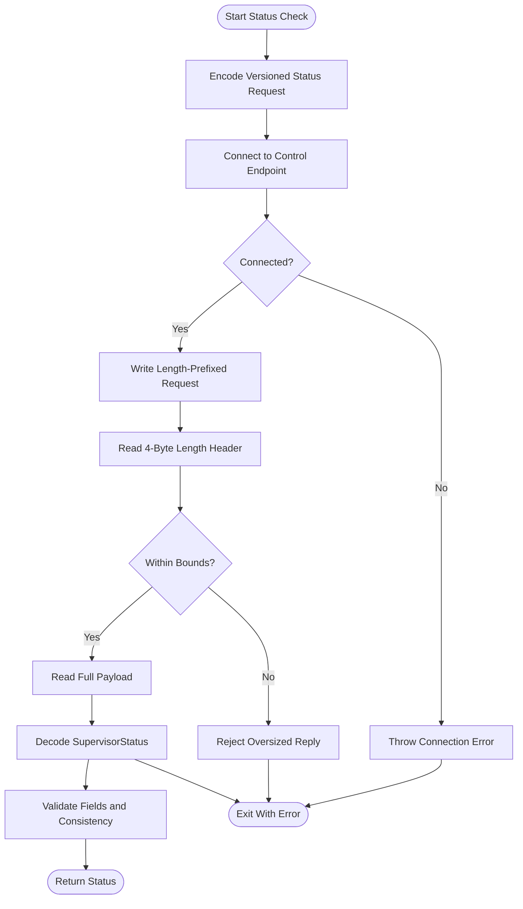
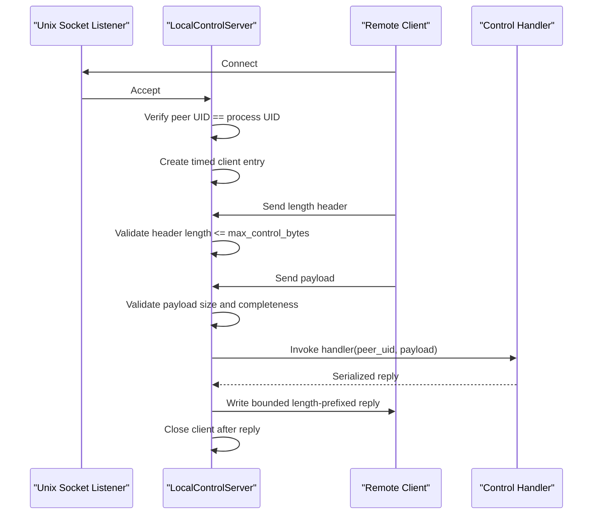
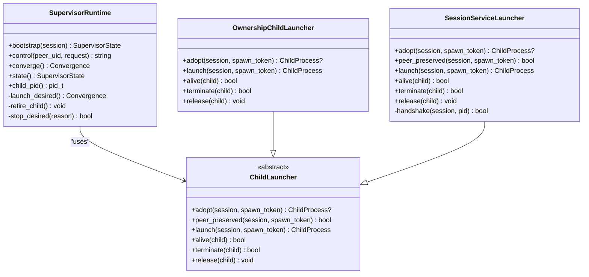
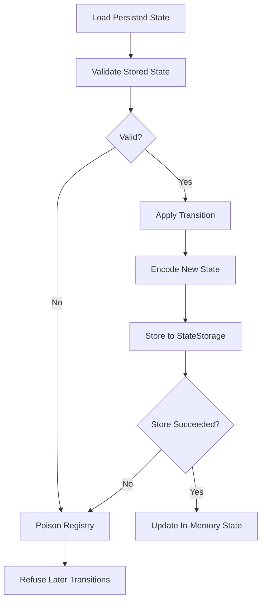
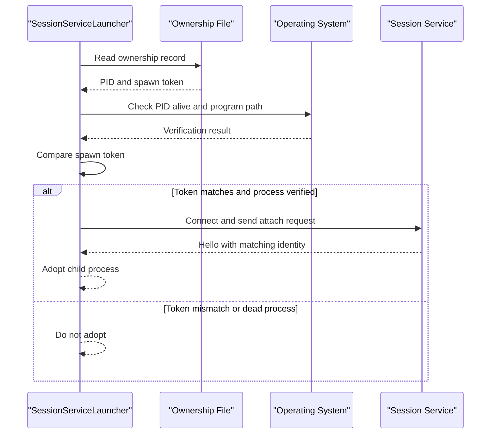
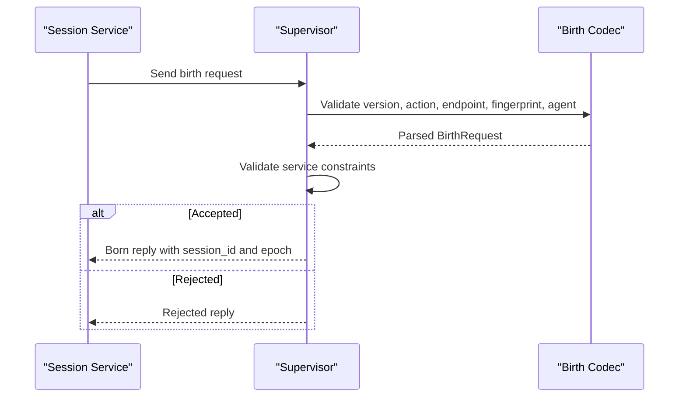
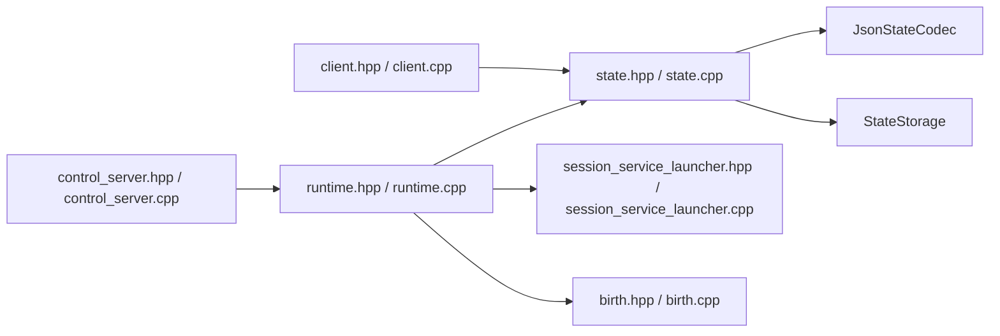

# Supervisor Client Integration

<cite>
**Referenced Files in This Document**
- [client.hpp](file://services/supervisor/include/lapis/supervisor/client.hpp)
- [client.cpp](file://services/supervisor/src/client.cpp)
- [control_server.hpp](file://services/supervisor/include/lapis/supervisor/control_server.hpp)
- [control_server.cpp](file://services/supervisor/src/control_server.cpp)
- [runtime.hpp](file://services/supervisor/include/lapis/supervisor/runtime.hpp)
- [runtime.cpp](file://services/supervisor/src/runtime.cpp)
- [state.hpp](file://services/supervisor/include/lapis/supervisor/state.hpp)
- [state.cpp](file://services/supervisor/src/state.cpp)
- [session_service_launcher.hpp](file://services/supervisor/include/lapis/supervisor/session_service_launcher.hpp)
- [session_service_launcher.cpp](file://services/supervisor/src/session_service_launcher.cpp)
- [birth.hpp](file://services/supervisor/include/lapis/supervisor/birth.hpp)
- [birth.cpp](file://services/supervisor/src/birth.cpp)
</cite>

## Table of Contents
1. [Introduction](#introduction)
2. [Project Structure](#project-structure)
3. [Core Components](#core-components)
4. [Architecture Overview](#architecture-overview)
5. [Detailed Component Analysis](#detailed-component-analysis)
6. [Dependency Analysis](#dependency-analysis)
7. [Performance Considerations](#performance-considerations)
8. [Troubleshooting Guide](#troubleshooting-guide)
9. [Conclusion](#conclusion)

## Introduction
This document explains how the Lapis desktop application integrates with the supervisor subsystem to manage background session services. The supervisor owns process lifecycle policy, maintains a durable registry of desired service state, and exposes a local control interface that clients use to discover, start, stop, and observe services. The integration is split into:

- A **supervisor client** that encodes status and control requests, reads persisted state, and communicates over Unix-domain sockets.
- A **local control server** that accepts one strict request per connection from authorized peers.
- A **runtime** that translates control actions into process launches, adoptions, health checks, restarts, and graceful shutdowns.
- A **state registry** that persists the current supervisor state and enforces transition rules.
- A **service launcher** that starts and verifies the actual session service child process.
- A **birth protocol** used by the session service to declare its identity to the supervisor.

The design emphasizes safety over convenience: endpoints are private Unix sockets, tokens are bounded hexadecimal identifiers, state files are owner-only, malformed messages are rejected, and failed persistence operations poison the registry so stale transitions cannot be applied.

## Project Structure
The supervisor implementation lives under `services/supervisor`. The most relevant parts for this documentation are headers under `include/lapis/supervisor` and implementations under `src/`:

| Area | Responsibility | Key files |
| --- | --- | --- |
| Client API | Status encoding, stop request encoding, control transport, state inspection | `client.hpp`, `client.cpp` |
| Control server | Local socket listener, peer authentication, one-frame-per-client handling | `control_server.hpp`, `control_server.cpp` |
| Runtime | Lifecycle policy, convergence loop, restart limits, process ownership | `runtime.hpp`, `runtime.cpp` |
| State model and storage | Data structures, validation, JSON codec, memory and POSIX storage | `state.hpp`, `state.cpp` |
| Session service launcher | Child launch, adoption, handshake, termination, ownership file management | `session_service_launcher.hpp`, `session_service_launcher.cpp` |
| Birth protocol | Decoding birth requests and encoding identity replies | `birth.hpp`, `birth.cpp` |

**Diagram sources**
- [client.cpp:1-249](file://services/supervisor/src/client.cpp#L1-L249)
- [control_server.cpp:1-327](file://services/supervisor/src/control_server.cpp#L1-L327)
- [runtime.cpp:1-560](file://services/supervisor/src/runtime.cpp#L1-L560)
- [state.cpp:1-284](file://services/supervisor/src/state.cpp#L1-L284)
- [session_service_launcher.cpp:1-710](file://services/supervisor/src/session_service_launcher.cpp#L1-L710)

**Section sources**
- [client.hpp:1-34](file://services/supervisor/include/lapis/supervisor/client.hpp#L1-L34)
- [control_server.hpp:1-32](file://services/supervisor/include/lapis/supervisor/control_server.hpp#L1-L32)
- [runtime.hpp:1-151](file://services/supervisor/include/lapis/supervisor/runtime.hpp#L1-L151)
- [state.hpp:1-232](file://services/supervisor/include/lapis/supervisor/state.hpp#L1-L232)

## Core Components
The supervisor client integration is built around six primary components:

| Component | Purpose | Important interfaces or constants |
| --- | --- | --- |
| Supervisor client | Encodes status and stop requests, validates replies, reads persisted state, sends control frames | `encode_status_request`, `encode_stop_request`, `decode_status_reply`, `read_control_state`, `send_control_request`, `supervisor_client_timeout_ms` |
| Local control server | Binds a private Unix socket, accepts at most four clients, authenticates by effective user ID, processes one strict frame per client | `LocalControlServer`, `poll_once`, `ControlHandler`, `max_control_clients`, `control_client_timeout_ms` |
| Runtime | Owns lifecycle decisions, coordinates registry and launcher, implements convergence and restart accounting | `SupervisorRuntime`, `bootstrap`, `control`, `converge`, `child_pid`, restart window constants |
| State registry | Authoritative single-threaded state owner; encodes transitions, validates tokens, persists changes | `SupervisorRegistry`, `start`, `restart`, `stop`, `disable`, `control`, `commit` |
| Service launcher | Starts, adopts, probes, terminates, and releases session service children | `ChildLauncher`, `OwnershipChildLauncher`, `SessionServiceLauncher` |
| Birth protocol | Parses a versioned birth request and returns an identity or rejection | `BirthRequest`, `decode_birth_request`, `encode_birth_reply`, `encode_birth_rejected` |

**Section sources**
- [client.hpp:7-33](file://services/supervisor/include/lapis/supervisor/client.hpp#L7-L33)
- [control_server.hpp:7-31](file://services/supervisor/include/lapis/supervisor/control_server.hpp#L7-L31)
- [runtime.hpp:10-150](file://services/supervisor/include/lapis/supervisor/runtime.hpp#L10-L150)
- [state.hpp:10-232](file://services/supervisor/include/lapis/supervisor/state.hpp#L10-L232)
- [session_service_launcher.hpp:12-55](file://services/supervisor/include/lapis/supervisor/session_service_launcher.hpp#L12-L55)
- [birth.hpp:12-38](file://services/supervisor/include/lapis/supervisor/birth.hpp#L12-L38)

## Architecture Overview
The supervisor uses a layered architecture where each layer has a narrow contract:

1. **Client layer**: The desktop application builds a JSON control request, connects to the supervisor control endpoint, writes a length-prefixed frame, waits for exactly one response, and decodes it into a typed status or outcome.
2. **Control server layer**: The supervisor binds a private Unix-domain socket, accepts connections only from the same owner, reads a 4-byte big-endian length header plus payload, invokes the handler once, and writes back a bounded reply.
3. **Runtime layer**: The runtime receives parsed control requests through the registry, applies authorization and state machine rules, then delegates process lifecycle work to the configured launcher.
4. **Registry and storage layer**: The registry loads the last known state from storage, validates it, updates it according to allowed transitions, and persists the new state. Persistence failures poison the registry so no further unsafe transition occurs.
5. **Process layer**: Launchers create child processes, write ownership records containing the spawn token and PID, optionally perform a protocol handshake, and terminate processes using group signals when appropriate.

**Diagram sources**
- [client.cpp:1-249](file://services/supervisor/src/client.cpp#L1-L249)
- [control_server.cpp:1-327](file://services/supervisor/src/control_server.cpp#L1-L327)
- [runtime.cpp:1-560](file://services/supervisor/src/runtime.cpp#L1-L560)
- [state.cpp:1-284](file://services/supervisor/src/state.cpp#L1-L284)

## Detailed Component Analysis

### Supervisor Client
The supervisor client provides the desktop application’s integration surface. It supports two primary workflows:

- **Status discovery**: Encode a versioned status request, connect to the control endpoint, read a framed response, and decode it into a `SupervisorStatus`.
- **Stop operation**: Encode a stop request that includes the current instance epoch and authenticated spawn token, send it, and rely on the control server and registry to enforce authorization.

The client also exposes `read_control_state`, which directly inspects the supervisor’s persistent state directory without contacting the running control server. This is useful for offline diagnostics or recovery paths where the control socket may not be available.

Key behaviors include:

| Behavior | Detail |
| --- | --- |
| Request framing | Uses a 4-byte big-endian length prefix followed by the JSON payload. |
| Timeout policy | Uses `supervisor_client_timeout_ms` as the overall deadline for connection, writing, and reading. |
| Reply validation | Requires exact field names, valid version, boolean fields, hex-encoded epoch, consistent slot values, and no trailing bytes. |
| State inspection | Requires an absolute directory owned by the caller with mode `0700`, a regular file named `supervisor.json` with mode `0600`, a single hard link, and a valid schema version 2 state record. |
| Size bounds | Enforces `max_control_bytes` for control frames and `max_state_bytes` for persisted state. |

**Diagram sources**
- [client.cpp:1-249](file://services/supervisor/src/client.cpp#L1-L249)
- [client.hpp:7-33](file://services/supervisor/include/lapis/supervisor/client.hpp#L7-L33)

**Section sources**
- [client.hpp:7-33](file://services/supervisor/include/lapis/supervisor/client.hpp#L7-L33)
- [client.cpp:1-249](file://services/supervisor/src/client.cpp#L1-L249)

### Local Control Server
The local control server is the access boundary between arbitrary callers and the supervisor runtime. It does not implement business logic itself; instead, it owns socket setup, peer authentication, framing, and connection scheduling.

Important characteristics:

- **Endpoint binding**: Creates a Unix-domain stream socket, removes a stale endpoint if present, sets permissions to `0600`, and verifies the bound socket is owned by the caller.
- **Peer authentication**: Accepts connections only when the peer UID matches the server process UID. On macOS, BSD-like systems, and Linux, it uses platform-specific credential APIs.
- **Connection limit**: Rejects additional connections beyond `max_control_clients`.
- **Strict framing**: Reads a fixed-length header, validates declared payload size against `max_control_bytes`, and processes exactly one request per connection.
- **Timeout behavior**: Each client has a deadline; incomplete headers or payloads cause the connection to be closed rather than held indefinitely.
- **One-request guarantee**: `poll_once` handles accept events and iterates ready clients, invoking the supplied handler exactly once per complete frame.

**Diagram sources**
- [control_server.cpp:1-327](file://services/supervisor/src/control_server.cpp#L1-L327)
- [control_server.hpp:7-31](file://services/supervisor/include/lapis/supervisor/control_server.hpp#L7-L31)

**Section sources**
- [control_server.hpp:7-31](file://services/supervisor/include/lapis/supervisor/control_server.hpp#L7-L31)
- [control_server.cpp:1-327](file://services/supervisor/src/control_server.cpp#L1-L327)

### Supervisor Runtime
The runtime is the policy engine. It owns:

- Bootstrap: Creating the first desired session when no authenticated state exists.
- Control translation: Mapping parsed control actions into registry transitions.
- Convergence: Reconciling desired state with live children.
- Restart accounting: Limiting restarts within a time window.
- Process observation: Tracking the current child PID and delegating lifecycle work to the launcher.

Convergence can return:

| Convergence value | Meaning |
| --- | --- |
| `converged` | Desired state already matches reality. |
| `started` | A new service was started. |
| `restarted` | A crashed or stale service was restarted. |
| `stopped` | A service was stopped. |
| `disabled` | Supervision was disabled. |
| `exhausted` | Restart limits were reached. |
| `failed` | A startup attempt failed. |

The runtime enforces restart rate limiting through `max_restarts_per_window` and `restart_window_ns`, and drops malformed or abandoned control clients before they can delay status or stop responses.

**Diagram sources**
- [runtime.hpp:10-150](file://services/supervisor/include/lapis/supervisor/runtime.hpp#L10-L150)
- [runtime.cpp:1-560](file://services/supervisor/src/runtime.cpp#L1-L560)
- [session_service_launcher.hpp:12-55](file://services/supervisor/include/lapis/supervisor/session_service_launcher.hpp#L12-L55)

**Section sources**
- [runtime.hpp:10-150](file://services/supervisor/include/lapis/supervisor/runtime.hpp#L10-L150)
- [runtime.cpp:1-560](file://services/supervisor/src/runtime.cpp#L1-L560)

### State Model and Registry
The state model describes the supervisor’s desired configuration and controls which transitions are allowed.

Primary data structures:

| Structure | Purpose |
| --- | --- |
| `DesiredAgentMode` | Selects terminal, codex, or claude agent mode. |
| `DesiredSessionLaunch` | Persistent launch description including program, arguments, working directory, terminal dimensions, and mode. |
| `DesiredSession` | Live desired state including endpoint, fingerprint, identity, desired state, spawn token, blocked reason, and optional persistent launch. |
| `SupervisorState` | Top-level supervisor state including schema version, enabled flag, instance epoch, and current session slot. |
| `ControlRequest` | External control message including instance epoch, token, action, and optional new session. |
| `ControlOutcome` | Result of a control request including status and current state. |

Validation rules are central to the design:

- Hexadecimal identifiers have fixed lengths for epoch, session ID, spawn token, and fingerprint.
- Endpoint strings must be non-empty, absolute paths.
- Spawn tokens are optional but required when the desired state is started.
- Schema version 1 must omit the persistent launch payload; schema version 2 must include it.
- Total state and control payloads are bounded.

The registry enforces:

- Single-threaded authoritative ownership via storage acquisition.
- Poisoning on failed persistence so later transitions cannot overwrite unknown disk state.
- Token-based authorization for control requests.
- Epoch checking to reject stale control attempts.
- Startup admission requiring an initial slot before allowing remote control.

**Diagram sources**
- [state.hpp:10-232](file://services/supervisor/include/lapis/supervisor/state.hpp#L10-L232)
- [state.cpp:1-284](file://services/supervisor/src/state.cpp#L1-L284)

**Section sources**
- [state.hpp:10-232](file://services/supervisor/include/lapis/supervisor/state.hpp#L10-L232)
- [state.cpp:1-284](file://services/supervisor/src/state.cpp#L1-L284)

### Session Service Launcher
The session service launcher manages the actual child process that runs the Lapis session service. There are two concrete strategies:

- `OwnershipChildLauncher`: An experimental launcher that directly execs a child program with supervisor-owned arguments, writes an ownership file, and uses process-group termination.
- `SessionServiceLauncher`: The production-oriented launcher that constructs service arguments, validates the expected fingerprint, performs a protocol handshake, adopts existing processes, and preserves recoverable peers.

Adoption flow:

1. Read the ownership file next to the service endpoint.
2. Verify the PID is alive and runs the expected service program.
3. Match the stored spawn token with the authoritative token.
4. Attempt a protocol handshake to verify the service is cooperative.
5. Return a `ChildProcess` marked as adopted if successful.

Handshake flow:

1. Connect to the service’s Unix endpoint.
2. Send an attach request with the session fingerprint.
3. Wait for a hello frame whose identity matches the session.
4. Retry only when the service reports it is starting and overloaded.
5. Respect a bounded handshake budget so a misbehaving service cannot block forever.

**Diagram sources**
- [session_service_launcher.cpp:1-710](file://services/supervisor/src/session_service_launcher.cpp#L1-L710)
- [session_service_launcher.hpp:12-55](file://services/supervisor/include/lapis/supervisor/session_service_launcher.hpp#L12-L55)

**Section sources**
- [session_service_launcher.hpp:12-55](file://services/supervisor/include/lapis/supervisor/session_service_launcher.hpp#L12-L55)
- [session_service_launcher.cpp:1-710](file://services/supervisor/src/session_service_launcher.cpp#L1-L710)

### Birth Protocol
The birth protocol allows a newly started session service to announce its identity to the supervisor. The request includes:

- Version.
- Action, which must be `birth`.
- Service endpoint.
- Fingerprint.
- Agent description, including mode, program, arguments, working directory, and terminal dimensions.
- Service metadata such as environment overrides, which are currently rejected.

The supervisor responds with either:

- A born reply containing the session ID and epoch.
- A rejected reply indicating the supervisor refused the registration.

**Diagram sources**
- [birth.hpp:12-38](file://services/supervisor/include/lapis/supervisor/birth.hpp#L12-L38)
- [birth.cpp:1-151](file://services/supervisor/src/birth.cpp#L1-L151)

**Section sources**
- [birth.hpp:12-38](file://services/supervisor/include/lapis/supervisor/birth.hpp#L12-L38)
- [birth.cpp:1-151](file://services/supervisor/src/birth.cpp#L1-L151)

## Dependency Analysis
The following diagram shows internal dependencies among supervisor modules:

**Diagram sources**
- [client.cpp:1-249](file://services/supervisor/src/client.cpp#L1-L249)
- [control_server.cpp:1-327](file://services/supervisor/src/control_server.cpp#L1-L327)
- [runtime.cpp:1-560](file://services/supervisor/src/runtime.cpp#L1-L560)
- [state.cpp:1-284](file://services/supervisor/src/state.cpp#L1-L284)
- [session_service_launcher.cpp:1-710](file://services/supervisor/src/session_service_launcher.cpp#L1-L710)
- [birth.cpp:1-151](file://services/supervisor/src/birth.cpp#L1-L151)

Key dependency observations:

- The client depends on state validation and JSON codecs but does not depend on the control server implementation.
- The control server depends on the runtime through a function-style handler, keeping socket I/O separate from lifecycle policy.
- The runtime depends on the registry for state transitions and on a pluggable launcher for process management.
- The registry depends on codec and storage abstractions, enabling testability with in-memory storage and real-world usage with POSIX-backed storage.
- The session service launcher depends on lower-level session launch and wire protocols, while the runtime remains protocol-agnostic.

**Section sources**
- [client.cpp:1-249](file://services/supervisor/src/client.cpp#L1-L249)
- [control_server.cpp:1-327](file://services/supervisor/src/control_server.cpp#L1-L327)
- [runtime.cpp:1-560](file://services/supervisor/src/runtime.cpp#L1-L560)
- [state.cpp:1-284](file://services/supervisor/src/state.cpp#L1-L284)
- [session_service_launcher.cpp:1-710](file://services/supervisor/src/session_service_launcher.cpp#L1-L710)
- [birth.cpp:1-151](file://services/supervisor/src/birth.cpp#L1-L151)

## Performance Considerations
Several design choices minimize overhead and avoid unbounded resource consumption:

| Concern | Strategy |
| --- | --- |
| Control connection cost | Each client gets one strict frame and one reply; malformed or abandoned clients are dropped. |
| Connection scaling | The server accepts up to `max_control_clients` concurrent clients. |
| Network latency | The client uses a configurable timeout for connection, write, and read phases. |
| Discovery polling | The desktop application should poll the status endpoint at a moderate interval rather than continuously. Polling frequency should account for network round-trip time and supervisor load. |
| Health checking | Use the `service_live` field from the status reply and the endpoint presence to determine whether the service appears healthy. |
| Restart storms | The runtime limits restarts per time window to prevent repeated rapid restarts after repeated failures. |
| Handshake timeouts | The session service handshake has a bounded budget and retry pauses to avoid tight polling loops. |
| Persistence cost | State persistence is atomic in intent: encode, store, update memory, then clear the poisoned flag. Failed persistence blocks later transitions until the registry is rebuilt. |

Recommended interaction patterns:

- **Startup**: Query status once, bootstrap if needed, then monitor `service_live` and `blocked_reason`.
- **Normal operation**: Periodically query status at a low frequency, such as seconds rather than milliseconds.
- **Shutdown**: Send a stop request only after confirming the supervisor is reachable and the current instance epoch is current.
- **Recovery**: If the control server is unavailable, fall back to inspecting the persisted state file through `read_control_state`, but do not assume it reflects the live process state.

[No sources needed since this section provides general guidance]

## Troubleshooting Guide

### Common Error Conditions
| Symptom | Likely Cause | Resolution |
| --- | --- | --- |
| Control endpoint already in use | Stale socket file or another supervisor instance | Stop the other supervisor or remove the stale endpoint safely. |
| Unauthorized control request | Missing or incorrect spawn token, or stale instance epoch | Refresh the current state and use the latest instance epoch and spawn token. |
| Stale epoch reply | Control request refers to an older supervisor instance | Re-query status and resend with the current instance epoch. |
| Invalid state directory or file | Wrong permissions, wrong owner, multiple hard links, or oversized state | Ensure the directory is `0700`, the state file is `0600`, owned by the supervisor user, and contains a valid schema version 2 record. |
| Service not adopting after restart | Spawn token mismatch, dead process, or handshake failure | Inspect the ownership file, verify the process is alive, and check the service logs for handshake rejections. |
| Service handshake timeout | Service did not establish its backend or responded with overload/rejection | Increase diagnostic logging in the service; ensure the service is capable of answering attach requests within the handshake budget. |
| Registry poisoned | Persistence write succeeded partially or failed during commit | Rebuild the registry from storage; do not continue applying transitions with the poisoned registry. |

### Recovery Workflow
1. **Check connectivity**: Attempt a status request to the control endpoint.
2. **Inspect persisted state**: Use `read_control_state` to read the latest durable state.
3. **Verify permissions**: Confirm the state directory and file meet ownership and permission requirements.
4. **Check process state**: Determine whether the service process is alive and owns the expected endpoint.
5. **Restart if safe**: If the service is dead and the state permits, allow the runtime to converge and restart.
6. **Disable if necessary**: If the service repeatedly fails, disable supervision through the control API to stop automatic restarts.

**Section sources**
- [client.cpp:1-249](file://services/supervisor/src/client.cpp#L1-L249)
- [control_server.cpp:1-327](file://services/supervisor/src/control_server.cpp#L1-L327)
- [state.cpp:1-284](file://services/supervisor/src/state.cpp#L1-L284)
- [session_service_launcher.cpp:1-710](file://services/supervisor/src/session_service_launcher.cpp#L1-L710)

## Conclusion
The supervisor client integration provides a safe, bounded, and persistent mechanism for managing Lapis session services. Its core strengths are:

- Clear separation between transport, lifecycle policy, state persistence, and process management.
- Strong validation of all external inputs, including JSON, endpoints, tokens, and filesystem artifacts.
- Owner-only Unix-domain sockets and state files that reduce cross-user attack surfaces.
- Explicit lifecycle states and transitions, including bootstrap, start, restart, stop, and disable.
- Robust recovery semantics through ownership files, spawn tokens, epoch rotation, and registry poisoning.

For desktop applications, the recommended approach is to treat the supervisor as an authority rather than a cache: always refresh status before issuing control commands, honor timeouts and size bounds, handle unauthorized and stale-epoch replies gracefully, and fall back to persisted state inspection only for diagnostics when the control server is unavailable.