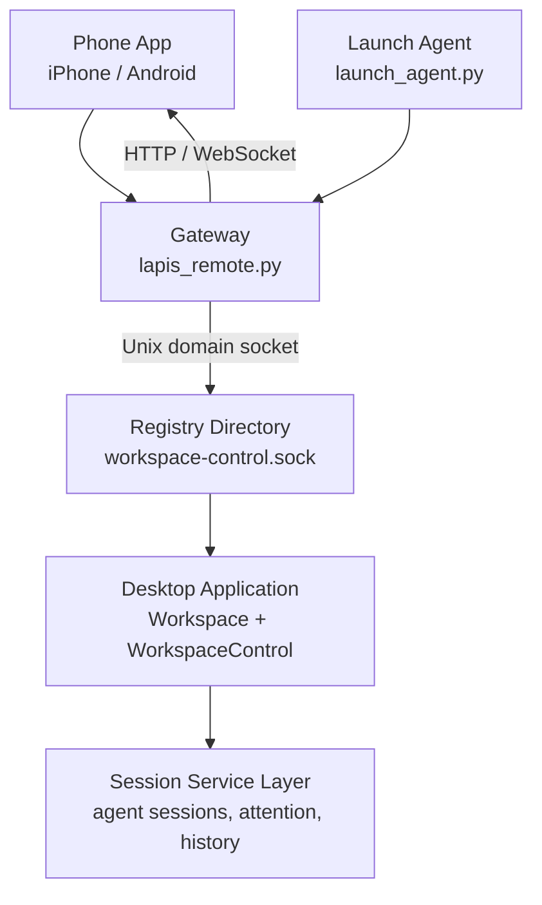
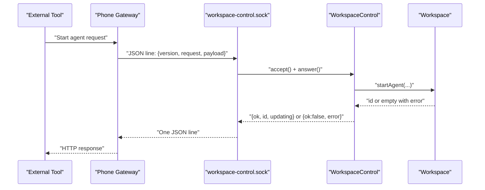
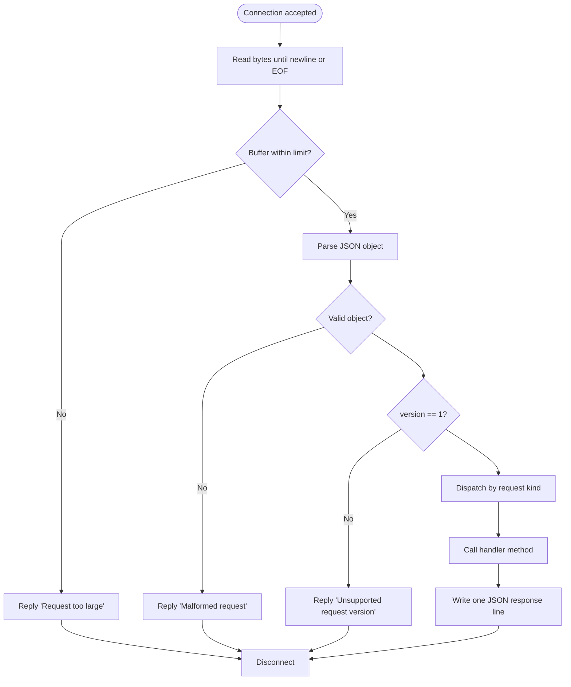
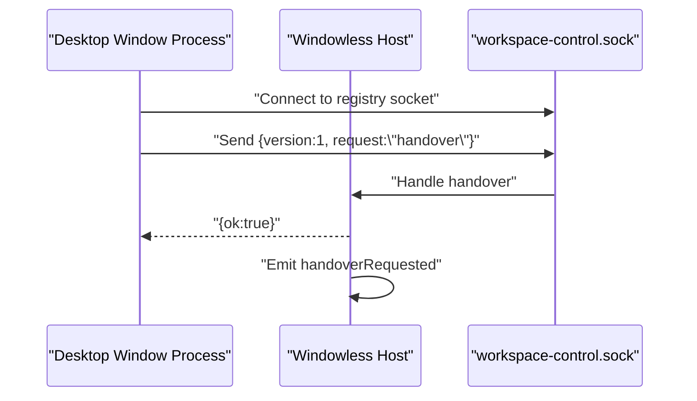
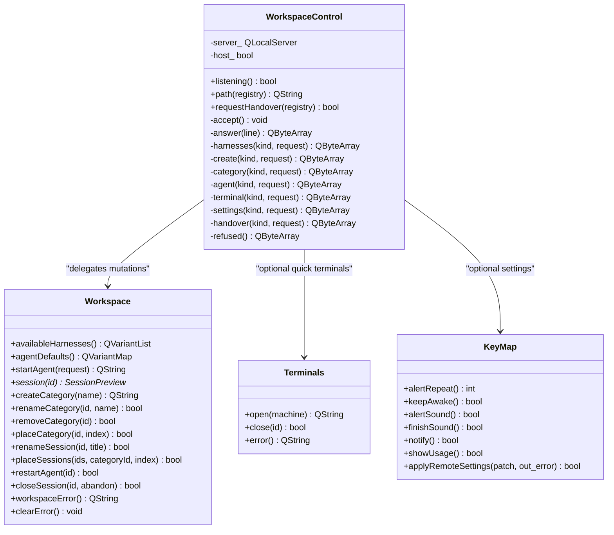
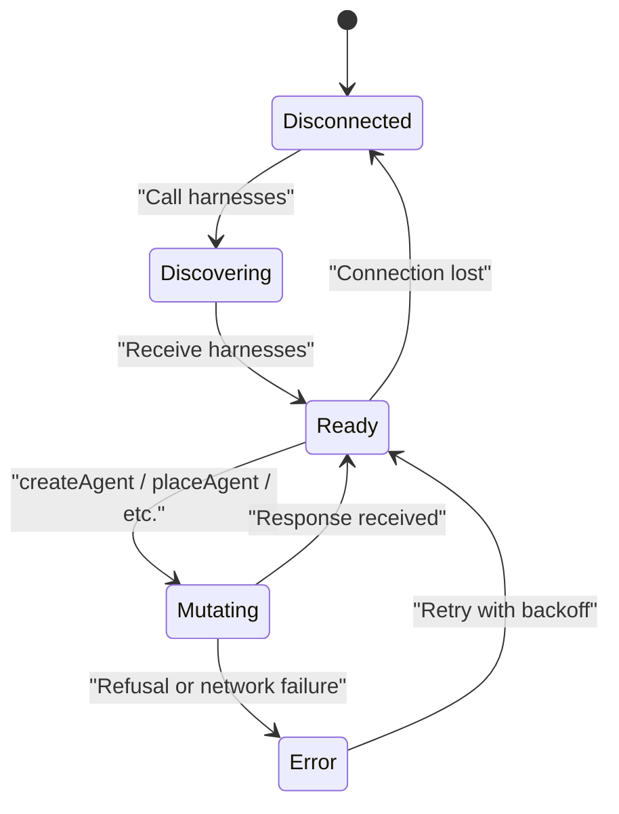

# Workspace Control API

<cite>
**Referenced Files in This Document**
- [workspace_control.hpp](file://apps/desktop/src/workspace_control.hpp)
- [workspace_control.cpp](file://apps/desktop/src/workspace_control.cpp)
- [main.cpp](file://apps/desktop/src/main.cpp)
- [workspace.hpp](file://apps/desktop/src/workspace.hpp)
- [workspace.cpp](file://apps/desktop/src/workspace.cpp)
- [lapis_remote.py](file://apps/remote/lapis_remote.py)
- [launch_agent.py](file://apps/remote/launch_agent.py)
- [attention.hpp](file://services/session/include/lapis/session/attention.hpp)
- [attention.cpp](file://services/session/src/attention.cpp)
- [README.md](file://README.md)
- [phone.md](file://docs/phone.md)
</cite>

## Table of Contents
1. [Introduction](#introduction)
2. [Project Structure](#project-structure)
3. [Core Components](#core-components)
4. [Architecture Overview](#architecture-overview)
5. [Detailed Component Analysis](#detailed-component-analysis)
6. [Dependency Analysis](#dependency-analysis)
7. [Performance Considerations](#performance-considerations)
8. [Security Model](#security-model)
9. [Request and Response Specification](#request-and-response-specification)
10. [Event Notification and State Synchronization](#event-notification-and-state-synchronization)
11. [Error Handling](#error-handling)
12. [Client Implementation Guide](#client-implementation-guide)
13. [Troubleshooting Guide](#troubleshooting-guide)
14. [Conclusion](#conclusion)

## Introduction
The Workspace Control API is the local IPC surface that lets other Lapis processes on the same Mac control the workspace owned by the desktop application or its windowless host process. It is not a general-purpose remote API: it runs over a Unix-domain socket inside the workspace registry directory, and it assumes the caller can reach that socket.

Its primary external consumer is the phone gateway, which exposes an HTTP/SSE interface to iPhone and Android clients. The gateway uses Workspace Control to start agents, manage categories, open quick-command terminals, read settings, and request ownership handover from the windowless host to a desktop window.

This document explains the command interface, security assumptions, request/response contract, error model, synchronization expectations, and guidance for building robust clients.

## Project Structure
Workspace Control lives in the desktop application code, while the phone gateway lives under `apps/remote`. The session service layer provides agent lifecycle, terminal streaming, attention, and history; Workspace Control delegates state mutations to the desktop `Workspace` object rather than duplicating business logic.

**Diagram sources**
- [lapis_remote.py:1-40](file://apps/remote/lapis_remote.py#L1-L40)
- [workspace_control.cpp:70-110](file://apps/desktop/src/workspace_control.cpp#L70-L110)
- [main.cpp:920-965](file://apps/desktop/src/main.cpp#L920-L965)

**Section sources**
- [README.md:1-35](file://README.md#L1-L35)
- [workspace_control.hpp:1-70](file://apps/desktop/src/workspace_control.hpp#L1-L70)
- [workspace_control.cpp:1-120](file://apps/desktop/src/workspace_control.cpp#L1-L120)
- [lapis_remote.py:1-60](file://apps/remote/lapis_remote.py#L1-L60)

## Core Components
- **WorkspaceControl**: A Qt `QObject` that owns a `QLocalServer` listening on `<registry>/workspace-control.sock`. It accepts one JSON line per connection, validates the version and request kind, dispatches to handlers, and writes one compact JSON response followed by a newline.
- **Workspace**: The desktop application’s workspace model. Workspace Control does not directly mutate UI state; it calls workspace methods such as starting agents, renaming sessions, placing agents into categories, closing sessions, restarting agents, creating or removing categories, and changing settings.
- **Terminals**: Optional quick-command shell endpoints exposed through the control API. They are required for phone-initiated terminal operations.
- **KeyMap**: Optional access to laptop settings that the phone can change remotely, such as alert sounds, notifications, usage display, and whether the Mac should stay awake.
- **Gateway**: Python HTTP server exposing `/api/deck`, `/api/agents/<id>/submit`, and terminal streams. It calls Workspace Control only when the phone asks to create an agent or perform workspace-level operations.
- **Launch Agent**: macOS LaunchAgent helper that keeps the gateway running at login.

**Section sources**
- [workspace_control.hpp:10-70](file://apps/desktop/src/workspace_control.hpp#L10-L70)
- [workspace_control.cpp:70-180](file://apps/desktop/src/workspace_control.cpp#L70-L180)
- [workspace.hpp:402-555](file://apps/desktop/src/workspace.hpp#L402-L555)
- [lapis_remote.py:1-60](file://apps/remote/lapis_remote.py#L1-L60)
- [launch_agent.py:1-87](file://apps/remote/launch_agent.py#L1-L87)

## Architecture Overview
The workspace owner is either a visible desktop window or a windowless host process. Only the process holding the registry lock may serve Workspace Control requests. External tools must go through the phone gateway; they cannot call Workspace Control directly unless they also run on the Mac and can reach the Unix socket.

**Diagram sources**
- [workspace_control.cpp:100-180](file://apps/desktop/src/workspace_control.cpp#L100-L180)
- [lapis_remote.py:400-430](file://apps/remote/lapis_remote.py#L400-L430)
- [workspace.hpp:489-503](file://apps/desktop/src/workspace.hpp#L489-L503)

## Detailed Component Analysis

### Workspace Control Server
`WorkspaceControl` starts a local server bound to the workspace registry directory. Each accepted connection is given an idle timeout and reads until a newline. Only one JSON line is processed per connection; subsequent data is ignored. Requests are parsed as a JSON object with a `version` field and a `request` dispatcher key.

Key implementation characteristics:
- One request per connection.
- Compact JSON responses terminated by a newline.
- Version 1 only.
- Max request buffer size limits malformed or oversized payloads.
- Idle connections are aborted after five seconds without input.
- Socket path is derived from the workspace storage path plus `workspace-control.sock`.

**Diagram sources**
- [workspace_control.cpp:80-170](file://apps/desktop/src/workspace_control.cpp#L80-L170)

**Section sources**
- [workspace_control.hpp:10-70](file://apps/desktop/src/workspace_control.hpp#L10-L70)
- [workspace_control.cpp:70-180](file://apps/desktop/src/workspace_control.cpp#L70-L180)

### Command Handlers
Workspace Control supports these request kinds:

| Request | Purpose | Required Fields | Notes |
|---|---|---|---|
| `harnesses` | List available agent harnesses and defaults | None | Read-only discovery. |
| `createAgent` | Create a new agent session | `category`, `harness`, `directory` | Optional `machine`, `program`, `title`, `model`, `mode`, `resume`. Title defaults to folder name if unnamed. |
| `createCategory` | Add a category | `name` | Returns new category `id`. |
| `renameCategory` | Rename a category | `id`, `name` | Fails if the workspace rejects the rename. |
| `removeCategory` | Remove a category | `id` | Category must be empty and another must remain. |
| `placeCategory` | Reorder a category | `id`, `index` | Index must be a whole non-negative integer. |
| `closeAgent` | End an agent session | `id` | Equivalent to the desktop close action. |
| `renameAgent` | Rename an agent title | `id`, `title` | Title remains over the conversation. |
| `placeAgent` | Move an agent into a category and position | `id`, `category`, `index` | Position must be a whole non-negative integer. |
| `restartAgent` | Restart a stopped agent | `id` | Requires the agent to be stopped. |
| `openTerminal` | Open a quick-command shell | `machine` | Empty string means this Mac. Requires `Terminals`. |
| `closeTerminal` | Close a quick-command shell | `id` | Requires `Terminals`. |
| `settings` | Read current remote-capable settings | None | Requires `KeyMap`. |
| `changeSettings` | Update remote-capable settings | `settings` object | Validates boolean switches and numeric repeat range. |
| `handover` | Ask windowless host to release the workspace to a window | None | Only honored by the windowless host. |

Handlers validate fields before calling `Workspace`. If the workspace operation fails, Workspace Control returns a refusal carrying the workspace’s human-readable reason and clears that error so it is not reported again.

**Section sources**
- [workspace_control.cpp:120-341](file://apps/desktop/src/workspace_control.cpp#L120-L341)
- [workspace.hpp:441-555](file://apps/desktop/src/workspace.hpp#L441-L555)

### Handover
When the desktop runs in headless mode, it can own the workspace and serve Workspace Control. A desktop window can ask the windowless host to release ownership using `WorkspaceControl::requestHandover`. This connects to the socket, sends the `handover` request, waits up to one second for a reply, and interprets the top-level `ok` field.

The windowless host emits a `handoverRequested` signal after writing the success reply, allowing the caller to react (for example, by launching or activating a desktop window).

**Diagram sources**
- [workspace_control.cpp:320-341](file://apps/desktop/src/workspace_control.cpp#L320-L341)
- [workspace_control.hpp:28-50](file://apps/desktop/src/workspace_control.hpp#L28-L50)
- [main.cpp:920-965](file://apps/desktop/src/main.cpp#L920-L965)

**Section sources**
- [workspace_control.cpp:150-170](file://apps/desktop/src/workspace_control.cpp#L150-L170)
- [workspace_control.cpp:320-341](file://apps/desktop/src/workspace_control.cpp#L320-L341)
- [main.cpp:920-965](file://apps/desktop/src/main.cpp#L920-L965)

## Dependency Analysis
Workspace Control depends on several internal components but deliberately avoids duplicating workspace policy.

**Diagram sources**
- [workspace_control.hpp:10-70](file://apps/desktop/src/workspace_control.hpp#L10-L70)
- [workspace.hpp:402-555](file://apps/desktop/src/workspace.hpp#L402-L555)

**Section sources**
- [workspace_control.cpp:100-341](file://apps/desktop/src/workspace_control.cpp#L100-L341)
- [workspace.hpp:402-555](file://apps/desktop/src/workspace.hpp#L402-L555)

## Security Model
Workspace Control has no built-in authentication token mechanism. Its security boundary is operating-system level:

1. **Local socket ownership**: Only the process that holds the registry lock listens on `workspace-control.sock`.
2. **Filesystem permissions**: The socket resides under the workspace registry directory.
3. **One-request-per-connection**: Prevents multiplexed abuse on a single socket.
4. **Request size limit**: Rejects buffers larger than 16 KiB.
5. **Version check**: Accepts only version 1.
6. **Input validation**: Field types, optional fields, and numeric positions are validated before calling `Workspace`.
7. **Gateway admission**: The phone gateway refuses browser-like requests and requires either Tailscale identity matching or ZeroTier membership.

There is no per-request permission scope, bearer token, or rate-limit header. Rate limiting is instead enforced at two layers:
- The gateway caps concurrent HTTP connections.
- Workspace Control enforces one request per connection and aborts idle sockets after five seconds.

Clients should implement their own retry and backoff policies because the API does not expose rate-limit responses.

**Section sources**
- [workspace_control.cpp:70-170](file://apps/desktop/src/workspace_control.cpp#L70-L170)
- [lapis_remote.py:1-60](file://apps/remote/lapis_remote.py#L1-L60)
- [lapis_remote.py:2188-2194](file://apps/remote/lapis_remote.py#L2188-L2194)

## Request and Response Specification

### Transport
- **Protocol**: One JSON line per connection over a Unix domain socket.
- **Path**: `<registry>/workspace-control.sock`.
- **Encoding**: UTF-8 JSON.
- **Termination**: A newline character ends each request and response.
- **Connection lifetime**: One request per connection; the server disconnects after processing.

### Request Schema
Every request is a JSON object with:

| Field | Type | Required | Description |
|---|---|---:|---|
| `version` | number | Yes | Must be `1`. |
| `request` | string | Yes | Request kind. |
| payload fields | varies | Depends on request | Per-request parameters. |

Example request shapes (described, not copied):
- `{version:1, request:"harnesses"}`
- `{version:1, request:"createAgent", category:"...", harness:"...", directory:"..."}`
- `{version:1, request:"createCategory", name:"..."}`
- `{version:1, request:"closeAgent", id:"..."}`
- `{version:1, request:"openTerminal", machine:""}`
- `{version:1, request:"settings"}`
- `{version:1, request:"changeSettings", settings:{...}}`
- `{version:1, request:"handover"}`

### Response Schema
All responses are JSON objects ending with a newline.

Success shape:
- `ok`: true
- Additional fields depend on the request kind.

Failure shape:
- `ok`: false
- `error`: string explaining why the request was rejected.

Common success fields:
- `id`: agent, category, or terminal identifier.
- `updating`: boolean indicating whether the newly created agent is still initializing.
- `harnesses`: array of available harnesses.
- `defaults`: agent default configuration.
- `settings`: current remote-capable settings.

### Field Validation Rules
- Missing required fields return a specific refusal message.
- Invalid field types return a refusal naming the invalid field where applicable.
- Numeric positions must be finite, non-negative whole numbers.
- `changeSettings` allows only defined keys: `keepAwake`, `alertSound`, `finishSound`, `notify`, `showUsage` (boolean), and `alertRepeat` (integer from 1 to 10).
- Unknown request kinds return `"Unknown request"`.

**Section sources**
- [workspace_control.cpp:80-170](file://apps/desktop/src/workspace_control.cpp#L80-L170)
- [workspace_control.cpp:180-341](file://apps/desktop/src/workspace_control.cpp#L180-L341)

## Event Notification and State Synchronization
Workspace Control itself is synchronous: send one request, receive one response. It does not push event streams.

External clients should reconcile state by:
1. Calling `harnesses` during initialization to discover supported harnesses and defaults.
2. Reading workspace state through the phone gateway’s existing listing endpoints (`/api/deck` and related agent views).
3. Using Workspace Control only for write operations that require workspace ownership.
4. Refreshing cached lists after successful mutations.
5. Treating agent creation as potentially asynchronous: `createAgent` may return `updating:true` when the agent is still initializing.

The session service layer provides richer event semantics for agent attention, including observation, reconciliation, pending requests, activity transitions, and epoch/sequence tracking. Clients that need fine-grained awareness of agent attention should use the session transport rather than polling Workspace Control.

[No sources needed since this diagram shows conceptual client workflow, not actual code structure]

**Section sources**
- [workspace_control.cpp:140-170](file://apps/desktop/src/workspace_control.cpp#L140-L170)
- [attention.hpp:1-136](file://services/session/include/lapis/session/attention.hpp#L1-L136)
- [attention.cpp:1-200](file://services/session/src/attention.cpp#L1-L200)

## Error Handling
Workspace Control distinguishes three broad error families:

| Family | Examples | Meaning |
|---|---|---|
| Protocol errors | `Malformed request`, `Unsupported request version`, `Unknown request`, `Request too large` | The request could not be parsed or is not supported by this API version. |
| Input validation errors | `Missing ...`, `Invalid ...`, `No such agent`, `No such terminal` | The request schema or referenced entity is invalid. |
| Workspace policy errors | Refusals containing the workspace’s error message | The request reached the workspace but was rejected by desktop policy. |

Workspace policy refusals are intentionally user-facing: the comment in the code notes that the phone asked for the change, so the phone should show the workspace’s reason. Workspace Control clears the workspace error after reading it, preventing duplicate reporting.

Common workspace-policy causes include:
- Creating a category when the workspace is unavailable.
- Removing a category that is not empty.
- Closing or renaming an agent that does not exist.
- Placing an agent with an invalid index.
- Operating terminals or settings when those subsystems are unavailable.

Clients should treat all `ok:false` responses as failures and display or log the `error` field. They should not assume that missing fields imply success.

**Section sources**
- [workspace_control.cpp:120-170](file://apps/desktop/src/workspace_control.cpp#L120-L170)
- [workspace_control.cpp:180-341](file://apps/desktop/src/workspace_control.cpp#L180-L341)
- [workspace.cpp:1034-1034](file://apps/desktop/src/workspace.cpp#L1034-L1034)

## Client Implementation Guide

### Integrating with the Phone Gateway
The phone gateway is the intended integration point for external tools:

1. Run the gateway with `uv run --no-project python apps/remote/launch_agent.py install`.
2. Ensure Tailscale or ZeroTier is active so the gateway can admit peer devices.
3. Use the gateway’s documented HTTP routes for discovery and terminal streaming.
4. Let the gateway call Workspace Control for workspace mutations such as starting agents.
5. Do not attempt to connect directly to `workspace-control.sock` from untrusted processes.

The gateway documents its own routes, such as:
- `GET /api/deck`: read-only registry, agent_state, ultratab cards, and version information.
- `POST /api/agents/<id>/submit`: join an agent’s session as an extra view and submit text.

**Section sources**
- [phone.md:1-130](file://docs/phone.md#L1-L130)
- [lapis_remote.py:1-60](file://apps/remote/lapis_remote.py#L1-L60)
- [launch_agent.py:1-87](file://apps/remote/launch_agent.py#L1-L87)

### Implementing a Robust Local Client
If you are building a trusted local tool that can reach the registry directory:

1. Resolve the socket path from the registry directory.
2. Connect using a Unix domain socket client.
3. Send exactly one valid JSON line.
4. Read until a newline.
5. Parse the response and handle both `ok:true` and `ok:false`.
6. Close the connection immediately after receiving the response.
7. Retry failed operations with exponential backoff and jitter.
8. Re-fetch discovery data after mutations.
9. Handle disconnections by reconnecting rather than assuming long-lived state.
10. Avoid sending concurrent requests on the same socket; the protocol is explicitly one-request-per-connection.

Recommended retry behavior:
- Retry only idempotent reads like `harnesses` and `settings`.
- For write operations, deduplicate retries using client-side request identifiers where possible.
- Stop retrying after a maximum number of attempts or elapsed time.
- Surface persistent workspace errors to the user.

### Example Integration Scenarios

#### Starting a New Agent from an External Script
1. Call `harnesses` to verify the harness exists.
2. Call `createAgent` with a valid category, harness, and directory.
3. If `ok:true` and `updating:true`, poll the gateway’s agent listing until the agent becomes ready.
4. If `ok:false`, display the error and do not assume the agent was created.

#### Switching Focus Between Agents
Workspace Control does not have a direct “switch focus” command. Focus changes are managed by the desktop UI and the phone gateway’s join/attach semantics. An external client should:
- Use the gateway’s agent attach/join endpoints to make the phone or external view the agent.
- Avoid trying to manipulate focus directly through Workspace Control.

#### Executing Workspace-Level Operations
- Categories: use `createCategory`, `renameCategory`, `removeCategory`, and `placeCategory`.
- Agents: use `closeAgent`, `renameAgent`, `placeAgent`, and `restartAgent`.
- Terminals: use `openTerminal` and `closeTerminal`, but only when `Terminals` is available.
- Settings: use `settings` and `changeSettings`, but only when `KeyMap` is available.

**Section sources**
- [workspace_control.cpp:180-341](file://apps/desktop/src/workspace_control.cpp#L180-L341)
- [phone.md:60-130](file://docs/phone.md#L60-L130)

## Performance Considerations
- **Request granularity**: Because each request consumes a connection, batch logical work on the client side rather than opening many short-lived sockets unnecessarily.
- **Idle timeout**: Connections without input are aborted after five seconds. Long-running control clients should avoid keeping sockets open.
- **Gateway concurrency**: The gateway limits HTTP connections to 16 by default. Excess connections receive a busy response.
- **Agent startup**: `createAgent` may return `updating:true`; downstream consumers should treat this as asynchronous initialization.
- **History and terminal streams**: These are handled by the session service and gateway, not Workspace Control. Streaming operations should use the appropriate transport rather than the control socket.

[No sources needed since this section provides general guidance]

## Troubleshooting Guide

| Symptom | Likely Cause | Resolution |
|---|---|---|
| Connection refused to `workspace-control.sock` | No workspace owner is serving the registry | Start the desktop application or ensure the windowless host is running. |
| `Request too large` | Request body exceeds 16 KiB | Reduce request size or split work across multiple calls. |
| `Malformed request` | JSON parse failure | Validate request JSON before sending. |
| `Unsupported request version` | Client sends a version other than 1 | Upgrade the client to use version 1. |
| `Unknown request` | Misspelled or unsupported request kind | Check the supported request list. |
| `No such agent` | Agent ID does not exist | Refresh the agent list before mutating. |
| `Terminals are not available` | Quick-command terminals were not initialized | Run the desktop workspace with terminals enabled. |
| `Settings are not available` | Settings subsystem was not injected | Ensure the workspace host injects `KeyMap`. |
| `Invalid setting ...` | Change contains an unknown or wrong-typed field | Restrict changes to allowed keys and types. |
| Workspace policy refusal with human-readable message | Desktop rejected the operation | Show the error to the user; do not retry blindly. |
| Gateway refuses request | Browser-like headers, missing client header, or unauthorized peer | Use the gateway from a trusted device with Tailscale or ZeroTier configured. |

**Section sources**
- [workspace_control.cpp:100-170](file://apps/desktop/src/workspace_control.cpp#L100-L170)
- [workspace_control.cpp:180-341](file://apps/desktop/src/workspace_control.cpp#L180-L341)
- [lapis_remote.py:1-60](file://apps/remote/lapis_remote.py#L1-L60)

## Conclusion
Workspace Control is a focused, local IPC API for trusted callers that can reach the Lapis workspace registry. It delegates workspace mutations to the desktop `Workspace`, validates inputs strictly, and returns explicit refusal messages for policy failures. External applications should integrate through the phone gateway, which adds transport, admission, and streaming concerns on top of the workspace.

For robust clients:
- Treat Workspace Control as synchronous and one-request-per-connection.
- Validate every response, especially `ok:false`.
- Reconcile state after mutations rather than assuming immediate consistency.
- Handle disconnections with bounded retries.
- Prefer the session service and gateway transports for streaming and attention events.
- Never rely on Workspace Control for cross-machine authentication or authorization; trust boundaries are local and filesystem-based.