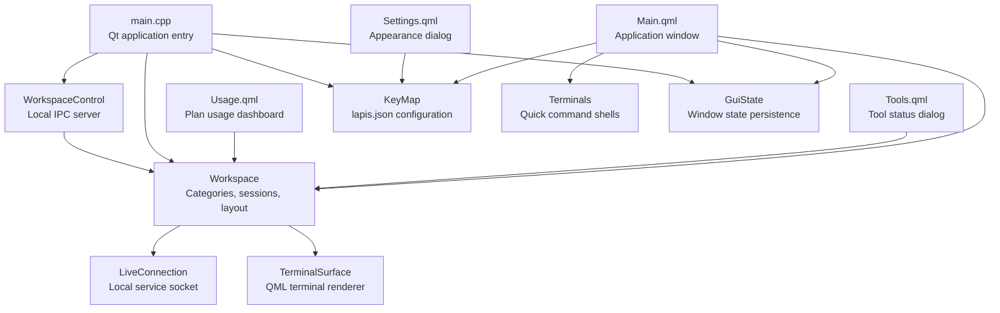
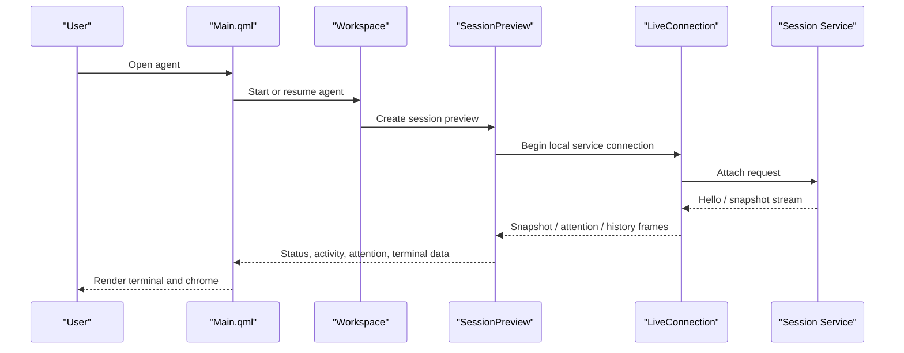
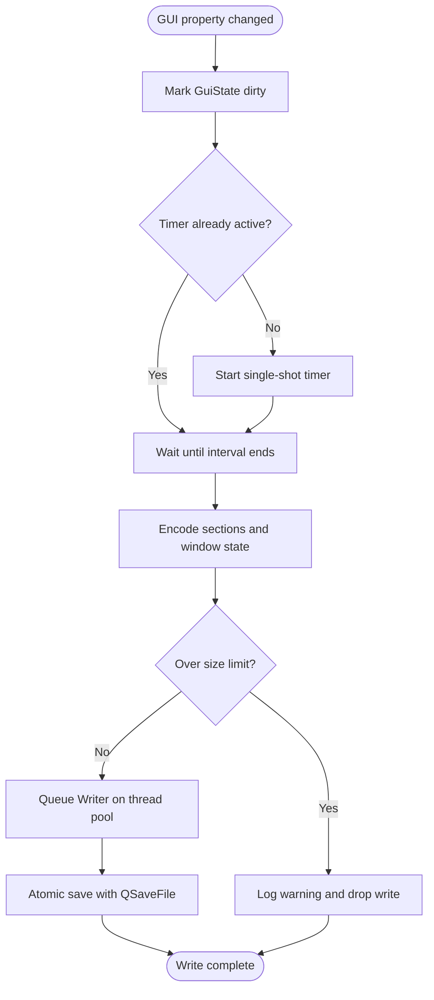
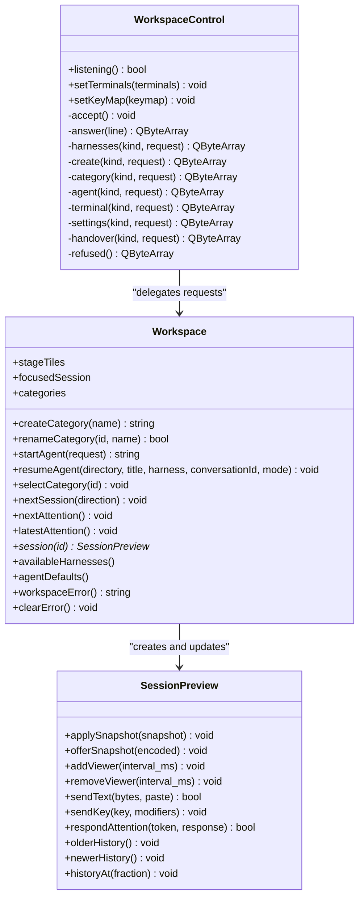
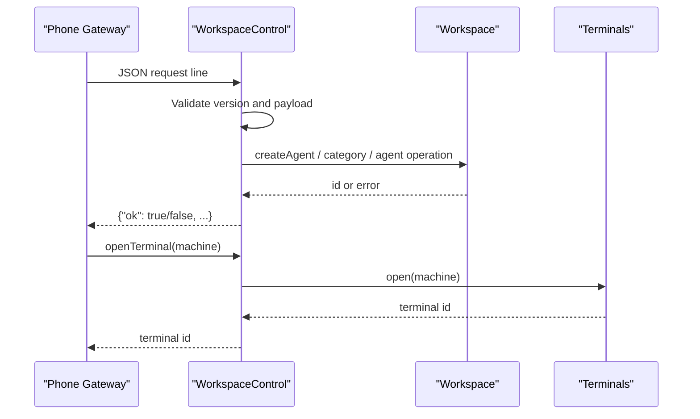
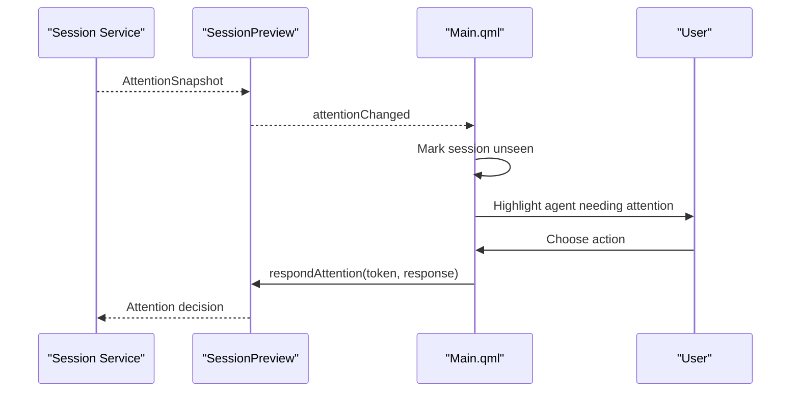
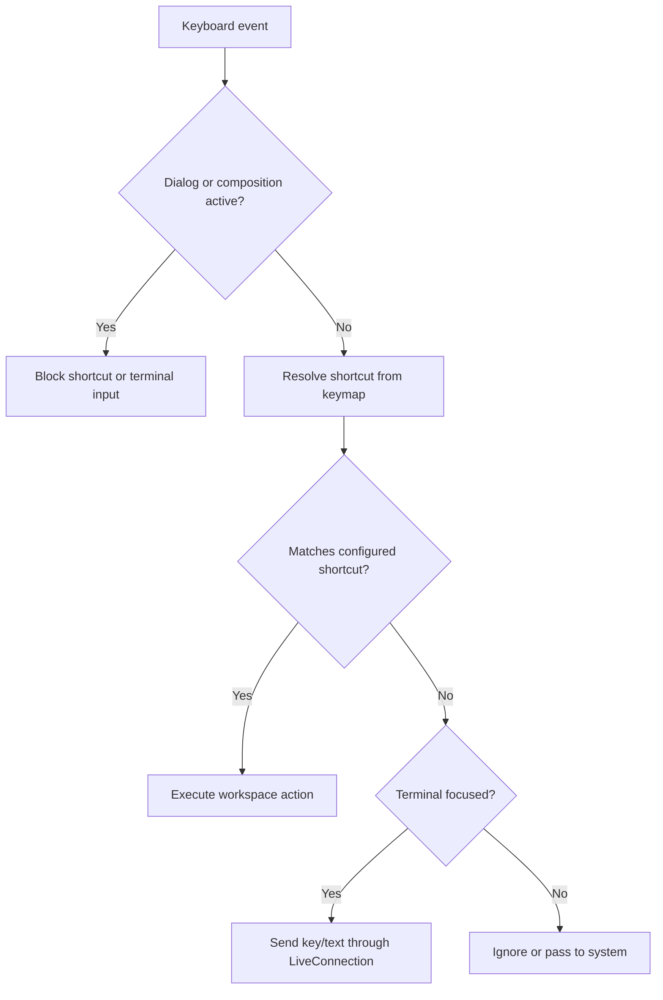
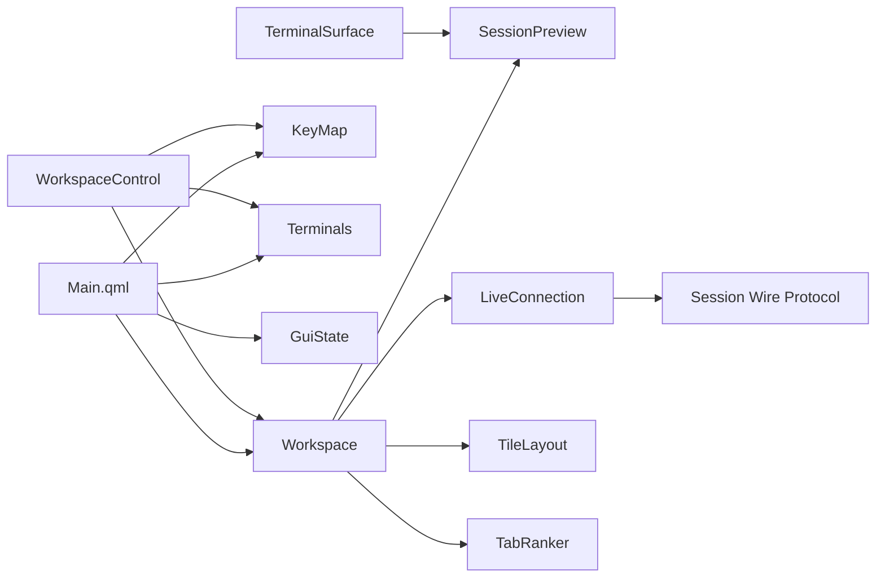

# Desktop Application Architecture

<cite>
**Referenced Files in This Document**   
- [README.md](file://README.md)
- [apps/desktop/qml/Main.qml](file://apps/desktop/qml/Main.qml)
- [apps/desktop/qml/Settings.qml](file://apps/desktop/qml/Settings.qml)
- [apps/desktop/qml/Tools.qml](file://apps/desktop/qml/Tools.qml)
- [apps/desktop/qml/Usage.qml](file://apps/desktop/qml/Usage.qml)
- [apps/desktop/src/main.cpp](file://apps/desktop/src/main.cpp)
- [apps/desktop/src/gui_state.hpp](file://apps/desktop/src/gui_state.hpp)
- [apps/desktop/src/gui_state.cpp](file://apps/desktop/src/gui_state.cpp)
- [apps/desktop/src/workspace_control.hpp](file://apps/desktop/src/workspace_control.hpp)
- [apps/desktop/src/workspace_control.cpp](file://apps/desktop/src/workspace_control.cpp)
- [apps/desktop/src/workspace.hpp](file://apps/desktop/src/workspace.hpp)
- [apps/desktop/src/workspace.cpp](file://apps/desktop/src/workspace.cpp)
- [apps/desktop/src/keymap.hpp](file://apps/desktop/src/keymap.hpp)
- [apps/desktop/src/live_connection.hpp](file://apps/desktop/src/live_connection.hpp)
- [apps/desktop/src/terminals.hpp](file://apps/desktop/src/terminals.hpp)
- [apps/desktop/src/terminal_surface.hpp](file://apps/desktop/src/terminal_surface.hpp)
- [apps/desktop/src/attention_view.cpp](file://apps/desktop/src/attention_view.cpp)
</cite>

## Table of Contents
1. [Introduction](#introduction)
2. [Project Structure](#project-structure)
3. [Core Components](#core-components)
4. [Architecture Overview](#architecture-overview)
5. [Detailed Component Analysis](#detailed-component-analysis)
6. [Dependency Analysis](#dependency-analysis)
7. [Performance Considerations](#performance-considerations)
8. [Troubleshooting Guide](#troubleshooting-guide)
9. [Conclusion](#conclusion)

## Introduction
Lapis is a desktop application for running multiple coding agents concurrently, each with its own live terminal. The desktop build uses Qt/QML for the user interface and C++ for business logic, session management, local IPC, and terminal rendering coordination. The application groups agent sessions into categories, shows previews in a category strip, tiles the active stage, routes attention-driven navigation, and exposes a local IPC surface that lets other Lapis processes (such as a phone gateway or windowless host) manage the workspace.

This document explains:
- The main application entry point and how it wires QML to C++.
- How GUI state persists across restarts without blocking shutdown.
- How the workspace controller coordinates categories, agents, tiles, terminals, and background services.
- How QML screens bind to controllers through properties, signals, and `Q_INVOKABLE` methods.
- How background services communicate over local IPC, including attention-driven navigation and keyboard input.
- Performance considerations for terminal rendering, large buffers, and IPC throughput.

**Section sources**
- [README.md:1-100](file://README.md#L1-L100)

## Project Structure
The desktop application lives under `apps/desktop`. Its structure separates presentation from logic:

- `qml/`: QML components representing the main window, dialogs, and reusable UI pieces.
- `src/`: C++ classes implementing workspace state, session previews, key mapping, terminal surfaces, IPC control, platform helpers, and tests.
- `tests/`: Unit and integration tests for most C++ modules.
- `macos/`: macOS packaging and entitlements.

**Diagram sources**
- [apps/desktop/qml/Main.qml:1-120](file://apps/desktop/qml/Main.qml#L1-L120)
- [apps/desktop/src/main.cpp:1-120](file://apps/desktop/src/main.cpp#L1-L120)
- [apps/desktop/src/workspace_control.hpp:1-70](file://apps/desktop/src/workspace_control.hpp#L1-L70)
- [apps/desktop/src/workspace.hpp:1-120](file://apps/desktop/src/workspace.hpp#L1-L120)
- [apps/desktop/src/keymap.hpp:1-120](file://apps/desktop/src/keymap.hpp#L1-L120)
- [apps/desktop/src/terminals.hpp:1-93](file://apps/desktop/src/terminals.hpp#L1-L93)
- [apps/desktop/src/gui_state.hpp:1-97](file://apps/desktop/src/gui_state.hpp#L1-L97)
- [apps/desktop/src/live_connection.hpp:1-116](file://apps/desktop/src/live_connection.hpp#L1-L116)
- [apps/desktop/src/terminal_surface.hpp:1-120](file://apps/desktop/src/terminal_surface.hpp#L1-L120)

**Section sources**
- [README.md:1-100](file://README.md#L1-L100)
- [apps/desktop/qml/Main.qml:1-120](file://apps/desktop/qml/Main.qml#L1-L120)
- [apps/desktop/src/main.cpp:1-120](file://apps/desktop/src/main.cpp#L1-L120)

## Core Components
The desktop application has five primary responsibilities:

1. **Application bootstrap**: Parse CLI options, initialize Qt, prepare environment, start the workspace, and expose C++ objects to QML.
2. **GUI state persistence**: Persist small per-window choices and owner-provided sections atomically, rate-limited and off the GUI thread.
3. **Workspace coordination**: Manage agent categories, sessions, tile layout, history, activity, and connection state.
4. **Local IPC**: Expose a Unix domain-style local socket server so other Lapis processes can create agents, manage categories, open quick terminals, and adjust settings.
5. **Terminal rendering and input**: Present terminal snapshots, handle keyboard input, paste, find text, follow links, and integrate next-prompt suggestions.

| Component | Responsibility | Primary File |
|---|---|---|
| Application entry | Command-line parsing, Qt setup, workspace initialization | [main.cpp](file://apps/desktop/src/main.cpp) |
| Window state | Versioned JSON persistence, rate-limited writes, window preferences | [gui_state.hpp](file://apps/desktop/src/gui_state.hpp), [gui_state.cpp](file://apps/desktop/src/gui_state.cpp) |
| Workspace | Categories, sessions, tiles, history, attention state | [workspace.hpp](file://apps/desktop/src/workspace.hpp), [workspace.cpp](file://apps/desktop/src/workspace.cpp) |
| Local IPC | Request routing, validation, workspace mutation | [workspace_control.hpp](file://apps/desktop/src/workspace_control.hpp), [workspace_control.cpp](file://apps/desktop/src/workspace_control.cpp) |
| Configuration | Themes, shortcuts, density, agent defaults, platform settings | [keymap.hpp](file://apps/desktop/src/keymap.hpp) |
| Quick terminals | Per-machine shell sessions exposed to the UI and IPC | [terminals.hpp](file://apps/desktop/src/terminals.hpp) |
| Live service connection | Local protocol transport, resize, paste, history | [live_connection.hpp](file://apps/desktop/src/live_connection.hpp) |
| Terminal view | QML terminal item, input handling, search, link resolution | [terminal_surface.hpp](file://apps/desktop/src/terminal_surface.hpp) |

**Section sources**
- [apps/desktop/src/main.cpp:1-120](file://apps/desktop/src/main.cpp#L1-L120)
- [apps/desktop/src/gui_state.hpp:1-97](file://apps/desktop/src/gui_state.hpp#L1-L97)
- [apps/desktop/src/workspace.hpp:1-120](file://apps/desktop/src/workspace.hpp#L1-L120)
- [apps/desktop/src/workspace_control.hpp:1-70](file://apps/desktop/src/workspace_control.hpp#L1-L70)
- [apps/desktop/src/keymap.hpp:1-120](file://apps/desktop/src/keymap.hpp#L1-L120)
- [apps/desktop/src/terminals.hpp:1-93](file://apps/desktop/src/terminals.hpp#L1-L93)
- [apps/desktop/src/live_connection.hpp:1-116](file://apps/desktop/src/live_connection.hpp#L1-L116)
- [apps/desktop/src/terminal_surface.hpp:1-120](file://apps/desktop/src/terminal_surface.hpp#L1-L120)

## Architecture Overview
At runtime, the desktop app follows a layered pattern:

- **Presentation layer (QML)**: `Main.qml` owns the application window, theme-derived colors, keyboard bindings, dialog visibility, focus target, and navigation commands. It binds to C++ controllers through injected properties such as `workspace`, `keymap`, `terminals`, `usage`, and `tools`.
- **Controller layer (C++)**: `Workspace` holds session state; `KeyMap` supplies configuration; `Terminals` manages quick command shells; `GuiState` persists window state.
- **Service integration layer**: `SessionPreview` represents an agent session; `LiveConnection` communicates with a background session service over a local protocol.
- **IPC layer**: `WorkspaceControl` listens on a registry-local socket and forwards requests to `Workspace`.

**Diagram sources**
- [apps/desktop/qml/Main.qml:201-469](file://apps/desktop/qml/Main.qml#L201-L469)
- [apps/desktop/src/workspace.hpp:1-120](file://apps/desktop/src/workspace.hpp#L1-L120)
- [apps/desktop/src/live_connection.hpp:1-116](file://apps/desktop/src/live_connection.hpp#L1-L116)

## Detailed Component Analysis

### Main Application Entry Point
`main.cpp` initializes the Qt application, parses command-line options, configures development modes, prepares environment variables, sets up UI preview mode, and starts the workspace and related subsystems. It supports options for managed Codex or Claude Code attention, restoring agents, serving the workspace for a phone, opening specific sessions, capturing UI output, and injecting smoke input.

Key behaviors:
- Distinguishes between normal desktop use, isolated UI preview, restoration, and hosting modes.
- Rejects unqualified workspace launches to prevent accidental agent execution.
- Prepares paths, clipboard access, terminal surface capabilities, and platform-specific features before constructing the QML engine.
- Injects C++ controllers into QML context so QML components can bind to workspace, keymap, tools, usage, terminals, and platform helpers.

**Section sources**
- [apps/desktop/src/main.cpp:1-120](file://apps/desktop/src/main.cpp#L1-L120)

### GUI State Management
`GuiState` is a per-window state manager designed for small, frequently changing UI state. It stores:
- A versioned JSON file containing named sections.
- Each section registered by an owner with a function returning current state.
- A reserved `window` section for QML-owned preferences.

Design characteristics:
- Atomic write using `QSaveFile`.
- Rate-limited debounced writes via a timer and publish-to-publish semantics.
- Off-GUI-thread writer pool.
- Size limits (`kMaxBytes`) and maximum key/value constraints for the window section.
- Graceful shutdown waiting with bounded timeout.

**Diagram sources**
- [apps/desktop/src/gui_state.hpp:1-97](file://apps/desktop/src/gui_state.hpp#L1-L97)
- [apps/desktop/src/gui_state.cpp:1-200](file://apps/desktop/src/gui_state.cpp#L1-L200)

**Section sources**
- [apps/desktop/src/gui_state.hpp:1-97](file://apps/desktop/src/gui_state.hpp#L1-L97)
- [apps/desktop/src/gui_state.cpp:1-200](file://apps/desktop/src/gui_state.cpp#L1-L200)

### Workspace Controller and Multi-Agent Coordination
`Workspace` is the central controller for the multi-agent terminal interface. It manages:
- Agent categories and their ordering.
- Sessions inside categories.
- Focus, selection, and navigation.
- Tile layout on the stage.
- History scrubbing and page navigation.
- Attention state and unseen marks.
- Launch parameters, approval modes, and harness selection.
- Integration with live session services and terminal snapshots.

`WorkspaceControl` provides the IPC boundary. It accepts one JSON line per connection, validates version and payload, routes requests to handlers, and returns compact JSON replies. Supported operations include listing harnesses, creating agents, managing categories, placing agents, restarting agents, opening quick terminals, reading or changing settings, and requesting handover from a windowless host.

**Diagram sources**
- [apps/desktop/src/workspace_control.hpp:1-70](file://apps/desktop/src/workspace_control.hpp#L1-L70)
- [apps/desktop/src/workspace_control.cpp:1-200](file://apps/desktop/src/workspace_control.cpp#L1-L200)
- [apps/desktop/src/workspace.hpp:1-120](file://apps/desktop/src/workspace.hpp#L1-L120)

**Section sources**
- [apps/desktop/src/workspace_control.hpp:1-70](file://apps/desktop/src/workspace_control.hpp#L1-L70)
- [apps/desktop/src/workspace_control.cpp:1-200](file://apps/desktop/src/workspace_control.cpp#L1-L200)
- [apps/desktop/src/workspace.hpp:1-120](file://apps/desktop/src/workspace.hpp#L1-L120)

### Separation Between Qt UI Layer and C++ Business Logic
The separation is explicit:

| Layer | Role | Example |
|---|---|---|
| QML UI | Layout, visual state, user interaction, binding expressions | `Main.qml`, `Settings.qml`, `Tools.qml`, `Usage.qml` |
| C++ Controllers | Domain state, IPC, service integration, persistence | `Workspace`, `KeyMap`, `GuiState`, `Terminals`, `LiveConnection` |
| C++ View Helpers | Terminal cell geometry, URL/path detection, search, suggestion layout | `TerminalSurface` utilities |

QML binds to C++ through:
- `QObject` properties with `Q_PROPERTY`.
- Signals emitted when underlying state changes.
- `Q_INVOKABLE` methods called from QML.
- Context-injected pointers and models.

For example, `Main.qml` reads `workspace.categories`, `workspace.activeCategoryId`, and `workspace.focusedSession`, and invokes methods like `workspace.selectCategory`, `workspace.nextSession`, and `workspace.resumeAgent`. It also binds to `keymap.themes`, `keymap.themeName`, and `keymap.shortcutBindings`.

**Section sources**
- [apps/desktop/qml/Main.qml:1-120](file://apps/desktop/qml/Main.qml#L1-L120)
- [apps/desktop/qml/Main.qml:201-469](file://apps/desktop/qml/Main.qml#L201-L469)
- [apps/desktop/src/keymap.hpp:1-150](file://apps/desktop/src/keymap.hpp#L1-L150)

### QML Screen Hierarchy and Data Binding

#### Main Window
`Main.qml` defines the application window, palette, keyboard shortcut mappings, focus target, home list, agent creation flow, sidebar toggle, preview strip, tiled stage, quick terminal integration, and command palette. It computes derived UI values from `keymap` and `workspace`, and blocks input while dialogs, composition, or paste are active.

Important bindings:
- Theme colors come from the selected `keymap` theme.
- Active category name is resolved from `workspace.categories` and `workspace.activeCategoryId`.
- Focus switches between side terminal, focused agent terminal, or home list.
- Dialog visibility controls whether shortcuts and interactions are armed.

**Section sources**
- [apps/desktop/qml/Main.qml:1-120](file://apps/desktop/qml/Main.qml#L1-L120)
- [apps/desktop/qml/Main.qml:201-469](file://apps/desktop/qml/Main.qml#L201-L469)

#### Settings Dialog
`Settings.qml` is a modal appearance dialog. It receives theme models, density model, current theme, font family, font size, motion settings, notification and update flags, and shortcut rows. It emits signals such as `themeChosen`, `densityChosen`, `fontFamilyChosen`, `fontSizeChosen`, `finishSoundChosen`, `keepAwakeChosen`, `showUsageChosen`, `notifyChosen`, and `launchAtLoginChosen`. These signals are handled by the parent window or C++ controller to apply configuration through `KeyMap`.

Binding pattern:
- Required properties provide model data.
- Internal preview palette derives from the selected theme.
- Motion animations respect `motionEnabled` and `motionDuration`.

**Section sources**
- [apps/desktop/qml/Settings.qml:1-200](file://apps/desktop/qml/Settings.qml#L1-L200)

#### Tools Dialog
`Tools.qml` displays a read-only status table for known agent commands. It expects an injected `engine` object exposing a `rows` array. On open, it calls `refresh()`, and individual rows support refresh through `refreshTool(id)`. States include working, failed, timeout, missing, present, and unknown.

Binding pattern:
- `engine.rows` is bound to a `ListView`.
- Delegate cards show label, state, command, detail, last check time, freshness, and availability.

**Section sources**
- [apps/desktop/qml/Tools.qml:1-188](file://apps/desktop/qml/Tools.qml#L1-L188)

#### Usage Dashboard
`Usage.qml` renders a per-machine plan usage dashboard. It expects an injected `engine` with `machines`. It formats token counts, reset times, gauge colors, pace text, provider accounts, and daily charts. Like `Tools.qml`, it refreshes on open.

Binding pattern:
- Machine tabs select a machine index.
- Provider cards bind to provider account lists and day arrays.
- Visual gauges derive color from remaining percentage.

**Section sources**
- [apps/desktop/qml/Usage.qml:1-200](file://apps/desktop/qml/Usage.qml#L1-L200)

### Background Services and Local IPC Integration
Each agent runs in a background session service. The desktop UI connects to these services through `LiveConnection`, which manages:
- Local socket lifecycle.
- Attach handshake.
- Snapshot streaming.
- Resize negotiation.
- Paste transactions.
- History requests.
- Retry and synchronization.

`WorkspaceControl` adds another IPC layer for process-to-process control of the workspace itself. It validates incoming JSON, enforces version 1, rejects oversized or malformed requests, and delegates to workspace operations. Only the process holding the registry lock can listen on the workspace-control socket.

**Diagram sources**
- [apps/desktop/src/workspace_control.cpp:1-200](file://apps/desktop/src/workspace_control.cpp#L1-L200)
- [apps/desktop/src/terminals.hpp:1-93](file://apps/desktop/src/terminals.hpp#L1-L93)

**Section sources**
- [apps/desktop/src/workspace_control.cpp:1-200](file://apps/desktop/src/workspace_control.cpp#L1-L200)
- [apps/desktop/src/live_connection.hpp:1-116](file://apps/desktop/src/live_connection.hpp#L1-L116)

### Attention-Driven Navigation Flow
Attention represents moments when an agent needs the user. `SessionPreview` integrates attention snapshots from the session service and exposes:
- Whether attention is available and ready.
- Pending requests, reasons, choices, and diagnostics.
- Unseen marks and attention serial numbers.
- Status labels derived from connection state and observer availability.

`Main.qml` exposes commands such as “go to agent that needs you” and “go to latest agent that needs you”, which call into the workspace’s attention navigation. When attention arrives, the UI can mark the session unseen and prompt the user to respond to pending requests.

**Diagram sources**
- [apps/desktop/src/attention_view.cpp:1-200](file://apps/desktop/src/attention_view.cpp#L1-L200)
- [apps/desktop/qml/Main.qml:201-469](file://apps/desktop/qml/Main.qml#L201-L469)

**Section sources**
- [apps/desktop/src/attention_view.cpp:1-200](file://apps/desktop/src/attention_view.cpp#L1-L200)
- [apps/desktop/qml/Main.qml:201-469](file://apps/desktop/qml/Main.qml#L201-L469)

### Keyboard Input Handling
Keyboard input is handled at multiple layers:

1. **Shortcut mapping**: `Main.qml` resolves configured shortcuts from `keymap.shortcutBindings` and falls back to built-in sequences. It distinguishes Mac vs non-Mac modifiers and formats display strings.
2. **Input gating**: Input is blocked during transitions, visible dialogs, composing, or paste.
3. **Terminal input**: `TerminalSurface` handles printable keys, native text, IME events, paste, wheel input, and find operations.
4. **Next-prompt suggestions**: The terminal can accept Tab-based suggestions or move focus to the next agent needing attention.
5. **IPC input**: `LiveConnection` sends typed text, pasted content, and key events to the session service.

**Diagram sources**
- [apps/desktop/qml/Main.qml:1-120](file://apps/desktop/qml/Main.qml#L1-L120)
- [apps/desktop/qml/Main.qml:201-469](file://apps/desktop/qml/Main.qml#L201-L469)
- [apps/desktop/src/terminal_surface.hpp:1-150](file://apps/desktop/src/terminal_surface.hpp#L1-L150)
- [apps/desktop/src/live_connection.hpp:1-116](file://apps/desktop/src/live_connection.hpp#L1-L116)

**Section sources**
- [apps/desktop/qml/Main.qml:1-120](file://apps/desktop/qml/Main.qml#L1-L120)
- [apps/desktop/qml/Main.qml:201-469](file://apps/desktop/qml/Main.qml#L201-L469)
- [apps/desktop/src/terminal_surface.hpp:1-150](file://apps/desktop/src/terminal_surface.hpp#L1-L150)
- [apps/desktop/src/live_connection.hpp:1-116](file://apps/desktop/src/live_connection.hpp#L1-L116)

### Terminal Rendering and Large Buffer Management
`TerminalSurface` is a `QQuickItem` responsible for rendering terminal output and handling interactive input. It exposes properties for:
- Associated `SessionPreview`.
- Interactivity.
- Frame interval throttling for noisy agents.
- Minimum scale for fitting wide screens.
- Font family, pixel size, and resolved fallback family.
- Grid size requested from a live terminal.
- Selected text, hovered link, and next-prompt suggestion state.
- Suggestion confidence and tab-flow behavior.

Rendering performance strategies:
- Snapshots are decoded only for views showing the agent.
- Previews use a frame interval so noisy agents cannot flood the renderer.
- The stage redraws immediately, while previews throttle redraws.
- Resize is held during divider/window drag to avoid repeated terminal resizes.
- History pages are kept separately from live screen state but synchronized.

Memory considerations:
- Encoded snapshots are offered to viewers; decoding happens lazily.
- Large terminal buffers require careful history paging and viewer lifetime management.
- Pastes are tracked with IDs and transaction confirmation where supported.

**Section sources**
- [apps/desktop/src/terminal_surface.hpp:1-150](file://apps/desktop/src/terminal_surface.hpp#L1-L150)
- [apps/desktop/src/workspace.hpp:1-200](file://apps/desktop/src/workspace.hpp#L1-L200)

## Dependency Analysis
The desktop module exhibits clear dependency direction:

- `Main.qml` depends on `Workspace`, `KeyMap`, `Terminals`, `GuiState`, and optional `Tools`/`Usage` engines.
- `Workspace` depends on `SessionPreview`, `LiveConnection`, `KeyMap`, `TabRanker`, `TileLayout`, and harness/session models.
- `WorkspaceControl` depends on `Workspace` and optionally `Terminals` and `KeyMap`.
- `LiveConnection` depends on the session wire protocol and descriptor store.
- `TerminalSurface` depends on `SessionPreview` and terminal utilities.

**Diagram sources**
- [apps/desktop/qml/Main.qml:1-120](file://apps/desktop/qml/Main.qml#L1-L120)
- [apps/desktop/src/workspace.hpp:1-120](file://apps/desktop/src/workspace.hpp#L1-L120)
- [apps/desktop/src/workspace_control.hpp:1-70](file://apps/desktop/src/workspace_control.hpp#L1-L70)
- [apps/desktop/src/live_connection.hpp:1-116](file://apps/desktop/src/live_connection.hpp#L1-L116)
- [apps/desktop/src/terminal_surface.hpp:1-120](file://apps/desktop/src/terminal_surface.hpp#L1-L120)

**Section sources**
- [apps/desktop/qml/Main.qml:1-120](file://apps/desktop/qml/Main.qml#L1-L120)
- [apps/desktop/src/workspace.hpp:1-120](file://apps/desktop/src/workspace.hpp#L1-L120)
- [apps/desktop/src/workspace_control.hpp:1-70](file://apps/desktop/src/workspace_control.hpp#L1-L70)
- [apps/desktop/src/live_connection.hpp:1-116](file://apps/desktop/src/live_connection.hpp#L1-L116)
- [apps/desktop/src/terminal_surface.hpp:1-120](file://apps/desktop/src/terminal_surface.hpp#L1-L120)

## Performance Considerations
The repository emphasizes speed, especially switching agents and typing latency on Apple silicon with high-refresh displays. Important performance patterns include:

- **Debounced state persistence**: `GuiState` batches changes and writes asynchronously, preventing UI stalls during frequent property updates.
- **Throttled terminal rendering**: `TerminalSurface.frameInterval` allows previews to avoid flooding the render loop; the active stage redraws immediately.
- **Lazy snapshot decoding**: `SessionPreview.offerSnapshot` decodes encoded terminal data only for active viewers.
- **Bounded IPC payloads**: `WorkspaceControl` enforces a maximum request size and one request per connection.
- **Resize coalescing**: `LiveConnection` tracks wanted size and avoids redundant resizes while dragging or resizing windows.
- **History pagination**: Agents can navigate history pages while keeping live synchronization separate from displayed history.
- **Size limits**: `GuiState` caps stored JSON to 1 MiB and restricts window preference keys and values.

Recommendations:
- Keep terminal buffer growth bounded by relying on history pages rather than retaining full scrollback in memory.
- Use preview frame intervals for long-running noisy agents.
- Avoid binding expensive computed properties directly to rapidly changing service streams; compute in C++ and emit stable signals.
- Validate and reject oversized IPC messages early.
- Prefer incremental state updates instead of rebuilding large QML models.

[No sources needed since this section provides general guidance]

## Troubleshooting Guide
Common issues and where to look:

| Symptom | Likely Area | Diagnostic Action |
|---|---|---|
| Window state not saved after crash or restart | `GuiState` | Check file size, permissions, version, and corruption warnings. |
| IPC requests from phone rejected | `WorkspaceControl` | Verify registry path, socket permissions, request version, and payload format. |
| Agent shows “unknown” or “status unavailable” | `SessionPreview` attention logic | Inspect observer availability, connection state, and first-prompt phase. |
| Terminal does not resize correctly | `LiveConnection` / `TerminalSurface` | Check grid size, hold-resize mode, and wanted-size retry behavior. |
| Keyboard shortcuts do nothing | `Main.qml` shortcut mapping | Confirm `interactionArmed`, dialog visibility, and `keymap.shortcutBindings`. |
| Tool or usage dialog stays empty | QML engine injection | Ensure `tools` and `usage` engines are injected and refreshed. |

Relevant implementation notes:
- `GuiState` logs warnings when the state file is unreadable, too large, wrong version, invalid JSON, symlinked, or unwritable.
- `WorkspaceControl` refuses malformed requests, unsupported versions, oversized payloads, unknown request kinds, and workspace-refused mutations.
- `SessionPreview::statusKind` maps connection state, observer availability, and attention phases into readable status labels.
- `LiveConnection` reports connection state, readiness, paste capability, and history request lifecycle.

**Section sources**
- [apps/desktop/src/gui_state.cpp:1-200](file://apps/desktop/src/gui_state.cpp#L1-L200)
- [apps/desktop/src/workspace_control.cpp:1-200](file://apps/desktop/src/workspace_control.cpp#L1-L200)
- [apps/desktop/src/attention_view.cpp:1-200](file://apps/desktop/src/attention_view.cpp#L1-L200)
- [apps/desktop/src/live_connection.hpp:1-116](file://apps/desktop/src/live_connection.hpp#L1-L116)
- [apps/desktop/qml/Main.qml:1-120](file://apps/desktop/qml/Main.qml#L1-L120)

## Conclusion
The Lapis desktop application cleanly separates Qt/QML presentation from C++ business logic. `Main.qml` drives the user experience, while `Workspace`, `KeyMap`, `GuiState`, `Terminals`, and `LiveConnection` implement the domain model, configuration, persistence, quick terminals, and service integration. `WorkspaceControl` extends the workspace beyond the local window through a robust local IPC protocol. Attention-driven navigation, keyboard shortcuts, and terminal rendering form a cohesive flow from service events to user actions.

For maintainability and performance, the codebase favors bounded state, lazy decoding, throttled rendering, asynchronous persistence, and strict IPC validation. Future work should continue to isolate expensive UI computations behind C++ controllers, preserve history pagination for large terminals, and keep IPC contracts versioned and validated.

[No sources needed since this section summarizes without analyzing specific files]