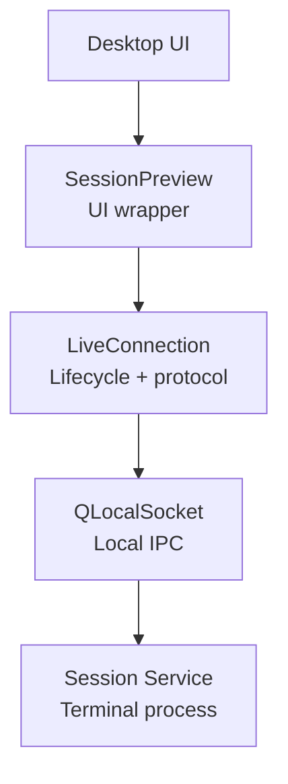
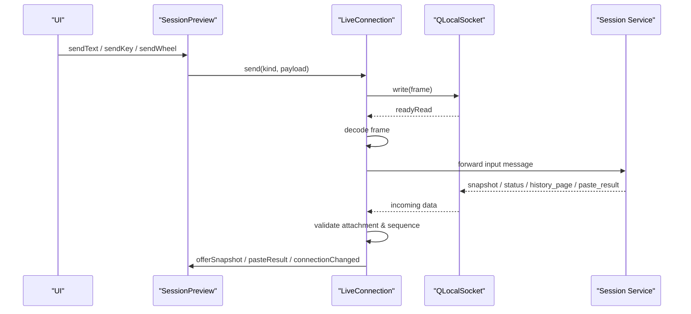
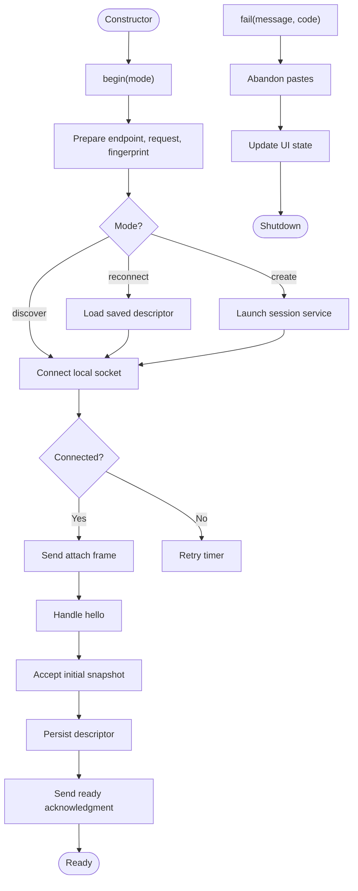
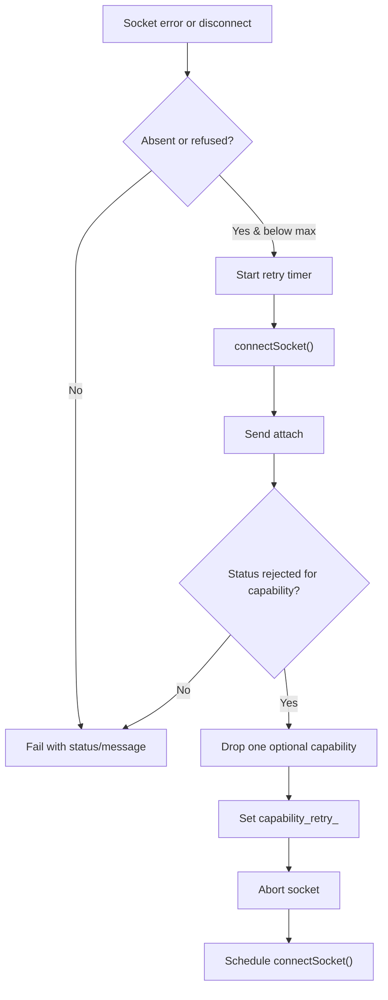
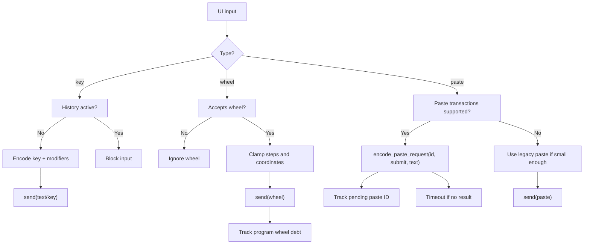
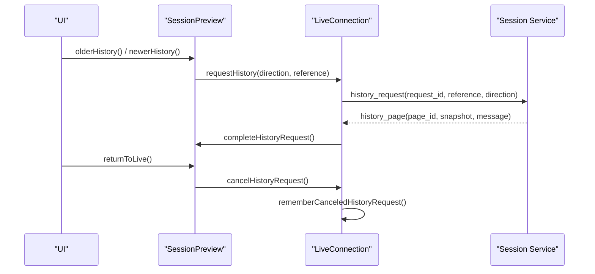
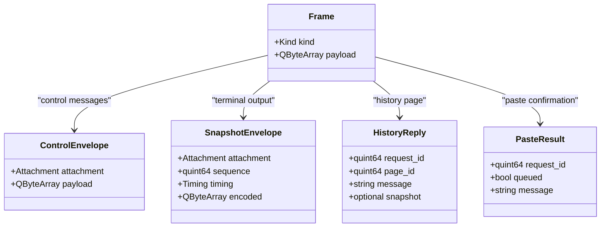
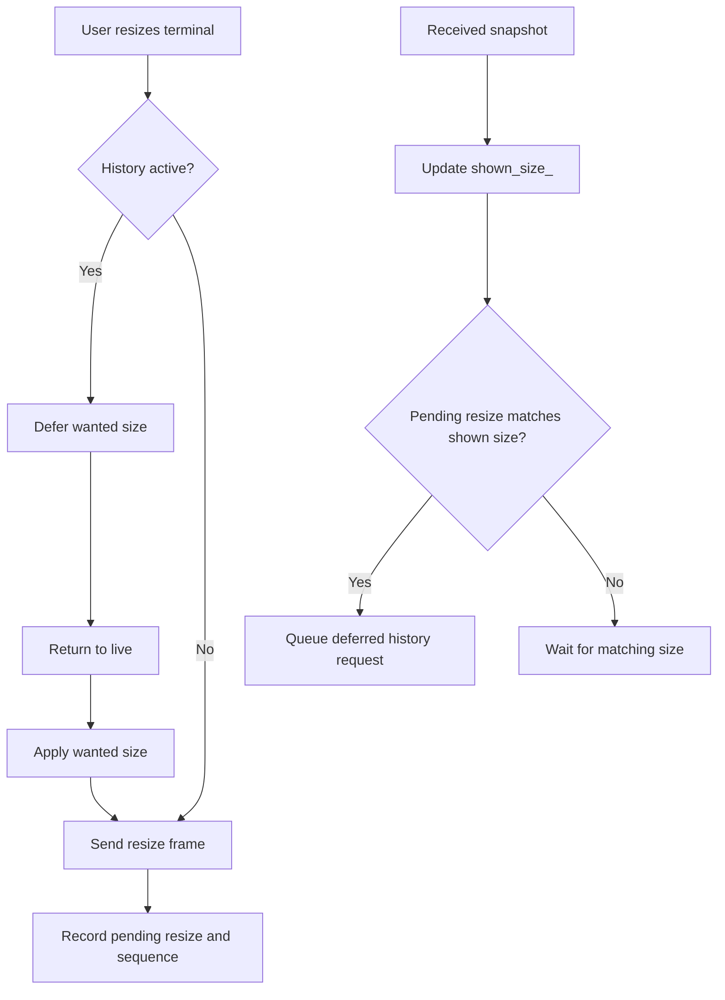
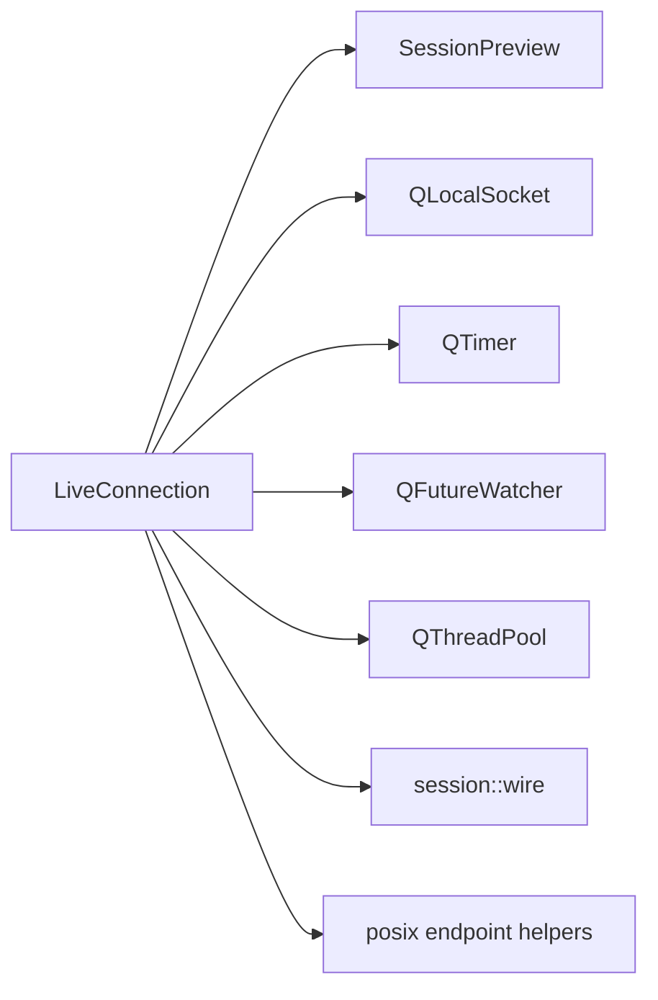

# Live Connection Management

<cite>
**Referenced Files in This Document**
- [live_connection.hpp](file://apps/desktop/src/live_connection.hpp)
- [live_connection.cpp](file://apps/desktop/src/live_connection.cpp)
- [local_protocol.hpp](file://services/session/src/transport/local_protocol.hpp)
- [wire_bytes.hpp](file://services/session/src/transport/wire_bytes.hpp)
- [terminal_surface.hpp](file://apps/desktop/src/terminal_surface.hpp)
- [terminals.hpp](file://apps/desktop/src/terminals.hpp)
- [live_connection_test.cpp](file://apps/desktop/tests/live_connection_test.cpp)
</cite>

## Table of Contents
1. [Introduction](#introduction)
2. [Project Structure](#project-structure)
3. [Core Components](#core-components)
4. [Architecture Overview](#architecture-overview)
5. [Detailed Component Analysis](#detailed-component-analysis)
6. [Wire Protocol and Terminal I/O Streaming](#wire-protocol-and-terminal-io-streaming)
7. [Terminal Size Negotiation and Coordinate Mapping](#terminal-size-negotiation-and-coordinate-mapping)
8. [Dependency Analysis](#dependency-analysis)
9. [Performance Considerations](#performance-considerations)
10. [Troubleshooting Guide](#troubleshooting-guide)
11. [Conclusion](#conclusion)

## Introduction
This document explains the `LiveConnection` class, which manages real-time communication between the desktop UI and a session service that owns a terminal process. It covers connection lifecycle management, reconnection behavior, graceful shutdown, terminal input handling, wire protocol framing and sequencing, terminal size negotiation, state tracking, timeout handling, and diagnostic logging. The goal is to make these behaviors understandable for both developers extending the desktop client and users diagnosing connectivity or terminal issues.

## Project Structure
The desktop application uses Qt-based C++ components under `apps/desktop/src`. The live terminal path involves:

- `LiveConnection`: connection lifecycle, transport framing, input routing, resize negotiation, history request coordination, and paste transactions.
- `SessionPreview`: UI-facing wrapper that exposes live terminal operations such as sending text, keys, wheel events, resizing, and browsing history.
- `QLocalSocket`: platform IPC socket used for local communication with the session service.
- Session transport helpers under `services/session/src/transport`: shared encoding, framing, constants, and protocol types.

**Diagram sources**
- [live_connection.cpp:201-260](file://apps/desktop/src/live_connection.cpp#L201-L260)
- [live_connection.cpp:451-560](file://apps/desktop/src/live_connection.cpp#L451-L560)
- [live_connection.cpp:1010-1039](file://apps/desktop/src/live_connection.cpp#L1010-L1039)

**Section sources**
- [live_connection.hpp:1-116](file://apps/desktop/src/live_connection.hpp#L1-L116)
- [live_connection.cpp:1-200](file://apps/desktop/src/live_connection.cpp#L1-L200)

## Core Components
- `LiveConnection`
  - Owns the connection lifecycle, including initialization, attachment handshake, synchronization, resizing, history requests, paste transactions, reconnection attempts, and failure reporting.
  - Tracks sequence numbers, pending resizes, pending pastes, capability negotiation flags, and terminal sizes.
  - Emits signals to `SessionPreview` so the UI can update activity, connection state, snapshots, and paste results.
- `SessionPreview`
  - Exposes user-facing APIs: send text, send key, send wheel, resize, request history, terminate, reconnect, discover, create new session.
  - Bridges UI events into `LiveConnection` calls and coordinates screen decoding and history rendering.
- Transport helpers
  - Shared wire types, frame encoder/decoder, maximum sizes, and status codes from the session transport layer.

Key responsibilities are separated so that UI concerns stay in `SessionPreview`, while transport details remain in `LiveConnection`.

**Section sources**
- [live_connection.hpp:20-116](file://apps/desktop/src/live_connection.hpp#L20-L116)
- [live_connection.cpp:201-260](file://apps/desktop/src/live_connection.cpp#L201-L260)

## Architecture Overview
The live terminal architecture is a producer-consumer pipeline over a local socket:

- The UI calls `SessionPreview` methods.
- `SessionPreview` validates input gating (for example, blocking input during active history browsing) and forwards it to `LiveConnection`.
- `LiveConnection` encodes frames using the shared wire protocol and writes them through `QLocalSocket`.
- Incoming frames are read incrementally, decoded, validated against the current attachment and sequence number, and dispatched to handlers.
- Terminal snapshots are offered back to `SessionPreview` for decoding and rendering.
- Resize, paste, attention, and history flows use explicit messages and acknowledgments where applicable.

**Diagram sources**
- [live_connection.cpp:201-260](file://apps/desktop/src/live_connection.cpp#L201-L260)
- [live_connection.cpp:560-750](file://apps/desktop/src/live_connection.cpp#L560-L750)
- [live_connection.cpp:751-1039](file://apps/desktop/src/live_connection.cpp#L751-L1039)

## Detailed Component Analysis

### Connection Lifecycle
Initialization, synchronization, readiness, and shutdown follow a clear progression:

1. **Construction**
   - Initializes timers for retry and handshake.
   - Sets up the initial attach request based on endpoint, launch specification, fingerprint, and requested mode.
   - Schedules `begin(mode)` on the next event loop turn.

2. **Beginning a connection**
   - Resets state: attempts, sequences, buffers, pending resizes, and history.
   - Prepares the endpoint and attach request.
   - For reconnect mode, loads saved descriptor; for create mode, launches the session service.
   - Opens a local socket and starts connecting.

3. **Socket connection**
   - On connect, widens OS-level buffers, starts the handshake timer, and sends an attach frame.
   - Handles disconnect and error events, backing off with retries when the server is absent.

4. **Hello and attachment**
   - Validates duplicate hello, expected identity, and requested capabilities.
   - Stores the attachment and switches the UI to synchronizing.

5. **Initial snapshot and persistence**
   - Accepts the first snapshot, updates sequence, tracks shown size, offers encoded snapshot to UI, and persists the session descriptor asynchronously.

6. **Acknowledgment and readiness**
   - After successful descriptor persistence, sends a ready acknowledgment.
   - Marks the connection ready, stops handshake timeout, emits “ready,” and applies the wanted terminal size.

7. **Graceful shutdown**
   - Destructor aborts and disconnects the socket, stops timers, and clears descriptor write tasks.
   - Failure paths abandon pending pastes, stop retries/handshake, invalidate history, and report connection state.

**Diagram sources**
- [live_connection.cpp:451-560](file://apps/desktop/src/live_connection.cpp#L451-L560)
- [live_connection.cpp:560-750](file://apps/desktop/src/live_connection.cpp#L560-L750)
- [live_connection.cpp:751-920](file://apps/desktop/src/live_connection.cpp#L751-L920)

**Section sources**
- [live_connection.cpp:451-560](file://apps/desktop/src/live_connection.cpp#L451-L560)
- [live_connection.cpp:560-750](file://apps/desktop/src/live_connection.cpp#L560-L750)
- [live_connection.cpp:751-920](file://apps/desktop/src/live_connection.cpp#L751-L920)

### Reconnection Logic
Reconnection is controlled by:

- **Attempt counter**: increments per connection attempt.
- **Maximum attempts**: limits transient server-not-found or connection-refused retries.
- **Retry timer**: schedules another connection attempt after failure.
- **Capability retry**: if the service rejects a message because it does not understand a newer capability, the client drops one optional capability and reconnects without relaunching the service.
- **Failure states**: distinguishes ended, replaced, and disconnected sessions.

When the server is unavailable at startup, the client retries up to a configured limit. If the server becomes available later, it reconnects automatically. Capability mismatches cause a targeted reconnect to downgrade features instead of failing completely.

**Diagram sources**
- [live_connection.cpp:560-750](file://apps/desktop/src/live_connection.cpp#L560-L750)
- [live_connection.cpp:920-1039](file://apps/desktop/src/live_connection.cpp#L920-L1039)

**Section sources**
- [live_connection.cpp:560-750](file://apps/desktop/src/live_connection.cpp#L560-L750)
- [live_connection.cpp:920-1039](file://apps/desktop/src/live_connection.cpp#L920-L1039)

### Terminal Input Handling
Terminal input includes keyboard events, mouse wheel interactions, paste operations, and clipboard integration.

- **Keyboard events**
  - Encoded as a key plus modifier bitmask.
  - Blocked during active history browsing or pending history requests.
  - Forwarded as a control frame once the connection is synchronized.

- **Mouse wheel**
  - Coordinates are clamped and step count is limited to avoid overwhelming the service.
  - Wheel delivery is tracked as “program wheel debt” so the client can replay missed steps when the terminal returns to its bottom.
  - Wheel is blocked if the service indicates it does not accept wheel input.

- **Paste and clipboard**
  - If the service supports paste transactions, the client sends a paste request with an ID and waits for a paste result.
  - Paste results confirm admission or rejection and may report uncertainty.
  - Pending paste IDs are tracked; timeouts report unknown delivery.
  - Large pastes may be rejected unless supported; older services require restart.

**Diagram sources**
- [live_connection.cpp:201-450](file://apps/desktop/src/live_connection.cpp#L201-L450)
- [live_connection.cpp:560-750](file://apps/desktop/src/live_connection.cpp#L560-L750)

**Section sources**
- [live_connection.cpp:201-450](file://apps/desktop/src/live_connection.cpp#L201-L450)
- [live_connection.cpp:560-750](file://apps/desktop/src/live_connection.cpp#L560-L750)

### History Browsing and Request Coordination
History browsing is coordinated between `SessionPreview` and `LiveConnection`:

- The UI triggers older/newer history navigation.
- `LiveConnection` sends a single outstanding history request at a time.
- Requests carry a direction and reference page identifier.
- A timeout guards unresponsive history replies.
- When returning to live, canceled history requests are remembered and ignored.
- Deferred history requests wait until a matching terminal size is received.

**Diagram sources**
- [live_connection.cpp:201-450](file://apps/desktop/src/live_connection.cpp#L201-L450)
- [live_connection.cpp:751-920](file://apps/desktop/src/live_connection.cpp#L751-L920)

**Section sources**
- [live_connection.cpp:201-450](file://apps/desktop/src/live_connection.cpp#L201-L450)
- [live_connection.cpp:751-920](file://apps/desktop/src/live_connection.cpp#L751-L920)

### Graceful Shutdown Procedures
Graceful shutdown involves:

- Stopping retry and handshake timers.
- Disconnecting and aborting the underlying socket.
- Clearing asynchronous descriptor writes.
- Abandoning pending paste transactions.
- Invalidating any outstanding history request.
- Reporting the final connection state to the UI.

The destructor ensures cleanup even if the connection was never fully established.

**Section sources**
- [live_connection.cpp:451-560](file://apps/desktop/src/live_connection.cpp#L451-L560)
- [live_connection.cpp:560-750](file://apps/desktop/src/live_connection.cpp#L560-L750)

## Wire Protocol and Terminal I/O Streaming
The wire protocol is defined in the session transport layer and used by `LiveConnection` to serialize and deserialize frames.

### Frame Format and Message Types
- Frames consist of a kind and payload.
- Control messages, such as input and resize, are wrapped in control envelopes containing the attachment.
- Terminal output arrives as snapshot envelopes carrying an attachment, sequence number, timing metadata, and encoded terminal content.
- Status messages carry a status code and message.
- History pages arrive as history reply messages.
- Paste results confirm paste admission and submission state.

### Binary Frame Boundaries and Buffering
- Frames are parsed incrementally from the socket read buffer.
- A maximum frame size prevents excessive memory growth.
- Overflow detection closes the connection when malformed or oversized data is received.

### Message Sequencing and Attachment Validation
- Each snapshot carries a monotonically increasing sequence number.
- Stale or mismatched snapshots, attachments, attention frames, history replies, and paste receipts are rejected.
- The first accepted snapshot establishes the current attachment and sequence baseline.

### Error Recovery Mechanisms
- Unknown or unsupported messages trigger failure.
- Status failures propagate service-provided codes and messages.
- Capability mismatches trigger a targeted reconnect with reduced capability flags.
- Pastes have per-request timeouts and abandonment on disconnect.
- History requests have global timeouts and cancellation tracking.

**Diagram sources**
- [local_protocol.hpp](file://services/session/src/transport/local_protocol.hpp)
- [wire_bytes.hpp](file://services/session/src/transport/wire_bytes.hpp)
- [live_connection.cpp:751-1039](file://apps/desktop/src/live_connection.cpp#L751-L1039)

**Section sources**
- [live_connection.cpp:751-1039](file://apps/desktop/src/live_connection.cpp#L751-L1039)
- [local_protocol.hpp](file://services/session/src/transport/local_protocol.hpp)
- [wire_bytes.hpp](file://services/session/src/transport/wire_bytes.hpp)

## Terminal Size Negotiation and Coordinate Mapping
Terminal size negotiation balances the view’s desired size with the service’s actual size.

### Client-Server Size Flow
- The client tracks `wanted_size_` and `shown_size_`.
- Resizes are sent only when the shown size differs from the wanted size.
- Initial snapshots may establish the service’s preferred size before the client requests a specific size.
- When returning to live after history browsing, the client reapplies its wanted size.

### Dynamic Resizing
- Direct resize calls send a resize frame immediately if the connection is ready.
- If history browsing is active, the size is deferred until the connection returns to live.
- Resizes coalesce repeated identical requests and allow one retry after a newly received snapshot.

### Coordinate System Mapping
- Mouse wheel coordinates are clamped to valid ranges.
- Wheel events include row and column positions relative to the terminal grid.
- Program wheel debt allows the client to replay missing scroll events when the terminal returns to its bottom, ensuring the user interface remains consistent with the remote terminal.

**Diagram sources**
- [live_connection.cpp:560-750](file://apps/desktop/src/live_connection.cpp#L560-L750)
- [live_connection.cpp:751-920](file://apps/desktop/src/live_connection.cpp#L751-L920)

**Section sources**
- [live_connection.cpp:560-750](file://apps/desktop/src/live_connection.cpp#L560-L750)
- [live_connection.cpp:751-920](file://apps/desktop/src/live_connection.cpp#L751-L920)

## Dependency Analysis
`LiveConnection` depends on several internal and Qt subsystems:

- `SessionPreview`: receives connection state, activity, snapshots, attention updates, and paste results.
- `QLocalSocket`: provides local IPC connectivity.
- `QTimer`: controls retry intervals and handshake/history timeouts.
- `QFutureWatcher` and `QThreadPool`: perform descriptor persistence asynchronously.
- Session transport utilities: encode/decode frames, manage maximum sizes, and define protocol kinds and statuses.
- Platform helpers: prepare endpoints and widen socket buffers.

**Diagram sources**
- [live_connection.hpp:1-116](file://apps/desktop/src/live_connection.hpp#L1-L116)
- [live_connection.cpp:1-200](file://apps/desktop/src/live_connection.cpp#L1-L200)
- [live_connection.cpp:451-560](file://apps/desktop/src/live_connection.cpp#L451-L560)

**Section sources**
- [live_connection.hpp:1-116](file://apps/desktop/src/live_connection.hpp#L1-L116)
- [live_connection.cpp:1-200](file://apps/desktop/src/live_connection.cpp#L1-L200)

## Performance Considerations
- **Input queue limits**: Prevents large outgoing queues by capping queued bytes and rejecting input when full.
- **Frame parsing budget**: Enforces a maximum frame size and detects receive overflow.
- **Decode pacing**: Screen decoding is paced by viewer intervals to avoid overwhelming the UI thread.
- **Resize coalescing**: Reduces unnecessary resize messages by deduplicating identical requests and deferring until a matching snapshot arrives.
- **Async descriptor persistence**: Avoids blocking the event loop during session identity storage.
- **Program wheel debt replay**: Limits replay chunk size to prevent stalls while restoring terminal position.

These mechanisms balance responsiveness with stability under bursty terminal output and intermittent connectivity.

[No sources needed since this section provides general guidance]

## Troubleshooting Guide
Common connectivity and terminal issues can be diagnosed using the following patterns:

- **Connecting but never ready**
  - Check handshake timeout.
  - Verify that the service accepts the requested capabilities.
  - Look for “Session synchronization timed out.”

- **Disconnected after restore**
  - Reconnect mode requires a saved descriptor; missing descriptors indicate a previous session ended or was replaced.
  - Look for “No saved session” or “saved session has ended or been replaced.”

- **Input not sent**
  - Input is blocked during history browsing or when the session is not synchronized.
  - Check activity messages about unsent input or full input queues.

- **Paste not admitted**
  - Paste transactions require service support; older services fall back or require restart.
  - Pending paste timeouts indicate uncertain delivery.

- **History request fails**
  - History timeouts occur if no reply arrives within the configured interval.
  - Canceled history replies are ignored after returning to live.

- **Terminal size drift**
  - If the terminal appears resized unexpectedly, check whether the service reported a different size in the snapshot.
  - Confirm that the client applied its wanted size after returning to live.

Diagnostic logging is emitted via the connection’s activity and connection state fields, and through Qt debug logs for session messages.

**Section sources**
- [live_connection.cpp:451-560](file://apps/desktop/src/live_connection.cpp#L451-L560)
- [live_connection.cpp:560-750](file://apps/desktop/src/live_connection.cpp#L560-L750)
- [live_connection.cpp:751-920](file://apps/desktop/src/live_connection.cpp#L751-L920)
- [live_connection.cpp:920-1039](file://apps/desktop/src/live_connection.cpp#L920-L1039)

## Conclusion
`LiveConnection` implements a robust, sequenced, and capability-aware terminal transport between the desktop UI and a session service. It handles connection setup, reconnection, input routing, paste transactions, history browsing, and dynamic terminal sizing. Its design emphasizes safety through attachment validation, sequence checks, bounded buffers, and explicit state transitions, while providing diagnostic signals and activity messages that help users and developers diagnose connectivity and terminal behavior.

[No sources needed since this section summarizes without analyzing specific files]