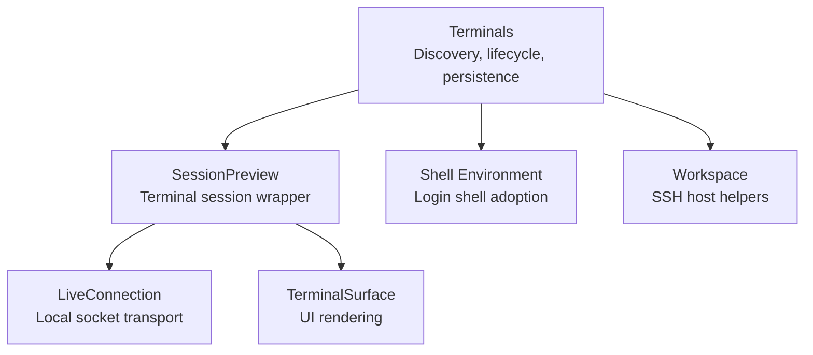
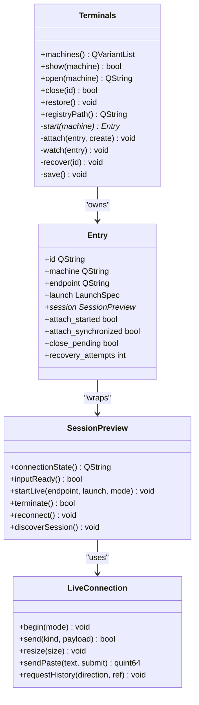
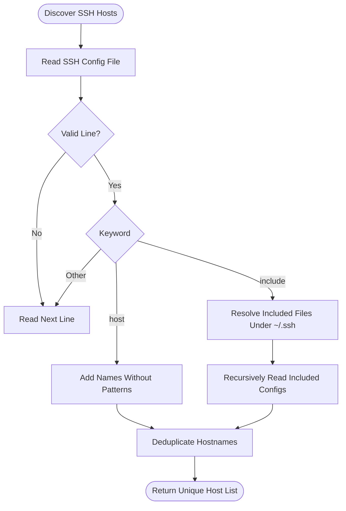
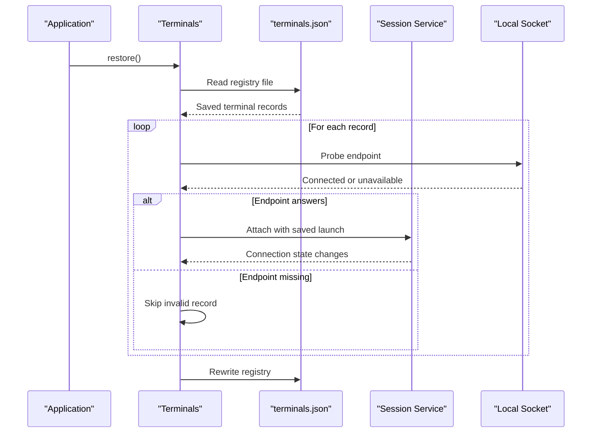
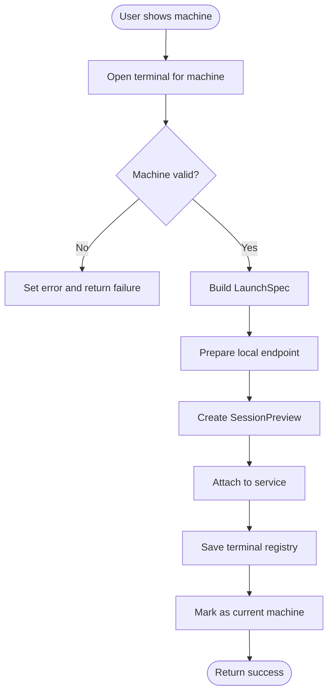
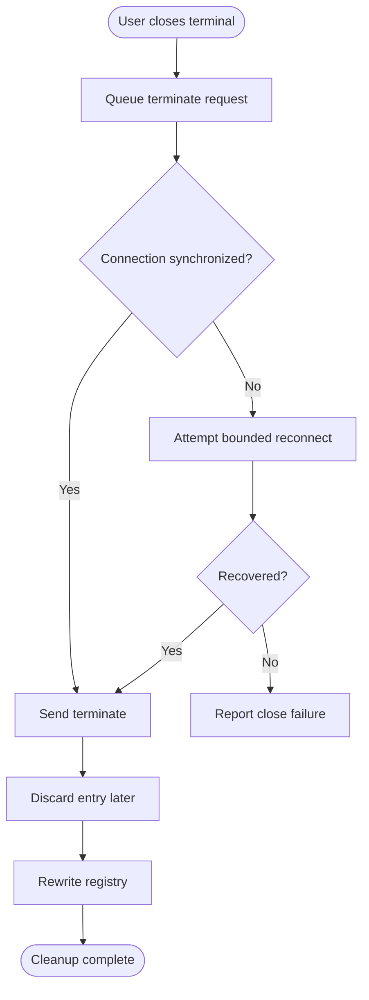
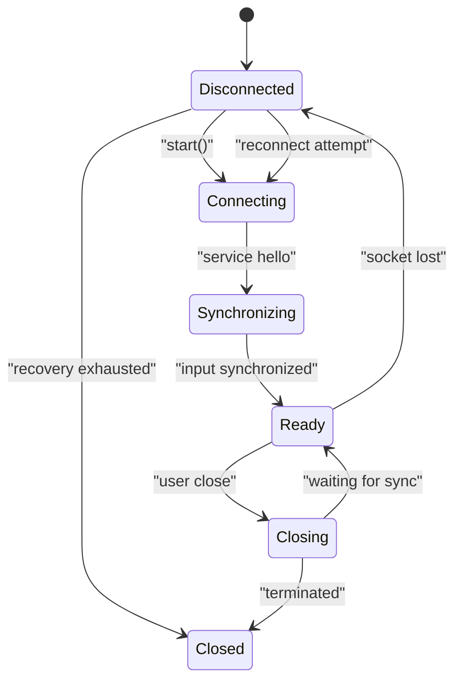
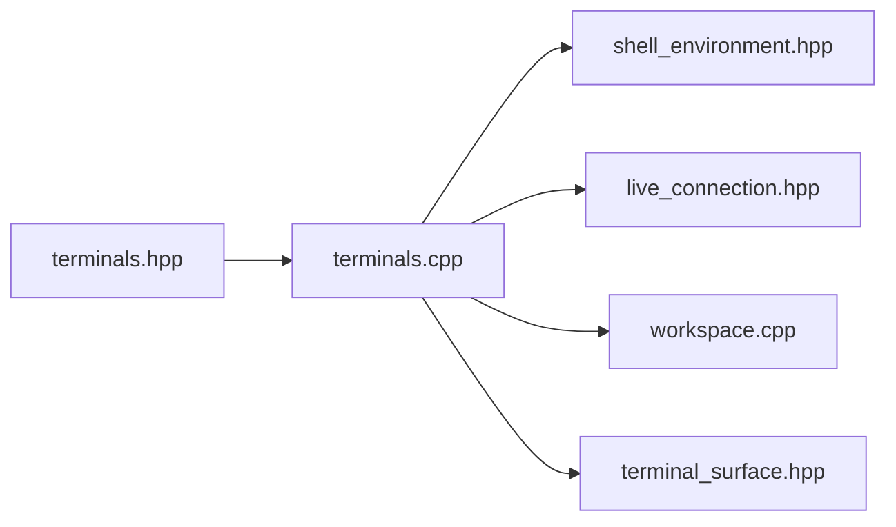

# Standalone Terminals

<cite>
**Referenced Files in This Document**
- [terminals.hpp](file://apps/desktop/src/terminals.hpp)
- [terminals.cpp](file://apps/desktop/src/terminals.cpp)
- [shell_environment.hpp](file://apps/desktop/src/shell_environment.hpp)
- [shell_environment.cpp](file://apps/desktop/src/shell_environment.cpp)
- [live_connection.hpp](file://apps/desktop/src/live_connection.hpp)
- [workspace.cpp](file://apps/desktop/src/workspace.cpp)
- [terminal_surface.hpp](file://apps/desktop/src/terminal_surface.hpp)
</cite>

## Table of Contents
1. [Introduction](#introduction)
2. [Project Structure](#project-structure)
3. [Core Components](#core-components)
4. [Architecture Overview](#architecture-overview)
5. [Detailed Component Analysis](#detailed-component-analysis)
6. [Dependency Analysis](#dependency-analysis)
7. [Performance Considerations](#performance-considerations)
8. [Troubleshooting Guide](#troubleshooting-guide)
9. [Conclusion](#conclusion)

## Introduction
This document explains the standalone terminal subsystem that provides shell terminals separate from agent sessions. The central component is the `Terminals` class, which discovers local shells and SSH hosts, manages one terminal per machine, persists their state across application restarts, and coordinates lifecycle, environment propagation, connection recovery, cleanup, and user-facing errors.

Standalone terminals are intentionally different from agent sessions: they do not belong to a category, do not act as attention sources, and are managed through a session service so that closing the Lapis desktop does not kill them; subsequent starts can reattach.

## Project Structure
The standalone terminal implementation lives in the desktop application under `apps/desktop/src`:

| File | Responsibility |
|---|---|
| `terminals.hpp` / `terminals.cpp` | Terminal discovery, enumeration, creation, persistence, connection watching, recovery, and cleanup. |
| `shell_environment.hpp` / `shell_environment.cpp` | Environment adoption on macOS when Lapis is launched by the operating system rather than an interactive shell. |
| `live_connection.hpp` | Transport-level connection model used by terminal sessions through `SessionPreview`. |
| `workspace.cpp` | Hostname enumeration helpers and SSH-related workspace logic referenced by terminal features. |
| `terminal_surface.hpp` | Rendering and interaction surface for live terminal snapshots; it consumes terminal output but does not own terminal lifecycle. |

**Diagram sources**
- [terminals.hpp:1-93](file://apps/desktop/src/terminals.hpp#L1-L93)
- [terminals.cpp:1-483](file://apps/desktop/src/terminals.cpp#L1-L483)
- [shell_environment.hpp:1-25](file://apps/desktop/src/shell_environment.hpp#L1-L25)
- [shell_environment.cpp:1-76](file://apps/desktop/src/shell_environment.cpp#L1-L76)
- [live_connection.hpp:1-116](file://apps/desktop/src/live_connection.hpp#L1-L116)
- [workspace.cpp:267-503](file://apps/desktop/src/workspace.cpp#L267-L503)
- [terminal_surface.hpp:1-200](file://apps/desktop/src/terminal_surface.hpp#L1-L200)

**Section sources**
- [terminals.hpp:1-93](file://apps/desktop/src/terminals.hpp#L1-L93)
- [terminals.cpp:1-483](file://apps/desktop/src/terminals.cpp#L1-L483)
- [shell_environment.hpp:1-25](file://apps/desktop/src/shell_environment.hpp#L1-L25)
- [shell_environment.cpp:1-76](file://apps/desktop/src/shell_environment.cpp#L1-L76)
- [live_connection.hpp:1-116](file://apps/desktop/src/live_connection.hpp#L1-L116)
- [workspace.cpp:267-503](file://apps/desktop/src/workspace.cpp#L267-L503)
- [terminal_surface.hpp:1-200](file://apps/desktop/src/terminal_surface.hpp#L1-L200)

## Core Components
- **`Terminals`**: Manages the list of machines, creates or reattaches terminals, watches connection state, saves and restores terminal records, and emits UI signals.
- **`Entry`**: Internal record for each terminal instance, including its identifier, target machine, endpoint path, launch specification, session preview, and connection-recovery flags.
- **`SessionPreview`**: Wraps a terminal session exposed to the UI layer. It owns the live connection and snapshot pipeline.
- **`LiveConnection`**: Low-level transport connecting to a local Unix domain socket, handling attachment, synchronization, resize, paste, history, and reconnect retry.
- **Shell environment module**: Reads the interactive login shell’s environment on macOS when Lapis is started by `launchd`, skipping shell bookkeeping variables.
- **Terminal surface**: Renders terminal snapshots and forwards user input; it is decoupled from terminal lifecycle.

Key responsibilities:
- Discover SSH hosts without patterns.
- Create one terminal per machine, with “This Mac” first.
- Launch a login shell locally or `ssh -t` remotely.
- Persist endpoints and launch information in `terminals.json`.
- Reattach surviving services after restart or crash.
- Recover transient disconnections with bounded retries.
- Clean up terminal entries and resources on shutdown.

**Section sources**
- [terminals.hpp:16-93](file://apps/desktop/src/terminals.hpp#L16-L93)
- [terminals.cpp:15-483](file://apps/desktop/src/terminals.cpp#L15-L483)
- [shell_environment.hpp:1-25](file://apps/desktop/src/shell_environment.hpp#L1-L25)
- [shell_environment.cpp:1-76](file://apps/desktop/src/shell_environment.cpp#L1-L76)
- [live_connection.hpp:1-116](file://apps/desktop/src/live_connection.hpp#L1-L116)

## Architecture Overview
The terminal architecture separates discovery, lifecycle management, process isolation, transport, and rendering.

**Diagram sources**
- [terminals.hpp:23-93](file://apps/desktop/src/terminals.hpp#L23-L93)
- [terminals.cpp:15-483](file://apps/desktop/src/terminals.cpp#L15-L483)
- [live_connection.hpp:24-116](file://apps/desktop/src/live_connection.hpp#L24-L116)

## Detailed Component Analysis

### Terminal Discovery and Enumeration

#### Local Shells
A local terminal runs the configured login shell in the user’s home directory. The shell program comes from the `SHELL` environment variable; if unset, the code asks the session layer for the login shell. The launch is validated and marked as a terminal agent mode.

#### SSH Host Discovery
SSH hosts are extracted from an SSH configuration file. The parser:
- Ignores comments and malformed lines.
- Splits keywords and values.
- Handles `host` lines.
- Recursively follows `include` directives relative to `~/.ssh`, with a maximum include depth.
- Filters out names containing glob-like characters such as `*`, `?`, and `!`.
- Deduplicates discovered hosts.

Host discovery also exposes a helper for listing hosts from a given configuration path, which is used by workspace features.

**Diagram sources**
- [terminals.cpp:15-70](file://apps/desktop/src/terminals.cpp#L15-L70)
- [workspace.cpp:267-503](file://apps/desktop/src/workspace.cpp#L267-L503)

**Section sources**
- [terminals.cpp:15-70](file://apps/desktop/src/terminals.cpp#L15-L70)
- [terminals.cpp:72-98](file://apps/desktop/src/terminals.cpp#L72-L98)
- [workspace.cpp:267-503](file://apps/desktop/src/workspace.cpp#L267-L503)

### Connection Persistence and Endpoint Management
Each terminal uses a local Unix domain socket endpoint stored beside the workspace runtime folder. The endpoint path is canonicalized, and the registry stores:
- Terminal ID
- Target machine
- Endpoint path
- Program
- Arguments
- Working directory

On startup, `restore()` reads `terminals.json`, validates version 1 records, filters to endpoints owned by this runtime, verifies that the socket still answers, and attempts to reattach. If a saved launch cannot be reconstructed safely, the record is skipped with a warning.

Persistence is atomic and permission-aware: it writes via a temporary file and commits only on success, while attempting restrictive owner-only permissions.

**Diagram sources**
- [terminals.cpp:369-483](file://apps/desktop/src/terminals.cpp#L369-L483)

**Section sources**
- [terminals.cpp:99-144](file://apps/desktop/src/terminals.cpp#L99-L144)
- [terminals.cpp:369-483](file://apps/desktop/src/terminals.cpp#L369-L483)

### Terminal Instance Lifecycle

#### Creation
`show()` opens a terminal for a machine and makes it current. `open()` returns the terminal ID for callers such as the phone gateway. Creation flow:
1. Validate the machine against known SSH hosts when remote.
2. Generate a unique terminal ID.
3. Build a `LaunchSpec`:
   - Local: login shell with interactive login flags in the home directory.
   - Remote: `ssh -o ControlPath=none -t -- <host>` in the home directory.
4. Prepare a local endpoint path.
5. Create a `SessionPreview`, set its harness and status source, attach, and save the registry.

**Diagram sources**
- [terminals.cpp:146-248](file://apps/desktop/src/terminals.cpp#L146-L248)

**Section sources**
- [terminals.cpp:146-248](file://apps/desktop/src/terminals.cpp#L146-L248)

#### Configuration
Configuration includes:
- Runtime folder for endpoint storage.
- SSH configuration path for host discovery.
- Shell program selection.
- Launch arguments for local vs SSH.
- Working directory inheritance (home directory).
- Agent mode set to terminal.

Environment propagation is handled at two levels:
- Desktop environment adoption on macOS when Lapis is started by `launchd`.
- Per-terminal working directory and shell selection.

**Section sources**
- [terminals.cpp:146-199](file://apps/desktop/src/terminals.cpp#L146-L199)
- [shell_environment.cpp:1-76](file://apps/desktop/src/shell_environment.cpp#L1-L76)

#### Cleanup
Cleanup has two phases:
1. **Logical close**: marks the entry as closing, queues termination, and waits for synchronization before sending the terminate request.
2. **Physical discard**: removes the `SessionPreview` using Qt’s deferred deletion mechanism, erases the entry, resaves the registry, and emits change signals.

If a disconnect occurs during close, the code attempts bounded recovery; if recovery fails while a close was pending, it reports that the terminal could not be reconnected for termination.

**Diagram sources**
- [terminals.cpp:250-368](file://apps/desktop/src/terminals.cpp#L250-L368)

**Section sources**
- [terminals.cpp:250-368](file://apps/desktop/src/terminals.cpp#L250-L368)

### Environment Variable Propagation and Working Directory Inheritance
- **Desktop environment adoption**: On macOS, when the parent process is `launchd`, Lapis launches the interactive login shell and parses its printed environment. Variables like `PWD`, `OLDPWD`, `SHLVL`, `_`, and `TERM` are explicitly skipped because the terminal sets those itself.
- **Per-terminal working directory**: Local terminals use the home directory; SSH terminals start in the home directory on the remote host.
- **Agent isolation**: Managed agents add their own timeout and session behavior; standalone terminals rely on the user’s keepalive policy.

**Section sources**
- [shell_environment.hpp:1-25](file://apps/desktop/src/shell_environment.hpp#L1-L25)
- [shell_environment.cpp:1-76](file://apps/desktop/src/shell_environment.cpp#L1-L76)
- [terminals.cpp:146-199](file://apps/desktop/src/terminals.cpp#L146-L199)

### Process Isolation Strategy
Standalone terminals are isolated by design:
- Each terminal runs under its own session service.
- A local Unix domain socket endpoint isolates communication between Lapis and the service.
- SSH connections use `ControlPath=none`, preventing shared control sockets from tying multiple terminals together.
- Closing Lapis leaves the underlying shell running; reattachment is possible.

**Section sources**
- [terminals.hpp:23-33](file://apps/desktop/src/terminals.hpp#L23-L33)
- [terminals.cpp:146-199](file://apps/desktop/src/terminals.cpp#L146-L199)

### Terminal State Persistence and Crash Recovery
- **Persistence format**: Versioned JSON registry with terminal records and strict validation for paths and argument sizes.
- **Restore rules**: Only records whose endpoints match the current runtime folder and whose sockets answer are restored.
- **Recovery strategy**: When a ready connection loses its socket, Lapis retries attach or reconnect with exponential-style delays and a fixed number of attempts.
- **Crash semantics**: If a terminal becomes disconnected before synchronization completes, it is considered closed; if it disconnects after synchronization, recovery is attempted.

**Diagram sources**
- [terminals.cpp:201-368](file://apps/desktop/src/terminals.cpp#L201-L368)

**Section sources**
- [terminals.cpp:201-368](file://apps/desktop/src/terminals.cpp#L201-L368)
- [terminals.cpp:369-483](file://apps/desktop/src/terminals.cpp#L369-L483)

### Security Considerations

#### SSH Connections
- Host discovery ignores pattern-based host names, reducing accidental expansion of wildcards.
- SSH commands disable shared control paths, ensuring terminals are not unintentionally bound to another SSH session.
- Remote terminals run over SSH, inheriting the security properties of the system SSH client and user credentials.

#### Credential Management
- Credentials are not embedded in the terminal registry. The registry stores only the executable, arguments, and working directory.
- The transport layer supports a service launch request with an optional environment map, explicitly documented as never being written anywhere because it may contain secrets.
- The registry file attempts owner-only permissions.

#### Host Verification
- The repository evidence does not show explicit SSH host-key verification or known-hosts management inside `Terminals`. Host discovery is limited to parsing configuration files and filtering non-pattern names.
- SSH authentication and host-key handling therefore rely on the system SSH client configuration and user environment.

**Section sources**
- [terminals.cpp:146-199](file://apps/desktop/src/terminals.cpp#L146-L199)
- [live_connection.hpp:24-42](file://apps/desktop/src/live_connection.hpp#L24-L42)
- [terminals.cpp:436-483](file://apps/desktop/src/terminals.cpp#L436-L483)

## Dependency Analysis

**Diagram sources**
- [terminals.hpp:1-93](file://apps/desktop/src/terminals.hpp#L1-L93)
- [terminals.cpp:1-483](file://apps/desktop/src/terminals.cpp#L1-L483)
- [shell_environment.hpp:1-25](file://apps/desktop/src/shell_environment.hpp#L1-L25)
- [live_connection.hpp:1-116](file://apps/desktop/src/live_connection.hpp#L1-L116)
- [workspace.cpp:267-503](file://apps/desktop/src/workspace.cpp#L267-L503)
- [terminal_surface.hpp:1-200](file://apps/desktop/src/terminal_surface.hpp#L1-L200)

Coupling and cohesion observations:
- `Terminals` has high cohesion around terminal lifecycle and registry persistence.
- It depends on `SessionPreview` for session abstraction and `LiveConnection` indirectly through the session layer.
- SSH host discovery is reusable through both `Terminals` and `Workspace`.
- The UI rendering layer (`TerminalSurface`) is decoupled from terminal lifecycle, receiving snapshots instead of owning processes.

**Section sources**
- [terminals.hpp:16-93](file://apps/desktop/src/terminals.hpp#L16-L93)
- [terminals.cpp:15-483](file://apps/desktop/src/terminals.cpp#L15-L483)
- [workspace.cpp:267-503](file://apps/desktop/src/workspace.cpp#L267-L503)

## Performance Considerations

### Managing Multiple Concurrent Sessions
- One `SessionPreview` per terminal avoids sharing mutable terminal state across machines.
- The registry lookup is linear in the number of active terminals; this is acceptable for a small number of concurrent shells.
- Endpoint probing uses a short timeout to avoid blocking discovery.

### Resource Cleanup
- Deferred deletion prevents unsafe access during Qt signal delivery.
- Recovery attempts are bounded to prevent infinite retry loops.
- Persistent state is rewritten after every structural change to the terminal list.

### Rendering Decoupling
- `TerminalSurface` is responsible for rendering and throttling redraws for previews; it does not affect backend lifecycle.
- Input and paste operations go through the session protocol, keeping the UI thread responsive while transport and service work asynchronously.

[No sources needed since this section provides general guidance]

## Troubleshooting Guide

| Symptom | Likely Cause | Resolution |
|---|---|---|
| Opening a remote terminal reports the host is not in the SSH config | Host name contains patterns or is absent from parsed configuration | Verify the hostname appears in the SSH configuration without wildcard patterns. |
| Terminal remains open after close | Termination could not be queued or synchronization failed | Retry; check whether the service is still alive and whether a reconnect succeeded. |
| Terminal disappears after disconnect | Disconnection occurred before synchronization or recovery attempts were exhausted | Reopen the terminal to start a fresh session. |
| Saved terminal is not restored | Endpoint no longer exists, version mismatch, or saved launch validation failed | Inspect `terminals.json`; remove stale records if the service is gone. |
| Login tools are missing on macOS | Lapis was launched by `launchd` and did not inherit the interactive shell environment | Ensure the login environment adoption path runs; verify the login shell responds within the timeout. |

**Section sources**
- [terminals.cpp:201-368](file://apps/desktop/src/terminals.cpp#L201-L368)
- [terminals.cpp:369-483](file://apps/desktop/src/terminals.cpp#L369-L483)
- [shell_environment.cpp:1-76](file://apps/desktop/src/shell_environment.cpp#L1-L76)

## Conclusion
The standalone terminal subsystem provides a focused, persistent, and recoverable shell experience separate from agent workflows. It discovers local and SSH hosts, isolates processes through session services and local sockets, preserves terminal state across restarts, and recovers from transient connection failures. Security relies on system SSH behavior and careful separation of credentials from persisted data. For best results, configure SSH hosts explicitly, ensure the login shell is reachable on macOS, and allow the session service to remain available for reattachment.

[No sources needed since this section summarizes without analyzing specific files]