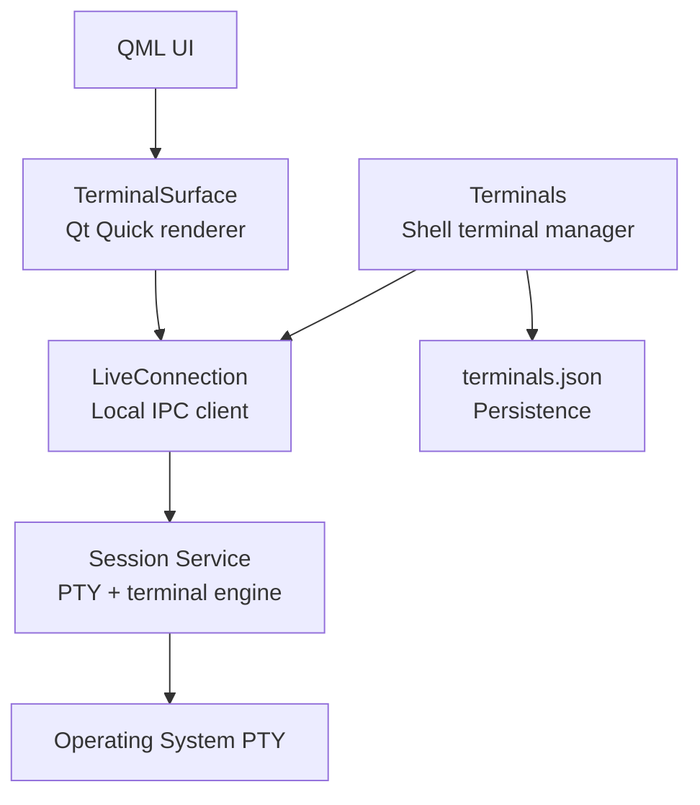
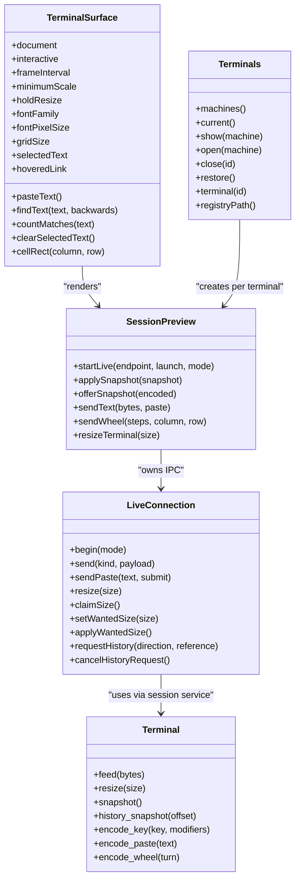
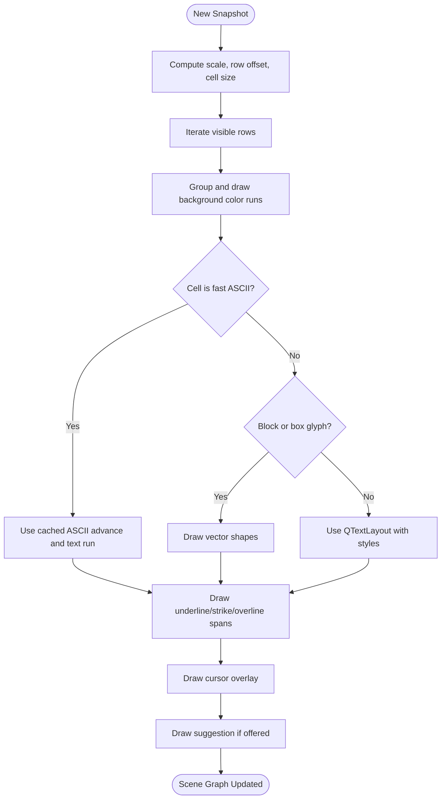
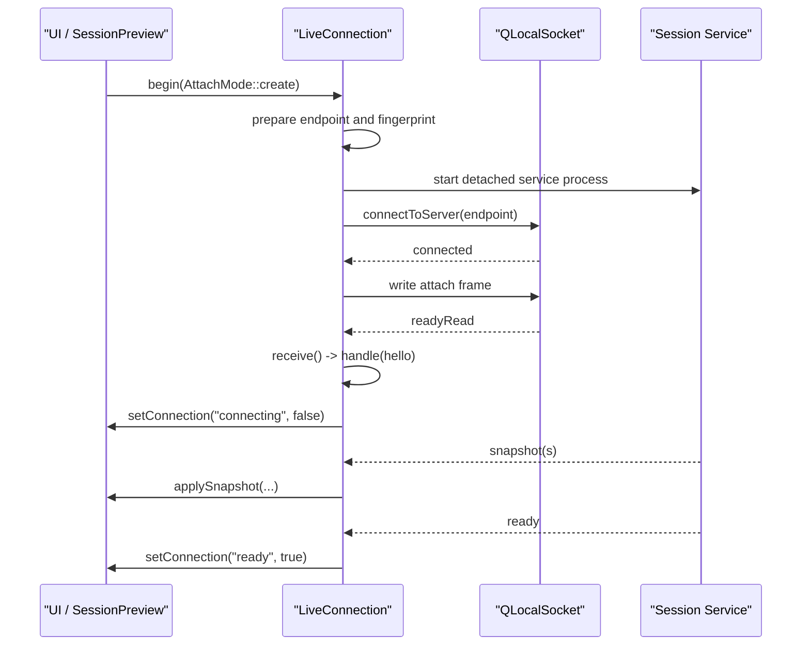
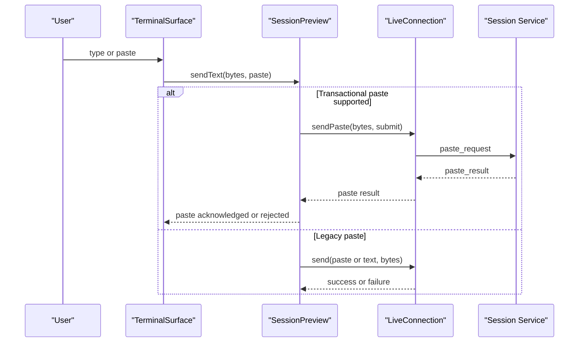
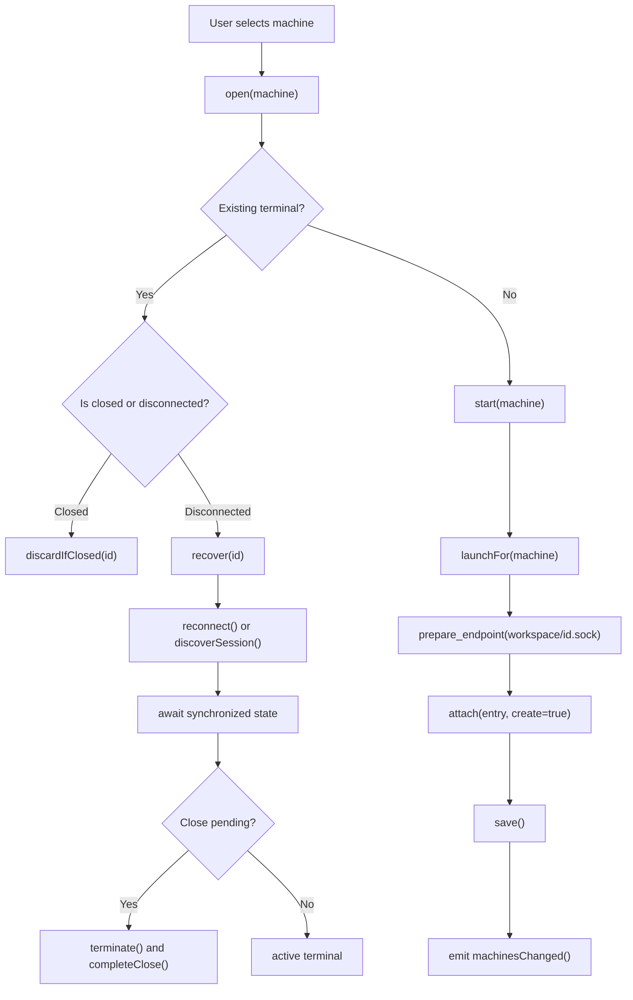
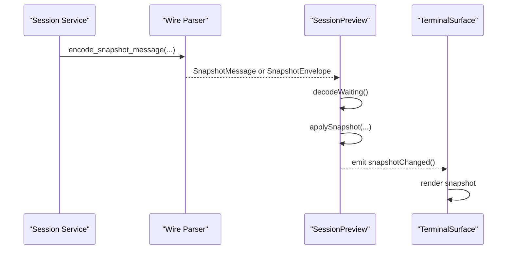
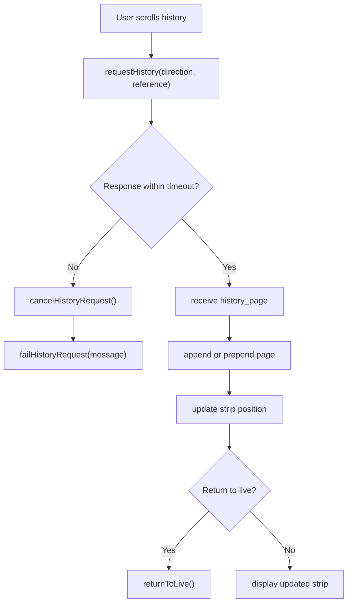

# Terminal Rendering Engine

<cite>
**Referenced Files in This Document**
- [terminal_surface.hpp](file://apps/desktop/src/terminal_surface.hpp)
- [terminal_surface.cpp](file://apps/desktop/src/terminal_surface.cpp)
- [live_connection.hpp](file://apps/desktop/src/live_connection.hpp)
- [live_connection.cpp](file://apps/desktop/src/live_connection.cpp)
- [terminals.hpp](file://apps/desktop/src/terminals.hpp)
- [terminals.cpp](file://apps/desktop/src/terminals.cpp)
- [terminal.hpp](file://services/session/include/lapis/session/terminal.hpp)
- [local_protocol.hpp](file://services/session/src/transport/local_protocol.hpp)
- [wire_bytes.hpp](file://services/session/src/transport/wire_bytes.hpp)
</cite>

## Table of Contents
1. [Introduction](#introduction)
2. [Project Structure](#project-structure)
3. [Core Components](#core-components)
4. [Architecture Overview](#architecture-overview)
5. [Detailed Component Analysis](#detailed-component-analysis)
6. [Wire Protocol and Data Flow](#wire-protocol-and-data-flow)
7. [Performance Considerations](#performance-considerations)
8. [Troubleshooting Guide](#troubleshooting-guide)
9. [Conclusion](#conclusion)

## Introduction
This document explains the desktop terminal rendering subsystem used by the Lapis desktop application. It covers:

- The `TerminalSurface` component that renders PTY output as a Qt Quick item using a session-provided terminal snapshot model.
- The `LiveConnection` class that manages real-time local IPC between the desktop UI and session services, including input, paste, resize negotiation, history browsing, and reconnection.
- The `Terminals` manager for standalone shell terminals separate from agent sessions, including SSH host discovery, persistence, lifecycle management, and reattachment.
- The wire protocol between desktop and session services for terminal I/O streaming, binary frame formats, size negotiation, wheel events, and error handling.
- Performance considerations such as incremental rendering, scrollback buffering, efficient text shaping, and live-update pacing.

The documentation is written for both developers integrating with the terminal engine and users troubleshooting terminal behavior.

## Project Structure
The terminal subsystem spans three layers:

| Layer | Responsibility | Key Files |
|---|---|---|
| Desktop UI layer | Renders snapshots, handles user input, owns Qt Quick items | `apps/desktop/src/terminal_surface.*`, `apps/desktop/src/live_connection.*` |
| Session service layer | Owns PTY processes, parses VT output, exposes snapshots and history | `services/session/include/lapis/session/terminal.hpp`, transport headers |
| Transport layer | Local socket frames, serialization, attachment identity, limits | `services/session/src/transport/local_protocol.hpp`, `services/session/src/transport/wire_bytes.hpp` |

**Diagram sources**
- [terminal_surface.hpp:1-200](file://apps/desktop/src/terminal_surface.hpp#L1-L200)
- [terminal_surface.cpp:1-200](file://apps/desktop/src/terminal_surface.cpp#L1-L200)
- [live_connection.hpp:1-116](file://apps/desktop/src/live_connection.hpp#L1-L116)
- [live_connection.cpp:1-120](file://apps/desktop/src/live_connection.cpp#L1-L120)
- [terminals.hpp:1-93](file://apps/desktop/src/terminals.hpp#L1-L93)
- [terminals.cpp:1-120](file://apps/desktop/src/terminals.cpp#L1-L120)
- [terminal.hpp:1-200](file://services/session/include/lapis/session/terminal.hpp#L1-L200)
- [local_protocol.hpp:1-196](file://services/session/src/transport/local_protocol.hpp#L1-L196)

**Section sources**
- [terminal_surface.hpp:1-200](file://apps/desktop/src/terminal_surface.hpp#L1-L200)
- [live_connection.hpp:1-116](file://apps/desktop/src/live_connection.hpp#L1-L116)
- [terminals.hpp:1-93](file://apps/desktop/src/terminals.hpp#L1-L93)
- [terminal.hpp:1-200](file://services/session/include/lapis/session/terminal.hpp#L1-L200)
- [local_protocol.hpp:1-196](file://services/session/src/transport/local_protocol.hpp#L1-L196)

## Core Components

### TerminalSurface
`TerminalSurface` is a Qt Quick item that displays a `session::TerminalSnapshot`. Its responsibilities include:

- Rendering rows, backgrounds, colors, decorations, cursors, hyperlinks, and block or box-drawing glyphs.
- Managing font selection, grid size, scaling, and viewport alignment.
- Handling interactive features: keyboard input, IME composition, mouse clicks, text selection, link opening, and next-prompt suggestions.
- Exposing properties to QML such as `gridSize`, `selectedText`, `hoveredLink`, `composing`, `pasting`, and suggestion state.
- Providing search, URL/path resolution, and cell geometry helpers.

Key design characteristics:

| Area | Behavior |
|---|---|
| Rendering model | Reads from `session::TerminalSnapshot`; does not own PTY state. |
| Text optimization | Uses cached ASCII advances, run-based `QTextLayout`, glyph shapes for block characters, and background rectangles. |
| Memory model | Consumes a snapshot passed by the session; large buffers are owned by the session side. |
| Interaction | Emits signals for link clicks, selection changes, and suggestion actions; delegates actual IPC through `LiveConnection`. |
| Viewport control | Supports minimum scale, resizing hold, and cursor-focused layout when fitting would be too small. |

**Section sources**
- [terminal_surface.hpp:1-200](file://apps/desktop/src/terminal_surface.hpp#L1-L200)
- [terminal_surface.cpp:1-200](file://apps/desktop/src/terminal_surface.cpp#L1-L200)

### LiveConnection
`LiveConnection` owns the local socket connection to a session service. It coordinates:

- Service discovery, creation, and reconnection.
- Attach handshake, capability negotiation, and identity tracking.
- Sending keyboard, wheel, paste, resize, and terminate messages.
- Receiving snapshots, status updates, history pages, and paste results.
- Pacing decode work and coordinating with the owning `SessionPreview` object.

Important behaviors:

| Feature | Details |
|---|---|
| Connection lifecycle | Starts connecting asynchronously, retries absent servers up to a bounded number of attempts, and fails with a user-visible message on unrecoverable errors. |
| Paste handling | Supports optional transactional pastes; rejects or queues large pastes according to protocol limits. |
| Resize negotiation | Tracks wanted size, requested size, shown size, and coalesces repeated requests; supports joining another view’s size. |
| History browsing | Requests older/newer/at pages, times out pending requests, and cancels them during reconnects. |
| Error reporting | Converts transport failures, malformed frames, and service status codes into UI-level activity and error strings. |

**Section sources**
- [live_connection.hpp:1-116](file://apps/desktop/src/live_connection.hpp#L1-L116)
- [live_connection.cpp:1-200](file://apps/desktop/src/live_connection.cpp#L1-L200)

### Terminals
`Terminals` manages standalone shell terminals distinct from agent sessions. Each entry represents one machine (this Mac or an SSH host) and owns a `SessionPreview` instance.

Responsibilities:

| Area | Responsibility |
|---|---|
| Host discovery | Parses SSH config files, following `Include` directives and ignoring pattern-only hosts. |
| Lifecycle | Creates, opens, shows, closes, recovers, and discards terminal entries. |
| Persistence | Saves and restores terminal definitions in a workspace-local JSON registry. |
| Reattachment | Detects running endpoints, validates saved launch specifications, and reconnects rather than relaunching where possible. |
| UI integration | Emits current-machine and machine-list changes so QML can display active terminals. |

**Section sources**
- [terminals.hpp:1-93](file://apps/desktop/src/terminals.hpp#L1-L93)
- [terminals.cpp:1-200](file://apps/desktop/src/terminals.cpp#L1-L200)

## Architecture Overview

**Diagram sources**
- [terminal_surface.hpp:1-200](file://apps/desktop/src/terminal_surface.hpp#L1-L200)
- [live_connection.hpp:1-116](file://apps/desktop/src/live_connection.hpp#L1-L116)
- [terminals.hpp:1-93](file://apps/desktop/src/terminals.hpp#L1-L93)
- [terminal.hpp:1-200](file://services/session/include/lapis/session/terminal.hpp#L1-L200)

## Detailed Component Analysis

### TerminalSurface Rendering Pipeline
`TerminalSurface` converts a `session::TerminalSnapshot` into Qt Scene Graph nodes:

1. **Layout calculation**: Computes scale, first visible row, cell width, and row height based on viewport, grid size, and minimum scale.
2. **Background rendering**: Draws contiguous background rectangles per row, grouped by color runs.
3. **Glyph rendering**: Groups printable ASCII cells into fast runs and uses precomputed advances; falls back to `QTextLayout` for complex graphemes.
4. **Block and box drawing**: Renders wide or special glyphs as vector shapes so they join across rows.
5. **Decorations**: Draws underline, strikethrough, and overline spans with style-aware coloring.
6. **Cursor overlay**: Draws cursor shape and optionally redraws the covered character in background color.
7. **Suggestion overlay**: Optionally draws the next prompt offer after the cursor.
8. **Interaction**: Handles click-to-open links, selection, focus, IME composition, and key translation.

**Diagram sources**
- [terminal_surface.cpp:201-545](file://apps/desktop/src/terminal_surface.cpp#L201-L545)

**Section sources**
- [terminal_surface.cpp:201-545](file://apps/desktop/src/terminal_surface.cpp#L201-L545)

### LiveConnection Real-Time Communication
`LiveConnection` implements a bounded, retrying, capability-negotiated local socket client.

Key sequence for starting a new terminal session:

**Diagram sources**
- [live_connection.cpp:201-611](file://apps/desktop/src/live_connection.cpp#L201-L611)
- [local_protocol.hpp:1-196](file://services/session/src/transport/local_protocol.hpp#L1-L196)

Input and paste flow:

**Diagram sources**
- [live_connection.cpp:201-611](file://apps/desktop/src/live_connection.cpp#L201-L611)
- [local_protocol.hpp:1-196](file://services/session/src/transport/local_protocol.hpp#L1-L196)

### Terminals Manager Lifecycle
`Terminals` manages one shell per machine. A typical lifecycle looks like this:

**Diagram sources**
- [terminals.cpp:201-483](file://apps/desktop/src/terminals.cpp#L201-L483)

**Section sources**
- [terminals.cpp:201-483](file://apps/desktop/src/terminals.cpp#L201-L483)

## Wire Protocol and Data Flow

### Frame Format and Limits
The desktop and session services communicate through local frames defined in the wire protocol:

| Element | Description |
|---|---|
| Version | Fixed protocol version constant. |
| Maximum frame size | Bounded to prevent unbounded memory growth. |
| Maximum cells | Bounded terminal screen cell count. |
| Maximum codepoints | Bounded grapheme buffer size. |
| Maximum input bytes | Per text/paste/key message limit. |
| Maximum paste bytes | Upper bound for a single pasted payload. |
| Attachment | 16-byte session ID, 16-byte epoch, and 64-bit generation. |
| Big-endian primitives | Used for multi-byte integers. |

Frames carry a kind byte and a payload. Parsing functions return incomplete input when data is partial and throw on malformed or oversized frames.

**Section sources**
- [local_protocol.hpp:1-196](file://services/session/src/transport/local_protocol.hpp#L1-L196)
- [wire_bytes.hpp:1-55](file://services/session/src/transport/wire_bytes.hpp#L1-L55)

### Attach and Hello
- Client sends `attach` with mode, fingerprint, expected identity, and negotiated capability bits.
- Modes include discover, reconnect, create, and join.
- Server responds with `hello`, attachment identity, child PID, and negotiated capabilities such as paste transactions.
- Reconnect requires a saved descriptor matching the fingerprint; create launches a new service.

**Section sources**
- [local_protocol.hpp:1-196](file://services/session/src/transport/local_protocol.hpp#L1-L196)
- [live_connection.cpp:201-611](file://apps/desktop/src/live_connection.cpp#L201-L611)

### Snapshot Streaming
- The server publishes snapshots with sequence numbers, timing metadata, and the serialized terminal screen.
- The desktop receives either a full `SnapshotMessage` or a lightweight `SnapshotEnvelope` containing only header fields and encoded screen bytes.
- The desktop decodes snapshots into `TerminalSnapshot` and emits them to viewers.
- Decoding is paced by viewer intervals and shared across multiple viewers.

**Diagram sources**
- [local_protocol.hpp:1-196](file://services/session/src/transport/local_protocol.hpp#L1-L196)
- [live_connection.cpp:1-200](file://apps/desktop/src/live_connection.cpp#L1-L200)

**Section sources**
- [local_protocol.hpp:1-196](file://services/session/src/transport/local_protocol.hpp#L1-L196)
- [live_connection.cpp:1-200](file://apps/desktop/src/live_connection.cpp#L1-L200)

### Input, Paste, Wheel, and Resize
| Direction | Message Kind | Purpose |
|---|---|---|
| Client to service | `key` | Sends a validated terminal key plus modifier bits. |
| Client to service | `text` | Sends plain text input. |
| Client to service | `paste` | Sends legacy paste input. |
| Client to service | `paste_request` | Sends a transactional paste with request ID and submit flag. |
| Service to client | `paste_result` | Reports PTY queue admission and optional message. |
| Client to service | `wheel` | Sends wheel turns for full-screen programs when negotiated. |
| Client to service | `resize` | Negotiates terminal columns and rows. |
| Client to service | `terminate` | Requests ending the agent or shell process. |

The desktop caps wheel steps, clamps coordinates, and tracks program wheel debt when the service scrolls its own alternate screen.

**Section sources**
- [local_protocol.hpp:1-196](file://services/session/src/transport/local_protocol.hpp#L1-L196)
- [live_connection.cpp:201-611](file://apps/desktop/src/live_connection.cpp#L201-L611)

### History Protocol
- History requests include direction (`older`, `newer`, `at`) and a reference value.
- Replies include page ID, optional message, and a snapshot.
- The desktop maintains a strip of pages, supports scrubbing, extending older history, and returning to live mode.
- Timeouts cancel outstanding requests and restore UI state.

**Diagram sources**
- [local_protocol.hpp:1-196](file://services/session/src/transport/local_protocol.hpp#L1-L196)
- [live_connection.cpp:201-611](file://apps/desktop/src/live_connection.cpp#L201-L611)

**Section sources**
- [local_protocol.hpp:1-196](file://services/session/src/transport/local_protocol.hpp#L1-L196)
- [live_connection.cpp:201-611](file://apps/desktop/src/live_connection.cpp#L201-L611)

### Error Handling Model
Errors propagate through several layers:

| Source | Handling |
|---|---|
| Malformed or oversized wire frames | Thrown by parsing functions; handled by failing the connection or rejecting the frame. |
| Missing or refused server | Retries a bounded number of times before reporting failure. |
| Service status | Status messages use a bounded status code and message; desktop maps them to connection state and activity strings. |
| Paste rejection | Paste results report whether the PTY accepted the paste and provide a human-readable message. |
| History timeout | Cancels outstanding requests and reports a timeout message. |
| Terminal disconnect | Attempts recovery with bounded delays; eventually asks the user to reopen if recovery fails. |

**Section sources**
- [local_protocol.hpp:1-196](file://services/session/src/transport/local_protocol.hpp#L1-L196)
- [live_connection.cpp:201-611](file://apps/desktop/src/live_connection.cpp#L201-L611)
- [terminals.cpp:201-483](file://apps/desktop/src/terminals.cpp#L201-L483)

## Performance Considerations

### Incremental Rendering
- `TerminalSurface` avoids rebuilding the entire scene by grouping background colors and text runs.
- ASCII characters use cached horizontal advances, reducing repeated font measurement.
- Block and box glyphs are drawn as vector shapes instead of text, improving consistency and performance for drawing-heavy terminals.
- Decoration spans are computed per row and merged into contiguous rectangles.

### Memory Management for Large Buffers
- The session-side `TerminalLimits` bounds cells, input bytes, grapheme codepoints, reply bytes, and history budget.
- The wire protocol bounds frame size, cells, codepoints, input size, and paste size.
- Snapshots store graphemes and cells contiguously where practical to reduce allocation overhead.
- The desktop stores decoded snapshots in `SessionPreview`, which shares the newest live snapshot with viewers and strips.

### Scrollback Buffering
- History is modeled as pages rather than one monolithic buffer.
- The desktop maintains a strip of pages, supports appending, prepending, and scrubbing.
- When scrolling beyond available pages, it requests older pages lazily.
- Returning to live mode clears history state and resynchronizes the wanted terminal size.

### Efficient Text Diffing and Live Updates
- The implementation does not perform a traditional cell-by-cell diff at render time. Instead, it consumes a complete `TerminalSnapshot` and renders only what is visible.
- Output pacing is controlled by viewer intervals: the fastest viewer determines the decode cadence, and bursts share the remaining decode delay.
- Multiple viewers can observe the same snapshot stream without redundant decode scheduling.
- History decoding is paused while browsing and resumes when returning to live mode.

### Optimization Opportunities
| Area | Current Approach | Potential Improvement |
|---|---|---|
| Font measurement | Cached ASCII advances and per-style metrics | Extend caching to common non-ASCII ranges if profiling shows contention. |
| Background rendering | Contiguous rectangle groups | Already efficient; monitor large-row allocations under extreme ANSI output. |
| Snapshot decoding | Paced by viewer interval | Ensure very slow viewers do not starve other viewers; current set-based interval handling helps. |
| History paging | Lazy page requests | Keep page cache bounded and evict oldest pages when total history grows. |
| Paste throughput | Transactional paste with bounded queue | Monitor service-side paste queue pressure and backpressure UI paste admission. |

[No sources needed since this section provides general guidance]

## Troubleshooting Guide

### Terminal Does Not Render
- Check whether the session connection state reaches `ready`.
- Verify that the service launched successfully and the endpoint exists.
- Confirm that the desktop received at least one snapshot.
- Inspect activity messages for decode failures or missing history pages.

### Paste Is Rejected or Stalls
- If the service supports paste transactions, check the paste result for admission status and message.
- For legacy paste, verify that the payload is under the maximum input size.
- Large pastes may require service restart if the transport cannot accept them.

### Terminal Resizes Incorrectly
- Ensure the client sent a resize and the service replied with a snapshot reflecting the new size.
- When another device resized the terminal, call `claimSize()` to reassert the desktop view’s size.
- During history browsing, size requests are deferred until returning to live mode.

### Shell Terminal Disappears After Disconnect
- `Terminals` attempts bounded recovery after a disconnected state.
- If recovery fails, the terminal must be reopened.
- Closing a terminal waits for synchronization before queuing termination; persistent close errors indicate the service did not accept the terminate request.

### SSH Host Discovery Fails
- Verify the SSH config path is valid and readable.
- Ensure hosts are listed without patterns or wildcards.
- Check that included config files resolve relative to the SSH directory.

**Section sources**
- [live_connection.cpp:201-611](file://apps/desktop/src/live_connection.cpp#L201-L611)
- [terminals.cpp:201-483](file://apps/desktop/src/terminals.cpp#L201-L483)
- [local_protocol.hpp:1-196](file://services/session/src/transport/local_protocol.hpp#L1-L196)

## Conclusion
The Lapis desktop terminal engine separates rendering, communication, and lifecycle concerns:

- `TerminalSurface` focuses on high-fidelity, optimized rendering of a session-provided snapshot.
- `LiveConnection` encapsulates robust local IPC, including attach, input, paste, wheel, resize, history, and reconnection.
- `Terminals` manages standalone shell terminals with SSH discovery, persistence, and recovery.
- The wire protocol enforces bounded sizes, attachment identity, and capability negotiation, making the system safe against malformed or oversized messages.

Together, these components deliver responsive terminal rendering, reliable real-time I/O, and resilient terminal management suitable for both agent sessions and standalone shells.

[No sources needed since this section summarizes without analyzing specific files]