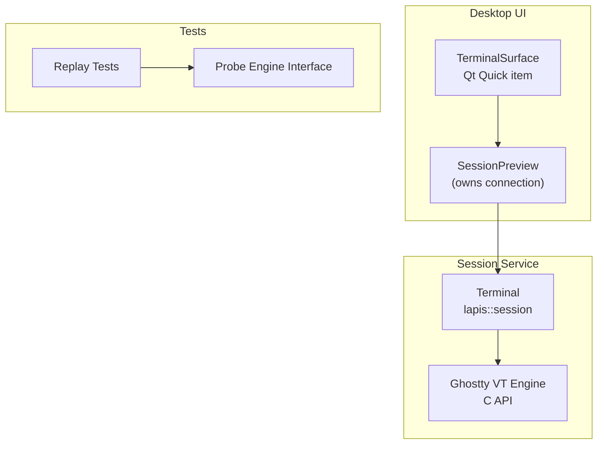
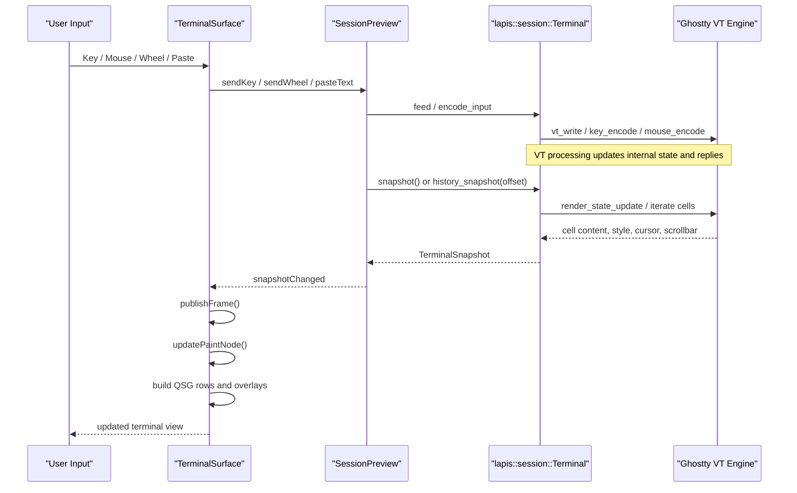
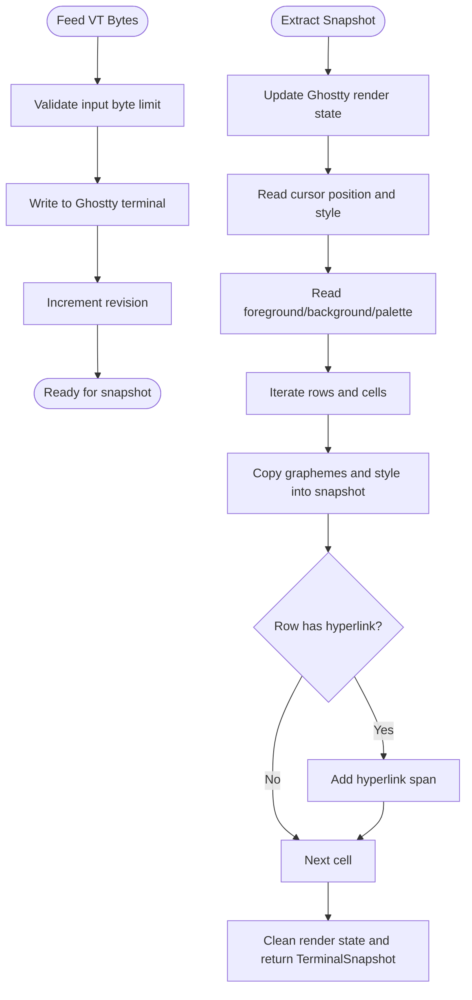
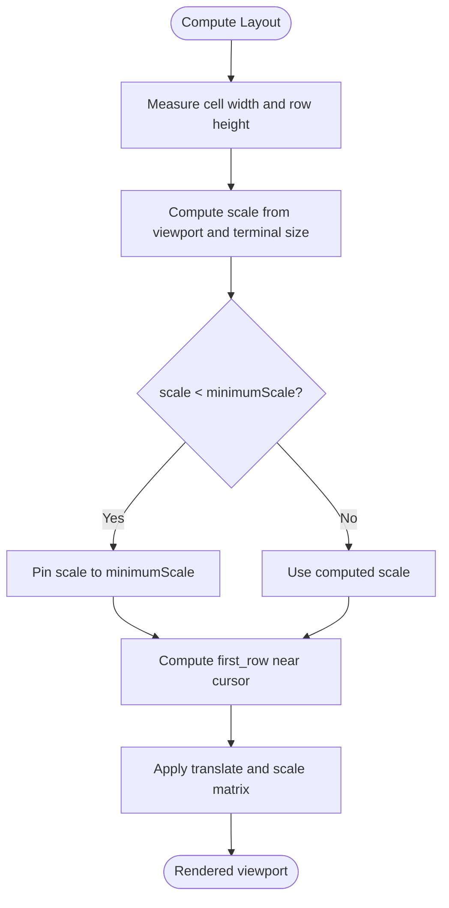
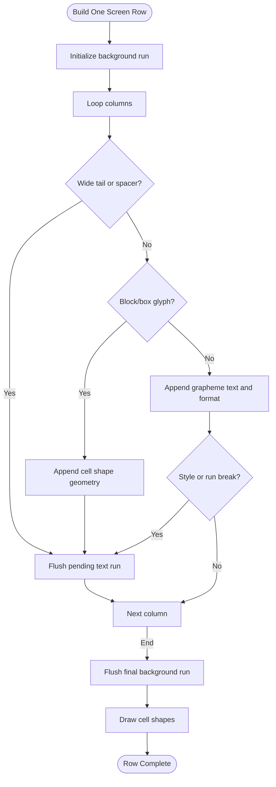
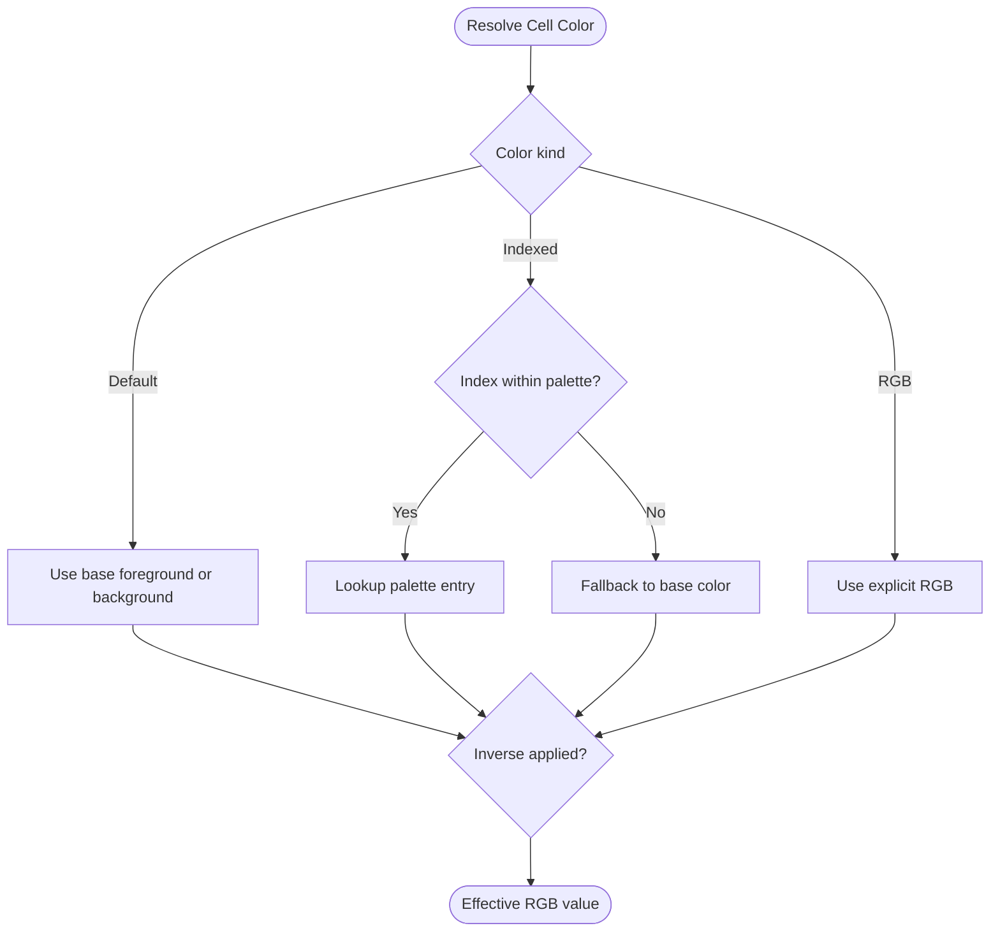
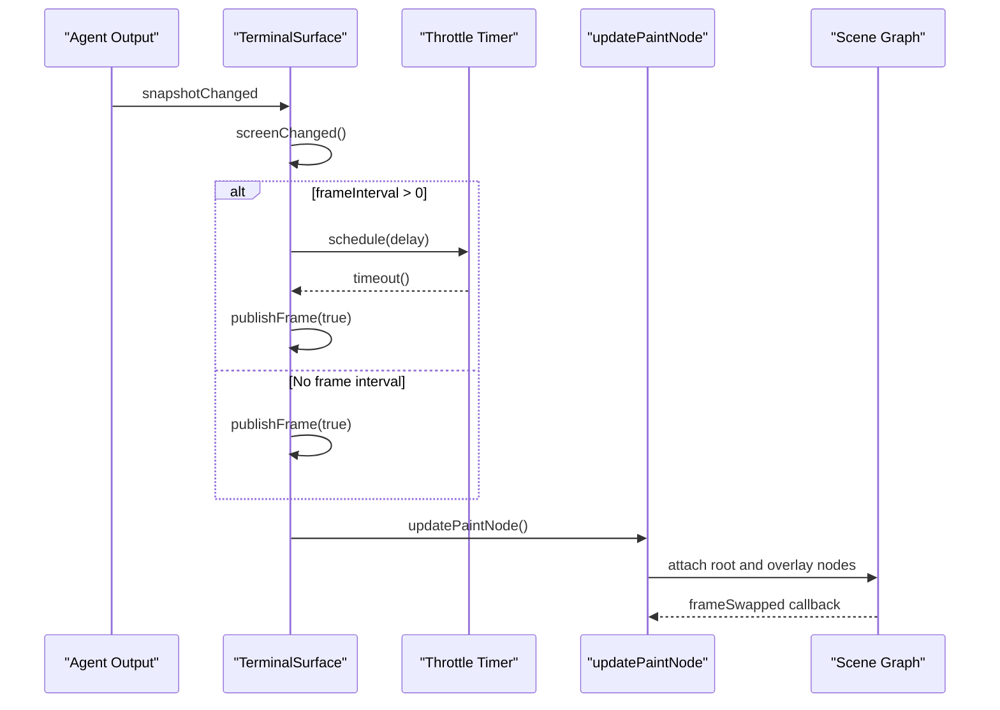
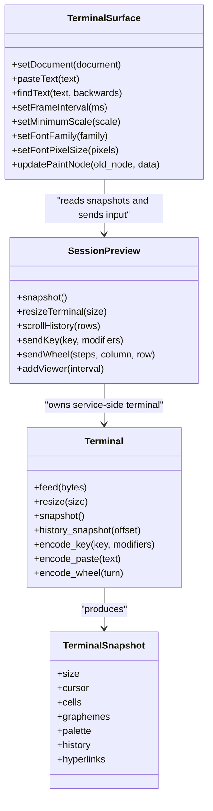

# Terminal Surface Rendering

<cite>
**Referenced Files in This Document**
- [terminal_surface.hpp](file://apps/desktop/src/terminal_surface.hpp)
- [terminal_surface.cpp](file://apps/desktop/src/terminal_surface.cpp)
- [terminals.hpp](file://apps/desktop/src/terminals.hpp)
- [terminals.cpp](file://apps/desktop/src/terminals.cpp)
- [terminal.hpp](file://services/session/include/lapis/session/terminal.hpp)
- [terminal.cpp](file://services/session/src/terminal/terminal.cpp)
- [probe.hpp](file://tools/terminal_probe/probe.hpp)
- [replay.cpp](file://tools/terminal_probe/replay.cpp)
</cite>

## Table of Contents
1. [Introduction](#introduction)
2. [Project Structure](#project-structure)
3. [Core Components](#core-components)
4. [Architecture Overview](#architecture-overview)
5. [Detailed Component Analysis](#detailed-component-analysis)
6. [Dependency Analysis](#dependency-analysis)
7. [Performance Considerations](#performance-considerations)
8. [Troubleshooting Guide](#troubleshooting-guide)
9. [Conclusion](#conclusion)

## Introduction
This document explains how the desktop application renders terminal output through the `TerminalSurface` component and the underlying session terminal engine built on Ghostty. It covers:

- The visual rendering path from VT input to Qt Quick scene graph nodes.
- Buffer management for scrollback history, viewport positioning, and memory-bounded storage.
- Text rendering, glyph mapping, color palette handling, Unicode support, and decorations.
- Performance features such as frame throttling, handoff between GUI and render threads, batched row drawing, and scaled viewport scrolling.
- Configuration options exposed by `TerminalSurface`, including font selection, minimum scale, frame interval, and terminal grid sizing.
- Troubleshooting guidance for garbled output, large-session memory behavior, and platform-specific display differences.

## Project Structure
The relevant implementation is split across three layers:

1. **Desktop UI layer (`apps/desktop/src`)**: `TerminalSurface` owns the Qt Quick item, user interaction, layout, and scene-graph drawing.
2. **Session terminal layer (`services/session`)**: `lapis::session::Terminal` wraps the Ghostty VT engine, manages state, limits, history, and produces a snapshot model.
3. **Probe tooling (`tools/terminal_probe`)**: A small test harness that exercises the same terminal contract against a probe engine implementation.

**Diagram sources**
- [terminal_surface.hpp:1-80](file://apps/desktop/src/terminal_surface.hpp#L1-L80)
- [terminal_surface.cpp:700-1087](file://apps/desktop/src/terminal_surface.cpp#L700-L1087)
- [terminal.hpp:1-200](file://services/session/include/lapis/session/terminal.hpp#L1-L200)
- [terminal.cpp:280-470](file://services/session/src/terminal/terminal.cpp#L280-L470)
- [probe.hpp:1-58](file://tools/terminal_probe/probe.hpp#L1-L58)
- [replay.cpp:1-60](file://tools/terminal_probe/replay.cpp#L1-L60)

**Section sources**
- [terminal_surface.hpp:1-200](file://apps/desktop/src/terminal_surface.hpp#L1-L200)
- [terminal_surface.cpp:1-200](file://apps/desktop/src/terminal_surface.cpp#L1-L200)
- [terminal.hpp:1-200](file://services/session/include/lapis/session/terminal.hpp#L1-L200)
- [terminal.cpp:280-470](file://services/session/src/terminal/terminal.cpp#L280-L470)

## Core Components
- `TerminalSurface`: A Qt Quick item that translates terminal snapshots into drawn rows, overlays, cursors, selections, links, suggestions, and composition text. It also handles keyboard, mouse, wheel, IME, and suggestion flow interactions.
- `lapis::session::Terminal`: An owner-thread terminal emulator that consumes VT bytes, applies terminal modes, maintains scrollback, and exposes snapshots and encoded input.
- `TerminalSnapshot`: A read-only snapshot model describing screen size, cursor, colors, cell array, contiguous grapheme storage, scrollback metadata, and hyperlinks.
- Probe interface: A test contract used by replay tests to validate terminal behavior such as Unicode, alternate screen, styles, input modes, and burst output.

**Section sources**
- [terminal_surface.hpp:1-200](file://apps/desktop/src/terminal_surface.hpp#L1-L200)
- [terminal.hpp:1-200](file://services/session/include/lapis/session/terminal.hpp#L1-L200)
- [probe.hpp:1-58](file://tools/terminal_probe/probe.hpp#L1-L58)

## Architecture Overview
The rendering pipeline connects UI events to the Ghostty engine through owned snapshots and a thread-safe frame handoff.

**Diagram sources**
- [terminal_surface.cpp:700-1087](file://apps/desktop/src/terminal_surface.cpp#L700-L1087)
- [terminal.cpp:410-470](file://services/session/src/terminal/terminal.cpp#L410-L470)
- [terminal.cpp:655-787](file://services/session/src/terminal/terminal.cpp#L655-L787)

## Detailed Component Analysis

### TerminalBuffer Management and Scrollback History
The session terminal owns VT emulation and scrollback; the UI layer only reads snapshots.

Key responsibilities:
- **Input budgeting**: `feed` rejects oversized input and increments a revision counter after successful writes.
- **History budget**: The engine sets and verifies `GHOSTTY_TERMINAL_OPT_SCROLLBACK_MAX_BYTES`.
- **Viewport extraction**: `snapshot()` returns the current live viewport; `history_snapshot(offset)` scrolls to an absolute history row, extracts a full viewport, then restores the previous viewport.
- **History metadata**: `history_metadata()` exposes total rows, viewport offset, viewport row count, and whether primary history is available.
- **Memory safety**: Reply overflow marks the instance poisoned; subsequent operations throw `overflow_error`, requiring recreation.

**Diagram sources**
- [terminal.cpp:410-470](file://services/session/src/terminal/terminal.cpp#L410-L470)
- [terminal.cpp:655-787](file://services/session/src/terminal/terminal.cpp#L655-L787)

Scrollback constraints:
- Default history budget is 16 MiB.
- Maximum cells default to 512 × 256.
- Grapheme codepoint limit defaults to 1 MiU.
- Input bytes default to 1 MiB.
- Reply bytes are bounded to 64 KiB with a poison-on-overflow strategy.

**Section sources**
- [terminal.hpp:12-80](file://services/session/include/lapis/session/terminal.hpp#L12-L80)
- [terminal.cpp:280-470](file://services/session/src/terminal/terminal.cpp#L280-L470)
- [terminal.cpp:655-787](file://services/session/src/terminal/terminal.cpp#L655-L787)

### Viewport Positioning and Scaling
`TerminalSurface` computes a scaled viewport so very long terminals can fit into smaller windows without losing the prompt area.

Behavior:
- Cell width and height come from the selected monospace font.
- Scale is the smaller ratio of viewport width to terminal width, and viewport height to terminal height.
- When `minimumScale` is set, scaling below that threshold pins the scale and aligns visible rows to the cursor when possible.
- `first_row` offsets the rendered matrix so the bottom of the terminal remains visible during forced minimum scaling.

**Diagram sources**
- [terminal_surface.cpp:60-76](file://apps/desktop/src/terminal_surface.cpp#L60-L76)
- [terminal_surface.cpp:1074-1087](file://apps/desktop/src/terminal_surface.cpp#L1074-L1087)

**Section sources**
- [terminal_surface.hpp:80-120](file://apps/desktop/src/terminal_surface.hpp#L80-L120)
- [terminal_surface.cpp:60-76](file://apps/desktop/src/terminal_surface.cpp#L60-L76)
- [terminal_surface.cpp:1074-1087](file://apps/desktop/src/terminal_surface.cpp#L1074-L1087)

### Text Rendering Pipeline
Rendering uses Qt Quick’s scene graph. Rows are built with background rectangles, `QSGTextNode` layouts, and optional shape-based glyphs for block and box-drawing characters.

Highlights:
- Backgrounds are batched per contiguous run of identical background colors.
- Character runs are flushed when style, safe-ASCII status, or text changes.
- ASCII printable characters whose advance matches the cell width use cached metrics and avoid full shaping.
- Block and box characters are converted to geometric shapes so they join across rows.
- Decorations (underline, strikethrough, overline) are drawn as thin rectangles or dash patterns.
- Cursor overlay draws block, bar, underline, or hollow-block cursors and repaints covered text using background color when needed.

**Diagram sources**
- [terminal_surface.cpp:201-545](file://apps/desktop/src/terminal_surface.cpp#L201-L545)

Unicode and grapheme handling:
- Each cell stores a slice into a single contiguous `u32string` grapheme buffer rather than per-cell strings.
- Empty cells map to a space character for copyable text.
- Wide cells and continuation spacers are represented by `CellKind`.
- Combining sequences and fragmented UTF-8 are exercised by replay tests.

**Section sources**
- [terminal_surface.cpp:201-545](file://apps/desktop/src/terminal_surface.cpp#L201-L545)
- [terminal.hpp:48-120](file://services/session/include/lapis/session/terminal.hpp#L48-L120)
- [replay.cpp:60-120](file://tools/terminal_probe/replay.cpp#L60-L120)

### Color Palette Handling
Color resolution happens both in the session layer and the UI layer.

Session layer:
- Colors may be default, indexed palette, or explicit RGB.
- Inverse swaps foreground and background before computing effective RGB.
- Palette indices are validated; invalid indices cause errors.

UI layer:
- Effective colors fall back to the snapshot’s foreground or background when index bounds are exceeded.
- Faint and invisible flags adjust alpha or hide decoration.
- Underline color uses the cell’s configured underline color when present.

**Diagram sources**
- [terminal.cpp:240-260](file://services/session/src/terminal/terminal.cpp#L240-L260)
- [terminal_surface.cpp:80-120](file://apps/desktop/src/terminal_surface.cpp#L80-L120)

**Section sources**
- [terminal.hpp:24-80](file://services/session/include/lapis/session/terminal.hpp#L24-L80)
- [terminal.cpp:240-260](file://services/session/src/terminal/terminal.cpp#L240-L260)
- [terminal_surface.cpp:80-120](file://apps/desktop/src/terminal_surface.cpp#L80-L120)

### Hyperlinks and Links
Hyperlinks are stored separately from ordinary cell text to avoid per-cell string allocations.

- The session layer collects hyperlink spans with a starting cell index, span length, and URI.
- The UI layer maps hovered cells to visible link spans and supports opening URLs or local paths.
- On macOS, Command opens links; elsewhere, Control opens them.
- Remote agent-printed paths are not treated as local files unless explicitly valid.

**Section sources**
- [terminal.hpp:90-120](file://services/session/include/lapis/session/terminal.hpp#L90-L120)
- [terminal.cpp:100-140](file://services/session/src/terminal/terminal.cpp#L100-L140)
- [terminal_surface.hpp:20-50](file://apps/desktop/src/terminal_surface.hpp#L20-L50)
- [terminal_surface.cpp:1200-1380](file://apps/desktop/src/terminal_surface.cpp#L1200-L1380)

### Suggestion Overlay and Composition Text
`TerminalSurface` can draw a suggested next prompt after the cursor, dimmed unless confidence is high. It also composes IME preedit text above the cursor.

- Suggestion layout respects available room and elides text when necessary.
- Preedit text replaces the normal cursor overlay while composing.
- Both overlays are added to a separate scene-graph node tree under the root.

**Section sources**
- [terminal_surface.hpp:60-120](file://apps/desktop/src/terminal_surface.hpp#L60-L120)
- [terminal_surface.cpp:545-700](file://apps/desktop/src/terminal_surface.cpp#L545-L700)
- [terminal_surface.cpp:1040-1087](file://apps/desktop/src/terminal_surface.cpp#L1040-L1087)

### Frame Throttling and Handoff
`TerminalSurface` avoids flooding the renderer when agents produce noisy output.

- `frameInterval` delays output-driven frames until enough time has passed since the last output publish.
- A throttle timer coalesces frequent updates.
- A shared `FrameHandoff` object transfers immutable `RenderState` from the GUI thread to the render thread safely.
- Presentation callbacks mark painted frames as presented after `frameSwapped`.

**Diagram sources**
- [terminal_surface.cpp:700-920](file://apps/desktop/src/terminal_surface.cpp#L700-L920)
- [terminal_surface.cpp:920-1087](file://apps/desktop/src/terminal_surface.cpp#L920-L1087)

**Section sources**
- [terminal_surface.hpp:80-120](file://apps/desktop/src/terminal_surface.hpp#L80-L120)
- [terminal_surface.cpp:700-920](file://apps/desktop/src/terminal_surface.cpp#L700-L920)
- [terminal_surface.cpp:920-1087](file://apps/desktop/src/terminal_surface.cpp#L920-L1087)

### Input, Selection, and Wheel Scrolling
`TerminalSurface` converts Qt input events into terminal actions:

- Keyboard: normal keys, navigation keys, paste, copy, and suggestion flow.
- Mouse: selection, double-click word selection, link opening, and hover highlighting.
- Wheel: program-mode wheel events go to the agent; otherwise, history scrolls by accumulated pixels or wheel notches.
- Selection: copies text from visible cells, skipping wide tails and wrap spacers.

**Section sources**
- [terminal_surface.cpp:1200-1576](file://apps/desktop/src/terminal_surface.cpp#L1200-L1576)
- [terminal_surface.hpp:120-200](file://apps/desktop/src/terminal_surface.hpp#L120-L200)

### Configuration Options
| Option | Type | Meaning |
|---|---|---|
| `fontFamily` | String | Requested font family; empty or unavailable families fall back to the system fixed-width font. |
| `fontPixelSize` | Integer | Font pixel size. |
| `resolvedFontFamily` | String | Actual resolved family reported by the surface. |
| `gridSize` | Size | Computed requested columns and rows based on current item geometry and font metrics. |
| `frameInterval` | Milliseconds | Minimum delay between output-driven redraws; zero means every snapshot redraws immediately. |
| `minimumScale` | Real number | Smallest scale used when fitting the entire terminal; below it, rows ending at the cursor remain visible. |
| `holdResize` | Boolean | While resizing, terminal dimensions are updated once instead of continuously. |
| `interactive` | Boolean | Whether the surface accepts terminal input. |
| `suggestion` | String | Offered next prompt text. |
| `suggestionConfident` | Boolean | Whether the suggestion should be rendered nearly as bright as normal text. |
| `tabFlow` | Boolean | Enables Tab-flow behavior tied to suggestions and agent navigation. |

**Section sources**
- [terminal_surface.hpp:60-160](file://apps/desktop/src/terminal_surface.hpp#L60-L160)
- [terminal_surface.cpp:1180-1220](file://apps/desktop/src/terminal_surface.cpp#L1180-L1220)

## Dependency Analysis
`TerminalSurface` depends on:
- `SessionPreview` for snapshots, input forwarding, resize, history scrolling, and viewer registration.
- Qt Quick for scene-graph drawing, fonts, timers, and event handling.
- `lapis::session::TerminalSnapshot` for all terminal data.

`lapis::session::Terminal` depends on:
- Ghostty C API for VT processing, render state iteration, key/mouse encoding, and scrollback control.

**Diagram sources**
- [terminal_surface.hpp:1-200](file://apps/desktop/src/terminal_surface.hpp#L1-L200)
- [workspace.hpp:50-240](file://apps/desktop/src/workspace.hpp#L50-L240)
- [terminal.hpp:80-200](file://services/session/include/lapis/session/terminal.hpp#L80-L200)

**Section sources**
- [terminal_surface.hpp:1-200](file://apps/desktop/src/terminal_surface.hpp#L1-L200)
- [terminal.hpp:80-200](file://services/session/include/lapis/session/terminal.hpp#L80-L200)

## Performance Considerations
- **Batched background rectangles**: Consecutive cells with the same background are merged into one rectangle.
- **Cached ASCII advances**: Printable ASCII widths are measured once per font style and reused.
- **Contiguous grapheme storage**: Cells store offsets and lengths into one `u32string`, avoiding per-cell heap allocation.
- **Shape-based glyphs**: Block and box characters are drawn as geometry, improving cross-row joins and reducing font fallback overhead.
- **Frame throttling**: `frameInterval` prevents output bursts from forcing every frame.
- **Thread-safe handoff**: Immutable `RenderState` objects are transferred via mutex-guarded shared pointers.
- **Presentation tracking**: Frames are marked presented after window frame swap, allowing old frames to be dropped safely.
- **History budget**: Scrollback is limited by configured bytes, preventing unlimited growth.
- **Reply poisoning**: Oversized PTY replies poison the terminal instance to avoid unbounded reply queues.

[No sources needed since this section summarizes previously analyzed performance mechanisms]

## Troubleshooting Guide

### Garbled or Incorrect Output
Likely causes:
- Fragmented UTF-8 or combining sequences were not retained.
- Palette indices returned by the terminal engine are out of range.
- Alternate-screen mode was not restored correctly.
- Resize did not retain requested columns or rows.

Recommended checks:
- Verify Unicode handling with fragmented input and combining characters.
- Confirm palette index validation and fallback behavior.
- Ensure alternate-screen restoration preserves cursor and content.
- Confirm that resize validates and retains requested dimensions.

**Section sources**
- [replay.cpp:60-120](file://tools/terminal_probe/replay.cpp#L60-L120)
- [terminal.cpp:240-260](file://services/session/src/terminal/terminal.cpp#L240-L260)
- [terminal.cpp:420-430](file://services/session/src/terminal/terminal.cpp#L420-L430)

### Memory Leaks with Large Sessions
Symptoms:
- Increasing memory usage during long-running sessions.
- Scrollback growing beyond expected bounds.
- Excessive grapheme codepoints or hyperlink spans.

Mitigations:
- Set appropriate `TerminalLimits.history_bytes`, `max_cells`, `max_grapheme_codepoints`, and `max_input_bytes`.
- Use `clear_history()` to reset scrollback budget when appropriate.
- Avoid retaining snapshots longer than necessary; snapshots own their buffers.
- Watch for reply overflow, which poisons the terminal and requires recreation.

**Section sources**
- [terminal.hpp:12-80](file://services/session/include/lapis/session/terminal.hpp#L12-L80)
- [terminal.cpp:440-470](file://services/session/src/terminal/terminal.cpp#L440-L470)
- [terminal.cpp:720-787](file://services/session/src/terminal/terminal.cpp#L720-L787)

### Platform-Specific Display Differences
Differences observed:
- Link modifier keys differ: Command on macOS, Control elsewhere.
- System fixed-width font fallback behavior depends on platform font availability.
- Trackpad versus wheel scrolling accumulates differently but converges to row-aligned history movement.
- IME composition resets depend on window activity and focus.

Recommendations:
- Always resolve fonts through the provided helpers.
- Test link modifiers on each platform.
- Verify wheel accumulation behavior for trackpads and mice.
- Reset IME context when the window becomes inactive or loses focus.

**Section sources**
- [terminal_surface.cpp:120-160](file://apps/desktop/src/terminal_surface.cpp#L120-L160)
- [terminal_surface.cpp:1200-1400](file://apps/desktop/src/terminal_surface.cpp#L1200-L1400)
- [terminal_surface.cpp:920-1087](file://apps/desktop/src/terminal_surface.cpp#L920-L1087)

## Conclusion
`TerminalSurface` provides a robust, Qt Quick-based terminal renderer backed by the Ghostty VT engine through `lapis::session::Terminal`. It separates VT state and history management from UI concerns, exposing a snapshot model that supports efficient Unicode rendering, palette-aware colors, hyperlink spans, and scrollback navigation. Performance is addressed through batched drawing, cached metrics, frame throttling, and bounded memory budgets. Configuration options allow tuning fonts, scaling, frame pacing, and interactive behavior. For production reliability, operators should monitor history budgets, handle reply overflow recovery, and validate platform-specific input and font behavior.

[No sources needed since this section summarizes without analyzing specific files]