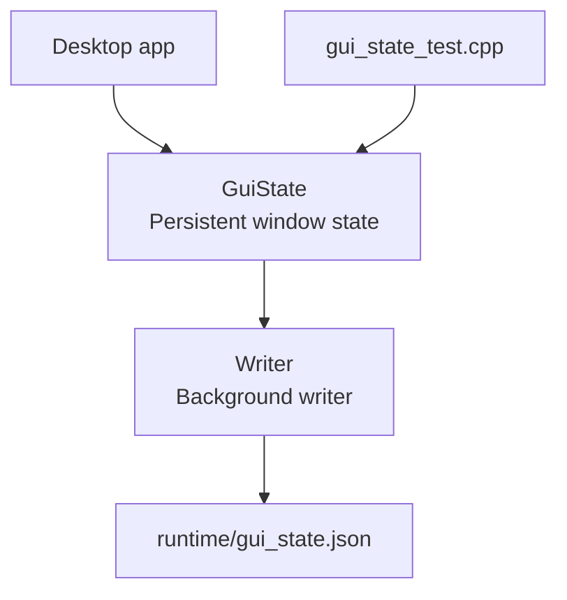
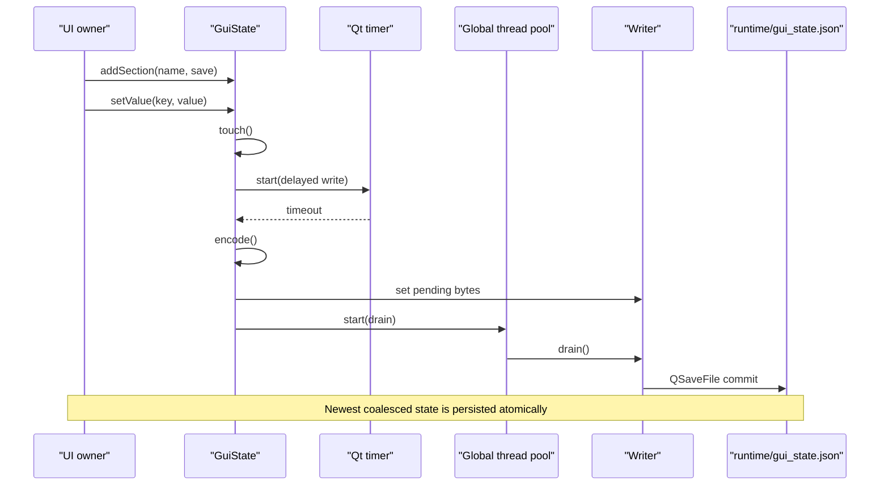
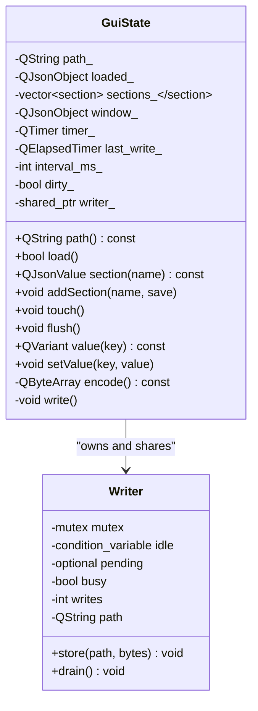
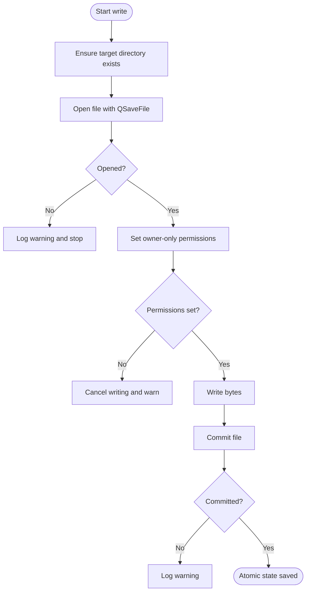
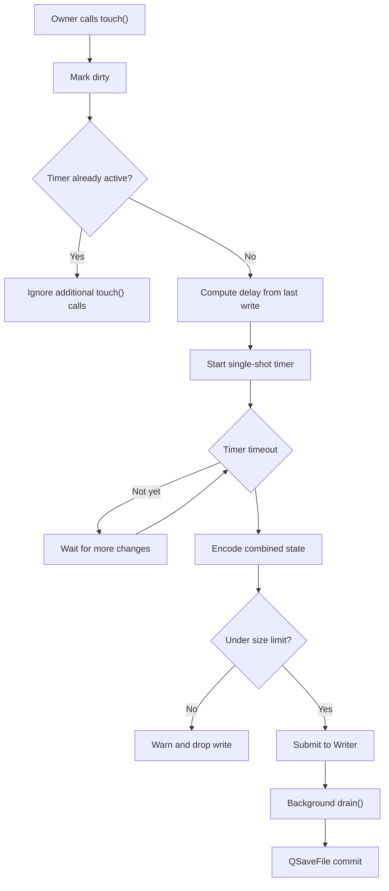
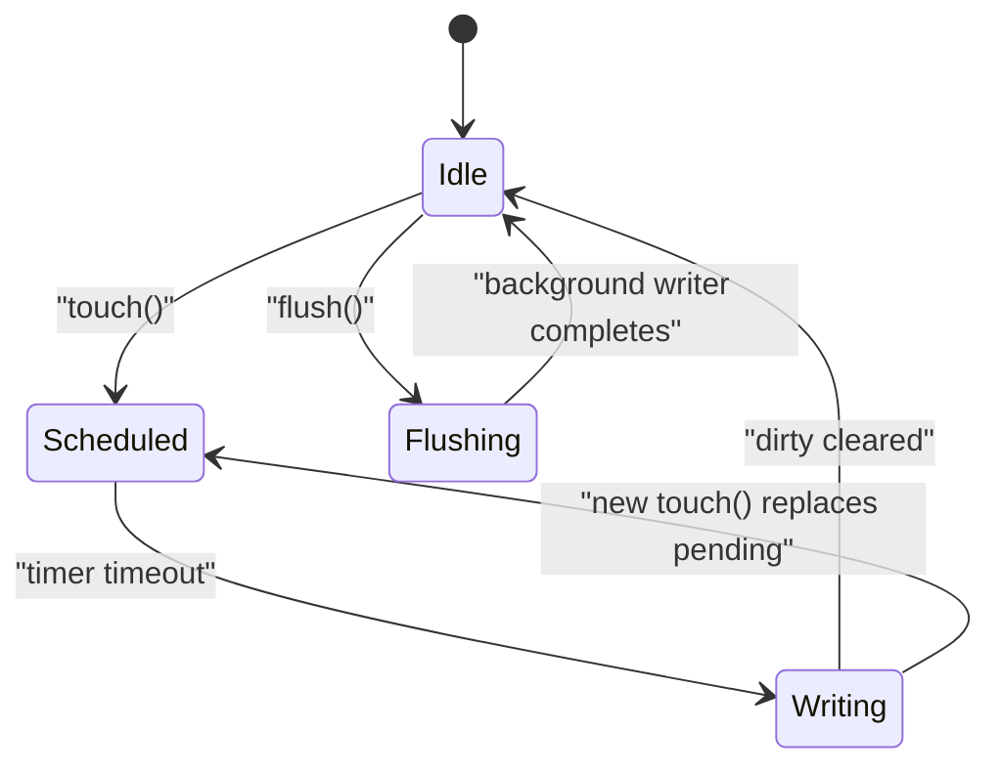
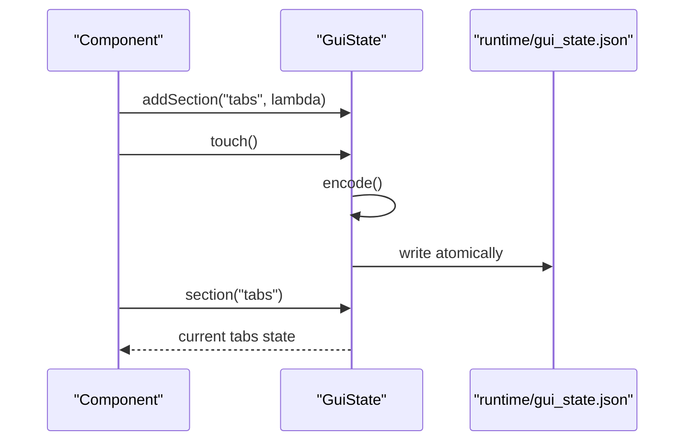
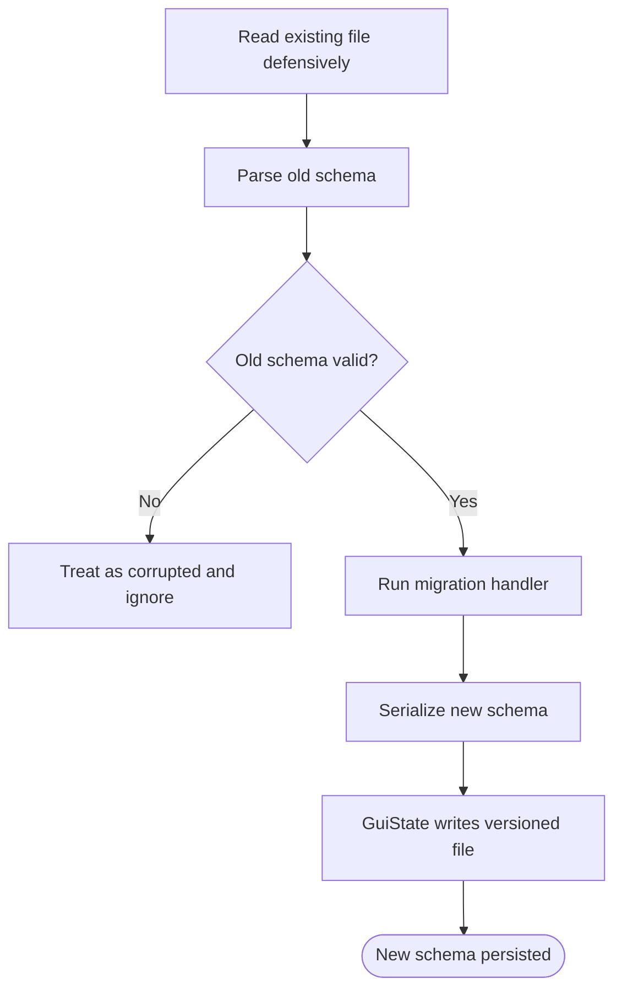
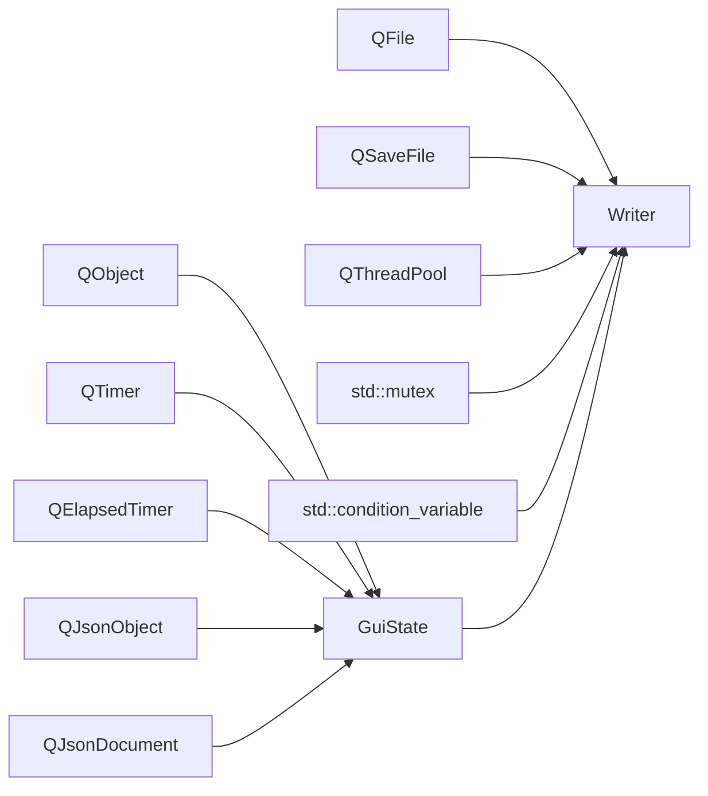

# GUI State Persistence

<cite>
**Referenced Files in This Document**
- [gui_state.hpp](file://apps/desktop/src/gui_state.hpp)
- [gui_state.cpp](file://apps/desktop/src/gui_state.cpp)
- [gui_state_test.cpp](file://apps/desktop/tests/gui_state_test.cpp)
</cite>

## Table of Contents
1. [Introduction](#introduction)
2. [Project Structure](#project-structure)
3. [Core Components](#core-components)
4. [Architecture Overview](#architecture-overview)
5. [Detailed Component Analysis](#detailed-component-analysis)
6. [Dependency Analysis](#dependency-analysis)
7. [Performance Considerations](#performance-considerations)
8. [Troubleshooting Guide](#troubleshooting-guide)
9. [Conclusion](#conclusion)

## Introduction
This document explains the `GuiState` class used by Lapis desktop to persist window state across restarts. It focuses on:

- The atomic JSON serialization mechanism.
- The versioned schema contract and recovery behavior for corrupt or incompatible files.
- The rate-limited, publish-to-publish write strategy that prevents disk thrashing during rapid UI updates.
- The persistent state categories stored under sections, including window geometry-like choices, tab ordering, terminal sizes, and workspace layout preservation.
- How new state fields are registered through owner-provided sections.
- Thread-safety guarantees between the Qt event loop and background workers.

`GuiState` is intentionally small and bounded: it owns one JSON file under `runtime/gui_state.json`, limits its size, serializes it as a single document, and writes it atomically.

**Section sources**
- [gui_state.hpp:10-35](file://apps/desktop/src/gui_state.hpp#L10-L35)
- [gui_state.cpp:12-36](file://apps/desktop/src/gui_state.cpp#L12-L36)

## Project Structure
The persistence logic lives entirely within the desktop application source tree:

**Diagram sources**
- [gui_state.hpp:18-96](file://apps/desktop/src/gui_state.hpp#L18-L96)
- [gui_state.cpp:12-213](file://apps/desktop/src/gui_state.cpp#L12-L213)
- [gui_state_test.cpp:1-30](file://apps/desktop/tests/gui_state_test.cpp#L1-L30)

**Section sources**
- [gui_state.hpp:1-97](file://apps/desktop/src/gui_state.hpp#L1-L97)
- [gui_state.cpp:1-213](file://apps/desktop/src/gui_state.cpp#L1-L213)
- [gui_state_test.cpp:1-413](file://apps/desktop/tests/gui_state_test.cpp#L1-L413)

## Core Components
`GuiState` provides:

| Responsibility | Implementation detail |
|---|---|
| Persistent storage location | One path supplied at construction; tests use `runtime/gui_state.json`. |
| Versioning | A top-level integer `version` field must match `kVersion`; otherwise the file is ignored. |
| Sections | Owner-owned state serialized under a `sections` object. Each owner registers a section name and a lambda that returns its current state. |
| Window choices | A reserved `window` section holds small per-window QML choices exposed through `value()` and `setValue()`. |
| Atomicity | Writes go through `QSaveFile`, which commits only after successful write. Permissions are restricted to the owner. |
| Size limits | Total file read limit is `kMaxBytes`; section encoding rejects payloads larger than that limit. |
| Rate limiting | Changes call `touch()`, which schedules a single delayed write. Frequent calls coalesce into one write after a quiet interval. |
| Background writing | Encoded bytes are handed to a shared `Writer`, which runs on a global thread pool. Only one write is active at a time. |
| Corrupt-file recovery | Missing, unreadable, symlinked, oversized, invalid JSON, wrong-version, or non-object files are rejected with warnings. |
| Shutdown safety | Destructor flushes pending work and waits briefly so a stuck filesystem does not block exit. |

**Section sources**
- [gui_state.hpp:18-96](file://apps/desktop/src/gui_state.hpp#L18-L96)
- [gui_state.cpp:38-213](file://apps/desktop/src/gui_state.cpp#L38-L213)

## Architecture Overview
At runtime, GUI owners (for example, window-related subsystems, tab order, terminal sizing, and workspace layout components) register their data through `addSection`. When the UI changes, they call `touch()`. `GuiState` then schedules a single future write. A background worker serializes the combined state, enforces the size budget, and writes it atomically.

**Diagram sources**
- [gui_state.hpp:56-96](file://apps/desktop/src/gui_state.hpp#L56-L96)
- [gui_state.cpp:62-199](file://apps/desktop/src/gui_state.cpp#L62-L199)

## Detailed Component Analysis

### Serialization Model and Schema Contract
The persisted JSON has this structure:

| Field | Meaning |
|---|---|
| `version` | Current schema version. Must equal `GuiState::kVersion`. |
| `sections` | Object containing all registered owner sections plus the reserved `window` section. |
| `sections.window` | Small per-window choices such as last selected harness, model mappings, and other lightweight settings. |
| `sections.<owner>` | Owner-defined state returned by the `Save` function registered through `addSection`. |

The schema contract is enforced at load time:

1. The file must exist, be a regular file, and be readable.
2. Symlinks are rejected.
3. The read buffer is limited to `kMaxBytes + 1`.
4. The content must parse as valid JSON.
5. The parsed root must be an object.
6. The `version` field must equal `kVersion`.
7. The `sections` object is extracted.
8. The `window` subsection is validated against key and value limits before being loaded into memory.

If any step fails, `load()` returns false and logs a warning. Consumers treat missing or invalid state as empty state and rely on owner-specific validation.

**Section sources**
- [gui_state.hpp:18-34](file://apps/desktop/src/gui_state.hpp#L18-L34)
- [gui_state.cpp:74-127](file://apps/desktop/src/gui_state.cpp#L74-L127)

#### Class Diagram

**Diagram sources**
- [gui_state.hpp:18-96](file://apps/desktop/src/gui_state.hpp#L18-L96)
- [gui_state.cpp:38-59](file://apps/desktop/src/gui_state.cpp#L38-L59)

### Atomic Write Strategy
Writes avoid partial files by using `QSaveFile`:

1. The directory is created if needed.
2. The file is opened for writing.
3. Owner-only permissions are requested.
4. Bytes are written.
5. `commit()` finalizes the write atomically.

If opening, setting permissions, writing, or committing fails, a warning is logged and no incomplete file is committed.

**Diagram sources**
- [gui_state.cpp:38-59](file://apps/desktop/src/gui_state.cpp#L38-L59)

**Section sources**
- [gui_state.cpp:38-59](file://apps/desktop/src/gui_state.cpp#L38-L59)
- [gui_state_test.cpp:70-92](file://apps/desktop/tests/gui_state_test.cpp#L70-L92)

### Rate-Limited Coalescing and Publish-to-Publish Semantics
`GuiState` avoids frequent disk writes through two mechanisms:

1. **Dirty flag:** `touch()` marks state as dirty without immediately writing.
2. **Single delayed timer:** If no timer is active, `touch()` starts a timer whose delay depends on how long ago the last write occurred.
3. **Coalescing:** Subsequent calls while the timer is active do nothing extra.
4. **Publish-to-publish timing:** The first change after a quiet period triggers a write soon, while bursts wait until the end of the configured interval.
5. **Newest wins:** Later changes replace earlier pending state before the next scheduled write.

Key constants:

| Constant | Default meaning |
|---|---|
| `kIntervalMs` | Default scheduling interval between writes. |
| `kExitWaitMs` | Maximum wait during shutdown before giving up on a write. |
| `kTestWaitMs` | Maximum wait in test helpers. |

**Diagram sources**
- [gui_state.cpp:129-199](file://apps/desktop/src/gui_state.cpp#L129-L199)

**Section sources**
- [gui_state.cpp:129-199](file://apps/desktop/src/gui_state.cpp#L129-L199)
- [gui_state_test.cpp:124-170](file://apps/desktop/tests/gui_state_test.cpp#L124-L170)

### Window Choices and Bounded Metadata
The reserved `window` section stores small values used by QML and other UI code. It enforces stricter bounds than general sections:

| Constraint | Limit |
|---|---|
| Maximum number of keys | `kMaxWindowKeys` |
| Maximum serialized size per value | `kMaxWindowValueBytes` |
| Maximum key length | 64 characters |
| Undefined values | Rejected |
| Duplicate unchanged values | Ignored |

These constraints protect the state file from growing too large through accidental window metadata accumulation.

**Section sources**
- [gui_state.hpp:24-34](file://apps/desktop/src/gui_state.hpp#L24-L34)
- [gui_state.cpp:118-127](file://apps/desktop/src/gui_state.cpp#L118-L127)
- [gui_state.cpp:145-164](file://apps/desktop/src/gui_state.cpp#L145-L164)
- [gui_state_test.cpp:61-92](file://apps/desktop/tests/gui_state_test.cpp#L61-L92)

### State Categories
Although `GuiState` itself does not define domain models, it persists whatever owners register through `addSection`. Based on the tests and surrounding desktop modules, the important state categories include:

| Category | Where it appears or is used | What it preserves |
|---|---|---|
| Window choices | `GuiState::value()` / `setValue()` | Last selected harness, model mappings, and other lightweight UI preferences. |
| Agent attention marks | Test uses `agent_checkpoint.hpp` and `alerts.hpp` | Unseen agent flags, activity state, and timing information. |
| Workspace layout | Tests use `workspace.hpp` and related workspace types | Focused session, seen screens, and conversation-scoped mark state. |
| Closed agents | Tests reference workspace closed-agent handling | Valid closed agents that can be reopened after restart. |
| Tab and terminal state | Desktop module names such as `tab_ranker`, `terminal_surface`, `terminals` | Ordering and sizing information owned by those modules. |

Consumers should treat unknown or missing section data as recoverable. Owners validate what they restore and ignore stale identifiers, moved paths, or deleted sessions.

**Section sources**
- [gui_state_test.cpp:1-30](file://apps/desktop/tests/gui_state_test.cpp#L1-L30)
- [gui_state_test.cpp:171-318](file://apps/desktop/tests/gui_state_test.cpp#L171-L318)

### Thread-Safety Guarantees
`GuiState` coordinates between the Qt event loop and background threads as follows:

| Operation | Thread | Behavior |
|---|---|---|
| Construction and destruction | Any thread owning the object | Destructor attempts a safe flush and bounded wait. |
| `load()` | Usually GUI thread during startup | Reads and validates the file; never performs expensive background work. |
| `section()` | Any thread reading state | Returns a copy of the loaded JSON value. |
| `addSection()` | Usually GUI thread during setup | Registers an owner’s save function. |
| `value()` / `setValue()` | Usually GUI thread | Updates in-memory window choices and may schedule a write. |
| `touch()` | Usually GUI thread | Schedules a delayed write. |
| `write()` | Usually GUI thread | Encodes state and submits it to the background writer. |
| `flush()` | Any thread needing synchronous completion | Stops the timer, writes, and waits for completion. |
| `Writer::drain()` | Background thread from `QThreadPool` | Performs the actual disk write and counts completed writes. |

Thread synchronization primitives:

- `std::mutex` protects shared writer state.
- `std::condition_variable` allows callers to wait for background work.
- `QTimer` runs on the GUI thread.
- `QThreadPool::globalInstance()` runs the writer off the GUI thread.

**Diagram sources**
- [gui_state.cpp:38-59](file://apps/desktop/src/gui_state.cpp#L38-L59)
- [gui_state.cpp:62-73](file://apps/desktop/src/gui_state.cpp#L62-L73)
- [gui_state.cpp:166-213](file://apps/desktop/src/gui_state.cpp#L166-L213)

**Section sources**
- [gui_state.hpp:56-96](file://apps/desktop/src/gui_state.hpp#L56-L96)
- [gui_state.cpp:38-73](file://apps/desktop/src/gui_state.cpp#L38-L73)
- [gui_state.cpp:166-213](file://apps/desktop/src/gui_state.cpp#L166-L213)

### Recovery from Corrupted or Incompatible State
Recovery follows a defensive-by-default policy:

1. If `load()` cannot produce a usable document, it returns false.
2. Warnings identify why the file was ignored.
3. All sections appear undefined to callers.
4. Owners receive empty state and can safely initialize defaults.
5. New writes overwrite the bad file once owners update their state.

Supported rejection reasons include:

- Not a regular file.
- Symlink.
- Unreadable.
- Oversized.
- Invalid JSON.
- Non-object root.
- Wrong schema version.

Tests verify that corrupt JSON, arrays, wrong versions, missing versions, oversized files, and symlinks are all treated as invalid.

**Section sources**
- [gui_state.cpp:74-127](file://apps/desktop/src/gui_state.cpp#L74-L127)
- [gui_state_test.cpp:94-122](file://apps/desktop/tests/gui_state_test.cpp#L94-L122)

### Registering New State Fields
To add a new persistent category:

1. Define the in-memory state owned by your component.
2. Call `addSection("name", Save)` when initializing the component.
3. Make the `Save` lambda return the current state as a `QJsonValue`.
4. On restore, call `section("name")` and validate the returned value.
5. Treat missing, malformed, or unexpected fields as invalid and fall back to defaults.
6. Avoid using the reserved name `"window"`.

Example workflow:

**Diagram sources**
- [gui_state.hpp:56-71](file://apps/desktop/src/gui_state.hpp#L56-L71)
- [gui_state.cpp:129-199](file://apps/desktop/src/gui_state.cpp#L129-L199)

**Section sources**
- [gui_state.hpp:56-71](file://apps/desktop/src/gui_state.hpp#L56-L71)
- [gui_state_test.cpp:61-92](file://apps/desktop/tests/gui_state_test.cpp#L61-L92)

### Implementing Migration Handlers for Schema Versions
The current implementation does not support multiple live schema versions. Instead, it rejects files whose `version` field differs from `kVersion`. Therefore, migration should be implemented at the application level rather than inside `GuiState`:

1. Increment `kVersion` when the schema changes.
2. On startup, detect whether the existing file has the old version.
3. Load the old format directly from disk using the same defensive checks.
4. Transform it into the new format.
5. Let `GuiState` write the new file atomically.
6. Keep the migration logic outside `GuiState` because `GuiState` treats unknown versions as invalid state.

Recommended migration pattern:

**Diagram sources**
- [gui_state.hpp:20-24](file://apps/desktop/src/gui_state.hpp#L20-L24)
- [gui_state.cpp:74-127](file://apps/desktop/src/gui_state.cpp#L74-L127)

**Section sources**
- [gui_state.hpp:20-24](file://apps/desktop/src/gui_state.hpp#L20-L24)
- [gui_state.cpp:74-127](file://apps/desktop/src/gui_state.cpp#L74-L127)
- [gui_state_test.cpp:94-122](file://apps/desktop/tests/gui_state_test.cpp#L94-L122)

### Handling State Corruption Recovery
Recommended recovery strategy for owners:

1. Check `GuiState::load()` result.
2. If false, assume every section is undefined.
3. Initialize defaults in memory.
4. Do not panic or crash on missing state.
5. Allow normal UI operation.
6. On next meaningful change, let `touch()` schedule a fresh write.
7. For critical data, log diagnostics but keep the application usable.

Owners should also validate restored data independently. For example, workspace and agent references may have changed between runs, so stale IDs, removed terminals, or relocated workspaces should be skipped gracefully.

**Section sources**
- [gui_state.cpp:74-127](file://apps/desktop/src/gui_state.cpp#L74-L127)
- [gui_state_test.cpp:171-318](file://apps/desktop/tests/gui_state_test.cpp#L171-L318)

## Dependency Analysis
`GuiState` depends on Qt infrastructure and standard library concurrency primitives:

**Diagram sources**
- [gui_state.hpp:4-17](file://apps/desktop/src/gui_state.hpp#L4-L17)
- [gui_state.cpp:12-24](file://apps/desktop/src/gui_state.cpp#L12-L24)

Coupling summary:

- High cohesion inside `GuiState` and `Writer`.
- Low coupling to consumers through the public API.
- No circular dependency between owners and `GuiState`; owners only supply a `Save` lambda.
- External integration points are file I/O and the global thread pool.

**Section sources**
- [gui_state.hpp:4-17](file://apps/desktop/src/gui_state.hpp#L4-L17)
- [gui_state.cpp:12-24](file://apps/desktop/src/gui_state.cpp#L12-L24)

## Performance Considerations
`GuiState` is designed for frequent UI updates without dominating the GUI thread or causing excessive disk activity:

- **Bounded payload:** Encoding rejects state larger than `kMaxBytes`.
- **Rate limiting:** The default interval is 2 seconds, configurable for testing.
- **Coalescing:** Rapid changes merge into one write.
- **Background execution:** Disk I/O runs off the GUI thread.
- **Single-writer lock:** Prevents concurrent writes and lost updates.
- **Small window metadata:** Key and value limits prevent accidental growth of lightweight settings.

Optimization recommendations:

- Batch related UI updates and call `touch()` once after the batch.
- Avoid storing large binary data in `window` or custom sections.
- Use stable identifiers for agents and terminals so restored state remains valid.
- Prefer immutable snapshots returned by `Save` lambdas to avoid race conditions.
- Monitor write counts and latency during development using the testing helpers.

[No sources needed since this section provides general guidance]

## Troubleshooting Guide
Common symptoms and likely causes:

| Symptom | Likely cause | Recommended action |
|---|---|---|
| State file is missing after restart | No owner registered a section or `touch()` was never called. | Verify owners call `addSection()` and modify state through `touch()` or `setValue()`. |
| State file is ignored | Corrupt JSON, wrong version, symlink, oversized file, or unreadable file. | Check warnings logged by `load()` and inspect the file manually. |
| Window choices disappear | Keys exceeded 64 characters, values were too large, or too many keys were added. | Enforce key/value constraints before calling `setValue()`. |
| UI freezes during exit | A write is still waiting for the filesystem. | Rely on the destructor’s bounded wait; investigate stuck mounts or permission issues. |
| Multiple writes occur during rapid updates | Rate limiter may be disabled or interval set too low in tests. | Use production intervals; reserve `setIntervalForTesting()` for tests. |
| Data appears inconsistent | Two writers raced, or an owner mutated state after returning it from `Save`. | Return stable snapshots from `Save` and avoid mutating shared state concurrently. |

Useful debugging helpers:

- `writesForTesting()`: Inspect how many background writes have completed.
- `waitForTesting()`: Wait for pending writes in tests.
- `waitForWrites(timeout_ms)`: Wait with a bounded timeout.
- `setIntervalForTesting(ms)`: Adjust rate limiting for tests.

**Section sources**
- [gui_state.hpp:73-96](file://apps/desktop/src/gui_state.hpp#L73-L96)
- [gui_state.cpp:166-213](file://apps/desktop/src/gui_state.cpp#L166-L213)
- [gui_state_test.cpp:124-170](file://apps/desktop/tests/gui_state_test.cpp#L124-L170)

## Conclusion
`GuiState` is a focused persistence layer for Lapis desktop window state. It combines:

- A simple versioned JSON contract.
- Defensive loading that ignores corrupt or incompatible files.
- Atomic writes through `QSaveFile`.
- Bounded size and metadata limits.
- Rate-limited, coalesced writes executed off the GUI thread.
- Clear separation between owner-owned sections and reserved window choices.

For new state, register a section and validate restored data. For schema evolution, increment the version and migrate externally before letting `GuiState` write the new format. For reliability, always treat missing or invalid state as recoverable and allow the application to continue with sensible defaults.

[No sources needed since this section summarizes without analyzing specific files]