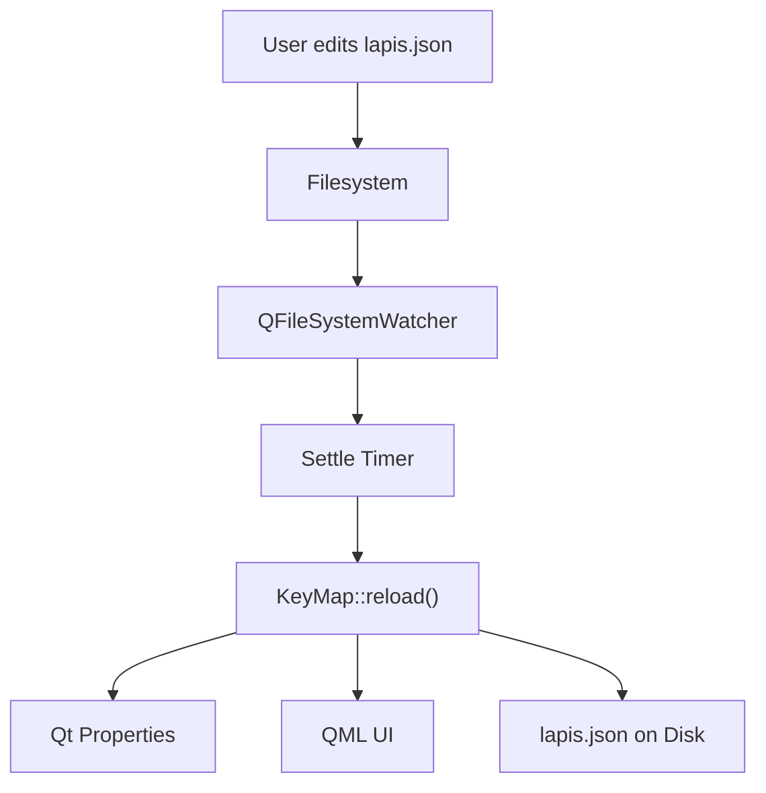
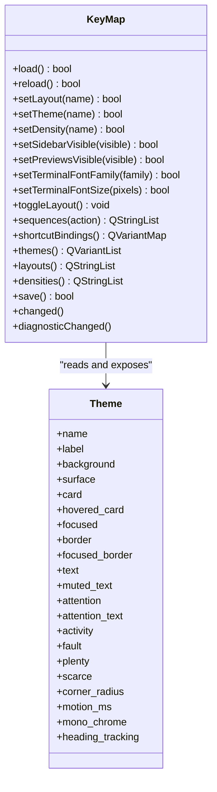
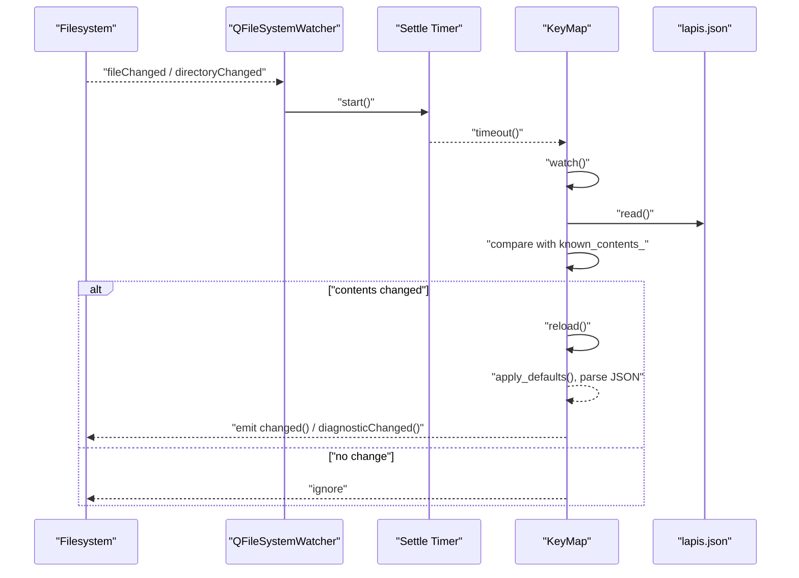
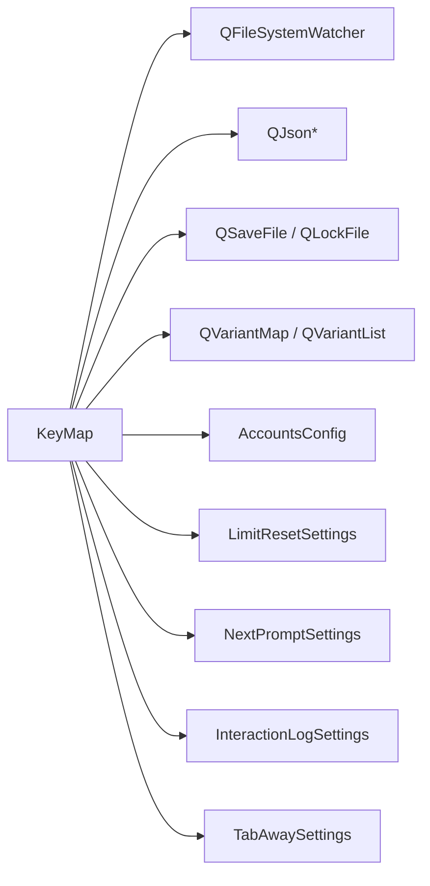

# KeyMap System

<cite>
**Referenced Files in This Document**
- [keymap.hpp](file://apps/desktop/src/keymap.hpp)
- [keymap.cpp](file://apps/desktop/src/keymap.cpp)
- [keys.md](file://docs/keys.md)
- [config.md](file://docs/config.md)
- [lapis.json](file://lapis.json)
- [keymap_test.cpp](file://apps/desktop/tests/keymap_test.cpp)
</cite>

## Table of Contents
1. [Introduction](#introduction)
2. [Project Structure](#project-structure)
3. [Core Components](#core-components)
4. [Architecture Overview](#architecture-overview)
5. [Detailed Component Analysis](#detailed-component-analysis)
6. [Dependency Analysis](#dependency-analysis)
7. [Performance Considerations](#performance-considerations)
8. [Troubleshooting Guide](#troubleshooting-guide)
9. [Conclusion](#conclusion)
10. [Appendices](#appendices)

## Introduction
The KeyMap system is the desktop application’s central configuration and keyboard shortcut engine. It owns:
- Keyboard shortcuts for application actions.
- Workspace layout, card density, and theme selection.
- Terminal font family and size.
- Alert sounds, notifications, editor selection, and other appearance-related settings.
- A hot-reloading mechanism that applies configuration changes from `lapis.json` without restarting the app.

It exposes its state through Qt properties so QML can bind to it directly, while also providing C++ APIs for programmatic control, validation, persistence, and platform-specific key handling.

## Project Structure
KeyMap lives in the desktop application source tree under `apps/desktop/src`. Its public interface is declared in a header and implemented with extensive JSON parsing, file watching, and persistence logic. Documentation for keys and configuration schema lives under `docs`, and a minimal example configuration file exists at the repository root.

**Diagram sources**
- [keymap.cpp:320-360](file://apps/desktop/src/keymap.cpp#L320-L360)
- [keymap.cpp:360-420](file://apps/desktop/src/keymap.cpp#L360-L420)
- [keymap.hpp:70-160](file://apps/desktop/src/keymap.hpp#L70-L160)

**Section sources**
- [keymap.hpp:1-170](file://apps/desktop/src/keymap.hpp#L1-L170)
- [keymap.cpp:1-200](file://apps/desktop/src/keymap.cpp#L1-L200)
- [docs/keys.md:1-64](file://docs/keys.md#L1-L64)
- [docs/config.md:1-20](file://docs/config.md#L1-L20)
- [lapis.json:1-4](file://lapis.json#L1-L4)

## Core Components
- **KeyMap**: The main QObject subclass that loads, validates, watches, persists, and exposes configuration.
- **Theme**: A lightweight struct describing built-in color schemes for window chrome.
- **WorkspaceLayout**: Enum for focus, blocks, columns, and stack layouts.
- **CardDensity**: Enum for comfortable, compact, and minimal preview densities.
- **Built-in defaults**: Platform-aware modifier keys and action-to-key-sequence mappings.

Key responsibilities:
- Load `lapis.json` into validated runtime state.
- Map string action names to one or more `QKeySequence` values.
- Provide `sequences(action)` and `shortcutBindings()` for binding UI components.
- Persist layout, theme, density, visibility flags, terminal font, alert behavior, and related settings.
- Emit `changed()` and `diagnosticChanged()` when state or diagnostics change.

**Section sources**
- [keymap.hpp:20-170](file://apps/desktop/src/keymap.hpp#L20-L170)
- [keymap.cpp:300-500](file://apps/desktop/src/keymap.cpp#L300-L500)

## Architecture Overview
The KeyMap architecture separates concerns between input, parsing, state, and persistence:

**Diagram sources**
- [keymap.hpp:20-170](file://apps/desktop/src/keymap.hpp#L20-L170)
- [keymap.cpp:200-260](file://apps/desktop/src/keymap.cpp#L200-L260)

## Detailed Component Analysis

### Hot-Reloading Configuration Mechanism
KeyMap watches the directory containing `lapis.json`. When the file or directory changes, a settle timer coalesces bursts of filesystem events before reloading. If the new contents differ from the previously known snapshot, KeyMap calls `reload()`, which reapplies defaults and parses the file safely.

Important behaviors:
- The watcher monitors both the file and its directory because editors may replace files.
- A 150 ms single-shot timer prevents rapid successive reloads.
- The maximum parsed config size is 1 MiB; oversized files are rejected with a diagnostic.
- Hand-edited malformed sections degrade gracefully rather than crashing the UI.

**Diagram sources**
- [keymap.cpp:320-360](file://apps/desktop/src/keymap.cpp#L320-L360)
- [keymap.cpp:360-420](file://apps/desktop/src/keymap.cpp#L360-L420)

**Section sources**
- [keymap.cpp:320-420](file://apps/desktop/src/keymap.cpp#L320-L420)
- [keymap.hpp:120-170](file://apps/desktop/src/keymap.hpp#L120-L170)
- [docs/config.md:1-20](file://docs/config.md#L1-L20)

### Action Registration API
KeyMap does not use a dynamic plugin-style registration API. Instead, it defines built-in action identifiers and maps each action to one or more user-editable key sequences. Consumers call:
- `sequences(action)` to get the current list of sequences.
- `shortcutBindings()` to expose all action-to-sequence pairs to QML.
- `actionSequences(action)` as a QML-invokable wrapper around `sequences`.

The default mapping is constructed by `apply_defaults()`. Users can override any action name under the `keybindings` section of `lapis.json`. Each entry supports either a single string or an array of strings.

Constraints enforced during loading:
- At most 64 action entries are considered.
- At most four sequences per action are accepted.
- Unknown key codes are rejected.
- The `openSettings` action accepts only a single chord.

Example workflow:
1. QML binds a shortcut to an action name such as `quit`, `newAgent`, or `openSettings`.
2. On key press, the UI layer asks KeyMap for the sequence list.
3. If the pressed sequence matches, the UI invokes the corresponding action handler.
4. If the user edits `lapis.json`, KeyMap reloads and emits `changed()`, allowing QML bindings to refresh automatically.

**Section sources**
- [keymap.cpp:500-650](file://apps/desktop/src/keymap.cpp#L500-L650)
- [keymap.hpp:120-170](file://apps/desktop/src/keymap.hpp#L120-L170)
- [keymap_test.cpp:1-120](file://apps/desktop/tests/keymap_test.cpp#L1-L120)

### Modifier Key Combinations and Platform Differences
KeyMap chooses a platform-specific base modifier:
- macOS uses `Meta+`, representing Command.
- Linux and other platforms use `Ctrl+Shift+`.

This affects many defaults, including quitting, opening settings, reloading configuration, creating agents and categories, navigating categories and windows, and toggling the side terminal. Some actions have additional platform-specific chords, such as tile navigation and terminal toggle variants.

Platform-specific differences include:
- macOS: `Command-` and `Control-`` for the side terminal; `Command-[`, `]`, `J`, `K` for category navigation; `Command-M` for minimize; `Command-Shift-W` for closing the window.
- Non-macOS: `Ctrl+Alt+` combinations for some tile operations; different close and terminal toggle defaults.

A helper function `shifted_punctuation` adjusts X11-reported punctuation when Shift is involved, mapping symbols like comma to less, period to greater, and so on.

**Section sources**
- [keymap.cpp:500-811](file://apps/desktop/src/keymap.cpp#L500-L811)
- [keymap.cpp:260-300](file://apps/desktop/src/keymap.cpp#L260-L300)
- [docs/keys.md:1-64](file://docs/keys.md#L1-L64)

### Defining Custom Actions and Binding Them to Shortcuts
To define custom behavior:
1. Decide on a stable action identifier, such as `myCustomAction`.
2. Add it under `keybindings` in `lapis.json`.
3. Use a valid Qt key sequence string, or an array of strings for multiple bindings.
4. In your UI component, bind to that action name using the same identifier.
5. Handle the event in your application code after KeyMap resolves the sequence.

Valid examples conceptually include:
- A single binding: `"myCustomAction": "Meta+M"`
- Multiple bindings: `"myCustomAction": ["Meta+M", "Ctrl+Alt+M"]`

Invalid inputs produce diagnostics rather than failing the whole configuration. For example, unknown key codes, too many sequences, or exceeding the maximum number of actions are logged as diagnostics but do not prevent KeyMap from applying other settings.

The test suite demonstrates writing a temporary `lapis.json`, setting the source path, calling `load()`, inspecting `themeName()`, `layoutName()`, and `densityName()`, and confirming that appearance changes are persisted back to disk.

**Section sources**
- [lapis.json:1-4](file://lapis.json#L1-L4)
- [keymap.cpp:560-650](file://apps/desktop/src/keymap.cpp#L560-L650)
- [keymap_test.cpp:60-180](file://apps/desktop/tests/keymap_test.cpp#L60-L180)

### Handling Key Events Across Different UI Components
KeyMap itself does not dispatch application actions. It provides the canonical mapping between action names and key sequences. Higher layers:
- Read `shortcutBindings()` to populate UI elements.
- Listen to `changed()` to update bindings when configuration reloads.
- Translate user input into action names and invoke the appropriate handler.

Common actions exposed by the default map include:
- Quitting the application.
- Opening and closing agents and categories.
- Resuming past conversations.
- Navigating attention and agent lists.
- Toggling the sidebar and previews.
- Splitting tiles and zooming stages.
- Text resizing, finding text, and opening the command palette.
- Reloading configuration and opening appearance settings.

For terminal input, documentation notes that terminal Control chords stay with the agent, while application-level shortcuts are handled by KeyMap.

**Section sources**
- [keymap.cpp:500-811](file://apps/desktop/src/keymap.cpp#L500-L811)
- [docs/keys.md:1-64](file://docs/keys.md#L1-L64)

### Theme Integration with Color Schemes, Fonts, and Visual Styling
KeyMap exposes seven built-in themes through `theme_table()` and `themes()`. Each theme contains semantic colors for background, surface, card, border, focused border, text, muted text, attention, activity, fault, usage gauge, plus visual tuning fields like corner radius, motion duration, monochrome mode, and heading tracking.

Theme selection:
- The active theme name is stored in `theme_`.
- `setTheme(name)` validates the name against built-in themes, updates memory, logs the selection, emits `changed()`, and persists it.
- `theme_exists(name)` and `theme_for(name)` allow lookup and validation.
- `themes()` returns a QVariantList suitable for QML dropdowns.

Appearance persistence:
- Appearance setters (`setLayout`, `setTheme`, `setDensity`, `setSidebarVisible`, `setPreviewsVisible`) write to disk through `persist()`.
- Invalid names are rejected without changing state.
- The writer uses a lock file to avoid concurrent writes.
- Malformed existing values are preserved where possible so unrelated hand-written settings survive unrelated appearance saves.

Terminal font integration:
- `terminalFontFamily()` and `terminalFontSize()` return the live font settings.
- `setTerminalFontFamily()` and `setTerminalFontSize()` validate and persist immediately.
- On failure, values are rolled back so the window remains consistent with the file.
- Defaults are minimum 10 pixels, maximum 32 pixels, and default 14 pixels.

Configuration schema relevant to appearance:
- `layout`: one of `focus`, `columns`, `blocks`, `stack`.
- `theme`: a named theme or structured object with `name`.
- `density`: one of `comfortable`, `compact`, `minimal`.
- `sidebarVisible` and `previewsVisible`: boolean UI visibility flags.
- `terminalFont`: object with `family` and `size`.

**Section sources**
- [keymap.hpp:20-120](file://apps/desktop/src/keymap.hpp#L20-L120)
- [keymap.cpp:200-260](file://apps/desktop/src/keymap.cpp#L200-L260)
- [keymap.cpp:900-1060](file://apps/desktop/src/keymap.cpp#L900-L1060)
- [keymap.cpp:1180-1282](file://apps/desktop/src/keymap.cpp#L1180-L1282)
- [keymap_test.cpp:1-120](file://apps/desktop/tests/keymap_test.cpp#L1-L120)
- [docs/config.md:1-20](file://docs/config.md#L1-L20)

### Configuration Schema Summary
| Section | Purpose | Key Examples | Behavior |
|---|---|---|---|
| `keybindings` | Override or add keyboard shortcuts | `quit`, `newAgent`, `openSettings` | String or array of strings; validated and limited |
| `layout` | Window layout mode | `focus`, `columns`, `blocks`, `stack` | Unknown values fall back with a diagnostic |
| `theme` | Active theme | Name string or `{ name }` | Validated against built-in themes |
| `density` | Preview card density | `comfortable`, `compact`, `minimal` | Unknown values fall back with a diagnostic |
| `sidebarVisible` | Show or hide category sidebar | Boolean | Persisted and watched |
| `previewsVisible` | Show or hide preview strip | Boolean | Persisted and watched |
| `terminalFont.family` | Fixed-width font name | Opaque font family string | Trimmed and printable ASCII checked |
| `terminalFont.size` | Font size in pixels | Integer within allowed range | 10–32 pixels |
| `alerts` | Sound and notification preferences | `sound`, `finished`, `repeat`, `notify` | Merged into existing alerts object |
| `keepAwake` | Prevent system sleep | Boolean | Persisted |
| `usage.show` | Show usage meter | Boolean | Persisted under `usage` |

**Section sources**
- [keymap.cpp:900-1282](file://apps/desktop/src/keymap.cpp#L900-L1282)
- [docs/config.md:1-200](file://docs/config.md#L1-L200)

## Dependency Analysis
KeyMap depends on several Qt facilities and internal types:
- `QFileSystemWatcher` for hot reloading.
- `QTimer` for settling file-change bursts.
- `QJsonDocument`, `QJsonObject`, `QJsonArray` for parsing and formatting `lapis.json`.
- `QSaveFile` and `QLockFile` for safe atomic writes and concurrency protection.
- `QVariantMap` and `QVariantList` for exposing data to QML.
- Internal types such as `AccountsConfig`, `LimitResetSettings`, `NextPromptSettings`, `InteractionLogSettings`, and `TabAwaySettings` are loaded alongside appearance and keybinding settings.

Coupling and cohesion:
- KeyMap is cohesive around configuration loading, validation, and persistence.
- It is loosely coupled to UI through Qt signals and properties.
- It couples tightly to JSON structure and platform-specific defaults.
- External consumers should not assume that KeyMap handles application action execution; they bind to its exported action names.

Potential circular dependencies:
- KeyMap includes headers for account, limit reset, next prompt, interaction log, and tab-away types. These are read-only during load and do not appear to create circular dependency pressure in this context.

**Diagram sources**
- [keymap.hpp:1-170](file://apps/desktop/src/keymap.hpp#L1-L170)
- [keymap.cpp:900-1282](file://apps/desktop/src/keymap.cpp#L900-L1282)

**Section sources**
- [keymap.hpp:1-170](file://apps/desktop/src/keymap.hpp#L1-L170)
- [keymap.cpp:900-1282](file://apps/desktop/src/keymap.cpp#L900-L1282)

## Performance Considerations
- Config reload is throttled by a 150 ms settle timer, preventing UI churn during rapid edits.
- Maximum config size is capped at 1 MiB to avoid excessive parsing and memory use.
- Maximum 64 actions and 4 sequences per action limit the size of the shortcut table.
- JSON output prefers pretty formatting but falls back to compact output if formatted content would exceed limits.
- Lock-file contention returns a diagnostic instead of blocking indefinitely.
- Terminal font changes apply live, so callers must handle resize events carefully; KeyMap blocks its own signals during tentative persistence to avoid redundant updates.

[No sources needed since this section provides general guidance]

## Troubleshooting Guide
Common diagnostics and their meanings:
- Path or file issues: “not read”, “not found”, “not a regular file”.
- Parse failures: invalid JSON or non-object root.
- Oversized config: exceeds 1 MiB.
- Unknown layout, theme, or density: keeps previous value and records a diagnostic.
- Invalid key sequence: rejects the offending entry while keeping others.
- Too many actions or sequences: truncates silently beyond limits.
- Write failures: lock busy, save error, malformed existing `terminalFont`, or updated config too large.
- Chime or sound diagnostics are appended to `diagnostic()` and emitted via `diagnosticChanged()`.

Best practices:
- Edit `lapis.json` through the Appearance dialog when possible to ensure valid values.
- Use Command-R or `reload()` to force a reload after manual edits.
- Check `diagnostic()` after failed operations to see why a change was rejected.
- Keep `keybindings` entries short and human-readable; arrays should remain compact.
- Avoid overwriting `lapis.json` with tools that cannot preserve unrelated keys.

**Section sources**
- [keymap.cpp:560-650](file://apps/desktop/src/keymap.cpp#L560-L650)
- [keymap.cpp:1180-1282](file://apps/desktop/src/keymap.cpp#L1180-L1282)
- [keymap.hpp:100-170](file://apps/desktop/src/keymap.hpp#L100-L170)

## Conclusion
The KeyMap system provides a robust, observable, and platform-aware configuration layer for the desktop application. It centralizes keyboard shortcuts, workspace layout, theme selection, terminal fonts, and related appearance settings. Its hot-reloading design allows users to modify `lapis.json` live, while strict validation ensures that bad edits degrade gracefully. By exposing action names, sequence lists, and theme metadata through Qt properties and C++ methods, it integrates cleanly with QML and higher-level UI components.

[No sources needed since this section summarizes without analyzing specific files]

## Appendices

### Default Action Names and Platform Notes
The documented defaults emphasize macOS Command chords and note that Linux replaces Command with Control-Shift. Terminal Control chords remain with the agent. Representative groups include:
- Agents and categories: new agent, new category, reopen last closed agent, resume conversation, navigate categories and windows, search agents, and jump to attention.
- Stage and tiles: split right and down, tile movement, zoom tile, show/hide side terminal, choose terminal machine, toggle sidebar.
- Terminal: find, copy/paste, text size, line navigation, link/file handling.
- Window: commands, appearance, reload config, minimize, close window, quit.

Developers should treat these as conventions and consult the implementation for exact platform-specific chords.

**Section sources**
- [docs/keys.md:1-64](file://docs/keys.md#L1-L64)
- [keymap.cpp:500-811](file://apps/desktop/src/keymap.cpp#L500-L811)