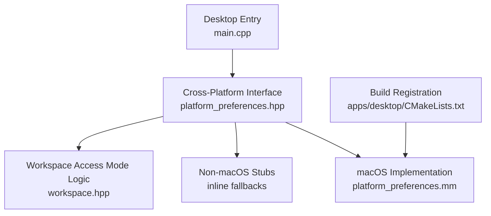
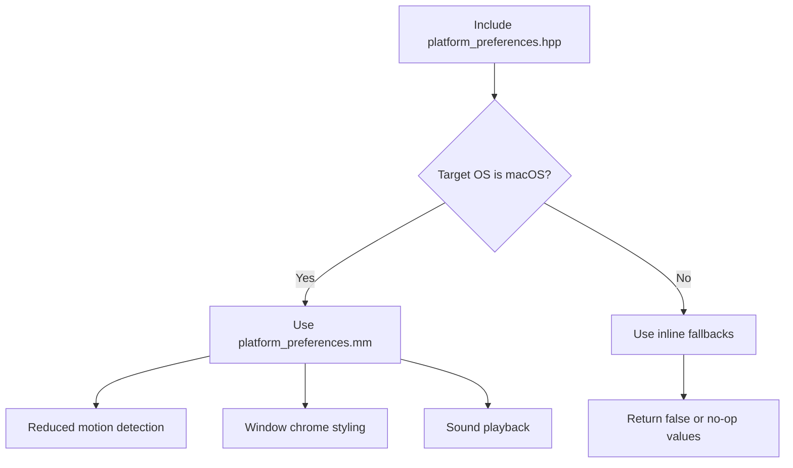
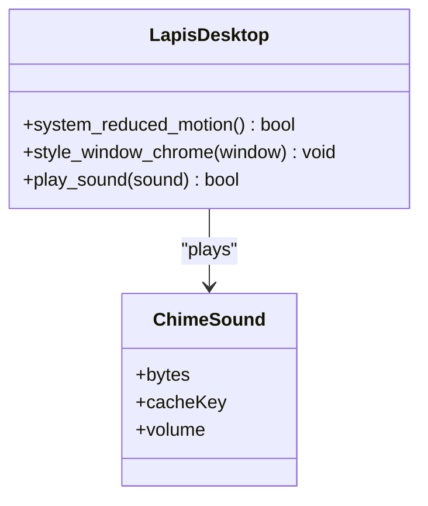
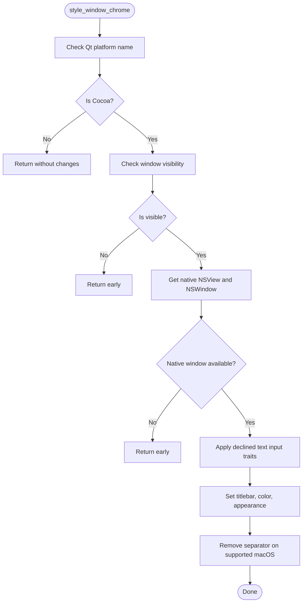
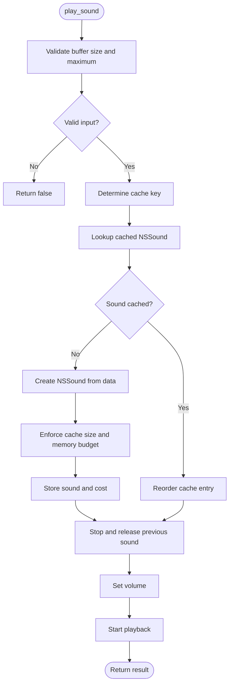
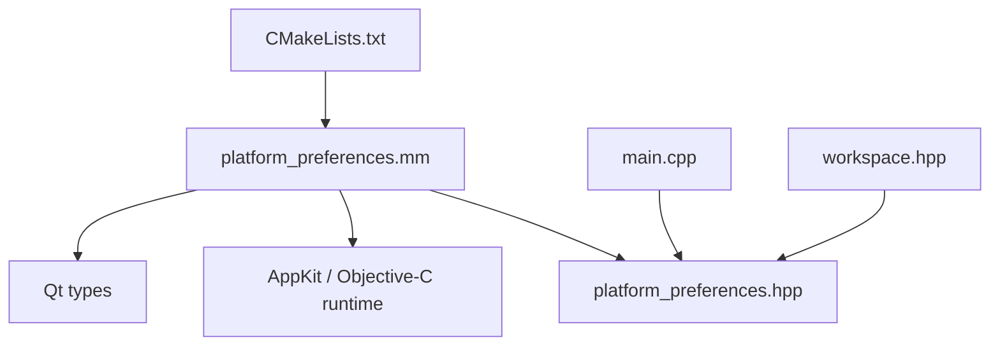

# Platform Preferences Abstraction

<cite>
**Referenced Files in This Document**
- [platform_preferences.hpp](file://apps/desktop/src/platform_preferences.hpp)
- [platform_preferences.mm](file://apps/desktop/src/platform_preferences.mm)
- [main.cpp](file://apps/desktop/src/main.cpp)
- [workspace.hpp](file://apps/desktop/src/workspace.hpp)
- [CMakeLists.txt](file://apps/desktop/CMakeLists.txt)
</cite>

## Table of Contents
1. [Introduction](#introduction)
2. [Project Structure](#project-structure)
3. [Core Components](#core-components)
4. [Architecture Overview](#architecture-overview)
5. [Detailed Component Analysis](#detailed-component-analysis)
6. [Dependency Analysis](#dependency-analysis)
7. [Performance Considerations](#performance-considerations)
8. [Troubleshooting Guide](#troubleshooting-guide)
9. [Conclusion](#conclusion)

## Introduction
This document explains the Platform Preferences abstraction layer used by the Lapis desktop application. It focuses on how macOS-specific platform behavior is exposed through a cross-platform C++ interface, and how that interface can serve as a foundation for unified settings storage across platforms.

The current implementation provides:
- A cross-platform header under `lapis::desktop` that compiles on macOS and non-macOS builds.
- macOS-specific behavior for reduced motion detection, window chrome styling, and sound playback.
- Non-macOS stubs that return safe defaults so other platforms compile without changes.

There is no direct user-facing preferences API in the files analyzed here. Instead, this module abstracts platform capabilities that influence application behavior and presentation. The design pattern it establishes—conditional compilation with a stable interface—is what enables future expansion to a unified preference system for user settings, application defaults, and system integration options.

## Project Structure
The relevant code lives under the desktop application source tree:

| File | Purpose |
| --- | --- |
| `apps/desktop/src/platform_preferences.hpp` | Cross-platform interface definition for macOS behaviors. |
| `apps/desktop/src/platform_preferences.mm` | macOS implementation using AppKit, Objective-C runtime, and Qt bridges. |
| `apps/desktop/src/main.cpp` | Desktop entry point; includes the platform preferences header. |
| `apps/desktop/src/workspace.hpp` | Workspace logic that references preference-related access modes. |
| `apps/desktop/CMakeLists.txt` | Build configuration registering the macOS platform file. |

**Diagram sources**
- [main.cpp:15-15](file://apps/desktop/src/main.cpp#L15-L15)
- [platform_preferences.hpp:1-24](file://apps/desktop/src/platform_preferences.hpp#L1-L24)
- [platform_preferences.mm:1-118](file://apps/desktop/src/platform_preferences.mm#L1-L118)
- [workspace.hpp:370-371](file://apps/desktop/src/workspace.hpp#L370-L371)
- [CMakeLists.txt:110-110](file://apps/desktop/CMakeLists.txt#L110-L110)

**Section sources**
- [platform_preferences.hpp:1-24](file://apps/desktop/src/platform_preferences.hpp#L1-L24)
- [platform_preferences.mm:1-118](file://apps/desktop/src/platform_preferences.mm#L1-L118)
- [main.cpp:15-15](file://apps/desktop/src/main.cpp#L15-L15)
- [workspace.hpp:370-371](file://apps/desktop/src/workspace.hpp#L370-L371)
- [CMakeLists.txt:110-110](file://apps/desktop/CMakeLists.txt#L110-L110)

## Core Components
The core abstraction is the `lapis::desktop` namespace, which exposes three primary capabilities when compiled on macOS:

| Capability | Cross-Platform Meaning | macOS Behavior | Non-macOS Behavior |
| --- | --- | --- | --- |
| Reduced motion | Detects whether the user prefers reduced motion. | Reads macOS accessibility display settings. | Returns false, meaning normal motion is allowed. |
| Window chrome styling | Applies native window appearance and behavior. | Hides title bar, sets background color, selects light or dark appearance, removes separator on supported versions. | No-op; does nothing. |
| Sound playback | Plays an alert or chime at a controlled volume. | Uses `NSSound`, caches decoded sounds, and enforces memory budgets. | Returns false, indicating no sound was played. |

These functions are intentionally narrow: they do not expose generic key-value preference storage. They encapsulate platform-dependent behaviors that applications often treat as “preferences,” such as accessibility, visual style, and notification audio.

**Section sources**
- [platform_preferences.hpp:5-23](file://apps/desktop/src/platform_preferences.hpp#L5-L23)
- [platform_preferences.mm:23-118](file://apps/desktop/src/platform_preferences.mm#L23-L118)

## Architecture Overview
The architecture follows a conditional compilation strategy rather than runtime dispatch:

1. Consumers include `platform_preferences.hpp`.
2. On macOS, the Objective-C++ implementation in `platform_preferences.mm` is compiled.
3. On other platforms, inline stubs provide safe defaults.
4. The desktop build registers the macOS source file through CMake.

**Diagram sources**
- [platform_preferences.hpp:5-23](file://apps/desktop/src/platform_preferences.hpp#L5-L23)
- [CMakeLists.txt:110-110](file://apps/desktop/CMakeLists.txt#L110-L110)

## Detailed Component Analysis

### Cross-Platform Interface
The header defines:
- A macOS-only function to query reduced motion.
- A macOS-only function to style a Qt quick window’s native chrome.
- A macOS-only function to play a chime sound from a byte buffer and optional cache key.
- Inline fallbacks for Linux and other non-macOS platforms.

**Diagram sources**
- [platform_preferences.hpp:5-23](file://apps/desktop/src/platform_preferences.hpp#L5-L23)

Key observations:
- The interface is small and focused. This reduces coupling and makes it easy to extend with additional preference-related behaviors.
- The use of `QByteArray` and `QString` ties the interface to Qt types, which is appropriate for a Qt-based desktop app but limits reuse outside that ecosystem.
- The macOS-only functions are marked with `Q_OS_MACOS`; non-macOS builds still compile because stubs are provided.

**Section sources**
- [platform_preferences.hpp:1-24](file://apps/desktop/src/platform_preferences.hpp#L1-L24)

### macOS Implementation
The `.mm` file implements macOS-specific behavior:

#### Reduced Motion Detection
The function reads the system workspace accessibility setting for reduced motion. This is useful for disabling animations or transitions when users have enabled accessibility-driven motion reduction.

#### Window Chrome Styling
The function performs several Cocoa operations:
- Guards against non-Cocoa Qt platform plugins.
- Avoids operating on hidden or closing windows.
- Retrieves the native `NSView` and `NSWindow`.
- Declines text input traits such as inline prediction, autocorrection, spell checking, grammar checking, smart quotes, smart dashes, and related behaviors.
- Sets the title bar transparent, hides the title, applies the window color, chooses Aqua or Dark Aqua appearance based on brightness, and removes the titlebar separator on macOS 11+.

**Diagram sources**
- [platform_preferences.mm:33-86](file://apps/desktop/src/platform_preferences.mm#L33-L86)

#### Sound Playback
The playback function:
- Validates the input buffer size.
- Creates a deterministic cache key either from bytes or an external cache key.
- Uses an `NSSound` instance cache bounded by count and total retained bytes.
- Stops any previously playing sound before starting the next one.
- Sets the requested volume and returns whether playback started.

**Diagram sources**
- [platform_preferences.mm:87-118](file://apps/desktop/src/platform_preferences.mm#L87-L118)

**Section sources**
- [platform_preferences.mm:1-118](file://apps/desktop/src/platform_preferences.mm#L1-L118)

### Integration Points
The platform preferences interface is included by the desktop entry point and referenced indirectly by workspace access-mode logic.

- `main.cpp` includes the header, making the symbols available to the desktop process.
- `workspace.hpp` contains comments about unsupported preferences and access modes, indicating that preference handling influences privilege levels such as restricted versus full access.

**Diagram sources**
- [main.cpp:15-15](file://apps/desktop/src/main.cpp#L15-L15)
- [workspace.hpp:370-371](file://apps/desktop/src/workspace.hpp#L370-L371)

**Section sources**
- [main.cpp:15-15](file://apps/desktop/src/main.cpp#L15-L15)
- [workspace.hpp:370-371](file://apps/desktop/src/workspace.hpp#L370-L371)

## Dependency Analysis
The dependency relationships are straightforward and intentionally low-coupling:

| Component | Depends On | Reason |
| --- | --- | --- |
| `platform_preferences.mm` | `platform_preferences.hpp` | Implements declared macOS functions. |
| `platform_preferences.mm` | AppKit and Objective-C runtime | Uses `NSWorkspace`, `NSView`, `NSWindow`, `NSSound`, and runtime method injection. |
| `platform_preferences.mm` | Qt types | Bridges `QByteArray`, `QString`, `QColor`, and `QGuiApplication`. |
| `main.cpp` | `platform_preferences.hpp` | Imports the cross-platform interface. |
| `CMakeLists.txt` | `platform_preferences.mm` | Registers the macOS implementation as part of the desktop target. |

**Diagram sources**
- [CMakeLists.txt:110-110](file://apps/desktop/CMakeLists.txt#L110-L110)
- [platform_preferences.mm:1-118](file://apps/desktop/src/platform_preferences.mm#L1-L118)
- [platform_preferences.hpp:1-24](file://apps/desktop/src/platform_preferences.hpp#L1-L24)
- [main.cpp:15-15](file://apps/desktop/src/main.cpp#L15-L15)
- [workspace.hpp:370-371](file://apps/desktop/src/workspace.hpp#L370-L371)

**Section sources**
- [CMakeLists.txt:110-110](file://apps/desktop/CMakeLists.txt#L110-L110)
- [platform_preferences.hpp:1-24](file://apps/desktop/src/platform_preferences.hpp#L1-L24)
- [platform_preferences.mm:1-118](file://apps/desktop/src/platform_preferences.mm#L1-L118)
- [main.cpp:15-15](file://apps/desktop/src/main.cpp#L15-L15)
- [workspace.hpp:370-371](file://apps/desktop/src/workspace.hpp#L370-L371)

## Performance Considerations
The sound playback implementation already includes performance-aware design choices:

- **Decoding cache**: Decoded `NSSound` objects are cached to avoid repeated decoding of identical content.
- **Cache key flexibility**: Consumers can supply a cache key to deduplicate sounds beyond raw bytes.
- **Memory budget**: The cache evicts oldest entries when the number of entries exceeds eight or the retained bytes exceed approximately 16 MiB.
- **Playback control**: Each new sound stops the previous one, preventing overlapping audio.

Potential considerations:
- The cache is global and mutable, which is acceptable for a desktop app but should be reviewed if multithreaded access grows.
- The maximum file-size check prevents extremely large buffers from being accepted, but consumers should still validate audio payloads before calling into this function.
- The cache eviction policy is simple and deterministic, which aids predictability but could be tuned for different workload patterns.

[No sources needed since this section provides general guidance]

## Troubleshooting Guide

### macOS-Specific Issues

| Symptom | Likely Cause | Recommended Action |
| --- | --- | --- |
| Alerts never play | Non-macOS build or invalid input buffer. | Verify the build targets macOS and that the buffer is non-empty and within the expected size limit. |
| Audio plays but immediately stops | Another sound is started before the previous one finishes. | Review caller logic; the implementation stops the previous sound before starting the next one. |
| Window chrome does not change | Not running on Cocoa, window not visible, or native window unavailable. | Ensure the Qt platform plugin is Cocoa, the window is visible, and the native window exists. |
| Text input features remain enabled | Objective-C method replacement did not apply. | Confirm the view class is valid and the runtime method injection path executes. |
| Reduced motion returns unexpected value | System accessibility setting differs from expectation. | Check the user’s macOS accessibility preferences for reduced motion. |

**Section sources**
- [platform_preferences.mm:23-118](file://apps/desktop/src/platform_preferences.mm#L23-L118)

### Preference Key Organization and Migration Guidance
Although this repository snapshot does not contain a generic preference store, the existing code suggests best practices for organizing and evolving preference-like behavior:

- Use a consistent prefix for all preference keys to avoid collisions with other components.
- Group keys by category:
  - User settings: personal UI preferences, theme choices, notification behavior.
  - Application defaults: built-in values that may be overridden by user settings.
  - System integration options: platform-specific integrations such as accessibility, shell association, or update behavior.
- Treat unknown or unsupported preferences conservatively:
  - Existing workspace comments indicate that unsupported preferences should not increase access mode; they should add no flags and fall back to lower privilege levels.
- Version preferences explicitly:
  - Include a schema version field so migrations can detect old formats.
- Migrate safely:
  - Read the stored version first.
  - Apply one-way migrations only when necessary.
  - Preserve user-visible values while changing internal representation.
  - Roll back or fail closed when migration cannot be validated.

**Section sources**
- [workspace.hpp:370-371](file://apps/desktop/src/workspace.hpp#L370-L371)

## Conclusion
The Platform Preferences abstraction in the Lapis desktop application currently focuses on macOS-specific behaviors rather than a generic key-value preferences store. Its strength lies in exposing a stable cross-platform C++ interface for reduced motion, window chrome styling, and sound playback, while providing safe non-macOS stubs.

For a broader cross-platform settings storage system, the recommended approach is to extend this abstraction:
- Add typed getters and setters for user settings, application defaults, and system integration options.
- Keep macOS-specific storage behind the same interface, for example mapping to `NSUserDefaults` where appropriate.
- Implement non-macOS backends using platform-appropriate storage mechanisms.
- Enforce conservative defaults and explicit versioning for migrations.
- Apply security controls for sensitive settings, including encryption and least-privilege access.

This layered design allows the desktop application to evolve toward a unified preferences model without breaking existing platform-specific behavior.