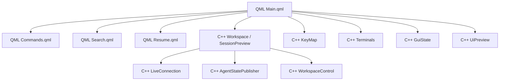
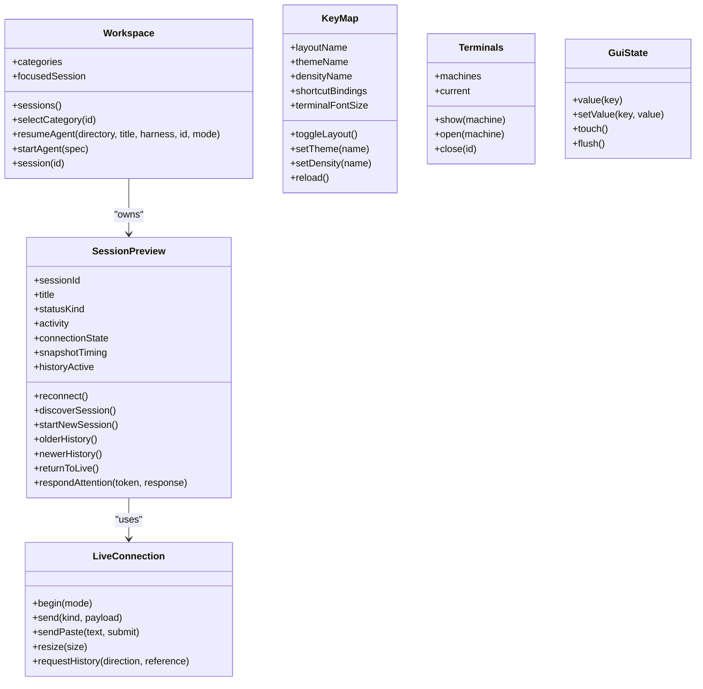
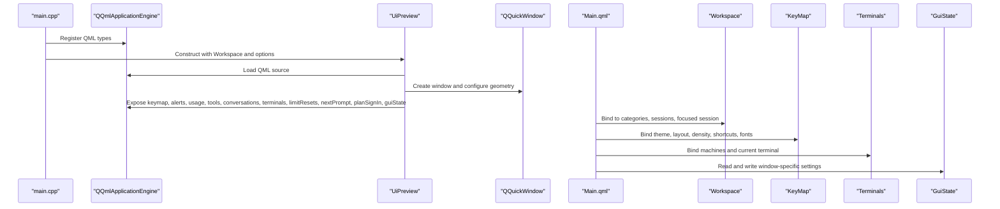
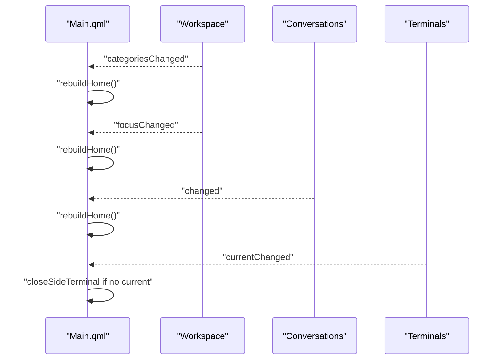
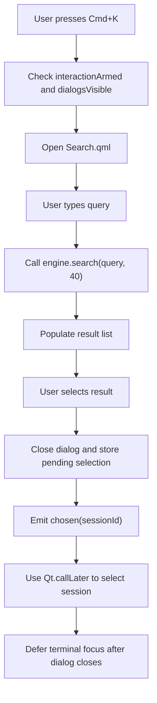
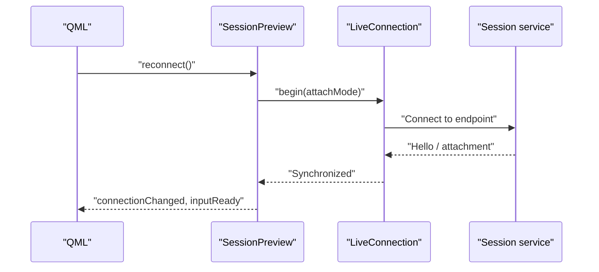
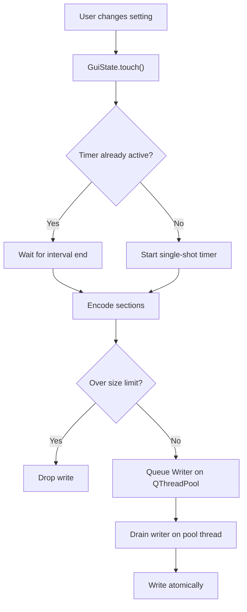
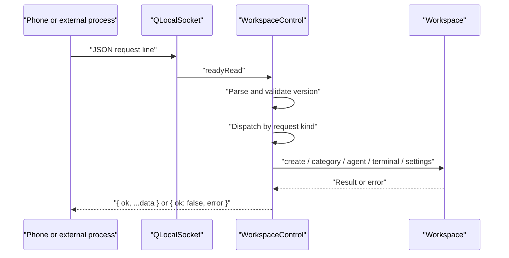
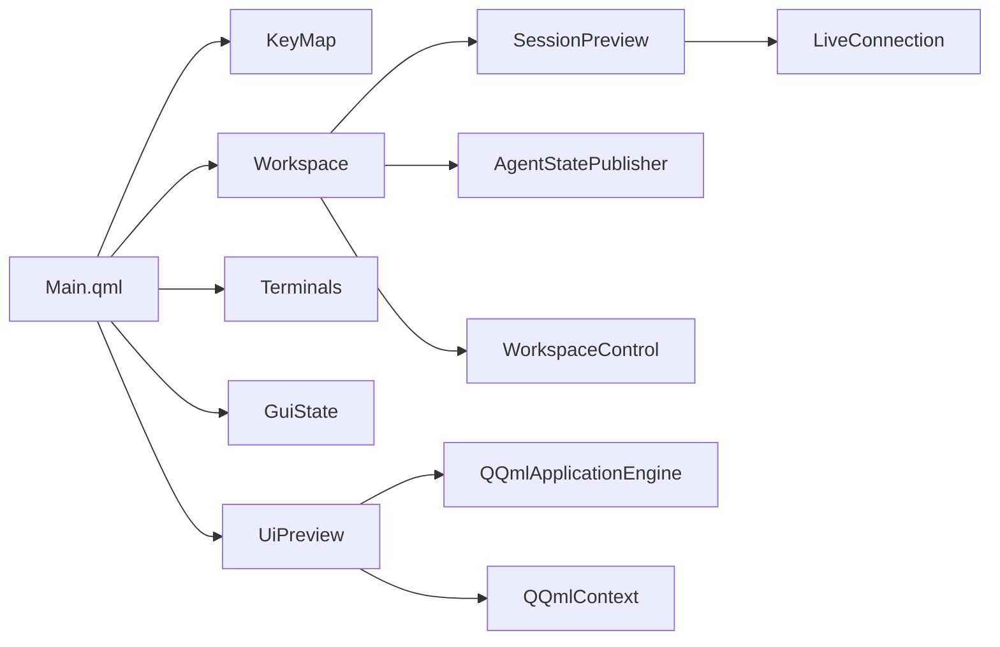

# QML/C++ Binding Patterns

<cite>
**Referenced Files in This Document**
- [main.cpp](file://apps/desktop/src/main.cpp)
- [Main.qml](file://apps/desktop/qml/Main.qml)
- [gui_state.hpp](file://apps/desktop/src/gui_state.hpp)
- [gui_state.cpp](file://apps/desktop/src/gui_state.cpp)
- [agent_state.hpp](file://apps/desktop/src/agent_state.hpp)
- [agent_state.cpp](file://apps/desktop/src/agent_state.cpp)
- [workspace_control.hpp](file://apps/desktop/src/workspace_control.hpp)
- [workspace_control.cpp](file://apps/desktop/src/workspace_control.cpp)
- [workspace.hpp](file://apps/desktop/src/workspace.hpp)
- [terminals.hpp](file://apps/desktop/src/terminals.hpp)
- [keymap.hpp](file://apps/desktop/src/keymap.hpp)
- [ui_preview.hpp](file://apps/desktop/src/ui_preview.hpp)
- [live_connection.hpp](file://apps/desktop/src/live_connection.hpp)
- [live_connection.cpp](file://apps/desktop/src/live_connection.cpp)
- [Commands.qml](file://apps/desktop/qml/Commands.qml)
- [Search.qml](file://apps/desktop/qml/Search.qml)
- [Resume.qml](file://apps/desktop/qml/Resume.qml)
</cite>

## Table of Contents
1. [Introduction](#introduction)
2. [Project Structure](#project-structure)
3. [Core Components](#core-components)
4. [Architecture Overview](#architecture-overview)
5. [Detailed Component Analysis](#detailed-component-analysis)
6. [Dependency Analysis](#dependency-analysis)
7. [Performance Considerations](#performance-considerations)
8. [Troubleshooting Guide](#troubleshooting-guide)
9. [Conclusion](#conclusion)

## Introduction
This document explains the QML/C++ binding patterns used by the Lapis desktop application. It focuses on how C++ controllers are exposed to QML, how properties and signals synchronize state across languages, how asynchronous operations flow from JavaScript into C++, and how `Main.qml` coordinates multiple UI components while managing focus, input ownership, and memory lifetime.

The desktop app is built around a small set of long-lived `QObject`-based services: workspace state, session previews, keymaps, terminal surfaces, usage and tool status objects, optional conversation history, and per-window GUI state. QML owns presentation logic; C++ owns lifecycle, I/O, persistence, network IPC, and platform integration. The binding surface is intentionally narrow so that most property bindings stay cheap and context switches happen only for explicit actions or high-value updates.

## Project Structure
At the top level, the desktop application is split between:

| Area | Responsibility | Representative files |
|---|---|---|
| Application bootstrap and QML engine setup | Command-line parsing, type registration, object exposure, window host | [main.cpp](file://apps/desktop/src/main.cpp), [ui_preview.hpp](file://apps/desktop/src/ui_preview.hpp) |
| Top-level QML composition | Window chrome, keyboard shortcuts, dialog coordination, shared appearance state | [Main.qml](file://apps/desktop/qml/Main.qml) |
| Workspace and session model | Agent sessions, categories, layouts, attention, history, live terminal data | [workspace.hpp](file://apps/desktop/src/workspace.hpp) |
| Live terminal transport | Local socket connection, framing, resize, paste, history requests | [live_connection.hpp](file://apps/desktop/src/live_connection.hpp), [live_connection.cpp](file://apps/desktop/src/live_connection.cpp) |
| Settings and appearance | Theme, layout, density, shortcuts, font choices, accounts, usage meter | [keymap.hpp](file://apps/desktop/src/keymap.hpp) |
| Quick terminals | Non-agent shells per machine with their own session service | [terminals.hpp](file://apps/desktop/src/terminals.hpp) |
| Per-window settings persistence | Rate-limited JSON file for window-specific choices | [gui_state.hpp](file://apps/desktop/src/gui_state.hpp), [gui_state.cpp](file://apps/desktop/src/gui_state.cpp) |
| Cross-process workspace control | Unix local socket commands from phone gateway or other lapis processes | [workspace_control.hpp](file://apps/desktop/src/workspace_control.hpp), [workspace_control.cpp](file://apps/desktop/src/workspace_control.cpp) |
| External agent-state publication | Read-only JSON published for other apps such as Ultra Tab | [agent_state.hpp](file://apps/desktop/src/agent_state.hpp), [agent_state.cpp](file://apps/desktop/src/agent_state.cpp) |
| Dialog components | Commands palette, agent search, resume conversation | [Commands.qml](file://apps/desktop/qml/Commands.qml), [Search.qml](file://apps/desktop/qml/Search.qml), [Resume.qml](file://apps/desktop/qml/Resume.qml) |

**Diagram sources**
- [main.cpp:580-610](file://apps/desktop/src/main.cpp#L580-L610)
- [Main.qml:260-420](file://apps/desktop/qml/Main.qml#L260-L420)
- [workspace.hpp:20-120](file://apps/desktop/src/workspace.hpp#L20-L120)
- [ui_preview.hpp:15-117](file://apps/desktop/src/ui_preview.hpp#L15-L117)

**Section sources**
- [main.cpp:580-610](file://apps/desktop/src/main.cpp#L580-L610)
- [ui_preview.hpp:15-117](file://apps/desktop/src/ui_preview.hpp#L15-L117)

## Core Components
The most important binding patterns fall into four categories:

1. **Exposed C++ types and singletons**: `SessionPreview`, `TerminalSurface`, and `KeyMap` are registered through the Qt meta-object system. `SessionPreview` is uncreatable because its lifetime belongs to `Workspace`; `TerminalSurface` is creatable; `KeyMap` is uncreatable because it is owned by the application.
2. **Property-driven read-only state**: Many C++ models expose `Q_PROPERTY` values such as session identity, status labels, activity, history state, and keymap configuration. QML reads these reactively without calling C++ methods.
3. **Signal-driven event propagation**: Changes in workspace categories, sessions, focus, or terminal availability propagate through Qt signals. QML uses `Connections` blocks or handler names like `onXxxChanged` to react.
4. **Explicit invocations**: Long-running or side-effecting work goes through `Q_INVOKABLE` methods or C++ slots called from QML. Examples include reconnecting a session, starting a new session, navigating history, changing keymap settings, opening dialogs, and controlling quick terminals.

**Diagram sources**
- [workspace.hpp:20-120](file://apps/desktop/src/workspace.hpp#L20-L120)
- [live_connection.hpp:20-116](file://apps/desktop/src/live_connection.hpp#L20-L116)
- [keymap.hpp:120-200](file://apps/desktop/src/keymap.hpp#L120-L200)
- [terminals.hpp:20-93](file://apps/desktop/src/terminals.hpp#L20-L93)
- [gui_state.hpp:20-97](file://apps/desktop/src/gui_state.hpp#L20-L97)

**Section sources**
- [workspace.hpp:20-120](file://apps/desktop/src/workspace.hpp#L20-L120)
- [live_connection.hpp:20-116](file://apps/desktop/src/live_connection.hpp#L20-L116)
- [keymap.hpp:120-200](file://apps/desktop/src/keymap.hpp#L120-L200)
- [terminals.hpp:20-93](file://apps/desktop/src/terminals.hpp#L20-L93)
- [gui_state.hpp:20-97](file://apps/desktop/src/gui_state.hpp#L20-L97)

## Architecture Overview
The desktop entry point registers QML types, builds the workspace and supporting services, creates the UI preview host, and exposes selected C++ objects into the QML root context. The preview host owns the `QQmlApplicationEngine` and `QQuickWindow`, applies geometry persistence, sets reduced-motion preferences, and wires cross-language connections.

**Diagram sources**
- [main.cpp:580-750](file://apps/desktop/src/main.cpp#L580-L750)
- [ui_preview.hpp:15-117](file://apps/desktop/src/ui_preview.hpp#L15-L117)
- [Main.qml:260-420](file://apps/desktop/qml/Main.qml#L260-L420)

**Section sources**
- [main.cpp:580-750](file://apps/desktop/src/main.cpp#L580-L750)
- [ui_preview.hpp:15-117](file://apps/desktop/src/ui_preview.hpp#L15-L117)

## Detailed Component Analysis

### Property Bindings Between QML and C++ Controllers
Most visual state is driven by C++ `Q_PROPERTY` members with change notifications. Typical patterns include:

- **Appearance and behavior**: `KeyMap` publishes layout, theme, density, shortcut bindings, terminal font family and size, alert sounds, notification behavior, editor choice, keep-awake, and usage visibility. QML computes derived tokens like background color, surface color, motion duration, and font sizes.
- **Session state**: `SessionPreview` publishes session identifiers, titles, status labels, activity text, connection state, snapshot timing, history flags, accent colors, closing state, unseen marks, and attention information.
- **Terminal list**: `Terminals` publishes available machines, the current terminal, its machine name, and an error message.
- **Per-window settings**: `GuiState` exposes a bounded map of window-specific keys and values through `Q_INVOKABLE` accessors.

In `Main.qml`, these are mostly read-only bindings. For example, appearance derives from the currently selected keymap theme, while terminal-related properties derive from `liveTerminal` and `keymap`. When user action needs to mutate state, QML calls a C++ method rather than mutating a writable property directly.

Recommended pattern summary:

| Pattern | Direction | Example |
|---|---|---|
| Read-only display | C++ → QML via `Q_PROPERTY` | Status label, activity, category list, machine list |
| Configuration mutation | QML → C++ via `Q_INVOKABLE` | `KeyMap::setLayout`, `KeyMap::setTheme`, `KeyMap::setDensity` |
| Event propagation | C++ → QML via signals | `Workspace::categoriesChanged`, `Terminals::currentChanged` |
| Action invocation | QML → C++ via slot or `Q_INVOKABLE` | `SessionPreview::reconnect`, `SessionPreview::startNewSession`, `Terminals::show` |

**Section sources**
- [keymap.hpp:120-200](file://apps/desktop/src/keymap.hpp#L120-L200)
- [workspace.hpp:20-120](file://apps/desktop/src/workspace.hpp#L20-L120)
- [terminals.hpp:20-93](file://apps/desktop/src/terminals.hpp#L20-L93)
- [gui_state.hpp:20-97](file://apps/desktop/src/gui_state.hpp#L20-L97)
- [Main.qml:30-120](file://apps/desktop/qml/Main.qml#L30-L120)

### QObject-Based Interfaces Exposed to QML
The application distinguishes three kinds of exposed objects:

| Object | Exposure mechanism | Lifetime rule | Primary purpose |
|---|---|---|---|
| `SessionPreview` | `qmlRegisterUncreatableType` | Owned by `Workspace`; never created from QML | Represents one agent session |
| `TerminalSurface` | `qmlRegisterType` | Created by QML when needed | Renders terminal snapshots |
| `KeyMap` | Uncreatable type + context property | Owned by application | User configuration and runtime settings |
| Optional services | Context properties in `UiPreviewOptions` | Owned by host code | Alerts, agent search, usage, tools, desktop helpers, conversations, terminals, limit resets, next prompt, plan sign-in, GUI state |

This separation keeps QML from accidentally creating or deleting backend objects. `SessionPreview` is deliberately uncreatable because its lifecycle is tied to workspace operations such as launching, discovering, attaching, resuming, and closing agents.

**Section sources**
- [main.cpp:580-610](file://apps/desktop/src/main.cpp#L580-L610)
- [ui_preview.hpp:15-117](file://apps/desktop/src/ui_preview.hpp#L15-L117)
- [workspace.hpp:20-120](file://apps/desktop/src/workspace.hpp#L20-L120)

### Signal-Slot Connections for Cross-Language Communication
Cross-language communication follows a consistent design:

1. C++ emits Qt signals when observable state changes.
2. QML connects to those signals using either named handlers (`onXxxChanged`) or explicit `Connections` blocks.
3. For events that should not create tight binding chains, QML sometimes defers expensive work to the next event loop iteration using `Qt.callLater`.
4. For heavy or blocking work, QML delegates to C++ slots or `Q_INVOKABLE` functions.

Examples visible in the repository:

- `Main.qml` listens to `Workspace::categoriesChanged`, `focusChanged`, `closedChanged`, and `sessionsChanged` to rebuild the home screen.
- `Main.qml` listens to `conversations` and `terminals` availability to enable or disable related UI paths.
- `Search.qml` and `Resume.qml` use `Connections` to refresh results when the underlying search engine emits change signals.
- `Commands.qml` emits a `requested` signal carrying the chosen command ID; `Main.qml` handles it and runs the corresponding action.

**Diagram sources**
- [Main.qml:288-420](file://apps/desktop/qml/Main.qml#L288-L420)
- [Commands.qml:20-80](file://apps/desktop/qml/Commands.qml#L20-L80)
- [Search.qml:60-120](file://apps/desktop/qml/Search.qml#L60-L120)
- [Resume.qml:60-120](file://apps/desktop/qml/Resume.qml#L60-L120)

**Section sources**
- [Main.qml:288-420](file://apps/desktop/qml/Main.qml#L288-L420)
- [Commands.qml:20-80](file://apps/desktop/qml/Commands.qml#L20-L80)
- [Search.qml:60-120](file://apps/desktop/qml/Search.qml#L60-L120)
- [Resume.qml:60-120](file://apps/desktop/qml/Resume.qml#L60-L120)

### Main.qml Coordination Pattern
`Main.qml` is the composition root for the desktop window. Its responsibilities include:

- Deriving appearance tokens from `keymap`.
- Tracking transient UI state such as sidebar visibility, preview strip visibility, transition locks, pending dialogs, and interaction readiness.
- Computing focus targets so keyboard input goes to the right place: side terminal, active agent terminal, or home list.
- Coordinating dialogs such as commands, search, resume, usage, tools, settings, attention, agent creation, category management, and renaming.
- Providing keyboard shortcuts through `ActionShortcut` entries that call window functions.
- Acting as the central place where cross-component events are normalized before being passed to C++.

A representative flow is opening the agent search dialog:

**Diagram sources**
- [Main.qml:260-420](file://apps/desktop/qml/Main.qml#L260-L420)
- [Search.qml:60-120](file://apps/desktop/qml/Search.qml#L60-L120)

#### State Synchronization
`Main.qml` synchronizes state through three mechanisms:

1. **Read-only computed properties**: Derived values such as background color, motion duration, narrow mode, focus target, and window title are recalculated from stable sources like `keymap`, `workspace`, and `liveTerminal`.
2. **Transient QML state**: Properties such as `transitionLock`, `pendingDialog`, `sideTerminalOpen`, and `lastTerminalMachine` track short-lived UI conditions.
3. **Persistent window state**: Choices like last harness, last machine, last mode, tile zoom, and sidebar state are saved through `GuiState` and restored at startup.

#### Event Propagation
Events generally move outward from specific dialogs to `Main.qml`, which then calls workspace or terminal APIs. This avoids direct coupling between dialogs and C++ business logic. Important examples:

- Commands palette emits `requested(commandId)` → `Main.qml` runs the command.
- Agent search emits `chosen(sessionId)` → `Main.qml` selects the session.
- Resume dialog emits `chosen(conversation)` → `Main.qml` resumes the agent.
- Terminal picker opens a shell through `Terminals::show`.

#### Memory Management Considerations
Several patterns protect against leaks and dangling references:

- `SessionPreview` is uncreatable and owned by `Workspace`, so QML holds only borrowed pointers.
- `QPointer` is used in C++ for weak references where an object may be destroyed asynchronously.
- Dialogs store pending selections locally and only commit them after closing.
- Input focus is deferred with `preview.deferTerminalFocus()` after dialogs close so that terminal rendering can stabilize.
- Keyboard ownership is explicitly tracked through `inputBlocked`, `terminalBusy`, and `interactionArmed`.

**Section sources**
- [Main.qml:260-420](file://apps/desktop/qml/Main.qml#L260-L420)
- [Main.qml:1117-1351](file://apps/desktop/qml/Main.qml#L1117-L1351)
- [workspace.hpp:20-120](file://apps/desktop/src/workspace.hpp#L20-L120)
- [terminals.hpp:20-93](file://apps/desktop/src/terminals.hpp#L20-L93)

### Handling Asynchronous Operations from QML
Asynchronous operations are kept out of the QML render path:

| Operation | QML role | C++ role |
|---|---|---|
| Reconnecting a session | Calls `SessionPreview::reconnect` | Manages `LiveConnection` lifecycle and socket state |
| Starting a new session | Calls workspace API | Launches service, attaches, reports status |
| History navigation | Calls `SessionPreview::olderHistory`, `newerHistory`, `returnToLive` | Loads pages, tracks scrubbing state |
| Paste submission | May call paste APIs | Sends framed messages over `LiveConnection` |
| Resizing terminal | Updates wanted size | Coalesces and sends resize frames |
| Persisting settings | Calls `GuiState::setValue` / `touch` | Rate-limits writes and persists off the GUI thread |

`LiveConnection` encapsulates local socket connection, retry timers, handshake, frame handling, history requests, paste transactions, and size synchronization. QML rarely touches this layer directly; it interacts with `SessionPreview`, which wraps the transport and presents stable properties to the UI.

**Diagram sources**
- [workspace.hpp:20-120](file://apps/desktop/src/workspace.hpp#L20-L120)
- [live_connection.hpp:20-116](file://apps/desktop/src/live_connection.hpp#L20-L116)
- [live_connection.cpp:40-120](file://apps/desktop/src/live_connection.cpp#L40-L120)

**Section sources**
- [workspace.hpp:20-120](file://apps/desktop/src/workspace.hpp#L20-L120)
- [live_connection.hpp:20-116](file://apps/desktop/src/live_connection.hpp#L20-L116)
- [live_connection.cpp:40-120](file://apps/desktop/src/live_connection.cpp#L40-L120)

### Optimizing Performance by Minimizing Context Switches
The codebase uses several deliberate optimizations:

1. **Binding-first state**: Most display values are `Q_PROPERTY` members. QML binds to them, avoiding function calls on every frame.
2. **Coalesced writes**: `GuiState` rate-limits persistence with a publish-to-publish timer. Multiple rapid changes produce one write after quiet time.
3. **Off-GUI-thread persistence**: `GuiState::Writer` runs on `QThreadPool`, so file I/O does not block the UI.
4. **Paced terminal decoding**: `SessionPreview` decodes terminal snapshots only when viewers exist, and paces decode attempts based on viewer intervals.
5. **Avoiding unnecessary redraws**: Snapshot publication is suppressed while history browsing owns the visible screen.
6. **Limited context properties**: Only necessary services are exposed to QML; many internal classes remain hidden.
7. **Cheap shortcut resolution**: Shortcut sequences are resolved once from `KeyMap` and cached in QML bindings rather than recomputed per keystroke.

**Diagram sources**
- [gui_state.cpp:120-213](file://apps/desktop/src/gui_state.cpp#L120-L213)
- [gui_state.hpp:20-97](file://apps/desktop/src/gui_state.hpp#L20-L97)

**Section sources**
- [gui_state.cpp:120-213](file://apps/desktop/src/gui_state.cpp#L120-L213)
- [gui_state.hpp:20-97](file://apps/desktop/src/gui_state.hpp#L20-L97)
- [live_connection.cpp:40-120](file://apps/desktop/src/live_connection.cpp#L40-L120)

### Exposing C++ Objects to QML Using Q_PROPERTY Macros
The most relevant `Q_PROPERTY` patterns are:

- **SessionPreview**: Identifiers, status, activity, connection state, history state, snapshot timing, accent color, and attention data. These allow QML to bind card labels, attention markers, and terminal readiness indicators.
- **KeyMap**: Layout, theme, density, themes list, layouts list, densities list, sidebar and preview visibility, diagnostics, shortcut bindings, terminal font family and size, alert sound, finish sound, notification preference, editor, keep-awake, usage visibility, and usage meters.
- **Terminals**: Machines list, current terminal pointer, current machine string, and error message.
- **UiPreview**: Active mode, reduced motion, system reduced motion, diagnostics, settings shortcuts, and monospace families.
- **GuiState**: Bounded per-window key/value map exposed through `Q_INVOKABLE` accessors.

Best practices visible in the project:

- Use `NOTIFY` signals for frequently changing properties.
- Keep mutable configuration through explicit setters so validation and persistence can run together.
- Mark constant-derived values with `CONSTANT` where appropriate.
- Avoid exposing large mutable containers directly when QML only needs read-only views.

**Section sources**
- [workspace.hpp:20-120](file://apps/desktop/src/workspace.hpp#L20-L120)
- [keymap.hpp:120-200](file://apps/desktop/src/keymap.hpp#L120-L200)
- [terminals.hpp:20-93](file://apps/desktop/src/terminals.hpp#L20-L93)
- [ui_preview.hpp:15-117](file://apps/desktop/src/ui_preview.hpp#L15-L117)
- [gui_state.hpp:20-97](file://apps/desktop/src/gui_state.hpp#L20-L97)

### Cross-Process Integration Through WorkspaceControl
`WorkspaceControl` provides a versioned JSON-over-local-socket protocol for external lapis processes such as the phone gateway. It accepts one request per connection, validates the version and fields, dispatches to typed handlers, and returns compact JSON replies.

Supported request kinds include harness discovery, agent creation, category management, agent placement, restart, terminal management, settings retrieval, settings changes, and handover. Errors are returned uniformly as `{ ok: false, error: message }`.

**Diagram sources**
- [workspace_control.cpp:40-200](file://apps/desktop/src/workspace_control.cpp#L40-L200)
- [workspace_control.hpp:10-70](file://apps/desktop/src/workspace_control.hpp#L10-L70)

**Section sources**
- [workspace_control.hpp:10-70](file://apps/desktop/src/workspace_control.hpp#L10-L70)
- [workspace_control.cpp:40-200](file://apps/desktop/src/workspace_control.cpp#L40-L200)

### Publishing Agent State for Other Applications
`AgentStatePublisher` publishes a read-only JSON document describing agents, their status, unseen counts, pending attention, and next-prompt offers. It coalesces changes through a timer and writes atomically on a dedicated worker thread. It watches workspace sessions, categories, parked state, turn completion, and next-prompt changes.

This is useful for companion applications such as Ultra Tab, which need to know about agents without reading the full workspace implementation.

**Section sources**
- [agent_state.hpp:10-72](file://apps/desktop/src/agent_state.hpp#L10-L72)
- [agent_state.cpp:10-144](file://apps/desktop/src/agent_state.cpp#L10-L144)

## Dependency Analysis
The main dependency relationships are:

**Diagram sources**
- [main.cpp:580-750](file://apps/desktop/src/main.cpp#L580-L750)
- [ui_preview.hpp:15-117](file://apps/desktop/src/ui_preview.hpp#L15-L117)
- [workspace.hpp:20-120](file://apps/desktop/src/workspace.hpp#L20-L120)

Key observations:

- `Main.qml` depends on all major services but does not own them. Ownership stays in C++.
- `SessionPreview` is the bridge between QML and the live terminal transport.
- `WorkspaceControl` is independent of QML and can operate in headless mode.
- `AgentStatePublisher` depends on `Workspace` and optionally `NextPrompt`, but does not depend on QML.
- `UiPreview` is the boundary between the Qt Quick scene graph and the rest of the desktop stack.

**Section sources**
- [main.cpp:580-750](file://apps/desktop/src/main.cpp#L580-L750)
- [ui_preview.hpp:15-117](file://apps/desktop/src/ui_preview.hpp#L15-L117)
- [workspace.hpp:20-120](file://apps/desktop/src/workspace.hpp#L20-L120)

## Performance Considerations
When extending the QML/C++ binding surface, prefer these guidelines:

1. **Expose stable state through properties**: If QML only needs to observe something, add a `Q_PROPERTY` with a `NOTIFY` signal rather than requiring a polling function.
2. **Batch mutations**: Group related changes and emit one notification where possible.
3. **Keep heavy work off the GUI thread**: File I/O, networking, serialization, and long computations should run on threads or async facilities.
4. **Avoid expensive calculations in QML expressions used every frame**: Cache derived values in C++ or compute them lazily.
5. **Use `Q_INVOKABLE` for actions with side effects**: Do not rely on getters for work that changes state or performs I/O.
6. **Bound persisted data**: `GuiState` enforces limits on keys, values, and total size; follow similar constraints for new persistent state.
7. **Minimize context switches**: Prefer property bindings for display state; call C++ only for interactions, I/O, or significant state transitions.
8. **Handle failures gracefully**: Network, socket, JSON, and filesystem operations should fail safely without crashing the UI.

[No sources needed since this section provides general guidance]

## Troubleshooting Guide

### Common Symptom: QML Cannot Find a C++ Type
**Likely causes:**
- The type was not registered with `qmlRegisterType` or `qmlRegisterUncreatableType`.
- The module name or version does not match the `import` statement.
- The type is uncreatable but QML tries to instantiate it.

**Checks:**
- Confirm `register_qml_types` is called before loading QML.
- Verify the import declaration matches the registered module name and version.
- Ensure uncreatable types are referenced as existing instances, not constructed.

**Section sources**
- [main.cpp:580-610](file://apps/desktop/src/main.cpp#L580-L610)

### Common Symptom: Window Settings Are Not Saved
**Likely causes:**
- The key is empty or too long.
- The value serializes to more than the allowed size.
- The window key count is already at the maximum.
- The same value is assigned again.
- The file is unreadable, corrupted, wrong version, symlink, or too large.

**Checks:**
- Validate keys and values before calling `GuiState::setValue`.
- Inspect warnings from load/save paths.
- Use testing helpers such as `waitForWrites` or `waitForTesting` in automated tests.

**Section sources**
- [gui_state.cpp:60-213](file://apps/desktop/src/gui_state.cpp#L60-L213)
- [gui_state.hpp:20-97](file://apps/desktop/src/gui_state.hpp#L20-L97)

### Common Symptom: Terminal Focus Is Lost After a Dialog Closes
**Likely causes:**
- A dialog consumed focus.
- The terminal was busy composing or pasting.
- The side terminal became active.
- Focus was not deferred until the terminal surface stabilized.

**Checks:**
- Verify `inputBlocked` and `terminalBusy` guards.
- Confirm `preview.deferTerminalFocus()` is called after dialogs close.
- Check focus target computation for side terminals versus the stage.

**Section sources**
- [Main.qml:1117-1351](file://apps/desktop/qml/Main.qml#L1117-L1351)
- [Main.qml:260-420](file://apps/desktop/qml/Main.qml#L260-L420)

### Common Symptom: External Process Requests Fail
**Likely causes:**
- Malformed JSON.
- Unsupported request version.
- Missing required fields.
- Invalid field types.
- Workspace refused the operation due to an error state.

**Checks:**
- Inspect the uniform refusal response.
- Validate request version and field types.
- Check whether the workspace has a stored error that caused refusal.

**Section sources**
- [workspace_control.cpp:40-200](file://apps/desktop/src/workspace_control.cpp#L40-L200)

### Common Symptom: Agent-State Publication Is Stuck
**Likely causes:**
- The output directory is unavailable.
- Permissions cannot be set to owner-only.
- The serialized document changed before comparison.
- The writer thread is still draining.

**Checks:**
- Confirm the publisher path exists and is writable.
- Compare the generated document with the last written document.
- Call `waitForWrites` in tests or shutdown paths.

**Section sources**
- [agent_state.cpp:10-144](file://apps/desktop/src/agent_state.cpp#L10-L144)

## Conclusion
The Lapis desktop application uses a clean separation between QML presentation and C++ domain logic. C++ controllers own state, I/O, persistence, and platform services; QML owns layout, user interaction, and localized presentation. The binding surface is intentionally small: most UI state flows through `Q_PROPERTY` bindings, events flow through Qt signals, and side effects go through `Q_INVOKABLE` methods or slots.

For new features, the recommended approach is:

- Keep business logic and persistence in C++.
- Expose only what QML needs.
- Prefer properties and signals for reactive state.
- Use explicit invocations for actions.
- Coalesce expensive updates.
- Offload I/O from the GUI thread.
- Validate and bound persisted data.
- Handle errors gracefully in both directions.

This pattern makes the desktop UI responsive, testable, and easier to evolve as new agents, terminals, settings, and integrations are added.