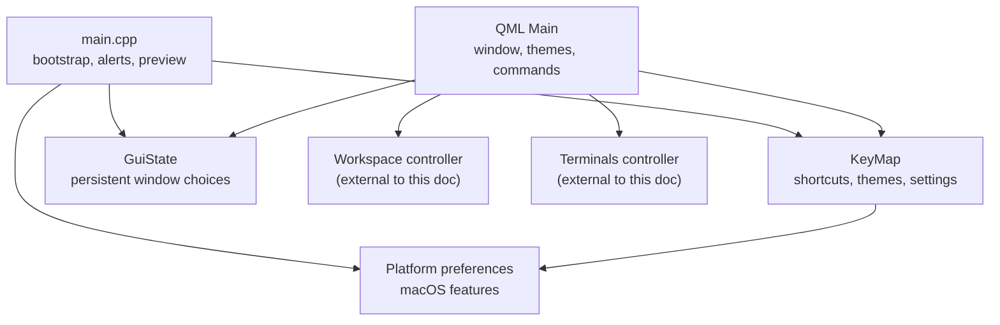
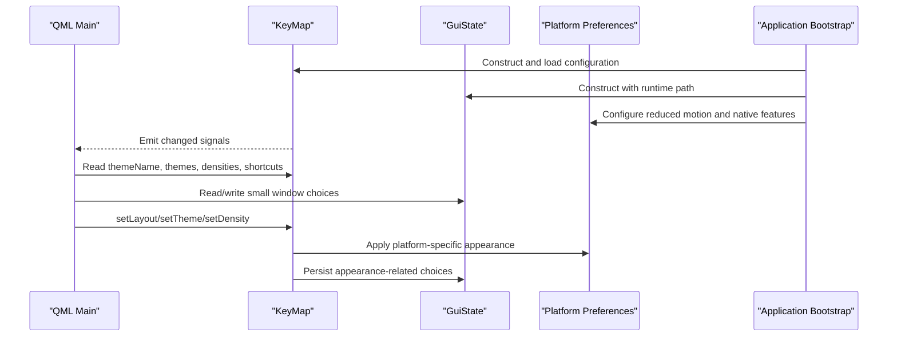
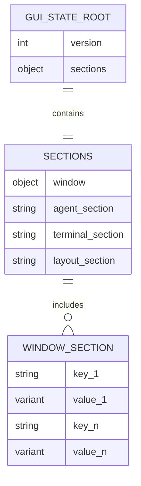
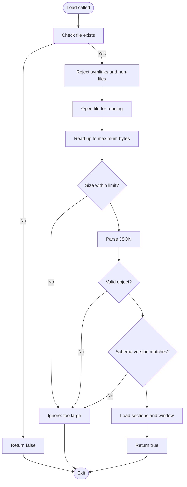
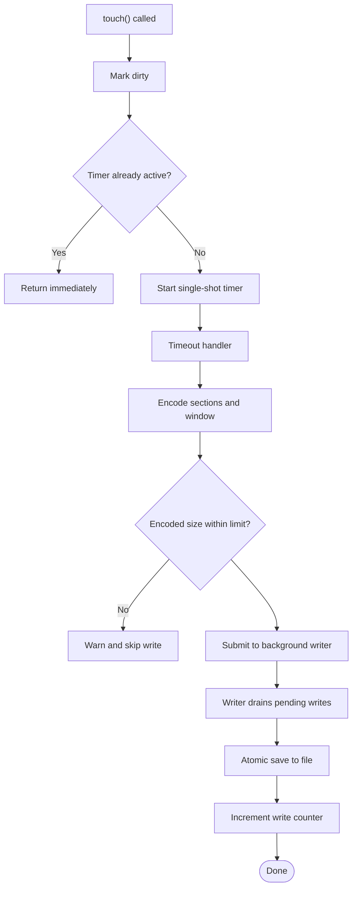
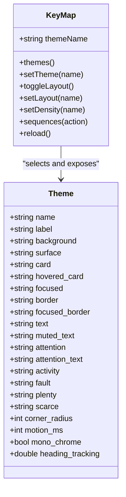
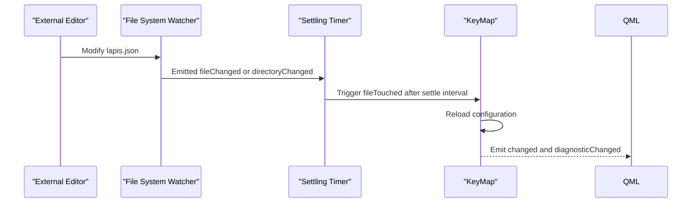
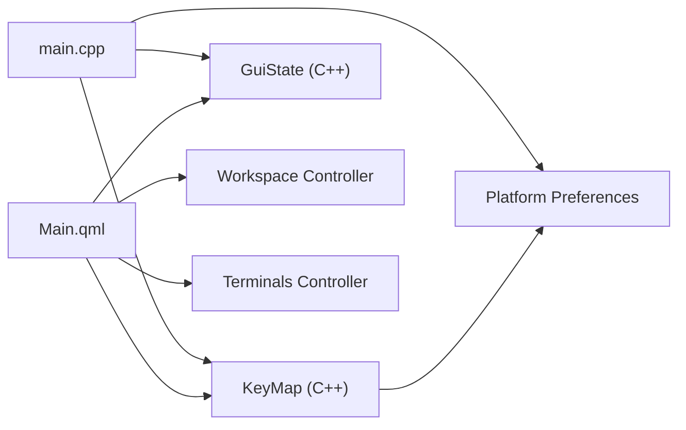

# UI State Management

<cite>
**Referenced Files in This Document**
- [Main.qml](file://apps/desktop/qml/Main.qml)
- [gui_state.hpp](file://apps/desktop/src/gui_state.hpp)
- [gui_state.cpp](file://apps/desktop/src/gui_state.cpp)
- [keymap.hpp](file://apps/desktop/src/keymap.hpp)
- [keymap.cpp](file://apps/desktop/src/keymap.cpp)
- [platform_preferences.hpp](file://apps/desktop/src/platform_preferences.hpp)
- [platform_preferences.mm](file://apps/desktop/src/platform_preferences.mm)
- [main.cpp](file://apps/desktop/src/main.cpp)
</cite>

## Table of Contents
1. [Introduction](#introduction)
2. [Project Structure](#project-structure)
3. [Core Components](#core-components)
4. [Architecture Overview](#architecture-overview)
5. [Detailed Component Analysis](#detailed-component-analysis)
6. [Dependency Analysis](#dependency-analysis)
7. [Performance Considerations](#performance-considerations)
8. [Troubleshooting Guide](#troubleshooting-guide)
9. [Conclusion](#conclusion)

## Introduction
This document explains the desktop UI state management architecture used by Lapis’s Qt/QML application. It focuses on:

- `GuiState`: persistent window state storage with atomic JSON serialization, versioned schema migration, and rate-limited background writes.
- `KeyMap`: keyboard shortcuts, themes, layout/density settings, terminal appearance preferences, and hot-reloading from a user configuration file.
- QML/C++ binding patterns in `Main.qml`, including property bindings, signal-slot connections, and synchronization between QML components and C++ controllers.
- The cross-platform preferences abstraction for macOS-specific behavior and platform features.
- Practical examples of custom properties exposed to QML, event handling patterns, and best practices for keeping the UI responsive during heavy terminal operations.

The goal is to make these subsystems understandable for developers extending the UI or integrating new controllers while preserving durability, performance, and cross-platform consistency.

## Project Structure
The relevant parts of the desktop application are organized into two layers:

- **QML layer (`apps/desktop/qml`)**: User-facing composition, bindings, command dispatch, dialog orchestration, and theme-driven visual tokens.
- **C++ layer (`apps/desktop/src`)**: Persistent state, configuration loading and watching, platform integration, workspace/session controllers, and application bootstrap logic.

**Diagram sources**
- [Main.qml:1-120](file://apps/desktop/qml/Main.qml#L1-L120)
- [keymap.hpp:1-120](file://apps/desktop/src/keymap.hpp#L1-L120)
- [gui_state.hpp:1-97](file://apps/desktop/src/gui_state.hpp#L1-L97)
- [platform_preferences.hpp:1-24](file://apps/desktop/src/platform_preferences.hpp#L1-L24)
- [main.cpp:200-512](file://apps/desktop/src/main.cpp#L200-L512)

**Section sources**
- [Main.qml:1-120](file://apps/desktop/qml/Main.qml#L1-L120)
- [gui_state.hpp:1-97](file://apps/desktop/src/gui_state.hpp#L1-L97)
- [keymap.hpp:1-120](file://apps/desktop/src/keymap.hpp#L1-L120)
- [platform_preferences.hpp:1-24](file://apps/desktop/src/platform_preferences.hpp#L1-L24)
- [main.cpp:200-512](file://apps/desktop/src/main.cpp#L200-L512)

## Core Components

### GuiState: Persistent Window State Storage
`GuiState` stores small per-window choices that survive application restarts. Its responsibilities include:

- Loading a single owner-only JSON file under the runtime directory.
- Enforcing a fixed schema version so older or newer files are ignored safely.
- Protecting against symlink attacks, unreadable files, invalid JSON, and oversized payloads.
- Rate-limiting writes using a publish-to-publish timer so bursty UI updates do not hammer the filesystem.
- Serializing each section atomically through a background writer that runs once at a time.
- Exposing a bounded “window” section to QML for simple key/value persistence.

Key design points:

- **Versioned schema**: A constant schema version is embedded; mismatches cause the entire file to be treated as missing.
- **Atomic write**: Uses an atomic save-file strategy so partial writes cannot corrupt the state file.
- **Rate limiter**: A single-shot timer coalesces changes until a quiet interval elapses.
- **Background execution**: Actual disk writes run off the GUI thread via a global thread pool.
- **Bounded size**: The whole encoded payload is capped at 1 MiB, and individual window values are also bounded.
- **Graceful shutdown**: Destructor triggers a final flush and waits briefly for in-flight writes.

Typical usage pattern:

1. Register one or more owners with `addSection(name, save_function)`.
2. Read restored data through `section(name)`.
3. Call `touch()` when any owner mutates its state.
4. Optionally call `flush()` before exit or in tests.

**Section sources**
- [gui_state.hpp:12-97](file://apps/desktop/src/gui_state.hpp#L12-L97)
- [gui_state.cpp:24-213](file://apps/desktop/src/gui_state.cpp#L24-L213)

### KeyMap: Keyboard Shortcuts, Themes, and Appearance Settings
`KeyMap` is the central configuration object for the desktop UI. It manages:

- **Keyboard shortcuts**: Built-in defaults and user overrides, resolved per action and exposed as lists of sequences.
- **Layout modes**: Focus, blocks, columns, and stack layouts.
- **Theme selection**: A curated table of built-in themes plus the ability to look up a theme by name.
- **Card density**: Comfortable, compact, and minimal preview card spacing.
- **Terminal appearance**: Font family and pixel font size, with validation and immediate persistence.
- **User preference toggles**: Sidebar visibility, preview visibility, alert sounds, notifications, editor choice, usage display, and related settings.
- **Hot reloading**: Watches the project configuration file and reloads it when modified externally.

Important behaviors:

- Missing or malformed configuration is degraded gracefully, falling back to built-in defaults.
- Configuration changes emit signals so QML can update immediately.
- File watching uses a settling timer because editors often replace files rather than writing in place.
- Shortcut normalization validates sequences and reports diagnostics without bricking the UI.
- Theme lookup returns a safe default when an unknown theme name is requested.

**Section sources**
- [keymap.hpp:14-200](file://apps/desktop/src/keymap.hpp#L14-L200)
- [keymap.cpp:200-573](file://apps/desktop/src/keymap.cpp#L200-L573)

### Platform Preferences Abstraction
The platform preferences interface provides a uniform API across platforms while allowing macOS-specific implementation details:

- Detecting whether the system prefers reduced motion.
- Styling the native macOS window chrome, including titlebar transparency, appearance matching, and input service behavior.
- Playing chime sounds through the system sound framework on macOS.
- Providing no-op inline implementations for non-macOS builds.

This abstraction lets higher-level code such as alerts, audio feedback, and window styling remain portable while still accessing native capabilities where available.

**Section sources**
- [platform_preferences.hpp:1-24](file://apps/desktop/src/platform_preferences.hpp#L1-L24)
- [platform_preferences.mm:1-118](file://apps/desktop/src/platform_preferences.mm#L1-L118)

### Application Bootstrap and Integration Points
`main.cpp` wires together the application lifecycle, command-line options, logging, alerts, conversation indexing, and platform features. Relevant integration points for UI state management include:

- Creating and configuring `KeyMap`.
- Setting up `GuiState` and exposing it to QML.
- Installing message handlers for robust logging when standard error is redirected.
- Connecting `KeyMap` changes to alert sounds and platform notification behavior.
- Routing special terminal keys based on current shortcut bindings.
- Handling activation and reduced-motion preferences.

**Section sources**
- [main.cpp:200-512](file://apps/desktop/src/main.cpp#L200-L512)

## Architecture Overview
The desktop UI state architecture follows a layered approach:

1. **QML owns composition and user interaction.** `Main.qml` computes derived visual properties from `KeyMap`, binds actions to shortcut sequences, and coordinates dialogs and workspace state.
2. **C++ owns durable state and platform behavior.** `GuiState` persists window choices, `KeyMap` loads and watches configuration, and platform functions bridge OS-specific features.
3. **Controllers own business state.** Workspace, terminals, agents, and other controllers expose models and signals that QML consumes but does not directly persist.
4. **Bootstrap connects everything.** `main.cpp` constructs controllers, installs observers, and exposes objects to QML.

**Diagram sources**
- [main.cpp:200-512](file://apps/desktop/src/main.cpp#L200-L512)
- [keymap.hpp:14-200](file://apps/desktop/src/keymap.hpp#L14-L200)
- [gui_state.hpp:12-97](file://apps/desktop/src/gui_state.hpp#L12-L97)
- [platform_preferences.hpp:1-24](file://apps/desktop/src/platform_preferences.hpp#L1-L24)

## Detailed Component Analysis

### GuiState Implementation Details

#### Data Model and Schema
GuiState serializes a root object containing:

- `version`: Fixed integer schema version.
- `sections`: Named sections owned by different subsystems.
- `window`: Reserved section for QML-persisted key/value pairs.

**Diagram sources**
- [gui_state.hpp:28-97](file://apps/desktop/src/gui_state.hpp#L28-L97)
- [gui_state.cpp:110-170](file://apps/desktop/src/gui_state.cpp#L110-L170)

#### Load Pipeline
Loading rejects unsafe or incompatible files early:

**Diagram sources**
- [gui_state.cpp:58-110](file://apps/desktop/src/gui_state.cpp#L58-L110)

#### Write Pipeline
Writes are coalesced and executed off the GUI thread:

**Diagram sources**
- [gui_state.cpp:110-200](file://apps/desktop/src/gui_state.cpp#L110-L200)

#### Concurrency and Shutdown Guarantees
- A shared writer holds a mutex and condition variable to serialize disk I/O.
- Pending writes are replaced if a newer payload arrives before the writer starts.
- Destructor calls `write()` and then waits briefly for completion.
- Tests can wait longer and inspect write counts.

**Section sources**
- [gui_state.cpp:24-57](file://apps/desktop/src/gui_state.cpp#L24-L57)
- [gui_state.cpp:170-213](file://apps/desktop/src/gui_state.cpp#L170-L213)

### KeyMap Implementation Details

#### Theme System
Themes are defined as a static array of semantic color tokens and layout parameters. QML reads the selected theme by name and derives palette colors, corner radius, animation duration, and typography hints.

Built-in themes include variants optimized for dark environments, high contrast, OLED displays, and accessibility needs.

**Diagram sources**
- [keymap.hpp:28-120](file://apps/desktop/src/keymap.hpp#L28-L120)
- [keymap.cpp:200-360](file://apps/desktop/src/keymap.cpp#L200-L360)

#### Hot-Reload Workflow
KeyMap watches both the configuration file and its directory because editors may replace the file. Events are settled through a short timer to avoid reloading on every intermediate write.

**Diagram sources**
- [keymap.cpp:520-573](file://apps/desktop/src/keymap.cpp#L520-L573)

#### Shortcut Resolution
Shortcut resolution has two layers:

1. **User configuration**: `KeyMap::sequences` resolves configured sequences.
2. **QML fallback**: `Main.qml` provides platform-aware fallback sequences when no external keymap is available.

This allows the same command names to work in preview fixtures and in normal operation.

**Section sources**
- [keymap.cpp:573-1387](file://apps/desktop/src/keymap.cpp#L573-L1387)
- [Main.qml:1-200](file://apps/desktop/qml/Main.qml#L1-L200)

### QML/C++ Binding Patterns in Main.qml

#### Theme-Driven Properties
`Main.qml` derives most visual tokens from the active theme. It selects the theme by name, finds the matching theme entry, and exposes computed colors and sizing properties. If `KeyMap` is unavailable, it falls back to hardcoded defaults.

Examples of derived properties include:

- Background, surface, card, hover, focus, border, and text colors.
- Attention, activity, and fault status colors.
- Corner radius and motion duration.
- Terminal font size and density mode.

These properties ensure that changing the theme through `KeyMap` updates the entire UI without manual propagation.

**Section sources**
- [Main.qml:1-120](file://apps/desktop/qml/Main.qml#L1-L120)
- [keymap.hpp:28-120](file://apps/desktop/src/keymap.hpp#L28-L120)

#### Command Dispatch and Shortcut Text
`Main.qml` defines a `bindings(action)` function that looks up configured sequences from `KeyMap` and falls back to built-in platform-aware sequences. It also formats shortcuts for human-readable labels.

Common command patterns:

- Guarded actions check `interactionArmed` to prevent input during composition, paste, or modal dialogs.
- Actions delegate to workspace, terminals, dialogs, or platform services.
- Shortcut hints are displayed in menus and help screens.

**Section sources**
- [Main.qml:1-200](file://apps/desktop/qml/Main.qml#L1-L200)
- [Main.qml:200-469](file://apps/desktop/qml/Main.qml#L200-L469)

#### State Synchronization Between QML and Controllers
Synchronization relies on three patterns:

1. **Property bindings**: QML reads read-only properties from `KeyMap` and controllers.
2. **Signals and Connections**: QML listens to controller signals like category changes, session changes, and focus changes.
3. **Invokable methods**: QML calls C++ methods such as `setLayout`, `setTheme`, `setDensity`, `setSidebarVisible`, and `setPreviewsVisible`.

For example, the home list rebuilds when workspace categories, focus, closed sessions, or recent conversations change. Dialog visibility and terminal ownership are coordinated through explicit QML state and controller callbacks.

**Section sources**
- [Main.qml:200-469](file://apps/desktop/qml/Main.qml#L200-L469)

### Custom Properties Exposed to QML
`KeyMap` exposes many QML-accessible properties through Qt’s property system:

- Layout and density names.
- Available themes, layouts, and densities.
- Sidebar and preview visibility.
- Shortcut bindings.
- Terminal font family and size.
- Alert sound and notification preferences.
- Editor choice and usage display options.

These properties allow QML to react to configuration changes automatically through Qt’s signal-slot mechanism.

**Section sources**
- [keymap.hpp:70-200](file://apps/desktop/src/keymap.hpp#L70-L200)

### Event Handling Patterns
Key event handling patterns observed in the desktop UI:

- **Input blocking**: Modal dialogs, transitions, and terminal composition/paste block shortcuts and chrome interactions.
- **Platform-aware routing**: Special terminal keys are routed before platform shortcuts take effect.
- **Alert and notification flow**: Alerts use `KeyMap` for configuration, play platform sounds, and post system notifications that bring the correct session forward.
- **Activation handling**: When the app becomes active again, reduced-motion preferences are refreshed and hidden windows are shown.

**Section sources**
- [main.cpp:200-512](file://apps/desktop/src/main.cpp#L200-L512)
- [platform_preferences.mm:1-118](file://apps/desktop/src/platform_preferences.mm#L1-L118)

## Dependency Analysis

**Diagram sources**
- [Main.qml:1-120](file://apps/desktop/qml/Main.qml#L1-L120)
- [keymap.hpp:14-200](file://apps/desktop/src/keymap.hpp#L14-L200)
- [gui_state.hpp:12-97](file://apps/desktop/src/gui_state.hpp#L12-L97)
- [platform_preferences.hpp:1-24](file://apps/desktop/src/platform_preferences.hpp#L1-L24)
- [main.cpp:200-512](file://apps/desktop/src/main.cpp#L200-L512)

### Coupling Observations
- `Main.qml` depends on `KeyMap` for appearance and shortcuts, and on `GuiState` for small persistent window choices.
- `KeyMap` depends on platform preferences only where macOS-specific behavior is required.
- `GuiState` is intentionally lightweight and does not depend on UI components; it only knows about JSON serialization and file I/O.
- `main.cpp` orchestrates all subsystems but keeps business logic in separate controllers.

### Potential Circular Dependencies
There is no direct circular dependency among the core UI state components. `KeyMap` and `GuiState` are independent; `Main.qml` references both; `main.cpp` constructs them. Platform preferences are leaf dependencies.

**Section sources**
- [gui_state.hpp:12-97](file://apps/desktop/src/gui_state.hpp#L12-L97)
- [keymap.hpp:14-200](file://apps/desktop/src/keymap.hpp#L14-L200)
- [platform_preferences.hpp:1-24](file://apps/desktop/src/platform_preferences.hpp#L1-L24)
- [main.cpp:200-512](file://apps/desktop/src/main.cpp#L200-L512)

## Performance Considerations

### Rate-Limited Writes
GuiState avoids frequent disk writes by:

- Using a single-shot timer to coalesce changes.
- Waiting for a quiet interval before flushing.
- Replacing pending writes with newer payloads.
- Running disk I/O off the GUI thread.

This prevents UI jank during rapid state updates such as terminal rendering or workspace model changes.

### Bounded Serialization Size
Both the total serialized state and individual window values have hard limits. Oversized payloads are rejected with warnings instead of crashing or hanging.

### Hot-Reload Debouncing
KeyMap settles configuration-change events for 150 milliseconds. This reduces reload churn when editors write multiple times during a single save.

### Responsive UI During Heavy Terminal Operations
Best practices derived from the codebase:

- Keep expensive operations off the GUI thread.
- Use signals and property bindings instead of polling.
- Block shortcuts during composition or paste to avoid conflicting input.
- Defer focus changes until terminal operations complete.
- Prefer read-only derived properties in QML over mutable state duplication.
- Use `KeyMap` for appearance changes so QML can react instantly without manual refresh.

[No sources needed since this section provides general guidance]

## Troubleshooting Guide

### Window State Not Saved
Symptoms:

- Window choices disappear after restart.
- Warnings about window state being ignored or not saved.

Likely causes:

- File is missing, unreadable, a symlink, or not a regular file.
- JSON is invalid or has an unexpected schema version.
- File exceeds the maximum size.
- Disk write fails due to permissions or filesystem errors.
- Shutdown occurs before background writer completes.

Recommended checks:

- Verify the runtime directory exists and is writable.
- Inspect warnings logged by `GuiState`.
- Confirm the file is not a symlink.
- Ensure the schema version matches the running application.
- Check file permissions and available disk space.

**Section sources**
- [gui_state.cpp:58-110](file://apps/desktop/src/gui_state.cpp#L58-L110)
- [gui_state.cpp:110-200](file://apps/desktop/src/gui_state.cpp#L110-L200)

### Configuration Changes Not Applied
Symptoms:

- External edits to `lapis.json` are ignored.
- Shortcuts or theme changes do not appear.

Likely causes:

- Configuration file path is incorrect.
- File watcher is not attached.
- Changes arrive in bursts and have not settled yet.
- Configuration is malformed and falls back to defaults.

Recommended checks:

- Verify the source path and environment variable configuration.
- Wait briefly after editing the file.
- Check diagnostics emitted by `KeyMap`.
- Validate that the configuration remains valid JSON.

**Section sources**
- [keymap.cpp:520-573](file://apps/desktop/src/keymap.cpp#L520-L573)

### macOS-Specific Issues
Symptoms:

- Inline predictions or smart text replacement interfere with terminal input.
- Native window chrome does not match the theme.
- Chime sounds do not play on non-macOS systems.

Likely causes:

- Platform preferences functions are no-ops outside macOS.
- Native window is not visible when styling is attempted.
- Sound cache or decoding failed.

Recommended checks:

- Confirm platform detection.
- Ensure the window is visible before applying native chrome.
- Verify sound data is valid and within size limits.

**Section sources**
- [platform_preferences.mm:1-118](file://apps/desktop/src/platform_preferences.mm#L1-L118)

## Conclusion
Lapis’s desktop UI state management separates concerns cleanly:

- `GuiState` provides durable, versioned, rate-limited window state.
- `KeyMap` centralizes keyboard shortcuts, themes, layout, density, and appearance settings with hot-reload support.
- `Main.qml` composes the UI, derives visual tokens from themes, and synchronizes with C++ controllers through bindings and signals.
- Platform preferences abstract macOS-specific behavior behind a portable interface.

Together, these components keep the UI responsive, resilient to bad configuration, and consistent across platforms. New features should follow the established patterns: expose read-only properties to QML, emit signals on state changes, validate inputs, persist durable state through `GuiState`, and avoid blocking the GUI thread.

[No sources needed since this section summarizes without analyzing specific files]