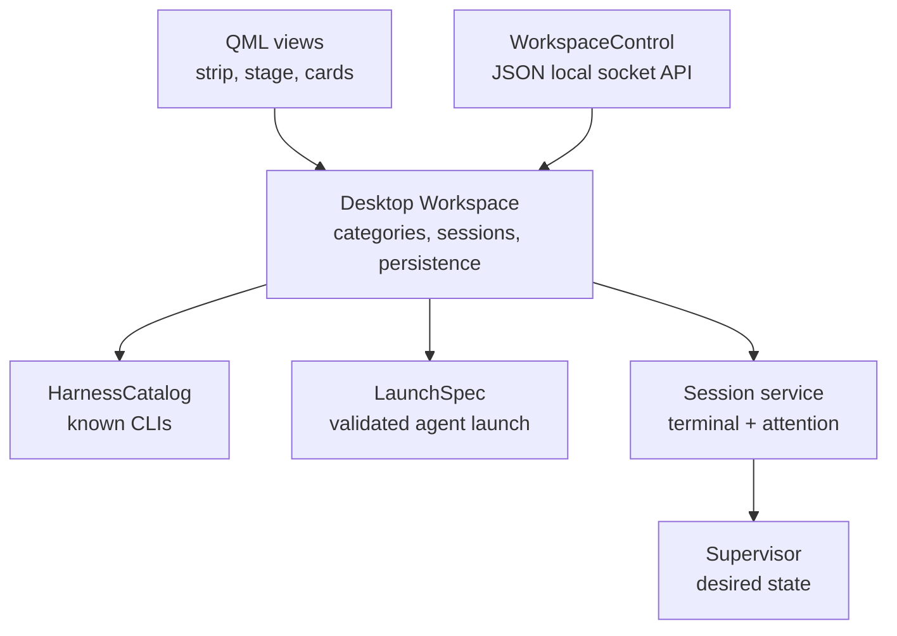
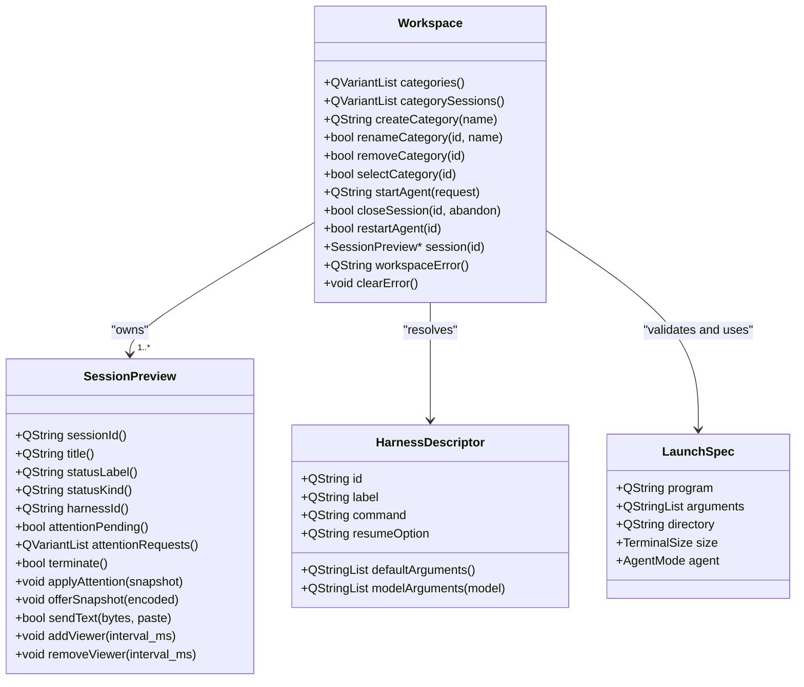
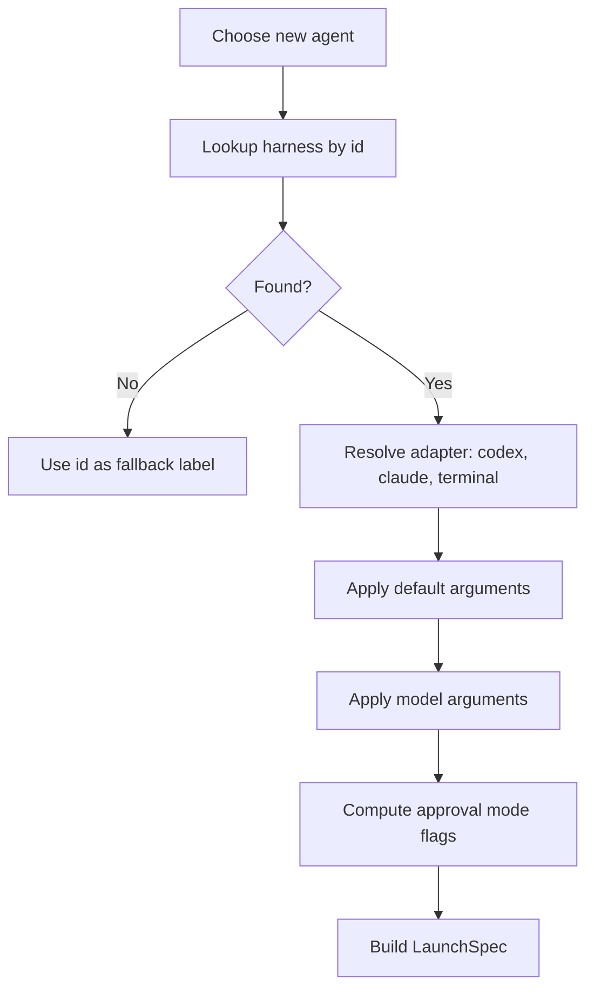
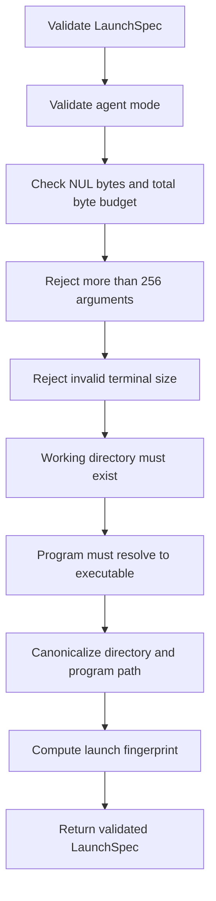
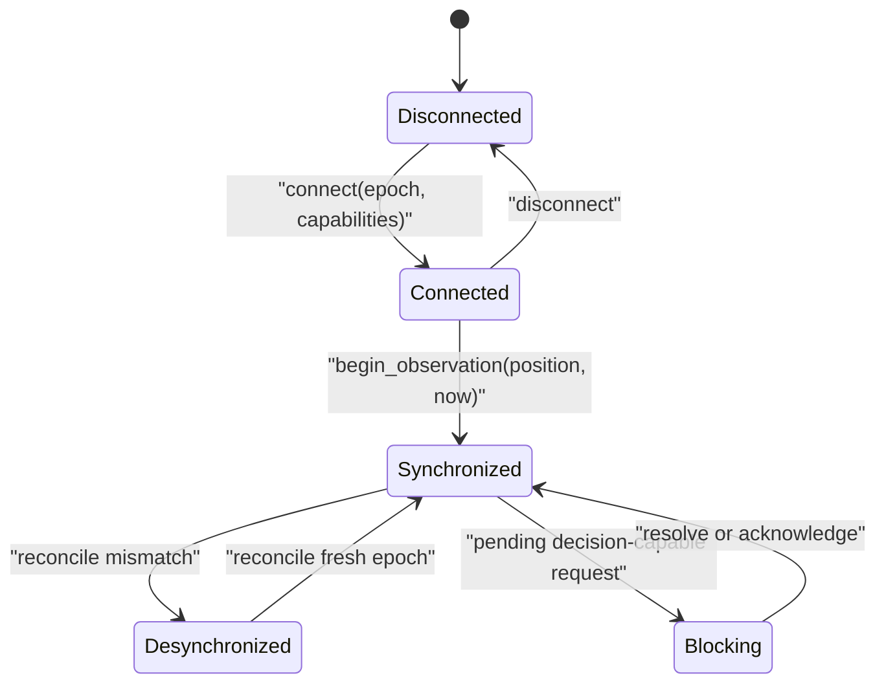
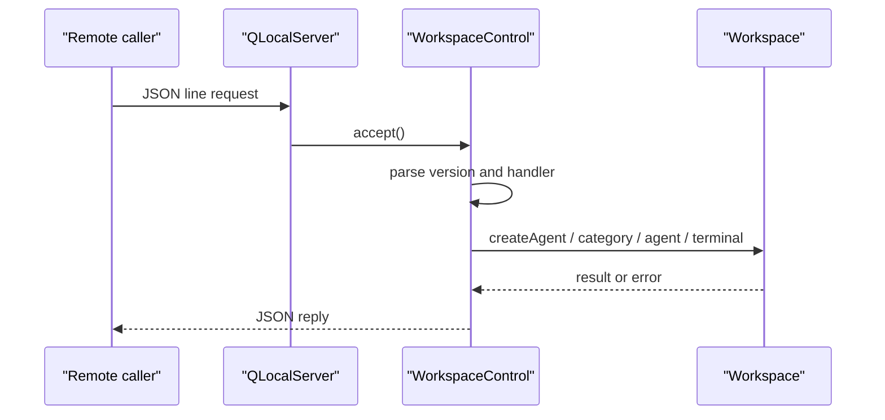
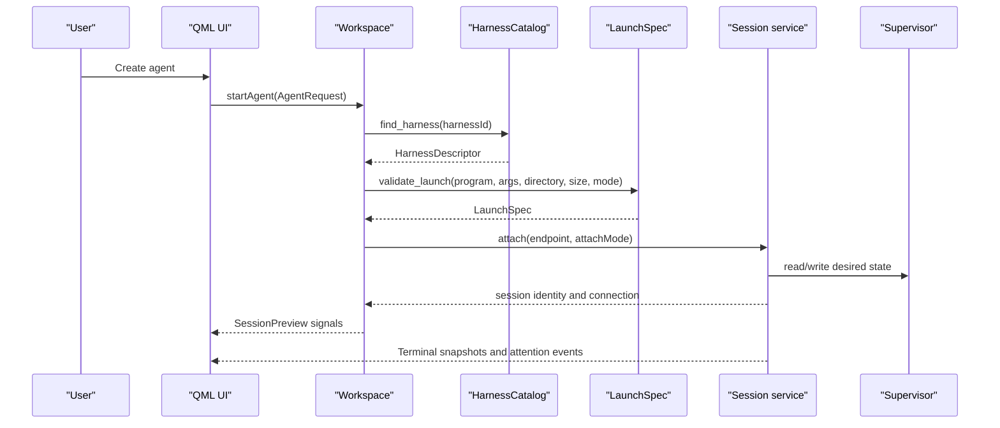
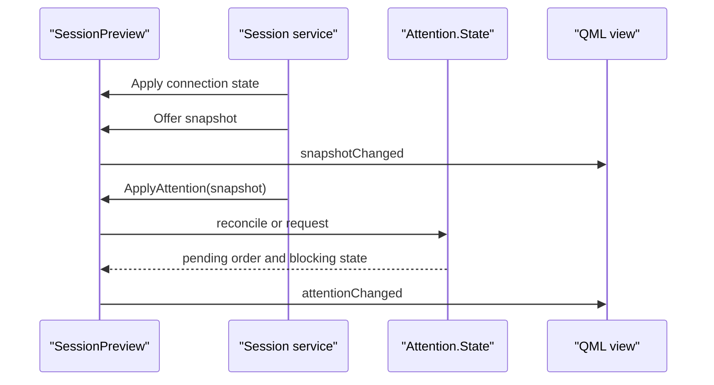
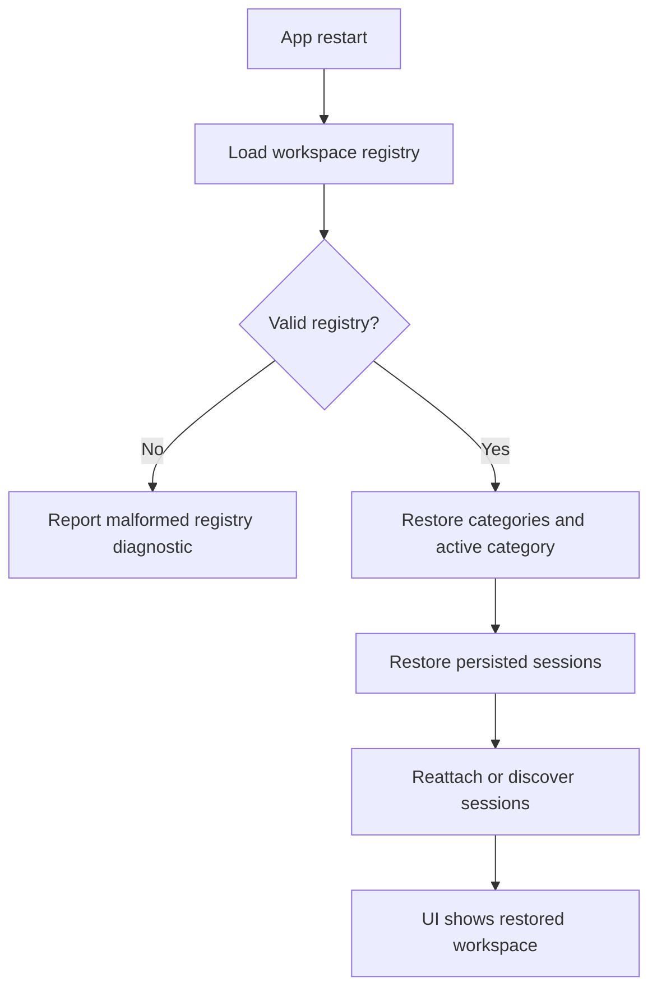
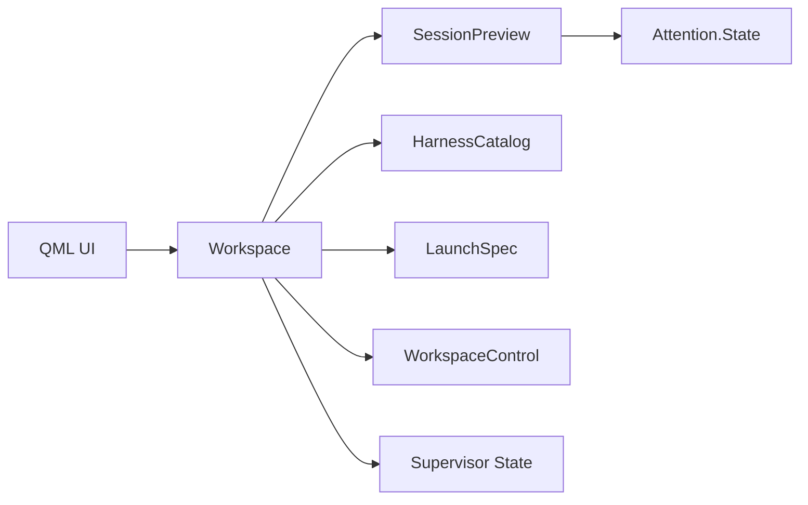

# Category and Session Management

<cite>
**Referenced Files in This Document **
- [workspace.hpp](file://apps/desktop/src/workspace.hpp)
- [workspace.cpp](file://apps/desktop/src/workspace.cpp)
- [workspace_control.hpp](file://apps/desktop/src/workspace_control.hpp)
- [workspace_control.cpp](file://apps/desktop/src/workspace_control.cpp)
- [harness_catalog.hpp](file://apps/desktop/src/harness_catalog.hpp)
- [harness_catalog.cpp](file://apps/desktop/src/harness_catalog.cpp)
- [launch_spec.hpp](file://services/session/src/launch_spec.hpp)
- [launch_spec.cpp](file://services/session/src/launch_spec.cpp)
- [attention.hpp](file://services/session/include/lapis/session/attention.hpp)
- [client.hpp](file://services/supervisor/include/lapis/supervisor/client.hpp)
- [state.hpp](file://services/supervisor/include/lapis/supervisor/state.hpp)
- [workspace.md](file://docs/workspace.md)
- [workspace_test.cpp](file://apps/desktop/tests/workspace_test.cpp)
</cite>

## Table of Contents
1. [Introduction](#introduction)
2. [Project Structure](#project-structure)
3. [Core Components](#core-components)
4. [Architecture Overview](#architecture-overview)
5. [Detailed Component Analysis](#detailed-component-analysis)
6. [Dependency Analysis](#dependency-analysis)
7. [Performance Considerations](#performance-considerations)
8. [Troubleshooting Guide](#troubleshooting-guide)
9. [Conclusion](#conclusion)

## Introduction
This document explains how the Lapis desktop workspace organizes agent sessions into categories, manages their lifecycle, and synchronizes state between the desktop UI, background session services, and the supervisor. The central concepts are:

- **Workspace**: the top-level desktop object that owns categories, sessions, persistence, launch orchestration, and event coordination.
- **SessionPreview**: a per-session Qt model exposing title, status, terminal snapshots, attention state, history navigation, and connection state to QML views.
- **Category model**: named groups of sessions with selection, ordering, creation, renaming, removal, and placement.
- **LaunchSpec**: validated launch parameters for an agent process, including program, arguments, working directory, terminal size, and agent mode.
- **HarnessCatalog**: known CLI agents (Codex, Claude, OpenCode, Grok, OMP, Antigravity, Kimi, Gemini) and their adapter-specific behavior.
- **Supervisor client/state**: persistent desired-state representation for managed service-backed sessions.
- **Attention system**: a bounded, epoch-based protocol for agent requests such as approvals or idle notices.

The documentation focuses on category organization, session discovery and synchronization, persistence across restarts, memory management, and error handling.

## Project Structure
The relevant implementation is split across three layers:

| Layer | Responsibility | Key files |
|---|---|---|
| Desktop UI layer | Categories, sessions, presentation, drag-and-drop tiles, command routing | `apps/desktop/src/workspace.{hpp,cpp}`, `apps/desktop/src/workspace_control.{hpp,cpp}` |
| Session runtime | Agent launch validation, terminal transport, attention ledger, checkpoints | `services/session/src/launch_spec.{hpp,cpp}`, `services/session/include/lapis/session/attention.hpp` |
| Supervisor runtime | Persistent desired state, control endpoints, session identity and lifecycle | `services/supervisor/include/lapis/supervisor/{client.hpp,state.hpp}` |

**Diagram sources**
- [workspace.hpp:300-500](file://apps/desktop/src/workspace.hpp#L300-L500)
- [workspace_control.hpp:1-70](file://apps/desktop/src/workspace_control.hpp#L1-L70)
- [harness_catalog.hpp:1-54](file://apps/desktop/src/harness_catalog.hpp#L1-L54)
- [launch_spec.hpp:1-32](file://services/session/src/launch_spec.hpp#L1-L32)
- [client.hpp:1-34](file://services/supervisor/include/lapis/supervisor/client.hpp#L1-L34)
- [state.hpp:1-120](file://services/supervisor/include/lapis/supervisor/state.hpp#L1-L120)

**Section sources**
- [workspace.hpp:1-200](file://apps/desktop/src/workspace.hpp#L1-L200)
- [workspace_control.hpp:1-70](file://apps/desktop/src/workspace_control.hpp#L1-L70)
- [harness_catalog.hpp:1-54](file://apps/desktop/src/harness_catalog.hpp#L1-L54)
- [launch_spec.hpp:1-32](file://services/session/src/launch_spec.hpp#L1-L32)
- [client.hpp:1-34](file://services/supervisor/include/lapis/supervisor/client.hpp#L1-L34)
- [state.hpp:1-120](file://services/supervisor/include/lapis/supervisor/state.hpp#L1-L120)

## Core Components

### Workspace
`Workspace` is the main desktop controller. It exposes:

- A list of **categories** and the active category identifier.
- A list of **sessions** and a focused session pointer.
- Category-scoped grouping through `categorySessions`.
- Creation and removal of categories via `addCategory`, `createCategory`, `renameCategory`, and `removeCategory`.
- Session lifecycle operations such as `startAgent`, `closeSession`, `restartAgent`, and `moveSession`.
- QML bindings for stage tiles, dividers, focus index, attention counts, and workspace errors.

It also holds options for endpoint attachment, launch spec reuse, attach mode, storage path, agent restoration, harness updates, headless operation, and account configuration.

#### Category Model
Categories are identified by string identifiers and hold ordered session pointers. The workspace maintains:

- Default categories when the app starts.
- Custom user-defined categories created through the UI or remote control.
- Selection per category.
- Ordering preserved through place operations.
- Protection against removing non-empty categories.

The default categories implied by the codebase include at least one initial category used by test fixtures and UI flow; custom categories can be added without limit except for name validation constraints.

#### Session Preview Lifecycle
Each `SessionPreview` represents one agent. Its lifecycle includes:

1. **Creation** through `Workspace::startAgent`, which validates inputs, chooses a harness, builds a `LaunchSpec`, optionally launches over SSH, attaches to a session service, and inserts the preview into the active category.
2. **Discovery** when an existing service endpoint is found, using `discoverSession`.
3. **Live attachment** through `startLive`, connecting to the session service endpoint with a specified attach mode.
4. **Snapshot delivery**, where encoded terminal screens are offered and decoded only for active viewers.
5. **History browsing**, which buffers older pages and supports scrubbing, scrolling, and returning to live.
6. **Attention handling**, receiving snapshots from adapters and translating them into visible pending requests and activity indicators.
7. **Termination**, either gracefully through the session service or abandoned if unreachable.

**Diagram sources**
- [workspace.hpp:300-500](file://apps/desktop/src/workspace.hpp#L300-L500)
- [workspace.hpp:1-200](file://apps/desktop/src/workspace.hpp#L1-L200)
- [harness_catalog.hpp:1-54](file://apps/desktop/src/harness_catalog.hpp#L1-L54)
- [launch_spec.hpp:1-32](file://services/session/src/launch_spec.hpp#L1-L32)

**Section sources**
- [workspace.hpp:300-500](file://apps/desktop/src/workspace.hpp#L300-L500)
- [workspace.cpp:200-494](file://apps/desktop/src/workspace.cpp#L200-L494)

### HarnessCatalog
`HarnessCatalog` defines known CLI agents and their adapter strategy. Each descriptor contains:

- Identifier, label, command, update command, whether it is offered.
- Adapter type: Codex, Claude, or generic terminal.
- Model option style: unsupported, short option, long option, or assignment.
- Resume option supported by the CLI.

Known harnesses include Claude, Codex, OpenCode, Grok, OMP, Antigravity, Kimi, and Gemini. Retired CLIs remain known so saved agents can still restore.

**Diagram sources**
- [harness_catalog.cpp:1-135](file://apps/desktop/src/harness_catalog.cpp#L1-L135)
- [workspace.cpp:200-494](file://apps/desktop/src/workspace.cpp#L200-L494)

**Section sources**
- [harness_catalog.hpp:1-54](file://apps/desktop/src/harness_catalog.hpp#L1-L54)
- [harness_catalog.cpp:1-135](file://apps/desktop/src/harness_catalog.cpp#L1-L135)

### LaunchSpec Validation
`LaunchSpec` is the internal contract for launching an agent. Validation enforces:

- Program and working directory must be present.
- Working directory must exist and be canonicalized.
- Program must resolve to an executable file.
- Argument count must not exceed 256.
- Total text payload must not exceed 64 KiB.
- Initial terminal size must be positive and within bounded cell limits.
- Agent-mode-specific conflicts are rejected, such as managed Claude flags or managed Codex remote options.
- A fingerprint is derived from program, arguments, directory, and agent mode.

**Diagram sources**
- [launch_spec.cpp:1-144](file://services/session/src/launch_spec.cpp#L1-L144)
- [launch_spec.hpp:1-32](file://services/session/src/launch_spec.hpp#L1-L32)

**Section sources**
- [launch_spec.hpp:1-32](file://services/session/src/launch_spec.hpp#L1-L32)
- [launch_spec.cpp:1-144](file://services/session/src/launch_spec.cpp#L1-L144)

### Attention System
The attention subsystem models agent-initiated interactions such as approvals, observations, and idle notices. Key elements:

- `Activity`: unknown, working, idle, turn completed.
- `Outcome`: applied, duplicate, rejected, desynchronized.
- `RequestStatus`: pending, responding, stale.
- `State`: thread-local ledger tracking epochs, sequences, revisions, pending requests, retired IDs, and blocking conditions.
- Operations include connect/disconnect, observation boundaries, reconciliation, request submission, response resolution, snoozing, acknowledgment, and ordering.

This state is consumed by `SessionPreview` to expose `attentionPending`, `attentionReason`, `attentionSerial`, `attentionCount`, `hasAttentionSource`, `attentionReady`, `attentionDiagnostic`, and `attentionRequests`.

**Diagram sources**
- [attention.hpp:1-136](file://services/session/include/lapis/session/attention.hpp#L1-L136)

**Section sources**
- [attention.hpp:1-136](file://services/session/include/lapis/session/attention.hpp#L1-L136)

### WorkspaceControl Remote API
`WorkspaceControl` exposes a JSON-over-local-socket API for cross-process commands such as:

- Listing available harnesses and defaults.
- Creating agents with category, harness, directory, optional title, machine, program, model, mode, and resume.
- Creating, renaming, removing, and placing categories.
- Closing, renaming, placing, restarting, and managing agents.
- Opening and closing quick terminals.
- Reading and changing settings.
- Requesting handover of the workspace host.

This is the integration point used by other lapis processes, such as the phone gateway or windowless host.

**Diagram sources**
- [workspace_control.cpp:1-200](file://apps/desktop/src/workspace_control.cpp#L1-L200)
- [workspace_control.cpp:200-341](file://apps/desktop/src/workspace_control.cpp#L200-L341)

**Section sources**
- [workspace_control.hpp:1-70](file://apps/desktop/src/workspace_control.hpp#L1-L70)
- [workspace_control.cpp:1-341](file://apps/desktop/src/workspace_control.cpp#L1-L341)

## Architecture Overview
The end-to-end session flow combines desktop orchestration, background services, and persistent state:

**Diagram sources**
- [workspace.cpp:200-494](file://apps/desktop/src/workspace.cpp#L200-L494)
- [harness_catalog.cpp:1-135](file://apps/desktop/src/harness_catalog.cpp#L1-L135)
- [launch_spec.cpp:1-144](file://services/session/src/launch_spec.cpp#L1-L144)
- [state.hpp:1-200](file://services/supervisor/include/lapis/supervisor/state.hpp#L1-L200)

## Detailed Component Analysis

### Category Organization and Filtering
Categories group sessions and maintain:

- Name and identifier.
- Ordered list of sessions.
- Selected session pointer.
- Aggregated attention count for display.

Filtering and grouping are primarily category-scoped:

- `categorySessions()` returns sessions belonging to the active category.
- `categories()` returns metadata suitable for the UI rail, including attention counts.
- Drag-and-drop and wire commands move sessions between categories.

Default categories come from initialization. Custom categories are created through:

- `Workspace::addCategory` for direct UI use.
- `Workspace::createCategory` for wire/API callers that need the generated identifier.
- `WorkspaceControl::category` for remote callers creating, renaming, removing, or reordering categories.

Removal requires the category to be empty. Renaming and placement are validated and emit appropriate errors through `workspaceError`.

**Section sources**
- [workspace.hpp:300-500](file://apps/desktop/src/workspace.hpp#L300-L500)
- [workspace_control.cpp:200-341](file://apps/desktop/src/workspace_control.cpp#L200-L341)

### Session Discovery and State Synchronization
A session may be discovered in two ways:

1. **Explicit launch**: `Workspace::startAgent` validates inputs, resolves harness behavior, constructs a `LaunchSpec`, and attaches to a session service.
2. **Discovery**: `SessionPreview::discoverSession` locates an existing service endpoint and attempts to attach without relaunching.

Once attached, `SessionPreview` receives:

- Connection state updates.
- Terminal snapshots, offered as encoded bytes and decoded lazily.
- Attention snapshots containing activity, capability flags, and pending requests.
- History page boundaries and scrubbing metadata.

Synchronization rules include:

- Activity alone does not rebuild category data; changes in pending attention counts do.
- Reconciliation replaces attention state atomically with epoch and sequence checks.
- Output timing estimates are used when no observer is synchronized.

**Diagram sources**
- [workspace.hpp:1-200](file://apps/desktop/src/workspace.hpp#L1-L200)
- [attention.hpp:1-136](file://services/session/include/lapis/session/attention.hpp#L1-L136)

**Section sources**
- [workspace.hpp:1-200](file://apps/desktop/src/workspace.hpp#L1-L200)
- [workspace.cpp:200-494](file://apps/desktop/src/workspace.cpp#L200-L494)
- [attention.hpp:1-136](file://services/session/include/lapis/session/attention.hpp#L1-L136)

### Session Events: Attention Updates and Termination
`SessionPreview` exposes attention-related properties and methods:

- `applyAttention` transforms service-side snapshots into UI-visible pending requests and diagnostics.
- `respondAttention` submits a choice for a pending request.
- `terminate` asks the session service to end the agent process.
- `closing` indicates a close request waiting for process termination.
- `unseen` marks an earlier window’s attention mark that should persist until the agent is selected.

Termination flows prefer graceful shutdown through the session service. If the session is unreachable, the workspace may abandon the tab depending on caller intent.

**Section sources**
- [workspace.hpp:1-200](file://apps/desktop/src/workspace.hpp#L1-L200)
- [workspace.cpp:200-494](file://apps/desktop/src/workspace.cpp#L200-L494)

### Persistence Across App Restarts
Persistence covers two related concerns:

1. **Workspace registry**: category names, active category, and session identities are stored under a storage path. Tests show that restoring a workspace preserves category count, active category, and renamed categories.
2. **Supervisor desired state**: managed sessions store endpoint, fingerprint, identity, spawn token, blocked reason, and canonical launch information.

Key behaviors:

- A live writer lock prevents concurrent modification.
- Malformed registry files produce a diagnostic and are preserved rather than silently overwritten.
- Headless mode allows background services to continue running while a window reconnects.
- Restoration can resynchronize with observed resumes when enabled.

**Diagram sources**
- [workspace.cpp:200-494](file://apps/desktop/src/workspace.cpp#L200-L494)
- [state.hpp:1-200](file://services/supervisor/include/lapis/supervisor/state.hpp#L1-L200)

**Section sources**
- [workspace_test.cpp:1-250](file://apps/desktop/tests/workspace_test.cpp#L1-L250)
- [state.hpp:1-200](file://services/supervisor/include/lapis/supervisor/state.hpp#L1-L200)

### Memory Management for Many Concurrent Sessions
`SessionPreview` implements several strategies to handle large numbers of concurrent sessions:

- Encoded terminal snapshots are kept in memory but decoded only for active viewers.
- Viewer intervals throttle redraw frequency; hidden or closed windows avoid unnecessary decoding.
- Output timing estimates avoid expensive observer-dependent status when unavailable.
- Attention state has bounded pending and retired limits, aging intervals, cooldowns, and overflow handling.
- Wheel scroll-back debt is bounded and tied to the session rather than the surface.
- History pages are buffered through a strip structure, with explicit request cancellation and scrubbing bounds.

These mechanisms reduce CPU and memory pressure while preserving responsiveness for the currently active session.

**Section sources**
- [workspace.hpp:1-200](file://apps/desktop/src/workspace.hpp#L1-L200)
- [attention.hpp:1-136](file://services/session/include/lapis/session/attention.hpp#L1-L136)

### Error Handling for Failed Launches and Connections
Errors appear at multiple layers:

- **Launch validation**: `LaunchSpec::validate_launch` throws for invalid programs, directories, sizes, argument budgets, or conflicting agent modes.
- **Workspace orchestration**: failed launches leave no session tab and set `workspaceError`.
- **Remote calls**: `WorkspaceControl` returns refusal responses with messages such as malformed request, missing fields, unsupported request, or workspace refusal.
- **Connection state**: `SessionPreview` tracks reachable, input-ready, and connection state strings.
- **Attention reconciliation**: mismatches report desynchronization and require a fresh epoch boundary.
- **Persistence**: malformed registries are diagnosed and preserved; locked writers reject mutations.

Best practice is to inspect `workspaceError` after mutating operations and to treat attention outcomes as potentially transient.

**Section sources**
- [launch_spec.cpp:1-144](file://services/session/src/launch_spec.cpp#L1-L144)
- [workspace_control.cpp:1-200](file://apps/desktop/src/workspace_control.cpp#L1-L200)
- [workspace.hpp:300-500](file://apps/desktop/src/workspace.hpp#L300-L500)
- [attention.hpp:1-136](file://services/session/include/lapis/session/attention.hpp#L1-L136)

## Dependency Analysis
The following diagram maps high-level dependencies between components:

**Diagram sources**
- [workspace.hpp:300-500](file://apps/desktop/src/workspace.hpp#L300-L500)
- [workspace_control.hpp:1-70](file://apps/desktop/src/workspace_control.hpp#L1-L70)
- [harness_catalog.hpp:1-54](file://apps/desktop/src/harness_catalog.hpp#L1-L54)
- [launch_spec.hpp:1-32](file://services/session/src/launch_spec.hpp#L1-L32)
- [attention.hpp:1-136](file://services/session/include/lapis/session/attention.hpp#L1-L136)
- [state.hpp:1-200](file://services/supervisor/include/lapis/supervisor/state.hpp#L1-L200)

**Section sources**
- [workspace.hpp:300-500](file://apps/desktop/src/workspace.hpp#L300-L500)
- [workspace_control.cpp:1-341](file://apps/desktop/src/workspace_control.cpp#L1-L341)
- [harness_catalog.cpp:1-135](file://apps/desktop/src/harness_catalog.cpp#L1-L135)
- [launch_spec.cpp:1-144](file://services/session/src/launch_spec.cpp#L1-L144)
- [attention.hpp:1-136](file://services/session/include/lapis/session/attention.hpp#L1-L136)
- [state.hpp:1-200](file://services/supervisor/include/lapis/supervisor/state.hpp#L1-L200)

## Performance Considerations
- Prefer lazy decoding of terminal snapshots so only visible sessions pay the full cost.
- Keep viewer intervals reasonable; zero means redraw immediately, while larger values throttle background sessions.
- Use output timing estimates for agents without a synchronized observer to avoid unnecessary polling.
- Bound attention pending and retired sets; monitor aging and cooldown settings to prevent unbounded growth.
- Avoid rebuilding category data for every attention activity change; rely on pending count changes.
- For many concurrent sessions, prefer discovery and reconnect over repeated process launches where possible.

[No sources needed since this section provides general guidance]

## Troubleshooting Guide

| Symptom | Likely cause | What to check |
|---|---|---|
| New agent fails immediately | Invalid directory, program, or launch arguments | Inspect `workspaceError` and `LaunchSpec::validate_launch` constraints |
| Category cannot be removed | Category still contains sessions | Move or close all sessions first |
| Remote category or agent command fails | Missing fields, wrong types, or workspace locked | Validate JSON request and ensure the workspace registry is writable |
| Attention does not appear | No connected source or desynchronized epoch | Check `hasAttentionSource`, `attentionReady`, and attention diagnostics |
| Session appears disconnected but process remains | Service lost or attach failed | Check `connectionState`, `reachable`, and `serviceSessionId` |
| Restart fails in preview or headless attach mode | Operation requires a persisted workspace | Ensure a persisted registry and a valid service-backed session |
| History cannot be scrolled | Service did not place pages or request is pending | Check `historyScrubbable`, `historyActive`, and `historyMessage` |

**Section sources**
- [workspace.hpp:1-200](file://apps/desktop/src/workspace.hpp#L1-L200)
- [workspace_control.cpp:1-341](file://apps/desktop/src/workspace_control.cpp#L1-L341)
- [launch_spec.cpp:1-144](file://services/session/src/launch_spec.cpp#L1-L144)
- [workspace_test.cpp:1-250](file://apps/desktop/tests/workspace_test.cpp#L1-L250)

## Conclusion
The Lapis workspace model separates concerns cleanly:

- `Workspace` owns categories, session discovery, persistence, and orchestration.
- `SessionPreview` encapsulates per-session presentation, connection state, terminal snapshots, attention, and history.
- `HarnessCatalog` abstracts known CLIs and their adapter-specific launch behavior.
- `LaunchSpec` enforces safe, bounded, and reproducible agent launches.
- `Attention.State` provides a robust, bounded ledger for agent-initiated interactions.
- `WorkspaceControl` exposes a stable JSON API for cross-process control.
- Supervisor state enables managed sessions to survive daemon restarts and be adopted by replacement processes.

For reliable operation, validate launches early, honor attention epochs, respect category ownership rules, use discovery for existing services, and keep attention and terminal buffers bounded. When integrating remotely, always check request versions, field types, and workspace readiness before mutating categories or sessions.