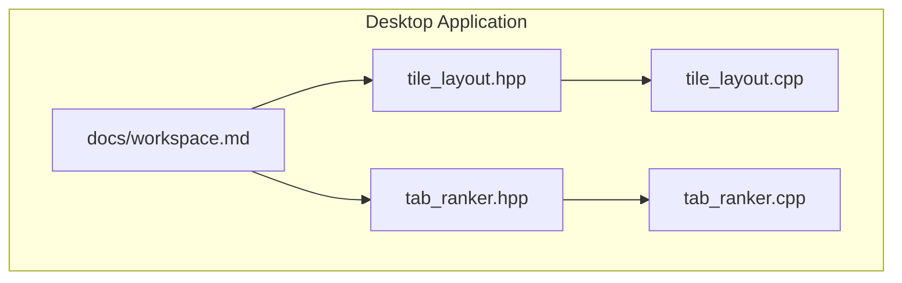
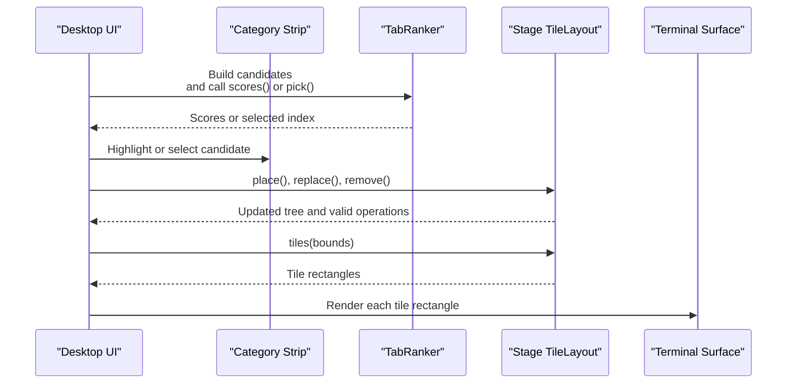
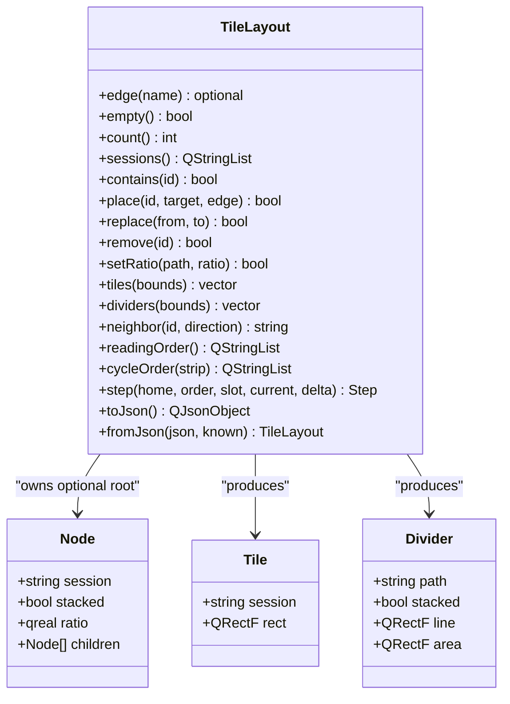
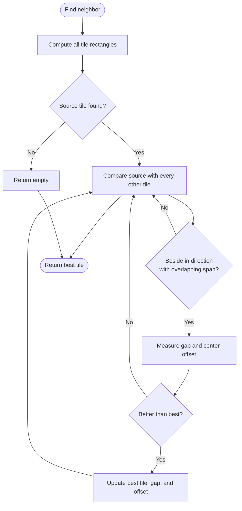
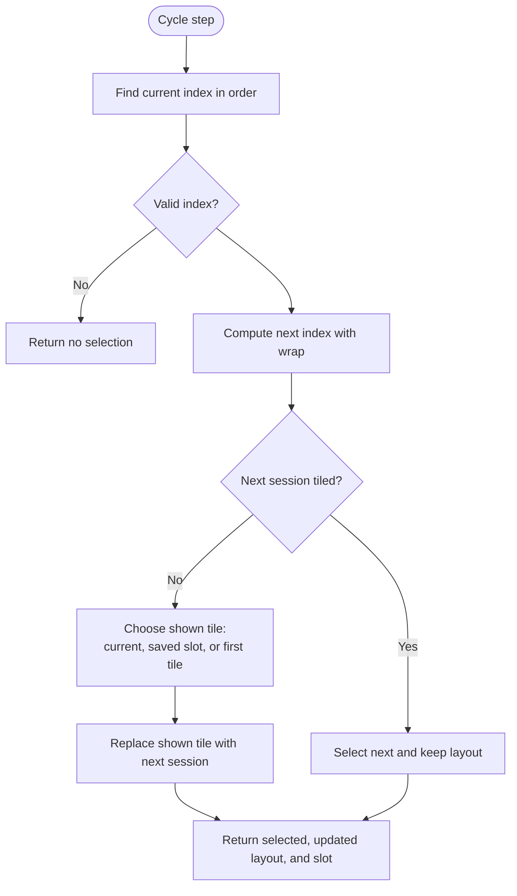
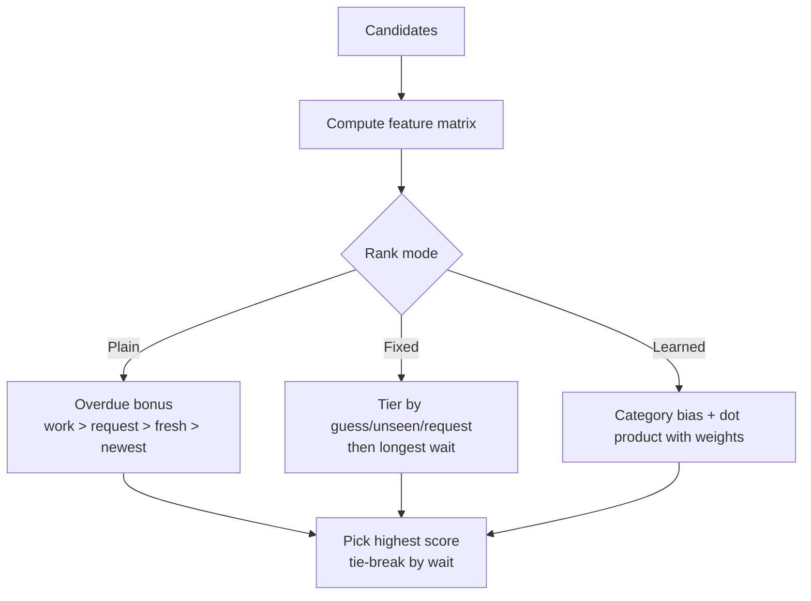
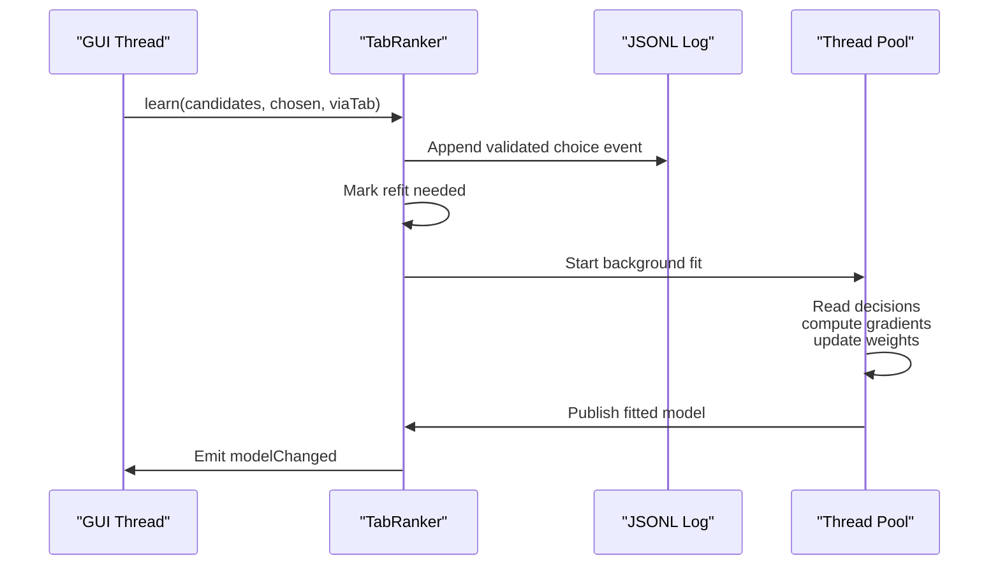
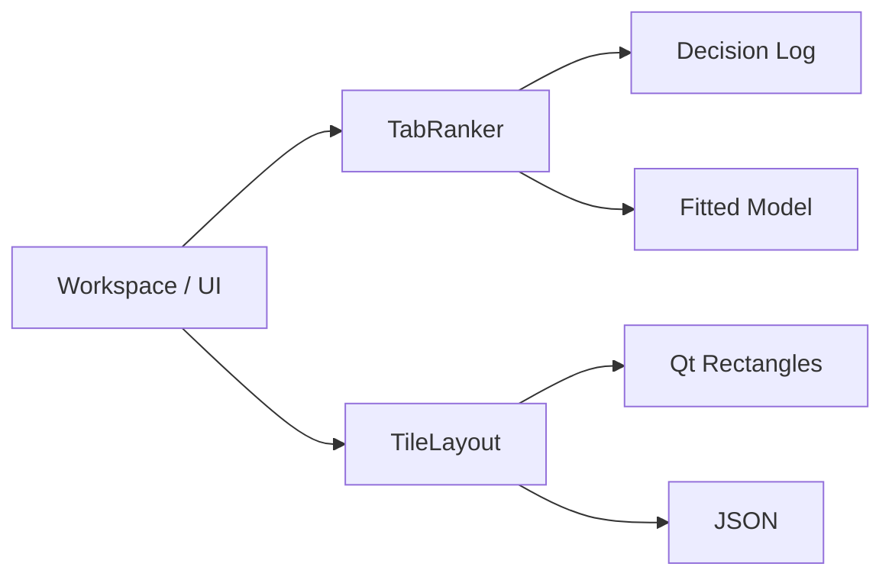

# Layout Algorithms and Tiling

<cite>
**Referenced Files in This Document**
- [tile_layout.hpp](file://apps/desktop/src/tile_layout.hpp)
- [tile_layout.cpp](file://apps/desktop/src/tile_layout.cpp)
- [tab_ranker.hpp](file://apps/desktop/src/tab_ranker.hpp)
- [tab_ranker.cpp](file://apps/desktop/src/tab_ranker.cpp)
- [tile_layout_test.cpp](file://apps/desktop/tests/tile_layout_test.cpp)
- [tab_ranker_test.cpp](file://apps/desktop/tests/tab_ranker_test.cpp)
- [workspace.md](file://docs/workspace.md)
</cite>

## Table of Contents
1. [Introduction](#introduction)
2. [Project Structure](#project-structure)
3. [Core Components](#core-components)
4. [Architecture Overview](#architecture-overview)
5. [Detailed Component Analysis](#detailed-component-analysis)
6. [Dependency Analysis](#dependency-analysis)
7. [Performance Considerations](#performance-considerations)
8. [Troubleshooting Guide](#troubleshooting-guide)
9. [Conclusion](#conclusion)

## Introduction
This document explains the Lapis desktop workspace layout system that tiles terminal sessions on a stage, and the tab ranking system that orders sessions for attention-driven navigation. The tiling layer is built around a binary split tree: every non-leaf node divides its area into two children either side-by-side or top-to-bottom, and every leaf holds one session. The ranking layer decides which waiting session should receive attention next, using three modes: focus-like behavior driven by overdue work and recency, fixed ordering based on explicit categories such as guesses and requests, and learned ordering that adapts to user choices over time.

The documentation covers how tile positions are computed, how dynamic insertion/removal/swap operations modify the layout, how dividers control relative sizes, how reading order and neighbor selection work, and how the ranker computes scores from features like work category, request status, unseen turns, guess state, wait duration, and recent activity. It also addresses performance characteristics for large terminal buffers and frequent updates, and documents customization options exposed through configuration.

## Project Structure
The relevant implementation lives under the desktop application source tree:

- `apps/desktop/src/tile_layout.hpp` and `tile_layout.cpp`: the binary-split tiling engine.
- `apps/desktop/src/tab_ranker.hpp` and `tab_ranker.cpp`: the attention-aware tab ranking engine.
- `apps/desktop/tests/tile_layout_test.cpp` and `tab_ranker_test.cpp`: behavioral tests that define the expected semantics.
- `docs/workspace.md`: user-facing description of the stage, strip, drag-and-drop tiling, and terminal behavior.

**Diagram sources**
- [tile_layout.hpp:1-90](file://apps/desktop/src/tile_layout.hpp#L1-L90)
- [tile_layout.cpp:1-381](file://apps/desktop/src/tile_layout.cpp#L1-L381)
- [tab_ranker.hpp:1-134](file://apps/desktop/src/tab_ranker.hpp#L1-L134)
- [tab_ranker.cpp:1-504](file://apps/desktop/src/tab_ranker.cpp#L1-L504)
- [workspace.md:1-105](file://docs/workspace.md#L1-L105)

**Section sources**
- [tile_layout.hpp:1-90](file://apps/desktop/src/tile_layout.hpp#L1-L90)
- [tile_layout.cpp:1-381](file://apps/desktop/src/tile_layout.cpp#L1-L381)
- [tab_ranker.hpp:1-134](file://apps/desktop/src/tab_ranker.hpp#L1-L134)
- [tab_ranker.cpp:1-504](file://apps/desktop/src/tab_ranker.cpp#L1-L504)
- [workspace.md:1-105](file://docs/workspace.md#L1-L105)

## Core Components
The layout system has two main responsibilities:

1. **TileLayout**: Represents and mutates a binary split tree of terminal tiles. It calculates absolute rectangles, finds neighbors, computes reading order, serializes and deserializes layouts, and supports keyboard-driven cycle navigation between tiled and untiled sessions.
2. **TabRanker**: Orders eligible waiting sessions according to configured policy. It supports plain (overdue-first with recency), fixed (explicit tiered ordering), and learned (regularized gradient fitting over observed choices).

Key concepts:
- A **split** is an internal node with two children and a ratio between 0.15 and 0.85.
- A **tile** is a leaf holding one session identifier.
- A **divider** identifies a split and exposes both the dividing line and the parent area used for dragging.
- A **candidate** is a waiting session annotated with work, request, unseen, guess, wait time, and recency information.
- A **model** contains feature weights, per-category biases, and decision count.

**Section sources**
- [tile_layout.hpp:1-90](file://apps/desktop/src/tile_layout.hpp#L1-L90)
- [tab_ranker.hpp:1-134](file://apps/desktop/src/tab_ranker.hpp#L1-L134)

## Architecture Overview
At runtime, the desktop UI owns stages per category. Each stage carries a `TileLayout`, while the category maintains a strip of sessions. When a session needs attention, the UI builds `TabCandidate` objects and asks `TabRanker` to score or pick among them. The chosen session may be moved onto the stage by replacing a tile, dragged beside another tile, or selected in the strip. Terminal rendering itself is outside these modules: the layout module outputs rectangles, and the terminal surface consumes them to draw buffered text.

**Diagram sources**
- [tab_ranker.cpp:265-360](file://apps/desktop/src/tab_ranker.cpp#L265-L360)
- [tile_layout.cpp:201-381](file://apps/desktop/src/tile_layout.cpp#L201-L381)
- [workspace.md:1-105](file://docs/workspace.md#L1-L105)

## Detailed Component Analysis

### TileLayout: Binary-Split Tiling Engine
`TileLayout` stores an optional root node. If present, the layout is non-empty. Internal nodes have exactly two children; leaves store a session identifier. The tree represents a history of splits:
- Side-by-side splits divide width by ratio.
- Stacked splits divide height by ratio.
- Ratio values are clamped to a minimum and maximum so no child becomes degenerate.

Important operations:
- `place(id, target, edge)` inserts or repositions a session beside a target or replaces it at center.
- `replace(from, to)` swaps the session occupying a tile with another session.
- `remove(id)` removes a leaf and promotes its sibling.
- `setRatio(path, ratio)` adjusts a specific split’s proportion.
- `tiles(bounds)` computes absolute rectangles.
- `dividers(bounds)` returns draggable divider geometry.
- `neighbor(id, direction)` finds the closest adjacent tile without wrapping.
- `readingOrder()` sorts tiles by top edge then left edge for stable visual traversal.
- `cycleOrder(strip)` combines tiled reading order with untiled strip agents.
- `step(home, order, slot, current, delta)` advances or retreats through the cycle, optionally moving an untiled agent into a visible tile.

#### Data Structures and Complexity
- Tree traversal for finding a session or its parent is proportional to the number of nodes in the subtree searched.
- `sessions()` performs an in-order traversal and is O(n).
- `tiles(bounds)` visits every node once and is O(n).
- `neighbors` compares the source tile against all other tiles, making it O(n).
- `readingOrder()` materializes all tiles and sorts them; sorting dominates at O(n log n).
- `fromJson` validates structure, depth, known identifiers, and duplicates; malformed or repeated entries produce empty-session leaves that are later removed.

**Diagram sources**
- [tile_layout.hpp:1-90](file://apps/desktop/src/tile_layout.hpp#L1-L90)

#### Layout Modes and User Interaction
The repository does not expose four named modes called “focus,” “blocks,” “columns,” or “stack” as separate classes. Instead, those visual arrangements emerge from the same binary split tree through different sequences of `place` operations and divider ratios:

| Visual arrangement | How it arises in the code | Typical use case |
|---|---|---|
| Attention-driven focus | One active tile plus smaller side panels; achieved by placing new sessions beside the current one and adjusting ratios | Reviewing one agent while keeping others visible |
| Grid arrangement | Multiple side-by-side splits nested with stacked splits, producing rows and columns | Comparing several sessions horizontally and vertically |
| Vertical strips | Repeated right placements create tall columns; ratios adjust column widths | Multi-agent dashboards where vertical bands are preferred |
| Overlay tabs | Not implemented as true overlay tabs in `TileLayout`; instead, cycling between tiled and strip slots simulates switching views via `step` and `replace` | Keyboard-driven navigation without losing background sessions |

User interaction is described in the workspace documentation: cards can be dragged onto edges to split, onto centers to swap, and dividers can be dragged to resize. Terminal scrolling and viewport management are handled separately by the terminal surface; the layout engine only supplies rectangles.

**Section sources**
- [tile_layout.cpp:201-381](file://apps/desktop/src/tile_layout.cpp#L201-L381)
- [workspace.md:1-105](file://docs/workspace.md#L1-L105)

#### Neighbor Selection Algorithm
Neighbor selection uses geometric proximity rather than tree adjacency:

**Diagram sources**
- [tile_layout.cpp:260-330](file://apps/desktop/src/tile_layout.cpp#L260-L330)

#### Reading Order and Cycle Navigation
Reading order is visually intuitive: tiles are sorted by top edge first, then left edge. This differs from the raw tree traversal order when the tree forms grids or uneven splits. Cycle navigation combines the visual reading order with untiled strip agents, allowing keyboard movement across the full set of sessions in a category.

**Diagram sources**
- [tile_layout.cpp:330-381](file://apps/desktop/src/tile_layout.cpp#L330-L381)

### TabRanker: Attention-Aware Session Ordering
`TabRanker` orders eligible waiting sessions. Eligibility is determined by the workspace layer; the ranker only ranks candidates it receives. Each candidate includes metadata such as whether it belongs to a work category, whether it is a request, whether it is unseen, whether it is a guessed next prompt, wait duration, recent turn count, and time since its last turn.

#### Ranking Modes
| Mode | Behavior | Configuration or data source |
|---|---|---|
| Plain | Prioritizes overdue work and recency without learning long-term preferences. Overdue items get a very high base score; otherwise work, requests, unseen turns, and newest are scored with large but ordered weights. | `TabAwaySettings.rank = plain` and `overdueHours` |
| Fixed | Uses explicit tiers: unseen guess, then unseen turn or request, then seen guess; within each tier, longest wait wins. Negative waits are clamped to zero. | `TabAwaySettings.rank = fixed` |
| Learned | Scores candidates with a linear model over nine features plus per-category bias. The model is regularized toward a prior and refitted in the background after user decisions. | `TabAwaySettings.rank = learned` |

#### Feature Vector
The learned model uses nine normalized or categorical features:
1. Work category flag.
2. Request flag.
3. Unseen flag.
4. Guess flag.
5. Log-transformed wait minutes.
6. Newest indicator.
7. Stale indicator.
8. Log-transformed turns in the last hour.
9. Capped, log-transformed minutes since last turn.

These features feed a softmax-style scoring function, with regularization pulling weights toward a hand-tuned prior that favors work, requests, unseen content, and freshness while avoiding letting stale work dominate forever.

**Diagram sources**
- [tab_ranker.cpp:265-360](file://apps/desktop/src/tab_ranker.cpp#L265-L360)
- [tab_ranker.cpp:201-264](file://apps/desktop/src/tab_ranker.cpp#L201-L264)

#### Learning and Model Fitting
Learning proceeds in two layers:
- Immediate logging: every choice is appended to a JSON Lines log file when a folder is configured. Logs are rotated when they exceed a size limit, archiving the previous file.
- Background refitting: decisions are parsed, validated, and fitted using gradient descent on mean negative log-likelihood plus regularization. Refits run on a thread pool, avoid duplicate work, and publish a new model back to the GUI thread.

**Diagram sources**
- [tab_ranker.cpp:360-504](file://apps/desktop/src/tab_ranker.cpp#L360-L504)

#### Customization Options
Power users can adjust ranking behavior through `TabAwaySettings`:
- `rank`: choose `plain`, `learned`, or `fixed`.
- `work`: list of category names considered work; comparison is case-insensitive.
- `overdueHours`: threshold above which work-related items are treated as overdue in plain mode.

The settings parser enforces bounds such as capping overdue hours, limiting work category count and length, and removing duplicates.

**Section sources**
- [tab_ranker.hpp:1-134](file://apps/desktop/src/tab_ranker.hpp#L1-L134)
- [tab_ranker.cpp:1-200](file://apps/desktop/src/tab_ranker.cpp#L1-L200)
- [tab_ranker.cpp:201-504](file://apps/desktop/src/tab_ranker.cpp#L201-L504)

## Dependency Analysis
`TileLayout` is self-contained: it depends on Qt geometry and JSON types, and exposes a pure API for mutation, querying, and serialization. Its complexity is dominated by tree traversal and geometric comparisons.

`TabRanker` depends on:
- Workspace-provided candidate metadata.
- Platform task infrastructure for background execution.
- File I/O for decision logs and fitted models.
- Qt threading, JSON, and event-loop facilities.

**Diagram sources**
- [tile_layout.hpp:1-90](file://apps/desktop/src/tile_layout.hpp#L1-L90)
- [tab_ranker.hpp:1-134](file://apps/desktop/src/tab_ranker.hpp#L1-L134)
- [tab_ranker.cpp:360-504](file://apps/desktop/src/tab_ranker.cpp#L360-L504)

**Section sources**
- [tile_layout.cpp:1-381](file://apps/desktop/src/tile_layout.cpp#L1-L381)
- [tab_ranker.cpp:1-504](file://apps/desktop/src/tab_ranker.cpp#L1-L504)

## Performance Considerations

### Rendering Large Terminal Buffers
The layout engine does not render terminal text; it computes rectangles. Rendering performance therefore depends on the terminal surface, which must handle:
- Large scrollback buffers.
- Frequent cell updates.
- Viewport clipping to each tile rectangle.
- Efficient redraw regions.

Recommendations grounded in the code structure:
- Batch layout recomputation: `TileLayout` already resizes tiles once per divider drag, reducing repeated geometry computation.
- Clip terminal drawing to tile rectangles returned by `tiles(bounds)`.
- Avoid recomputing neighbor relationships unless focus changes.
- Use stable reading order for predictable keyboard navigation even when floating-point coordinates differ slightly.

[No sources needed since this section provides general guidance]

### Optimization Strategies for Frequent Layout Updates
- Prefer immutable updates: `place` constructs a copy of the layout before mutation, helping rollback and consistent state.
- Clamp ratios to avoid degenerate splits that cause numerical instability during neighbor checks.
- Limit iteration in neighbor queries by early rejection of tiles not beside the source in the requested direction.
- Cache reading order if the underlying geometry does not change.

**Section sources**
- [tile_layout.cpp:1-200](file://apps/desktop/src/tile_layout.cpp#L1-L200)
- [tile_layout.cpp:201-381](file://apps/desktop/src/tile_layout.cpp#L201-L381)

### Ranking and Learning Performance
- Scoring is O(n) over candidates with a small fixed-size feature vector.
- Candidate lists are capped during logging to prevent excessive log growth.
- Fitting runs off the GUI thread, preventing UI jank.
- Only one refit runs at a time; additional decisions queue exactly one further refit.
- The decision history is bounded, and logs are rotated when too large.

**Section sources**
- [tab_ranker.cpp:1-200](file://apps/desktop/src/tab_ranker.cpp#L1-L200)
- [tab_ranker.cpp:360-504](file://apps/desktop/src/tab_ranker.cpp#L360-L504)

## Troubleshooting Guide

### Tiles Do Not Appear or Are Missing
- Verify the layout is non-empty: `empty()` returns false only when a root exists.
- Check that session identifiers passed to `place` exist in the known set when loading from JSON.
- Malformed or repeated sessions are dropped; inspect serialized layout JSON for unknown or duplicate entries.

**Section sources**
- [tile_layout.cpp:120-199](file://apps/desktop/src/tile_layout.cpp#L120-L199)
- [tile_layout.cpp:350-381](file://apps/desktop/src/tile_layout.cpp#L350-L381)

### Divider Dragging Has No Effect
- Ensure the path points to an actual split node, not a leaf.
- Ratios are clamped between minimum and maximum values; extreme drags will snap to limits.
- Confirm the root path and child indices match the stored split hierarchy.

**Section sources**
- [tile_layout.cpp:230-260](file://apps/desktop/src/tile_layout.cpp#L230-L260)
- [tile_layout_test.cpp:1-200](file://apps/desktop/tests/tile_layout_test.cpp#L1-L200)

### Neighbor Navigation Moves Unexpectedly
- Neighbor selection requires overlapping spans in the requested direction; adjacent tiles that do not share enough alignment are ignored.
- Directional queries never wrap around the layout.
- Floating-point differences are tolerated through epsilon checks, but reading order uses rounded row buckets for stability.

**Section sources**
- [tile_layout.cpp:260-330](file://apps/desktop/src/tile_layout.cpp#L260-L330)
- [tile_layout_test.cpp:1-200](file://apps/desktop/tests/tile_layout_test.cpp#L1-L200)

### Tab Ranking Picks Surprising Sessions
- In plain mode, overdue work can dominate; check `overdueHours`.
- In fixed mode, unseen guesses come first, followed by longest-waiting unseen turns or requests.
- In learned mode, verify the model has enough decisions; initial behavior follows the prior.
- Negative wait times are clamped to zero and should not unfairly reward a candidate.

**Section sources**
- [tab_ranker.cpp:265-360](file://apps/desktop/src/tab_ranker.cpp#L265-L360)
- [tab_ranker_test.cpp:1-200](file://apps/desktop/tests/tab_ranker_test.cpp#L1-L200)

### Learned Model Does Not Update
- Ensure decisions contain at least two candidates and a valid chosen index.
- Malformed decisions are ignored.
- Refits run asynchronously; check `refitting()` and wait for completion in tests or diagnostics.
- Without a configured folder, decisions remain in memory and are bounded.

**Section sources**
- [tab_ranker.cpp:360-504](file://apps/desktop/src/tab_ranker.cpp#L360-L504)
- [tab_ranker_test.cpp:1-200](file://apps/desktop/tests/tab_ranker_test.cpp#L1-L200)

## Conclusion
Lapis’s layout system separates concerns cleanly: `TileLayout` manages geometry and topology of terminal tiles through a simple binary split tree, while `TabRanker` manages attention flow through configurable scoring and optional machine-learning-style adaptation. Together, they support attention-driven workflows, grid-like multi-agent comparisons, vertical dashboard-style strips, and keyboard-driven switching between tiled and untiled sessions. For power users, the key customization points are the tab-away ranking mode, work categories, and overdue thresholds, while performance remains anchored by bounded operations, background fitting, and geometry reuse.