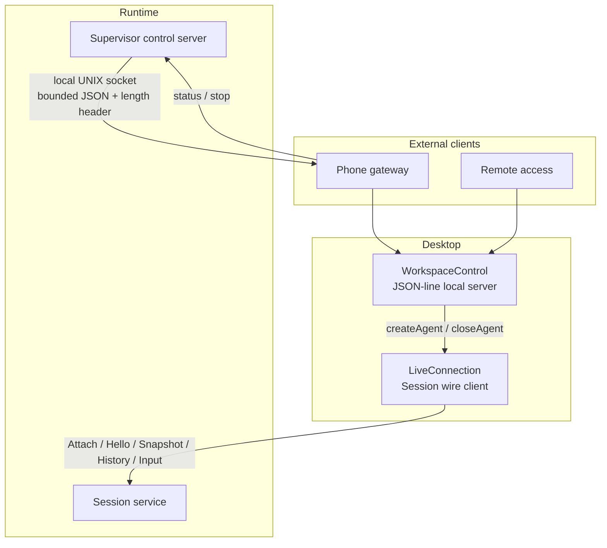
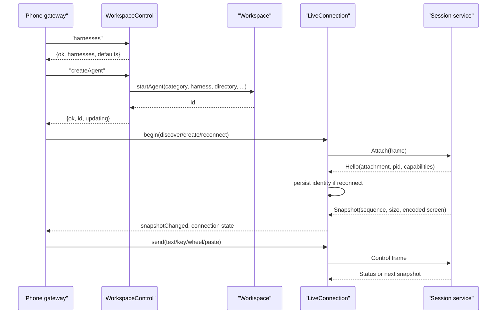
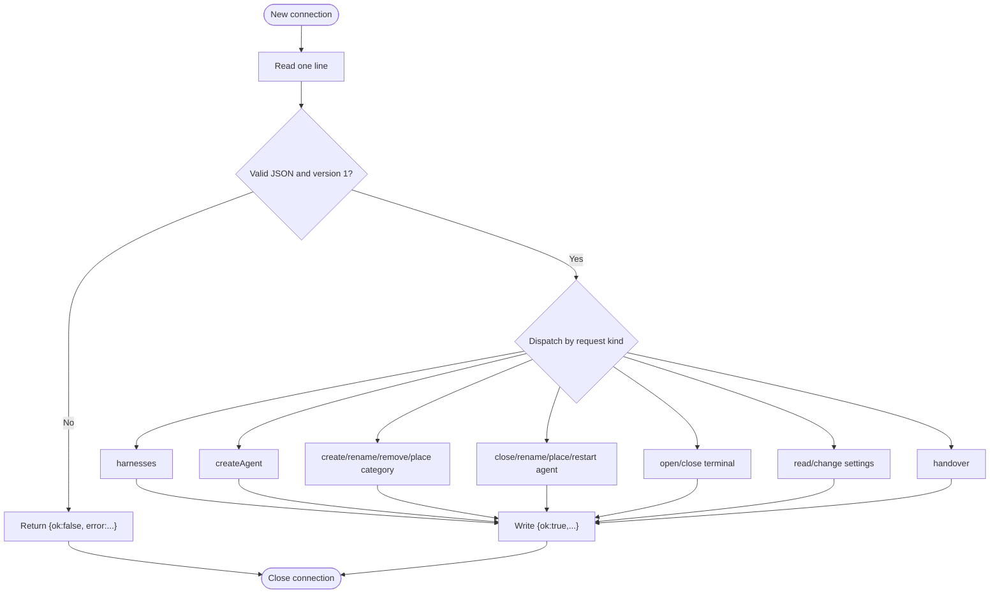
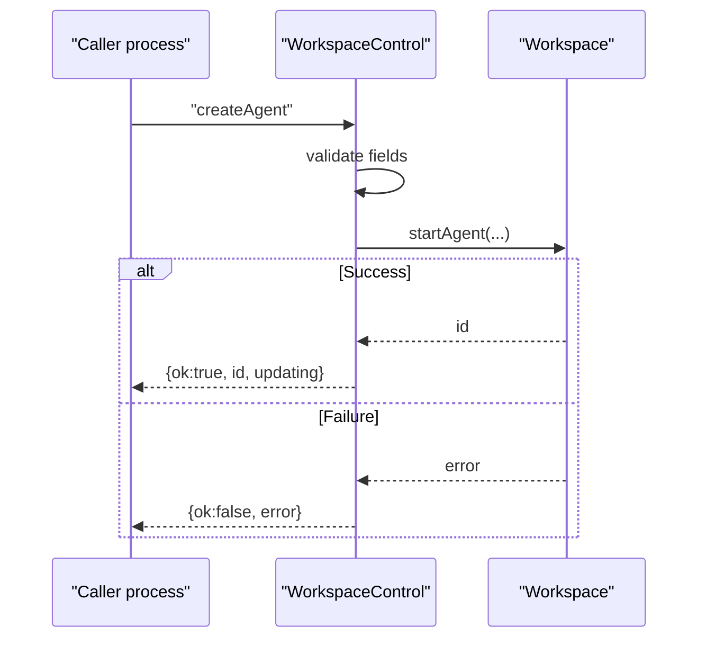
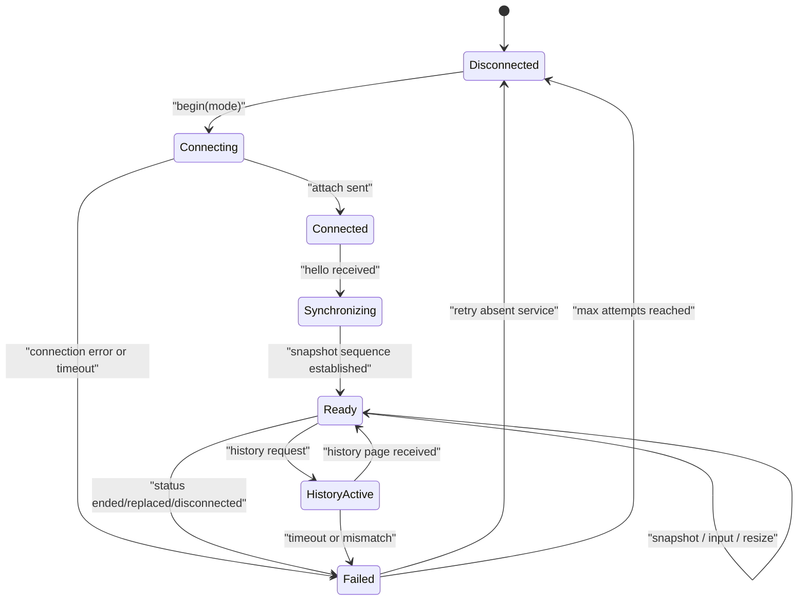
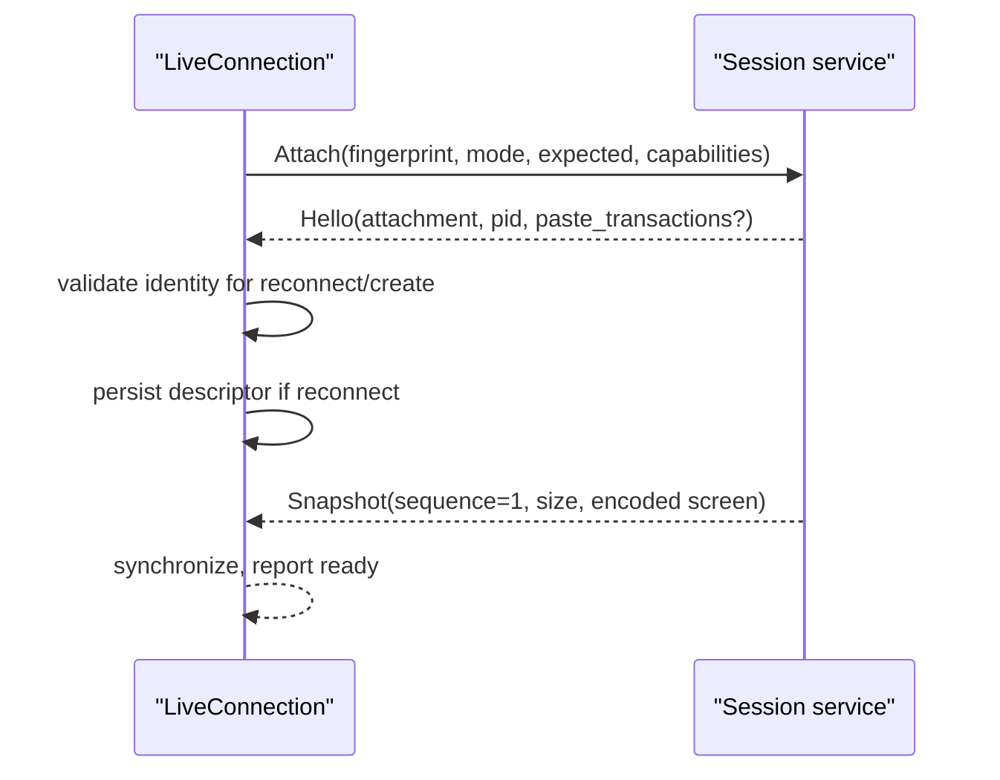
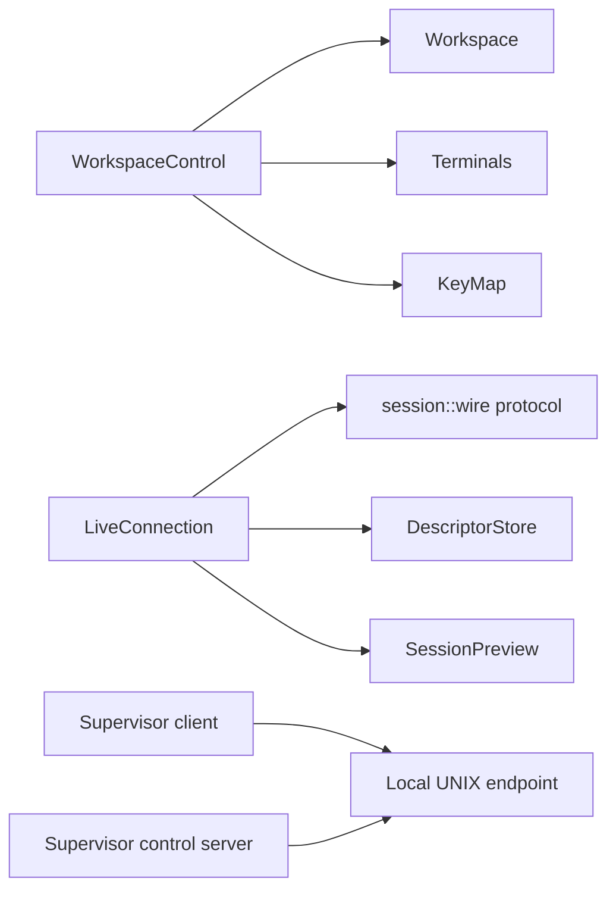

# Service Integration and IPC

<cite>
**Referenced Files in This Document**
- [workspace_control.hpp](file://apps/desktop/src/workspace_control.hpp)
- [workspace_control.cpp](file://apps/desktop/src/workspace_control.cpp)
- [live_connection.hpp](file://apps/desktop/src/live_connection.hpp)
- [live_connection.cpp](file://apps/desktop/src/live_connection.cpp)
- [local_protocol.hpp](file://services/session/src/transport/local_protocol.hpp)
- [local_protocol.cpp](file://services/session/src/transport/local_protocol.cpp)
- [wire_bytes.hpp](file://services/session/src/transport/wire_bytes.hpp)
- [update_pacing.hpp](file://services/session/src/transport/update_pacing.hpp)
- [client.hpp](file://services/supervisor/include/lapis/supervisor/client.hpp)
- [client.cpp](file://services/supervisor/src/client.cpp)
- [control_server.hpp](file://services/supervisor/include/lapis/supervisor/control_server.hpp)
- [control_server.cpp](file://services/supervisor/src/control_server.cpp)
- [architecture.md](file://docs/architecture.md)
</cite>

## Table of Contents
1. [Introduction](#introduction)
2. [Project Structure](#project-structure)
3. [Core Components](#core-components)
4. [Architecture Overview](#architecture-overview)
5. [Detailed Component Analysis](#detailed-component-analysis)
6. [Dependency Analysis](#dependency-analysis)
7. [Performance Considerations](#performance-considerations)
8. [Troubleshooting Guide](#troubleshooting-guide)
9. [Security Considerations](#security-considerations)
10. [Conclusion](#conclusion)

## Introduction
This document explains how the Lapis workspace integrates with background services through inter-process communication. It focuses on two integration paths:

- **WorkspaceControl**: a local Unix socket server that lets other Lapis processes, such as the phone gateway or remote access tools, coordinate with the process owning the workspace (the desktop window or windowless host). It handles requests to list available agents, create or destroy sessions, manage categories, open quick terminals, adjust settings, and request ownership handover.
- **LiveConnection**: the desktop client that connects to session services through the supervisor-controlled runtime. It negotiates attach modes, discovers existing sessions, starts new ones, synchronizes terminal snapshots, manages history paging, resizes terminals, sends input, and retries connections after failures.

The underlying wire protocol is defined in `services/session/src/transport/local_protocol.*`, while the supervisor’s control plane uses a separate bounded JSON-over-local-socket protocol implemented under `services/supervisor`.

## Project Structure
The relevant implementation is split across three layers:

| Layer | Responsibility | Key files |
|---|---|---|
| Desktop GUI layer | UI-driven lifecycle, event propagation, retry, sizing, paste handling | `apps/desktop/src/workspace_control.{hpp,cpp}`, `apps/desktop/src/live_connection.{hpp,cpp}` |
| Session wire protocol | Framing, attach/hello/snapshot/history/input/status messages | `services/session/src/transport/local_protocol.{hpp,cpp}`, `services/session/src/transport/wire_bytes.hpp`, `services/session/src/transport/update_pacing.hpp` |
| Supervisor control plane | Local control server, status/stop encoding, endpoint binding, peer UID checks | `services/supervisor/include/lapis/supervisor/client.hpp`, `services/supervisor/src/client.cpp`, `services/supervisor/include/lapis/supervisor/control_server.hpp`, `services/supervisor/src/control_server.cpp` |

**Diagram sources**
- [workspace_control.hpp:12-68](file://apps/desktop/src/workspace_control.hpp#L12-L68)
- [workspace_control.cpp:31-110](file://apps/desktop/src/workspace_control.cpp#L31-L110)
- [live_connection.hpp:23-115](file://apps/desktop/src/live_connection.hpp#L23-L115)
- [local_protocol.hpp:18-194](file://services/session/src/transport/local_protocol.hpp#L18-L194)
- [control_server.hpp:12-30](file://services/supervisor/include/lapis/supervisor/control_server.hpp#L12-L30)
- [client.hpp:8-33](file://services/supervisor/include/lapis/supervisor/client.hpp#L8-L33)

**Section sources**
- [workspace_control.hpp:12-68](file://apps/desktop/src/workspace_control.hpp#L12-L68)
- [workspace_control.cpp:31-110](file://apps/desktop/src/workspace_control.cpp#L31-L110)
- [live_connection.hpp:23-115](file://apps/desktop/src/live_connection.hpp#L23-L115)
- [local_protocol.hpp:18-194](file://services/session/src/transport/local_protocol.hpp#L18-L194)
- [control_server.hpp:12-30](file://services/supervisor/include/lapis/supervisor/control_server.hpp#L12-L30)
- [client.hpp:8-33](file://services/supervisor/include/lapis/supervisor/client.hpp#L8-L33)

## Core Components

### WorkspaceControl
`WorkspaceControl` owns a local server listening on `<registry folder>/workspace-control.sock`. Each connection accepts one line-delimited JSON request and returns one line-delimited JSON response. The supported version is 1.

Supported request kinds include:

| Request kind | Purpose | Important fields | Response behavior |
|---|---|---|---|
| `harnesses` | Lists available agent harnesses and defaults | None | Returns available harnesses and agent defaults |
| `createAgent` | Starts an agent session | `category`, `harness`, `directory`; optional `title`, `machine`, `program`, `model`, `mode`, `resume` | Returns success plus agent ID and whether it is updating |
| `createCategory` / `renameCategory` / `removeCategory` / `placeCategory` | Manages categories | `name`, `id`, `index` | Returns success or workspace refusal |
| `closeAgent` / `renameAgent` / `placeAgent` / `restartAgent` | Controls running agents | `id`, optional `title`, `category`, `index` | Returns success or workspace refusal |
| `openTerminal` / `closeTerminal` | Opens or closes quick-command terminals | `machine`, `id` | Requires active `Terminals` pointer; returns success or error |
| `settings` / `changeSettings` | Reads or patches selected macOS settings exposed to remote clients | Boolean switches and numeric `alertRepeat` | Returns current settings or validation failure |
| `handover` | Requests the windowless host to transfer registry ownership | None | Only honored by the host process |

Error responses are uniform: they set `ok` to false and include an `error` message. Successful responses set `ok` to true and include operation-specific data such as IDs.

Key design points:

- The server removes any leftover socket from a dead process before listening.
- Connections are limited to one request; idle sockets are aborted after a short timeout.
- Malformed JSON, unsupported versions, unknown requests, missing fields, and invalid positions are rejected without touching the workspace.
- Workspace-level failures, such as a refused Mac policy, are returned through a shared refusal helper.
- Handover emits a Qt signal for the host process to move ownership rather than doing it directly inside the socket handler.

**Section sources**
- [workspace_control.hpp:12-68](file://apps/desktop/src/workspace_control.hpp#L12-L68)
- [workspace_control.cpp:31-110](file://apps/desktop/src/workspace_control.cpp#L31-L110)
- [workspace_control.cpp:186-341](file://apps/desktop/src/workspace_control.cpp#L186-L341)

### LiveConnection
`LiveConnection` is the desktop-side client for a session service. It manages the full lifecycle:

1. **Begin**: sets up retry timers, clears state, prepares an attach request, and either discovers an existing session, reconnects to a saved identity, or creates a new session by launching the service.
2. **Connect**: opens a local socket, widens OS buffers, sends the attach frame, and starts a synchronization handshake timer.
3. **Hello**: validates attachment identity according to attach mode, negotiates capabilities such as paste transactions, and reports service identity to the UI.
4. **Snapshot stream**: tracks monotonic sequence numbers, decodes screen frames when needed, coalesces updates, and persists session descriptors so reconnects can recover.
5. **History**: pages older/newer/at-row content with bounded timeouts, cancellation tracking, and size reconciliation.
6. **Input**: sends text, keys, wheel events, and optionally large pastes using negotiated paste transactions.
7. **Resize**: reconciles view size, service size, pending history, and external joins.
8. **Failure and retry**: distinguishes absent endpoints from transport errors, limits initial retries, and exposes connection states to the UI.

Common integration patterns built into this component:

- **Discovery**: call `begin(AttachMode::discover)` to find an existing session matching the launch fingerprint.
- **Reconnect**: call `begin(AttachMode::reconnect)` to restore a previously saved session identity.
- **Create**: call `begin(AttachMode::create)` to start a fresh service and attach immediately.
- **Retry absent services**: if the server is not found or connection is refused, the client retries up to a fixed limit before failing.
- **Capability negotiation**: enables hyperlinks, attention phases, and paste transactions only when the service supports them.
- **Graceful degradation**: falls back to regular text/paste frames when paste transactions are unavailable.

**Section sources**
- [live_connection.hpp:23-115](file://apps/desktop/src/live_connection.hpp#L23-L115)
- [live_connection.cpp:550-720](file://apps/desktop/src/live_connection.cpp#L550-L720)
- [live_connection.cpp:720-926](file://apps/desktop/src/live_connection.cpp#L720-L926)

### Supervisor Client and Control Server
The supervisor provides a separate control plane for inspecting and stopping the supervised runtime.

#### Supervisor client
The client encodes JSON requests with a `version` field and actions such as `status` and `stop`. It connects to a local UNIX endpoint, writes a framed request, drains partial writes, reads a bounded response, and decodes it into a structured status object.

Important behaviors:

- Status replies validate schema version, slot values, enabled/service-live flags, and endpoint presence.
- Stop requests require an authenticated spawn token from the persisted state.
- State file reading enforces owner-only permissions, no symlink exposure, and strict size bounds.
- Control requests use a fixed timeout and block until the complete response is received.

#### Supervisor control server
The server binds a private UNIX socket, rejects stale endpoints, listens for clients, validates peer UIDs, reads a four-byte big-endian length header followed by a bounded payload, invokes a handler with the caller’s UID, and writes a bounded reply.

Security-relevant properties:

- Socket path must be absolute and bounded.
- Existing stale socket is probed and removed if not already bound.
- Socket file mode is set to owner-only.
- Peer credentials are required on supported platforms.
- Clients are accepted up to a maximum and polled with deadlines.
- Reply writes are bounded and timed.

**Section sources**
- [client.hpp:8-33](file://services/supervisor/include/lapis/supervisor/client.hpp#L8-L33)
- [client.cpp:27-249](file://services/supervisor/src/client.cpp#L27-L249)
- [control_server.hpp:12-30](file://services/supervisor/include/lapis/supervisor/control_server.hpp#L12-L30)
- [control_server.cpp:24-327](file://services/supervisor/src/control_server.cpp#L24-L327)

## Architecture Overview

**Diagram sources**
- [workspace_control.cpp:88-110](file://apps/desktop/src/workspace_control.cpp#L88-L110)
- [workspace_control.cpp:118-185](file://apps/desktop/src/workspace_control.cpp#L118-L185)
- [live_connection.cpp:550-720](file://apps/desktop/src/live_connection.cpp#L550-L720)
- [local_protocol.hpp:18-194](file://services/session/src/transport/local_protocol.hpp#L18-L194)

## Detailed Component Analysis

### WorkspaceControl Message Flow
WorkspaceControl is a dispatcher over one local UNIX socket. Each incoming line is parsed as JSON, checked for version 1, dispatched by request kind, and answered with one compact JSON line terminated by a newline.

**Diagram sources**
- [workspace_control.cpp:31-110](file://apps/desktop/src/workspace_control.cpp#L31-L110)
- [workspace_control.cpp:118-341](file://apps/desktop/src/workspace_control.cpp#L118-L341)

#### Session Creation via WorkspaceControl
When another Lapis process asks for an agent:

1. The caller sends a `createAgent` request containing `category`, `harness`, and `directory`.
2. WorkspaceControl validates required string fields and optional fields.
3. It calls the workspace’s `startAgent` method with normalized title, harness, machine, program, model, mode, resume flag, and selection behavior.
4. If the workspace refuses, WorkspaceControl returns a workspace-provided error.
5. On success, it returns the agent ID and whether the session is currently updating.

**Diagram sources**
- [workspace_control.cpp:118-168](file://apps/desktop/src/workspace_control.cpp#L118-L168)

**Section sources**
- [workspace_control.cpp:31-110](file://apps/desktop/src/workspace_control.cpp#L31-L110)
- [workspace_control.cpp:118-185](file://apps/desktop/src/workspace_control.cpp#L118-L185)

### LiveConnection Lifecycle and Synchronization
LiveConnection coordinates the desktop UI with a session service. Its state machine is best understood as a pipeline rather than a simple finite automaton because it interleaves connection setup, capability negotiation, snapshot synchronization, history paging, resize reconciliation, and input delivery.

**Diagram sources**
- [live_connection.cpp:550-720](file://apps/desktop/src/live_connection.cpp#L550-L720)
- [live_connection.cpp:720-926](file://apps/desktop/src/live_connection.cpp#L720-L926)

#### Attach Modes and Identity Negotiation
The attach protocol defines four modes:

| Mode | Expected identity | Use case |
|---|---|---|
| `discover` | Zero session ID and epoch | Find an existing compatible session |
| `reconnect` | Nonzero session ID and epoch | Restore a saved session |
| `create` | Nonzero session ID, zero epoch | Start a new service with a known session ID |
| `join` | Zero session ID and epoch | Attach beside an existing client (v6) |

After `Attach`, the service replies with `Hello`, including its attachment identity, child PID, and optional paste transaction capability. The client validates that the hello matches the expected identity for reconnect or create, then marks itself synchronized once the first snapshot establishes a monotonic sequence.

**Diagram sources**
- [local_protocol.hpp:18-194](file://services/session/src/transport/local_protocol.hpp#L18-L194)
- [local_protocol.cpp:76-164](file://services/session/src/transport/local_protocol.cpp#L76-L164)
- [live_connection.cpp:720-820](file://apps/desktop/src/live_connection.cpp#L720-L820)

**Section sources**
- [live_connection.hpp:23-115](file://apps/desktop/src/live_connection.hpp#L23-L115)
- [live_connection.cpp:550-720](file://apps/desktop/src/live_connection.cpp#L550-L720)
- [local_protocol.hpp:18-194](file://services/session/src/transport/local_protocol.hpp#L18-L194)

### Session Wire Protocol Summary
The session wire protocol is internal version 6 and uses binary framing around typed payloads.

| Frame kind | Direction | Meaning |
|---|---|---|
| `hello` | Service → Client | Attachment identity, child PID, optional paste transaction capability |
| `attach` | Client → Service | Attach mode, fingerprint, expected identity, capability bits |
| `ready` | Service → Client | First applied snapshot sequence |
| `snapshot` | Service → Client | Monotonic sequence, timing metadata, terminal snapshot |
| `text` | Client → Service | User input text |
| `paste` | Client → Service | Bounded user paste |
| `paste_request` / `paste_result` | Client/Service ↔ Service | Transactional paste admission and result |
| `key` | Client → Service | Key plus modifiers |
| `resize` | Client → Service | Terminal column/row size |
| `wheel` | Client → Service | Full-screen scroll step, column, row |
| `history_request` | Client → Service | Older/newer/at-row page request |
| `history_page` | Service → Client | Paged history snapshot |
| `attention_snapshot` / `attention_decision` / `attention_retry` | Adapter-aware attention flow | Attention state and decisions |
| `terminate` | Client → Service | Request termination; service answers with ordinary `ended` status |
| `status` | Service → Client | Rejected, ended, replaced, overloaded |

Message constraints:

- Maximum frame payload is 8 MiB.
- Text/paste/key input is bounded at 64 KiB per message.
- Large pastes may be split into multiple bounded paste frames.
- Snapshots carry monotonic sequence numbers and timing fields.
- History requests are independent from live snapshot sequences but still use attachment-bound envelopes.

**Section sources**
- [local_protocol.hpp:18-194](file://services/session/src/transport/local_protocol.hpp#L18-L194)
- [local_protocol.cpp:1-200](file://services/session/src/transport/local_protocol.cpp#L1-L200)
- [wire_bytes.hpp:1-55](file://services/session/src/transport/wire_bytes.hpp#L1-L55)

## Dependency Analysis

**Diagram sources**
- [workspace_control.hpp:12-68](file://apps/desktop/src/workspace_control.hpp#L12-L68)
- [live_connection.hpp:23-115](file://apps/desktop/src/live_connection.hpp#L23-L115)
- [client.hpp:8-33](file://services/supervisor/include/lapis/supervisor/client.hpp#L8-L33)
- [control_server.hpp:12-30](file://services/supervisor/include/lapis/supervisor/control_server.hpp#L12-L30)

### Coupling and Boundaries
- `WorkspaceControl` couples tightly to the desktop `Workspace`, `Terminals`, and `KeyMap`. It does not own session lifecycle; it translates remote requests into workspace operations.
- `LiveConnection` depends on the session wire protocol, descriptor persistence, and the UI preview layer. It owns reconnection, pacing, and history reconciliation but not PTY ownership.
- The supervisor client/server pair is isolated from the session wire protocol. It uses its own JSON framing, length-prefixed binary envelope, and permission-checked UNIX sockets.

### External Dependencies
- Qt is used for local sockets, JSON, timers, future watchers, thread pools, and process launching.
- Platform POSIX helpers provide unique file descriptors, endpoint preparation, and socket buffer widening.
- The architecture document clarifies that the GUI does not own PTY handles and that session services own terminal state and lifecycle.

**Section sources**
- [architecture.md:1-80](file://docs/architecture.md#L1-L80)

## Performance Considerations

### High-Frequency Updates
The session wire protocol separates raw output parsing from presentation. LiveConnection receives encoded snapshots and defers decoding until a viewer needs the screen. This reduces UI pressure during bursts.

Optimization strategies present in the codebase:

| Area | Strategy | Effect |
|---|---|---|
| Snapshot decoding | Decode only when shown | Reduces unnecessary CPU work |
| Viewer interval pacing | Multiple viewers share decode delay | Avoids redundant rapid decode cycles |
| Update pacing utility | Rate-limits publish-to-publish intervals | Prevents bursty observers from overwhelming consumers |
| Input queue bounds | Limits queued bytes per connection | Prevents slow services from growing unbounded memory |
| Paste batching | Supports transactional paste admission | Reduces partial paste ambiguity |
| Resize coalescing | Sends requested size only when changed | Avoids repeated resize churn |
| History pagination | Asynchronous paged retrieval with timeout | Avoids blocking the UI while fetching large archives |

### Retry Behavior
LiveConnection retries absent services up to a fixed number of attempts with a short retry timer. This helps when a session service has not yet started or the endpoint is momentarily unavailable. After max attempts or non-absent errors, it fails explicitly and notifies the UI.

### Supervisor Control Plane Throughput
The supervisor control server is intentionally conservative:

- One strict control frame and reply per client.
- Poll-based accept-and-process loop with deadlines.
- Maximum client count and bounded payload sizes.
- Owner-only socket permissions and peer UID validation.

This keeps the control plane suitable for diagnostics and lifecycle management rather than high-frequency telemetry.

**Section sources**
- [live_connection.cpp:55-120](file://apps/desktop/src/live_connection.cpp#L55-L120)
- [live_connection.cpp:550-720](file://apps/desktop/src/live_connection.cpp#L550-L720)
- [update_pacing.hpp:1-52](file://services/session/src/transport/update_pacing.hpp#L1-L52)
- [control_server.cpp:200-327](file://services/supervisor/src/control_server.cpp#L200-L327)

## Troubleshooting Guide

### Common WorkspaceControl Issues
| Symptom | Likely cause | Resolution |
|---|---|---|
| `Request too large` | A single JSON line exceeds the configured limit | Reduce request size or split operations |
| `Malformed request` | Invalid JSON or missing root object | Validate JSON before sending |
| `Unsupported request version` | Client sends a version other than 1 | Upgrade the client to version 1 protocol |
| `Unknown request` | Unknown or misspelled request kind | Check the supported request table |
| `Missing ...` | Required field absent or wrong type | Add required fields with correct types |
| `No such agent` | Agent ID does not exist | List sessions or check prior creation response |
| `Terminals are not available` | Phone gateway called terminal methods before `setTerminals` | Initialize `Terminals` on the workspace controller |
| `Settings are not available` | Phone gateway called settings before `setKeyMap` | Initialize `KeyMap` on the workspace controller |
| `A lapis window keeps this workspace` | Handover requested from a non-host process | Send handover only to the windowless host |

### Common LiveConnection Issues
| Symptom | Likely cause | Resolution |
|---|---|---|
| `Connecting...` then disconnect | Service not found or refused repeatedly | Verify endpoint, allow retries, or start the service manually |
| `Session synchronization timed out` | No hello/snapshot within the configured timeout | Check service startup, logs, and attach mode |
| `No saved session` | Reconnect mode without a stored descriptor | Discover or create first |
| `Saved session has ended or been replaced` | Hello identity does not match expected identity | Discover again or create a new session |
| `History request timed out` | Service did not return the requested page | Retry browsing or restart the session |
| `Input was not sent: session is not synchronized` | Connection not ready or failed | Wait for ready state or reconnect |
| `Input queue full` | Too much pending output or slow service | Pause input, reduce paste size, or restart service |
| `Paste delivery is unknown after disconnect` | Paste transaction not acknowledged before disconnect | Treat as unacknowledged; do not assume success |
| `Disconnected. Reconnect to verify the saved session.` | Transport disconnected | Offer reconnect or discover |

### Debugging Cross-Process Communication
For `WorkspaceControl`:

- Inspect the socket path under the workspace registry folder.
- Confirm the calling process can reach the local socket.
- Log the exact JSON request line.
- Verify the request version is 1.
- Validate all required fields before sending.
- For handover, confirm the target process is the windowless host.

For `LiveConnection`:

- Capture service log output written to `<endpoint>.log`.
- Check whether the attach mode matches the intended lifecycle: discover, reconnect, or create.
- Verify the service identity returned in `Hello` matches expectations for reconnect.
- Inspect connection state transitions: connecting, synchronizing, ready, ended, replaced, disconnected.
- Use paste transaction results to distinguish admission uncertainty from explicit rejection.

For the supervisor control plane:

- Ensure the endpoint is a valid absolute path.
- Confirm the state directory and `supervisor.json` have correct ownership and permissions.
- Validate status or stop JSON against the documented fields.
- Check that the control socket is owned by the same user.
- Inspect whether the client timed out waiting for a reply.

**Section sources**
- [workspace_control.cpp:31-110](file://apps/desktop/src/workspace_control.cpp#L31-L110)
- [workspace_control.cpp:118-341](file://apps/desktop/src/workspace_control.cpp#L118-L341)
- [live_connection.cpp:550-720](file://apps/desktop/src/live_connection.cpp#L550-L720)
- [client.cpp:120-249](file://services/supervisor/src/client.cpp#L120-L249)
- [control_server.cpp:200-327](file://services/supervisor/src/control_server.cpp#L200-L327)

## Security Considerations

### Local IPC Permissions
- `WorkspaceControl` sets local socket options appropriate for local access and removes stale sockets before listening.
- `LiveConnection` uses local sockets for session services and widens OS buffers only after successful connection.
- The supervisor control server explicitly sets the socket file mode to owner-only and validates that the bound socket remains owner-only.
- The supervisor control server validates peer UIDs where available and rejects clients from foreign users.

### Input and Output Bounds
- WorkspaceControl rejects oversized lines.
- LiveConnection bounds input frames and paste frames.
- The session wire protocol bounds frames, cells, codepoints, inputs, and pastes.
- The supervisor control plane bounds state files, control payloads, and replies.

### Authentication and Trust Model
- These interfaces trust local callers restricted by operating-system filesystem and socket permissions. They are not a general network security boundary.
- The supervisor stop command requires an authenticated spawn token derived from persisted state.
- Descriptor stores and endpoint paths must remain protected from untrusted users.

### Operational Recommendations
- Run Lapis components under a dedicated user account.
- Restrict registry folders, supervisor directories, and endpoint paths to the owner.
- Do not expose these local sockets through network firewalls.
- Treat paste results carefully: admission does not imply application-level acknowledgement.
- Log diagnostic information without leaking secrets, tokens, or session transcripts.

**Section sources**
- [workspace_control.cpp:31-65](file://apps/desktop/src/workspace_control.cpp#L31-L65)
- [live_connection.cpp:550-720](file://apps/desktop/src/live_connection.cpp#L550-L720)
- [local_protocol.hpp:18-194](file://services/session/src/transport/local_protocol.hpp#L18-L194)
- [client.cpp:84-170](file://services/supervisor/src/client.cpp#L84-L170)
- [control_server.cpp:24-120](file://services/supervisor/src/control_server.cpp#L24-L120)

## Conclusion
The Lapis workspace integrates with background services through two complementary IPC mechanisms:

- `WorkspaceControl` provides a simple, versioned JSON-line interface for coordinating workspace operations between Lapis processes. It delegates session creation and destruction to the owning workspace and protects the host from malformed or unauthorized requests.
- `LiveConnection` implements the desktop client for the session wire protocol. It discovers, creates, reconnects to, and synchronizes with session services, handling retries, capability negotiation, snapshot pacing, history paging, resize reconciliation, and input delivery.
- The supervisor control plane adds a secure, bounded local control API for checking runtime status and requesting shutdown, enforcing strict permissions, ownership, and payload limits.

Together, these components separate concerns: the desktop UI owns presentation and user interaction, session services own PTYs and terminal state, and the supervisor owns durable process birth and convergence. Correct integration requires respecting request versions, attachment identities, message bounds, retry policies, and local IPC permissions.