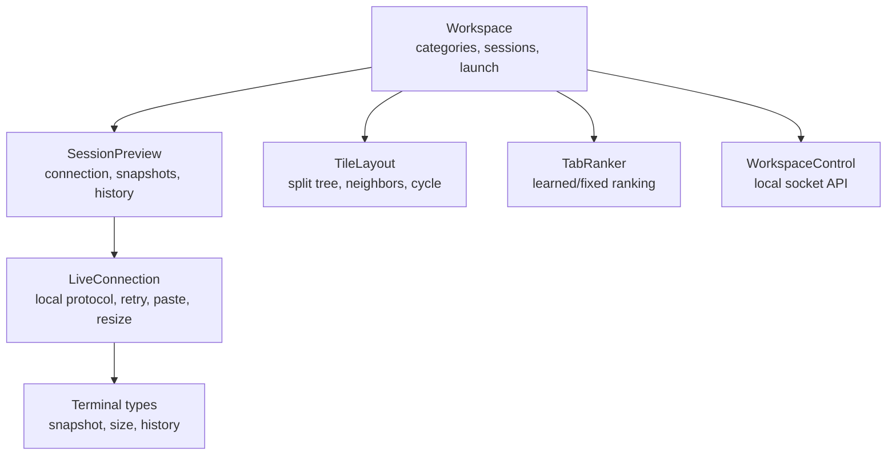
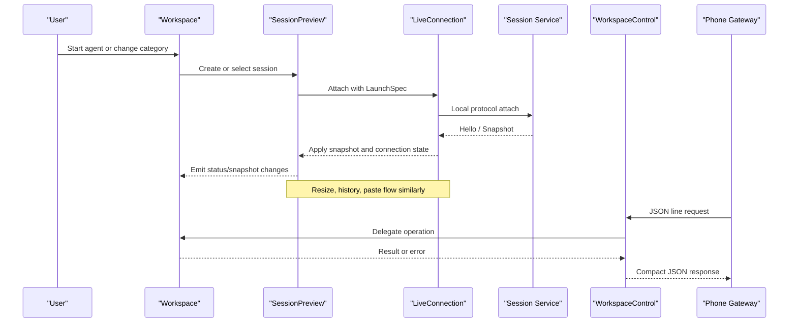
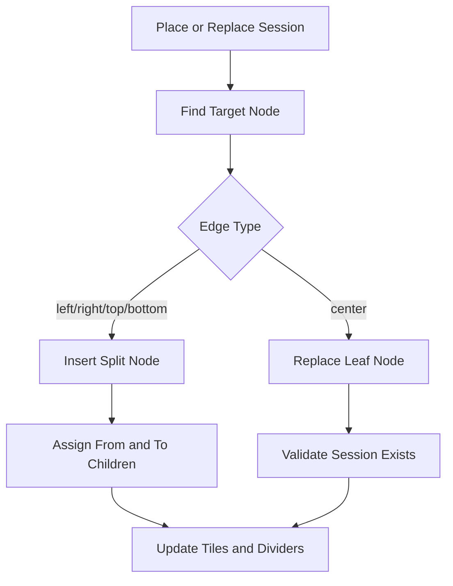
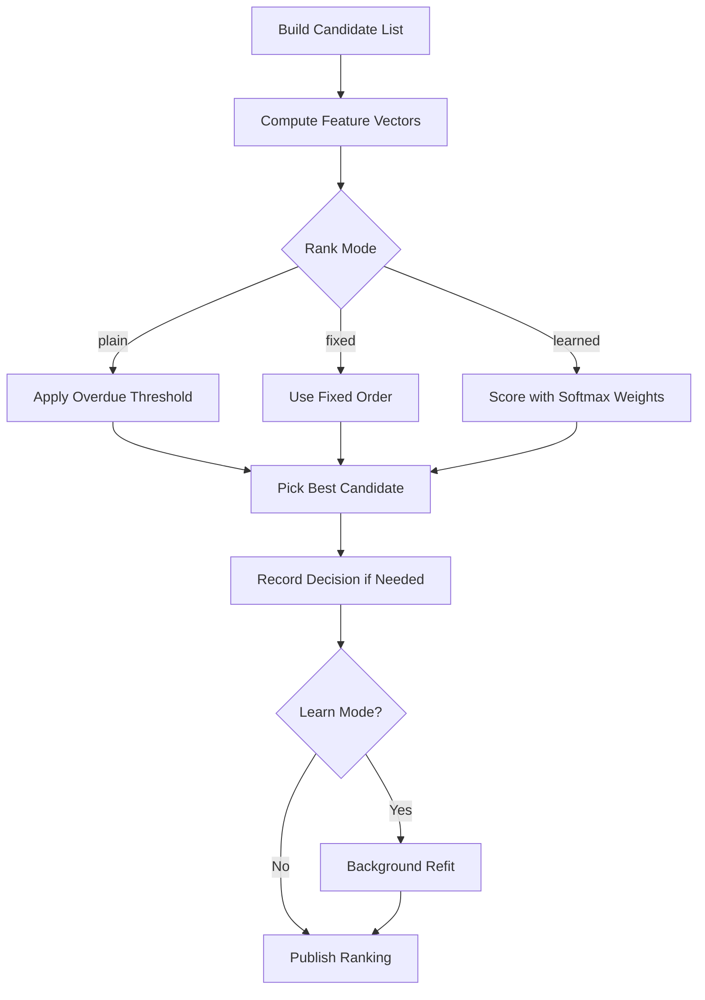
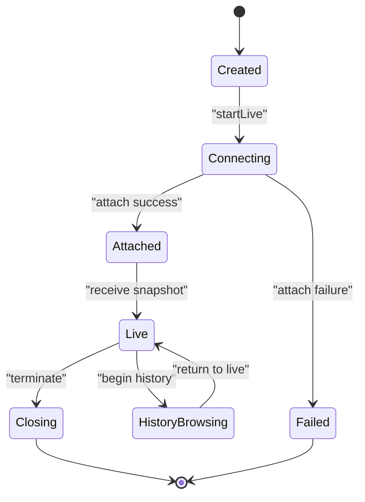
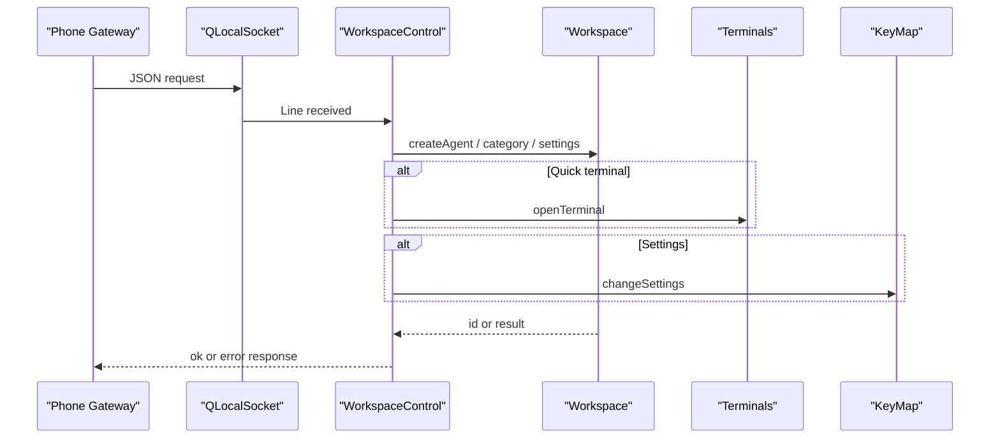
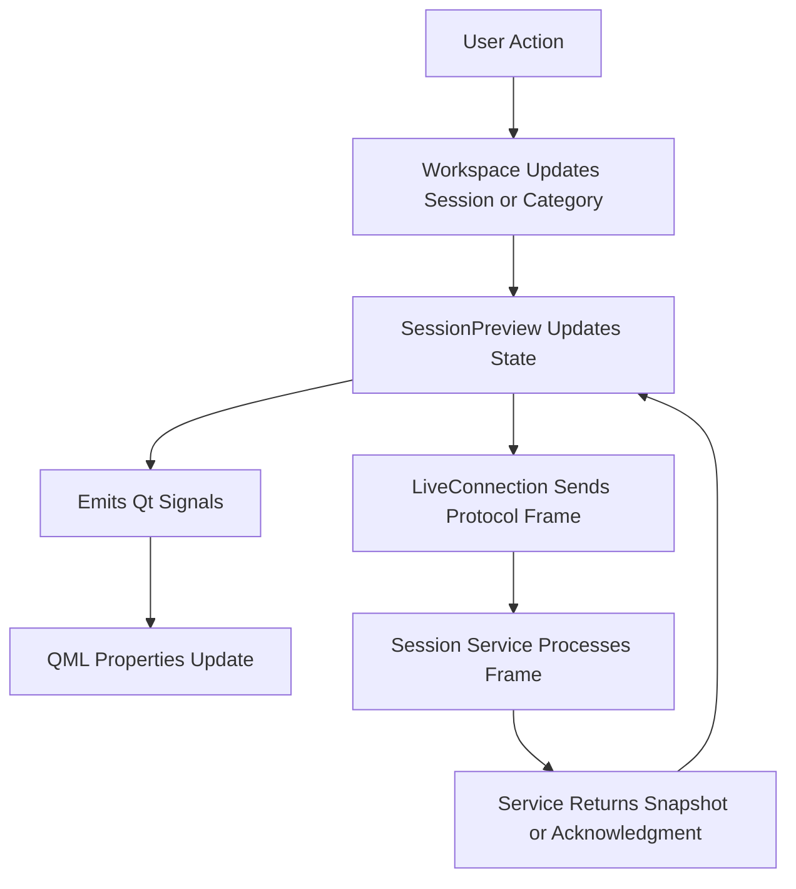
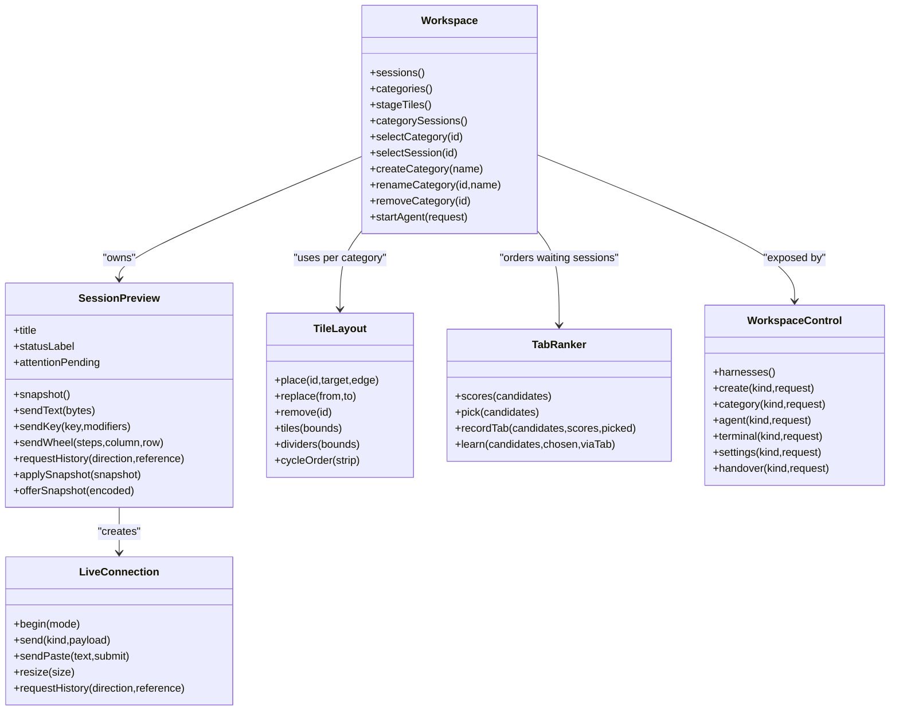

# Workspace Management

<cite>
**Referenced Files in This Document**
- [workspace.hpp](file://apps/desktop/src/workspace.hpp)
- [workspace.cpp](file://apps/desktop/src/workspace.cpp)
- [live_connection.hpp](file://apps/desktop/src/live_connection.hpp)
- [live_connection.cpp](file://apps/desktop/src/live_connection.cpp)
- [workspace_control.hpp](file://apps/desktop/src/workspace_control.hpp)
- [workspace_control.cpp](file://apps/desktop/src/workspace_control.cpp)
- [tab_ranker.hpp](file://apps/desktop/src/tab_ranker.hpp)
- [tab_ranker.cpp](file://apps/desktop/src/tab_ranker.cpp)
- [tile_layout.hpp](file://apps/desktop/src/tile_layout.hpp)
- [tile_layout.cpp](file://apps/desktop/src/tile_layout.cpp)
- [terminal.hpp](file://services/session/include/lapis/session/terminal.hpp)
- [workspace.md](file://docs/workspace.md)
</cite>

## Table of Contents
1. [Introduction](#introduction)
2. [Project Structure](#project-structure)
3. [Core Components](#core-components)
4. [Architecture Overview](#architecture-overview)
5. [Detailed Component Analysis](#detailed-component-analysis)
6. [Dependency Analysis](#dependency-analysis)
7. [Performance Considerations](#performance-considerations)
8. [Troubleshooting Guide](#troubleshooting-guide)
9. [Conclusion](#conclusion)

## Introduction
This document explains the Lapis desktop workspace management system. It focuses on how the `Workspace` class organizes agent categories, session tiles, and the multi-agent terminal interface; how `SessionPreview` objects represent and manage agent sessions; how tile layout algorithms arrange agents; how the tab ranker orders sessions; and how background services are connected through `LiveConnection` and cross-process control is handled by `WorkspaceControl`.

The workspace is primarily a Qt-based desktop application layer that sits above the shared session service and terminal abstractions. It presents one active agent on a stage, a strip of category cards underneath, optional tiled splits within a category, and history scrubbing. Categories group related agents and remember their own selection state. The workspace can run in live mode for the normal UI or preview mode for development fixtures.

## Project Structure
At the heart of the desktop workspace are:

- `Workspace`: category registry, session registry, launch orchestration, attention aggregation, stage and strip state, and public QML bindings.
- `SessionPreview`: per-session state including connection lifecycle, terminal snapshot buffer, history strip, attention state, input/output queues, and viewer pacing.
- `LiveConnection`: local transport to a session service process, attachment handshake, resize/history/paste handling, retry logic, and descriptor store coordination.
- `WorkspaceControl`: local socket server exposing workspace operations (agent/category creation, ordering, settings, terminals, handover) to other Lapis processes such as the phone gateway.
- `TileLayout`: binary split tree describing tiled agents with ratios, neighbor queries, reading order, and next/previous cycling behavior.
- `TabRanker`: learned or fixed ordering of waiting agents used by the Tab feature.
- `Terminal` types from the shared session library: size, limits, snapshot, cell model, history metadata, and wheel/key encoders.

**Diagram sources**
- [workspace.hpp:300-450](file://apps/desktop/src/workspace.hpp#L300-L450)
- [workspace.cpp:1-200](file://apps/desktop/src/workspace.cpp#L1-L200)
- [live_connection.hpp:1-116](file://apps/desktop/src/live_connection.hpp#L1-L116)
- [tab_ranker.hpp:1-134](file://apps/desktop/src/tab_ranker.hpp#L1-L134)
- [tile_layout.hpp:1-90](file://apps/desktop/src/tile_layout.hpp#L1-L90)
- [workspace_control.hpp:1-70](file://apps/desktop/src/workspace_control.hpp#L1-L70)
- [terminal.hpp:1-200](file://services/session/include/lapis/session/terminal.hpp#L1-L200)

**Section sources**
- [workspace.hpp:1-200](file://apps/desktop/src/workspace.hpp#L1-L200)
- [workspace.cpp:1-200](file://apps/desktop/src/workspace.cpp#L1-L200)
- [workspace.md:1-105](file://docs/workspace.md#L1-L105)

## Core Components

### Workspace
`Workspace` is the top-level coordinator. It owns:

- A set of categories and their selected agents.
- All `SessionPreview` instances keyed by session identifier.
- Active category, focus index, error state, and stage tile data exposed to QML.
- Launch configuration via `AgentRequest`, including harness, directory, machine, program, model, approval mode, resume conversation, and whether to select the new session immediately.
- Category lifecycle: add, create, rename, remove, and select.
- Session lifecycle: start, close, restart, rename, move between categories, place into tiles, and focus.
- Attention aggregation across all sessions for UI badges and status.
- History and terminal size propagation to focused sessions.

Key responsibilities include translating user actions into service requests, managing `SessionPreview` lifetimes, updating tile layouts, and publishing properties such as `sessions`, `categories`, `stageTiles`, and `stageDividers`.

**Section sources**
- [workspace.hpp:300-450](file://apps/desktop/src/workspace.hpp#L300-L450)
- [workspace.cpp:201-495](file://apps/desktop/src/workspace.cpp#L201-L495)

### SessionPreview
`SessionPreview` represents one agent session visible to the UI. Its main concerns are:

- Connection state: endpoint, service identity, service session identifier, reachable flag, input readiness, and closing state.
- Terminal snapshot buffering: latest decoded screen, alternate-screen awareness, decode pacing, and viewer count.
- History browsing: a `HistoryStrip` abstraction for archived pages, scrubbing position, oldest page tracking, and request cancellation.
- Attention state: pending reasons, serial number, request map, diagnostic information, and unseen marking.
- Input routing: text, key events, wheel turns, paste transactions, and scroll-back debt when inside full-screen programs.
- Service environment injection: transient credentials or variables passed only to the spawned service process.

It exposes many Qt properties so QML can bind directly to title, status, accent color, activity, attention flags, and timing diagnostics.

**Section sources**
- [workspace.hpp:1-200](file://apps/desktop/src/workspace.hpp#L1-L200)
- [workspace.hpp:201-450](file://apps/desktop/src/workspace.hpp#L201-L450)
- [live_connection.cpp:1-200](file://apps/desktop/src/live_connection.cpp#L1-L200)

### LiveConnection
`LiveConnection` manages the local protocol channel to a session service. Responsibilities include:

- Establishing a local socket connection.
- Performing an attach/handshake using a `session::LaunchSpec` and `AttachMode`.
- Sending terminal snapshots, history requests, resize messages, key and wheel events, and paste payloads.
- Retrying failed connections up to a bounded attempt limit.
- Tracking capability negotiation such as paste transactions and terminal synchronization.
- Coordinating with a descriptor store and optional launcher callback for detached service processes.
- Coalescing resize and history requests to avoid redundant traffic.

It reports failures through its owning `SessionPreview`, which updates connection state, history message, and reachability.

**Section sources**
- [live_connection.hpp:1-116](file://apps/desktop/src/live_connection.hpp#L1-L116)
- [live_connection.cpp:1-200](file://apps/desktop/src/live_connection.cpp#L1-L200)

### WorkspaceControl
`WorkspaceControl` runs a local JSON-line server on a Unix-domain socket under the workspace registry folder. It handles requests from other Lapis processes, especially the phone gateway. Supported request kinds include:

- Listing available harnesses and defaults.
- Creating agents and categories.
- Renaming, removing, and reordering categories.
- Closing, renaming, moving, and restarting agents.
- Opening and closing quick-command terminals.
- Reading and changing settings.
- Requesting workspace handover from a windowless host to a window.

Requests are validated, routed to handlers, and answered with compact JSON. If the workspace refuses an operation, it returns the workspace’s current error.

**Section sources**
- [workspace_control.hpp:1-70](file://apps/desktop/src/workspace_control.hpp#L1-L70)
- [workspace_control.cpp:1-200](file://apps/desktop/src/workspace_control.cpp#L1-L200)

### TileLayout
`TileLayout` models a category’s stage as a binary tree. Each leaf is a session tile; each internal node is either side-by-side or stacked, with a ratio dividing child areas. It supports:

- Placing a session beside a target or replacing a target.
- Removing a session and collapsing its sibling into the space.
- Computing tile rectangles and divider lines for dragging.
- Finding neighboring tiles in left/right/top/bottom directions.
- Producing reading order and cycle order for next/previous navigation.
- Serializing and reconstructing layouts while dropping unknown or repeated sessions.

Maximum tiles and depth are bounded to prevent runaway nesting.

**Section sources**
- [tile_layout.hpp:1-90](file://apps/desktop/src/tile_layout.hpp#L1-L90)
- [tile_layout.cpp:1-200](file://apps/desktop/src/tile_layout.cpp#L1-L200)

### TabRanker
`TabRanker` ranks eligible waiting agents for the Tab feature. It supports three modes:

- Plain: overdue work first, then work categories, requests, unseen turns, and newest.
- Learned: a linear softmax ranker fitted to recorded choices, with category weights pulled toward a prior.
- Fixed: earliest order, then unseen turn/request, then already-seen guess, longest wait first.

Features include work classification, request presence, unseen status, guess status, logarithmic wait time, recency, staleness, recent turn rate, and time since last turn. Decisions are persisted in a log file and a fitted model file when a folder is configured.

**Section sources**
- [tab_ranker.hpp:1-134](file://apps/desktop/src/tab_ranker.hpp#L1-L134)
- [tab_ranker.cpp:1-200](file://apps/desktop/src/tab_ranker.cpp#L1-L200)

### Shared Terminal Types
The shared session library defines the terminal contract used by both the service and the desktop workspace:

- `TerminalSize`: column and row dimensions.
- `TerminalLimits`: maximum cells, input size, grapheme codepoints, reply size, and history budget.
- `TerminalSnapshot`: revision, size, cursor, alternate screen, capabilities, palette, contiguous graphemes, row-major cells, history metadata, and hyperlinks.
- Wheel and key encoders for interacting with programs without granting clipboard access.

These types separate rendering and I/O concerns from workspace orchestration.

**Section sources**
- [terminal.hpp:1-200](file://services/session/include/lapis/session/terminal.hpp#L1-L200)

## Architecture Overview
The workspace integrates user interactions, UI state, background services, and cross-process commands through a layered design.

**Diagram sources**
- [workspace.cpp:1-200](file://apps/desktop/src/workspace.cpp#L1-L200)
- [live_connection.cpp:1-200](file://apps/desktop/src/live_connection.cpp#L1-L200)
- [workspace_control.cpp:1-200](file://apps/desktop/src/workspace_control.cpp#L1-L200)

## Detailed Component Analysis

### Category-Based Organization Model
Categories act as containers for related agents. Each category maintains:

- A unique identifier and display name.
- Its currently selected session.
- Its tile layout.
- Ordered placement of sessions within the category strip.

The workspace validates category operations: at least one category must remain, removal requires an empty category, and remote-controlled renames or moves follow the same rules as direct UI commands.

Categories also participate in attention counting: any agent that finished a turn needing attention or has a pending request increments the workspace-wide attention indicator.

**Section sources**
- [workspace.hpp:300-450](file://apps/desktop/src/workspace.hpp#L300-L450)
- [workspace_control.cpp:200-341](file://apps/desktop/src/workspace_control.cpp#L200-L341)
- [workspace.md:1-40](file://docs/workspace.md#L1-L40)

### Session Tiles and Layout Algorithms
Tile layout is a binary split tree. When a user drags a card onto a stage edge, `TileLayout.place` inserts or replaces the session in reading order. Dividers expose draggable geometry, and ratios are clamped to safe bounds.

Navigation combines two orders:

- Reading order: left-to-right, then top-to-bottom across splits.
- Cycle order: tiling tiles in reading order, followed by untiled sessions from the category strip.

Next/previous keys compute a step that may swap a tiled slot with a strip agent or simply select the next candidate. Neighbor queries help keyboard traversal without wrapping around unrelated tiles.

**Diagram sources**
- [tile_layout.cpp:120-200](file://apps/desktop/src/tile_layout.cpp#L120-L200)
- [tile_layout.hpp:20-90](file://apps/desktop/src/tile_layout.hpp#L20-L90)

**Section sources**
- [tile_layout.hpp:1-90](file://apps/desktop/src/tile_layout.hpp#L1-L90)
- [tile_layout.cpp:1-200](file://apps/desktop/src/tile_layout.cpp#L1-L200)
- [workspace.md:20-40](file://docs/workspace.md#L20-L40)

### Tab Ranker and Session Ordering
The tab ranker decides which waiting agent should be selected next. Eligibility is determined by the workspace (for example, a finished turn without background work, or a pending request). The ranker itself scores candidates using nine features:

1. Work category flag.
2. Request flag.
3. Unseen flag.
4. Guess flag.
5. Logarithmic wait minutes.
6. Newest flag.
7. Staleness flag.
8. Turn rate in the last hour.
9. Minutes since last turn.

In learned mode, decisions are logged and refit asynchronously. The fitted model includes global weights and per-category weights. In plain mode, overdue work takes priority; in fixed mode, an earlier order is preserved until an unseen turn or request appears.

**Diagram sources**
- [tab_ranker.cpp:120-200](file://apps/desktop/src/tab_ranker.cpp#L120-L200)
- [tab_ranker.hpp:1-134](file://apps/desktop/src/tab_ranker.hpp#L1-L134)

**Section sources**
- [tab_ranker.hpp:1-134](file://apps/desktop/src/tab_ranker.hpp#L1-L134)
- [tab_ranker.cpp:1-200](file://apps/desktop/src/tab_ranker.cpp#L1-L200)

### SessionPreview Lifecycle and Attention State
A `SessionPreview` progresses through several states:

1. **Created**: initialized with title, directory, activity, accent, and optional content.
2. **Connecting**: `startLive` creates a `LiveConnection`; connection state becomes disconnected until attached.
3. **Attached**: receives hello, initial snapshot, and capability flags.
4. **Live**: receiving terminal snapshots and accepting input.
5. **History browsing**: showing archived pages while preserving live synchronization.
6. **Closing**: terminating the service and awaiting process exit.

Attention state tracks:

- Pending attention reason and serial number.
- Number of attention requests.
- Whether an attention source exists and whether attention is ready.
- Diagnostic details and request payloads.
- Unseen marking when attention arrived while another agent was selected.

When attention arrives, `SessionPreview` notifies the workspace, which aggregates counts and emits category-level attention indicators.

**Diagram sources**
- [workspace.hpp:1-200](file://apps/desktop/src/workspace.hpp#L1-L200)
- [live_connection.cpp:1-200](file://apps/desktop/src/live_connection.cpp#L1-L200)

**Section sources**
- [workspace.hpp:1-200](file://apps/desktop/src/workspace.hpp#L1-L200)
- [live_connection.cpp:1-200](file://apps/desktop/src/live_connection.cpp#L1-L200)

### Background Services and Cross-Process Communication
Background sessions are managed by the shared session service, not directly by the desktop UI. `LiveConnection` communicates with the service over a local endpoint using a wire protocol defined by the session layer. It handles:

- Attachment handshake.
- Snapshot delivery and decoding.
- History direction requests and replies.
- Terminal resize and size claims.
- Paste admission and transaction results.
- Retry and timeout policies.

`WorkspaceControl` provides a second integration surface: a JSON-line local socket API for other Lapis processes. The phone gateway uses this to create agents, manage categories, open quick terminals, read or change settings, and request handover. The workspace delegates these operations to its public methods and translates errors into refusal responses.

**Diagram sources**
- [workspace_control.cpp:1-200](file://apps/desktop/src/workspace_control.cpp#L1-L200)
- [workspace_control.hpp:1-70](file://apps/desktop/src/workspace_control.hpp#L1-L70)

**Section sources**
- [workspace_control.hpp:1-70](file://apps/desktop/src/workspace_control.hpp#L1-L70)
- [workspace_control.cpp:1-200](file://apps/desktop/src/workspace_control.cpp#L1-L200)

### Data Flow from User Interaction to UI and Services
A typical interaction follows these steps:

1. User selects or starts an agent.
2. `Workspace` locates or creates a `SessionPreview`.
3. If needed, `SessionPreview.startLive` creates `LiveConnection`.
4. `LiveConnection` attaches to the session service and applies hello/snapshot frames.
5. `SessionPreview` updates its snapshot, attention state, and history strip.
6. `SessionPreview` emits Qt signals; QML binds to properties such as title, status, and snapshot timing.
7. User input is encoded and sent back through `LiveConnection` to the service.
8. Cross-process requests from the phone go through `WorkspaceControl` into `Workspace`.

**Diagram sources**
- [workspace.cpp:201-495](file://apps/desktop/src/workspace.cpp#L201-L495)
- [live_connection.cpp:1-200](file://apps/desktop/src/live_connection.cpp#L1-L200)
- [workspace.hpp:201-450](file://apps/desktop/src/workspace.hpp#L201-L450)

**Section sources**
- [workspace.cpp:201-495](file://apps/desktop/src/workspace.cpp#L201-L495)
- [live_connection.cpp:1-200](file://apps/desktop/src/live_connection.cpp#L1-L200)

## Dependency Analysis

**Diagram sources**
- [workspace.hpp:300-450](file://apps/desktop/src/workspace.hpp#L300-L450)
- [workspace.hpp:1-200](file://apps/desktop/src/workspace.hpp#L1-L200)
- [live_connection.hpp:1-116](file://apps/desktop/src/live_connection.hpp#L1-L116)
- [tile_layout.hpp:1-90](file://apps/desktop/src/tile_layout.hpp#L1-L90)
- [tab_ranker.hpp:1-134](file://apps/desktop/src/tab_ranker.hpp#L1-L134)
- [workspace_control.hpp:1-70](file://apps/desktop/src/workspace_control.hpp#L1-L70)

**Section sources**
- [workspace.hpp:1-450](file://apps/desktop/src/workspace.hpp#L1-L450)
- [live_connection.hpp:1-116](file://apps/desktop/src/live_connection.hpp#L1-L116)
- [tile_layout.hpp:1-90](file://apps/desktop/src/tile_layout.hpp#L1-L90)
- [tab_ranker.hpp:1-134](file://apps/desktop/src/tab_ranker.hpp#L1-L134)
- [workspace_control.hpp:1-70](file://apps/desktop/src/workspace_control.hpp#L1-L70)

## Performance Considerations

### Terminal Buffer Handling
The terminal snapshot model avoids per-cell string allocations by storing a contiguous `u32string` grapheme buffer and row-major cells referencing offsets and lengths. This reduces memory pressure when displaying large screens.

`SessionPreview` decodes incoming screen payloads lazily:

- Encoded snapshots are stored as `waiting_`.
- Decoding occurs only when a viewer is present or explicitly requested.
- Decode attempts are paced by the fastest viewer interval.
- Failed decodes preserve the last good screen.
- Alternate-screen switches clear wheel-debt state because scrolling semantics differ between primary and alternate buffers.

These strategies keep frame-rate-sensitive UI responsive while still supporting long-running terminal output.

**Section sources**
- [terminal.hpp:1-200](file://services/session/include/lapis/session/terminal.hpp#L1-L200)
- [live_connection.cpp:1-200](file://apps/desktop/src/live_connection.cpp#L1-L200)
- [workspace.hpp:1-200](file://apps/desktop/src/workspace.hpp#L1-L200)

### Memory Management for Many Concurrent Sessions
Several mechanisms bound memory growth:

- `TabRanker` caps candidate lists, decision logs, and category weight entries.
- `TabRanker` limits the number of decisions retained for fitting.
- `LiveConnection` enforces input queue byte limits and message overhead budgets.
- `SessionPreview` keeps one newest encoded screen in `waiting_` and does not retain every decoded frame unless history is actively browsed.
- History is represented as a strip with explicit page management rather than an unbounded terminal dump.
- `TerminalLimits` in the shared session library define maximum cells, input bytes, grapheme codepoints, reply size, and history bytes.

For very large numbers of concurrent sessions, prefer keeping most sessions out of view or in history browsing where possible, and rely on viewer pacing to avoid unnecessary decoding.

**Section sources**
- [tab_ranker.cpp:1-200](file://apps/desktop/src/tab_ranker.cpp#L1-L200)
- [live_connection.hpp:1-116](file://apps/desktop/src/live_connection.hpp#L1-L116)
- [terminal.hpp:1-200](file://services/session/include/lapis/session/terminal.hpp#L1-L200)

### Optimization Opportunities
Potential improvements include:

- Bounding the number of simultaneously decoded screens across all previews during heavy bursts.
- Using incremental diff hints from the service to reduce snapshot payload sizes.
- Caching decoded viewport slices for frequently viewed history pages.
- Limiting the number of active `LiveConnection` retries under persistent network failures.
- Throttling attention-diagnostic emission when many sessions update rapidly.
- Reusing terminal encoder buffers for paste and wheel encoding.

[No sources needed since this section provides general guidance]

## Troubleshooting Guide

### Agent Cannot Connect
Symptoms:

- Connection state remains disconnected.
- `reachable` is false.
- `historyMessage` reports a failure.

Likely causes:

- Invalid endpoint or unavailable session service.
- Descriptor store write failure.
- Service process exited or rejected attachment.

Actions:

- Check `LiveConnection` retry counters and reported status.
- Verify the session service is running and accessible.
- Inspect service logs written by detached launches.
- Recreate the session if descriptors are corrupted.

**Section sources**
- [live_connection.cpp:1-200](file://apps/desktop/src/live_connection.cpp#L1-L200)
- [workspace.hpp:1-200](file://apps/desktop/src/workspace.hpp#L1-L200)

### Screen Not Decoding
Symptoms:

- `decodedScreens` stops increasing.
- `decodeAttempts` increases but no new visual update.
- Last known screen remains stale.

Likely causes:

- Malformed encoded snapshot.
- Alternate-screen mismatch clearing expected state.
- No viewers registered, so decode timer is inactive.

Actions:

- Add or restore a viewer to allow paced decoding.
- Check for malformed snapshots and service compatibility.
- Confirm that history browsing is not blocking publication.

**Section sources**
- [live_connection.cpp:1-200](file://apps/desktop/src/live_connection.cpp#L1-L200)
- [workspace.hpp:1-200](file://apps/desktop/src/workspace.hpp#L1-L200)

### History Scrubbing Fails
Symptoms:

- History bar appears but cannot move.
- Older pages do not load.
- Page positioning is incorrect.

Likely causes:

- Service did not provide history placement metadata.
- History request timed out or was canceled.
- Strip pages are missing rows and the service cannot fetch them.

Actions:

- Use older/newer navigation instead of scrubbing if the service does not support placement.
- Cancel outstanding history requests before changing position aggressively.
- Return to live to reset strip state.

**Section sources**
- [live_connection.cpp:1-200](file://apps/desktop/src/live_connection.cpp#L1-L200)
- [workspace.hpp:201-450](file://apps/desktop/src/workspace.hpp#L201-L450)

### Cross-Process Request Refused
Symptoms:

- Phone gateway receives `ok: false`.
- Error message indicates malformed request, unsupported version, unknown request, or workspace refusal.

Likely causes:

- Invalid JSON or missing fields.
- Out-of-range numeric values.
- Workspace is locked or in an error state.
- Handover attempted from a window that already owns the workspace.

Actions:

- Validate request schema and version.
- Ensure numeric positions are whole and non-negative.
- Clear workspace error and retry.
- Confirm that the target process is the windowless host for handover.

**Section sources**
- [workspace_control.cpp:1-200](file://apps/desktop/src/workspace_control.cpp#L1-L200)
- [workspace_control.hpp:1-70](file://apps/desktop/src/workspace_control.hpp#L1-L70)

## Conclusion
The Lapis desktop workspace centers on `Workspace` as the orchestrator of categories, sessions, and layout state. `SessionPreview` encapsulates per-agent lifecycle, terminal snapshot pacing, history browsing, and attention signaling. `LiveConnection` abstracts the local protocol to session services, while `WorkspaceControl` enables other Lapis processes to manage the workspace safely. `TileLayout` provides deterministic split-tree geometry, and `TabRanker` learns or fixes the preferred order of waiting agents. Together, these components form a scalable, observable, and interactive multi-agent terminal interface that balances responsiveness with robust background service communication.