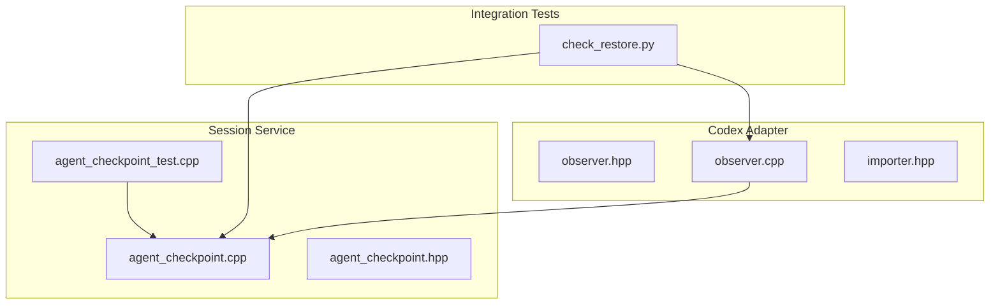
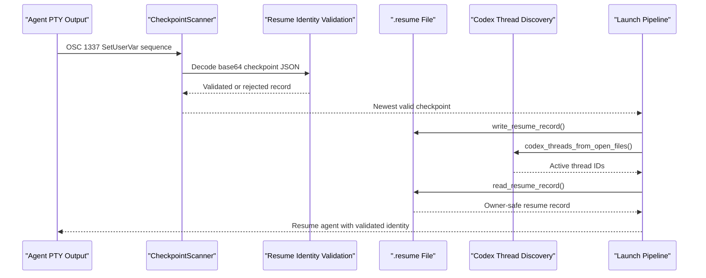
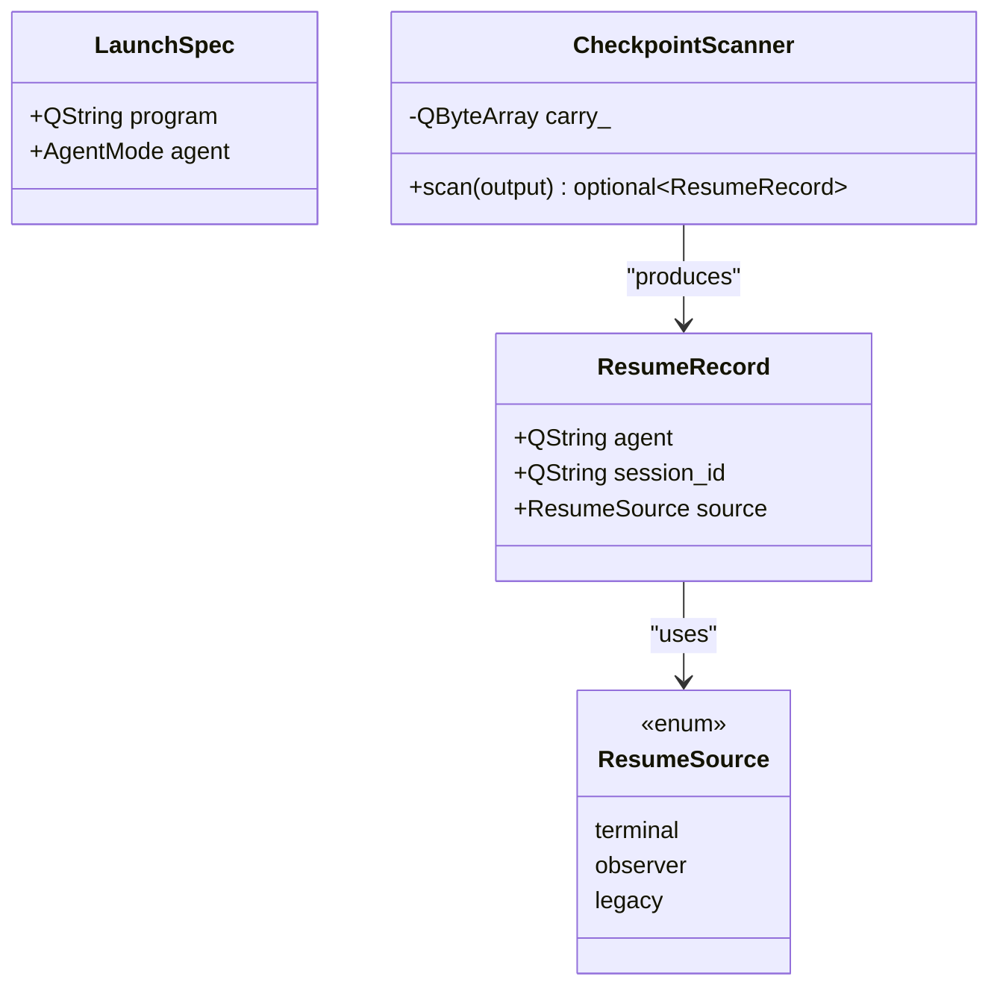
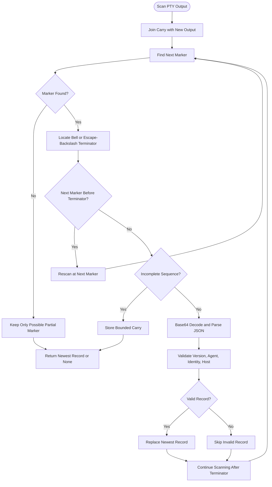
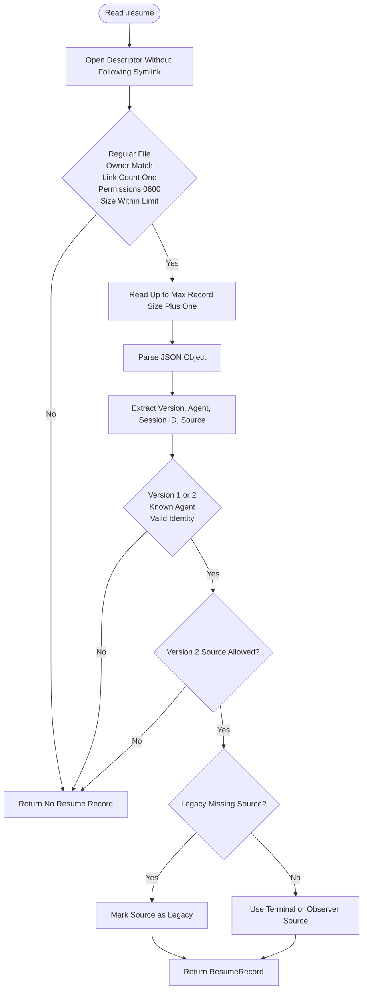
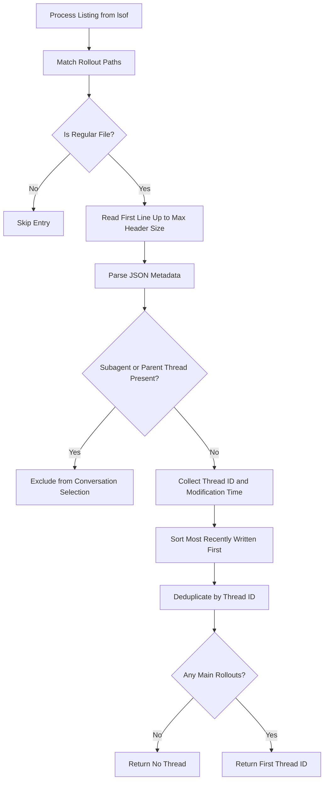
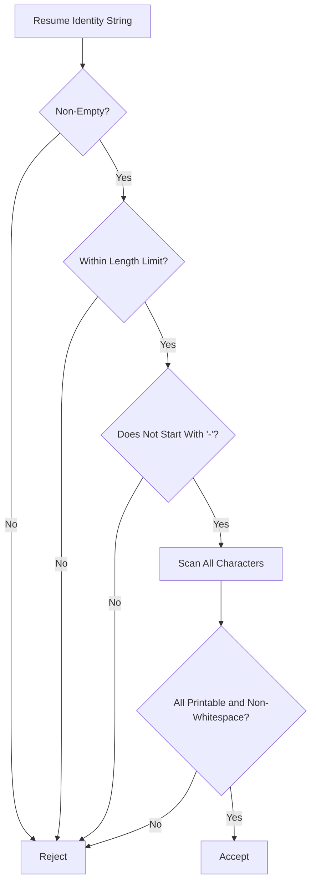
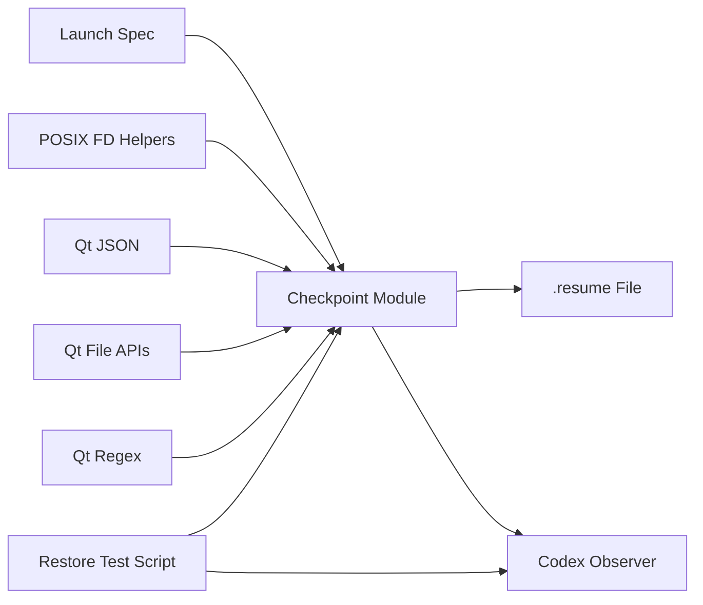

# Agent Checkpoint & Resume

<cite>
**Referenced Files in This Document**   
- [agent_checkpoint.hpp](file://services/session/src/agent_checkpoint.hpp)
- [agent_checkpoint.cpp](file://services/session/src/agent_checkpoint.cpp)
- [agent_checkpoint_test.cpp](file://services/session/tests/agent_checkpoint_test.cpp)
- [observer.hpp](file://adapters/codex/src/observer.hpp)
- [observer.cpp](file://adapters/codex/src/observer.cpp)
- [importer.hpp](file://adapters/codex/src/importer.hpp)
- [check_restore.py](file://scripts/check_restore.py)
</cite>

## Table of Contents
1. [Introduction](#introduction)
2. [Project Structure](#project-structure)
3. [Core Components](#core-components)
4. [Architecture Overview](#architecture-overview)
5. [Detailed Component Analysis](#detailed-component-analysis)
6. [Dependency Analysis](#dependency-analysis)
7. [Performance Considerations](#performance-considerations)
8. [Troubleshooting Guide](#troubleshooting-guide)
9. [Security Considerations](#security-considerations)
10. [Conclusion](#conclusion)

## Introduction
This document explains the agent checkpoint and resume system that allows Lapis to continue conversations after process restarts. The system has two complementary responsibilities:

- **Checkpoint scanning:** Observing untrusted PTY output from agents, extracting conversation identifiers emitted as OSC 1337 `SetUserVar` sequences, validating them, and writing durable `.resume` records.
- **Resume discovery:** Determining which conversation is currently active for supported agents (notably Codex) by inspecting process state and open files, then resuming with a validated identity.

The implementation separates observation and parsing from actual resume operations. Checkpoint scanning treats terminal output as hostile input and never directly launches or modifies an agent; resume operations are guarded by stricter validation, ownership checks, and capability checks.

## Project Structure
The checkpoint and resume logic lives primarily in the session service, while adapter-specific observer code supplies enhanced resume information for supported agents.

**Diagram sources**
- [agent_checkpoint.hpp:1-66](file://services/session/src/agent_checkpoint.hpp#L1-L66)
- [agent_checkpoint.cpp:1-273](file://services/session/src/agent_checkpoint.cpp#L1-L273)
- [agent_checkpoint_test.cpp:1-308](file://services/session/tests/agent_checkpoint_test.cpp#L1-L308)
- [observer.hpp:1-55](file://adapters/codex/src/observer.hpp#L1-L55)
- [observer.cpp:1-200](file://adapters/codex/src/observer.cpp#L1-L200)
- [importer.hpp:1-130](file://adapters/codex/src/importer.hpp#L1-L130)
- [check_restore.py:1-200](file://scripts/check_restore.py#L1-L200)

**Section sources**
- [agent_checkpoint.hpp:1-66](file://services/session/src/agent_checkpoint.hpp#L1-L66)
- [agent_checkpoint.cpp:1-273](file://services/session/src/agent_checkpoint.cpp#L1-L273)
- [observer.hpp:1-55](file://adapters/codex/src/observer.hpp#L1-L55)
- [observer.cpp:1-200](file://adapters/codex/src/observer.cpp#L1-L200)
- [importer.hpp:1-130](file://adapters/codex/src/importer.hpp#L1-L130)
- [check_restore.py:1-200](file://scripts/check_restore.py#L1-L200)

## Core Components
The checkpoint system centers on four concepts:

| Concept | Purpose | Key Behavior |
|---|---|---|
| `ResumeRecord` | Represents one recoverable conversation | Stores agent name, session identifier, and provenance source |
| `ResumeSource` | Records how the identity was learned | Terminal, observer, or legacy |
| `CheckpointScanner` | Parses PTY output for checkpoints | Finds OSC 1337 sequences across read boundaries with bounded memory |
| Resume record file I/O | Persists safe, owner-only conversation metadata | Validates permissions, version, agent, and identity before reading or writing |

Additional utilities include:

| Utility | Purpose |
|---|---|
| `valid_resume_identity` | Ensures a session ID is safe as a literal command-line argument |
| `checkpoint_agent_for_launch` | Maps a launched process to its expected checkpoint agent name |
| `observer_backed_agent` | Declares whether an agent supports lapis-backed resume enhancement |
| `codex_threads_from_open_files` / `codex_thread_from_open_files` | Detects active Codex rollout threads from `lsof`-style output |
| `read_resume_record` / `write_resume_record` | Safe accessors for `<endpoint>.resume` |

**Section sources**
- [agent_checkpoint.hpp:1-66](file://services/session/src/agent_checkpoint.hpp#L1-L66)
- [agent_checkpoint.cpp:1-273](file://services/session/src/agent_checkpoint.cpp#L1-L273)

## Architecture Overview
At a high level, the resume flow involves three stages:

1. **Observation:** An agent emits its current conversation identity through a terminal hook. For supported agents, Lapis may also learn it through an observer integration.
2. **Validation and persistence:** Checkpoint data is parsed, validated, and optionally written into a private `.resume` JSON file beside the agent’s endpoint socket.
3. **Resume discovery:** On launch, Lapis determines which conversation should be resumed, using either the persisted record or live process inspection, then constructs a resume command.

**Diagram sources**
- [agent_checkpoint.cpp:1-273](file://services/session/src/agent_checkpoint.cpp#L1-L273)
- [agent_checkpoint_test.cpp:1-308](file://services/session/tests/agent_checkpoint_test.cpp#L1-L308)
- [check_restore.py:1-200](file://scripts/check_restore.py#L1-L200)

## Detailed Component Analysis

### ResumeRecord and ResumeSource
`ResumeRecord` is the central data structure for conversation continuity:

- **agent:** The normalized CLI name used by Lapis (for example `claude`, `codex`).
- **session_id:** The native conversation identifier passed back to the agent when resuming.
- **source:** Provenance indicating how the identity was learned:
  - `terminal`: Learned from the agent’s terminal hook output.
  - `observer`: Learned by Lapis through an adapter observer such as the Codex or Claude observer.
  - `legacy`: Learned before Lapis recorded provenance explicitly.

`ResumeSource` is intentionally conservative: terminal output cannot claim observer provenance. Observer-backed identities are trusted only when Lapis itself obtained them through a qualified integration.

**Diagram sources**
- [agent_checkpoint.hpp:1-66](file://services/session/src/agent_checkpoint.hpp#L1-L66)
- [agent_checkpoint.cpp:1-273](file://services/session/src/agent_checkpoint.cpp#L1-L273)

**Section sources**
- [agent_checkpoint.hpp:1-66](file://services/session/src/agent_checkpoint.hpp#L1-L66)
- [agent_checkpoint.cpp:1-273](file://services/session/src/agent_checkpoint.cpp#L1-L273)

### CheckpointScanner: Bounded PTY Parsing
`CheckpointScanner` scans arbitrary PTY output for OSC 1337 sequences of the form `SetUserVar=agent_checkpoint=<base64 JSON>`. It is designed for untrusted terminal streams:

- It searches for a fixed marker prefix.
- It accepts either a bell terminator (`\x07`) or an escape-backslash terminator (`\x1b\\`).
- It keeps only a small tail of unmatched data in `carry_`, so long uninterrupted output does not grow memory indefinitely.
- If an incomplete sequence grows beyond a maximum sequence size, it discards the carry rather than retaining it forever.
- It decodes the base64 payload, limits the decoded record size, parses JSON, validates the schema, agent, identity, and host, then returns the newest valid record found.

Key constants and bounds:

| Bound | Meaning |
|---|---|
| Maximum sequence length | Limits how much unmatched OSC data is retained |
| Maximum record size | Limits decoded checkpoint JSON |
| Maximum rollout header size | Limits inspection of Codex rollout headers |
| Known agent list | Restricts accepted agents to supported names |
| Identity length limit | Prevents excessively long session IDs |

**Diagram sources**
- [agent_checkpoint.cpp:1-273](file://services/session/src/agent_checkpoint.cpp#L1-L273)
- [agent_checkpoint_test.cpp:1-200](file://services/session/tests/agent_checkpoint_test.cpp#L1-L200)

**Section sources**
- [agent_checkpoint.cpp:1-273](file://services/session/src/agent_checkpoint.cpp#L1-L273)
- [agent_checkpoint_test.cpp:1-200](file://services/session/tests/agent_checkpoint_test.cpp#L1-L200)

### Resume Record File Format: `.resume`
Each agent endpoint has a companion file named `<endpoint>.resume`. Its format evolved across versions:

| Field | Version 1 | Version 2 | Notes |
|---|---:|---:|---|
| `version` | Required | Required | Supports `1` and `2`; other values are rejected |
| `agent` | Required | Required | Lowercase agent name from the known set |
| `session_id` | Required | Required | Must pass identity validation |
| `host` | Present in terminal-emitted checkpoints | Not required in stored records | Used during checkpoint validation but not persisted |
| `source` | Absent | Optional string | `terminal` or `observer`; absent records read as `legacy` |

Filesystem guarantees:

- The file must be a regular file.
- It must be owned by the effective user.
- It must have exactly one hard link.
- Its permission bits must match owner-only mode `0600`.
- Its size must not exceed the maximum record size.
- Symlinks are rejected when opening for reading.
- Writes use atomic commit semantics via a save file helper.
- Permission errors or unsafe existing files cause read/write operations to fail safely.

**Diagram sources**
- [agent_checkpoint.cpp:1-273](file://services/session/src/agent_checkpoint.cpp#L1-L273)
- [agent_checkpoint_test.cpp:201-308](file://services/session/tests/agent_checkpoint_test.cpp#L201-L308)

**Section sources**
- [agent_checkpoint.cpp:201-273](file://services/session/src/agent_checkpoint.cpp#L201-L273)
- [agent_checkpoint_test.cpp:201-308](file://services/session/tests/agent_checkpoint_test.cpp#L201-L308)

### Codex Thread Detection Using Process Inspection
For Codex, the system can detect the active conversation without relying solely on terminal output. It analyzes `lsof`-style output to find rollout files opened by the running Codex process:

- Rollout paths follow a pattern under a sessions directory and end in `.jsonl`.
- Each rollout begins with a first line containing JSON metadata.
- Metadata with a `subagent` source or a non-empty parent thread ID identifies a subagent rollout and is excluded from conversation selection.
- Main-thread rollouts are collected, sorted by modification time, and deduplicated by thread ID.
- The most recently written main rollout is treated as the active conversation.
- When `/new` creates a new thread, both the old and new threads may remain open; the newer thread appears first, preserving history of the previous thread.
- When `/resume` switches back to an earlier thread, that thread becomes the most recently modified main rollout again.

**Diagram sources**
- [agent_checkpoint.cpp:1-200](file://services/session/src/agent_checkpoint.cpp#L1-L200)
- [agent_checkpoint_test.cpp:201-308](file://services/session/tests/agent_checkpoint_test.cpp#L201-L308)

**Section sources**
- [agent_checkpoint.cpp:1-200](file://services/session/src/agent_checkpoint.cpp#L1-L200)
- [agent_checkpoint_test.cpp:201-308](file://services/session/tests/agent_checkpoint_test.cpp#L201-L308)

### Observer-Backing Capability Check
Not every agent integrates with Lapis’s observer layer. The capability check answers whether an agent is considered observer-backed for resume policy purposes:

- Currently, `codex` and `claude` return true.
- Other agents, including terminal-launched harnesses, return false unless they are otherwise managed through Lapis resume flows.
- The check is a policy capability declaration, not a runtime guarantee that an observer is connected; older services launched before an observer was attached can still report true for known observers.

Observer-backed agents are significant because observer-learned identities can be written with `observer` provenance, whereas terminal-learned identities cannot self-attest that provenance.

**Section sources**
- [agent_checkpoint.cpp:1-200](file://services/session/src/agent_checkpoint.cpp#L1-L200)
- [observer.hpp:1-55](file://adapters/codex/src/observer.hpp#L1-L55)
- [observer.cpp:1-200](file://adapters/codex/src/observer.cpp#L1-L200)

### Validation Pipeline for Resume Identities
The resume identity validator ensures that a session ID is safe to pass as one literal command-line argument:

- The value must not be empty.
- It must not exceed the configured identity length limit.
- It must not start with a hyphen, preventing accidental option injection.
- Every character must be printable and non-whitespace.

This validation applies to:

- Decoded checkpoint payloads.
- Existing resume records.
- Newly written resume records.
- Launch-time resume arguments validated by higher-level components.

The design deliberately rejects common shell and command-line attack vectors such as whitespace splitting, option-like prefixes, and overly large values.

**Diagram sources**
- [agent_checkpoint.cpp:1-200](file://services/session/src/agent_checkpoint.cpp#L1-L200)

**Section sources**
- [agent_checkpoint.cpp:1-200](file://services/session/src/agent_checkpoint.cpp#L1-L200)

### Checkpoint-to-Launch Agent Binding
Terminal output alone is not enough to trust an arbitrary agent name. The system binds checkpoints to the launched process through `checkpoint_agent_for_launch`:

- Managed `codex` processes map to the `codex` checkpoint agent.
- Managed `claude` processes map to the `claude` checkpoint agent.
- Terminal-launch harnesses derive the expected agent name from the executable’s filename.
- This prevents a malicious or misconfigured agent from claiming to be another agent.

**Section sources**
- [agent_checkpoint.cpp:1-200](file://services/session/src/agent_checkpoint.cpp#L1-L200)
- [agent_checkpoint_test.cpp:1-200](file://services/session/tests/agent_checkpoint_test.cpp#L1-L200)

### Integration and End-to-End Resume Testing
The restore test script exercises the full resume path:

- It starts real managed Codex and Claude instances against local fake model wiring.
- It uses stand-in agents for grok, kimi, opencode, and omp.
- It simulates power loss by killing all processes while leaving stale sockets.
- It verifies that each agent resumes the conversation in use at the moment of interruption.
- It checks that saved launch arguments contain the correct resume flag and identity exactly once.
- It validates durable provenance for managed agents.

This test bridges the C++ checkpoint/resume layer with the desktop and service launch pipeline.

**Section sources**
- [check_restore.py:1-200](file://scripts/check_restore.py#L1-L200)

## Dependency Analysis
The checkpoint and resume system has clear internal and external dependencies:

| Dependency | Direction | Reason |
|---|---|---|
| `launch_spec.hpp` | Imported by checkpoint module | Determines expected agent name from launch configuration |
| POSIX unique descriptor helpers | Imported by checkpoint module | Provides safe file descriptors for untrusted resume files |
| Qt JSON, file, and regex facilities | Used throughout | Encodes/decodes records, handles files, matches rollout paths |
| Codex observer | Consumer of attention and thread state | Supplies enhanced resume context for Codex |
| Restore test script | Consumer of checkpoint behavior | Verifies end-to-end resume behavior across restarts |

**Diagram sources**
- [agent_checkpoint.hpp:1-66](file://services/session/src/agent_checkpoint.hpp#L1-L66)
- [agent_checkpoint.cpp:1-273](file://services/session/src/agent_checkpoint.cpp#L1-L273)
- [observer.hpp:1-55](file://adapters/codex/src/observer.hpp#L1-L55)
- [check_restore.py:1-200](file://scripts/check_restore.py#L1-L200)

**Section sources**
- [agent_checkpoint.hpp:1-66](file://services/session/src/agent_checkpoint.hpp#L1-L66)
- [agent_checkpoint.cpp:1-273](file://services/session/src/agent_checkpoint.cpp#L1-L273)
- [observer.hpp:1-55](file://adapters/codex/src/observer.hpp#L1-L55)
- [check_restore.py:1-200](file://scripts/check_restore.py#L1-L200)

## Performance Considerations
The checkpoint scanner is optimized for continuous PTY streams:

- It avoids copying entire output buffers when no partial marker is present.
- It retains only the smallest possible suffix that could complete an OSC marker.
- It stops carrying incomplete sequences after a bounded length.
- It prefers the newest valid checkpoint in a single scan, avoiding unnecessary reprocessing.
- It skips unreadable or malformed Codex rollout headers instead of crashing or retaining them.

The Codex thread detection scans the full listing once, collects matching rollout entries, sorts by modification time, and deduplicates by thread ID. This is appropriate for periodic process inspection rather than per-character terminal processing.

[No sources needed since this section provides general guidance]

## Troubleshooting Guide

### Checkpoints Are Detected But Resume Fails
Common causes include:

- The checkpoint agent does not match the launched agent.
- The session ID fails identity validation because it contains whitespace, starts with a hyphen, or is too long.
- The checkpoint claims a remote host.
- The checkpoint version is unsupported.
- The resume record is missing, malformed, or has incorrect filesystem permissions.

Recommended checks:

1. Confirm the launched agent matches the expected checkpoint agent.
2. Inspect the `.resume` file ownership and permissions.
3. Verify the file is a regular file owned by the effective user with mode `0600` and exactly one link.
4. Ensure the record contains a supported version and a known agent.
5. Check that the session ID is a safe literal value.

**Section sources**
- [agent_checkpoint.cpp:1-273](file://services/session/src/agent_checkpoint.cpp#L1-L273)
- [agent_checkpoint_test.cpp:1-308](file://services/session/tests/agent_checkpoint_test.cpp#L1-L308)

### Codex Resume Does Not Select the Expected Thread
Likely causes:

- The rollout header is malformed, oversized, or not readable.
- The rollout is identified as a subagent.
- The process listing does not contain a valid rollout path.
- The expected thread was replaced by a newer `/new` thread.
- The process restarted and switched back with `/resume`.

Recommended checks:

1. Confirm the Codex process still has the rollout file open.
2. Inspect the rollout’s first-line metadata to verify it is a main thread.
3. Compare modification times and thread IDs.
4. Re-run the thread discovery function against the current process listing.

**Section sources**
- [agent_checkpoint.cpp:1-200](file://services/session/src/agent_checkpoint.cpp#L1-L200)
- [agent_checkpoint_test.cpp:201-308](file://services/session/tests/agent_checkpoint_test.cpp#L201-L308)

### Observer-Provenance Is Not Trusted
If a checkpoint reports observer provenance but is rejected, check:

- Whether the checkpoint came from terminal output, which cannot self-attest observer provenance.
- Whether the agent is recognized as observer-backed.
- Whether the record was written by Lapis through `write_resume_record` with explicit observer provenance.

**Section sources**
- [agent_checkpoint.cpp:1-200](file://services/session/src/agent_checkpoint.cpp#L1-L200)
- [agent_checkpoint_test.cpp:1-200](file://services/session/tests/agent_checkpoint_test.cpp#L1-L200)

## Security Considerations

### Untrusted Terminal Output
Checkpoint scanning treats all PTY output as hostile. The scanner:

- Uses fixed markers and terminators rather than trusting arbitrary content.
- Limits carry buffer growth.
- Limits decoded payload size.
- Rejects unknown versions, agents, hosts, and identities.
- Never executes or interprets checkpoint content beyond validation.

### Separation Between Scanning and Resume
Scanning produces candidate `ResumeRecord` values; it does not directly launch agents or perform privileged resume operations. Actual resume decisions should combine:

- The scanned checkpoint.
- The bound launched agent.
- The persisted `.resume` record.
- Live process inspection where available.
- Capability checks for observer-backed agents.

### Filesystem Safety
Resume records are protected by strict filesystem checks:

- Owner-only access control.
- Regular-file enforcement.
- Link-count enforcement to prevent hard-link races.
- Symlink rejection.
- Atomic writes through a save-and-commit helper.
- Rejection of unsafe existing files during updates.

### Identity Safety
Resume identities are validated before being treated as command-line arguments:

- No leading hyphens.
- No whitespace.
- Printable characters only.
- Bounded length.
- Known agent restriction.

These constraints reduce risks of option injection, argument splitting, and denial-of-service through oversized inputs.

**Section sources**
- [agent_checkpoint.cpp:1-273](file://services/session/src/agent_checkpoint.cpp#L1-L273)
- [agent_checkpoint_test.cpp:1-308](file://services/session/tests/agent_checkpoint_test.cpp#L1-L308)

## Conclusion
The agent checkpoint and resume system provides a secure, layered approach to conversation continuity:

- `ResumeRecord` captures who owns a conversation, which session to resume, and how that knowledge was obtained.
- `CheckpointScanner` extracts conversation identities from untrusted terminal output while keeping memory bounded and rejecting invalid or suspicious data.
- `.resume` files provide durable, owner-only state with atomic write semantics.
- Codex thread detection adds process-aware resume discovery based on open rollout files.
- Validation pipelines ensure that resume identities are safe literal arguments suitable for command-line invocation.
- Observer-backing capability checks distinguish Lapis-owned resume enhancements from ordinary terminal output.

Together, these components allow Lapis to recover meaningful conversations after restarts without trusting hostile terminal output, untrusted filesystem state, or arbitrary command-line identities.