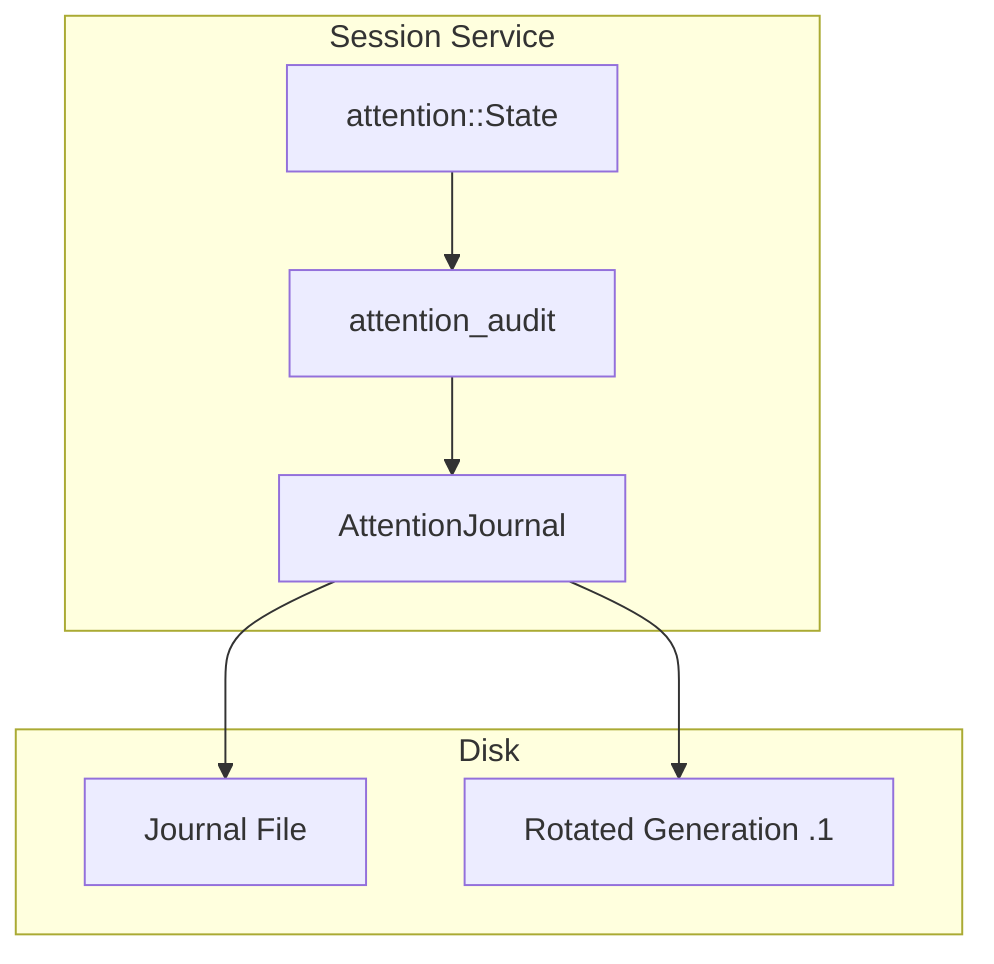
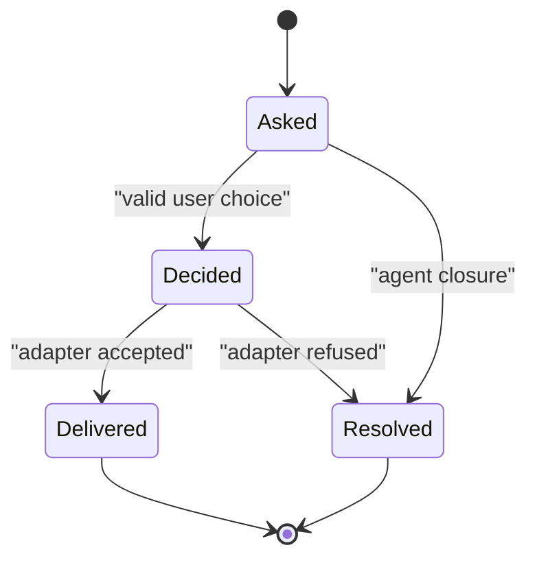
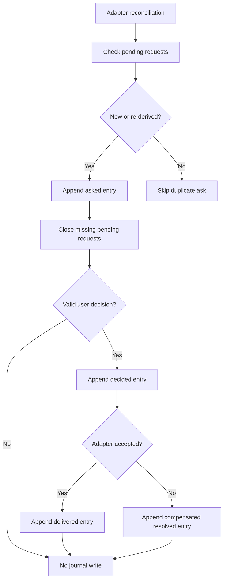
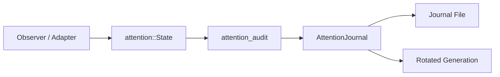
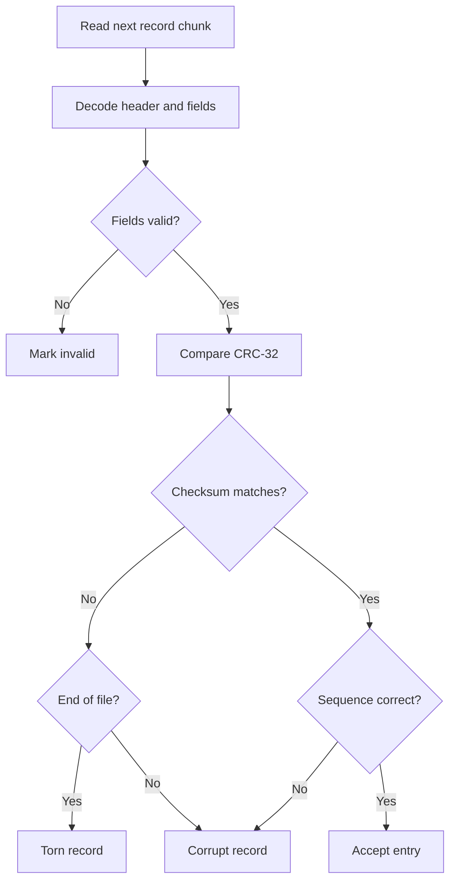
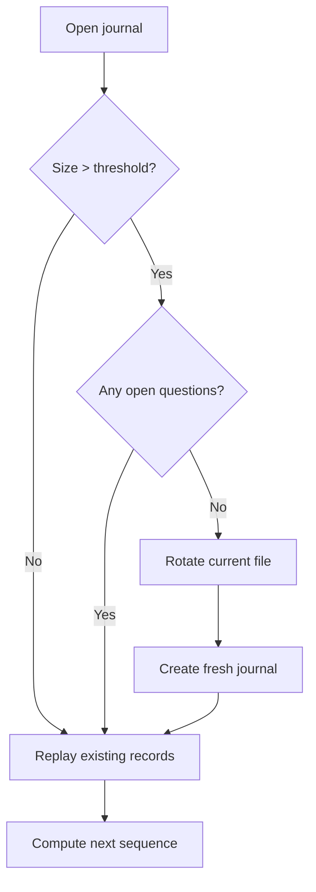
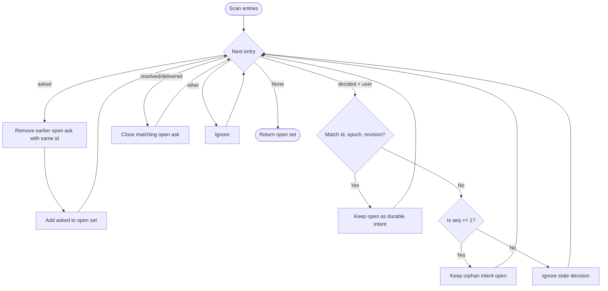
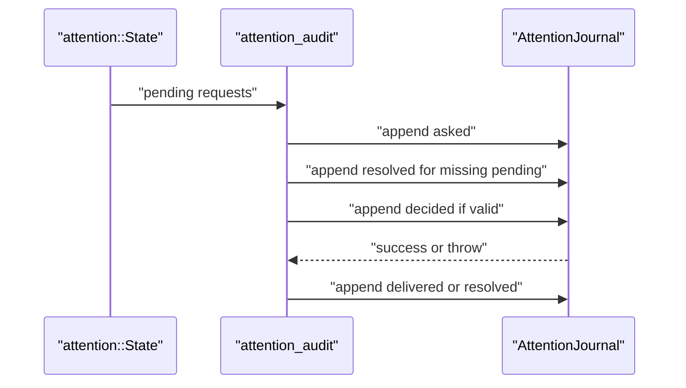
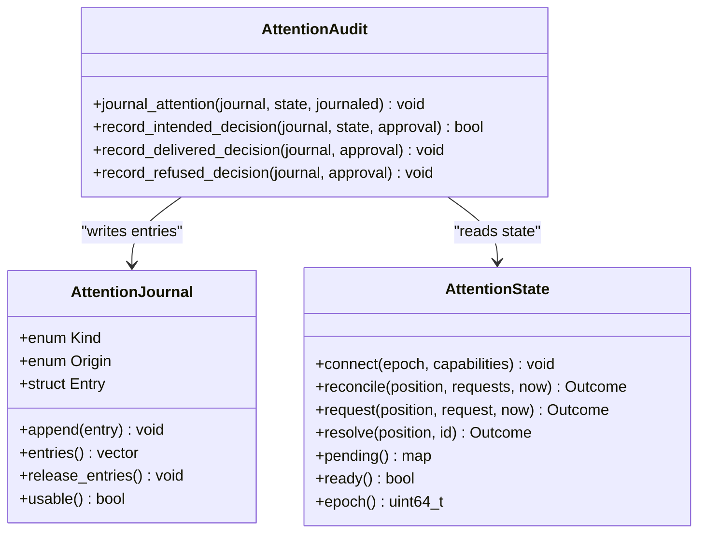

# Attention Journal & Audit Trail

<cite>
**Referenced Files in This Document**
- [attention_journal.hpp](file://services/session/src/attention_journal.hpp)
- [attention_journal.cpp](file://services/session/src/attention_journal.cpp)
- [attention_audit.hpp](file://services/session/src/attention_audit.hpp)
- [attention_audit.cpp](file://services/session/src/attention_audit.cpp)
- [attention.cpp](file://services/session/src/attention.cpp)
- [attention_journal_test.cpp](file://services/session/tests/attention_journal_test.cpp)
- [attention_audit_test.cpp](file://services/session/tests/attention_audit_test.cpp)
</cite>

## Table of Contents
1. [Introduction](#introduction)
2. [Project Structure](#project-structure)
3. [Core Components](#core-components)
4. [Architecture Overview](#architecture-overview)
5. [Detailed Component Analysis](#detailed-component-analysis)
6. [Dependency Analysis](#dependency-analysis)
7. [Performance Considerations](#performance-considerations)
8. [Troubleshooting Guide](#troubleshooting-guide)
9. [Conclusion](#conclusion)

## Introduction
The attention journal system is the durable audit trail for user-facing agent requests and their outcomes. It records when a request is asked, what decision was intended, whether that decision was delivered to the adapter, or how an agent resolved or retired a request. The journal survives process restarts, protects against concurrent writers, tolerates torn writes after crashes, and rotates old history into separate files while keeping active questions safely within one log generation.

The audit layer connects this on-disk journal with the in-memory attention state used by the session service and its adapters. Together they provide:
- A strict lifecycle per request identity.
- Crash-safe replay with deterministic sequence numbers.
- Fail-closed behavior so partial state cannot become false evidence.
- Synthetic recovery entries for unknown crash outcomes.
- Rotation of historical journals without losing open questions.

## Project Structure
The attention journal implementation lives under the session service. Its core responsibilities are split between:
- `AttentionJournal`: file format, locking, replay, rotation, append durability, and open-question detection.
- `attention_audit`: higher-level operations that translate session state changes into journal entries.
- `attention::State`: the transport-independent model of pending and retired requests whose lifecycle gates journal decisions.
- Unit tests validating recovery, corruption handling, rotation, concurrency, and audit workflows.

**Diagram sources**
- [attention.cpp:1-200](file://services/session/src/attention.cpp#L1-L200)
- [attention_audit.cpp:1-82](file://services/session/src/attention_audit.cpp#L1-L82)
- [attention_journal.cpp:1-200](file://services/session/src/attention_journal.cpp#L1-L200)

**Section sources**
- [attention_journal.hpp:1-99](file://services/session/src/attention_journal.hpp#L1-L99)
- [attention_journal.cpp:1-558](file://services/session/src/attention_journal.cpp#L1-L558)
- [attention_audit.hpp:1-51](file://services/session/src/attention_audit.hpp#L1-L51)
- [attention_audit.cpp:1-82](file://services/session/src/attention_audit.cpp#L1-L82)
- [attention.cpp:1-200](file://services/session/src/attention.cpp#L1-L200)

## Core Components

### Entry Model and Lifecycle
An `Entry` represents one immutable event in the journal. Each entry carries:
- `kind`: one of `asked`, `decided`, `resolved`, or `delivered`.
- `seq`: a dense, journal-local sequence number starting at 1. It is assigned by `append()` and must match during replay.
- `epoch` and `revision`: source derivation identifiers from the attention state. They prevent stale decisions from closing newer questions.
- `id`: the request identity, which can be numeric or textual depending on the adapter.
- `choice`: present for `decided` and `delivered` entries.
- `origin`: who closed the question:
  - `user`: a locally validated user decision.
  - `agent`: an agent-side resolution or compensation.
  - `outcome_unknown`: synthetic evidence created by crash recovery when a user intent may not have been delivered.
- `request`: present only for `asked` entries and includes the full request payload.

Lifecycle semantics:
1. An adapter sends an `asked` entry containing the request.
2. The service records a `decided` entry once a valid user approval is made.
3. If the adapter accepts the decision, a `delivered` entry confirms completion.
4. If the adapter refuses delivery, a compensating `resolved` entry closes the question without implying successful delivery.
5. If the agent resolves or retires a request independently, a `resolved` entry marks it closed.

**Diagram sources**
- [attention_journal.hpp:12-44](file://services/session/src/attention_journal.hpp#L12-L44)
- [attention_audit.cpp:1-82](file://services/session/src/attention_audit.cpp#L1-L82)

**Section sources**
- [attention_journal.hpp:12-44](file://services/session/src/attention_journal.hpp#L12-L44)
- [attention_audit.cpp:1-82](file://services/session/src/attention_audit.cpp#L1-L82)

### Sequence Numbering and Epoch Tracking
Sequence numbering is local to each journal file:
- `next_seq_` starts at 1.
- `append()` assigns the current sequence before writing.
- Replay expects strictly increasing sequences; any mismatch is treated as corruption.
- After appending, the in-memory working set is trimmed to open questions only, but the file retains all records for audit and replay.

Epoch and revision tracking connect journal entries to the broader attention state:
- `epoch` comes from the attention source connection.
- `revision` is assigned by the attention state when a new or changed request is reconciled.
- Matching `decided`, `resolved`, or `delivered` entries must refer to the same `(id, epoch, revision)` as the corresponding `asked` entry.
- A newer source derivation with the same request id supersedes older asks, preventing stale approvals from closing current questions.

**Section sources**
- [attention_journal.hpp:16-35](file://services/session/src/attention_journal.hpp#L16-L35)
- [attention_journal.cpp:302-353](file://services/session/src/attention_journal.cpp#L302-L353)
- [attention.cpp:40-120](file://services/session/src/attention.cpp#L40-L120)

### Request Lifecycle States Across Components
The attention journal is not the sole owner of request state. `attention::State` models:
- Pending requests with status, revision, arrival time, source epoch, and submission flags.
- Retired request ids.
- Connection epochs, observation/reconciliation capabilities, and synchronization.
- Boundaries such as maximum pending count, aging intervals, and overflow conditions.

The audit layer bridges these two:
- New pending requests produce `asked` entries.
- Requests removed from pending without a user decision receive `resolved` entries.
- User decisions are gated by `record_intended_decision`.
- Delivery confirmation uses `record_delivered_decision`.
- Adapter refusal uses `record_refused_decision`.

**Diagram sources**
- [attention_audit.cpp:1-82](file://services/session/src/attention_audit.cpp#L1-L82)
- [attention.cpp:120-271](file://services/session/src/attention.cpp#L120-L271)

**Section sources**
- [attention_audit.hpp:10-49](file://services/session/src/attention_audit.hpp#L10-L49)
- [attention_audit.cpp:1-82](file://services/session/src/attention_audit.cpp#L1-L82)
- [attention.cpp:1-271](file://services/session/src/attention.cpp#L1-L271)

## Architecture Overview
The attention system has three layers:

1. **Transport/state layer**: `attention::State` validates identities, bounds, choices, epochs, sequences, and request lifecycles.
2. **Audit coordination layer**: `attention_audit` translates state transitions into durable journal entries while enforcing fail-closed policy.
3. **Durable storage layer**: `AttentionJournal` manages file I/O, CRC checksums, exclusive writer locks, replay, torn-tail truncation, and rotation.

**Diagram sources**
- [attention.cpp:1-271](file://services/session/src/attention.cpp#L1-L271)
- [attention_audit.cpp:1-82](file://services/session/src/attention_audit.cpp#L1-L82)
- [attention_journal.cpp:1-558](file://services/session/src/attention_journal.cpp#L1-L558)

## Detailed Component Analysis

### AttentionJournal: File Format, Locking, and Replay

#### Record Format and Integrity
Each record stores:
- Kind, origin, sequence, epoch, revision.
- Request id (numeric or text).
- Choice string.
- Optional request payload for `asked` entries.
- CRC-32 checksum covering all preceding fields.

Integrity rules:
- Fields are little-endian integers and length-prefixed strings.
- String lengths and counts are bounded.
- Replayed records must have the expected sequence.
- A malformed final field is treated as a torn append and truncated.
- Mid-file corruption throws because it cannot be explained by a simple crash tear.

**Diagram sources**
- [attention_journal.cpp:1-120](file://services/session/src/attention_journal.cpp#L1-L120)
- [attention_journal.cpp:240-301](file://services/session/src/attention_journal.cpp#L240-L301)

#### Exclusive Writer Locking
On construction:
- The file is opened with restrictive permissions.
- An exclusive non-blocking lock is acquired.
- The inode and device are rechecked after locking to avoid holding a lock on a replaced file.
- A second writer receives a clear error indicating ownership.
- Lease attempts include reopening and re-verifying the locked inode.

This prevents concurrent writers from interleaving records and ensures only one service owns the journal.

#### Crash Recovery: Torn Tail Truncation
Replay reads bounded chunks up to `max_record_bytes`. For each chunk:
- If reading stops before the record frame is complete, the tail is marked torn.
- If the checksum fails at EOF, it is also treated as torn.
- Malformed but structurally complete records at EOF are truncated.
- Mid-file corruption throws rather than silently skipping data.

After truncation, `next_seq_` is derived from the last accepted sequence plus one, allowing safe continuation.

#### Rotation Mechanism
Rotation occurs:
- Before opening if the journal exceeds `rotate_bytes_`.
- Before appending if the journal exceeds `rotate_bytes_`.
- Only when there are no open questions.

Rotation steps:
1. Rename the current file to `<path>.1`.
2. Synchronize the directory.
3. Open a fresh file under the original path while still holding the old lease.
4. Write a fresh header.
5. Clear the in-memory working set and reset sequence numbering.

If rotation fails, the operation aborts without committing the pending record.

**Diagram sources**
- [attention_journal.cpp:302-410](file://services/session/src/attention_journal.cpp#L302-L410)

**Section sources**
- [attention_journal.cpp:1-558](file://services/session/src/attention_journal.cpp#L1-L558)
- [attention_journal_test.cpp:1-390](file://services/session/tests/attention_journal_test.cpp#L1-L390)

### Open Question Detection Algorithm
`open_questions` scans entries in order and maintains a list of currently open asks. Its logic is:

1. For each `asked` entry:
   - Remove any earlier open ask with the same id.
   - Add the new ask to the open set.
2. For each `decided` entry with `Origin::user`:
   - Match by exact `(id, epoch, revision)`.
   - If no matching ask exists but the entry’s sequence is 1, treat it as orphan intent and keep it open.
3. For other closures (`resolved`, `delivered`, older non-user `decided`):
   - Remove the matching open ask by `(id, epoch, revision)`.

The result is the set of durable intents that remain unresolved.

**Diagram sources**
- [attention_journal.cpp:430-503](file://services/session/src/attention_journal.cpp#L430-L503)

**Section sources**
- [attention_journal.hpp:86-99](file://services/session/src/attention_journal.hpp#L86-L99)
- [attention_journal.cpp:430-503](file://services/session/src/attention_journal.cpp#L430-L503)
- [attention_journal_test.cpp:201-270](file://services/session/tests/attention_journal_test.cpp#L201-L270)

### Crash Recovery Outcome Unknown Entries
When an `asked` entry has no confirmed outcome, crash recovery produces a synthetic `decided` entry with:
- `origin = outcome_unknown`.
- Empty choice.
- Same epoch, id, and revision as the original ask.
- No request payload.

This allows the audit to mark the question closed without claiming the user approved it. Tests verify:
- Synthetic entries have the correct kind and origin.
- Orphan user intent with sequence 1 remains open until delivery or compensation.
- Stale decisions with different epoch/revision do not close newer asks.

**Section sources**
- [attention_journal.cpp:505-558](file://services/session/src/attention_journal.cpp#L505-L558)
- [attention_journal_test.cpp:201-270](file://services/session/tests/attention_journal_test.cpp#L201-L270)

### Audit Layer Integration
The audit layer performs four main operations:

| Operation | Purpose | Journal Effect |
|---|---|---|
| `journal_attention` | Syncs journal with pending state | Appends `asked` for new or re-derived requests; appends `resolved` for missing pending items |
| `record_intended_decision` | Validates user intent | Appends `decided` only if state is ready, epoch/revision match, request is pending, and choice is supported |
| `record_delivered_decision` | Confirms adapter acceptance | Appends `delivered` |
| `record_refused_decision` | Compensates failed delivery | Appends `resolved` with agent origin |

Fail-closed guarantees:
- Invalid state, stale epoch, wrong revision, unsupported choice, already submitted, or non-pending requests are rejected without a journal write.
- Append failures throw, leaving the journal in a durable rolled-back state.
- Callers must not forward a decision until `append()` succeeds.

**Diagram sources**
- [attention_audit.cpp:1-82](file://services/session/src/attention_audit.cpp#L1-L82)
- [attention_journal.cpp:410-429](file://services/session/src/attention_journal.cpp#L410-L429)

**Section sources**
- [attention_audit.hpp:10-49](file://services/session/src/attention_audit.hpp#L10-L49)
- [attention_audit.cpp:1-82](file://services/session/src/attention_audit.cpp#L1-L82)
- [attention_audit_test.cpp:1-211](file://services/session/tests/attention_audit_test.cpp#L1-L211)

### Relationship Between Journal Entries and Broader Attention Audit
The attention journal is not a replacement for `attention::State`; it is its durable reflection:

- `attention::State` tracks transient runtime properties: connection epoch, sequence, capabilities, timing, pending statuses, and retirement limits.
- The journal captures immutable audit events tied to source derivations through `epoch` and `revision`.
- `JournaledAsks` in the audit layer remembers which `(id → epoch, revision)` positions have been written, avoiding repeated asks for unchanged pending requests.
- When the source reconnects or reconciles, stale positions are refreshed and missing pending requests are closed with agent-originated `resolved` entries.
- Cross-source correlation uses the request id plus epoch/revision to distinguish different derivations even when an adapter reuses the same id.

**Section sources**
- [attention_audit.hpp:10-22](file://services/session/src/attention_audit.hpp#L10-L22)
- [attention_audit.cpp:1-82](file://services/session/src/attention_audit.cpp#L1-L82)
- [attention.cpp:120-271](file://services/session/src/attention.cpp#L120-L271)

## Dependency Analysis

**Diagram sources**
- [attention_journal.hpp:12-99](file://services/session/src/attention_journal.hpp#L12-L99)
- [attention_audit.hpp:10-49](file://services/session/src/attention_audit.hpp#L10-L49)
- [attention.cpp:1-271](file://services/session/src/attention.cpp#L1-L271)

**Section sources**
- [attention_journal.hpp:12-99](file://services/session/src/attention_journal.hpp#L12-L99)
- [attention_audit.hpp:10-49](file://services/session/src/attention_audit.hpp#L10-L49)
- [attention.cpp:1-271](file://services/session/src/attention.cpp#L1-L271)

## Performance Considerations

- **Bounded record size**: Records are read and written in bounded chunks. Large request payloads and many choices are limited to prevent unbounded memory growth.
- **In-memory working set**: After replay, `entries()` returns only the open working set. The file retains full history, so audit queries should scan the file directly when needed.
- **Rotation threshold**: The default rotation threshold is 4 MiB. Smaller thresholds increase file churn; larger thresholds delay archival.
- **Append atomicity**: Each append writes the entire record and fsyncs before updating the in-memory state. Failures trigger rollback to the previous durable size.
- **Replay cost**: Replay scans sequentially and validates checksums. Corruption in the middle throws immediately, while torn tails are truncated efficiently.

[No sources needed since this section provides general guidance]

## Troubleshooting Guide

### Common Failure Modes

| Symptom | Likely Cause | Expected Behavior |
|---|---|---|
| Another writer cannot open the journal | Exclusive lock held | Throws with ownership or locking error |
| Reopening a corrupted mid-file journal | Field mismatch, checksum failure, or wrong sequence | Throws; caller should not continue |
| Reopening a torn tail | Crash during append | Truncates incomplete record and continues |
| Reopening a newer format | Version upgrade required | Throws with format upgrade message |
| Rotation does not occur | Open question exists | Rotation is deferred until the question closes |
| Decision not recorded | Invalid state, stale epoch/revision, unsupported choice, or non-pending request | Returns false without writing |
| Append fails | Disk space, permission, or fsync failure | Rolls back and throws; caller must retry after fixing the underlying issue |

### Security and Integrity Considerations

- **File permissions**: The journal is opened with restrictive permissions, limiting access to the owning process.
- **Exclusive ownership**: `flock` with inode verification prevents multiple writers from corrupting the log.
- **Checksum validation**: Every accepted record is verified with CRC-32, ensuring byte-identical round-trips.
- **Format versioning**: The header contains magic bytes, format version, and newline terminator. Unsupported or newer formats reject recovery instead of guessing.
- **Fail-closed checkpoint barriers**:
  - `append()` is the barrier; callers must not forward decisions until durability succeeds.
  - `record_intended_decision` refuses invalid approvals before writing.
  - Unavailable journals cause fail-closed behavior in audit paths.
  - Torn headers are rewritten; torn tails are truncated; mid-file corruption is fatal.

### Recovery Checklist

1. Verify the journal is not locked by another process.
2. Attempt to open the journal; handle ownership errors.
3. If replay throws on corruption, inspect the file and consider restoring from a known-good backup.
4. If only the tail is torn, allow truncation and resume normal operation.
5. Confirm open questions after recovery using `open_questions`.
6. Generate `outcome_unknown_for` entries for unresolved asks where appropriate.
7. Retry decisions only after the underlying disk or filesystem issue is resolved.

**Section sources**
- [attention_journal.cpp:302-558](file://services/session/src/attention_journal.cpp#L302-L558)
- [attention_journal_test.cpp:120-390](file://services/session/tests/attention_journal_test.cpp#L120-L390)
- [attention_audit_test.cpp:1-211](file://services/session/tests/attention_audit_test.cpp#L1-L211)

## Conclusion
The attention journal provides a robust, crash-resistant audit trail for agent interaction lifecycles. Its design separates durable event recording from transient state management, enforces strict sequencing and derivation checks, and applies fail-closed semantics throughout. Rotation keeps long-running services bounded, while open-question detection and synthetic `outcome_unknown` entries ensure crash recovery preserves correctness over completeness. Together with the audit layer and attention state, the system delivers a coherent, verifiable record of user intent, adapter delivery, and agent behavior.