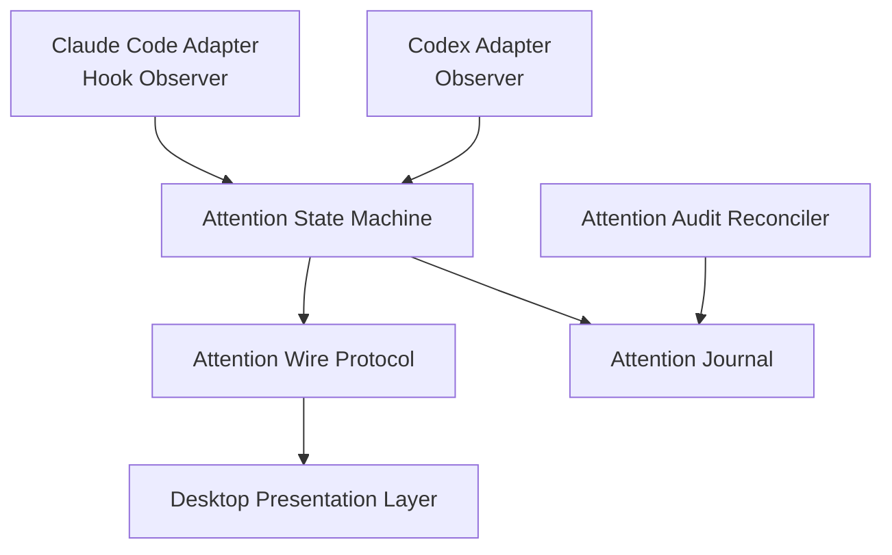
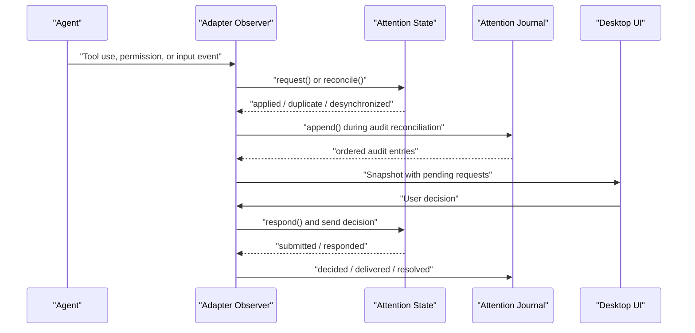
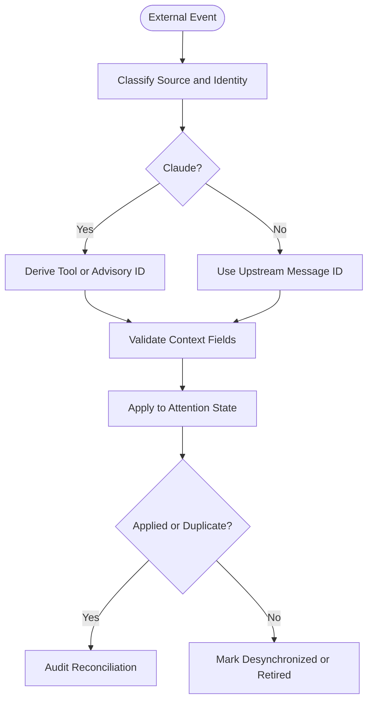
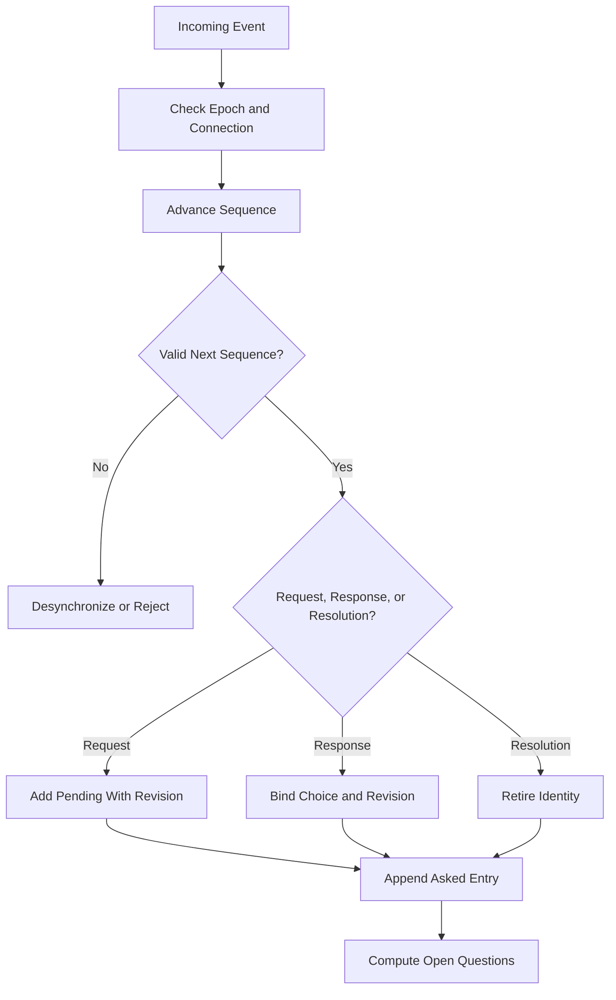
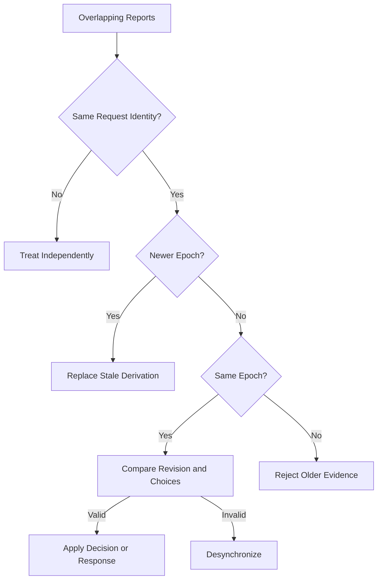
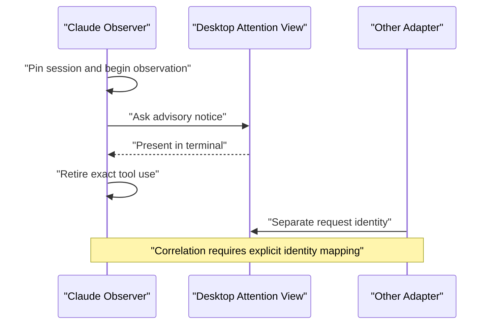
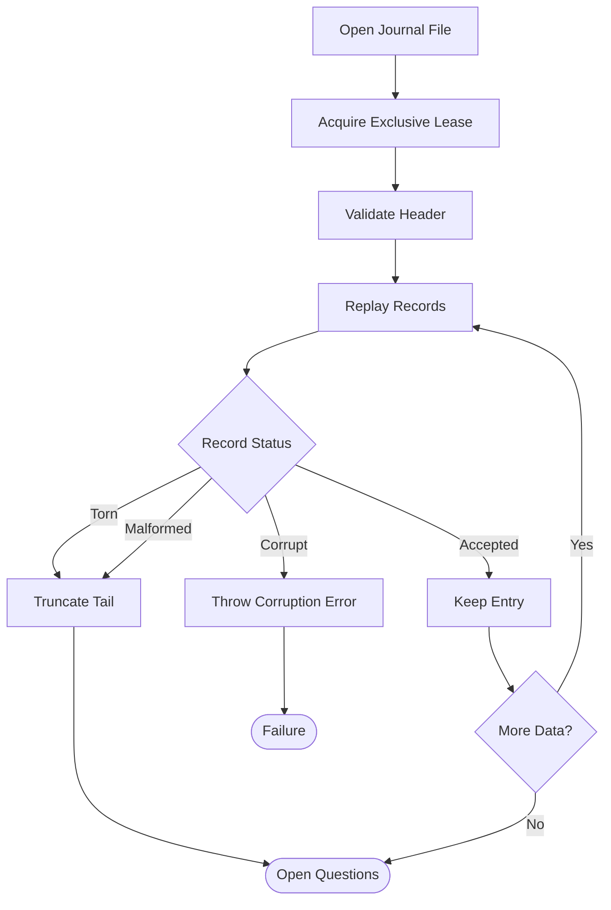
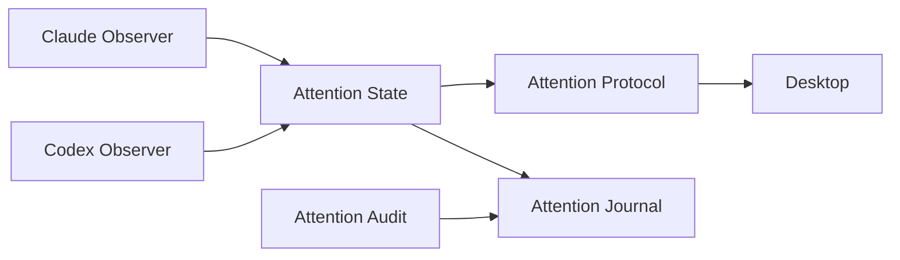

# Audit Trail Correlation

<cite>
**Referenced Files in This Document**
- [attention.hpp](file://services/session/include/lapis/session/attention.hpp)
- [attention.cpp](file://services/session/src/attention.cpp)
- [attention_audit.cpp](file://services/session/src/attention_audit.cpp)
- [attention_journal.cpp](file://services/session/src/attention_journal.cpp)
- [attention_protocol.cpp](file://services/session/src/transport/attention_protocol.cpp)
- [observer.cpp (Codex)](file://adapters/codex/src/observer.cpp)
- [claude_observer.cpp](file://adapters/claude/src/claude_observer.cpp)
- [architecture.md](file://docs/architecture.md)
- [attention-journal-integration.json](file://evidence/attention-journal-integration.json)
</cite>

## Table of Contents
1. [Introduction](#introduction)
2. [Project Structure](#project-structure)
3. [Core Components](#core-components)
4. [Architecture Overview](#architecture-overview)
5. [Detailed Component Analysis](#detailed-component-analysis)
6. [Dependency Analysis](#dependency-analysis)
7. [Performance Considerations](#performance-considerations)
8. [Troubleshooting Guide](#troubleshooting-guide)
9. [Conclusion](#conclusion)

## Introduction
This document explains the audit trail correlation system used by Lapis to build a unified, durable record of cross-source attention events. The system coordinates two agent adapters—Claude Code and Codex—with an internal attention state machine, a transport protocol, and a persistent journal. Its goal is not to force all sources into perfect order, but to preserve provable relationships between adapter events, user decisions, and adapter confirmations while handling out-of-order delivery, restarts, stale data, and overlapping information from multiple sources.

The core idea is simple:
- Each adapter produces events about a single request identity.
- The session service validates those events against a bounded, epoch-based state machine.
- A persistent journal records durable audit entries with monotonically increasing sequence numbers.
- An audit reconciler turns transient attention state into a stable history of asked, decided, delivered, and resolved events.
- External events are reconciled with internal state using epochs, revisions, source identities, and explicit capability flags rather than global timestamps alone.

## Project Structure
The audit correlation logic spans four layers:

| Layer | Responsibility | Key Files |
|---|---|---|
| Adapter layer | Observes agent behavior and translates it into attention requests, responses, and lifecycle boundaries | Claude observer, Codex observer |
| Session state layer | Maintains per-session pending requests, epochs, revisions, activity, and synchronization status | Attention state header and implementation |
| Transport layer | Validates and serializes snapshots and decisions across IPC boundaries | Attention wire protocol |
| Persistence and audit layer | Persists ordered audit entries, replays them safely, and derives open questions and outcomes | Attention journal and attention audit |

**Diagram sources**
- [claude_observer.cpp:201-540](file://adapters/claude/src/claude_observer.cpp#L201-L540)
- [observer.cpp (Codex):201-537](file://adapters/codex/src/observer.cpp#L201-L537)
- [attention.hpp:1-136](file://services/session/include/lapis/session/attention.hpp#L1-L136)
- [attention_protocol.cpp:1-343](file://services/session/src/transport/attention_protocol.cpp#L1-L343)
- [attention_journal.cpp:1-558](file://services/session/src/attention_journal.cpp#L1-L558)
- [attention_audit.cpp:1-82](file://services/session/src/attention_audit.cpp#L1-L82)

**Section sources**
- [architecture.md:1-165](file://docs/architecture.md#L1-L165)

## Core Components
The audit correlation system is built around five core components.

### Attention State Machine
The state machine owns one session’s pending requests and its synchronization boundary. It enforces:
- Monotonic source epochs.
- Strict per-epoch sequence ordering.
- Capability negotiation for observation, response, and reconciliation.
- Bounded pending and retired request sets.
- Request revision tokens that prevent replay of old decisions.
- Aging-based ordering of pending requests without claiming absolute source time.

Important operations include connecting, disconnecting, beginning observation-only streams, reconciling authoritative snapshots, submitting new requests, resolving completed requests, recording activity, responding with a choice, snoozing or acknowledging pending requests, and computing the current ordered list of actionable requests.

### Attention Journal
The journal is the durable audit log. Each entry has:
- A kind such as asked, decided, delivered, or resolved.
- An origin such as user or agent.
- A globally increasing sequence number.
- An epoch and revision identifying the exact derivation.
- A request identity and optional choice.
- An optional full request payload.

It uses:
- A magic header and format version.
- CRC-32 checksums over each record.
- Exclusive file leases with inode verification.
- Atomic append-and-fsync semantics.
- Automatic rotation when open questions are absent.
- Replay logic that tolerates torn tails and rejects corrupt records.

### Attention Audit Reconciler
The reconciler bridges transient attention state and the durable journal. It:
- Emits `asked` entries for pending requests not yet submitted.
- Emits `resolved` entries when a previously journaled request disappears from state.
- Emits `decided`, `delivered`, and `resolved` entries based on approval outcomes.
- Guards against invalid approvals by checking readiness, epoch, revision, status, submission state, and allowed choices.

### Attention Wire Protocol
The wire protocol validates and serializes:
- Attachments identifying session and adapter identity.
- Observation-phase-aware snapshots.
- Pending requests with metadata, details, status, revision, timing, and source epoch.
- Decisions with source epoch, request identity, revision, choice, and optional answers.

All payloads are bounded, UTF-8 validated, and fail closed on malformed input.

### Agent Adapters
The Claude and Codex adapters are different event sources with different capabilities:
- Claude observes terminal hooks and produces observation-only notices; actual answers happen in the Claude terminal.
- Codex observes RPC-style hook messages, supports observation, response, and reconciliation, and can send decisions back to the agent.

Both adapters must keep their local sequence numbers consistent with the state machine and must never silently ignore synchronization failures.

**Section sources**
- [attention.hpp:1-136](file://services/session/include/lapis/session/attention.hpp#L1-L136)
- [attention.cpp:1-271](file://services/session/src/attention.cpp#L1-L271)
- [attention_journal.cpp:1-558](file://services/session/src/attention_journal.cpp#L1-L558)
- [attention_audit.cpp:1-82](file://services/session/src/attention_audit.cpp#L1-L82)
- [attention_protocol.cpp:1-343](file://services/session/src/transport/attention_protocol.cpp#L1-L343)
- [claude_observer.cpp:201-540](file://adapters/claude/src/claude_observer.cpp#L201-L540)
- [observer.cpp (Codex):201-537](file://adapters/codex/src/observer.cpp#L201-L537)

## Architecture Overview
The end-to-end flow starts with an agent event, passes through an adapter-specific validator, enters the shared attention state machine, optionally becomes a durable journal entry, and may be presented to the desktop.

**Diagram sources**
- [observer.cpp (Codex):201-537](file://adapters/codex/src/observer.cpp#L201-L537)
- [claude_observer.cpp:201-540](file://adapters/claude/src/claude_observer.cpp#L201-L540)
- [attention.cpp:1-271](file://services/session/src/attention.cpp#L1-L271)
- [attention_journal.cpp:1-558](file://services/session/src/attention_journal.cpp#L1-L558)
- [attention_audit.cpp:1-82](file://services/session/src/attention_audit.cpp#L1-L82)

## Detailed Component Analysis

### Cross-Source Request Tracking
Cross-source tracking does not rely on a single global clock. Instead, it combines:
- A per-session identifier.
- An adapter identifier.
- A monotonic source epoch.
- A strict per-epoch sequence number.
- A request identity.
- A request revision.
- Optional thread, turn, and item identifiers.

For Claude, request identities come from tool-use IDs when exact, or deterministic hashes derived from prompt boundaries for advisory notices. For Codex, request identities come from the upstream message ID. Both adapters reject duplicate pending identities and map external context into the shared attention request model.

**Diagram sources**
- [claude_observer.cpp:201-540](file://adapters/claude/src/claude_observer.cpp#L201-L540)
- [observer.cpp (Codex):1-200](file://adapters/codex/src/observer.cpp#L1-L200)
- [attention.hpp:1-136](file://services/session/include/lapis/session/attention.hpp#L1-L136)

**Section sources**
- [claude_observer.cpp:201-540](file://adapters/claude/src/claude_observer.cpp#L201-L540)
- [observer.cpp (Codex):1-200](file://adapters/codex/src/observer.cpp#L1-L200)

### Request Correlation Algorithms
The correlation algorithm is layered:

1. **Identity matching:** Requests are grouped by request identity within an epoch.
2. **Sequence validation:** Events must arrive in strictly increasing order per epoch. Gaps cause desynchronization.
3. **Revision binding:** Responses and decisions must match the current revision for the same request identity.
4. **Capability gating:** Only adapters with response or reconciliation capabilities can perform those actions.
5. **Retention policy:** Retired identities remain bounded so delayed events cannot resurrect old state indefinitely.
6. **Aging tiebreakers:** When several pending requests are ready, older arrival time and lower priority score later, but age eventually outranks newer high-priority requests.

**Diagram sources**
- [attention.cpp:1-271](file://services/session/src/attention.cpp#L1-L271)
- [attention_journal.cpp:201-558](file://services/session/src/attention_journal.cpp#L201-L558)

**Section sources**
- [attention.cpp:1-271](file://services/session/src/attention.cpp#L1-L271)
- [attention_journal.cpp:201-558](file://services/session/src/attention_journal.cpp#L201-L558)

### Relationship Between Attention Journal Entries and the Broader Audit System
The attention journal is not merely a log of state changes; it is the source of truth for open questions and outcome recovery. The reconciler maps three primary concepts:

| Concept | Journal Meaning |
|---|---|
| Ask | The adapter observed or created a request needing resolution. |
| Decision | The user expressed intent to approve or decline. |
| Delivery | The adapter accepted the decision and marked the request as submitted. |
| Resolution | The request was explicitly retired or became stale. |

The journal preserves:
- Exact epoch and revision so that only the correct derivation closes an entry.
- Origin so that user intent and agent-originated closures are distinguishable.
- Optional full request data so that historical reconstruction does not require live state.
- A monotonically increasing sequence number so replay order is unambiguous.

Open-question computation treats a newer ask with the same identity as superseding the older ask, while a user-decided entry remains open until a matching delivered or compensating closure appears. A first-sequence user decision with no preceding ask is treated as potentially missing an earlier ask and stays open for unknown-outcome recovery.

**Section sources**
- [attention_journal.cpp:201-558](file://services/session/src/attention_journal.cpp#L201-L558)
- [attention_audit.cpp:1-82](file://services/session/src/attention_audit.cpp#L1-L82)

### Event Ordering Guarantees
Ordering guarantees are scoped, not global:

| Guarantee | Scope | Behavior |
|---|---|---|
| Monotonic clock | Local state | Backward clock movement throws an error. |
| Monotonic epoch | Source connection | New connections must increase the epoch. |
| Strict sequence | Per epoch | Missing sequences mark state desynchronized. |
| Durable sequence | Journal file | Each record gets a unique, increasing sequence. |
| Stable replay | Journal file | Records are read forward with checksum and sequence validation. |
| Ordering of pending decisions | In-memory state | Priority plus aging determines presentation order. |

The state machine explicitly distinguishes local delivery sequence from source completeness. Adapters must separately establish whether a source stream is complete; the state machine does not assume that sequence continuity implies total correctness.

**Section sources**
- [attention.hpp:1-136](file://services/session/include/lapis/session/attention.hpp#L1-L136)
- [attention.cpp:1-271](file://services/session/src/attention.cpp#L1-L271)
- [attention_journal.cpp:1-200](file://services/session/src/attention_journal.cpp#L1-L200)

### Conflict Resolution Strategies
When multiple sources report overlapping information, the system uses these strategies:

1. **Exact identity wins:** A request identity ties related events together.
2. **Epoch wins:** Events from a newer epoch replace stale evidence from an older epoch.
3. **Revision wins:** Responses and decisions must match the current revision.
4. **Capability wins:** Observation-only adapters cannot submit decisions.
5. **Superseding asks:** A newer ask with the same identity replaces an older ask in open-question computation.
6. **Bounded retirement:** Retired identities are retained up to a limit; exceeding the bound desynchronizes state.
7. **Fail-closed desynchronization:** Invalid or out-of-order events generally move state into a degraded mode rather than silently accepting them.

**Diagram sources**
- [attention.cpp:1-271](file://services/session/src/attention.cpp#L1-L271)
- [attention_journal.cpp:201-558](file://services/session/src/attention_journal.cpp#L201-L558)

**Section sources**
- [attention.cpp:1-271](file://services/session/src/attention.cpp#L1-L271)
- [attention_journal.cpp:201-558](file://services/session/src/attention_journal.cpp#L201-L558)

### Consistency Models
The system mixes several consistency models depending on the component:

| Component | Model | Rationale |
|---|---|---|
| Attention state | Linearizable per-epoch sequence with capability gates | Prevents replay and unauthorized responses. |
| Journal | Append-only durable log with checksums and fsync | Survives crashes and allows safe replay. |
| Open-question computation | Deterministic scan of journal entries | Produces a reproducible view of unresolved items. |
| Adapter observation | Best-effort event stream | Some hooks may be missed before attachment. |
| Adapter response | Transactional state transition plus network send | Network uncertainty leaves durable intent open. |
| Timeline reconstruction | Journal sequence plus epoch/revision | Provides causal linkage even when wall-clock order is unavailable. |

**Section sources**
- [attention.hpp:1-136](file://services/session/include/lapis/session/attention.hpp#L1-L136)
- [attention_journal.cpp:1-558](file://services/session/src/attention_journal.cpp#L1-L558)
- [observer.cpp (Codex):201-537](file://adapters/codex/src/observer.cpp#L201-L537)

### Multi-Source Event Correlation Example
Consider a user prompt that triggers both Claude and Codex-related work:

1. Claude receives a prompt and emits a session start. The Claude observer pins the session and begins observation-only state.
2. Claude emits a permission or input notice. The observer creates an observation-only request with a deterministic identity tied to the prompt boundary.
3. The desktop presents this notice as part of the attention timeline.
4. The user answers in the Claude terminal, not through Lapis’ decision path.
5. Later, Claude emits completion or stop events. The observer retires exact tool-use identities and updates activity.
6. If another adapter observes the same logical task through a different channel, it must use a distinct request identity unless it is explicitly correlating with Claude’s exact tool-use ID.

**Diagram sources**
- [claude_observer.cpp:201-540](file://adapters/claude/src/claude_observer.cpp#L201-L540)

**Section sources**
- [claude_observer.cpp:201-540](file://adapters/claude/src/claude_observer.cpp#L201-L540)

### Timeline Reconstruction
Timeline reconstruction reads the journal sequentially and computes open questions:

1. Initialize expected sequence to 1.
2. Read bounded chunks from disk.
3. Decode each record and validate checksums.
4. Accept accepted records and advance expected sequence.
5. Treat torn or malformed final records as truncated tails.
6. Treat corrupt records as unrecoverable damage.
7. Scan entries to compute open questions by identity, epoch, and revision.
8. Rotate the journal if it exceeds size limits and no open questions remain.

**Diagram sources**
- [attention_journal.cpp:1-200](file://services/session/src/attention_journal.cpp#L1-L200)
- [attention_journal.cpp:201-558](file://services/session/src/attention_journal.cpp#L201-L558)

**Section sources**
- [attention_journal.cpp:1-200](file://services/session/src/attention_journal.cpp#L1-L200)
- [attention_journal.cpp:201-558](file://services/session/src/attention_journal.cpp#L201-L558)

### Debugging Techniques for Audit Inconsistencies
When audit trails appear inconsistent, follow this diagnostic path:

1. **Check synchronization state:** If the state is not ready, inspect epoch, sequence, and capability flags.
2. **Inspect the journal lease and rotation:** Confirm the file is owned by one writer and not rotated while open questions exist.
3. **Verify checksums and sequence:** Corrupted or torn journal tails produce specific errors; torn tails are truncated, corruption is fatal.
4. **Trace request identity:** Ensure the same identity is used for related events across adapters.
5. **Trace epoch and revision:** A mismatch means the decision or response belongs to a stale derivation.
6. **Check adapter capabilities:** Claude is observation-only; Codex supports response and reconciliation.
7. **Check adapter diagnostics:** Claude reports connection overflow, paused-turn deadlines, and background-work schema issues. Codex reports unsupported binaries, RPC timeouts, and reconciliation phases.
8. **Use integration receipts:** The attention-journal integration receipt documents test scope, platform, tools, pass/fail results, repairs, and non-claims.

**Section sources**
- [attention.cpp:1-271](file://services/session/src/attention.cpp#L1-L271)
- [attention_journal.cpp:1-558](file://services/session/src/attention_journal.cpp#L1-L558)
- [claude_observer.cpp:201-540](file://adapters/claude/src/claude_observer.cpp#L201-L540)
- [observer.cpp (Codex):201-537](file://adapters/codex/src/observer.cpp#L201-L537)
- [attention-journal-integration.json:1-121](file://evidence/attention-journal-integration.json#L1-L121)

## Dependency Analysis
The following diagram shows how components depend on each other:

**Diagram sources**
- [claude_observer.cpp:201-540](file://adapters/claude/src/claude_observer.cpp#L201-L540)
- [observer.cpp (Codex):201-537](file://adapters/codex/src/observer.cpp#L201-L537)
- [attention.hpp:1-136](file://services/session/include/lapis/session/attention.hpp#L1-L136)
- [attention_protocol.cpp:1-343](file://services/session/src/transport/attention_protocol.cpp#L1-L343)
- [attention_journal.cpp:1-558](file://services/session/src/attention_journal.cpp#L1-L558)
- [attention_audit.cpp:1-82](file://services/session/src/attention_audit.cpp#L1-L82)

Key dependency properties:
- Adapters depend on the state machine for ordering, capacity, and capability enforcement.
- The state machine depends on monotonic ticks and bounded limits.
- The journal depends on POSIX durability primitives and CRC-32 integrity checks.
- The audit layer depends on both state and journal to derive durable outcomes.
- The protocol layer depends on the attention types and validates all fields before use.

**Section sources**
- [attention.hpp:1-136](file://services/session/include/lapis/session/attention.hpp#L1-L136)
- [attention.cpp:1-271](file://services/session/src/attention.cpp#L1-L271)
- [attention_journal.cpp:1-558](file://services/session/src/attention_journal.cpp#L1-L558)
- [attention_audit.cpp:1-82](file://services/session/src/attention_audit.cpp#L1-L82)
- [attention_protocol.cpp:1-343](file://services/session/src/transport/attention_protocol.cpp#L1-L343)

## Performance Considerations
The audit correlation system prioritizes safety and determinism over throughput:

- Journal reads and writes process one bounded record at a time.
- Journal replay validates checksums and sequences incrementally.
- Attention state uses ordered maps and sets, giving predictable memory bounds.
- Pending request counts are limited; excessive reconciliation batches desynchronize state.
- Wire protocol bounds snapshot size, request count, choice count, and field sizes.
- Aging avoids expensive timestamp comparisons by scoring pending requests relative to current time and limits.
- Journal rotation occurs only when open questions are empty, avoiding disruption of unresolved audits.

Potential optimization opportunities:
- Batch journal appends could reduce syscall overhead, but would weaken crash-consistency guarantees.
- Indexing journal entries by request identity could speed lookup for large histories, at the cost of additional persistence.
- Caching open-question computation could help repeated scans, but must be invalidated on every journal mutation.
- Adaptive aging intervals could improve responsiveness under bursty workloads.

[No sources needed since this section provides general guidance]

## Troubleshooting Guide
Common audit inconsistencies and their likely causes:

| Symptom | Likely Cause | Diagnostic Action |
|---|---|---|
| Requests disappear unexpectedly | Retired overflow or explicit resolution | Check retired set, request resolution, and journal entries. |
| Same request appears twice | Duplicate identity across adapters without explicit correlation | Inspect request identities and epoch boundaries. |
| Decision is rejected | Wrong epoch, revision, choice, or capability | Verify attention state readiness and adapter capabilities. |
| Journal fails to open | Another writer holds the lease or permissions are wrong | Check exclusive lock and descriptor ownership. |
| Replay stops early | Torn tail after crash | Expect truncation; verify next expected sequence. |
| Replay throws corruption | Bad checksum, invalid enum, or mismatched sequence | Inspect raw journal bytes and compare stored vs computed checksum. |
| Claude hooks miss events | Connection overflow or paused-turn deadline exceeded | Review observer diagnostics and retry after session restart. |
| Codex cannot reconnect | Unsupported binary hash or exhausted sequence space | Check binary hash and sequence limits. |
| Timeline shows open question with no ask | First-sequence user decision persisted without preceding ask | Treat as outcome_unknown and allow recovery. |

**Section sources**
- [attention_journal.cpp:1-558](file://services/session/src/attention_journal.cpp#L1-L558)
- [attention_audit.cpp:1-82](file://services/session/src/attention_audit.cpp#L1-L82)
- [claude_observer.cpp:201-540](file://adapters/claude/src/claude_observer.cpp#L201-L540)
- [observer.cpp (Codex):201-537](file://adapters/codex/src/observer.cpp#L201-L537)

## Conclusion
The audit trail correlation system trades simplicity for robustness. It does not try to impose a single global timeline on unrelated agents. Instead, it builds a provable chain of evidence per session, per epoch, and per request identity. Adapters observe independently, the state machine enforces ordering and capabilities, the journal persists durable audit facts, and the reconciler derives open questions and outcomes.

For multi-source correlation, the most important rule is identity discipline: unrelated adapters should not share identities unless they are explicitly mapping the same underlying operation. For timeline reconstruction, the journal sequence and epoch/revision pair are more reliable than wall-clock time. For debugging, always trace the full chain from adapter event through state outcome, journal entry, and open-question computation.