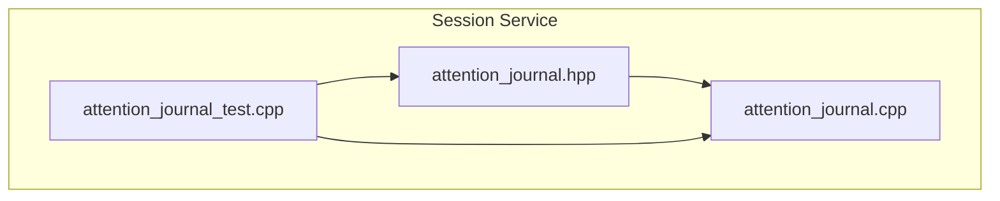
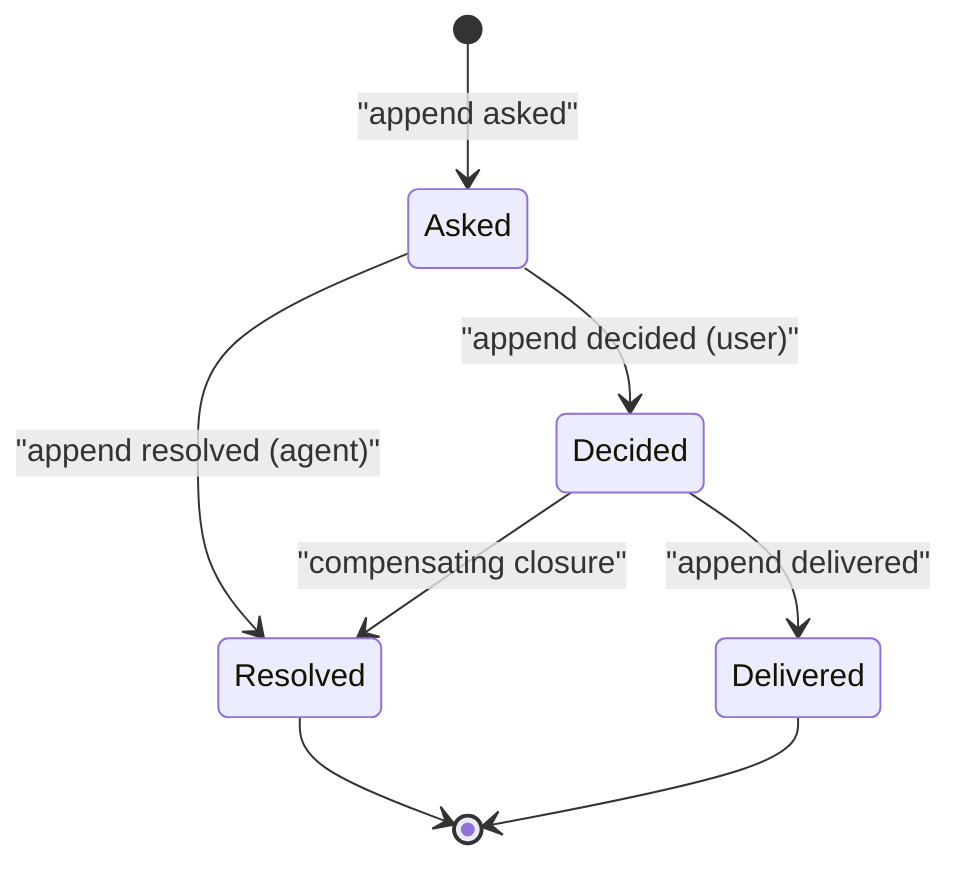
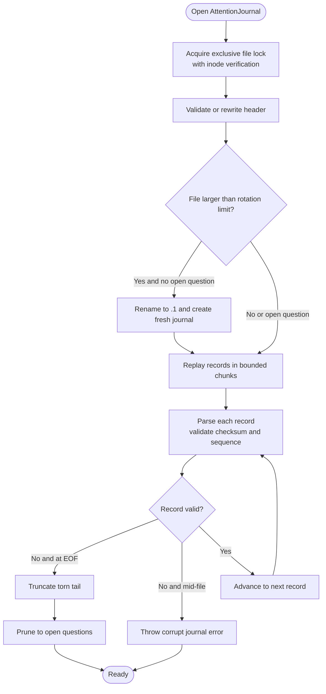
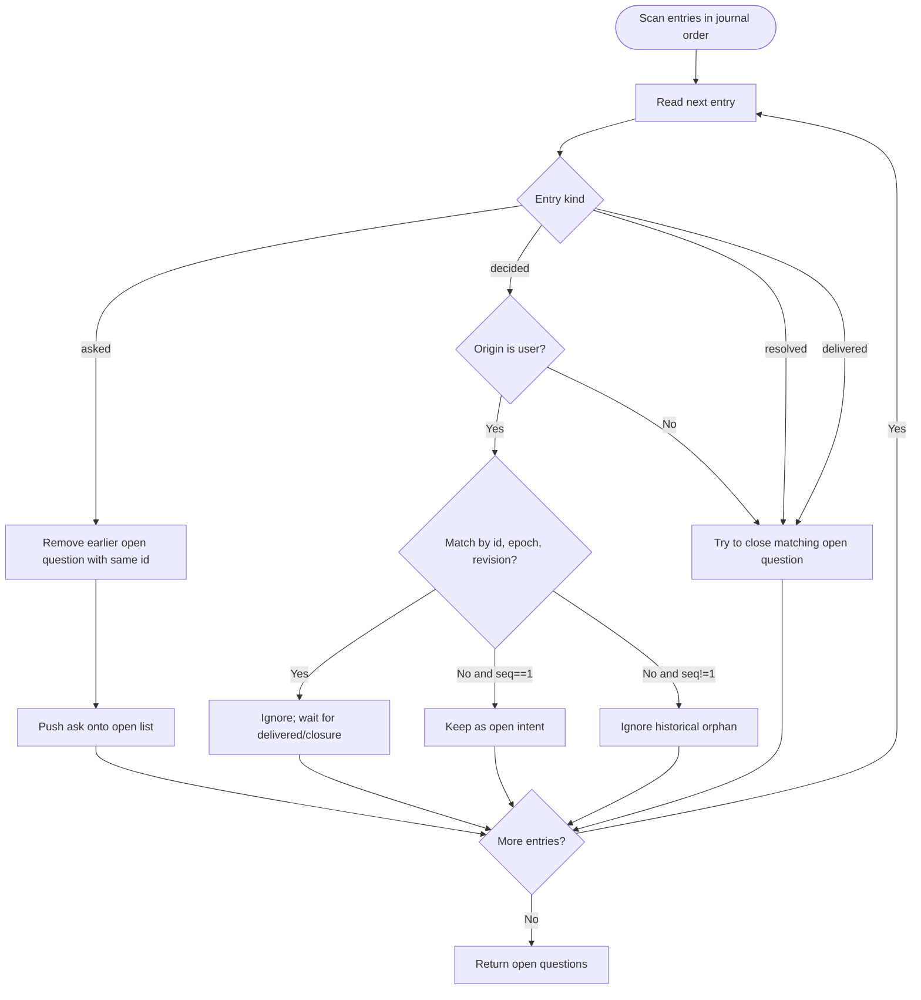
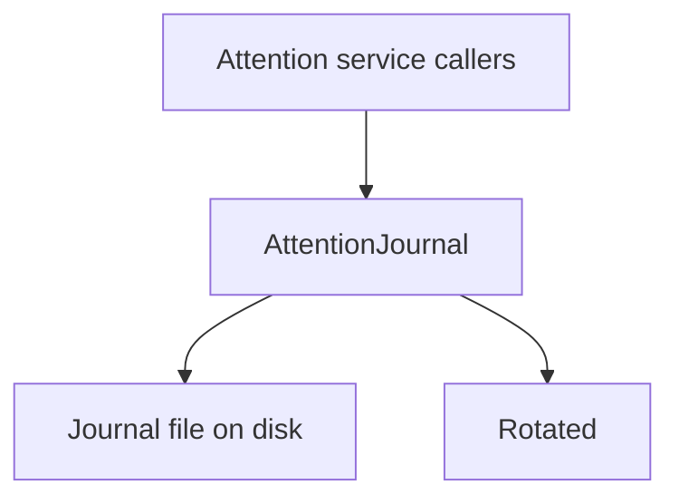
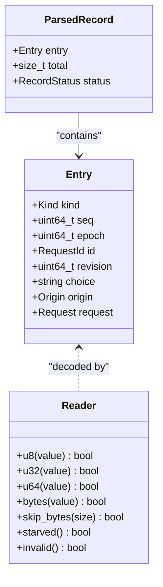
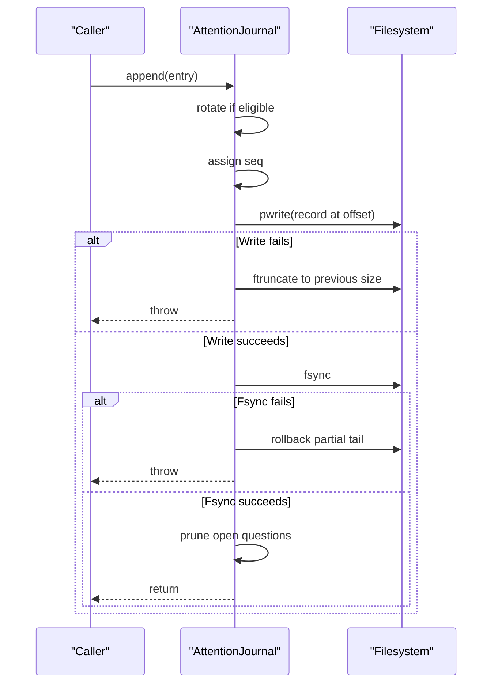
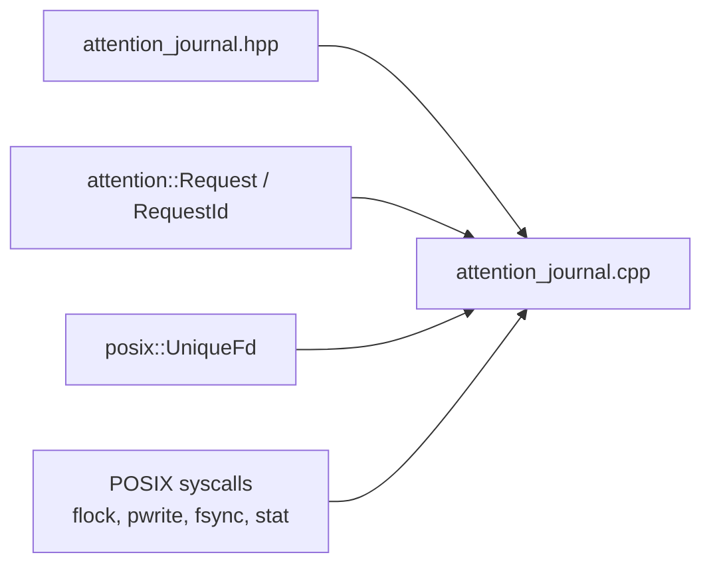

# Journal Persistence & Recovery

<cite>
**Referenced Files in This Document**
- [attention_journal.hpp](file://services/session/src/attention_journal.hpp)
- [attention_journal.cpp](file://services/session/src/attention_journal.cpp)
- [attention_journal_test.cpp](file://services/session/tests/attention_journal_test.cpp)
</cite>

## Table of Contents
1. [Introduction](#introduction)
2. [Project Structure](#project-structure)
3. [Core Components](#core-components)
4. [Architecture Overview](#architecture-overview)
5. [Detailed Component Analysis](#detailed-component-analysis)
6. [Dependency Analysis](#dependency-analysis)
7. [Performance Considerations](#performance-considerations)
8. [Troubleshooting Guide](#troubleshooting-guide)
9. [Conclusion](#conclusion)

## Introduction
This document describes the attention journal persistence layer used by the service-side attention subsystem. It is a durable, append-only audit trail for attention requests and their lifecycle outcomes. The design emphasizes crash safety, single-writer ownership, bounded replay, rotation of old generations, and fail-closed checkpoint barriers so that callers must not treat a decision as confirmed until the journal confirms it.

Key guarantees:
- Every record is written with a CRC-32 checksum and fsynced before the sequence number is assigned to the caller.
- A torn tail from a crash mid-append is truncated on recovery; mid-file corruption aborts startup.
- Only one writer may hold the journal file lock at a time.
- Journals rotate into numbered sibling files when they exceed a configurable byte threshold, but only when no question is open.
- Open questions are detected deterministically, and synthetic `outcome_unknown` decisions can be recorded for crash recovery.

## Project Structure
The attention journal lives in the session service under `services/session`. The implementation is split between a header declaring the public API and a source file implementing the binary format, locking, replay, rotation, and open-question detection. Tests validate round-trips, crash scenarios, rotation behavior, and recovery semantics.

**Diagram sources**
- [attention_journal.hpp:1-99](file://services/session/src/attention_journal.hpp#L1-L99)
- [attention_journal.cpp:1-558](file://services/session/src/attention_journal.cpp#L1-L558)
- [attention_journal_test.cpp:1-390](file://services/session/tests/attention_journal_test.cpp#L1-L390)

**Section sources**
- [attention_journal.hpp:1-99](file://services/session/src/attention_journal.hpp#L1-L99)
- [attention_journal.cpp:1-558](file://services/session/src/attention_journal.cpp#L1-L558)
- [attention_journal_test.cpp:1-390](file://services/session/tests/attention_journal_test.cpp#L1-L390)

## Core Components

### Entry Model
An `Entry` records one step in an attention request’s lifecycle:

| Field | Meaning |
|---|---|
| `kind` | Lifecycle stage: `asked`, `decided`, `resolved`, or `delivered`. |
| `seq` | Dense journal-local sequence starting at 1, assigned by `append`. |
| `epoch` | Source epoch identifying the current derivation of the request. |
| `id` | Request identity, either an integer ID or a string identifier. |
| `revision` | Revision within the same epoch and identity. |
| `choice` | Decision choice; present for `decided` entries. |
| `origin` | Who closed the request: `user`, `agent`, or `outcome_unknown`. |
| `request` | Full `Request` payload for `asked` entries. |

Lifecycle states:
- `asked`: The service observed a new request.
- `decided`: An intent was made. When `origin == user`, this is durable user intent, not proof that delivery completed.
- `resolved`: The agent resolved or retired the request without user approval.
- `delivered`: The requested outcome was delivered to the requester.

Sequence numbering:
- `seq` is assigned monotonically during `append`.
- Replay enforces expected sequence order and rejects mismatches.
- After appending, the working set is pruned to open questions only, while the full history remains on disk.

Epoch tracking:
- `(id, epoch, revision)` together identify the current derivation of a request.
- A newer ask with the same `id` supersedes earlier asks in the same identity.
- Closing events match by `id`, `epoch`, and `revision`.

Request lifecycle state machine:

**Diagram sources**
- [attention_journal.hpp:12-33](file://services/session/src/attention_journal.hpp#L12-L33)
- [attention_journal.cpp:380-430](file://services/session/src/attention_journal.cpp#L380-L430)

**Section sources**
- [attention_journal.hpp:12-33](file://services/session/src/attention_journal.hpp#L12-L33)
- [attention_journal.cpp:380-430](file://services/session/src/attention_journal.cpp#L380-L430)
- [attention_journal_test.cpp:49-94](file://services/session/tests/attention_journal_test.cpp#L49-L94)

### Rotation Mechanism
Journals rotate into a numbered sibling `<path>.1` when:
- The file size exceeds `rotate_bytes_` at open or before `append`, **and**
- No question is currently open according to `open_questions`.

Rotation preserves atomicity:
- The previous journal is renamed to its `.1` sibling while the writer lock remains held.
- A fresh journal is created under the original name before releasing the old descriptor.
- Directory metadata is synced after rename to make the rotation durable.
- If rotation fails before writing the new record, the original file is left unchanged.

Configurable thresholds:
- Default rotation threshold is 4 MiB.
- Tests demonstrate rotation with very small thresholds and verify that an open question blocks rotation.

**Section sources**
- [attention_journal.hpp:35-45](file://services/session/src/attention_journal.hpp#L35-L45)
- [attention_journal.cpp:244-303](file://services/session/src/attention_journal.cpp#L244-L303)
- [attention_journal_test.cpp:279-356](file://services/session/tests/attention_journal_test.cpp#L279-L356)

### Crash Recovery Process
Recovery occurs during construction:

1. **Exclusive writer lock**: The journal opens the file with `O_RDWR | O_CREAT` and acquires an exclusive non-blocking flock. If another process holds the lock, construction throws.
2. **Inode re-verification**: After acquiring the lock, the inode and device are compared with the current path to avoid holding a stale lock on a replaced file.
3. **Header validation**: The magic, version, and newline footer are checked. A torn header shorter than the expected size is rewritten; a newer format causes a startup error.
4. **Bounded replay**: Records are read in chunks up to `max_record_bytes`. Each record is parsed, checksummed, and validated.
5. **Torn tail truncation**: If parsing reaches EOF prematurely, or if the final record has an intact frame but invalid checksum/fields, the tail is truncated back to the last accepted record offset.
6. **Mid-file corruption**: Corruption inside the file, including bad checksums, unexpected sequences, or malformed fields, throws.
7. **Open-question pruning**: After replay, the in-memory working set is reduced to open questions. The full history remains on disk for auditing.

Failure modes:
- Another writer: throws “already owned”.
- Newer format: throws with a message instructing upgrade.
- Corrupt file: throws a runtime error describing corruption.
- Failed durability: appends roll back partial tails and throw, so callers must not proceed.

**Diagram sources**
- [attention_journal.cpp:304-379](file://services/session/src/attention_journal.cpp#L304-L379)
- [attention_journal.cpp:431-479](file://services/session/src/attention_journal.cpp#L431-L479)
- [attention_journal.cpp:481-512](file://services/session/src/attention_journal.cpp#L481-L512)

**Section sources**
- [attention_journal.cpp:244-379](file://services/session/src/attention_journal.cpp#L244-L379)
- [attention_journal.cpp:431-512](file://services/session/src/attention_journal.cpp#L431-L512)
- [attention_journal_test.cpp:104-158](file://services/session/tests/attention_journal_test.cpp#L104-L158)

### Open Question Detection Algorithm
`open_questions` scans entries in journal order and maintains a list of still-open questions:

- For each `asked` entry:
  - Remove any earlier open question with the same `id`.
  - Add the new ask to the open list.
- For each `decided` entry:
  - If `origin == user`, treat it as durable intent. If there is no matching open question by `(id, epoch, revision)`, keep it open only when it is the first sequence number, indicating the original ask may have failed to persist.
  - Otherwise, ignore older non-user decisions for compatibility.
- For other closing kinds (`resolved`, `delivered`):
  - Remove the matching open question identified by `(id, epoch, revision)`.

Result:
- The returned vector contains only questions whose lifecycle is not yet closed by a matching delivery, resolution, or compensating closure.
- A newer same-identity ask supersedes older asks.
- A durable user decision without a visible preceding ask is treated as open unless it is a historical orphan with `seq == 1`.

**Diagram sources**
- [attention_journal.cpp:514-556](file://services/session/src/attention_journal.cpp#L514-L556)

**Section sources**
- [attention_journal.cpp:514-556](file://services/session/src/attention_journal.cpp#L514-L556)
- [attention_journal_test.cpp:215-277](file://services/session/tests/attention_journal_test.cpp#L215-L277)

### Synthetic Outcome Unknown for Crash Recovery
When crash recovery detects an open question whose true outcome is unknown, it can emit a synthetic decision:

- Kind: `decided`.
- Origin: `outcome_unknown`.
- Copies the original ask’s `epoch`, `id`, and `revision`.
- Leaves `choice` empty.
- Does not carry the original request payload.

This ensures auditors do not interpret the entry as a real user approval.

**Section sources**
- [attention_journal.hpp:15-18](file://services/session/src/attention_journal.hpp#L15-L18)
- [attention_journal.cpp:558-558](file://services/session/src/attention_journal.cpp#L558-L558)
- [attention_journal_test.cpp:240-277](file://services/session/tests/attention_journal_test.cpp#L240-L277)

## Architecture Overview
At a high level, the attention journal sits beneath the attention service and exposes a simple append-and-replay interface. Callers forward decisions only after `append` returns successfully, making append itself the fail-closed checkpoint barrier.

**Diagram sources**
- [attention_journal.hpp:35-70](file://services/session/src/attention_journal.hpp#L35-L70)
- [attention_journal.cpp:244-379](file://services/session/src/attention_journal.cpp#L244-L379)

## Detailed Component Analysis

### Binary Format and Integrity
The journal file begins with a header consisting of:
- Magic bytes.
- Format version.
- Newline terminator.

Each record stores:
- Entry kind and origin.
- Sequence, epoch, and revision.
- Request ID, encoded as either a signed 64-bit integer or a length-prefixed string.
- Optional choice string.
- Optional request payload containing thread, turn, item identifiers, reason, summary, choices, and priority.
- CRC-32 checksum over the record bytes.

Constraints:
- Maximum string field size: 64 KiB.
- Maximum choices per request: 64.
- Maximum record size is bounded so replay reads one record at a time.

Integrity checks:
- CRC-32 validates every record.
- Expected sequence numbers are enforced during replay.
- Invalid enum values, invalid ID tags, or malformed payloads invalidate the record.
- Mid-file corruption throws; a final incomplete or invalid-looking record is treated as a torn tail and truncated.

**Diagram sources**
- [attention_journal.hpp:12-33](file://services/session/src/attention_journal.hpp#L12-L33)
- [attention_journal.cpp:100-200](file://services/session/src/attention_journal.cpp#L100-L200)
- [attention_journal.cpp:304-379](file://services/session/src/attention_journal.cpp#L304-L379)

**Section sources**
- [attention_journal.cpp:100-200](file://services/session/src/attention_journal.cpp#L100-L200)
- [attention_journal.cpp:304-379](file://services/session/src/attention_journal.cpp#L304-L379)
- [attention_journal_test.cpp:258-277](file://services/session/tests/attention_journal_test.cpp#L258-L277)

### File Permission Requirements
- The journal file is opened with mode `0600`, restricting access to the owner.
- Both the initial open and the rotated file creation use the same restrictive mode.
- Directory access is opened read-only for syncing directory metadata after rotation.

Implications:
- The service process must own the journal file and directory.
- Other users cannot read or write the journal.
- Failures opening or syncing the directory surface as startup errors.

**Section sources**
- [attention_journal.cpp:244-303](file://services/session/src/attention_journal.cpp#L244-L303)

### Append Semantics and Checkpoint Barrier
`append` performs:
1. Optional preappend rotation when the journal is oversized and no question is open.
2. Assignment of the next dense sequence number.
3. Serialization of the record.
4. Atomic write at the current file offset using `pwrite`.
5. Failure rollback: if writing fails, the partial tail is truncated and the original error is preserved.
6. Synchronous flush via `fsync`.
7. Update of in-memory size, appended entry, and next sequence.
8. Working-set pruning to open questions.

Fail-closed guarantee:
- Because `fsync` happens before returning, callers must not consider a decision durable until `append` succeeds.
- If durability fails, the method throws and the caller must not proceed.

**Diagram sources**
- [attention_journal.cpp:481-512](file://services/session/src/attention_journal.cpp#L481-L512)
- [attention_journal.cpp:304-379](file://services/session/src/attention_journal.cpp#L304-L379)

**Section sources**
- [attention_journal.cpp:481-512](file://services/session/src/attention_journal.cpp#L481-L512)
- [attention_journal_test.cpp:329-356](file://services/session/tests/attention_journal_test.cpp#L329-L356)

### Concrete Examples

#### Journal File Layout
A healthy journal consists of:
- Header: magic, version, newline.
- One or more records, each ending with a CRC-32 checksum.

Example structure (conceptual, not literal bytes):
- Header: `magic = "LAPISATT"`, `version = 1`, newline.
- Record 1: `asked`, `seq=1`, `epoch=3`, `id=42`, `revision=5`, optional request payload, checksum.
- Record 2: `decided`, `seq=2`, `epoch=3`, `id=42`, `revision=5`, choice `"allow"`, origin `user`, checksum.
- Record 3: `asked`, `seq=3`, `epoch=4`, `id="tool_9"`, `revision=1`, checksum.
- Record 4: `resolved`, `seq=4`, `epoch=4`, `id="tool_9"`, `revision=1`, origin `agent`, checksum.

After reopening:
- In-memory entries are pruned to open questions.
- Full history remains on disk for audit.

**Section sources**
- [attention_journal_test.cpp:49-94](file://services/session/tests/attention_journal_test.cpp#L49-L94)
- [attention_journal.cpp:244-379](file://services/session/src/attention_journal.cpp#L244-L379)

#### Rotation Trigger Example
With a small rotation threshold such as 64 bytes:
- Two completed requests fit into one journal generation.
- On reopen, because no question is open, the journal rotates to `<path>.1`.
- The active journal becomes empty after replay, while the archive retains the two records.
- If an open question exists, rotation is skipped so recovery continues against the asking journal.

**Section sources**
- [attention_journal_test.cpp:279-356](file://services/session/tests/attention_journal_test.cpp#L279-L356)

#### Recovery Scenarios
- Torn tail: The last record is cut short; recovery truncates it and retains earlier records.
- Final record with intact frame but damaged checksum: treated as torn and dropped.
- Mid-file corruption: startup throws; the service must not continue.
- Newer format: startup throws; the operator must upgrade lapis.
- Torn header: rewritten safely.
- Second writer: rejected with an ownership error.

**Section sources**
- [attention_journal_test.cpp:104-158](file://services/session/tests/attention_journal_test.cpp#L104-L158)
- [attention_journal_test.cpp:160-189](file://services/session/tests/attention_journal_test.cpp#L160-L189)
- [attention_journal_test.cpp:215-277](file://services/session/tests/attention_journal_test.cpp#L215-L277)

## Dependency Analysis
The journal depends on POSIX file operations, filesystem paths, and the shared attention model types.

**Diagram sources**
- [attention_journal.hpp:1-11](file://services/session/src/attention_journal.hpp#L1-L11)
- [attention_journal.cpp:1-20](file://services/session/src/attention_journal.cpp#L1-L20)

**Section sources**
- [attention_journal.hpp:1-11](file://services/session/src/attention_journal.hpp#L1-L11)
- [attention_journal.cpp:1-20](file://services/session/src/attention_journal.cpp#L1-L20)

## Performance Considerations
- Bounded replay: reading at most `max_record_bytes` prevents large allocations during recovery.
- Single-writer design avoids contention and simplifies consistency.
- Rotation reduces the amount of history scanned on subsequent recoveries.
- In-memory working set is pruned to open questions, reducing retained memory after replay.
- Large payloads are supported up to explicit limits; exceeding them raises validation errors rather than allowing unbounded growth.

[No sources needed since this section provides general guidance]

## Troubleshooting Guide

| Symptom | Likely Cause | Recommended Action |
|---|---|---|
| Startup throws “already owned” | Another process holds the exclusive journal lock. | Stop the other writer or investigate a wedged process. Do not force-remove the lock. |
| Startup throws “newer format” | Journal was created by a newer lapis version. | Upgrade lapis before resuming. |
| Startup throws about corruption | Mid-file checksum, sequence, or field mismatch. | Inspect the journal; do not silently ignore. Back up the file, then rebuild state if necessary. |
| Tail disappears after restart | Crash interrupted the final record; torn tail was truncated. | Replay earlier records; add missing follow-up entries if needed. |
| Appending a decision does not succeed | Write or fsync failed, possibly followed by rollback. | Investigate filesystem availability and permissions; retry only after fixing the underlying issue. |
| Journal grows without rotating | An open question is present. | Complete or resolve the open question; rotation will become eligible on the next reopen. |
| Cannot sync directory | Parent directory cannot be opened or flushed. | Verify directory existence, permissions, and filesystem health. |

**Section sources**
- [attention_journal.cpp:244-303](file://services/session/src/attention_journal.cpp#L244-L303)
- [attention_journal.cpp:431-512](file://services/session/src/attention_journal.cpp#L431-L512)
- [attention_journal_test.cpp:160-189](file://services/session/tests/attention_journal_test.cpp#L160-L189)

## Conclusion
The attention journal provides a robust, single-writer, append-only persistence layer for attention requests. Its design combines strict integrity checks, deterministic open-question detection, safe rotation, and fail-closed checkpoints. Crash recovery tolerates torn tails but treats mid-file corruption and incompatible formats as fatal, ensuring that partial or inconsistent state does not silently propagate into higher layers. Operators should monitor rotation behavior, preserve journal files for audit, and ensure exclusive ownership and correct file permissions.