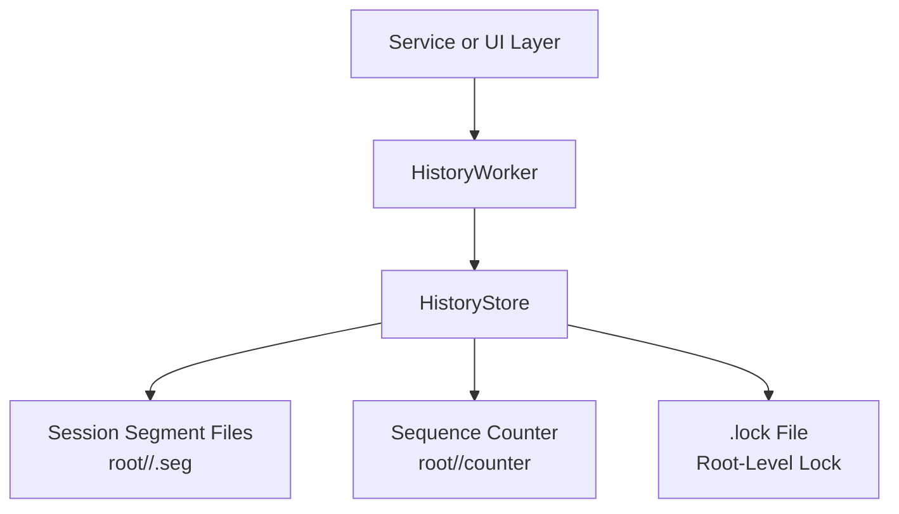
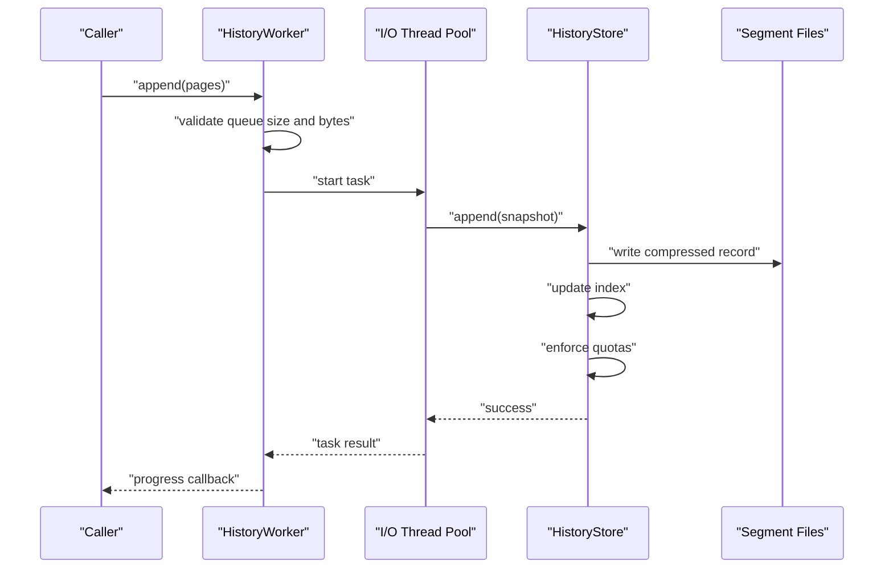
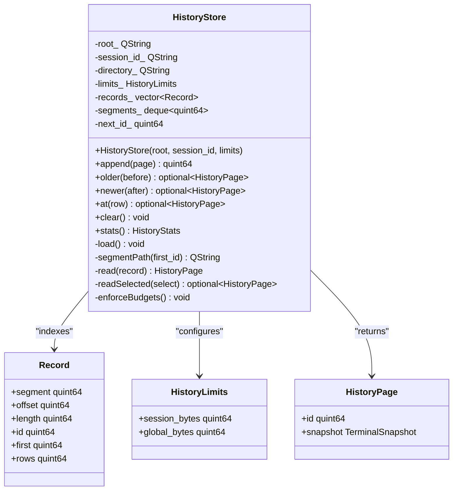
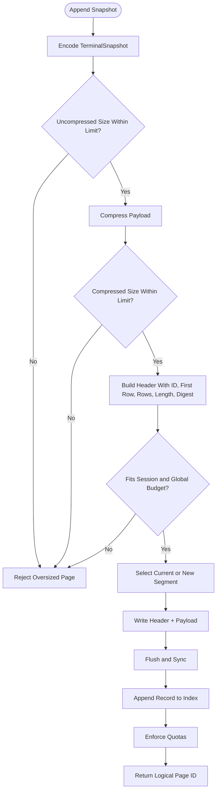
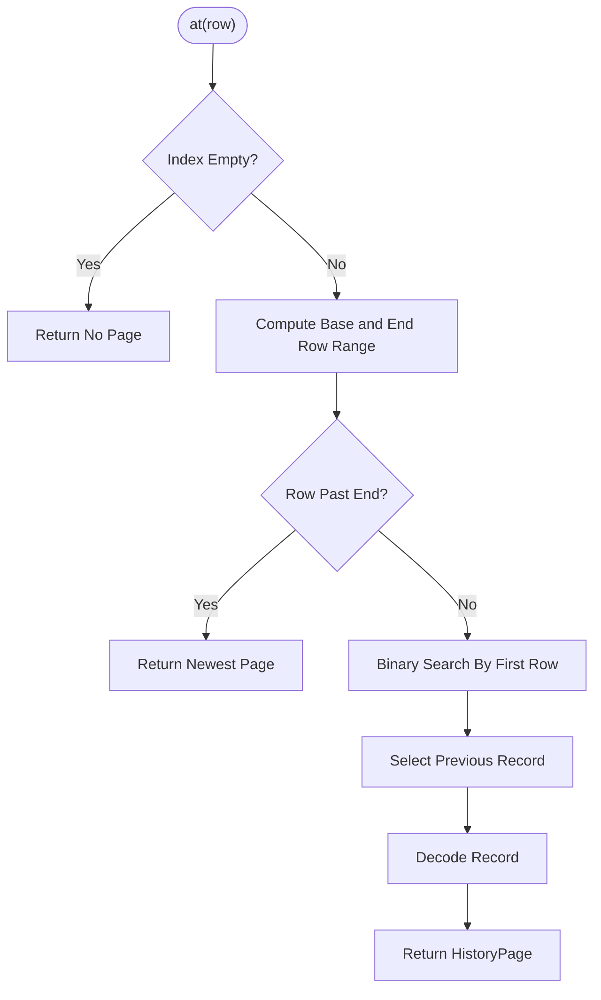
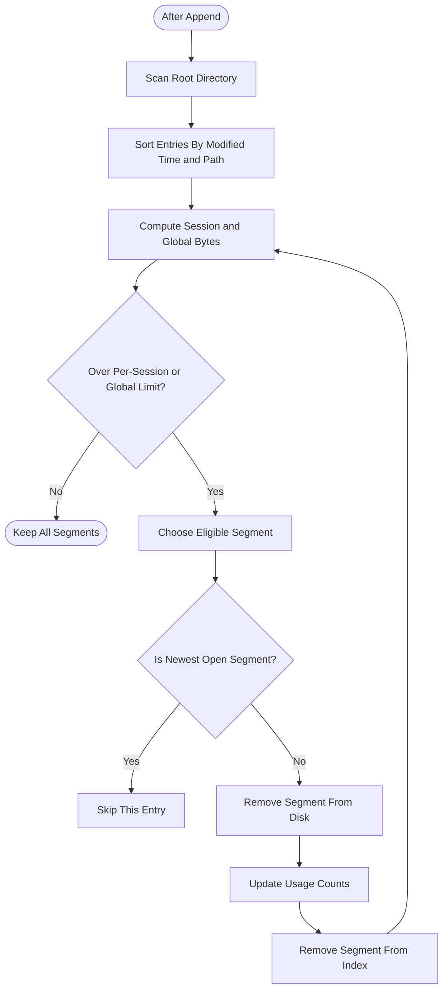
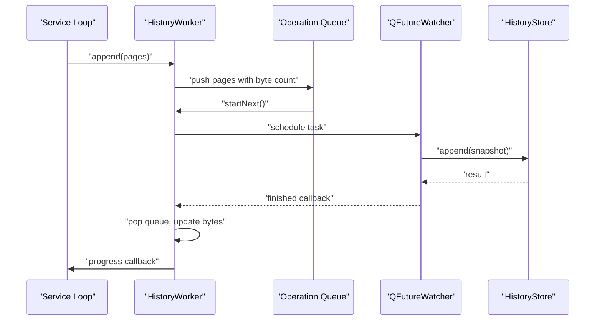
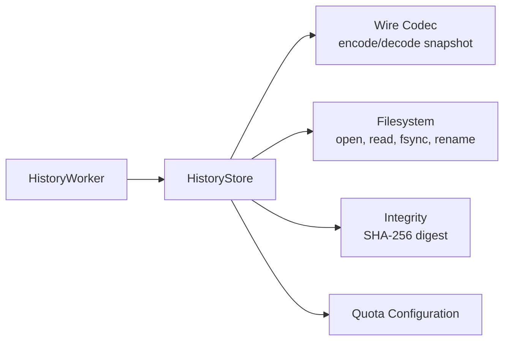

# History Storage System

<cite>
**Referenced Files in This Document**
- [history_store.hpp](file://services/session/src/history_store.hpp)
- [history_store.cpp](file://services/session/src/history_store.cpp)
- [history_worker.hpp](file://services/session/src/history_worker.hpp)
- [history_worker.cpp](file://services/session/src/history_worker.cpp)
</cite>

## Table of Contents
1. [Introduction](#introduction)
2. [Project Structure](#project-structure)
3. [Core Components](#core-components)
4. [Architecture Overview](#architecture-overview)
5. [Detailed Component Analysis](#detailed-component-analysis)
6. [Dependency Analysis](#dependency-analysis)
7. [Performance Considerations](#performance-considerations)
8. [Troubleshooting Guide](#troubleshooting-guide)
9. [Conclusion](#conclusion)

## Introduction
This document explains the history storage system that persists conversation snapshots to disk. It is designed for terminal-based conversations, where each page contains a compressed terminal snapshot. The system provides:

- Append-only segment files per session.
- An in-memory index mapping logical row numbers to on-disk records.
- Page-based organization with compact headers and integrity digests.
- Compression of terminal snapshots into kilobyte-sized pages.
- Per-session and global quota enforcement with eviction of older segments.
- An asynchronous I/O worker that isolates blocking filesystem operations from the service loop.
- O(1) access patterns through record offsets, with binary search over the in-memory index for logical row lookups.
- Compatibility handling for legacy `*.page` formats during migration.

The implementation lives in the session service layer and is consumed by higher-level components through an asynchronous worker interface.

## Project Structure
The history subsystem consists of two main units:

| File | Responsibility |
|---|---|
| `history_store.hpp` | Public API, data structures, limits, and core class declaration. |
| `history_store.cpp` | Segment file format, persistence, compression, quotas, and index maintenance. |
| `history_worker.hpp` | Asynchronous worker interface and queue model. |
| `history_worker.cpp` | Worker thread pool, request batching, and integration with `HistoryStore`. |

**Diagram sources**
- [history_worker.hpp:10-54](file://services/session/src/history_worker.hpp#L10-L54)
- [history_worker.cpp:1-126](file://services/session/src/history_worker.cpp#L1-L126)
- [history_store.hpp:14-74](file://services/session/src/history_store.hpp#L14-L74)
- [history_store.cpp:40-199](file://services/session/src/history_store.cpp#L40-L199)

**Section sources**
- [history_store.hpp:14-74](file://services/session/src/history_store.hpp#L14-L74)
- [history_store.cpp:1-521](file://services/session/src/history_store.cpp#L1-L521)
- [history_worker.hpp:10-54](file://services/session/src/history_worker.hpp#L10-L54)
- [history_worker.cpp:1-126](file://services/session/src/history_worker.cpp#L1-L126)

## Core Components
The core storage unit is `HistoryStore`. It manages:

- **Limits**: per-session and global byte budgets.
- **Pages**: compressed terminal snapshots stored as append-only records.
- **Records**: metadata mapping logical page IDs to file offsets.
- **Segments**: numbered files containing one or more records.
- **Index**: an ordered vector of records plus a deque of segment identifiers.
- **Quotas**: enforced after writes by scanning and evicting eligible segments.

Key data structures include:

| Structure | Purpose |
|---|---|
| `HistoryLimits` | Defines maximum bytes for one session and for all sessions combined. |
| `HistoryPage` | Holds a logical page ID and its decoded `TerminalSnapshot`. |
| `HistoryStats` | Reports current session bytes, global bytes, and page count. |
| `Record` | Maps a logical page to a segment file, offset, length, row range, and ID. |

Public operations are:

| Operation | Behavior |
|---|---|
| `append(snapshot)` | Encodes, compresses, indexes, and atomically appends a page. |
| `older(before)` | Returns the oldest page before a given ID. |
| `newer(after)` | Returns the newest page after a given ID. |
| `at(row)` | Returns the page covering a logical row index. |
| `clear()` | Removes all segments and resets the sequence counter. |
| `stats()` | Re-scans disk state and reports usage. |

**Section sources**
- [history_store.hpp:14-74](file://services/session/src/history_store.hpp#L14-L74)
- [history_store.cpp:261-521](file://services/session/src/history_store.cpp#L261-L521)

## Architecture Overview
The architecture separates synchronous persistence logic from asynchronous execution:

1. Callers enqueue append or read requests on `HistoryWorker`.
2. `HistoryWorker` serializes work onto a single-threaded pool.
3. Each operation constructs or reuses a `HistoryStore` instance.
4. `HistoryStore` performs filesystem operations under a root lock.
5. Results or errors are delivered back through callbacks.

**Diagram sources**
- [history_worker.cpp:23-126](file://services/session/src/history_worker.cpp#L23-L126)
- [history_store.cpp:261-360](file://services/session/src/history_store.cpp#L261-L360)

## Detailed Component Analysis

### HistoryStore Data Model
`HistoryStore` organizes history as follows:

- **Segments**: named `<first_page_id>.seg`, where the first page ID becomes the segment identifier.
- **Records**: each record has a fixed header followed by compressed payload.
- **Index**: `records_` stores every kept row’s metadata; `segments_` tracks segment order.
- **Counter**: a per-session file holds the last committed page ID with a SHA-256 checksum.

**Diagram sources**
- [history_store.hpp:14-74](file://services/session/src/history_store.hpp#L14-L74)

**Section sources**
- [history_store.hpp:14-74](file://services/session/src/history_store.hpp#L14-L74)
- [history_store.cpp:261-521](file://services/session/src/history_store.cpp#L261-L521)

### Append-Only Segment Format
Each segment is an append-only file composed of records. A record layout is:

| Field | Size / Meaning |
|---|---|
| Magic and version | Fixed magic string identifying the journal format. |
| Page ID | Monotonically increasing logical page number. |
| First row | Logical row index of the oldest row in this page. |
| Row count | Number of rows represented by the page. |
| Reserved field | Currently unused padding. |
| Payload length | Length of the compressed payload. |
| Digest | SHA-256 hash of the compressed payload. |
| Compressed payload | Compressed serialized terminal snapshot. |

Important constants include:

- Maximum uncompressed page payload.
- Maximum allowed segment size used when splitting new segments.
- Global scan limit for total disk usage.
- Header size used for validation and seeking.

**Diagram sources**
- [history_store.cpp:261-360](file://services/session/src/history_store.cpp#L261-L360)

**Section sources**
- [history_store.cpp:1-199](file://services/session/src/history_store.cpp#L1-L199)
- [history_store.cpp:261-360](file://services/session/src/history_store.cpp#L261-L360)

### Compression Strategy
The compression strategy targets terminal snapshots:

1. Serialize the terminal snapshot using the wire codec.
2. Validate the uncompressed size against a maximum page limit.
3. Compress the serialized payload at a fixed compression level.
4. Validate the compressed size again.
5. Store the compressed payload with a SHA-256 digest.
6. On read, verify the digest, decompress, and decode the snapshot.

This approach reduces large terminal screens to small on-disk payloads while preserving integrity through digest verification.

Performance characteristics:

- Compression cost occurs only during append.
- Read paths avoid recompression and perform a direct seek to the record.
- The design assumes typical terminal snapshots compress well enough to fit within the configured limits.

**Section sources**
- [history_store.cpp:261-320](file://services/session/src/history_store.cpp#L261-L320)
- [history_store.cpp:436-470](file://services/session/src/history_store.cpp#L436-L470)

### In-Memory Index and O(1) Access Pattern
The index enables fast access through two mechanisms:

- **Logical ID lookup**: Records store the logical page ID, so adjacent reads can resolve quickly when the caller knows the target ID.
- **Logical row lookup**: `at(row)` uses binary search over the ordered `first` row values to find the correct record, then returns that page.

**Diagram sources**
- [history_store.cpp:498-514](file://services/session/src/history_store.cpp#L498-L514)

Complexity notes:

- Row selection is O(log n) over the in-memory record list.
- Once the record is selected, decoding is proportional to the compressed page size.
- The index remains small because it stores metadata per page, not full snapshots.

**Section sources**
- [history_store.cpp:471-514](file://services/session/src/history_store.cpp#L471-L514)

### Quota Enforcement and Eviction Policy
Quotas are enforced after every successful append:

- **Per-session limit**: Default 1 GB per session.
- **Global limit**: Default 8 GB across all sessions.
- Additional internal scan limits cap directory scans and prevent excessive filesystem traversal.

Eviction policy:

1. Scan all session directories and files under the root.
2. Sort entries by modification time and path.
3. Compute session-specific and global totals.
4. If a session exceeds its own budget, evict closed segments belonging to that session.
5. If the global budget is exceeded, evict closed segments from any session, preferring least recently modified.
6. Never evict the newest open segment of a session unless the global budget requires cross-session cleanup.

**Diagram sources**
- [history_store.cpp:361-435](file://services/session/src/history_store.cpp#L361-L435)

**Section sources**
- [history_store.hpp:18-23](file://services/session/src/history_store.hpp#L18-L23)
- [history_store.cpp:361-435](file://services/session/src/history_store.cpp#L361-L435)

### Backup Compatibility and Migration Strategy
Legacy compatibility is handled through file naming:

- Legacy files use a numeric name with a `.page` suffix.
- New segments use a numeric name with a `.seg` suffix.
- During scans, legacy pages are counted toward disk usage but are not parsed into the live index.
- They remain eligible for eviction based on age and quota pressure.

Migration behavior:

- Existing legacy pages continue to exist until removed by `clear()` or quota-driven eviction.
- New writes always go into `.seg` segments.
- The sequence counter ensures page IDs remain monotonic even after clearing or recovery.

Security and safety checks:

- Session names must be valid hexadecimal identifiers.
- Directories and files are validated to be owned by the current user and not world-writable.
- Symbolic links are rejected for critical paths.

**Section sources**
- [history_store.cpp:88-199](file://services/session/src/history_store.cpp#L88-L199)
- [history_store.cpp:361-435](file://services/session/src/history_store.cpp#L361-L435)

### Asynchronous I/O Worker Pattern
`HistoryWorker` isolates blocking filesystem operations:

- A bounded queue limits queued pages and queued bytes.
- A single-threaded thread pool executes one operation at a time.
- Append and read operations are enqueued separately.
- Progress and failure callbacks decouple completion from the caller.
- Drain mode stops accepting new work and waits for queued operations to finish.

**Diagram sources**
- [history_worker.cpp:1-126](file://services/session/src/history_worker.cpp#L1-L126)

Concurrency guarantees:

- Only one operation runs in the worker pool at a time.
- `HistoryStore` acquires a root-level lock before mutating filesystem state.
- The worker avoids concurrent access to the same `HistoryStore` instance.
- Blocking I/O never runs directly on the service thread.

**Section sources**
- [history_worker.hpp:10-54](file://services/session/src/history_worker.hpp#L10-L54)
- [history_worker.cpp:1-126](file://services/session/src/history_worker.cpp#L1-L126)

### Error Handling and Recovery
Error handling covers several failure modes:

| Failure Mode | Handling |
|---|---|
| Interrupted write | Truncates or removes incomplete segments. |
| Corrupt header | Rejects malformed records and may truncate them. |
| Missing segment during read | Reloads index once and retries selection. |
| Full disk or unavailable storage | Fails the atomic write and propagates an error. |
| Corrupt sequence counter | Rejects invalid counter contents. |
| Invalid arguments | Throws during construction. |

Recovery strategies include:

- Atomic rename of pending files to final segment names.
- Truncation of partial records at the end of a segment.
- Removal of empty or fully corrupt segments.
- Retry with index reload when another process evicts a segment.

**Section sources**
- [history_store.cpp:40-199](file://services/session/src/history_store.cpp#L40-L199)
- [history_store.cpp:436-521](file://services/session/src/history_store.cpp#L436-L521)

## Dependency Analysis
The dependency relationships are layered:

**Diagram sources**
- [history_worker.cpp:1-126](file://services/session/src/history_worker.cpp#L1-L126)
- [history_store.cpp:1-521](file://services/session/src/history_store.cpp#L1-L521)

Coupling notes:

- `HistoryWorker` depends on `HistoryStore` but does not need to understand segment layout.
- `HistoryStore` encapsulates filesystem, compression, hashing, and quota logic.
- External callers interact primarily through `HistoryWorker`, reducing coupling to blocking I/O.

**Section sources**
- [history_worker.hpp:10-54](file://services/session/src/history_worker.hpp#L10-L54)
- [history_worker.cpp:1-126](file://services/session/src/history_worker.cpp#L1-L126)
- [history_store.hpp:14-74](file://services/session/src/history_store.hpp#L14-L74)

## Performance Considerations
For large conversations, the system emphasizes:

- **Append efficiency**: Pages are appended sequentially to the current segment.
- **Small pages**: Compression targets kilobyte-sized payloads, keeping index and read costs low.
- **Seek optimization**: Reads compute file offsets from the index instead of scanning files.
- **Index locality**: The in-memory record list is ordered by logical page ID and row ranges.
- **Limited concurrency**: One I/O operation at a time prevents filesystem contention and simplifies consistency.
- **Budget-aware segmentation**: Segments are split when they exceed a fraction of the session budget, enabling earlier eviction.
- **Scan limits**: Directory scans enforce maximum session and file counts to avoid pathological filesystem states.

Recommended operational practices:

- Avoid extremely large terminal snapshots; prefer natural page boundaries.
- Monitor global and per-session usage through `stats()`.
- Use `clear()` intentionally, since it removes persisted history and advances the sequence counter.
- Allow quota enforcement to run after sustained append bursts.

[No sources needed since this section provides general guidance]

## Troubleshooting Guide
Common issues and their likely causes:

| Symptom | Likely Cause | Recommended Action |
|---|---|---|
| Append fails immediately | Page too large or budget exceeded | Reduce snapshot size or increase limits carefully. |
| History appears missing after restart | Segment was truncated or evicted | Check logs for corruption or quota eviction messages. |
| Read returns no page | Target row or ID is outside kept range | Adjust navigation bounds or fetch newer/older pages. |
| Draining never completes | Long-running I/O or blocked filesystem | Inspect progress callbacks and underlying storage health. |
| Too many history directories | Many active sessions or orphaned directories | Review session lifecycle and ensure cleanup. |
| Corruption detected | Interrupted write or damaged disk | Clear corrupted history if safe, or investigate storage health. |

Debugging tips:

- Inspect the root lock file existence and ownership.
- Verify session directory permissions are private.
- Check whether `.pending` files remain after crashes.
- Use `stats()` to compare reported page count and byte usage.
- Review worker queue sizes and progress callbacks for stalls.

**Section sources**
- [history_store.cpp:40-199](file://services/session/src/history_store.cpp#L40-L199)
- [history_worker.cpp:1-126](file://services/session/src/history_worker.cpp#L1-L126)

## Conclusion
The history storage system provides a robust, append-only archive for terminal conversation snapshots. Its design balances durability, performance, and resource control:

- Segment files and headers provide a simple, verifiable on-disk format.
- The in-memory index maps logical rows to physical locations efficiently.
- Compression keeps terminal pages small while preserving integrity.
- Quota enforcement protects both individual sessions and global storage.
- The asynchronous worker isolates blocking filesystem operations from the main service loop.
- Legacy compatibility allows gradual migration without breaking existing history.

For future enhancements, consider:

- Background compaction to merge small segments.
- Configurable compression levels tuned to workload profiles.
- Metrics around compression ratios, eviction frequency, and read latency.
- Explicit snapshot rotation policies beyond raw byte quotas.

[No sources needed since this section summarizes without analyzing specific files]