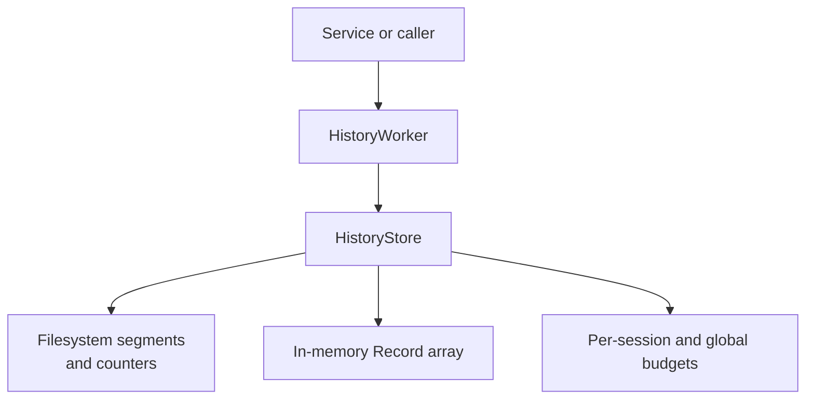
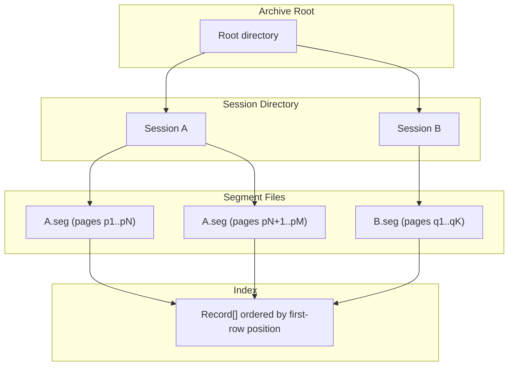
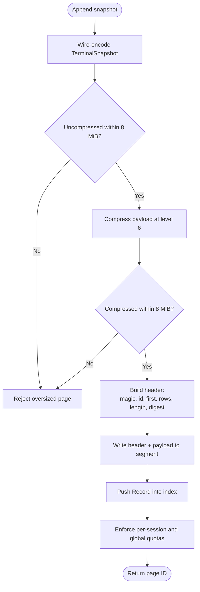
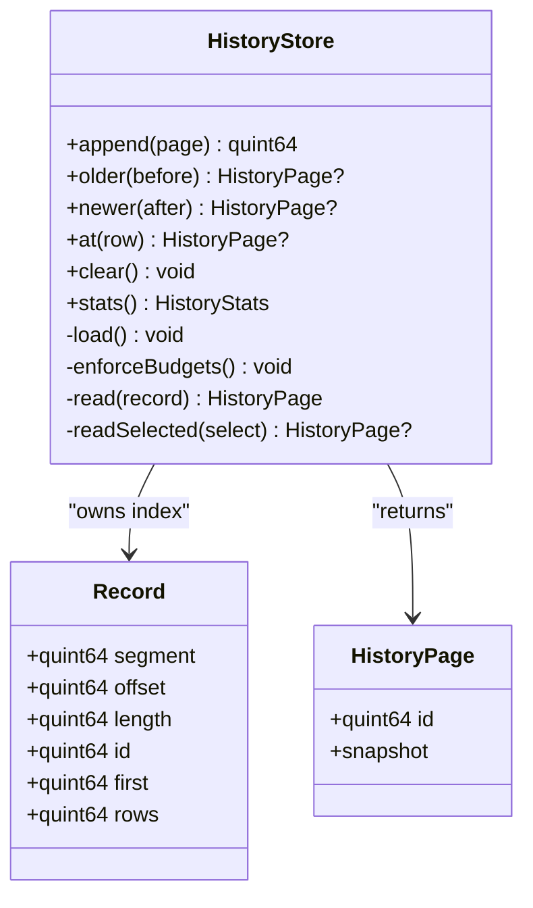
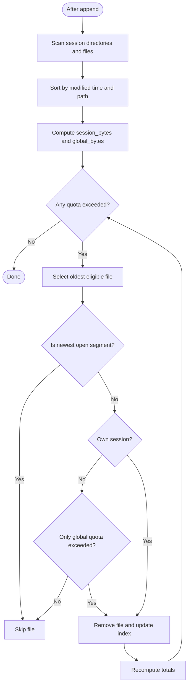
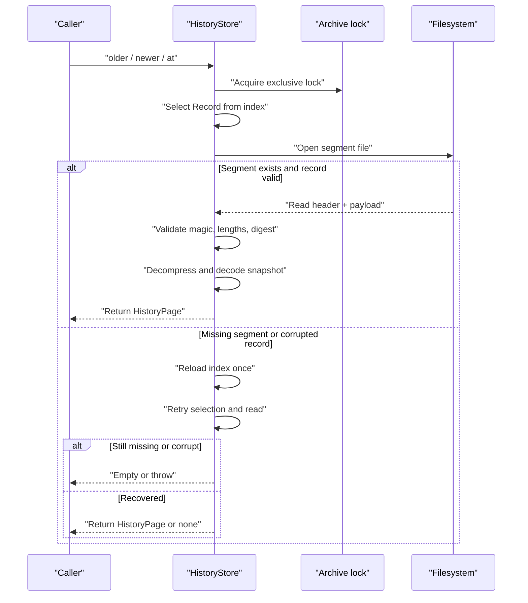
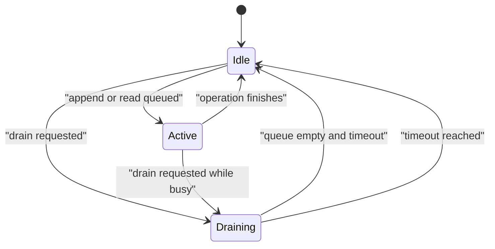
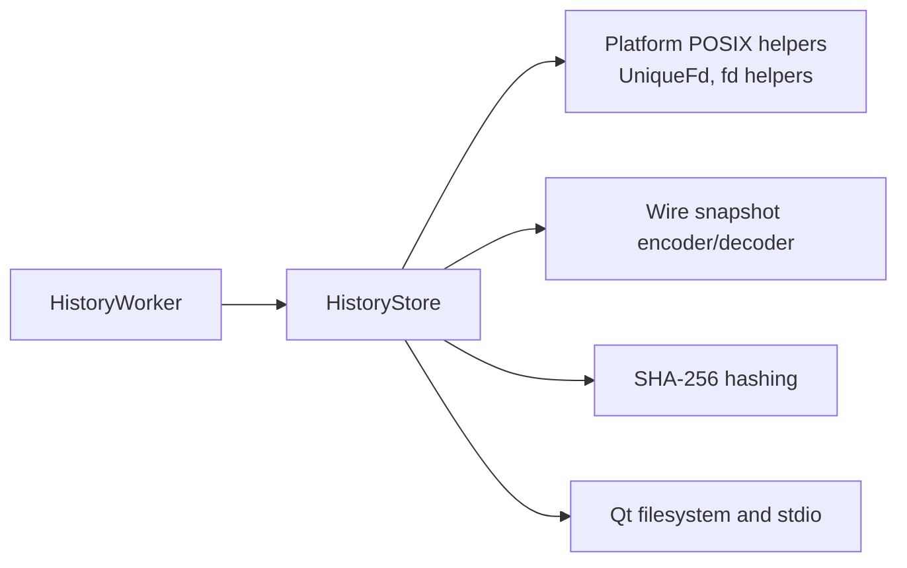

# History Store Engine

<cite>
**Referenced Files in This Document**
- [history_store.hpp](file://services/session/src/history_store.hpp)
- [history_store.cpp](file://services/session/src/history_store.cpp)
- [history_worker.hpp](file://services/session/src/history_worker.hpp)
- [history_worker.cpp](file://services/session/src/history_worker.cpp)
- [history_store_test.cpp](file://services/session/tests/history_store_test.cpp)
</cite>

## Table of Contents
1. [Introduction](#introduction)
2. [Project Structure](#project-structure)
3. [Core Components](#core-components)
4. [Architecture Overview](#architecture-overview)
5. [Detailed Component Analysis](#detailed-component-analysis)
6. [Dependency Analysis](#dependency-analysis)
7. [Performance Considerations](#performance-considerations)
8. [Troubleshooting Guide](#troubleshooting-guide)
9. [Conclusion](#conclusion)

## Introduction
The HistoryStore engine is the append-only persistence layer for conversation snapshots. It stores terminal history as compressed, page-sized records inside segment files, keeps an in-memory index for O(1)-style random access to historical rows, and enforces per-session and global storage quotas with an eviction policy that removes oldest closed segments. It also supports legacy `*.page` files, validates record integrity, repairs interrupted writes, and exposes a single-threaded worker that serializes all filesystem operations.

## Project Structure
The implementation lives under the session service:

| File | Responsibility |
|---|---|
| `services/session/src/history_store.hpp` | Public interface, data types, limits, in-memory index layout, and concurrency contract. |
| `services/session/src/history_store.cpp` | Segment file format, encoding/decoding, quota enforcement, recovery, and random-access APIs. |
| `services/session/src/history_worker.hpp` | Service-side queue wrapper around the store. |
| `services/session/src/history_worker.cpp` | Single I/O thread execution, back-pressure, drain semantics, and error forwarding. |
| `services/session/tests/history_store_test.cpp` | Behavioral tests covering append, navigation, eviction, corruption, interruption, and recovery. |

**Diagram sources**
- [history_worker.hpp:1-54](file://services/session/src/history_worker.hpp#L1-L54)
- [history_worker.cpp:1-126](file://services/session/src/history_worker.cpp#L1-L126)
- [history_store.hpp:1-74](file://services/session/src/history_store.hpp#L1-L74)
- [history_store.cpp:1-521](file://services/session/src/history_store.cpp#L1-L521)

**Section sources**
- [history_store.hpp:1-74](file://services/session/src/history_store.hpp#L1-L74)
- [history_store.cpp:1-521](file://services/session/src/history_store.cpp#L1-L521)
- [history_worker.hpp:1-54](file://services/session/src/history_worker.hpp#L1-L54)
- [history_worker.cpp:1-126](file://services/session/src/history_worker.cpp#L1-L126)

## Core Components
- **HistoryLimits**: Defines maximum archive sizes per session and globally. The header defaults are 1 GB per session and 8 GB globally.
- **HistoryPage**: A logical page containing a unique ID and a `TerminalSnapshot`.
- **HistoryStats**: Current counts of session bytes, global bytes, and in-memory page count.
- **Record**: In-memory index entry mapping a logical page ID to its segment file, offset, payload length, row position, and number of rows.
- **HistoryStore**: Append-only segment engine with index loading, append, navigation, clearing, statistics, and quota enforcement.
- **HistoryWorker**: Thread-safe facade that queues operations onto one dedicated I/O thread.

**Section sources**
- [history_store.hpp:6-72](file://services/session/src/history_store.hpp#L6-L72)
- [history_worker.hpp:6-52](file://services/session/src/history_worker.hpp#L6-L52)

## Architecture Overview
HistoryStore organizes history by session directory under a shared root. Each session owns numbered `.seg` segment files. Legacy `.page` files are recognized but not read; they contribute to quota scanning and eviction.

**Diagram sources**
- [history_store.cpp:1-200](file://services/session/src/history_store.cpp#L1-L200)
- [history_store.cpp:200-521](file://services/session/src/history_store.cpp#L200-L521)

### Disk Layout Summary
- **Segment file name**: Zero-padded 20-digit page ID followed by `.seg`.
- **Legacy file name**: Same numeric naming convention followed by `.page`.
- **Record layout**: Fixed-size header plus compressed payload.
- **Header fields**: Magic string, page ID, first-row index, row count, reserved field, payload length, and SHA-256 digest of the payload.
- **Counter file**: Stores the next sequence value plus a SHA-256 checksum for crash-safe progression.

**Section sources**
- [history_store.cpp:1-200](file://services/session/src/history_store.cpp#L1-L200)
- [history_store.cpp:200-521](file://services/session/src/history_store.cpp#L200-L521)

## Detailed Component Analysis

### Segment File Format and Page Encoding
Each appended terminal snapshot becomes one record:

1. The snapshot is wire-encoded into a byte buffer.
2. The buffer is compressed using Qt compression at level 6.
3. A fixed-length header is constructed with:
   - Magic identifier.
   - Unique page ID.
   - First row among all kept rows.
   - Number of rows in the page.
   - Payload length.
   - SHA-256 digest of the compressed payload.
4. Header and payload are written atomically through a pending file and rename.
5. The segment file grows by appending records until it reaches a per-segment budget.

Key constants and constraints:
- Maximum uncompressed page size: 8 MiB.
- Maximum compressed payload length: 8 MiB.
- Per-segment write budget: up to 16 MiB before starting a new segment.
- Global scan limit constant: 64 GiB used during quota scanning.
- Header size: 72 bytes.
- Magic identifier: `LPJRNL01`.

**Diagram sources**
- [history_store.cpp:200-521](file://services/session/src/history_store.cpp#L200-L521)

**Section sources**
- [history_store.cpp:1-200](file://services/session/src/history_store.cpp#L1-L200)
- [history_store.cpp:200-521](file://services/session/src/history_store.cpp#L200-L521)

### In-Memory Index and Random Access
The in-memory index is a `std::vector<Record>` sorted by each record’s first-row position across the session’s lifetime. Navigation uses this structure:

| Operation | Behavior | Complexity |
|---|---|---|
| `older(before)` | Finds the newest record whose page ID is less than `before`, or the most recent if `before` is zero. | Linear scan from the end. |
| `newer(after)` | Finds the first record with a page ID greater than `after`. | Linear scan from the beginning. |
| `at(row)` | Maps a logical row index to the correct record using binary search on `first`. Past the last row returns the newest record. | Binary search plus constant work. |

The `Record` structure contains:
- `segment`: First page ID of the owning segment file.
- `offset`: Byte offset of the record inside the segment.
- `length`: Header length stored in the record metadata.
- `id`: Unique page ID.
- `first`: Logical row index where the page begins.
- `rows`: Number of rows contained in the page.

Random access is effectively O(log n) for `at` because of binary search over the index, and O(1) disk access once the correct record is selected.

**Diagram sources**
- [history_store.hpp:20-72](file://services/session/src/history_store.hpp#L20-L72)
- [history_store.cpp:200-521](file://services/session/src/history_store.cpp#L200-L521)

**Section sources**
- [history_store.hpp:20-72](file://services/session/src/history_store.hpp#L20-L72)
- [history_store.cpp:200-521](file://services/session/src/history_store.cpp#L200-L521)

### Quota Enforcement and Eviction Policy
Quotas operate at two levels:

| Limit | Default Value | Scope | Purpose |
|---|---:|---|---|
| Per-session limit | 1 GB | One session directory | Prevents one conversation from consuming all history space. |
| Global limit | 8 GB | Entire archive root | Prevents total disk usage from growing without bound. |

Additional internal limits:
- Maximum per-segment size: 16 MiB.
- Maximum scanned global size: 64 GiB.
- Maximum sessions: 1,024.
- Maximum files per scan: 65,536.

Eviction rules:
1. Scan every session directory and stat each segment or legacy page.
2. Sort entries by modification time, then path.
3. While either per-session or global quota is exceeded:
   - Skip the newest open segment of each session.
   - If only the global quota is exceeded, evict any session’s closed segments.
   - If the per-session quota is exceeded, evict that session’s closed segments.
   - Remove the file and update in-memory segment and record lists.
4. Count surviving bytes and pages for `stats()`.

**Diagram sources**
- [history_store.cpp:1-200](file://services/session/src/history_store.cpp#L1-L200)
- [history_store.cpp:200-521](file://services/session/src/history_store.cpp#L200-L521)

**Section sources**
- [history_store.hpp:8-17](file://services/session/src/history_store.hpp#L8-L17)
- [history_store.cpp:1-200](file://services/session/src/history_store.cpp#L1-L200)
- [history_store.cpp:200-521](file://services/session/src/history_store.cpp#L200-L521)

### Backup Compatibility and Migration Strategy
- Legacy `*.page` files are detected by their numeric filename and suffix.
- They are counted toward quota usage and can be evicted like other files.
- They are not decoded into `HistoryPage` objects.
- New format uses numbered `.seg` segment files.
- During load, the engine scans both formats but only reads `.seg` records.
- Migration is implicit: old pages remain readable only through quota accounting; future writes use the new segment format.

This design avoids breaking existing archives while moving to a more efficient and recoverable segment model.

**Section sources**
- [history_store.cpp:1-200](file://services/session/src/history_store.cpp#L1-L200)
- [history_store.cpp:200-521](file://services/session/src/history_store.cpp#L200-L521)

### Data Validation, Integrity Checks, and Recovery
Validation and safety mechanisms include:

| Area | Mechanism |
|---|---|
| Root and session identity | Absolute root, valid 32-character lowercase hexadecimal session ID, non-zero positive limits, per-session ≤ global limit, global ≤ 64 GiB. |
| Directory safety | Private directory created with restrictive permissions; symlink or permission checks reject unsafe paths. |
| File safety | Opened with owner-only permissions, regular-file checks, ownership checks, no-follow flags. |
| Archive lock | Exclusive lock with retries protects concurrent writers across sessions. |
| Atomic writes | Writes go to a `.pending` file, `fsync` is called, then atomic rename replaces the target. |
| Interrupted writes | Truncated tail of a segment is truncated back to the last valid record; empty segments are removed. |
| Counter integrity | Sequence counter file stores value plus SHA-256 hash; corrupt counters throw. |
| Record integrity | Header magic, size, reserved field, length bounds, page ID ordering, and payload digest are verified. |
| Corrupted record handling | Throws during read; retry logic reloads the index once when a segment disappears due to eviction. |
| Partial artifacts | `.unfinished.tmp` is preserved; `.pending` is cleaned on open. |

Recovery procedure highlights:
- On startup, pending writes are removed safely.
- Segment files are parsed record-by-record; invalid tails are truncated.
- Empty segments are deleted.
- The next page ID is derived from both the persistent counter and the last loaded record.
- If a segment is missing after selection, the index is reloaded once and the operation retried.

**Diagram sources**
- [history_store.cpp:200-521](file://services/session/src/history_store.cpp#L200-L521)

**Section sources**
- [history_store.cpp:1-200](file://services/session/src/history_store.cpp#L1-L200)
- [history_store.cpp:200-521](file://services/session/src/history_store.cpp#L200-L521)

### Concurrent Access Safety and Thread-Safety Guarantees
Concurrency model:

| Component | Guarantee |
|---|---|
| `HistoryStore` | Not designed for direct multi-threaded use. All filesystem operations must run on the dedicated I/O worker. |
| `HistoryWorker` | Serializes access to one `HistoryStore` instance through a single-threaded `QThreadPool`. |
| Cross-session archive safety | Uses an exclusive lock on the archive root with bounded retries. |
| In-memory index | Updated atomically within locked append and load operations; readers see consistent snapshots because they acquire the lock before selecting records. |
| Eviction races | Read operations tolerate one missing-segment retry after reloading the index. |
| Back-pressure | Worker rejects new work when draining, queue exceeds page or byte limits, or an operation is already active. |

**Diagram sources**
- [history_worker.cpp:1-126](file://services/session/src/history_worker.cpp#L1-L126)

**Section sources**
- [history_worker.hpp:6-52](file://services/session/src/history_worker.hpp#L6-L52)
- [history_worker.cpp:1-126](file://services/session/src/history_worker.cpp#L1-L126)
- [history_store.cpp:1-200](file://services/session/src/history_store.cpp#L1-L200)
- [history_store.cpp:200-521](file://services/session/src/history_store.cpp#L200-L521)

## Dependency Analysis
HistoryStore depends on lower-level platform and transport utilities:

**Diagram sources**
- [history_worker.cpp:1-126](file://services/session/src/history_worker.cpp#L1-L126)
- [history_store.cpp:1-521](file://services/session/src/history_store.cpp#L1-L521)

**Section sources**
- [history_store.cpp:1-521](file://services/session/src/history_store.cpp#L1-L521)
- [history_worker.cpp:1-126](file://services/session/src/history_worker.cpp#L1-L126)

## Performance Considerations
- **Compression**: Terminal snapshots are compressed before writing, keeping pages small enough to retain long histories locally.
- **Segmentation**: Splitting into ~16 MiB segments reduces per-write locking impact and enables targeted eviction.
- **Indexing**: Binary search on the `Record` array makes `at` efficient even with many pages.
- **Sequential append**: Most writes extend the current segment, minimizing system calls.
- **Eviction cost**: Quota enforcement scans session directories and files; costs grow with the number of sessions and files.
- **I/O isolation**: The worker isolates blocking filesystem operations from service threads.
- **Back-pressure**: Queue size and byte limits prevent memory growth during bursts.

[No sources needed since this section provides general guidance]

## Troubleshooting Guide

### Common Failure Modes
| Symptom | Likely Cause | Recommended Action |
|---|---|---|
| Constructor throws `invalid_argument` | Invalid root path, malformed session ID, or misconfigured limits. | Use absolute paths, lowercase hex session IDs, positive limits with per-session ≤ global ≤ 64 GiB. |
| Append fails immediately | Snapshot too large or archive budget too small for a single page. | Reduce snapshot size or increase limits; verify compression still fits the 8 MiB payload limit. |
| `older` or `at` reports corruption | Truncated record or mismatched digest. | Let the store truncate invalid segment tails; reopen to recover. |
| Reading returns empty after another process runs | Another session evicted the selected segment. | Treat as normal; retry after reload or request a different page. |
| Archive remains busy | Multiple processes contending for the archive lock. | Ensure only one process manages the archive root; check for stale locks. |
| Partial `.pending` or `.unfinished.tmp` present | Interrupted write. | `.pending` is cleaned automatically; `.unfinished.tmp` is preserved for inspection. |
| Stats differ after another session writes | Closed segments may have been evicted. | Call `stats()` again; it reloads the index and scans the live archive. |

### Recovery Procedures
1. Open a new `HistoryStore` for the affected session.
2. Allow it to remove `.pending` and truncate invalid segment tails.
3. If the segment becomes empty, confirm it is removed.
4. Re-run queries; missing older pages may disappear if evicted.
5. Inspect `.unfinished.tmp` separately if application diagnostics require it.
6. Clear the session only when intentional, noting that later page IDs continue increasing.

**Section sources**
- [history_store.cpp:1-200](file://services/session/src/history_store.cpp#L1-L200)
- [history_store.cpp:200-521](file://services/session/src/history_store.cpp#L200-L521)
- [history_store_test.cpp:1-324](file://services/session/tests/history_store_test.cpp#L1-L324)

## Conclusion
HistoryStore provides a robust, append-only history backend built around compressed page records in numbered segment files. Its in-memory index enables efficient navigation, while strict validation, atomic writes, and recovery logic protect against corruption and interruptions. Quota enforcement prevents runaway disk usage, and the single-threaded `HistoryWorker` guarantees safe concurrent access patterns. Legacy `*.page` files remain supported for compatibility and eviction accounting, while new writes use the safer and more efficient `.seg` format.