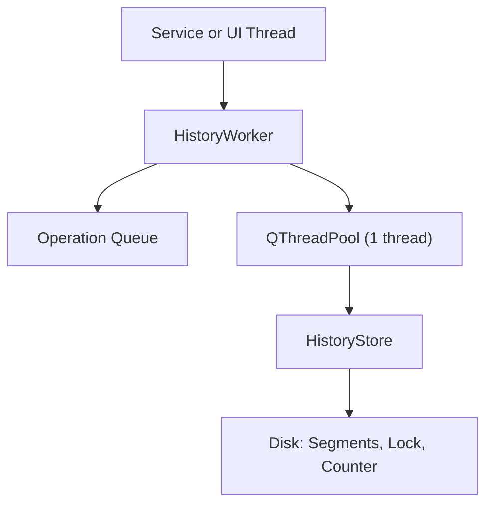
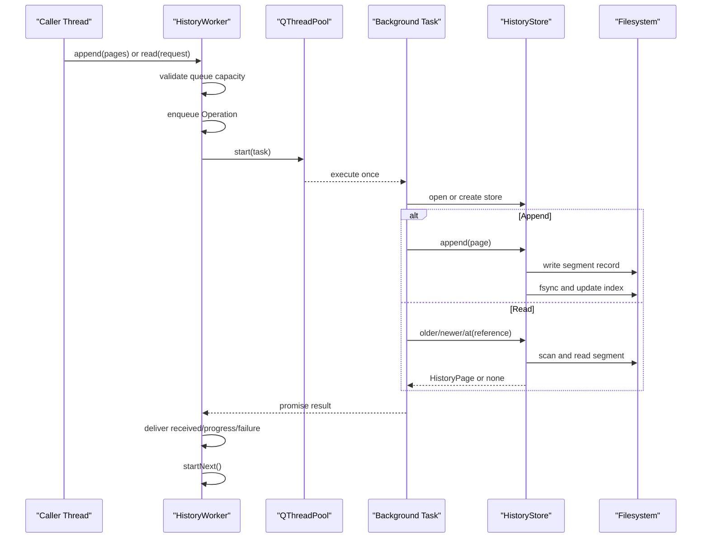
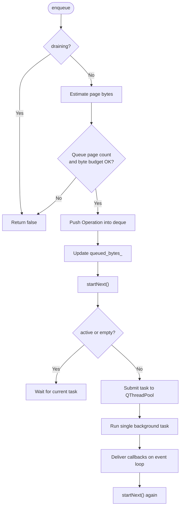
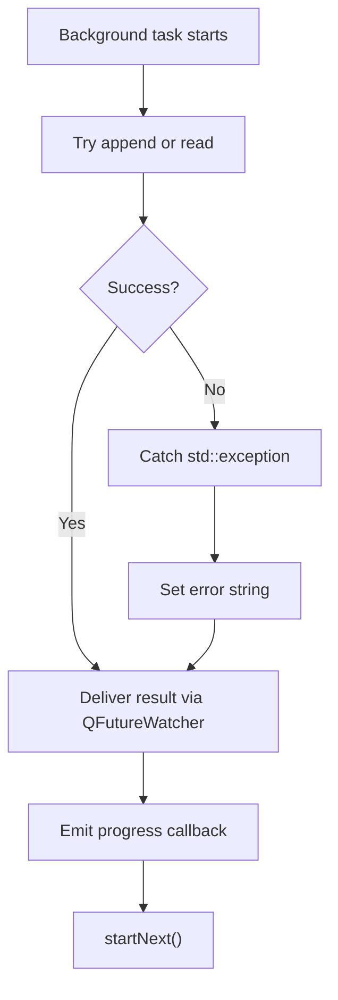
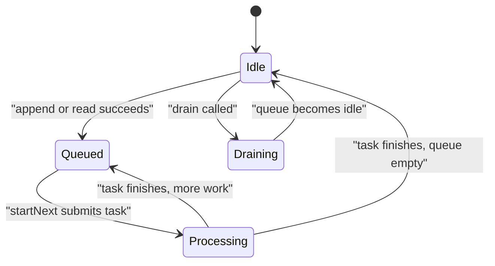
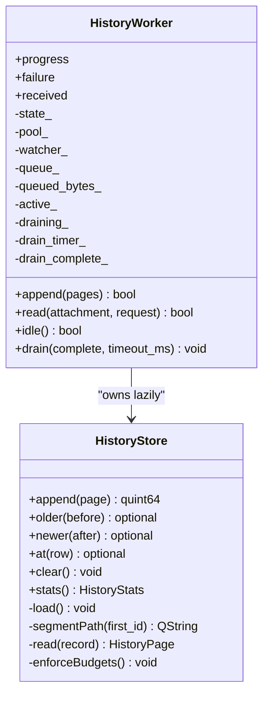

# History Worker I/O

<cite>
**Referenced Files in This Document**
- [history_worker.hpp](file://services/session/src/history_worker.hpp)
- [history_worker.cpp](file://services/session/src/history_worker.cpp)
- [history_store.hpp](file://services/session/src/history_store.hpp)
- [history_store.cpp](file://services/session/src/history_store.cpp)
</cite>

## Table of Contents
1. [Introduction](#introduction)
2. [Project Structure](#project-structure)
3. [Core Components](#core-components)
4. [Architecture Overview](#architecture-overview)
5. [Detailed Component Analysis](#detailed-component-analysis)
6. [Dependency Analysis](#dependency-analysis)
7. [Performance Considerations](#performance-considerations)
8. [Troubleshooting Guide](#troubleshooting-guide)
9. [Conclusion](#conclusion)

## Introduction
This document explains the asynchronous I/O worker pattern used by the history subsystem to isolate blocking filesystem operations from the main service loop. The design uses a dedicated single-thread worker backed by a queue and an append-only segment store. It handles:

- Segment creation and page writes
- Page reads for older, newer, and exact-row navigation
- Index updates in memory after each write
- Cleanup through per-session and global quota enforcement
- Shutdown-style draining that stops accepting new work while completing pending operations

The worker protects shared state by running all disk operations on one background thread, exposing only non-blocking enqueue methods to the caller.

## Project Structure
The relevant implementation lives under `services/session/src`:

| File | Responsibility |
| --- | --- |
| `history_worker.hpp` | Declares the asynchronous worker, its public API, queued operation model, result model, and internal state shape. |
| `history_worker.cpp` | Implements the worker’s queue, throttling, single-thread execution, drain lifecycle, and callback delivery. |
| `history_store.hpp` | Declares the append-only history store, limits, page model, statistics model, and indexing/eviction contract. |
| `history_store.cpp` | Implements segment files, headers, compression, locking, atomic writes, index loading, quota enforcement, and read paths. |

**Diagram sources**
- [history_worker.cpp:1-126](file://services/session/src/history_worker.cpp#L1-L126)
- [history_store.cpp:1-521](file://services/session/src/history_store.cpp#L1-L521)

**Section sources**
- [history_worker.hpp:1-54](file://services/session/src/history_worker.hpp#L1-L54)
- [history_worker.cpp:1-126](file://services/session/src/history_worker.cpp#L1-L126)
- [history_store.hpp:1-74](file://services/session/src/history_store.hpp#L1-L74)
- [history_store.cpp:1-521](file://services/session/src/history_store.cpp#L1-L521)

## Core Components

### HistoryWorker: Asynchronous I/O Coordinator
`HistoryWorker` is a Qt `QObject` that owns:

- A shared `State` containing root path, session ID, limits, and lazily created `HistoryStore`.
- A `std::deque<Operation>` queue of either page appends or history read requests.
- A bounded queue strategy based on page count and byte size.
- A `QThreadPool` configured to use exactly one worker thread.
- A `QFutureWatcher` observing each operation’s future so completion can be observed on the event loop.
- A one-shot `QTimer` used by the drain lifecycle to complete after the queue becomes idle.

Public behavior:

- `append(pages)` enqueues terminal snapshots for archival. It rejects new work when draining, when the queue would exceed the page limit, or when the encoded bytes would exceed the remaining byte budget.
- `read(attachment, request)` enqueues a history query. It rejects when draining or when the queue is already full.
- `drain(complete, timeout_ms)` stops accepting new work and invokes `complete` once the queue is idle, either immediately or after the timer expires.
- Callbacks `received`, `progress`, and `failure` are emitted from the event-loop context after a worker task finishes.

Concurrency guarantees:

- Only one operation runs at a time because the pool has one thread and `active_` prevents overlapping dispatch.
- Each queued operation captures a copy of `state_` and the operation itself before submitting to the pool.
- The worker comments explicitly state that only the submitted task accesses `State` until its future completes, avoiding concurrent access to the store.

Queue depth and throughput controls:

- `max_queue_pages = 128` bounds the number of queued operations.
- `max_queue_bytes` equals 16 MiB and bounds queued payload size.
- `page_bytes` estimates the memory footprint of a terminal snapshot by counting cells, graphemes, and the snapshot header.

Lifecycle:

- Construction connects the drain timer and watcher callbacks.
- Destruction disconnects the watcher and waits for the thread pool to finish.
- Draining sets `draining_`, schedules completion when idle, and prevents further enqueueing.

**Section sources**
- [history_worker.hpp:10-54](file://services/session/src/history_worker.hpp#L10-L54)
- [history_worker.cpp:7-126](file://services/session/src/history_worker.cpp#L7-L126)

### HistoryStore: Append-Only Segment Archive
`HistoryStore` implements the durable layer behind the worker:

- **Segment files**: `<root>/<session_id>/<id>.seg`, where `id` is a zero-padded 20-digit page ID acting as the segment’s first page identifier.
- **Legacy pages**: Older `.page` files are scanned, counted toward quotas, evicted, but not decoded.
- **Index**: An in-memory vector of `Record` entries mapping segment file, offset, length, page ID, row base, and row count.
- **Compression**: Each page is encoded through the wire protocol and then compressed with zlib level 6 before being written as a record payload.
- **Headers**: Each record begins with a fixed-size header containing magic, page ID, row base, row count, payload length, and SHA-256 digest of the compressed payload.
- **Atomicity**: Writes go to a temporary `.pending` file, are flushed and synced, then atomically renamed into place; interrupted writes are cleaned up during startup.
- **Locking**: A root-level lock file serializes archive mutations across sessions using `flock`.
- **Quotas**: Per-session and global byte budgets enforce eviction of closed segments.
- **Sequence counter**: A cryptographically tagged sequence counter preserves page IDs across restarts and truncation recovery.

Key operations:

- `append(page)`: Encodes and compresses the page, chooses or opens a segment, writes the record, updates the in-memory index, increments the next ID, and enforces quotas.
- `older(before)`, `newer(after)`, `at(row)`: Select records from the in-memory index and decode one page, with retry logic if another session evicts a segment concurrently.
- `clear()`: Removes all segment and legacy page files, updates the sequence counter, and resets the index.
- `stats()`: Reloads the index, scans disk usage, and reports session/global bytes and page count.

Error and safety checks:

- Path, permission, ownership, symlink, and size validation protect against unsafe history directories and files.
- Corrupt headers, truncated records, mismatched digests, invalid counters, and exhausted sequences raise exceptions.
- Failed writes undo partial segments by removing fresh files or truncating appended ones.
- Eviction failures raise errors rather than silently corrupting the archive.

**Section sources**
- [history_store.hpp:1-74](file://services/session/src/history_store.hpp#L1-L74)
- [history_store.cpp:1-521](file://services/session/src/history_store.cpp#L1-L521)

## Architecture Overview

**Diagram sources**
- [history_worker.cpp:24-126](file://services/session/src/history_worker.cpp#L24-L126)
- [history_store.cpp:256-521](file://services/session/src/history_store.cpp#L256-L521)

## Detailed Component Analysis

### Worker Thread and Message Queue Design

#### Queue Model
The worker queues two operation kinds:

| Field | Append Operation | Read Operation |
| --- | --- | --- |
| `page` | Present terminal snapshot | Empty |
| `attachment` | Empty | Client attachment handle |
| `request` | Empty | History direction and reference |
| `bytes` | Estimated snapshot payload size | Zero |

The queue is a FIFO `std::deque`. Capacity is constrained by:

- Maximum queued operations: `max_queue_pages`.
- Maximum queued payload bytes: `max_queue_bytes`.
- Current queued bytes tracked in `queued_bytes_`.

#### Concurrency Boundary
The worker exposes synchronous-enqueue methods that return immediately. Actual disk work runs inside a lambda captured by `QThreadPool::start`. That lambda:

1. Captures `state_` and the queued `Operation`.
2. Lazily constructs `HistoryStore` under `state_`.
3. Executes one operation: append, older, at, or newer.
4. Catches `std::exception` and converts it to a string error.
5. Fills a `Result` and delivers it through a `QPromise` observed by `QFutureWatcher`.

This design ensures that:

- No other thread modifies `state_->store` while an operation runs.
- The event loop remains responsive.
- Failure callbacks do not block callers.

**Diagram sources**
- [history_worker.cpp:38-126](file://services/session/src/history_worker.cpp#L38-L126)

**Section sources**
- [history_worker.hpp:23-54](file://services/session/src/history_worker.hpp#L23-L54)
- [history_worker.cpp:7-126](file://services/session/src/history_worker.cpp#L7-L126)

### Batched Write Strategy
The worker does not implement an explicit multi-page flush buffer; instead, batching occurs naturally through:

- `append(std::vector<TerminalSnapshot>)`: Accepts multiple snapshots in one call and pushes them sequentially onto the queue.
- Queue capacity: Up to 128 operations can be queued, allowing bursts of page arrivals without blocking the caller.
- Per-operation persistence: Each page is independently encoded, compressed, and committed to disk, which favors durability over maximum throughput.

Throughput optimization comes from:

- Single-threaded sequential execution, reducing filesystem contention.
- Append-only segment files, minimizing random metadata churn.
- Compression level 6, trading CPU for smaller disk usage.
- Bounded queue backpressure, preventing unbounded memory growth.

If higher batching is desired, the most direct extension point is the append method: batch several snapshots into a single larger segment record or coalesce small pages before committing.

**Section sources**
- [history_worker.cpp:38-74](file://services/session/src/history_worker.cpp#L38-L74)
- [history_store.cpp:305-360](file://services/session/src/history_store.cpp#L305-L360)

### Error Handling and Retry Mechanisms

#### Transient I/O Failures
The worker catches `std::exception` from store operations and converts them to an error string delivered through the failure callback. The worker itself does not automatically retry failed operations; failure is reported to the caller.

The store performs defensive retries for concurrent eviction races:

- `readSelected` reloads the index and reselects a record if the chosen segment disappears, retrying once more before giving up.
- This avoids reporting archive corruption when another session legitimately evicted a closed segment.

**Diagram sources**
- [history_worker.cpp:88-126](file://services/session/src/history_worker.cpp#L88-L126)
- [history_store.cpp:446-492](file://services/session/src/history_store.cpp#L446-L492)

#### Insufficient Disk Space and Corruption
When disk space is insufficient or a write fails:

- Atomic write routines fail with an error indicating storage may be full or unavailable.
- Fresh segment files are removed.
- Appended segments are truncated back to their previous size.
- The exception propagates to the worker’s error handler.

Corruption detection includes:

- Invalid magic numbers or header sizes.
- Truncated payloads.
- Mismatched SHA-256 digests.
- Invalid counters or exhausted sequence numbers.

These conditions throw exceptions rather than returning silently, ensuring callers observe archive integrity problems.

**Section sources**
- [history_store.cpp:114-152](file://services/session/src/history_store.cpp#L114-L152)
- [history_store.cpp:330-360](file://services/session/src/history_store.cpp#L330-L360)
- [history_store.cpp:493-521](file://services/session/src/history_store.cpp#L493-L521)

### Graceful Degradation Under Quota Pressure
Quota enforcement removes old segments when usage exceeds configured budgets:

- Per-session budget: Evicts closed segments belonging to the current session.
- Global budget: Evicts closed segments from any session, preferring least recently modified.
- Newest segment protection: The newest segment of each session is never evicted by another session, preserving an active writer’s data.

This provides graceful degradation:

- New pages may still be accepted if they fit within the budget.
- Old data is reclaimed to satisfy global constraints.
- Active writers retain their latest segment.

**Section sources**
- [history_store.cpp:362-424](file://services/session/src/history_store.cpp#L362-L424)

### Shutdown Procedure and Data Consistency
The worker supports a drain lifecycle:

1. `drain(complete, timeout_ms)` marks the worker as draining.
2. If the worker is already idle, `finishDrain()` completes immediately.
3. Otherwise, a one-shot timer waits until the queue becomes idle.
4. Completion callbacks are invoked and the worker stops accepting new work.

Data consistency is preserved by:

- Serializing all disk operations on one background thread.
- Using a lock file around archive mutations.
- Writing records atomically through rename.
- Syncing segment files after writes.
- Recovering interrupted writes by truncating or removing incomplete segments.

**Diagram sources**
- [history_worker.cpp:75-126](file://services/session/src/history_worker.cpp#L75-L126)

**Section sources**
- [history_worker.hpp:17-26](file://services/session/src/history_worker.hpp#L17-L26)
- [history_worker.cpp:75-126](file://services/session/src/history_worker.cpp#L75-L126)
- [history_store.cpp:114-152](file://services/session/src/history_store.cpp#L114-L152)
- [history_store.cpp:330-360](file://services/session/src/history_store.cpp#L330-L360)

## Dependency Analysis

**Diagram sources**
- [history_worker.hpp:10-54](file://services/session/src/history_worker.hpp#L10-L54)
- [history_store.hpp:14-74](file://services/session/src/history_store.hpp#L14-L74)

### Coupling and Cohesion
- `HistoryWorker` depends on `HistoryStore` but does not expose store internals. Its cohesion centers on queue management, threading coordination, and callback delivery.
- `HistoryStore` is cohesive around segment persistence, index maintenance, and quota enforcement.
- External dependencies include Qt concurrency primitives (`QThreadPool`, `QFutureWatcher`, `QTimer`), POSIX filesystem APIs, and the wire protocol encoder/decoder.

### Potential Risks
- The worker currently processes one operation at a time. High append throughput can serialize page writes.
- Errors are not retried automatically by the worker; transient failures must be handled by the caller or higher-level retry policy.
- The queue is bounded, so heavy bursts will reject new appends or reads rather than waiting indefinitely.

**Section sources**
- [history_worker.cpp:1-126](file://services/session/src/history_worker.cpp#L1-L126)
- [history_store.cpp:1-521](file://services/session/src/history_store.cpp#L1-L521)

## Performance Considerations

### Tunable Parameters

| Parameter | Location | Meaning | Recommended Use |
| --- | --- | --- | --- |
| `max_queue_pages` | `history_worker.cpp` | Maximum queued operations | Increase if bursts of pages arrive faster than disk can commit them. |
| `max_queue_bytes` | `history_worker.cpp` | Maximum queued payload bytes | Tune based on available RAM and typical terminal snapshot size. |
| `page_bytes` estimation | `history_worker.cpp` | Memory accounting per snapshot | Ensure accurate sizing to avoid premature queue rejection. |
| `max_page_bytes` | `history_store.cpp` | Maximum uncompressed or compressed page record size | Keep large enough for terminal snapshots; changing affects segment layout. |
| `max_segment_bytes` | `history_store.cpp` | Target segment size limit | Controls how many pages fit per segment file. |
| `max_global_bytes` | `history_store.cpp` | Absolute global archive size cap | Prevents runaway disk usage across sessions. |
| `session_bytes` | `history_store.hpp` | Per-session quota | Limits retained history per session. |
| `global_bytes` | `history_store.hpp` | Global quota across sessions | Limits total archive size. |
| Compression level | `history_store.cpp` | zlib level 6 | Higher levels reduce disk size but increase CPU usage. |
| Lock retry count | `history_store.cpp` | Number of attempts to acquire archive lock | Adjusts tolerance for short-lived contention. |

### Throughput and Latency Trade-offs

- **Append latency**: Each page is independently compressed and synced. Lower latency per page comes from small batches; lower overall I/O overhead comes from larger segments.
- **Read latency**: Reads are one-index lookup plus one segment read. Random access is efficient because the index is in memory.
- **Memory usage**: The queue holds up to 128 operations, and snapshots remain in memory until queued and processed. Monitor `queued_bytes_` and snapshot sizes.
- **CPU vs disk**: Compression level 6 reduces disk usage significantly; raising it can help storage-constrained environments at the cost of CPU.
- **Concurrency**: With one worker thread, the system avoids locking complexity but may become I/O bound under heavy write load.

### Monitoring Capabilities
The current implementation exposes limited monitoring hooks:

- `HistoryWorker::progress`: Can be used to track completed operations.
- `HistoryWorker::failure`: Reports I/O or archive errors.
- `HistoryWorker::received`: Delivers successful read replies.
- `HistoryStore::stats()`: Returns session bytes, global bytes, and page count after reloading the index.

Recommended monitoring extensions:

- Expose queue length and queued bytes.
- Emit metrics for append latency, read latency, and eviction counts.
- Track rejected appends due to queue capacity.
- Log quota pressure events when eviction runs.
- Report lock contention or retry counts under heavy multi-session workloads.

[No sources needed since this section provides general guidance]

## Troubleshooting Guide

### Common Symptoms and Causes

| Symptom | Likely Cause | Resolution |
| --- | --- | --- |
| New appends return false | Worker is draining, queue is full, or byte budget exceeded | Reduce burst rate, increase queue limits, or inspect memory pressure. |
| History reads return no page | Reference is beyond available history or segment was evicted | Verify reference and check whether quotas evicted older segments. |
| Failure callback receives an error | Disk write, sync, checksum, quota, or lock failure | Check disk space, permissions, archive locks, and logs. |
| History appears truncated after crash | Interrupted write recovered by truncating incomplete segment | Restore from backup if necessary; ensure atomic writes prevent partial commits. |
| Archive cannot grow | Global or session quota reached | Increase quotas or allow eviction of closed segments. |
| Multi-session writes stall briefly | Lock contention while acquiring archive lock | Accept brief stalls; tune lock retry behavior if needed. |

### Diagnostic Steps

1. **Check queue state**: Inspect whether the worker is idle, active, or draining.
2. **Inspect errors**: Capture the failure callback message and correlate with disk state.
3. **Verify permissions**: Ensure the history root and session directories are owned by the process user and not world-writable.
4. **Validate disk space**: Confirm free space above both per-session and global quotas.
5. **Review segment files**: Look for unexpected `.pending` files or malformed `.seg` files.
6. **Use stats**: Call `HistoryStore::stats()` to compare expected versus actual usage.

**Section sources**
- [history_worker.cpp:38-126](file://services/session/src/history_worker.cpp#L38-L126)
- [history_store.cpp:41-152](file://services/session/src/history_store.cpp#L41-L152)
- [history_store.cpp:362-521](file://services/session/src/history_store.cpp#L362-L521)

## Conclusion
The history subsystem implements a clean separation between the main service loop and blocking filesystem work. `HistoryWorker` provides a safe, bounded queue with one background task, while `HistoryStore` provides a durable, append-only segment archive with strong integrity checks, atomic writes, and quota-driven cleanup. Together, they deliver:

- Safe concurrent access to shared archive state
- Predictable backpressure through queue limits
- Durable page archival with compression and checksums
- Robust recovery from interrupted writes and concurrent eviction
- A drain-based shutdown path that avoids accepting new work while completing pending operations

For production tuning, adjust queue depth, byte budgets, segment size, compression level, and archive quotas according to workload characteristics. Extend the monitoring hooks to capture latency, throughput, rejection, and eviction metrics for observability.