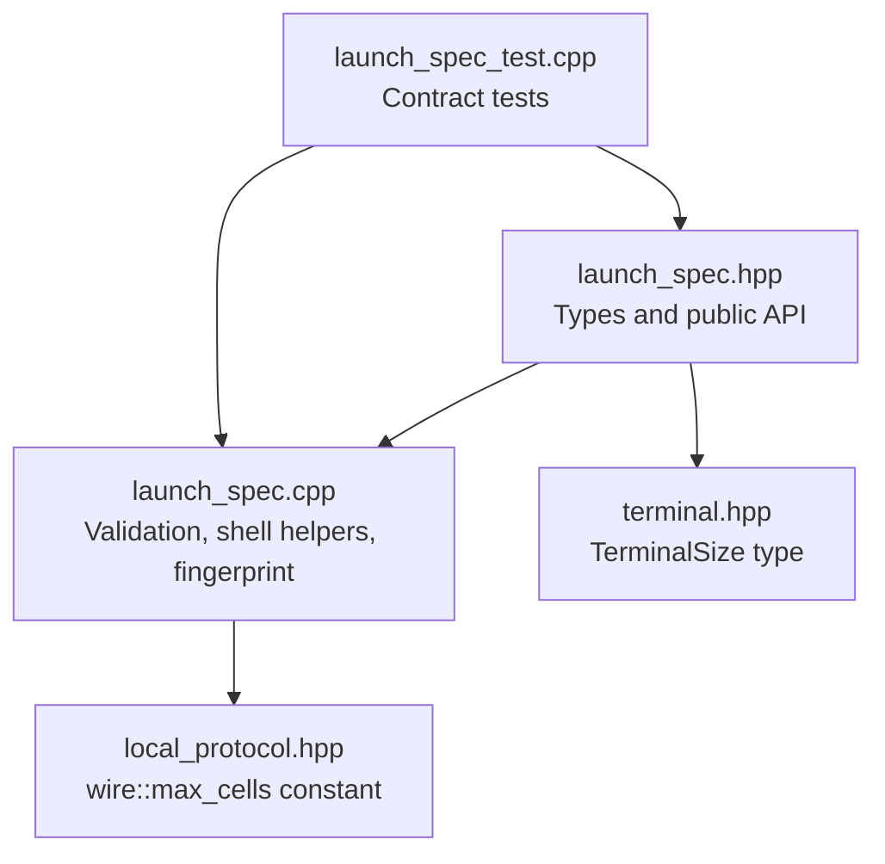
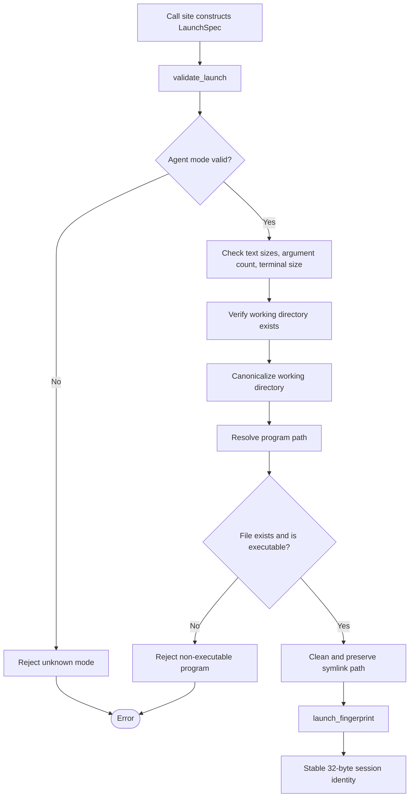
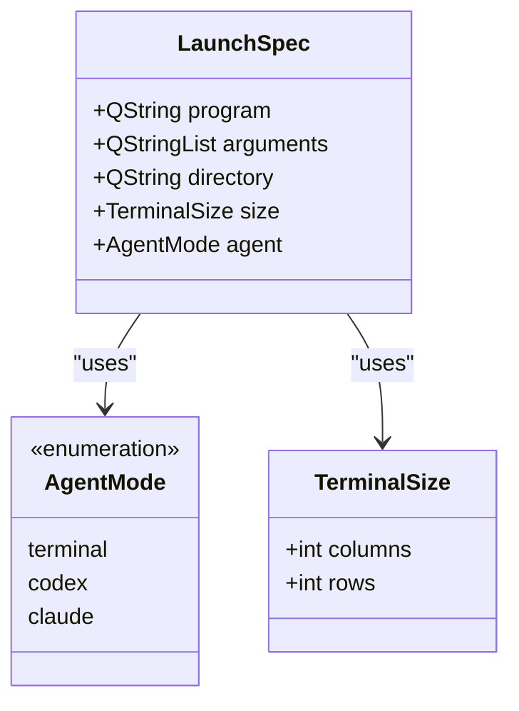
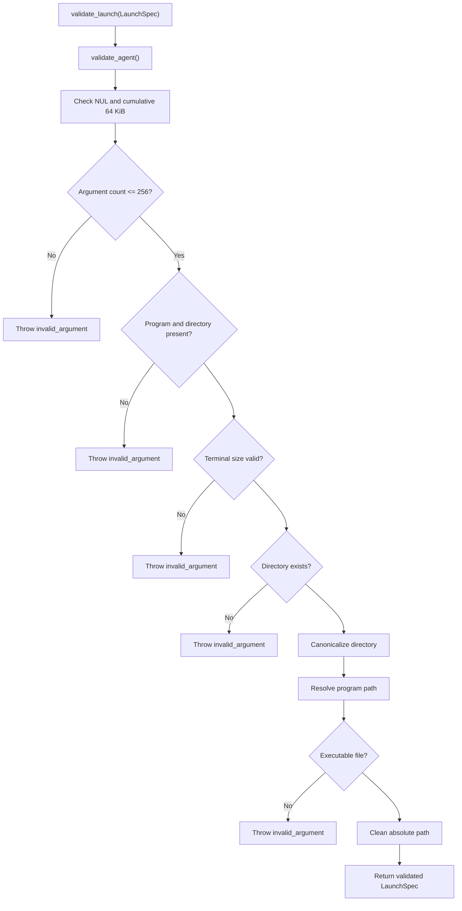
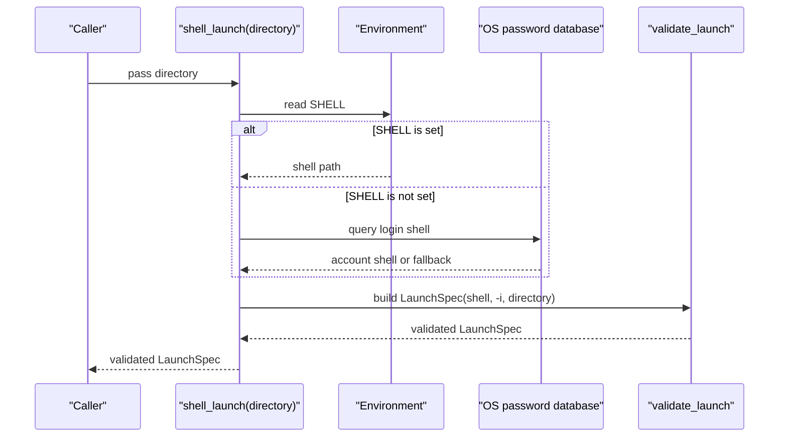
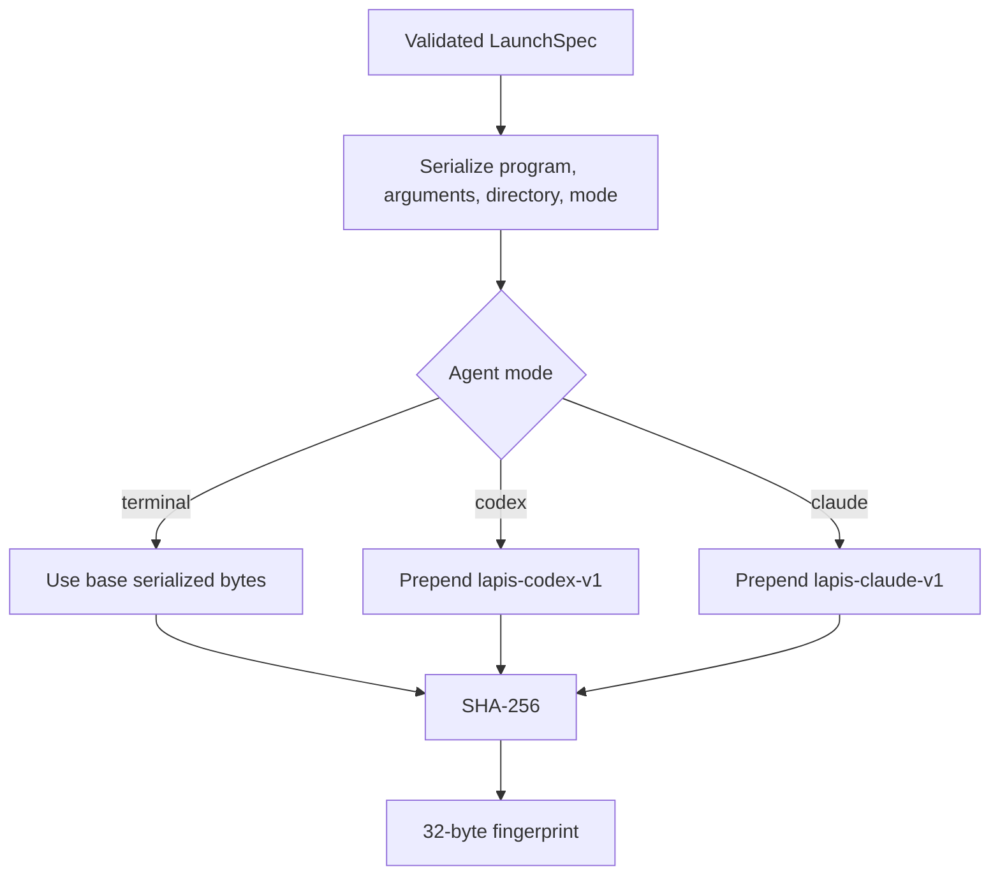
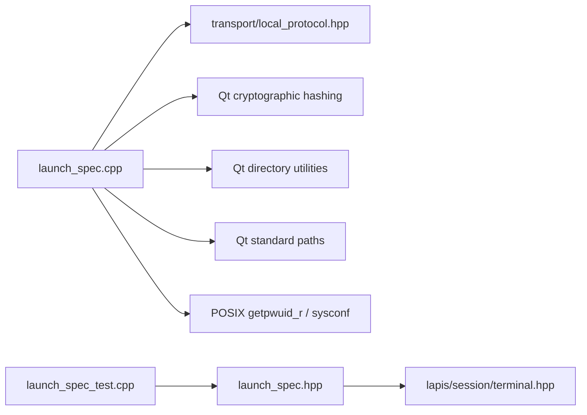

# Launch Specification & Validation

<cite>
**Referenced Files in This Document**
- [launch_spec.hpp](file://services/session/src/launch_spec.hpp)
- [launch_spec.cpp](file://services/session/src/launch_spec.cpp)
- [launch_spec_test.cpp](file://services/session/tests/launch_spec_test.cpp)
</cite>

## Table of Contents
1. [Introduction](#introduction)
2. [Project Structure](#project-structure)
3. [Core Components](#core-components)
4. [Architecture Overview](#architecture-overview)
5. [Detailed Component Analysis](#detailed-component-analysis)
6. [Dependency Analysis](#dependency-analysis)
7. [Performance Considerations](#performance-considerations)
8. [Troubleshooting Guide](#troubleshooting-guide)
9. [Conclusion](#conclusion)

## Introduction
This document explains the launch specification system that configures and validates agent process execution. It covers the data model for a launch request, the validation pipeline that sanitizes inputs and enforces security constraints, the stable fingerprinting algorithm used for session identity and caching, and the shell-launch helper that discovers an appropriate login shell. The design is intentionally defensive: it rejects unsafe paths, bounds argument sizes, prevents argument injection through managed agents, and produces reproducible identifiers independent of process lifecycle details.

## Project Structure
The launch specification logic lives under the session service implementation:

**Diagram sources**
- [launch_spec.hpp:1-32](file://services/session/src/launch_spec.hpp#L1-L32)
- [launch_spec.cpp:1-144](file://services/session/src/launch_spec.cpp#L1-L144)
- [launch_spec_test.cpp:1-194](file://services/session/tests/launch_spec_test.cpp#L1-L194)

**Section sources**
- [launch_spec.hpp:1-32](file://services/session/src/launch_spec.hpp#L1-L32)
- [launch_spec.cpp:1-144](file://services/session/src/launch_spec.cpp#L1-L144)
- [launch_spec_test.cpp:1-194](file://services/session/tests/launch_spec_test.cpp#L1-L194)

## Core Components
The launch system centers on one data structure and three primary operations:

| Component | Responsibility | Key Details |
|---|---|---|
| `AgentMode` | Distinguishes execution context | Values are terminal, codex, and claude. It is an 8-bit enumeration. |
| `LaunchSpec` | Describes a single executable launch | Contains program path, argument array, working directory, terminal size, and agent mode. |
| `validate_launch` | Sanitizes and resolves a launch request | Enforces presence, bounds, terminal geometry, directory existence, and executable permissions. |
| `login_shell` | Discovers the account’s login shell | Reads the password database on POSIX systems and falls back to `/bin/sh`. |
| `shell_launch` | Builds a safe interactive shell launch | Uses `SHELL` when available, otherwise the discovered login shell, with `-i`. |
| `launch_fingerprint` | Produces a stable identifier | Hashes program, arguments, working directory, and mode-specific prefix. |

**Section sources**
- [launch_spec.hpp:8-29](file://services/session/src/launch_spec.hpp#L8-L29)
- [launch_spec.cpp:20-144](file://services/session/src/launch_spec.cpp#L20-L144)

## Architecture Overview
At runtime, callers construct a `LaunchSpec`, run it through `validate_launch`, then use the validated result to start a process or compute its identity. The fingerprint is intentionally derived from the normalized launch parameters rather than the process ID so that sessions can be reattached across builds and restarts.

**Diagram sources**
- [launch_spec.cpp:20-90](file://services/session/src/launch_spec.cpp#L20-L90)
- [launch_spec.cpp:92-144](file://services/session/src/launch_spec.cpp#L92-L144)

## Detailed Component Analysis

### LaunchSpec Data Model
`LaunchSpec` holds all information needed to safely spawn an agent process:

- `program`: Resolved executable path.
- `arguments`: Literal argument array; not interpreted by a shell.
- `directory`: Canonicalized working directory.
- `size`: Initial terminal width and height, bounded by a wire-level maximum.
- `agent`: Execution context, either generic terminal, Codex, or Claude.

The header comment explicitly states that arguments are passed literally and initial geometry is not part of attachment identity. This matters because two launches with identical programs, arguments, working directory, and agent mode should share the same session identity even if their requested terminal sizes differ.

**Diagram sources**
- [launch_spec.hpp:8-22](file://services/session/src/launch_spec.hpp#L8-L22)

**Section sources**
- [launch_spec.hpp:8-22](file://services/session/src/launch_spec.hpp#L8-L22)

### AgentMode Enumeration
`AgentMode` selects how the launch is treated:

- `terminal`: Generic terminal execution. No special argument restrictions beyond the general validation rules.
- `codex`: Managed Codex integration. Disallows remote endpoint control options so the manager owns the transport.
- `claude`: Managed Claude integration. Disallows settings, bare-mode, and safe-mode flags because hooks must remain enabled.

Unknown values are rejected both during agent-specific validation and during fingerprint computation.

**Section sources**
- [launch_spec.hpp:10-11](file://services/session/src/launch_spec.hpp#L10-L11)
- [launch_spec.cpp:20-45](file://services/session/src/launch_spec.cpp#L20-L45)
- [launch_spec_test.cpp:112-130](file://services/session/tests/launch_spec_test.cpp#L112-L130)

### Validation Pipeline: validate_launch
`validate_launch` is the central safety gate. Its responsibilities are:

1. **Agent mode validation**: Checks that managed agent arguments do not conflict with the launcher’s control policy.
2. **Input sanitization**: Rejects NUL characters and accumulates UTF-8 byte length across all strings.
3. **Argument limits**: Rejects more than 256 arguments.
4. **Presence checks**: Requires both program and working directory.
5. **Terminal size checks**: Requires nonzero rows and columns and keeps the total cell count within the wire protocol limit.
6. **Directory normalization**: Requires the directory to exist and replaces it with its canonical path.
7. **Program resolution**:
   - If the program contains a slash, it is resolved relative to the working directory.
   - Otherwise, it is searched using the platform executable search mechanism.
8. **Executable verification**: Rejects missing files, non-files, and non-executable entries.
9. **Symlink preservation**: Keeps the absolute path but cleans it so multicall programs and shells can still use `argv[0]` behavior.

**Diagram sources**
- [launch_spec.cpp:20-90](file://services/session/src/launch_spec.cpp#L20-L90)

#### Security Constraints in Validation
- **NUL prevention**: Any input containing a NUL character is rejected early.
- **Memory budget**: All launch string bytes are accumulated and capped at 64 KiB.
- **Argument cap**: More than 256 arguments is rejected.
- **Working directory enforcement**: A nonexistent directory is rejected before path normalization.
- **Executable enforcement**: Only existing files marked executable are accepted.
- **Managed agent argument guards**:
  - Claude rejects `--settings`, `--bare`, and `--safe-mode`.
  - Codex rejects `--remote` and `--remote=...`.
  - Arguments after a literal `--` separator are preserved as agent payload rather than inspected as launcher options.

These checks prevent arbitrary shell interpretation, unbounded memory growth, and unsafe overrides of managed agent controls.

**Section sources**
- [launch_spec.cpp:20-90](file://services/session/src/launch_spec.cpp#L20-L90)

### Shell Launch Helper
The shell launch helper provides a safe default for launching an interactive shell suitable for agent CLIs:

1. Read `SHELL` from the environment.
2. If unset, call `login_shell()` to discover the account’s real login shell.
3. Construct a `LaunchSpec` with the shell program, the `-i` flag, and the caller-supplied working directory.
4. Run it through `validate_launch` so the resulting shell launch is fully sanitized and canonicalized.

On POSIX systems, `login_shell()` reads the current user’s password database entry for the shell field. It bounds buffer allocation, rejects empty or non-executable shell paths, and falls back to `/bin/sh`. On Windows, the function returns `/bin/sh` as a placeholder because Windows session backends are not implemented there.

**Diagram sources**
- [launch_spec.cpp:92-130](file://services/session/src/launch_spec.cpp#L92-L130)

**Section sources**
- [launch_spec.cpp:92-130](file://services/session/src/launch_spec.cpp#L92-L130)

### Fingerprint Generation Algorithm
`launch_fingerprint` creates a stable 32-byte identifier tied to the launch configuration, not to a running process. This allows session identity and caching to survive application restarts and rebuilds.

Algorithm steps:

1. Serialize the following fields into a deterministic binary stream:
   - Program path.
   - Argument list.
   - Working directory.
   - Agent mode.
2. Use a big-endian Qt 6 data stream for deterministic serialization.
3. Apply a SHA-256 hash to produce a 32-byte result.
4. Prefix the serialized data with a mode-specific tag:
   - Terminal mode uses no extra tag beyond the base fields.
   - Codex mode prepends a versioned namespace marker.
   - Claude mode prepends a different versioned namespace marker.

This separation ensures that the same program, arguments, and working directory can represent different identities depending on the agent mode. It also protects against collisions between unrelated integrations.

**Diagram sources**
- [launch_spec.cpp:132-144](file://services/session/src/launch_spec.cpp#L132-L144)

Important properties verified by tests:

- Changing only terminal size does not change the fingerprint.
- Changing agent mode changes the fingerprint.
- Changing arguments changes the fingerprint, including differences between joined and split forms.
- Empty arguments change the fingerprint.
- Pinned expected fingerprints demonstrate backward-compatible identity semantics.

**Section sources**
- [launch_spec.cpp:132-144](file://services/session/src/launch_spec.cpp#L132-L144)
- [launch_spec_test.cpp:29-75](file://services/session/tests/launch_spec_test.cpp#L29-L75)

### Error Handling Patterns
Errors are reported through `std::invalid_argument` with descriptive messages. Typical failure cases include:

| Scenario | Behavior |
|---|---|
| Unknown agent mode | Rejected by agent validation. |
| NUL character in any launch string | Rejected immediately. |
| Total launch string bytes exceed 64 KiB | Rejected. |
| More than 256 arguments | Rejected. |
| Missing program or working directory | Rejected. |
| Invalid terminal size | Zero dimensions or too many cells are rejected. |
| Working directory does not exist | Rejected. |
| Program cannot be resolved or is not an executable file | Rejected. |
| Managed Claude receives conflicting options | Rejected. |
| Managed Codex tries to configure remote endpoints | Rejected. |

Tests exercise these paths by constructing invalid specifications and asserting that validation throws.

**Section sources**
- [launch_spec.cpp:20-90](file://services/session/src/launch_spec.cpp#L20-L90)
- [launch_spec_test.cpp:1-194](file://services/session/tests/launch_spec_test.cpp#L1-L194)

## Dependency Analysis
The launch specification module has focused dependencies:

- `launch_spec.cpp` depends on Qt I/O and path utilities, cryptographic hashing, and POSIX user lookup where available.
- The wire-level maximum terminal cell count comes from the local protocol header.
- The public header exposes only the launch contract and helper functions.

**Diagram sources**
- [launch_spec.cpp:1-144](file://services/session/src/launch_spec.cpp#L1-L144)
- [launch_spec.hpp:1-32](file://services/session/src/launch_spec.hpp#L1-L32)

**Section sources**
- [launch_spec.cpp:1-144](file://services/session/src/launch_spec.cpp#L1-L144)
- [launch_spec.hpp:1-32](file://services/session/src/launch_spec.hpp#L1-L32)

## Performance Considerations
- **Single-pass validation**: Input scanning occurs once per launch, with cumulative byte accounting to enforce the 64 KiB limit without repeated allocations.
- **Argument cap**: Limiting arguments to 256 reduces command-line explosion risk.
- **Canonical directory**: Normalizing the working directory avoids redundant filesystem lookups later.
- **Fingerprint determinism**: Using a fixed Qt 6 data stream version and big-endian ordering makes fingerprint computation stable across processes and rebuilds.
- **Shell discovery cost**: `login_shell()` avoids spawning a subprocess on POSIX by reading the password database directly, which is cheaper and safer than invoking a shell just to discover another shell.

[No sources needed since this section provides general guidance]

## Troubleshooting Guide

### Common Validation Errors
- **"Program and working directory are required"**: Ensure both fields are non-empty before calling `validate_launch`.
- **"Working directory does not exist"**: Create or select an existing directory.
- **"Program is not an executable file"：
  - Check that the path resolves correctly.
  - Verify execute permission.
  - Confirm the target is a regular file, not a directory.
- **"Invalid initial terminal size"**: Set nonzero column and row counts and keep the product within the wire protocol limit.
- **"Launch values exceed 64 KiB" or **"Launch values cannot contain NUL"**: Reduce argument sizes and remove embedded NUL characters.
- **"Managed Claude requires hooks enabled"**: Remove `--settings`, `--bare`, or `--safe-mode` unless they appear after a literal `--` separator.
- **"Managed Codex owns its remote endpoint"**: Do not pass `--remote` or `--remote=...` to a managed Codex launch.

### Session Identity Problems
If a session cannot be reattached or reused:

1. Compare fingerprints instead of process IDs.
2. Confirm that program, arguments, working directory, and agent mode match.
3. Remember that terminal size changes do not affect fingerprint identity.
4. Confirm that canonicalization did not alter the intended working directory.

### Platform-Specific Notes
- On Windows, `login_shell()` returns `/bin/sh` as a placeholder because Windows session backends are not implemented.
- On POSIX systems, if the account shell is empty, not a file, or not executable, the helper falls back to `/bin/sh`.

**Section sources**
- [launch_spec.cpp:20-144](file://services/session/src/launch_spec.cpp#L20-L144)
- [launch_spec_test.cpp:29-130](file://services/session/tests/launch_spec_test.cpp#L29-L130)

## Conclusion
The launch specification system provides a secure, deterministic foundation for agent process execution. `LaunchSpec` models a minimal yet complete launch request, `validate_launch` enforces strict input safety and platform constraints, `shell_launch` supplies a safe interactive shell default, and `launch_fingerprint` ties sessions to stable configuration identifiers. Together, these components prevent path confusion, argument injection, unbounded resource use, and fragile process-based session identity.