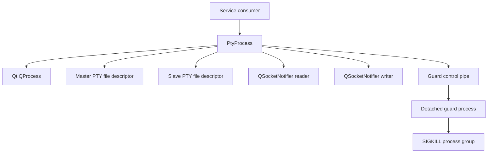
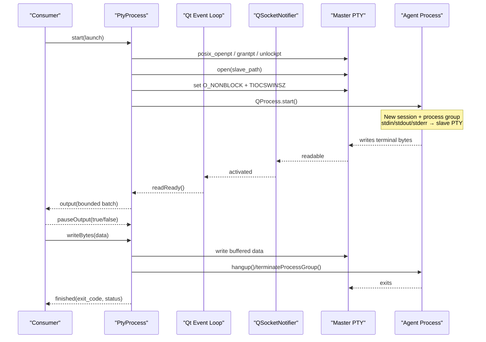
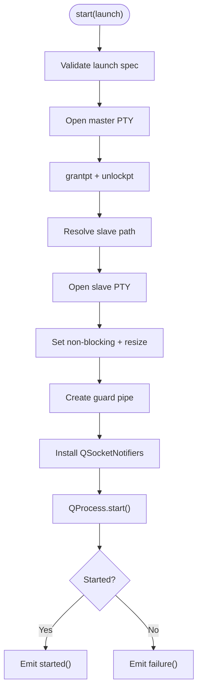
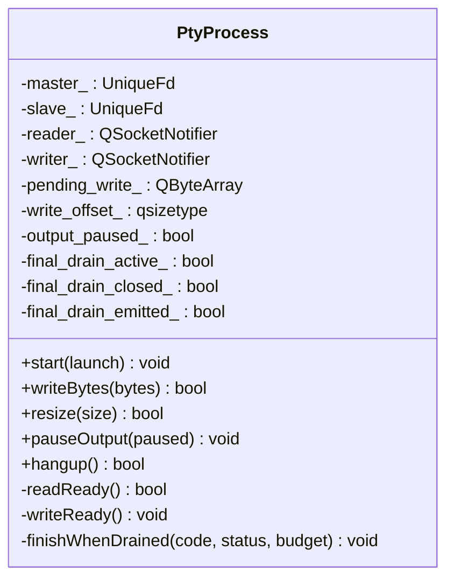
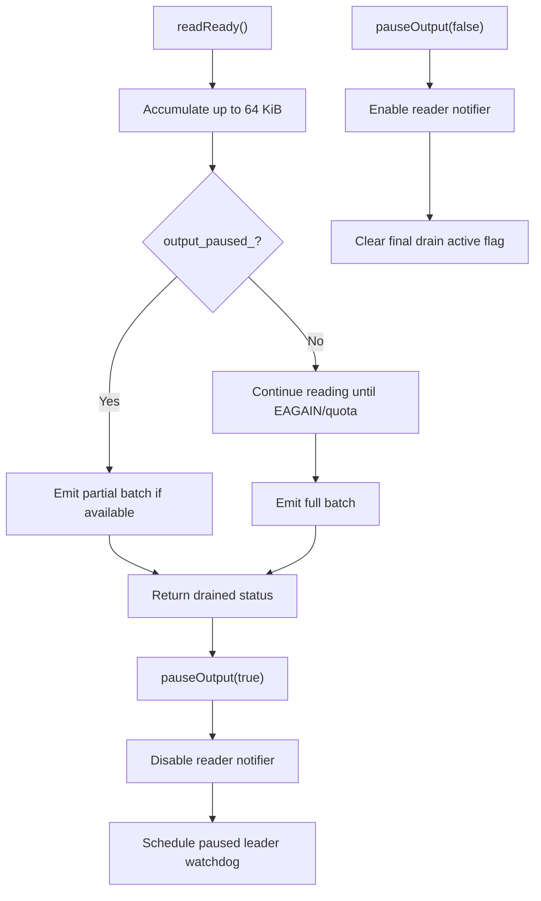
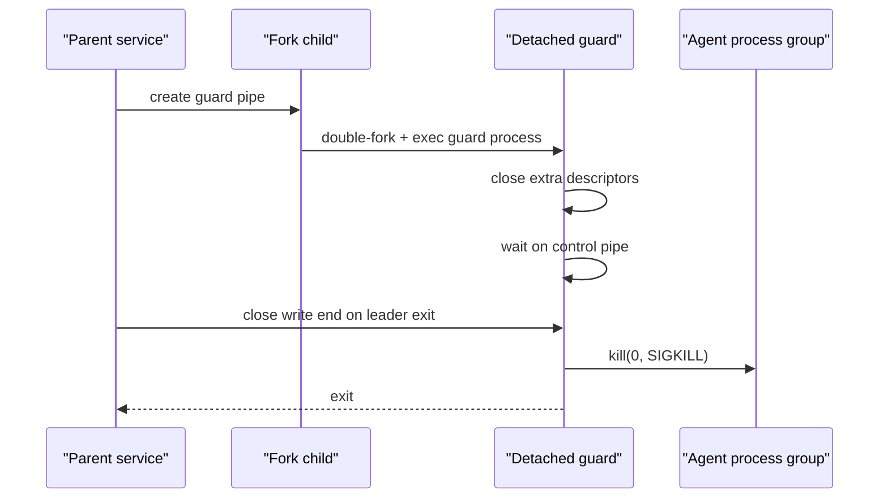
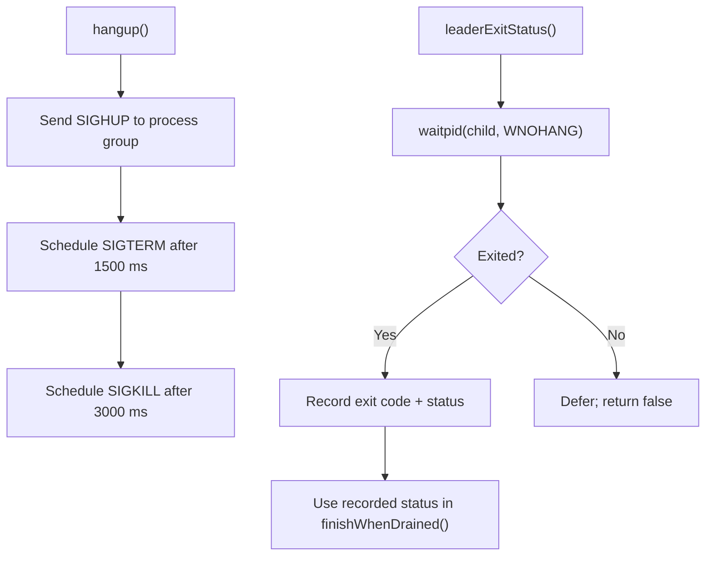
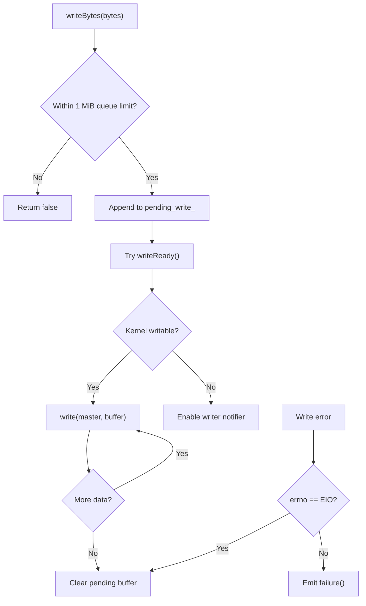
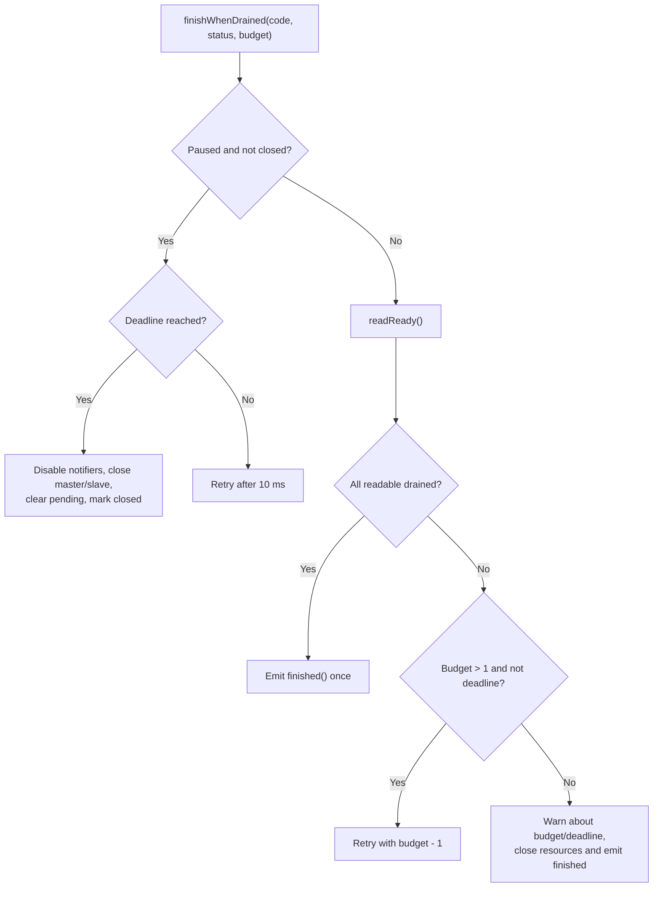
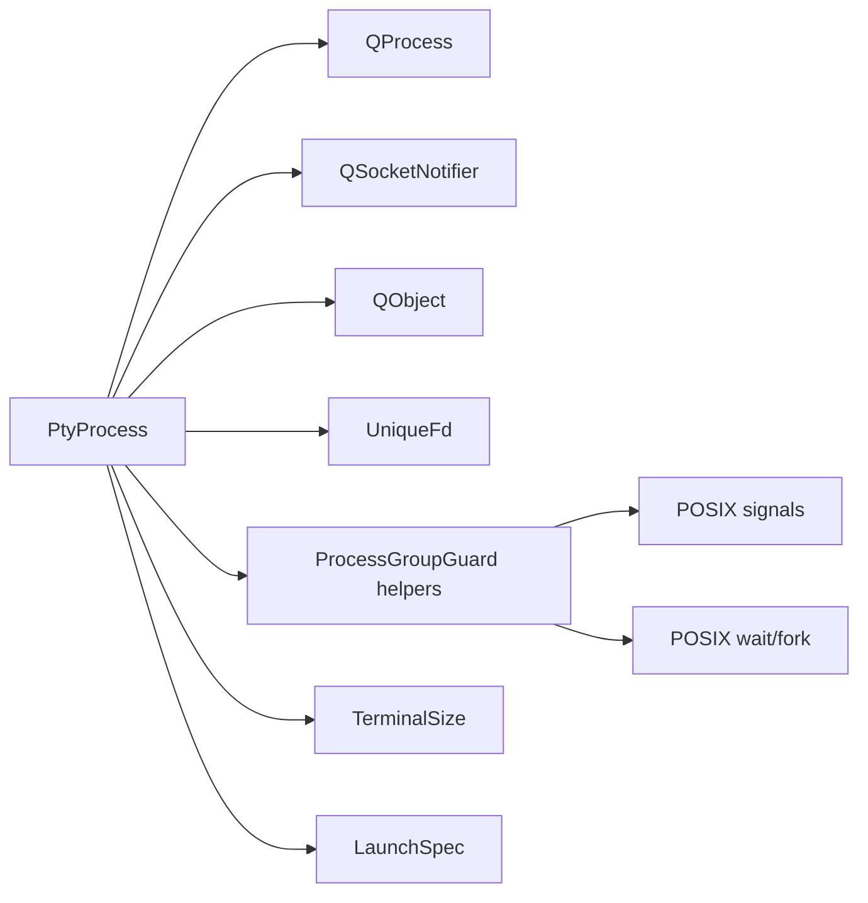

# PTY Process Management

<cite>
**Referenced Files in This Document**
- [pty_process.hpp](file://services/session/src/platform/posix/pty_process.hpp)
- [pty_process.cpp](file://services/session/src/platform/posix/pty_process.cpp)
- [process_group_guard.hpp](file://services/session/src/platform/posix/process_group_guard.hpp)
- [process_group_guard.cpp](file://services/session/src/platform/posix/process_group_guard.cpp)
- [pty_process_test.cpp](file://services/session/tests/pty_process_test.cpp)
</cite>

## Table of Contents
1. [Introduction](#introduction)
2. [Project Structure](#project-structure)
3. [Core Components](#core-components)
4. [Architecture Overview](#architecture-overview)
5. [Detailed Component Analysis](#detailed-component-analysis)
6. [Dependency Analysis](#dependency-analysis)
7. [Performance Considerations](#performance-considerations)
8. [Troubleshooting Guide](#troubleshooting-guide)
9. [Conclusion](#conclusion)

## Introduction
This document explains the POSIX PTY process management subsystem used by the service to launch, monitor, and terminate agent processes inside isolated pseudo-terminals. The implementation centers on `PtyProcess`, which owns a master/slave PTY pair, integrates with Qt’s event loop through `QSocketNotifier` for non-blocking I/O, and enforces bounded output processing to prevent memory pressure. It also documents the `ProcessGroupGuard` isolation pattern that ensures child process groups are terminated when sessions end, as well as signal handling, leader exit detection, error recovery, write buffering, and the final drain protocol.

## Project Structure
The PTY subsystem lives under the POSIX backend of the session service:

**Diagram sources**
- [pty_process.hpp:15-74](file://services/session/src/platform/posix/pty_process.hpp#L15-L74)
- [pty_process.cpp:40-198](file://services/session/src/platform/posix/pty_process.cpp#L40-L198)
- [process_group_guard.hpp:1-34](file://services/session/src/platform/posix/process_group_guard.hpp#L1-L34)
- [process_group_guard.cpp:1-97](file://services/session/src/platform/posix/process_group_guard.cpp#L1-L97)

**Section sources**
- [pty_process.hpp:1-75](file://services/session/src/platform/posix/pty_process.hpp#L1-L75)
- [pty_process.cpp:1-431](file://services/session/src/platform/posix/pty_process.cpp#L1-L431)
- [process_group_guard.hpp:1-34](file://services/session/src/platform/posix/process_group_guard.hpp#L1-L34)
- [process_group_guard.cpp:1-97](file://services/session/src/platform/posix/process_group_guard.cpp#L1-L97)

## Core Components
- **`PtyProcess`**: A Qt `QObject` owned by the service event loop that manages a PTY pair, launches an agent process, routes non-blocking I/O, exposes admission-bounded output events, and coordinates lifecycle termination.
- **`QProcess`**: The Qt wrapper around process creation, environment configuration, and child reaping.
- **`QSocketNotifier`**: Non-blocking readiness notification for reading from and writing to the master PTY.
- **`ProcessGroupGuard` helpers**: Pipe-based isolation utilities that spawn a detached guard process to terminate the entire process group when its control handle is closed or explicitly signaled.
- **Test harness**: Validates argument passing, burst output, resize behavior, cleanup, signal propagation, failed restarts, descendant drain bounds, and paused-drain behavior.

**Section sources**
- [pty_process.hpp:15-74](file://services/session/src/platform/posix/pty_process.hpp#L15-L74)
- [pty_process.cpp:40-198](file://services/session/src/platform/posix/pty_process.cpp#L40-L198)
- [process_group_guard.hpp:1-34](file://services/session/src/platform/posix/process_group_guard.hpp#L1-L34)
- [pty_process_test.cpp:1-200](file://services/session/tests/pty_process_test.cpp#L1-L200)

## Architecture Overview
`PtyProcess` constructs a new PTY, resolves its slave path, opens both ends, configures non-blocking mode, installs Qt notifier callbacks, sets up environment variables, and launches the agent through `QProcess`. The child process modifier creates a new session and process group, binds standard streams to the slave, and starts the guard. The parent keeps only the guard’s control write end; closing it terminates the guarded group. Output flows from the master PTY into a bounded batch before being emitted to consumers; input is queued in a write buffer and drained when the master becomes writable.

**Diagram sources**
- [pty_process.cpp:62-198](file://services/session/src/platform/posix/pty_process.cpp#L62-L198)
- [pty_process.cpp:246-339](file://services/session/src/platform/posix/pty_process.cpp#L246-L339)
- [pty_process.cpp:340-431](file://services/session/src/platform/posix/pty_process.cpp#L340-L431)

## Detailed Component Analysis

### PTY Pair Creation and Lifecycle
`PtyProcess::start` performs the following:
- Validates the launch specification.
- Creates a master PTY via `posix_openpt`, then grants and unlocks access.
- Resolves the slave path using platform-specific helpers (`TIOCPTYGNAME` on macOS, `ptsname_r` otherwise).
- Opens the slave path and applies non-blocking flags to the master.
- Applies the requested terminal size through `TIOCSWINSZ`.
- Creates a guard pipe and installs `QSocketNotifier`s for read/write.
- Configures `TERM` and `COLORTERM`, working directory, program, and arguments.
- Uses `QProcess::UnixProcessParameters` and a child process modifier to:
  - Create a new session with `setsid`.
  - Start the process-group guard.
  - Set the slave as controlling terminal.
  - Duplicate the slave onto standard descriptors.
  - Close inherited PTY handles.

On failure at any stage, the implementation emits a descriptive `failure` signal and resets internal state.

**Diagram sources**
- [pty_process.cpp:62-198](file://services/session/src/platform/posix/pty_process.cpp#L62-L198)

**Section sources**
- [pty_process.cpp:62-198](file://services/session/src/platform/posix/pty_process.cpp#L62-L198)

### Non-Blocking I/O Through Qt Notifiers
Read and write paths are integrated with `QSocketNotifier`:
- The reader is enabled after successful process startup unless output is paused or the leader has already exited.
- `readReady` accumulates bytes up to `max_read_batch` (64 KiB), emitting one batch per call.
- `writeReady` drains `pending_write_` incrementally, enabling the writer notifier only when the kernel reports `EAGAIN`/`EWOULDBLOCK`.
- Both notifiers are disabled during shutdown and final drain phases.

**Diagram sources**
- [pty_process.hpp:15-74](file://services/session/src/platform/posix/pty_process.hpp#L15-L74)
- [pty_process.cpp:246-339](file://services/session/src/platform/posix/pty_process.cpp#L246-L339)

**Section sources**
- [pty_process.hpp:15-74](file://services/session/src/platform/posix/pty_process.hpp#L15-L74)
- [pty_process.cpp:246-339](file://services/session/src/platform/posix/pty_process.cpp#L246-L339)

### Admission Control and Pause/Resume Output Flow
The subsystem uses a two-tier admission strategy:

1. **Batch-bound output**: Each emitted `output` event is capped at 64 KiB. Consumers receive batches and may synchronously pause output to bound retained service-side memory.
2. **Pause/resume signaling**: `pauseOutput(true)` disables the reader and schedules a watchdog if the leader has not yet exited. `pauseOutput(false)` re-enables the reader and clears the final-drain deadline flag so resuming does not restart a stuck-drain timer.

**Diagram sources**
- [pty_process.cpp:246-339](file://services/session/src/platform/posix/pty_process.cpp#L246-L339)

**Section sources**
- [pty_process.hpp:31-33](file://services/session/src/platform/posix/pty_process.hpp#L31-L33)
- [pty_process.cpp:246-339](file://services/session/src/platform/posix/pty_process.cpp#L246-L339)

### Process Group Isolation With ProcessGroupGuard
The guard mechanism isolates child processes:
- The parent opens a CLOEXEC pipe and passes both ends to the child process modifier.
- In the fork child, `start_group_guard` blocks signals, double-forks, and spawns a detached guard process that closes all other file descriptors except the retained pipe ends.
- The guard waits indefinitely on the control pipe; when EOF arrives (parent closes the write end), it sends `SIGKILL` to process group 0 and exits.
- Completion pipes can be used to observe guard teardown when needed.

**Diagram sources**
- [process_group_guard.cpp:1-97](file://services/session/src/platform/posix/process_group_guard.cpp#L1-L97)
- [process_group_guard.hpp:1-34](file://services/session/src/platform/posix/process_group_guard.hpp#L1-L34)
- [pty_process.cpp:133-198](file://services/session/src/platform/posix/pty_process.cpp#L133-L198)

**Section sources**
- [process_group_guard.hpp:1-34](file://services/session/src/platform/posix/process_group_guard.hpp#L1-L34)
- [process_group_guard.cpp:1-97](file://services/session/src/platform/posix/process_group_guard.cpp#L1-L97)
- [pty_process.cpp:133-198](file://services/session/src/platform/posix/pty_process.cpp#L133-L198)

### Signal Handling, Graceful Termination, and Leader Exit Detection
Graceful shutdown follows a staged cascade:
- `hangup()` sends `SIGHUP` to the owned process group immediately.
- If the process remains alive, `SIGTERM` is sent after 1500 ms, followed by `SIGKILL` after 3000 ms.
- Before escalation, ownership is verified by checking that the child PID belongs to a session equal to its PID.
- Leader exit detection combines `QProcess::finished` with independent `waitpid` polling:
  - When paused, a short-lived watchdog polls every 20 ms until the leader exits.
  - On detected exit, the recorded exit code and crash/signal status are stored and used to emit `finished`.
  - Reaped PIDs are never reused for signaling; the live `QProcess::processId()` is consulted each time.

**Diagram sources**
- [pty_process.cpp:201-245](file://services/session/src/platform/posix/pty_process.cpp#L201-L245)
- [pty_process.cpp:340-431](file://services/session/src/platform/posix/pty_process.cpp#L340-L431)

**Section sources**
- [pty_process.cpp:201-245](file://services/session/src/platform/posix/pty_process.cpp#L201-L245)
- [pty_process.cpp:340-431](file://services/session/src/platform/posix/pty_process.cpp#L340-L431)

### Error Recovery and Write Buffer Management
Write errors and backpressure are handled as follows:
- `writeBytes` rejects oversized bursts beyond a 1 MiB queue limit relative to pending bytes.
- Pending writes are appended to `pending_write_`; on subsequent calls, previously written offsets are cleared to avoid unbounded growth.
- `writeReady` drains the buffer incrementally; it enables the writer notifier only when blocking occurs.
- On `EIO`, pending output is cleared because the underlying PTY is likely broken.
- Other write failures emit a descriptive error signal.
- Process-level startup errors disable readers/writers, clear pending writes, reset guards, and emit `failure`.

**Diagram sources**
- [pty_process.cpp:199-245](file://services/session/src/platform/posix/pty_process.cpp#L199-L245)

**Section sources**
- [pty_process.cpp:133-198](file://services/session/src/platform/posix/pty_process.cpp#L133-L198)
- [pty_process.cpp:199-245](file://services/session/src/platform/posix/pty_process.cpp#L199-L245)

### Final Drain Protocol
After the agent process finishes, `finishWhenDrained` guarantees pending output is flushed while protecting against hung sinks:
- It repeatedly attempts to drain remaining readable data using `readReady`.
- Two independent limits protect against wedges:
  - A decreasing `drain_budget` bounds sustained producer activity.
  - A 3-second wall-clock deadline bounds paused or slow sinks.
- If the sink remains paused past the deadline, the master/slave descriptors are closed, pending writes are cleared, and the guard control is released.
- Once drained or forced-closed, the `finished` signal is emitted exactly once.

**Diagram sources**
- [pty_process.cpp:340-431](file://services/session/src/platform/posix/pty_process.cpp#L340-L431)

**Section sources**
- [pty_process.cpp:340-431](file://services/session/src/platform/posix/pty_process.cpp#L340-L431)

## Dependency Analysis
`PtyProcess` depends on Qt components for process lifecycle and event-driven I/O, while relying on POSIX primitives for PTY setup and process group isolation. The guard helper is intentionally async-signal-safe and called only in the child context.

**Diagram sources**
- [pty_process.hpp:1-75](file://services/session/src/platform/posix/pty_process.hpp#L1-L75)
- [pty_process.cpp:1-431](file://services/session/src/platform/posix/pty_process.cpp#L1-L431)
- [process_group_guard.hpp:1-34](file://services/session/src/platform/posix/process_group_guard.hpp#L1-L34)

**Section sources**
- [pty_process.hpp:1-75](file://services/session/src/platform/posix/pty_process.hpp#L1-L75)
- [pty_process.cpp:1-431](file://services/session/src/platform/posix/pty_process.cpp#L1-L431)
- [process_group_guard.hpp:1-34](file://services/session/src/platform/posix/process_group_guard.hpp#L1-L34)

## Performance Considerations
- **Bounded read batches**: Each `output` event is limited to 64 KiB, preventing large spikes from flooding consumer buffers.
- **Queue limit**: The write buffer is limited to approximately 1 MiB, rejecting inputs that would exceed the budget.
- **Non-blocking I/O**: `QSocketNotifier` avoids busy loops and reduces CPU usage by reacting to kernel readiness.
- **Final-drain deadlines**: A 3-second deadline prevents long-lived sinks from blocking teardown.
- **Admission-aware pause/resume**: Consumers can pause output to apply backpressure without restarting stuck-drain timers unintentionally.

[No sources needed since this section provides general guidance]

## Troubleshooting Guide
Common symptoms and their likely causes:

| Symptom | Likely Cause | Recommended Action |
|---|---|---|
| No output after startup | Reader disabled due to pause or final drain | Verify `pauseOutput(false)` was called and check whether the leader has exited |
| Intermittent missing output | Consumer paused too long, causing forced drain closure | Reduce pause duration or increase consumer throughput; inspect warnings about paused sinks |
| Process still running after destruction | Guard or QProcess cleanup did not complete | Inspect destructor fallback logic and ensure no external handles retain the process group |
| Failed start but stale input appears | Input queued before successful restart | Confirm failed-start cleanup clears pending writes; tests assert this behavior |
| Large output stream stalls teardown | Final drain exceeded budget or deadline | Expect warning logs and forced terminal closure; investigate producer behavior |
| Wrong arguments or working directory | Launch validation or shell aliasing issues | Use tests as reference for literal argument and cwd preservation |

**Section sources**
- [pty_process.cpp:40-198](file://services/session/src/platform/posix/pty_process.cpp#L40-L198)
- [pty_process.cpp:246-431](file://services/session/src/platform/posix/pty_process.cpp#L246-L431)
- [pty_process_test.cpp:1-200](file://services/session/tests/pty_process_test.cpp#L1-L200)

## Conclusion
The PTY process management subsystem implements a robust, event-driven pipeline for launching agent processes in isolated pseudo-terminals. Its design emphasizes safety and predictability: process groups are isolated via a detached guard, output is admitted in bounded batches, pause/resume semantics protect sinks from indefinite suspension, and graceful termination cascades through `SIGHUP`, `SIGTERM`, and `SIGKILL`. The final drain protocol ensures pending output is flushed while guarding against hung consumers and stalled producers. Together, these mechanisms provide reliable lifecycle management suitable for multi-session agent orchestration.

[No sources needed since this section summarizes without analyzing specific files]